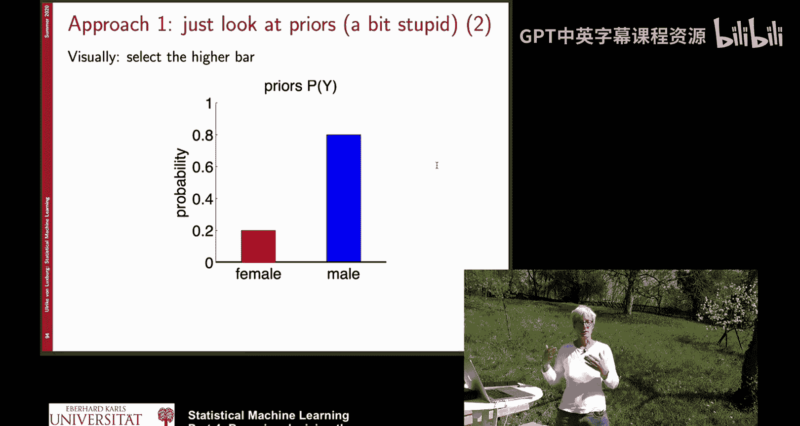
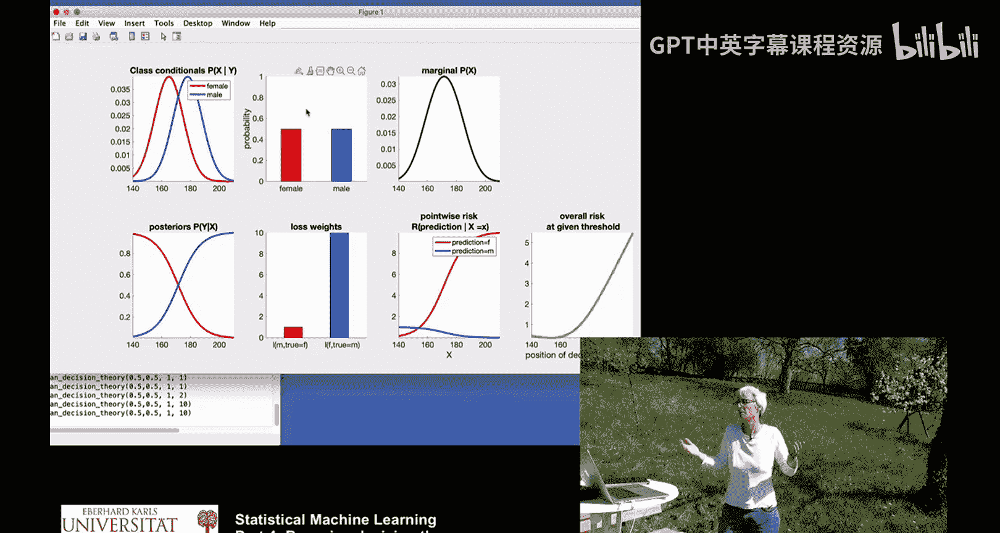
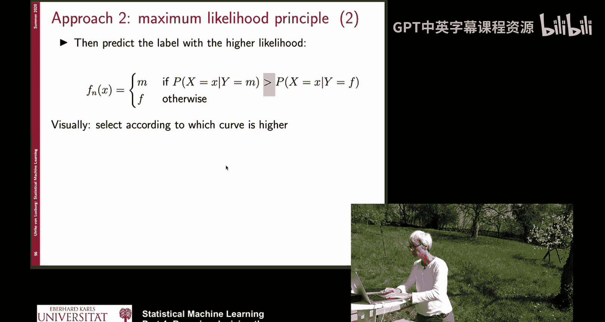
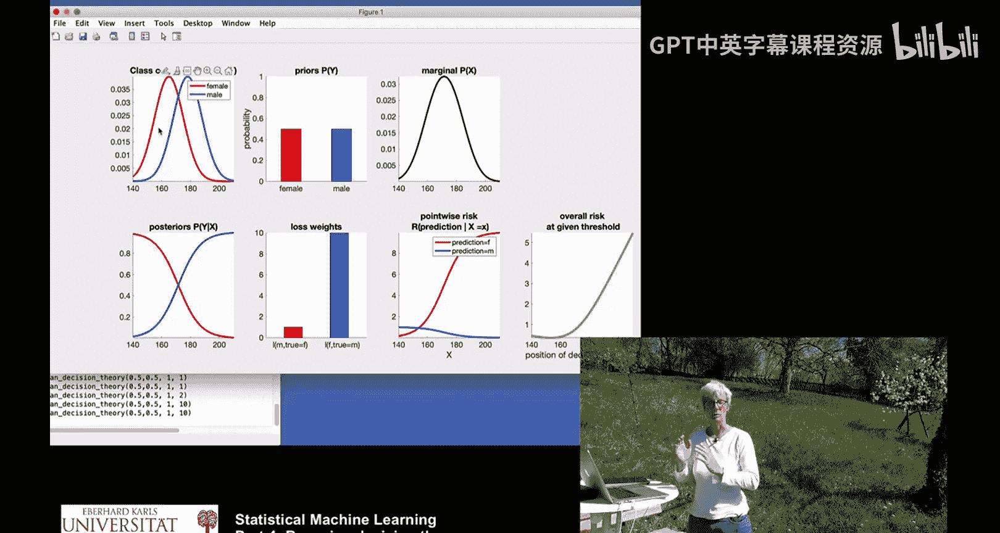
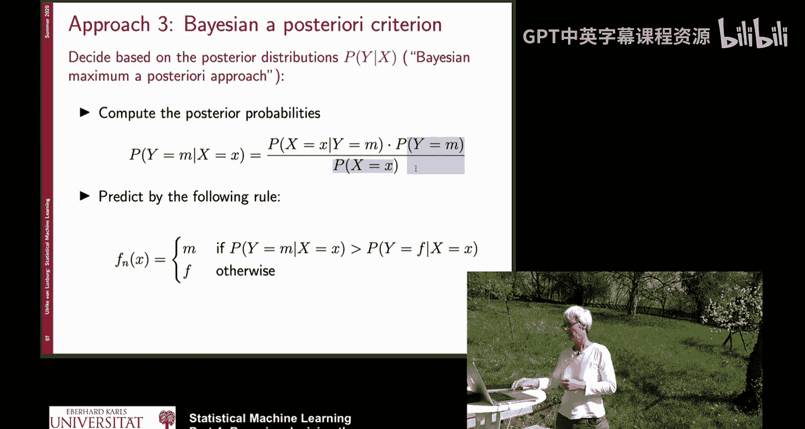
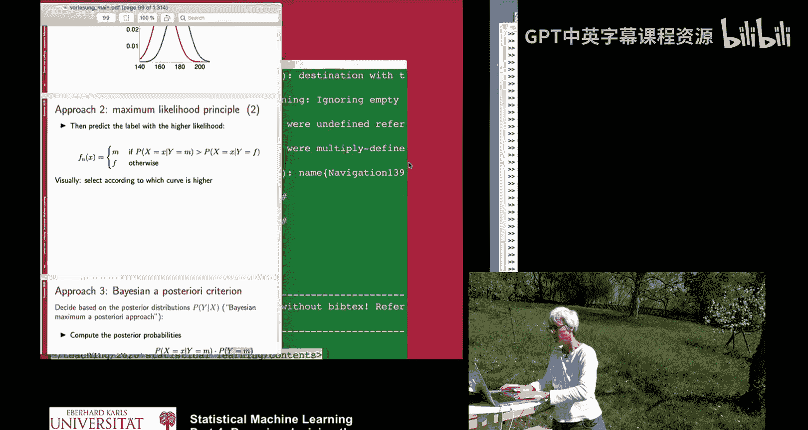
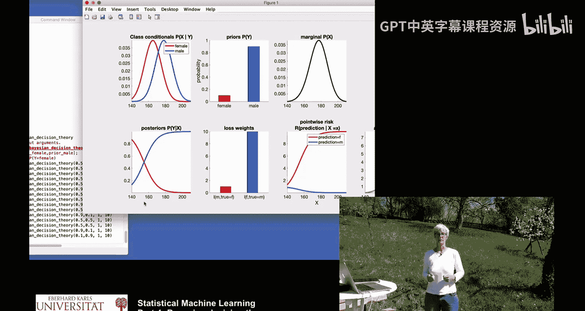
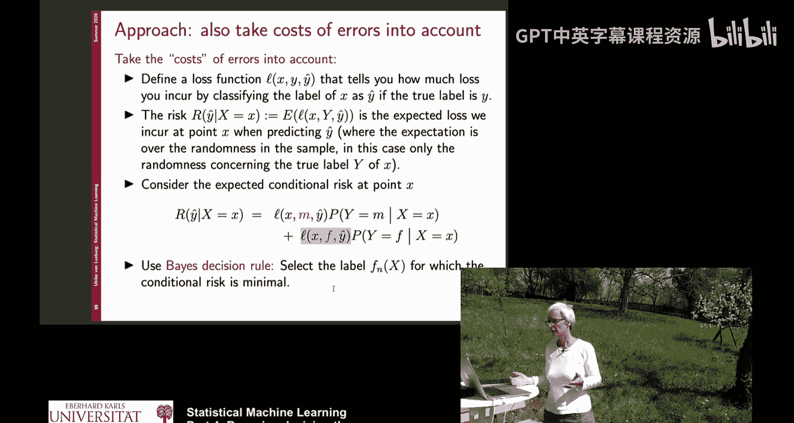
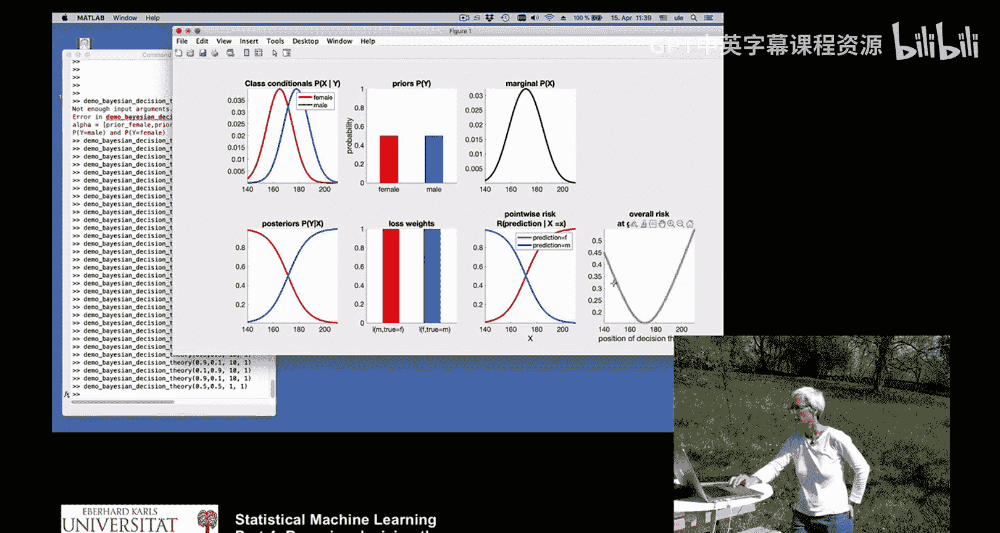

# 图宾根大学《概率和统计机器学习｜Tubingen Probabilistic and Statistical Machine Learning 2020》中英 p05 -05-Part 4 - Bayesian decision theory.zh_en -BV1gso5YGE4s_p5-

In our last lecture we have seen the formal setup of supervised machine learning problems。

 we have seen what the risk of a classifier is a true risk。

 we have looked at what is the base classifier and we have also defined what consistency means for a classification problem or for a classification algorithm。

😊，The next thing we want to look at is called statistical and patient decision theory。

the question we want to ask here is。😊，Again， we want to step back a bit from machine learning。

 We do not yet want to consider what happens if we only have a few data points and we need to reconstruct all this information from few data points。

 We want to say， assume we had all knowledge of the world。

 We know all the underlying probability distributions。

 What would then be the best classifier that we want to find like what what is it in which way do we want to decide what is the classification rule that we want to have。

And the running example that I want to have in this lecture。😊。

Is the following we assume we have we have a room full of people we can for each person。

 we can measure the height of this person， so I don't know， I'm 1 meter 68 or so。

And now this is the only measurement that we can take the height of a person and we want to predict whether the person is female or male。

 so given the height of a person，😊，We want to predict the gender of this person。And again。

 I would like to ask you to take a minute to think about how you would solve this problem。

 So someone comes to you and says， given the height of a person， predict。

Whether this person has been male or female。Please think about what would be your solution to this problem and please switch off the video and try to come up with a solution now。

Let's maybe make it a bit more concrete。Assume we know what we want to assume in this setting is that we know the input distribution。

 sorry。🤧。The running example that I want to have in this lecture is we want to predict given the height of a person。

 the gender of this person So we know like we measure for a person， the person is 1 meter 80。

 Do you think this person is male or female。This is the machine learning program that we want to look at。

And we want to look at this machine learning problem under the assumption that we know the underlying probability distributions。

😊，So for example， we know the class conditional distributions。😊。

I have a plot here of the class conditional distribution。

 so remember the class conditional distributions is the probability of x given y。

 so y is the class we condition on the class so assume that the class is female is what is the distribution of the x values in this case the height of a person。

😊，For the female population。And I plot it here too， I mean， this is sort of an ideal case。

 So we assume that that the height of people is normally distributed。It looks roughly like this。

 so we have the female population which is the red curve and the male population which is the blue curve and we see the two curves are slightly shifted so like the mode of the distribution the highest point of the distribution for females is maybe at 1 meter 60 in this case and the height for the male persons is as 1 meter 80。

😊，Now I would like to ask you to think about how you would solve this problem so as you I tell you the input of a certain I mean you get to see these probability distributions and then the question is if I tell you a certain person is 1 meter 60。

😊，Would you think this person is male or female。And think about what your answer would be and in particular think about why you would come up with your answer。

 what would be the algorithm behind your reasoning。😊，Please take a switch of the video。

 take a minute and think about it。I would now like to take you through a number of different approaches。

 all of which seem more or less plausible but lead to different results。😊，The very first approach。

 the really naive approach。Would be to just look at the prior distribution of the two labels。

 so it might be that because we are in a lecture of computer science and 90% of the people in this room are male。

That you don't even need to look at the recorded height of the person。 you would just say， well。

 everybody here is male， I would simply predict male。And if you make this formal。

 this means to predict according to the prior probability of your class distributions。

So what you do is your rule of n of x。😊，Predicts that the label of the person should be male。😊。

If the probability for being male in your underlying population is larger than the probability of being female in your underlying population。

😊，And if it's the other way around， you predict female So you just check in my population do we have more male or more female people。

 and this is what you predict。 you don't even look at the measurement X。😊。

The sound is stupid and typically is not what you would like to have but think about there might be situations where this is maybe not the most stupid thing to do at least if you're looking for the accuracy of your classifier so in spam detection like 99% of all the emails that get sent us spam emails and so if you predict for a random email that arrives that it's a spam email and with 99% probability this is already going to be correct。

😊，Now the point is for spam detection， this is not really what we want to have because we're interested in this other 1% of the emails。

 but still there might be cases where predicting the majority label is not the worst of all things to do。

😊，Visually， this means that if we check the probability。

 if you simply plot the male and female probability into a bar plot。

 we select according to the higher bar。😊，And this is maybe the point where I would like to introduce a MALap demo that I've written and that shows all these different concepts。

😊。

Let me just see。嗯嗯。So this is a demo that we are going to see for the rest of this lecture a number of times。

😊，It has many， many different windows but for now simply look at the first row so the first plot here is always the class conditional distribution this is the one that we have already seen it is not going to change in the course of this lecture we always assume like if we know people are female then the distribution of the highest this red line and for male people the distribution is this blue line。

😊，What we are going to change in the course of this lecture is the prior distribution here in this example I have an example where we have the same number of male or female people in the room。

😊，And so the prior distribution of male and female is the same。

 we cannot really say one population is higher than the other。

What you see on the right hand side is then the marginal distribution of x if you omit the conditions on male or female so this is essentially the sum of red fraction of population times the red density plus blue fraction of population times the blue density。

 this is what gives you the marginal distribution of x。😊。

So if you look at the whole population and just measure what is the height of the persons in your whole population without looking at the gender of the person。

 then this is the distribution that you would get。😊。

and the naive first thing that we have just said is we classify according to the virus in this particular plot。

 whichever bar is larger， this is what we are going to do。😊，In this particular example。

 if we have the same number of male and female people in the population。

 we wouldn't even know what to do， but okay， maybe then this would really be a stupid approach。

Okay。嗯。Now， the second approach。😊，Already makes a bit more sense。

 And this is what the statisticians would call the maximum likelihood approach。

The idea is simply we look at these class conditional distributions。

 This is the first plot that we've seen in the left corner of this Matla demo。😊。

And we simply take the distribution that seems more likely for the given input。

 so I said we want to know if a person is 1 meter 60， is it going to be a male or a female person？😊。

Now， if you look at this class conditional distribution。😊，You would say， well。

 it is much more likely that the person is female than that the person is male and this is why I want to predict that the person is female if the person is 1 meter 60 high。

And this is called a maximum likelihood principle， and formerly the rule works as follows。😊。

We check whether the probability。😊，For the given measurement that we have 1 m 60。

we check this probability if under the condition that the person is male。

And under the condition that the person is female， and then we compare。

And we take the one for which the agenda for which this gives us the higher value。

So observe if you have seen statistics before， this is sort of it feels like the wrong way around。

 we say assume we know the person has been female， what is the probability that we get this measurement of 1 meter 60？

😊，And the same for mail， and then we decide。In many cases。

 you would like to do it the other around because we want to say what is the probability that a person is male。

 given that we have met the person is 1 m 60， and this is going to be the next thing。

But let's fix this one first。 So this is the maximum likelihood principle。

 and I would like to go back to this matla demo here。

 Okay here we see this is essentially we just look for for this plot。

 we completely ignore all the prior distributions and we just check visually which of the two curves is higher for this particular input and this is then what we are going to predict。

😊。

O。Now comes the third approach， which is the Bayesian approach， the Bayesian a posterior crition。

And this does what I just mentioned。 It looks at the probability the right way。So essentially。

 what we now want to say is we want to， maybe Ill get lets go down to this formula first。

 we want to know。Given that， we measure that a person is 1 m 60。

Is it more likely that the person is male？Or is it more likely that the person is female。

 And then this is the criterion we used to decide。 So is given someone is 1 m 60。

 is the probability higher that the person is male or that the probability is female。

Now to be able to compute this quantity， we need to。

 first of all compute these posterior probabilities。And I guess all of you know base formula。

 and if you don't know it， it's time to look it up again。

There is this standard based formula that helps you to turn around the arguments in a probability in conditional probability distribution。

So the probability that a person is mainly given the person is 1 m 60 higher。

Youho can express it as the probability of being 1 meter 60 times under condition that the person is male。

Times the prior probability that the person is male。

 divided by the prior probability that the person is 1 m 60 high。 This is the standard based formula。

 You need to know that if you don't know it， learn it。 it is important。

嗯。I would now again like to show this for in the Matlap demo。

 because now something interesting could happen。

So what I here is what I have plotted here here in the bottom left hand corner。

 I plotted the the posterior distributions。 So the red and blue line is now the posterior distribution。

 assume someone is。The probability that a person is female for the red curve。

 given that she or she has a certain height and the same for male。

So now if the criteria would be for someone who is 1 meter 60。

 we check which of these two curves is higher。😊，And this is what we would use to predict。

Now in this particular setup， as we have it in this window that is currently open here。

 it doesn't seem to make a difference， whether you check whether the class conditional distribution is higher for red or blue or whether the posterior is higher for red or blue doesn't really seem to make any difference。

😊，And maybe think about for a minute。Where this when what what would what would we need to change to make a difference here。

I'm going to show you the answer， so the answer is going to be this prior probability distributions。

😊，If the prior distribution is uniform， we have the same weight for， male and female。

 then the maximum likelihood approach andtation poster approach give you the same results。

 This changes immediately if we change the prior。 So let me now bring up a new window where I change the prior。

 So say。like this。I know I will。 So now we have a room full of females and a couple of males。

 so the prior distribution in our population is 90% of the population consists of females。😊。

And only 10% of the population consists of males。And now what you can observe is this point where the red and the blue line crosses has been moved to the right。

😊，And maybe I just show it again。 So this is the or maybe how can I do that， I just bring the window。

Even more to hear。So this is if we have the same white weight。And this is if the weight changes。

 I just flip a couple of times。So you can see it， so please look at the window at the bottom of the in the bottom row。

 the first window。😊，This is for the same weight of male and female persons。

 and this is for the case where we have more females than males。

And now let's think about whether this makes sense。

So if we have the same number of male and female people in our population。

 the crossing point here is roughly at 1 m 70 so it would be at 1 meter 70 you would have the same number of males and females and you would say well I don't really know what to predict if someone is less than1 meter 70 you would predict female if it's more than1 me 70 you would predict male。

😊，This is if we have the same number of people in the room。

 but now assume the whole room is full of females and there are just three males there and you find someone who' is 1 m 70。

😊，Now you would probably say， well，1 m 70， if there would be the same number of people。

 I wouldn't really know whether the person is male or female。

But now this whole room is full of females， so it's really much more likely that the person with 1 m 70 is a female person than a male person。

😊，And this is why in this figure here in the screen， the crossing point。

 the intersection point of these two lines has been moved to 1 meter 90 I would estimate here so only when someone is1 met 90 in this room full of females you would start to doubt and you would say well if there is a person who's2 meter this room is full of females but I've very rarely seen a female who's2 mere large so probably it's still going to be a male。

😊，And this point here where these two lines intersect that shows you what is sort of where this decision slips from。

 from male to female。And again， maybe for just for the fun of it， thats。

Have a population which is the other way around。 So we have only。

Most of the population consists of male persons and only few female persons are in the room。

 then this intersection points moves much more to the left hand side and you would say I mean maybe the crossing point is now with1 meter 55 or so you would say。

 well if a person is1 meter of 40 even though there are only a few females in the rooms it's maybe a female。

 but for everybody who's larger than 1 meter 55 I would predict male because there are so many males in the room。

And this is now the difference between the Bayesian approach and the maximum likelihood approach。

 the maximum likelihood approach ignores the base rate。

 this prior probability of the labels that you have in your population。😊。

The next thing we would like to take into account is the loss function。

We have seen that in machine learning， we typically define a loss function that tells us us how much we want to punish certain types of errors of our algorithm。

And of course， if we know this loss function and we should design the algorithm and that such that it can take into account the loss function and maybe can focus on the parts of the space where where losses would be particularly costly。

So how does this work formally。We define a loss function L of x Y Y hat access the input data。

 say the height of the person， y is the true label and Y hat is the predicted label。

And how we define， we consider the conditional risk。So， assume。We。No。

 we want to predict the outcome at point x。 So we've measured 1 m 60 and we want to。

Construct a classifier for someone who is 1 m 60。And now we want to compute the risk under the condition that someone is 1 meter 60。

So this is the expected loss。😊，Of the predicted value and the input value。

 y the true label of the person if the person is 1 meter 60。So it's a bit tricky here。

 So capital y is the random quantity over which we take the expectation。

 This is the true label of the person and y hat is the deterministic label we that we predict。

Upon seeing that atministic label more lowercase X。

And now we consider the expected conditional risk at this point at lowercase x。

 So the risk of this prediction Y hat， given that the input is lowercase x or 1 m 60。

Is now is composed of two terms， the one of the male population and the one of the female population。

 So it is under the， like it is。嗯。Maybe start with this tower here。Given what someone is 1 me 60。

 what is the probability that is the true label of this person is male？

Times the loss we would make for prediction Why hat if the label is male。

And then the same for females， so under the condition that someone is 1 meter 60 high。😊。

What is the probability that this person is female and then what is this loss that we would occur if you predicted why hat and the person would be female？

And this expected conditional risk is now what we want to use to predict。

So the base in decision rule is to select the label for which this conditional risk is minimal。

Let's again look at this in our MALap implementation。

And I get go maybe again， first of all， back to the symmetric case。

 where we have the same prior distributions。 So again， here's our window。

 the conditional distributions as before the class prior are now equal， the posteriors are。

Are also now in the weighted case where we have uniform distributions are the same。

 and now him I want to。I want to show you this particular plot here so this is now the bar plot that shows you what the loss is so we have two cases either someone is female but we predict male or someone is male and we predict female and I want to give different weights to these particular losses。

😊，So here I have written the loss of male if the true label is female。

 so the color indicates the true label of the person so if truly a person is female but we say this person is male we incur a certain loss and in this particular case the loss is one and the other way around in this particular case as well。

😊，Now what we see here in the next plot is the point wise riskis。

 the blue curve and the red curve for these kind of predictions。

And this is the curves that we are going to use if we predict based on the spatial decision criterion on the one that we've just been discussing where we look at the conditional risk。

And to see what is going to happen， I would again like to change something so now。

Let's look at the case， where。The losses are not really the same。

 so here now if someone is female but we predict male we don't really incur a big loss。

 but if someone is male， the2 label is male but we predict female we incur a really big loss。

Now I am going to flip between this situation and the symmetric situation where the loss was the same in both cases and please observe this kind of plot the third plot in the bottom row I am simply going to flip between a number of situations。

😊，So this is the case where we have the same loss。And this is the case with a different loss。

 And again， look at how the plot slip。You can see that this blue curve is going to change。

And that this intersection point here moves more towards the left。And now this makes sense。

 So the question is。So what we plot here is the risk。And now if the majority of the pop。

 like if they loss， if it's much worse， if you predict that someone so。😊，TheThe loss is very bad。

 If someone is male， but we predict female。So the likelihood that when we predict female that we make a loss is in principle higher than if if we predict male。

 so the risk here increases when we predict females and it increases more than for the males。😊。

Whereas if we have the other way way around， let's see。 Maybe I do it。

The other extreme case now we have the case where if someone is female and we predict male。

 we do not make any loss or we sorry if someone is female and we predict male。

 we incur a big loss if someone is male。😊，And we predict female we do not incur such a big loss。

And now if you look at the point， why risk？😊，Predicting。That someone is male。

Has a much higher risk because here we can here we can do here we incur a big cost。

 whereas if we predict male， we do not incur such a big cost。😊。

So this is now if we have the same population in the same male and female population。😊，Now。

 this also is going to interact with the population。 And this is now when it gets really complicated。

 So let's maybe look at this。 So now。I change also the prior distribution here of the two populations。

So what we have now is we have a much higher population that is female and few people that are male and for the females。

 if we predict that they are males we incur really a big loss。😊，So essentially。

 this means that the risk for predicting male is much， much。

 much larger than the risk for predicting female。😊，And only when someone is， I don't know。

2 meter 20 or whatever this is here， we would dare to say that someone is male。

And for everybody else who is below 2 me at 20， we would say female because we have so many females in the room and if we get the females wrong。

 the error is so high that we simply cannot afford this。😊。

Now let's maybe play the other way around if we have the population is the other way around。😊。

Now we have few females in the room， many males in the room。😊。

But still getting the females wrong is bad。But now as opposed to the case we had earlier because there are not so many females in the room maybe it's not too bad if after all we predict for we predict male from time to time so here now the intersection point where we predict male has moved to the left again。

😊，So again， remember here we predict according to what is the lower of the curves where the risk is smaller。

and now from1 we 75 or whatever on， we would predict that someone is male and before that we would predict female。

Okay。There is one more plot that I haven't really explained yet。

 this is the plot here at the very right hand， this is the overall risk at a given threshold。😊。

So what in this plot， what we show in this plot is assume we put the decision threshold at 1 meter 70 say。

😊，Then the overall loss that we would occur with these kind of parameters would be 0。5 a bit below 0。

5。If we would put the classification threshold at 1 meter 50。😊，We would inqui a much higher loss。

 namely 1。5 on average。 So this is sort of given a particular decision threshold。

 what is going to be the loss。 And again， here you can see how this curve changes and maybe go back to one other to the other extreme scenario。

To this one here。This was where the population is unbalanced towards females and the loss is also much worse for females if we get females wrong。

😊，And then the risk decreases for a very， very long time until we are at 2 meter 20 or so。

 and it always gets like essentially this means if you put the decision threshold at about 2 meter 20。

😊，Then this is the smallest loss according to at least for the prime that we have in this plot。

And maybe again for let's make everything symmetric again so we can see again how a more normal situation would behave。

So now I made again， the female and male population have the same size and I made the loss。😊。

Sosymmetric in both cases and now you see that depending on your threshold you can have different risks and the smallest risk is when your threshold is around 1 meter 70 or so。

😊，Then you incur a loss of 0。15， maybe。And the loss increases or the risk increases if you go to the to the more extreme sites。

