# 图宾根大学《概率和统计机器学习｜Tubingen Probabilistic and Statistical Machine Learning 2020》中英 p06 -06-Part 5_ The Bayes classifier.zh_en -BV1gso5YGE4s_p6-

In the previous lecture， we have been looking at Bay decision theory。😊。

Which was about how we are going to classify if we know what the underlying probability distribution is and if we also know what is the loss function。

 what are all the prior distributions and so on。Now we still want to continue in this mindset under the assumption that we know the underlying probability distribution。

 can we maybe derive some formulas for the optimal classifier that actually we don't even have to solve an optimization problem and try to find out what is the best choice but can write down what is the optimal classifier right away。

😊，And understanding this will help us what is sort of at least the best thing that we could potentially achieve。

So we are going to look at what is the optimal prediction function in closed form when can we find closed form solutions？

😊，And we start with a case of classification under the 0，1 loss。

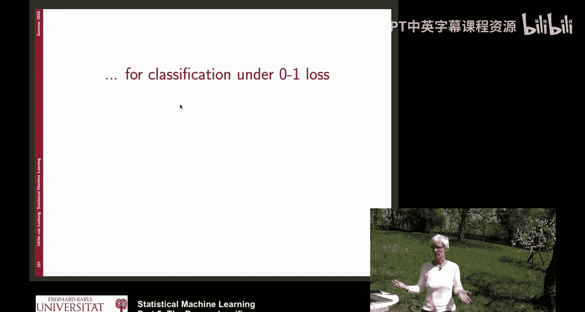

To define the objects we need for this lecture we need to consider a number of notions and one of them is called the regression function。

😊，And the regression function， iss really an unfortunate name because we look at a classification problem。

 but still， this function， for some stupid reason， is called the regression function。

So what we consider now is we have a pair of random variables， X， Y， input and output。😊。

That are drawn according to a probability distribution P on our typical product space x times 01。

 so we are in a binary classification setting， so we fix the output space x to be a binary space consisting of 0 and 1。

Now we need to manipulate this probability distribution。

 and we need to introduce a number of quantities。So mu。

Is supposed to be the marginal distribution of x that is if you integrate over the both the labels。

 what is left essentially。Or if you project just on the input space x。

 if you want to say it like this， so the marginal distribution of x she simply says the marginal distribution of a set A is the probability that the input point lives in the set A。

 it is just a part of the probability distribution that deals with the input of your classifier。😊。

And now we define the regression function。Is a function called Eta of x。And this is。

The expected value of the label Y。Under the condition that the input is x。

So here this is a conditional distribution， the input is x。

 and then what is the output what is the expectation for this y for the true label y corresponding to this input lowercase x。

now in this special case of classification everything is binary， it is reasonably simple。

 we can write this classification in a particular form so consider the regression function is this expected value so now we compute the expected value so here we need to take the expectation over y so y can either be0 so we need to take0 times the probability that y is 0 given x as x。

😊，Plus， now the other case，1 times the probability that y is 1 given x to x。

And now here this first term we multiply by 0， so it disappears。

 so what all we are left with is that the expected value is p of y given the probability that y is 1 given x is x。

😊，And this is now the regression function。 is We simply define the regression function to be this way。

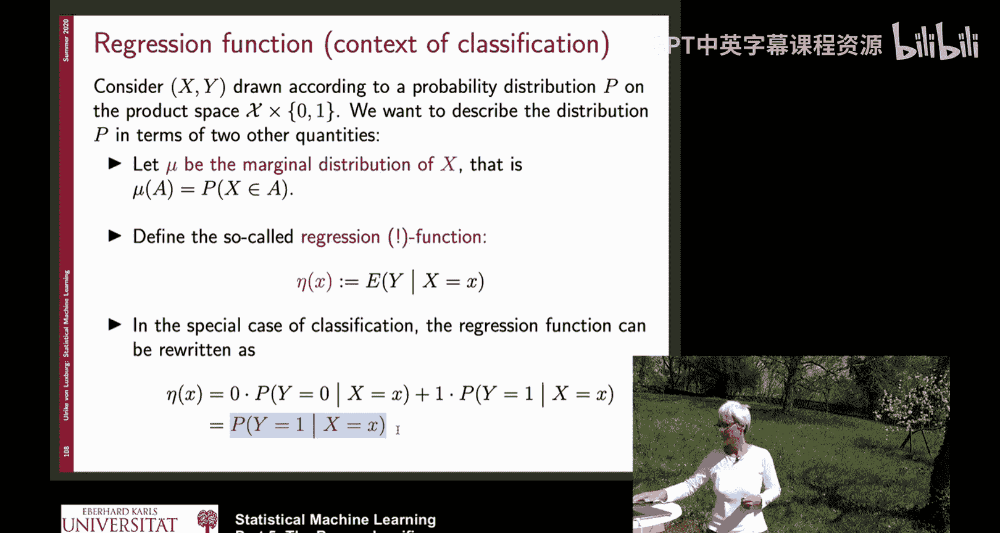

Now the intuition is that the regression function tells us a bit how difficult or complicated it is to solve a certain classification problem for a particular input。

 and I go back to the previous slide， so the regression function it is not so it is a probability。

 so the regression function takes values between 0 and1。😊。

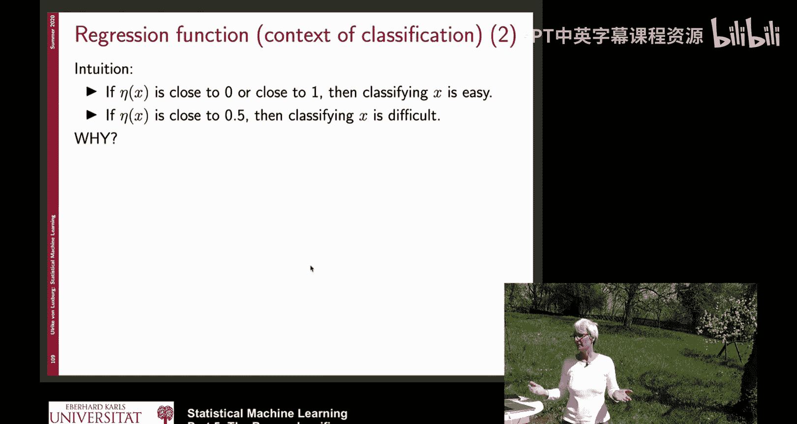

If the regression function is 0， it essentially says the probability that the label is 1 for this particular input is 0。

 so we are sure that the output would be the other way around 0。😊，Similarly。

 if the regression function is1， the probability is one that the output is supposed to be y equals 1。

 so this is also an easy case。It gets more complicated when this regression function takes values in the middle。

 say is 0。5。😊，At 0。5 the regression function says the probability that the label is 1 is 0。5。

 so essentially we don't really know what the label is supposed to be if we give the input x。

 we don't really know it could be with probability 0 it could be table 1 or with probability 0。

5 it could be label 0 so we don't really know。😊，So this means that the regression function。

 if the values are close to 0 or close to1， essentially says at least if we know this underlying regression function in probability distribution。

 then we are sort of certain what the output should be if we are close to1 half we don't really know what the output is supposed to be。

😊。

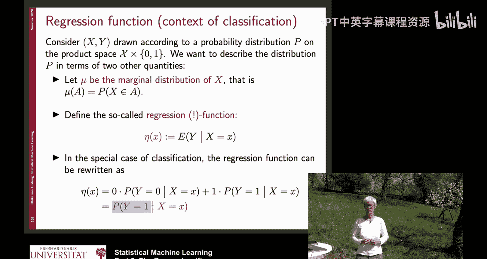

Now， what is going to be important is we want to class later on we are going to see that the regression function really plays an important role。

😊，And we now want to show that the probability distribution can be characterized in terms of the marginal distribution and the regression function。

 So here we have a proposition。That test the probability distribution P。

Is uniquely determined by mu and Eta。 So if we know the marginal distribution mu and we know the regression function E we know all of the probability distribution P and vice versa vice versa is obvious we have already seen that given p we can define what is mu namely the marginal distribution and what is E namely this conditional distribution so this is not difficult the interesting case is the other way around if we are given mu and E。

Can we reconstruct the joint probability distribution。

And I just want to show you the intuition for the proof and in the discrete case because it's really an easy case。

😊，So。To say we can reconstruct the joint distribution means for all events that might occur。

 we need to be able to specify what is the probability of this event。

 So we consider a joint event and assume all spaces are discrete。 So the event that x is x and y is1。

We can now write this by the definition the probability of conditional distributions as the probability of y is 1 given x is x times the probability that x is x。

And if you now look at these two terms， this is simply this is the marginal distribution of x。

 and this is at the regression function et of x。😊，So this is Eta of x。 This is mu of x。

 And so all in all， we have the product of Eta of x and mu of x。And the same。

 if we have some input x， but the output label is0。

 we can do exactly the same thing just instead of the regression function at of x。

 we get1 minus a regression function because we are going to look at the opposite event。😊。

So we can express the probability of any event。In terms of Eta and mu。

 And so we have this unique characterization。

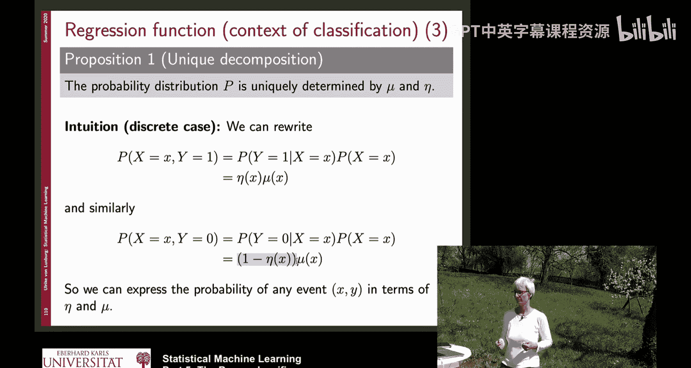

If you want to prove this more formally looking at the precise definition of conditional expectations and so on。

 this is something I completely shoved under the carpet so from a mathematics point of view conditional expectations are not always such trivial objects as we now treat them here。

😊，For this lecture I keep everything on a simple level and want to treat it just intuitively if you really want to know how it works please look at the book in this case it's a book on by thevo Guy and Togoi on pattern recognition and in the first couple of pages you are going to see the theorem and the result in the proof。

😊。

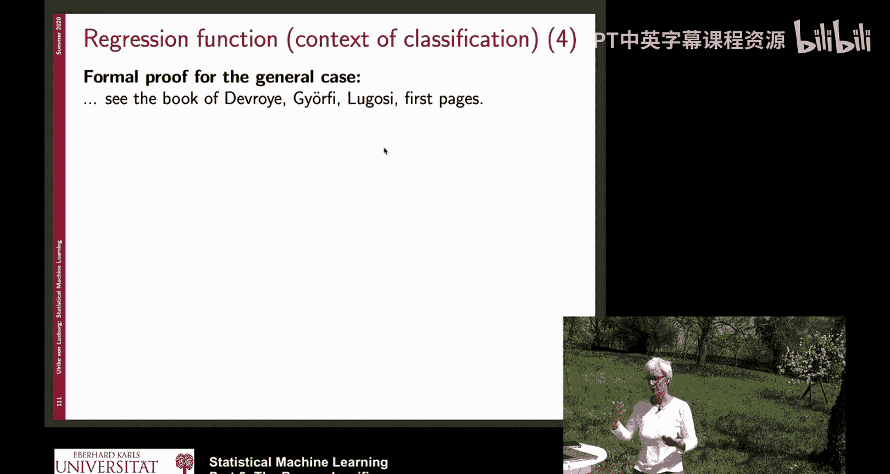

What we now want to do is we want to derive an explicit form for the base classifier。

Under this zero one loss。So we are in this zero one loss。

 so the risk of a classifier counts how often the classifier fails。

 And if you write this down the risk of a classifier。😊，By definition。

 the risk is the expected loss of a classifier。Now what is the loss in this case we are looking at the0 loss01 loss function。

 so the loss is 0 or1 depending on whether the true label and the label that is predicted by the function agree or not so we can write this in a simpler way and say it is the expectation over the characteristic function。

Of F of x being not equal to y。And this， again， we can write this is the probability that f of x is not equal to y。

So in the very specific case that when the 01 loss。

 the risk of a classifier F is the same as the probability that the classifier F does not correct the correct result。

 because we simply count how many  errors do we make。😊。

And now we had to find the base classifier as the classifier that minimizes this risk。

So among all possible functions， which is the functions that minimizes this risk。

But we didn't yet have a formula for it。And now we want to consider a formula the formula I want to define is now。

 consider this classifier， which for now I call a circle also。A circle of x simply is 1。😊。

If the regression function is larger than one half and its0 otherwise。

So remember the regression function。Essentially is the probability that upon this given input X。

 it is more likely or the probability that the output is 1。

So if this probability is larger than1 half， you would predict 1 and if it's smaller than1 half。

 you would predict  zero and this makes intuitively， this makes perfect sense。😊。

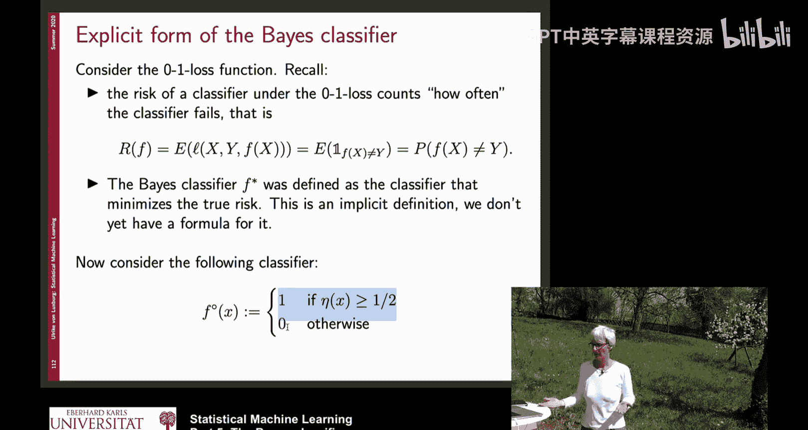

And now let's see what we can state formally about this classifier， so here's our first theorem。😊。

The theorem says this classifier F circle that we have just is really the base classifier。

 It is the best classifier that we can construct。😊，And formerly， the statement is as follows。

Consider classification with the 01 loss。Let F。Be any classifier。

 And I have written matter will here but ignore it。 be any classifier。

And Twiddle or F circle is the classifier that we just defined on the previous slide。Then。

The risk of this other classifier that you defined is always at least as large as the risk of the base of。

The classifier， if suck。Okay， so this is the statement of the zero。And before we prove it。

 let's try to digest what does the statement really mean， So the statement shows。

That this classifier f circle really is the base classifier。😊。

And I'd like to give you one minute to really consider why this is the case。

 And I'm not going to give you the answer。 So please think about yourself。

 Why does this theorem prove that a circle is the base classifier。Okay， I hope you've seen it if not。

 maybe the hint is go back to the definition of the base classifier and then try to relate it to this particular sphere。

😊，So the consequence is that whenever we are in classification with the 01s。

 we know what we have an explicit formula for the base classifier。😊。

So we can write down what is the base classifier namely it is the classifier I go back one slide which is follows this particular rule we look at the regression function。

 check whether it's larger or smaller than one half and this is what we use to classify。😊。

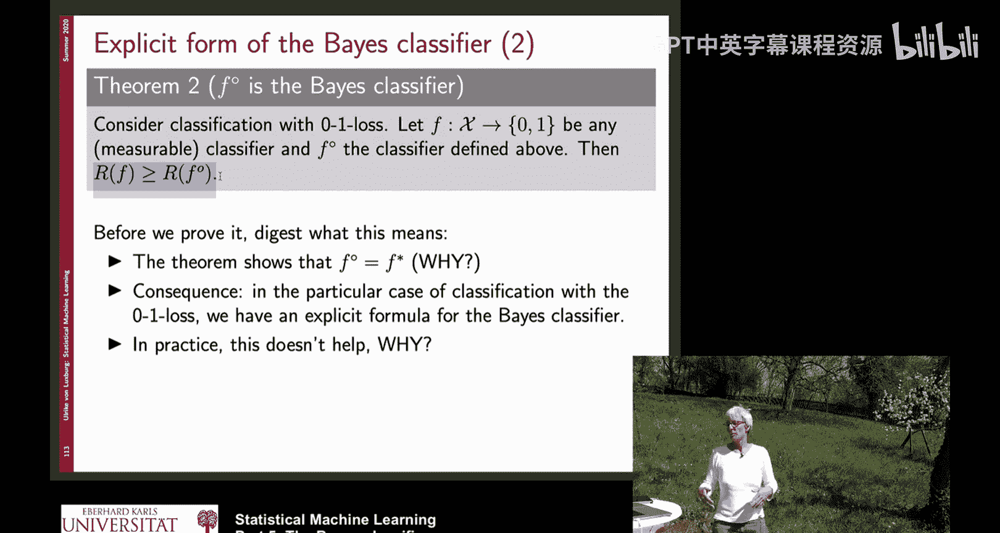

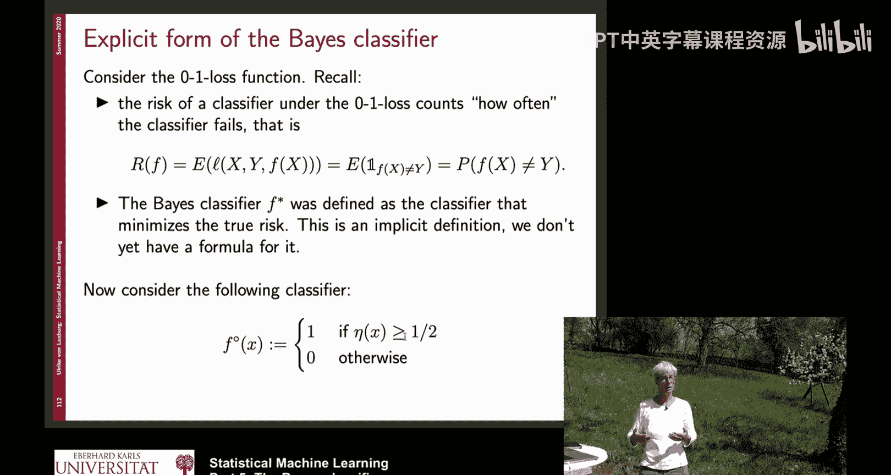

No， why doesn't this really help us in practice What is the problem。

 Why doesn't machine learning stop here？And we can say， well。

 we know what the base classifier is and we said the goal of machine learning is to find the base classifier。

 so why can't we stop here and go home？😊，Well， I hope you have found the answer。

 the answer is that we can only compute the base classifier if we know this underlying probability distribution。

 namely we need to be able to evaluate this function Eta。😊，In EA。

 you can only evaluate if you have the underlying probability distribution。😊。

But in practice we don't have it so there is a computability issue here so the point is really in a standard machine learning setting we only get to see a finite amount of training data so we don't know the underlying probability distribution the whole point is we want to construct something that is close to the base classifier。

😊，But we don know we cannot compute the base classifier just from a finite set of data points。

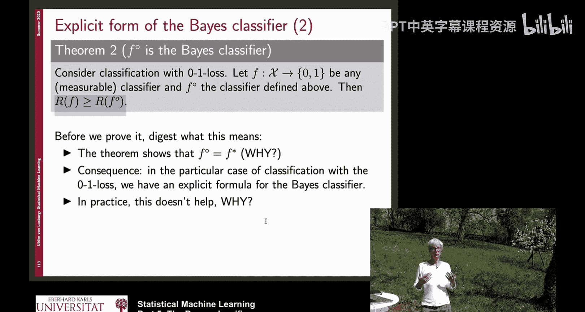

And before we continue the discussion let's first to prove the theorem。

 so it's in fact a very simple theorem and I'm going to go through the proof reasonably fast。

 you can spend more time at it at home if you would like to。😊。

So the first tip is we first consider any fixed classifier and compute the error probability at some fixed point。

 so we want to compute the probability that the classifier F makes an error。😊。

And given that the input point is x。first of all take the opposite event instead of looking at the probability that we make an error that f of x is not equal to y。

 we now consider the probability that f of x is equal to y and by doing this I need to take1 minus because it is the opposite event。

Now， I split the two cases。 I in like in this black term here， I sneak another term in here。

In one term， I sneak in here y is 1 and here I sneak in y is 0。

 So I decompose the probability space into two sub spaces 1 where y is 1，1 where y is 0。

And then the joint probability is just a sum of the two probabilities because these are thesejo events。

Now， the trick is here。What is the random variable and what is deterministic。

 Because we are under the condition that x is lowercase x。

 the fact of whether f of x is1 or whether f of x is 0 is then a deterministic quantity。

And again from a math point of view this is a bit handwavy here one would need to spend more time in really making this formula but let's just treat it intuitively and because this is a detertaministic quantity。

 it's either true or false and we can take it out with a characteristic function so I mean if this thing is false then this probability0 if this thing is true then it doesn't really have any effect anymore and we are just left with the remaining probability。

😊，So what I do now is I take the event out as a characteristic function and I'm left with the remaining part of the event。

😊，And I do the same here。I take the event so here we have the question whether f of x is 0 or not。

 we take it out as the characteristic function are left with the remaining event。😊，And now。

 we can observe that。This is， this term here is the regression function。

 And this term here is 1 minus the regression function。 So we get left oh sorry。

 we get left with this formula。

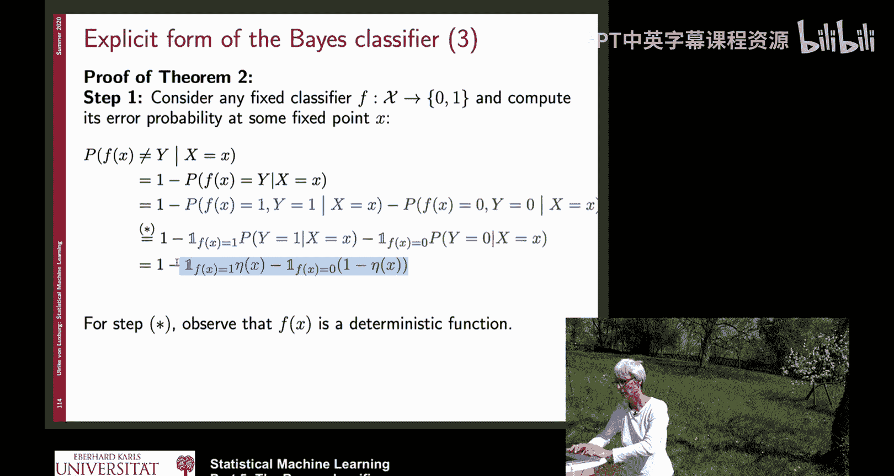

Okay。So this was the first step。Now we want to compare this point with error of any particular classifier to the one of F circling。

So， what we do is we consider any particular classifier。

 the red F minus the blue classifier f circle and so what we look at is the probability like always under the condition that existses some lowercase x。

😊，And what is the probability that this red guy makes a mistake and the probability that acer makes a mistake？

😊，Now what we do is we plug in the formula from the previous slide and we simplify a bit。

 we take together some terms and so on， you can do that at home if you want。😊。

And what we are going to left with is this expression2 atta of x minus1。😊。

Times the characteristic function of it x is 1 or whether if x is 1。Okay。

 and now the trick is we can observe that this expression。Always has to be greater or equal to 0。

 And this is sort of the key insight to the proof。Why is this the case？

So let's make a distinguishing between two different cases， either if C is one。

What happens if F circle is one。Then eta of x is larger than1 sorry then eta of x is larger than 0。

5 by the definition of f circle。 F circle can only be one if Eta of x is greater or equal to 0。5。

So then this term here is greater or equal to0， so it' is not negative because this guy is at least one half。

 so this guy is at least one， so something which is at least one minus-1 is at least 0。

And similarly here， this guy is one。😊，And no matter what this guy is， the term here is。

 is's not negative。 So the product of the two terms is going to be non negative。

And the other case works the same， so if f of x0 is 0。😊，Then we know that E of x is smaller than 0。5。

 so this term is definitely smaller than 0。And this term also is definitely going to be smaller or equal to 0。

 So the product is， again， because it's a product of two potentially negative terms。 It's， again。

 positive。 So it's， again， greater or equal to 0。

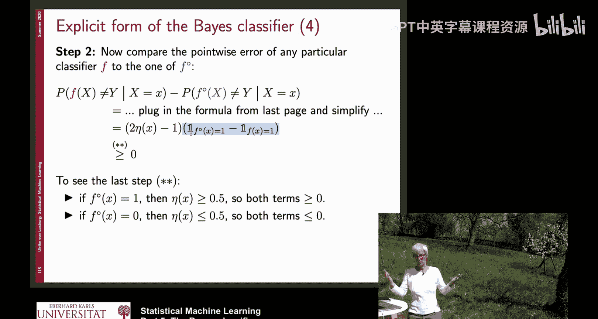

So what we have now is for all fixed values of x under this condition that the random variable x takes this value lower case x。

 We know that the probability。That the error probability for this other classifier is at least as large as the error probability of the the certain classifier。

And now again a bit hand wavy because this holds for all particular values x that we could choose here。

 it also holds if in expectation over the whole over all values of x。😊，And this， in the end。

 implies that the risk of this function F is always at least as large as the risk of the function F twiddle。

Okay。So far， so good。

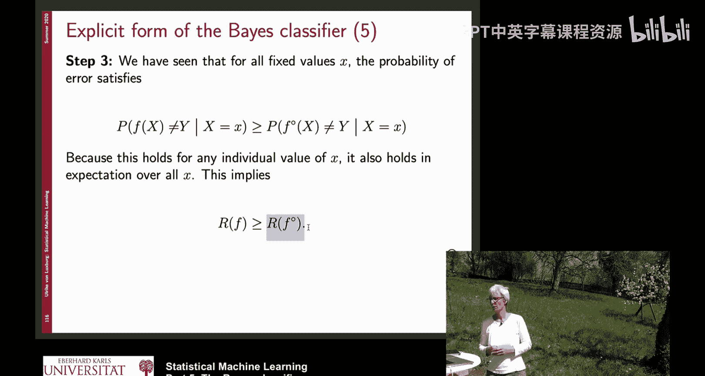

No， I we would like to make a couple of remarks。So the first remark I've said this before。

 if you would know the underlying probability distribution。

 we could simply write down what the regression function is。

 We can give the base classification if we're ready。 So there's nothing we need to do anymore。

Now this particular result is for the 01 loss， you can derive similar results for other loss functions in classification and you will get formulas which might look a bit different but also always take some aspects of the probability distribution and you can write down in closed form what for this particular loss function the best classifier would be。

And we will see one more example for， for regression and the square loss。As I said before。

 in practice， of course， we cannot do that because we don't know what the probability distribution is。

 and then we essentially don't。

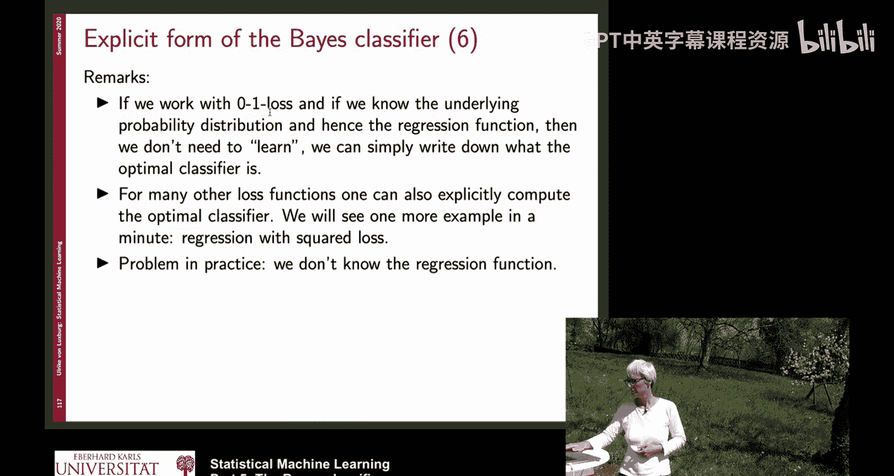

Now there is one funny idea that you might come up with。

 which is well why don't I simply estimate a regression function we just said earlier。

 we just have a finite set of data points。😊，And we need the regression function to compute what is the base classifier。

 so why don't we use our finitely many data points to estimate the regression function and then use that estimated regression function as our classifier。

And indeed， this is a pretty straightforward idea。 and also， I mean， on first glance。

 it looks like a good idea。 so let's look at it on the slide。😊。

So what we want to do is we want to estimate the regression function and we build up some quantity。😊。

Which I now call Eta n of x。 So Eta of x is the true regression function。

 Eta n of x is the function that has been the regression function that we could estimate based on n training points。

And then we build a classifier called Fn。 It now depends on N training points。

That simply checks whether this estimated regression function is smaller or equal to 0。

5 and then classifies accordingly。😊，And this classifier is called a plugque in classifier。😊，嗯。

And in statistics， plug in rules， there' is a whole family of plug in rules。

 which always assume there is a complicated quantity。 We do the naive estimate for that quantity。

 and then the the thing is called a plug in estimator。😊。

So here we're looking at the plugque in classifier。😊，Now， from a theoretical point of view， this is。

 in fact something that makes sense to do。😊，So if this estimate at of atta n of x is a consistent estimate of the regression function。

 meaning that as n goes to infinity， this regression function convertverges to the true regression function。

Then this is also going to converge。 then the go the classifier that you're going to construct is to be is going to be universally consistent。

So in the limit of infinitely many data points， this approach is going to work。In practice。

 the problem is。This approach doesn't work because it needs a ridiculous amount of training data。

 So what we do here implicitly is we do we solve a problem of density estimation。

And density estimation is about the most complicated thing that you can do and in particular in high dimension spaces。

 you need an enormous and exponential amount of data， exponentially in the number of dimensions。

And you would in practice， this simply wouldn't work， you would need to have so many data points。

 you simply cannot have enough data points for this statement to come into a regime where it makes sense。

😊，And this is not a contradiction observed that this consistency statement just says the limit for n to infinity。

😊，It is going to discover the right classifier。And the question is now。

 how fast does this classifier work， What is the speed of conversiongs of this classifier。

 and as we have stated it here， we don't make any statement about the speed of convergence。😊，嗯。

And the observation is now that in practice， the speed of convergence is so slow that with a normal amount of data。

 you would never， ever come even into a regime where you would get use for results。

 So this is a nice approach in theory in practice。 This is not what we are going to do。

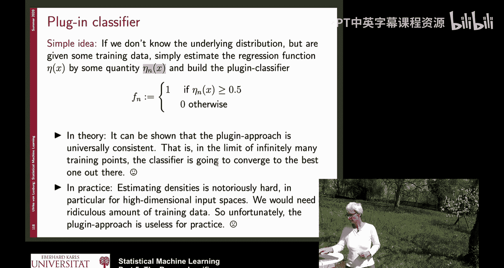

We have now looked at this optimal form of the classifier in 01 loss。

 I also want to show you what is the optimal classifier for regression in the squared loss case。

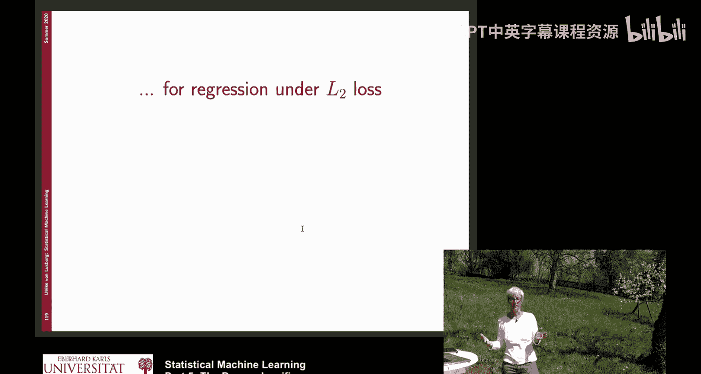

So in regression maybe it's a bit different in classification in classification。

 the 01 loss is really the kind of natural loss function you simply want to count how many points do I get right and wrong。

😊，For regression it is not really clear you want you predict a real number and the true number is a slightly different number what is the natural loss function in classical statistics people have often used the squared loss function but there are many other loss functions you can oit the square and just look at the absolute loss function and we are going to encounter many。

 many more loss functions in this semester。😊，So it's not really clear what the best loss function is。

But from a mathematical point of view， the squared loss function is always the simplest one to work with for several reasons。

And here we are going to see one example。So now we look at regression。

In the classic case of the squared loss function of the squared loss function。😊。

It just says the error that I make with when I make a prediction f of x and the true label is why I look at the difference between the two and take the square。

 This is the squared loss function。

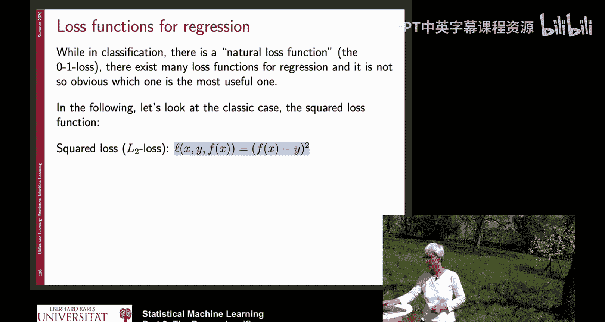

And now S in classification we can now define what is a regression function and we make exactly the same definition we say atta of x is the expected value of y given the input is x。

😊，And now we want to show what is an explicit formula for the space learner for the base regression solution in this particular case and before we can do that。

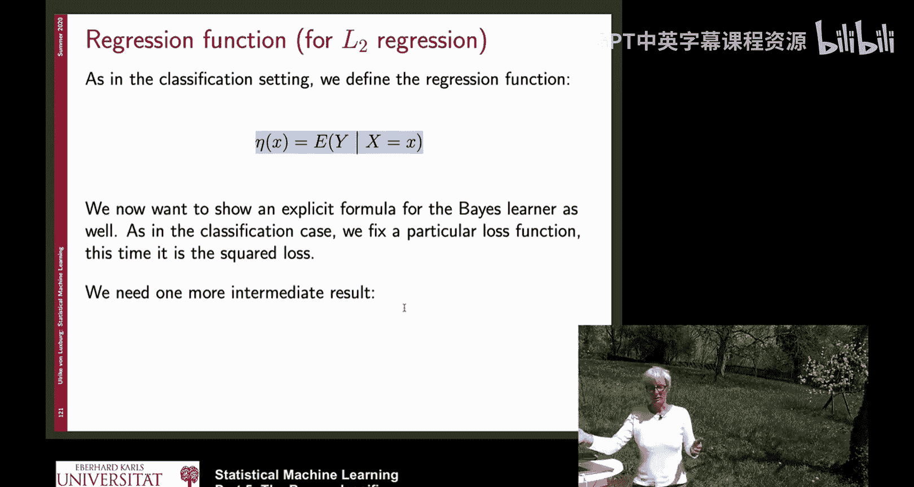

We need one more intermediate result， which is also important to know independently of this particular kind of statement。

So the result is that if we look at this squared loss function。We have a very specific decomposition。

So if you look at the expected value。😊，Of f of x minus y squared。 So observe this is the loss。

 this is the expected loss of classifier F。Then we can decompose it into two terms， namely。

We first look at what is the difference between f of x and Eta of x。

And then we look at what is the difference between ata of x and y。

And the interesting thing is that there is anequ sign here。

 so deriving this quantity with an inequality sign is easy。😊，And that works for many loss functions。

But for the squared loss， it in fact， also works with equality here。

The proof is simple it's just a few lines but I don't want to give it here because again we need to sort of talk about these conditional expectations because Eta is a conditional expectation and from a math perspective this is a bit more technical than I would like to have it here if you would like to look at this and you can see this in the regression book by Geficoola and Kjaak and Viacka Viac。

The distribution free theory of nonchometric regression。

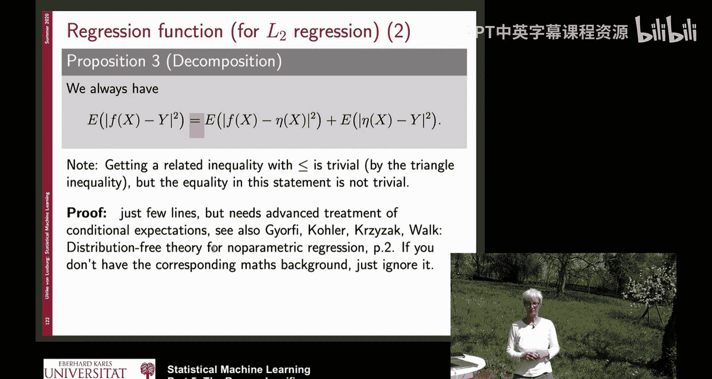

And it has it on the first couple of pages。

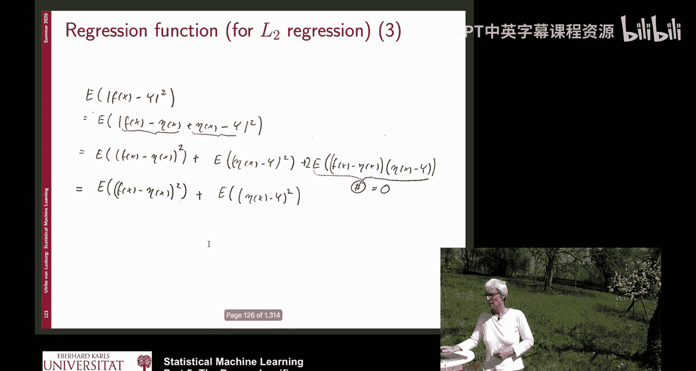

I also have the slides here。 if you want to look at them， you can do that at home。Now。

 once we have that intermediate result， we can now prove what is the best learner in the regression setting and we proceed similarly as above。

😊，We define the classifier or the immigration。😊，The prediction function F3。Which just says。

 I predict exactly the same as the regression function tells me。😊。

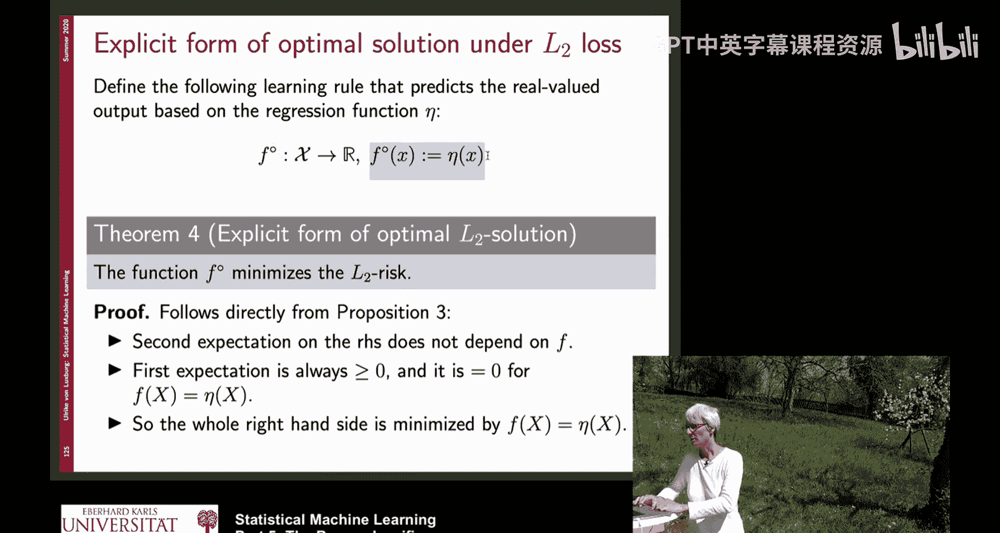

And maybe let's just to digest it， go back once more。

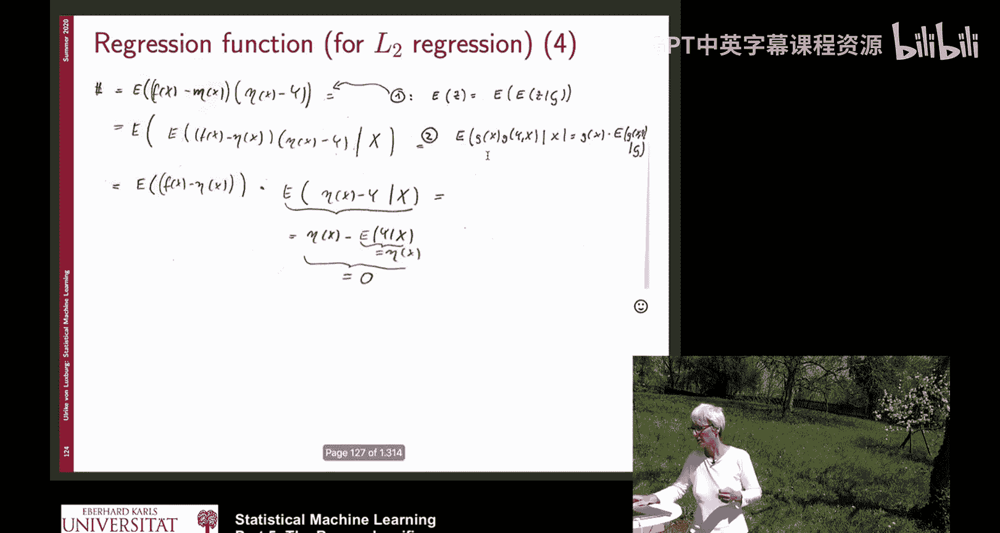

The regression function is the expected value of the outcome y under for the given input。

And now the statement is。We use this function essentially as our classifier sorry。

 it's not a classification。 We're in a regression setting as a prediction function。😊。

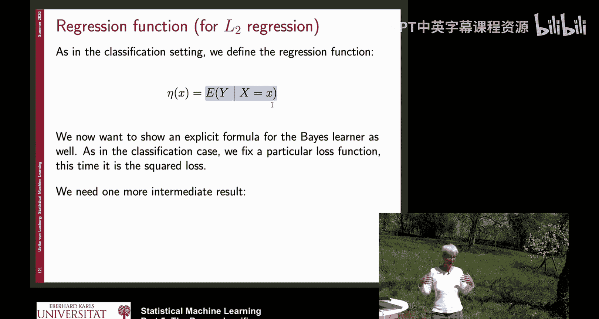

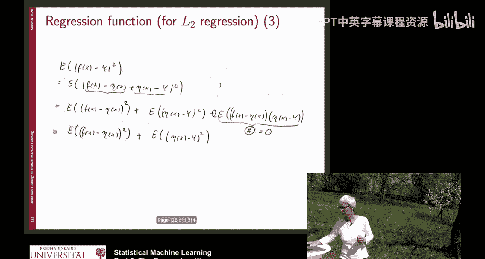

And now it is easy to see that this function minimizes the squared loss。😊。

And this follows directly from this proposition that we have seen before。

 so maybe let's go back to the proposition。😊。

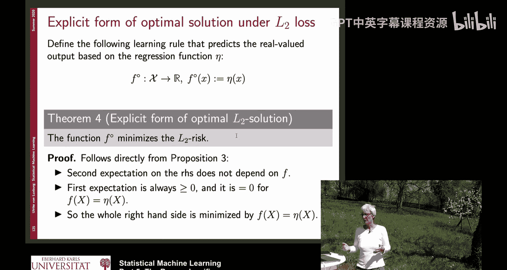

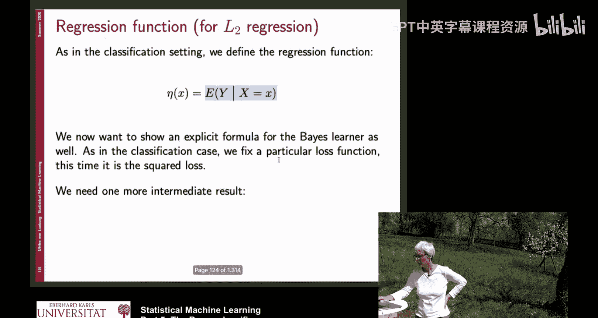

So this term here does not even depend on the function F so if you compare what is the risk。

 the expected squared risk and this term here you can ignore this term because it' is going to be the same term no matter which function of f you pick。

😊，And now you're going to look at this。 So youre only left with this term。 And what is the smallest。

The smallest term you can achieve here by choosing different functions F well the best thing you could do is you choose F being equal to Eta because then you have0 here and everything else would have a larger risk because you have the absolute value here or like a square term。

And so obviously， the best solution would here to pick Eta5。

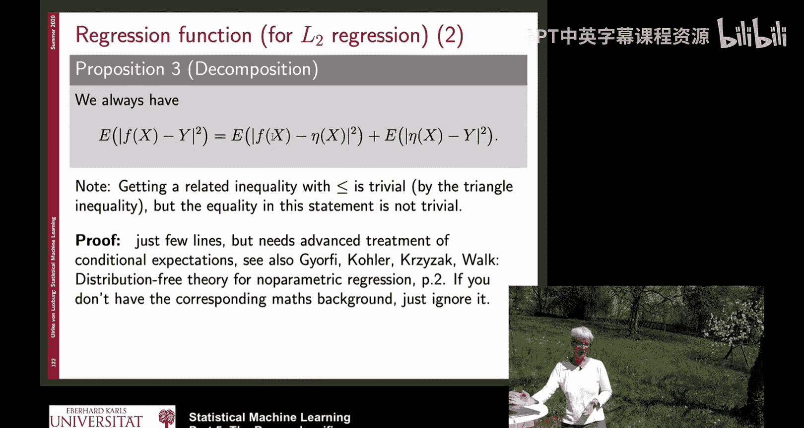

And that's it。 That's the proof。