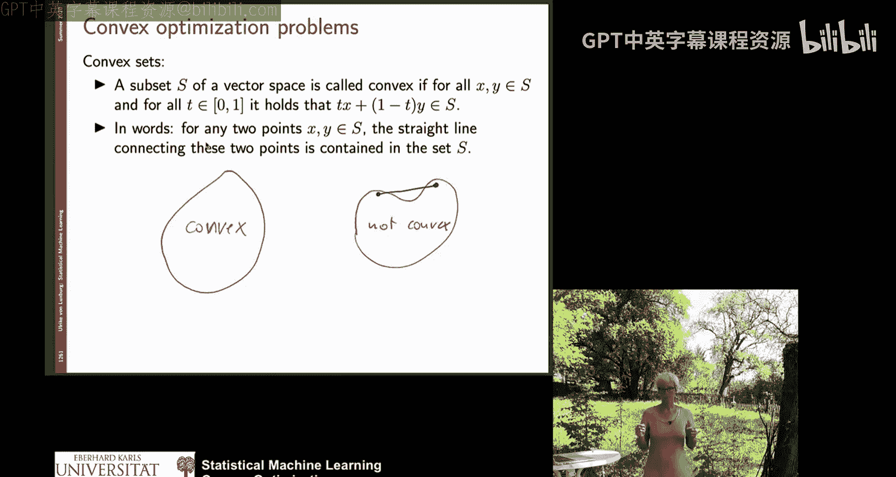
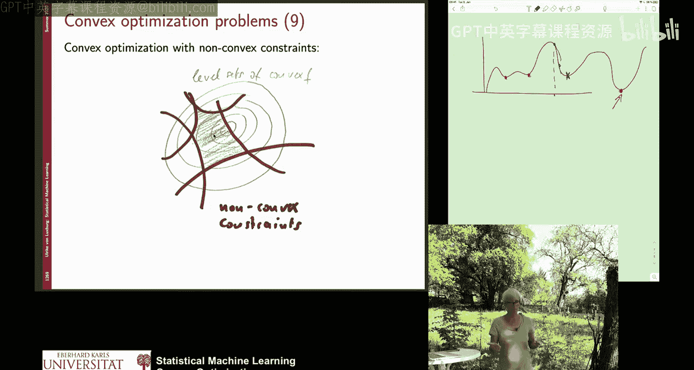
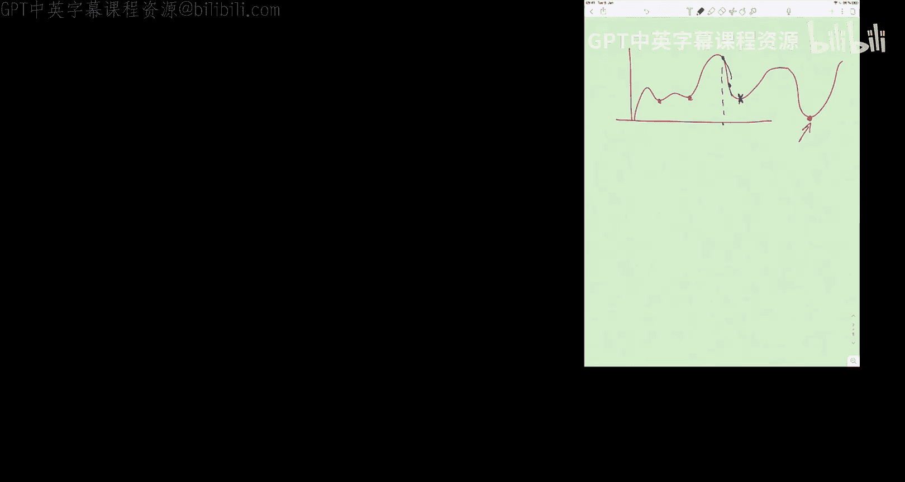

# 图宾根大学《概率和统计机器学习｜Tubingen Probabilistic and Statistical Machine Learning 2020》中英 p08 -08-Part 7a - What is a convex optimization problem_.zh_en -BV1gso5YGE4s_p8-

In this short piece of the lecture I would like to tell you what a convex optimization problem is many of you might have seen this before and for now I keep it on an intuitive level later on in the lecture we are going to treat more thoroughly how to solve convex optimization problem and what the Lag approach to this is but for now I want to simply give you what the definition of a convex optimization problem is and why we find it so interesting。

😊，Before we can talk about a convex optimization program。

 we first of all need to know what a convex set is and you see some images on the slide。

A convex set intuitively is a set like the one that is on the bottom of the slide that is round from the outside and that doesn't have any pumps to the inside。

😊，Informally， the definition is a set is convex if whenever I can to take two points in the set。

 connect these points by a straight line。

And then this whole straight line is still contained with in the set。

 And maybe let's take a couple of examples。嗯。This set here。

 which Ive just drawn is not convex because if I take these two points， I draw a line。

 the line is not always inside the set。Note that there might be other points where the line is very well inside the set these two。

 but the definition is for any two points in the set， the line needs to be inside the set。

And essentially， a convex set is something like this。

 no matter which kind of points I' am going to take。

Their connection is always going to be inside the set。This is the informal definition。 Formly。

 there is also a kind of mathematical formula for that。😊。

The first thing that you might want to note is that if you want to talk about a convex set and about a line between two points we need to have a vector space structure so because in a metric space or in some space which doesn't have metric any mathematical structure you couldn't even talk about a line connecting two points so we need to be at least in a vector space and now the definition is a subset s of a vector space is called convex if for any two points x y in the set and for any parameter t from 0 to 1 it holds that the point t times x plus 1 minus t times y is still in the set。

And if you look at this definition， this parameter t that goes from 0 to 1 is essentially the parameter that drives you from x to y。

 So if we set in this definition， if we set t to 0。😊，Then essentially。

 we are like we are all left at point Y。 And if we say T to 1， we are left at point x。

 And when we go from。with0 sorry， if we take t from 0 to1， we go from y to x。

And the definition now has all these points that sit on this line have to be themselves members of S。

 And this is， this is the definition of a convex set。

The next thing we need to define is what a convex function is。Intuitively。

 look at the figure at the bottom of this slide。 A function is convex if the following property holds。

If I look at the graph of this function， I take two points on this graph。

 and I connect them by a line。Then this connecting line needs to be above the graph of the function。

If this is the case for any two points in my set or in for any two points in my space。

 then the function is convexed。Again， we can make a more formal definition and say a function F。

Is convex if two conditions are satisfied， The first one is it needs to be defined on a convex domain。

So in R2， like if it's a function on R， a con domain is essentially an interval or the whole real line or half an interval。

😊，嗯。But it couldn't， for example， consist of two separated intervalts。 This would not be convex。

So the first condition is the domain on which the function is defined as convex。

 The second condition is now this condition about the connecting line。

 and this can be expressed as follow。 Again， we look at we fix any two points x and y in the domain of the function。

We fix a parameter T between 0 and 1， and then we say。

We look at the point on the line between x and y， indicated by this parameter T。

We look at the function value of this particular point。

And then this function value needs to be smaller， then if we would essentially connect the function value of the first point and the function value of the second point by a line。

Maybe I draw again figure here。So here's our function。 We have x here， we have y here。

The connecting line between x and y is this line on the input domain。

Note that in order to be able to state this property。

 we need to have that this whole line between x and y is a part of the domain of the function。

 This is why we need that the function domain is convex。Because the function domain is convex。

 we can look at all points on the straight line between x and y。Say we pick some。

 say we picked T one half。Then we have maybe  point Z， which is。T times x plus 1 minus t times y。

Now we look at the function value here。Which is Fc。And now the statement is。

 if we evaluate this fact。 So this is the left hand side of the equation。 We want to say that F of Z。

Which， by definition， is F of T times x。Plus，1 minus t times right。This is supposed to be smaller。

Then if I look at the function value。F of x。 So this is f of x。This is F of Y。like this。

And now we look at the line between those function values， which is t times f of x plus。

1 minus t times F of y。And the letter should be larger than the form。Okay。

 this is the definition of a convex function。 intuitivetuitively， a function。

 as I've drawn it before， like such a function is always convex。😊，It is like a bone。

AndThere are other notions， a function that is sort of if you， if you flip it is convex。

 This is called concave here in the definition， you simply need to replace the smaller or equal with the larger or equal。

And then there are many functions like this， which are neither convex or concave。And we can see that。

 because， for example， if I take， now， maybe I need to take a different colour here and maybe I need to also increase it。

 So if I'm at this， sorry， if I'm at this point here。嗯。And at this point here。

Then if I connect these two points by a straight line。

 the function value is the line goes beyond below the graph of the function。

 So this is not a convex function。Okay。Now， how can I get this back。系了。嗯。I don't get my iPad， too。

 get smaller again。 How can I do that now。Zoom out， please。 I don't know how this works。嗯。Come on。No。

 no， no for whatever。This was。嗯。Convicts。I56。So， this is the definition of a convex function。

 and there are a couple of examples that are easy to see， for example。😊。

If we have a function of one variable。It is twice differentiable。

And the second derivative is non negative。Then， this function is convex。

If you have a function of several variables， the same is true。 if instead of the second derivative。

 you talk about the Hasian matrix。 So the Hassian matrix needs to be positive definite。

 or if you look at depending on whether you want to look at strictly larger or larger or equal。

 it needs to be positive， definite or positive semideinite。Now， slowly。

 we need to move towards convex optimization problems。

 So what is so interesting about convex functions for a convex function。😊。

The sub level set is always a convicx set。Now， what is a sub levelve set You can see here I have the definition。

 I am looking at a particular function G of x， which in this image here is a function that goes from r2 to to R。

😊，And what I plotted here is the level sets of this function。

 So imagine we have these kind of contour lines that tell us how this function grows or shrinks。😊。

The red line in this image here is the part of the space where the function G of x is exactly 0。😊。

And now we can look at the set of points on which the function is larger than zero and the set of points on which the function is smaller than  zero。

😊，And the sublevel sets are the ones where the function is smaller than zero。

 that' is the green one in this case。😊，And if a function is convex。

 then such a sub level set is always convex itself。

And that's not only the case if you look at level sets which are low for which the function is smaller than0。

 no matter which parameter we pick， if you put some parameter A and say for some fixed a。

 what is the set of points in my space where the function G of x is smaller or equal to a。

 this is always a convexing。😊，There's a funny coincidence that this is not true the other way around。

 you can construct functions where all the suble sets are convex。

 but still the whole function is not complexvex。You might want to think about it as some kind of gridle if you want to solve it at home。

Now we have all the ingredients to define what a convex optimization problem is。

An optimization problem is， first of all， a problem that has the following form。We need to。

 We want to minimize a certain function。In in this example。

 the function is called F and the function we want to minimize is always the objective function。

 So this is how it's called the objective function is the one that we want to minimize or maximize depending on what kind of problem we look at。

And then typically， we have conditions。Subject 2。G I of x is smaller or equal to 0。

 So G is So now we have a number of functions G you1 to G K。And we have these kind of conditions。

 We want to find the minimum of a function under the conditions that G1 of x is smaller or equal to 0 G2 of x is smaller or equal to 0 and so on。

😊，So this is a general optimization problem。And such a problem is called convex if all the functions F NTI are convex。

As a side remark， maybe sometimes one also considers equality constraints。

 so rather than talking about a smaller or equal at this point。

 you can also talk about like G of x needs to be equal to 0。😊，But this is sort of a special case。

 which you can always mimic by saying the function like H should be smaller or equal to 0。

 and the negative of the function minus H should be also smaller or equal to 0。 So in this sense。

 this form of the optimization problem which which we have here at the top of the slide with a smaller or equal sign and sort of covers all the cases were interested in。

😊，Now， the reason why we are interested in convex optimization problems is that they have this very。

 very desirable property， that a convex optimization problem。

 whenever we found a minimum of a function， it is a global minimum so we cannot run into the trap that we have lots of local minimum and we don't really know how to find a global one whenever we have found a minimum it is the global minimum of a function。

😊，Maybe before I go to the next slide， just to make sure everybody knows what I'm talking about。

Sorry。If I have a functionun。And it looks like this。 sorry， maybe continue a bit。

This function has lots of minima， local minima。 So here we have a local minimum here we have a local minimum here we have one。

 and here we also have one。In the optimization problem， we are always after the global minimum。

 which is the absolute smallest problem， smallest minimum of the function。

 which in this case would be this one here。😊，The problem with optimization is that sort of the typical kind of optimization problem。

 in at least if you have sort of continuous differentiable functions。

 you would do some kind of gradient descent。 So the idea is。You start at a certain point。

 maybe at this point here。You check the derivative of your function and you walk downhill。

 you do a little step， check where you are， you are here， check the derivative。

 you walk downhill and so on。😊，So this gradientcent is going to take you downhi， downhill， downhill。

 downhill。And eventually， you are going to arrive at this particular point。

 and then you would see that it goes uphill on the other side again。 So you have found a minimum。

But this is a local minimum。And this is not what we want to find because in machine learning。

 if you want to minimize a loss function， we don't want to find a local minimum of the loss because its a suboptimal solution。

 we want to find the optimal solution。😊，And in this sense。

 if we have an optimization problem that is not convex， for example。

 because the objective function is not convex， we often run into problems。

Just maybe to continue the important terms， I have already mentioned this function。

 we optimize over is's called the objective function。

These functions G that we have are our constraints。

And then the set of all the points where those constraints are satisfied。 This is the feasible set。

 So often in optimization， I mean， if not only you need to optimize your function and find the smallest point。

 but you still need to be within your feasible set and you need to take care of both when you want to solve an optimization problem。

Here I have a couple of examples where I would like to ask you maybe as an exercise to figure out which of these optimization problems is convex and which one is not。

😊，And what you can see here on this slide the red line is always a domain。

 So here the domain consists like it's one dimensional functions。 the input is R， the output is R。

 So the input domain here， this red interval here is our set S。😊，This is how the function looks like。

 Here is another example that set S and how our function looks like。 Here is an example。😊。

Where you find another set S， which。You might want to think about。

 I mean the tricky part about this example is that like the global optimum of this function is not contained。

😊，In the domain of the set。 so maybe please consider whether this is still a convex optimization problem or not。

And here we have another example where we have a function that looks nicely convex and the domain consists of these two intervals。

😊，You might also want to figure out which of these two。

 which of these functions is convex or not and which one would lead to a convex optimization problem if we do not have any constraints。

 any side constraints， if the problem would simply be minimize the function over its domain。

I want to I have this slide because I also want to show what the problem problem is if you have non convex domains。

And this is because it took me some time myself to understand what the problem is when I was a student。

 I tried to make this figure even though it's not so easy to visualize。😊。

If we assume we have an optimization problem which doesn' not have any constraints。

 we simply have the problem to minimize f of x。😊，I now have a two dimensional example。

 So the input space is two dimensional。 the output space is one dimensional。

 So the graph of the function is essentially a three dimensional object。 It looks like a bowl here。😊。

And if you think about something like a pole， you would always think， oh。

 this is probably a convex problem。😊，And this is also how the level sets of this function look like if this if this function is defined on the whole real domain。

 for example， then this is definitely for a convex function。😊，Now， assume。

This function is maybe not defined on the convex domain。

 but on a domain that is highly non convex and I try to visualize it here in this figure。

 So this is now the domain of our function。😊，And the red lines visualize where our domain is。

 So inside the star， the function is defined and outside， is's not defined。

AndNow if you are supposed to optimize this problem。

 it's always hard because essentially you want to walk into a direction where the gradient decreases。

 but now it might be the case that you start walking here and the gradient decreases。

 but then you hit a boundary。😊，And then you don't know how to continue。

 You hit this boundary and you would think where I'm at the boundary。

 so probably I'm at the global optimum， but you're not because you could further decrease the function if you would。

 for example， walk to this boundary， but there's no no way to discover this way of walking there because you don't know what the boundary of your set is use so sort of there's no systematic way to walk along the boundary of your set。

 at least in general。And this is why for a convex function and a convex optimization problem in general。

 it's important that the domain is convex as well。😊。

And this is sort of a similar slide that tries to illustrate what is going to happen。

 So if our if now our constrained function are not convicts， why is this a problem？

So here I have essentially imagined the same kind of scenario as we had on the previous slide we have this function that is sort of like a pole and now we have this function GI that always tell us you are only allowed to search in the part of the space where the function GI is smaller or equal to0。

😊，And maybe I just indicated so these brown lines here。

 each line corresponds to one constraint and for example this brown line here says the feasible region of the space is above this brown name。

😊，And now we have several constraints we need to satisfy all of them at the same time。

 so the feasible region in this particular optimization problem might be this brown region and now we see that we that all of a sudden the set of feasible points is not a convex set it looks a bit like the star we had on our previous slide and this is again something that would make our optimization problem difficult because for the same reason as before we would run into a boundary and might not know whether this is really the end of or the best kind of point that we could find or not。

😊，So for this reason， if we want to have a simple optimization problem。

 we also need that the constraints are convics。😊，And so altogether。

 we now need the functions are convex， meaningan they are domains， are convex。

 and the constraints needs to be found convex as well。

