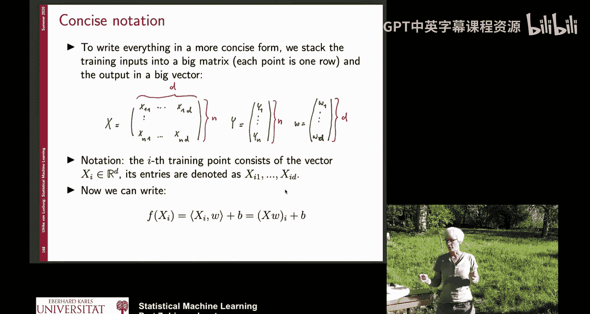
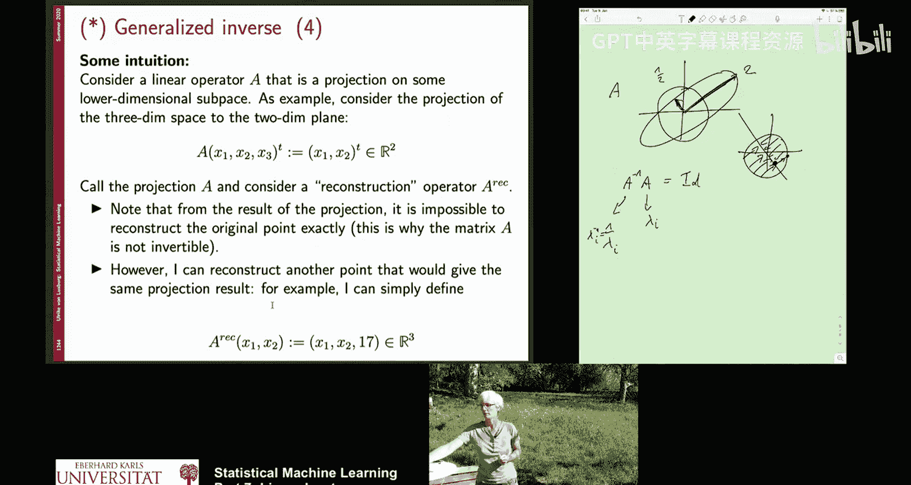
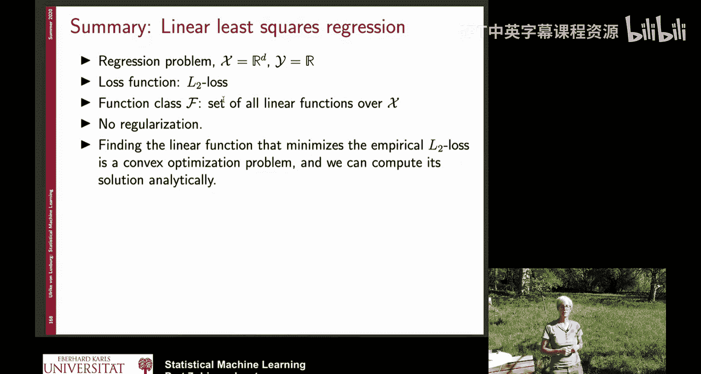

# 图宾根大学《概率和统计机器学习｜Tubingen Probabilistic and Statistical Machine Learning 2020》中英 p09 -09-Part 7 - Linear least squares.zh_en -BV1gso5YGE4s_p9-

Good morning。Today we are going to start to talk about linear regression and we start with the very classical algorithm of linear least square regression。

 Many of you might have seen this algorithm before。

 but maybe you haven't seen the derivation in the way I present it and many others haven't seen this algorithm before。

 so please be patient and watch this lecture。😊，Let us first discuss what the setup is in this and also in the following couple of lectures。

So we in a regression setup， this means we have some training data called X， I， Y， I。

Where X I come from our space curly X。 And in this case。

 we start with assuming that curly X is a Euclidean space。 So R D。This is the dimension of the space。

 So we assume that all our measurements come from the space are to the power of T。

And the output Y I comes from space curly Y， which in the case of regression。

 is simply the real line。 So we take some input that comes from R D。

 the measurements of a certain phenomenon。 and we want to predict an output that is a real valued number。

What we want to do given this training data， we want to find the best function that fits this training data and the function we are going to consider in linear regression is linear function。

And in the simplest notation， linear functions have to form F of x is sum over I from1 to D， W， I。

X I plus B， where x to the exponent of I in parentencies， This means the I coordinate of this point。

 So x is is a point that lives in R D， and it has coordinates x1 to x D。W I are weights。

 So we have for each coordinate we need to fix or we need to learn a particular weight。

 W I and B is the offset parameter by how far the linear function is shifted from the origin。

This parameter B is sometimes also called the the Well it's called the offset。

 the intercept or sometimes also the threshold parameter。This is where our data comes from。

 and now we need to fix a loss function。 And in the current setup。

 we look at the least square loss function。I always call this the L2 loss function for those of you who come from mathematics because it's essentially the the L2 ht space。

 but don't worry about it。 The least square loss is。

 I sometimes simply call it the L2 loss for historic reasons。

So the linear least squares problem that we now want to solve as the following。

 given the training data， find the best linear function that minimizes the training error for this particular data。

And if you want to write it down formally， the problem is we need to find the parameters W1 to W D in Rd and the offset parameter P。

 such that the empirical least Q error of this linear function f。

 which is given in this is the expression we had on the last slide。On the training data is minimal。

And these squares are on our training data is simply the sum of I equals from one to n over y I。

 the true label of the point minus f of X I， the predicted value of this point squared because we look at the squared loss。

And I have this factor one over n in front of it to have to normalize it to be between 0 and 1。

 But we often also drop this factor because in the， in like in the derivation。

 it doesn't really play a big。Let us give a particular example so you just know what we are talking about。

 So assume we want to predict the shoe size of a person and we have many different input values。

 So for example， for a person， I mean， we have just say we are an online shop and we want to we want to。

Predict what choose has to offer to this particular person。

 So maybe we know already the height of the person。 We know the weight of the person。

 We know the income of the person。 We might know the age of the person。 I don't know。

 We collect many of these different measurements， and each measurement is a number in R D。No， sorry。

 Each measurement is one single number in R， and altogether the person is presented by a vector of D measurements and this vector lives in R G。

Obviously， in this example， also， there might be measurements which are useful for the question we want to solve。

 So maybe if you want to predict the shoe size， the height of a person has a certain influence on that。

😊，The age of the person or the number of children of the person or the income of the person。

 maybe doesn't have such a big influence on the shoe size， but maybe we don't know this in advance。

 So in many machine learning applications， the idea is we simply sample or collect many different measurements because we might not even know what is relevant for the question at hand。

 and then we try to predict based on these measurements。YouNow。

 how does a linear function in this particular example look like。

 we might find that the following function is a good predictor。

 and this is sort of a made up example。 So the shoe size is maybe something like2 over 10 times the height of the person plus0 times the weight plus0 times the income plus 0 times the age plus 1。

😊，So it means that the height is sort of what we take as the main predictor In this example。

 it gets a factor in front of it the two over 10。 And this is the W 1， the weight 1， the other。

Prameterters like weight and income and age get a factor of 0 so that they don't play any role for our prediction。

 And this plus one is an offset parameter that parameter that we might choose。Okay。

 so this is the way you should think about a linear regression setup。Now。

 writing all these sums and so on is really a bit cumbersome。

 and we want to have a more concise notation， both to see more easily what's going on and also for implementing the stuff in in some programming language in in matrix formulas。

So we are now going to introduce a couple of matrices。

 and this is going to be the same in the in the rest of the lecture。

 So that this is really important， so。What we do is we define a matrix of， of our training points。

 And I also want to take it down here。 So our， our sorry。

Oh datata X。So the whole data set is going to be called x。 It consists of a big matrix。

And the rows of this matrix are going to be our training points。So I write it like this。

So for each person， we introduce a new row in our matrix and the columns of the matrix are going to be the measurements。

Measurement or feature。Or coordinate if you want。And we are always going to use the same letters to denote these things。

 So the number of points or persons， maybe if you want to。If we are going to predict the shoe size。

 this is always going to be denoted by n。 So n is the number of points or persons。

 And so on the number of training samples we have。And D is the dimension of the space。

 We live in the number of measurements we have。So our data x is represented by a matrix which lives in n times d。

 So it's a matrix in R R n times d。This this is the input data。

 and now the the output vector that is that comes with our training data is is now also stacked into a vector。

 So we have the measurements y。Which now consists of a whole vector we have by  one。2， y， N。

Which are all the measurements we have like the output of like the the the desired output for  a。1，4。

2 and so on until 0。8。 So this is a vector that lives in R N。And the weights。

 this is the last ingredient， and we need one weight for each of the coordinates。

 and we write the weights as a vector in。 So we have W1 to W T。And this is a vector that listen in R。

And this is the way we are going to to denote the things in the future。Now with this notation。

 I mean， there are now many different ways。 we will see many different notations for the same problem。

 What you can now do is you can say f of x。😊，If you remember。Maybe I write it down。 So previously。

 we said F of x It a sum from I from1 to D， W， I。X， I。Plus B。

 And now we can write the same thing because we now introduced the vector notation in terms of the scalar product。

 It is not the scalar product between the point X I。W。Let be。

 And now I made a mistake with my indices。 and this happens all the time。

 You need to be really careful。No， I didn't make a mistake。 It is correct， because I have sorry here。

 I the I is too much。Ajusts so。This is this is why sometimes it's really cumbersome to take track of all the indices so x is now a point。

 it consists of coordinates x1 to xt and these coordinates are indicated I can try to market it in red maybe so this is sort of the coordinate。

😊，Didn't get rejectedted it。So this here is the coordinate， the ice coordinate of the point x。

The sum runs from one to D over the all the dimensions。 and in the scalealar product is between。

The vector X and the vector W and both these vectors， you need to verify this yourself。 live in RD。

 Hence we can take the scalealar product。 It is often very important in machine learning that you check the dimensions of all your objects and whether they fit to each other。

 So x lives in R D。NW also is in R so we can take this scalealar product。

And if you can't remember what the scalar product is， please look it up。

 It's the Euclidean scalar product in R T。Okay。Now， if you want。

 we can also write the form the least square problem in this following way。

With this matrix notation now I mean first of all I put it again as a sum。

 so the matrix notation says we want to minimize the we want to find the vector w and B。

 the parameter B that minimizes the following this square error and with sum again over from one to n over all data points the true true outcome of this data point Y I minus and now instead of f of Xi。

We now write the concise form and x times w is also and then index I is also the scalar product of the data point and you can verify it yourself plus B squared。

 So this is just another way of writing the same problem so far we haven't done anything we just have introduced to notation Y I。

For a vector。Yeah。Yes， so y is the vector of all the outputs。 I is the index of the I component。

 X is the matrix of all the inputs。W is the vector consisting of all the weights， x times w。

Is the vector of predicted outputs， And we look at its ice coordinate。

 This is what we have on that slide。Now， there is one additional issue that we want to get rid of。

 And when we talk about linear functions and linear vector spaces and so on。

 this plus B is a term that is really annoying。Because if you remember from mathematics。

 linear functions always go through the origin。So if I have a linear function by definition。

 the the origin of the coordinate system is again map to the origin。

 If we allow for these kind of offsets， we are talking about a fine linear functions and that makes everything much more cumbersome。

 and we don't want to deal with that。Because we want to stay in a standard vector space setting。

 So we want to get rid of this parameter B and reformulate the problem in a way that the parameter B doesn't occur anymore。

And this is something that can surprisingly easily be done。

So what we do now is we extend our matrix a bit。So previously， we had this matrix x。

 which consisted of all the input points。Maybe I write it again here。

 So the x we had in the beginning was we had x11 here， x1 d here。X， n1 here。X and D here。

 So these where like each row is one point。 We have N rows。

And now what we do is we add yet another column to this matrix。

 We add a column that just consists of once。Close the matrix and call it now x tilder instead of x。

So the dimension of this matrix is now in this direction。 it's d plus 1。

 whereas previously it used to be D。Similarly， what we do is we introduce a new vector W Tder。

 which consists of the old vector W1 to WD。And we add  one， one below that。 So also， this vector， Oh。

 I can't really write it anymore。 lives in R to the D plus one。And now the trick is。

 if you now multiply the matrix with this vector， then we see that we can recover our parameter B。

And this works。 Oh， sorry。 I made a mistake。 I need to go here in the。And。Okay。F you on that front。

嗯哼。Similarly， we need to extend the weight vector W。So again， we now write introduce a new vector W。

 which consists of the old vector W1 to W D。And then we add one more entry to this vector。

 which is P。 P is the parameter that we want to get rid of。 So we write P here。

And now we have a vector that lives in our T plus one。Now the trick is with this notation。

 and we can now recover our， our original formulation in the following form。

 We now check what is the product between extilda。Times W Tilda at some particular entry， I。

You can see the formulas on the slide。😊，So you can now if you want。

 you can decompose it into the sums。 you can do the math。 And in the end。

 what you get is you get the original x times Wi plus B。Because this B in the weight vector。

 if you multiply this vector B to the matrix， you have to rotate it this way， you take the vector。

 take it on the matrix， and then on the last column， you always get this parameter B。Okay。

So what we can do now is we can rewrite our original formulation of the this square problem in the following way instead of writing。

The function with a B inside。 we now look at the version， which has the twiddles on top of it。

 So what we do is we want to me to find a vector W tilde。Which lives in the space R D plus  one。

 So we have D parameters， which are the weight。 And then we have one parameter， which is the B。

 altogether， they are D plus1 parameters that we want to find。

And we want to find these parameters to minimize the empiricalist square arrow。

And this is given as again the sum of n data points。

 the difference between the true output for this data point yi and the predicted output of this data point。

 which is now x till w till the I， and then we square the Hing。

And now the nice thing is we can even write this in terms of a matrix norm。

 if you remember what a norm in a Euclidean space is， you will know that if you don't remember it。

 you need to look it up。😊，The expression on the left hand side is exactly one over n times the norm between now the vector y。

And the vector x til the W toilde。 So this is a vector again， that lives in R D。sorry。

 both these vectors live in R N because n is the number of data points。

And now we have found a way to express the problem that originally wasn't a fine linear problem where we had。

 we， we had this offset parameter B as a linear problem。 So this is not a purely linear setup。

And now， in the future， we simply， for the without loss of generality。

 that's how mathematicians like to say that we now simply want to treat problems that don't have any offset parameter。

 And in the back of your mind， you always need to think， okay， if my parameter。

 if my original problem has an offset， which typically has， I first need to make this transformation。

To the problem without the offset。 And then I can apply all the theorems that we are now going to prove in the following remainder of the lecture。

So the problem we are now looking at， and this is sort of the standard linearly square problem is。

Find the vector W。In R D。 and now we also don't write D plus one。

 we simply act as if everything would be linear in R D。 We want to find a vector in R D。

Such that we can minimize the least square error between y and x times w。

 and this least square error is expressed in terms of the squared norm of the whole expression。

And in the following， you will often see different factors in front of this norm。

 Sometimes you have a factor 1 over n as we have it in our derivation here。

 often people drop this factor because it's maybe not so convenient or we don't really need it because minimizing this expression and minimizing it with a different factor in front of it doesn't really make a difference。

 Sometimes one also puts the factor one half because later and all the mathematically formulas are going to look nicer if we have the factor one half in front of it。

But this doesn't really change the problem。What we have seen so far is this linearly squares problem。

 we can write it in a contest form， and now we need to solve an optimization problem。

 This problem that is denoted by these three hashes is an optimization problem It says we need to minimize a certain expression。

😊，In this particular case， we will see on the next couple of slides that we can actually derive the analytic solution to this problem and write it down directly without running an optimization algorithm in the background For most other machine learning problems。

 this is not the case。 So typically machine learning problems always end up in an optimization problem and we need to call some optimization solver in order to find the best function that fits our data。

Now， one thing I want to mention here is a particularly particularly nice property of least square regression。

 namely， it is a convex optimization problem。If you know what a convex optimization problem is。

 then you can be happy and continue watching the slide。

 if you don't know what a convex optimization problem is。

 you might jump to this other part of the lecture where I record what a convex optimization problem is。

 and then you can resume watching the video here。😊。

The statement in this particular case is the the least square problem is convex。

And the proof is very simple， and we often have it as an exercise on the exercise on your assignment sheet。

 so please try to solve it。It's a really simple problem。

Now I want to tell you what is the solution of the optimization problem related to this square regression。

 the analytical solution， and in order to be able to understand the theorems。

 you need to know what the inverse of a matrix is and what the rank of a matrix is and I hope you all know that if not again。

 please do your math recap。😊，So and now from now， I assume that， you know all these things。

And here's the theorem。The theorem gives you the solution of the least squares problem in case the rank of the matrix of the data matrix is t。

 so we will see different theorems。 The first one is a simpler case where the rank of the matrix is t and then we are going to have another theorem that tells us what the solution is if the rank is smaller than D。

So the theorem says the following， assume this matrix x has rank D。😊，Then the solution。

 the vector w of linear is squares。😊，In the form， it is is written down and with the three hashes。

Is given by a sort of complicated expression。 W is given by you first take the data matrix x transpose times x。

Then of the whole product， you take the inverse， you multiply it by x transpose times y。

Now what you might want to do at this case is and this is what you should always do if you derive an algorithm this way or even if you read it in a textbook。

 you need to check that the matrices have the correct dimension and that you can take all these products。

 So taking a product of two matrices only works if if the dimensions sort of fit to each other and please you might want to check it here that this is really a correct expression that all the dimensions fit。

Maybe I can do it as an exercise once， but then I would like you to know how to do it yourself。

 So the expression is we have x transpose x。Inverse。X transpose， y。Now， x， as we said。

 is an n times D matrix， then x transpose because it's a transposedse matrix is a D times n matrix。

 So this whole thing is going to be a D times D matrix。X transpose。Is a D times n matrix y。

Is a n times one matrix。 It's just a vector。So， this whole thing。So is of the size D times1。

And now it fits together because you can now take the product of this matrix and this vector and the result is going to be yet another vector so the result of this whole thing is going to be d times 1。

 it is a vector of coordinates and this is what we want to have so the result lives in R D。

This kind of calculation， you always need to make if you have these products of matrices。

 because millions of things can go wrong here。So at least formally this statement makes sense。

 and maybe the other thing you might want to consider is this matrix x x is a d times n matrix。😊。

So maybe consider what might be the rank of such a matrix。Depending on whether D or n is larger。

 typically in simple scenarios， n is larger than D。

 then the largest rank the matrix could have is and the assumption in this theorem is that the matrix really has full rank in this case。

So this is the statement。 It says if the matrix has ranky。

 we know what the solution vector is namely the one that is given by this particular expression。

AndNow， I want to show you what the how the proof works。 And first of all。

 I give you the intuition of the proof， how it works high level。 and then we go into more details。😊。

The high level intuition is essentially what you have already learned in school。

 maybe not for vectors， but for simple functions， for， for one dimensional functions。

 But it is essentially sort of the same kind of argument。

 What do you need to do to find a minimum of a function。😊。

We are given the function that we want to minimize。We take the derivative of this function。

 We set it to 0。And then we solve it。 So we find the place where the derivative of the function is 0。

And then we need to check there are a couple of things that can occur。

 It could happen that we find a minimum。 We could also find a maximum。

 or we could also find a saddle point， which just looks like this。 where in the middle。

 you also have derivative 0， but you don't have a minimum or a maximum。

So you need to check whether what you have found is really a minimum。And once you have that。

 you need to figure out in principle whether you have a local minimum or the global minimum。

 So did you really find the best of all solutions or might it be the case。

 Like if your objective function has several wiggles， then you could have several local optim。

And you need to figure out whether this is the case for your problem。 In this case。

 it cannot be the case because we have already seen that our problem is convex。

 So the solution of this like that we find in this way can also only be the global opt。No。

 this is the the very high level outline。 But， of course， you know need to do it。

 and you need to derive this formula。 And now there are two ways in which you can do it a bit more elegant or you can do everything by foot。

 And I show you both of them briefly。😊，I start with the elegant way。

The elegant way is something that most of you might not really have seen so at least extensively in your past lectures that happens if you can deal with matrices and two matrix calculus if you know what a derivative of a matrix or a vector valued function is。

😊，AndThere are certain rules that you might want to look up if you want to use that in future。

 and we are not going to use it extensively in this lecture。

 but simply as a background if you ever have to deal with matrices a lot and you need to solve optimization problems or matrices。

 it might be worth looking at vector valued matrix functions。😊，This is what we' are going to do here。

 So we write down the objective function in a matrix form。

 so our objective function is so the parameter of this function is w so that we want to find the best parameter w。

 So the function itself is just one2 that's effective for convenience times the norm between the true values of the output of the data points minus x w。

 the predicted values and we take the norm squared。

Now we need to take the derivative and set it to0 and now there， as I said， there are two solutions。

 the one you do everything by foot， and I show it on the next slides。

 the other one you do with more elegant and matrix calculus。

And this is something you need to believe me currently。嗯。No， maybe we start first。

 So the derivatives， this is something you should know。If we are。

 we have a function that goes from R D to R。So the gradient of this function is a vector。

They listen R D， and it consists of all the partial derivatives of the single coordinates。

And now here is what you need to believe me， if you compute the gradient of this objective function and you write it again in a concise matrix notation。

 this is the result that you get。😊，And we are going to see on the next slide why this is the case。

 or we at least I show you how you can verify that， but also maybe to build up a bit intuition。

 why is that why does it make sense。Just for a second。

 consider we are looking at a one at a one dimensional function that looks like that。

 So say we have F of x is one half。Y minus。X times w squared。 So this is just now， just assume to。

 to get intuition。 These are all one dimension object numbers。 as you， as you know it from school。

 So this is really a function that you have known from school。 now， I made an important mistake。

 I don't want to consider it as a function of X。 but I want to consider it as a function of W。

 because w is the parameter I'm interested in。And now I want to take the derivative of this function with respect to W。

So I don't know how you have written this in your school。 but probably written F prime of w。

 And now if we take the derivative， the factor that1 half remains， we take the outer derivative。

 so we get two times y minus x times w。And now we still need to take the inner derivative。

 which is minus x because remember， again， we are deriving for taking the derivative with respect to W。

And now if you simplify that these factors cancel and essentially if you rearrange it for real valued things。

 you can simply rearrange it the way you want it， you have my y minus x times w and this is essentially the way it looks like on the slide on this slide what we have is the expression now in matrix form x transpose minus x transpose times factor y minus x w。

Now， of course， if you take matrices， you need to be a bit more careful with the dimensions and you also wouldn't be able to simply take something that you have in the back of your formula and move it to the front you can't simply exchange the order of things but the point is the intuition is sort of the same and on the next slide I show you how to derive this formula from scratch。

At this point， I only want you to note we have now taken the derivative。

 we know what the gradient is of this of this function and now we need to set it to 0。And now。

 so what we do is we take this equation。 We set it to 0。 we it。 and then what you get。

 Maybe I can also do it on my。The thing so we have the equation minus x transpose y minus x w is 0。

 so maybe it's easier if we sort of multiply it out before we start So x transpose y its the first expression and then we get plus x transpose x w is 0。

 So if you solve that for w，We get what we have on this slide， so we have x transpose xw。

Is x transpose y。 And now we would like to solve that for W。Now。

 if this would be real valued formulas， we would simply divide by x x transpose and hope that it's not0 and then we would find our solution now in a matrix calculus we need to to be a bit more careful here。

 we would need to multiply this equation with the inverse of this matrix right so what we ideally would like to do we have this matrix here。

😊，Maybe let's call it a and then to solve this expression for w。

 at least theoretically what we would need to do is we would need to multiply this equation from the left with a to the minus1 and then we would get a to the minus1 a times w is a to the minus1 x transpo y。

And then there's a-1， A to the it was a would cancel。 And we would left with， be left with W。

And then we would get the formula if we replace it again， x transpose x。Extent， supposedly。没了说。

And if you observe it， this is already what we have on this slide。Now， however。

 there is one important condition that we need to look at。

 we cannot simply take the inverse of any odd matrix there are many many matrices that don't have inverses。

 so we need to check whether our matrix can be inverted。

And this is where the where the rank comes into the game。So if you consider the rank。

 so the matrix we are interested in is this matrix， which I call I A on on the iPad x transpose X。

 so we know whether this matrix x transpose x has full rank。First of all。

 what is the dimension of x transpose x。X transpose x。

Just check it once more X is an n times D matrix x transpose is a d times n matrix。

 so this all in all is a d times D matrix saying that this matrix has full rank means that the rank of this matrix has to be D。

And now it is a well known fact that the rank of of this kind of product matrix is the same as the rank of the original matrix x transpose So we have。

 which is written on this slide， the rank of x transpose x。It's the same as the rank of x。

And we now want to have it that this rank is the， if this rank is the， we can invert a matrix。

 and then we have our solution the way we have seen it here。

And so the assumption under which we can do that is now the rank is T。

 And this is exactly what is written in the theorem。

 The theorem says if the rank of the data matrix is t。

Then the solution of the least square problem is given by the expression in this theem。

 and this expression is exactly what we have derived here as well。

And it's also the expression on the bottom of this slide。Still。

 we need to find out what we have done so far as we have found out what is the minimum。

 what is the point where where the derivative is 0。

 we still need to figure out whether we really have a minimum。

 we cannot argue via convexity and say we know that the function is strongly convex So we are fine as anyways it just has a one global optimum and this is a minimum and we we are done。

If you want to do it by foot， we would say you look at the Hasian matrix。

This is sort of the matrix of second derivatives。And then you need to check whether this Hassian is positive definite or positive semidefinite。

 which is the case in in this particular case。 And here's again a question I would like to ask to you。

 and this is something you need to recap and figure out if if you don't see that by yourself you need to recap your linear algebra。

The matrix we are looking at is x transpose x。 And my claim is that all eigenvalues of this matrix are greater or equal to 0。

😊，And maybe there are a couple of statements here。 The first one is that eigenvalues exist in the first place。

This might be something you might want to consider why because they exist many matrices which do not at least which well which do not have eigenvalue。

 and I now want to say this matrix has eigenvalue name the D。

 eigenvalue and all of them are greater or equal to 0。

And this is something that you might want to figure out yourself。

 And if you can't really figure it out， ask your colleagues and then maybe I also ask in the flip flipped classroom if you can't really solve it。

Because we know that the rank of this matrix is exactly D。

 We already know that there's not a single eingvalue that is exactly 0。 Otherwise。

 the rank of this matrix wouldn't be full。 So but combining the two statements that the eing values have to be greater or equal to 0。

And because the matrix is positive semiulative in it。

And the fact that we know they cannot exist in egg value that is exactly 0。

 We know that all of them are larger than 0。 and， and then we know if this is the case for the Hassian matrix。

 then we have。We have found a minimum of our function。And this concludes the。I still promised。

 I want to show you。How this derivative works， I said in the in the theorem we use this matrix values calculus but you can also do it by foot。

 and this is also the way I learned it myself when I started doing this you need simply to compute the gradient by foot and set it to0。

 and how do you do that。😊，It's written on this slide。 So again， we have our objective function。

 which goes from R D to R。 And now we write it explicitly as a function。

 including all the particular coordinates of this function。

 So we are not going to exploit the matrix expression anymore and we again write it in this cumsome way involving the many sums。

 So you can see it here on the slide。 So the objective function is a sum from。😊。

I from one to n over Y I minus yet another sum that runs over K from one to T。

Xk w K times X I to the K or the case coordinate， and then you square it。Now， all numbers。

 all all the all the expressions here。Now real valued like one dimension objects。

 So Y I so one dimensional number， Y W K is one dimension an X I to the power of k is also just a real number。

 So this is a standard normal real valued function that list in on one variable。

 You can now take the derivative for each of the W Ks。Write it down。

And this is what you get here in the second line。 So if you look at the derivative of the objective function。

😊，With respect to WK， you simply take the derivative as you learned in school， you write it down。

 This is what you get。And then you finally need to note that what we have here is exactly the same as what we have written in matrix notation on this on the previous slide where I told you already what the result would be。

😊，In this， you do with all the different expressions。 And then you can in this way。

 you can verify all these nice rules for matrix calculus by foot。

So there's not really a big secret here。Now， we want to turn to the case where the matrix does not not have full rank。

 Maybe it's a bit much to hope that in every real application， our data matrix has full rank。 and。

 in fact， in many applications， it does not have full rank。

And to be able to express the solution of a matrix that does not have full rank。We， first of all。

 need to discuss what is the generalized inverse of a matrix。

We now want to look at what is a generalized inverse of a matrix in the idea is。

It is not always the case that we take can take a normal inverse。

 like the standard inverse of a matrix。 We want now to derive an expression。That we can always。

 like or a function that we can always apply to any matrix， taking the generalized inverse。

 which is sort of as close as possible to the properties of what a normal inverse would have。

This is called a generalized inverse。And here is the way it works。

So we now consider a symmetric matrix A in D R to the D times D。

 So we have a D times d matrix and this humanid is symmetric。No。

 this is a symmetric matrix as a symmetric matrix， we can always decompose it into or express it in as a linear combination of eigenfunction and eigenvectors。

嗯。And if this is something you can't remember， then you need to look it up once more。

 Like if a matrix issymmetric， it always has a basis consisting of eigen of real valued eigen a basis consisting of eigen vectors corresponding to real valued eigenvalue vectors。

 I get confused。 So I have T eigenvalues。And these are all real valued。

 and I can decompose the matrix in the following way， and it's written on the slide。😊。

So I find the D eigenvalue is lambda 1 to lambda D。And the corresponding eyeing vectors。

 we want to V deep。And then the matrix can be written in the spectral decomposition form。

 The matrix A is not the sum from one to the。Iingvalue I times V I。

 V I transposed where V I is always the eing vector corresponding to eingvalue La time。

And this is a standard fact。 You need to know that。 if you have a symmetric matrix。

 this always works。Now， if a matrix now let's first of all assume we could invert a matrix how would the inverted matrix look like if you can invert a matrix if it has full rank if it has rank T。

 then the inverse of this matrix essentially looks more or less the same as before that just that instead of Lata we have one over Lata here。

And this is in the matrix A inverse。And if you haven't seen that before。

 it's maybe something that you might want to prove。

 you can try to prove that the matrix a inverse that I've written here is really the inverse of the matrix A that you have in the line above。

Initively， also what you can， maybe you can understand it this way， if we have a matrix。

 then the eing values tell us in which in the eing vectors in which direction the linear mapping that corresponds to this matrix stretches or crushes our geometry。

 So maybe I try to make a picture。😊，嗯。So here we have a coordinate system。

 say here we have the unit ci and now we assume we apply a linear map to the points on this circle and this linear and maybe after the linear maps the points look like this and so the map had two eing vectors the eing vectors are also second to each other in this case one of them is the one that points like in this direction here and the other one points in this direction and maybe the corresponding eigingvalue are two here because we stretch the data by a factor of two in this direction and maybe it's I don't know one half here because we squash the data in this direction by a factor of1 half。

This is what the map A does。And now the map a minus a to the power of -1， the inverse map。

Or the inverse matrix is supposed to undo this because like in the end， what you want to do。

 if you first apply apply M A and then you apply inverse， you want to get the identity back。

 This is the definition of an inverse matrix。So what do you need to do if you now have this new data set。

 this sort of qua cost data set， What do you need to do to get back to the original unit circle。

 Well， you need to like previously you had stretched in this direction by a factor of two。

 you now need to squash it by a factor of two。And in the other direction。

 we had squashed it by a factor of1 half。 so now we need to multiply by a factor of2。

 So essentially to to undo this。 So if a has an eing value Lada I。

 it stretches by a factor of lambda I， then the matrix a minus-1， has an eing value。1 over lamb I。

 or if you want， you can also write lambda I to the -1。Because it's sort of this is what。

 what is going to undo this geometric operation of stretching or squashing。

This is the geometric reason why what we have on this slide here is true that if a matrix A can be written in this form。

 the inverse matrix has this other form where we simply invert all the eigingvalues。😊，Now。

 why am I going to tell you this。Now， of course， if if the matrix is not full rank。

 we cannot do that。 And maybe here that's also nice。

 it's so nice that all these things always fit together。

 you can see it from this formula because if your matrix has not full rank。

 they exist at least one eingvalue Lada I， which is 0。

 So then you would have to derive one over lambda to take the inverse of one over lambda I。

 but0 in the denominator doesn't work。 You can do that。 This would be infinite。😊，In the figure。

 maybe also， let's show it once more in the figure。

 it might mean that if I have my original data like this。Maybe I do a projection。

 and I just project on this direction here。 So everything that is on the circle gets projected on this particular line。

So this mapping would have would result in an image that is just one dimensional because everything gets protected from two dimension to one dimension。

And one of the evalue is going to be 0 because everything that used to be in this direction is going to be multiplied by 0。

So this is why this matrix does not， does not have full rank。The matrix corresponding to this map。

 And now also， you can see that you cannot sort of undo this operation because for a point that lives on this straight line。

 you don't know how much should you move it outside again to to to again， sit on the circle。

 So if you have a point if you have a point here， you don't know， should I move it to here。

 should I move it to here to undo this previous action。 This is why this inverse matrix doesn't work。

Okay。So now the inverse matrix doesn't work。 What we are going to do is now to define what is the generalized inverse。

And we simply do a sum on a E trick。 We simply say， well， look at this sum here。

 We simply just take the inverse of all the。😊，Of all the directions where we know what to do。

 And for these zero directions， we simply skip it。 We simply don't do anything。 So here in this case。

 we now have a sum that goes over I， and ideally， it should go from one to n again。

 one to T or where is the dimension。But now we only sum over those parameters I where our eigenvalue is not to generate。

 where we have really an eigingvalue that is non0。And then we write down the formula。

 as we would have it before for the inverse of a matrix。If you want to think about it again。

 this is sort of the inverse of a matrix。 If you restrict it to the subspace。

 that is orthogonal to the null space。 So the null space is the one which sort of gets lost。And。

But in the rest of the space， you can still do the inverse。 So this is， again， in。

 in this kind of image here that I had on my， on my previous on the iPad， I don't know what。

 what I'm supposed to do in this one direction where I， where I shrank everything to0。

 But in this other direction， in this case， I didn't apply any kind of stretching or squashing。

 I I would have like because it was a projection。 It would be lambda equals 1。And in particular。

 if I'm in a higher dimensional space and just one the direction sort of vanishes in all the other directions。

 I can still apply。 What is the inverse。 And this is what I， what happens in this formula here。My。

 I mean， this is now a funny idea。 You can try to do it。 And then the question is。

 is it worth calling this thing a generalized inverse and what kind of properties does it have。

 Does it really make sense to consider this object at all。So。

 and here is why it might make sense to consider this object。

 The first obvious remark is that in general， we do not have。

That a A trans now A plus is what I what I use to denote this generalized inverse。 So in general。

 we do not have that A A。A plus is the identity or the other way round。 A plus a is the identity。

 If you would have both these things， then we would have the inverse of a matrix。

 This is only the case if the matrix has full rank， and is invertible。

If the matrix has not full rank and is not invertebrate， we。 we don't have these properties。

 but we have slightly weaker properties。 Naly， what we have is A， A plus A is identical to a。

And a plus a a plus is identical to a plus so essentially sort of it is we do this this operation of first applying the matrix a restoring it and then doing the operation A again we do it three times instead of two times and then the intuition is we do not lose anything here。

We only lose things if you want to recover the original state。

 but then applying the matrix again doesn't really hurt。So this is one of the properties we have。

 and we have it in both direction with the classes in in front and in the middle。

We also have that if we apply the inverse twice， we get the original matrix back。

And observe why this is the case because for all the non0。

 maybe I go back to the formula like doing this operation twice。

 I start with Lada I then doing the operation1 means I take one over lambta I doing it once more means I take the lambda I back to the top。

 So this for all these vectors， it doesn't really make any difference。

Now there are these other vectors where La I is 0。😊，And for those vectors， I don't do anything。

 But this means like in the in the inverse， I don't do anything and to restore， I don't do anything。

 So this， but I still have this factor 0 because it doesn't play any role。

This is why I still why I also have this property and there are then some other properties like if both these matrixrices a plus a and a a plus asosymmetric。

 if a is invertible then the inverse coincides with the generalized inverse I've already explained this。

And I've also said this before， at least intuitively。

 that AA plus is something like a projection on the image of the matrix a。Okay。

 theres more intuition on the slides if you want。 but you can look at these at home。

 But I think I'll stop here and go back to the lecture at the point where we wanted to go back。

Now， we have seen what the generalized inverse is。 and now I want to show you that the solution of the linearly square problem has to do with the generalized inverse of a matrix if the rank is not full。

So we now consider the situation that the data matrix has a rank that is strictly smaller than D。

 so we cannot invert it。And now there are two statements in the theem。 The first one is。

Then a solution w of linearly squares is given by essentially the same expression as we had before。

 just that we replace the inverse of the matrix by the generalized inverse of the matrix。😊。

That's the first and most important statement。 We just say we can compute a solution analytically。

 even if the rank is smaller than than D。We just need to apply the generalized inverse。

 rather than the inverse。This is quite nice and sort of maybe a bit surprising。

The second statement is the solution is not unique。And we will see that。

 I will show you some examples。 If the rank is not full。

 you can always find infinitely many different solutions。

But what we still have is if you have two different solutions， W 1 and W2。

Then their predictions agree on all their training points。

 So when we fit that linear function to the training points。

 the sort of the quality of this fit on the training points doesn't really make a difference no matter for which of the solutions I look at for the test points。

 it is going to make a difference and we are going to see and discuss how to do that。And now， let's。

 first of all， look at the proof。 So again， the proof says we。

 we do exactly the same kind of argument as before。We write on our objective function。

 We take what is the derivative。 We get the same necessary condition when we source the derivative and set it to 0。

And now the point was that this， this is where we previously needed to exploit that the matrix has an inverse。

 and we wanted to solve this this thing for W。And now。

The trick is we can't really solve this in general for this vector。

 but we can now check that the vector w。That is given in this particular form of the generalized inverse is a solution of this problem。

That means that it satisfies this kind of condition。So again。

 this is sort of proving in proving for like by knowing already what the result is。

 So the proof access follow， we derived the necessary condition。

 which is the derivative have has to be 0。Then we guess the solution by using the generalized inverse rather than the inverse。

 And then we check that this solution really satisfies our necessary condition。

 So we plug this solution W here into this formula and check that this condition is satisfied。

 So it means that this。The derivative for this particular point is 0。

And my suggestion is that you do this as an exercise to really understand what's going on here。

 It's not difficult。 It's just essentially a couple。 It's， it's one line of， of calculations。

So we have now that this vector is one solution of our problem。

 and this was what the statement one of the theorem said。

And now we want to look at the second part of the serumem， which says the solution is not unique。

 And Why is this the case， It is easy to see。So we consider we are in the in the situation where the rank of the matrix is not full。

This means in particular， that there exists a vector of V。Such that x times V is 0。

 because this exactly means that that there is a non non trivialile space of this linear operator。

 So they exist a vector that is going to be mapped to 0。And now we know such a vector exists。

 now take this vector V， just pick one of them， let w be the solution that we found in the previous slide。

😊，And now consider what happens to w plus V。 Now it's easy to see that w plus V is also a solution of the problem of the original problem。

And again， my suggestion is check it yourselves。 Take this vector W plus V。

And check by pluging it into the necessary condition that this really satisfies the necessary condition。

What this means is that our vector， that our our original problem has many solutions。 In fact。

 it has infinitely many solutions。Because if I find one vector v that gets mapped to0。

 at least all of its multi multiplicative vectors like a times v also get mapped to 0。

 so there are infinitely many vectors that get mapped to 0 and for each of them I can construct a solution。

😊，I also stated in the theorem that all these solutions give the same results on the training points。

 and this is again， something that we can see。😊，Let W1 be a solution and W2。

 which is w1+ be a solution as well。And now check on how how what is like what is the result if we apply this kind of linear function to a training point。

 we need to compute x times w2。 So this this is the prediction that the function induced by W2 makes on the training point x。

For all training points in matrix notation。 and now we replace。W2 by w1 plus B。 And then we can。

 because it's a linear function， we can sort of split it into its pieces。

 And we know that x times v is 0。 So we' are left with the same result x times W1。

 So these are the prediction that we had by our original function。

So all the solutions that we can construct in this way to the same kind of predictions on the training points。

😊，Which also means that if we just evaluate the training error。

 we are not going to see any difference between each of these solutions。 And now。

 depending on your implementation， like if you would try to do this would try to to solve this on like without knowing the analytic formula。

 but was an optimization algorithm， depending on the implementation。

 you would find this solution or the other solution。 And now the question is， of course。

 which of these solution should you take in the end。And for this again。

 of course the test error is what is important and not the training error and we are going to see in the next lecture that a good idea might be to use regularization to make your solution unique and also to make sure that the solution you pick has some interesting and nice properties。

There are a couple of more points that I would like to discuss。

 And the first one that is really important in machine learning is what is the relationship between N。

 the number of points and D， the number of dimensions in your space。

And I would like to ask you to take a couple of minutes and think about it and really maybe stop the video at this point and think about it。

What do you think is an easier solution or an easier situation for machine learning。

 We could have many data points in a low dimensional space。 So N is high。 T is low。

Or consider a situation where we have a high dimensional space。 D is high。 Maybe N is low。

Or it might also be that you say the best situation might be if N and D are sort of on the same order。

 So we should have as many， as many dimensions as we have features in our space。Sorry。

 we have as many features in oral dimensions and features is the same as we have data points。

And sometimes if you design a machine learning problem。

 you can sort of tune these things because like D is the kind of measurements that you try to take into account and it's sort of your design choice。

 whether you choose many measurements or whether you choose few measurements。

And so it's important to think about this。 So maybe take a minute and think about what do you think is the best situation for machine learning。

Here are some answers to this question。 The first one is。

This linear this essentially what we do is when we solve this this square problem is we solve a linear system。

So the necessary condition is essentially a linear system of equations。

 which has D equations and d unknowns。 So D is the parameters w that we want to find with D equations and D unknowns。

 and the important fact here and this is something where many students always get confused is this is independent of the number of data points we have。

 We always have D equations and the unknowns。Independentency of how many data points we have。

You know， there are two situations。 There could be either a unique solution。

 or there could be many different solutions。 I This is what you might or should know from。

 from your mass undergrad。Cours， if you have a system of linear equations。

 either it has a unique solution。 if the matrix is full rank or there are many solutions which are not unique。

The point is one of the points I want to make first is that the system always has a solution independently of N。

And the intuition is， of course， that we are not trying to fit the linear function perfectly through the data points。

 We just want to minimize the squared loss。 So there's always going to be a function that minimizes the squared loss。

😊，This is the one were going to find。Now， considering this interplay between N and T。

 there are two different regimes。The one is where D is much， much smaller than n And on the slides。

 I indicated this by these two smaller or equal signs， and this typically means D is much。

 much smaller than n。😊，This is what I would consider the harmless case。

So we are in a low dimensional space， say we just have five measurements and we have maybe 50 million points in want to find the best linear function。

😊，This would be relatively easy to do。 We probably would not tend to overfit at least unless we only have two data points。

 But if we have like100 data points in five dimensions， we typically do not overfit。

It could only happen that we underfi if our data is not sort of well suited to represent the problem we are trying to solve。

 but at least， I mean， underfitting is something that you observe and your training data already because you see that the training error is really high。

 overfitting would be something that you don't observe。So were always much。

 much more careful regarding overfitting because this might happen in the background without us noticing it。

 So this is sort of the traditional case。 It's easy。

 And people in mathematics have been looked at this have been looking at this problem since a century or so。

 So there's， I think no， not much more that can be said on this problem by now。

Theres this other case where the dimension is much larger than the number of input points。

 and this is not quite as harmless， but it is also a very important case。 and as an example。

 consider some maybe a problem in bioinformatics you have 20 patients hand selected which have particular types of diseases and you want to sort of learn something about how the genetic disposition of these people is related to this disease So you have 20 patients N 20。

And now you sort of record which kind of genes are active in the cells。

 and you have 10000 genes for each person。 This is D。 So you now have D is 10000，10000 genes。

 but only 20 patients。 And this is exactly the setting。 The dimension is much。

 much larger than the number of data points。And there many， many things can go wrong。It might be。

 I mean， you might overfi completely。 and this is sort of clear if you think about you have just 20 points and want to make a statement about 10000 different genes。

 I mean， somehow you simply don't have enough data to do that this is the intuitive reason if you want to put it more geometrically or machine learning terms。

 what you can say is that in high dimensional spaces。

 linear functions are already a quite large function space in low dimension spaces like looking at linear functions is。

It at least the intuion is that linear functions in low dimensional cases are are a small function space。

 This is not the case anymore in high dimensional spaces。

 And we might see this later when we talk about learning theory and capacity measures for functional spaces。

So in this case， it is very， very easy to overfit and in fact。

 there's a whole area of research which is called hidden dimension dimension statistics。

 which maybe has been very active during the last 20 years or so where people really looked at these kind of problems and try to make statements。

 What is not the best way to solve these problems， What kind of error guarantees can be given on。😊。

And there are two very good textbooks out there already。I already out there since a couple of years。

 and the one is by Peter Puman and Zra Fanderguer from the ETH and Zurich statistics for high dimensionional data。

 And Martin Rainwright has also written a book high dimensionmensional statistics。

 and they look at these problems from slightly different angles。

 one is more focused on limit theorems。 The first book and the the other book by Martin Rainro is more focused on on the fixed sample case。

 like not on limit statements。嗯。But this is， I mean， these are textbooks。

 and it's really a big and large area of research that goes much， much beyond。

But if you're interested in this， these two books are the first kind of sources you might want to look at。

So， let us summarize。Lingal is squares regression is like the very traditional problem。

 We are given input data that list in R D output data list in R。

 We want to find a function that maps input data to output data。

 The loss function we take is the least squares loss， the traditional loss function in regression。😊。

As function class， we look at all linear functions in this space。 We do not use any regularization。

And the very good point about this particular setup is that。

We can give an analytic solution to this problem。 We don't even need to to run an optimization。

 However， to find the solution， we can immediately write it down depending on whether the rank rank is full or not。

