# 图宾根大学《概率和统计机器学习｜Tubingen Probabilistic and Statistical Machine Learning 2020》中英 p10 -10-Part 8 - Feature representation.zh_en -BV1gso5YGE4s_p10-

In the last lecture， we have often looked at regression problems where the input space was RD。

 the Euclidean vector space of D dimensions， and the output space was real valued because it's a regression problem。

Now， sometimes one would think that this assumption that the data list in RD is a pretty restrictive assumptions because after all which kind of natural objects would have a vector space structure。

 we often want to classify texts or we want to classify molecules， cluster images。

 these kinds of objects and in a natural representation like a set of molecules doesn't really have a vector space structure。

So the question is， is it really a very restrictive assumption to assume for many methods that the data lives in RD or is there some application case that actually makes sense for all these kinds of applications？

😊，This is what I want to discuss with you in the next couple of minutes。

As I said on the first glance， the assumptions that data points are in RD seems very。

 very restrictive。

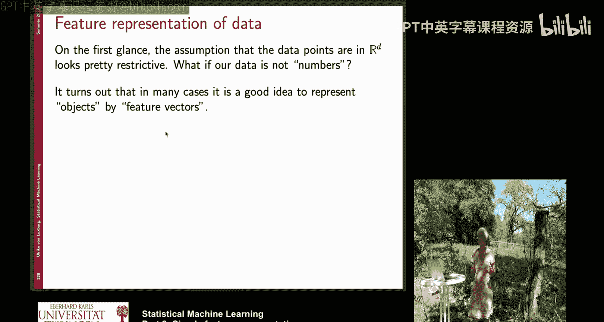

And I want now to show you why it's maybe not as restrictive as it looks like。

And I want to show it to you with a couple of examples。 We start with texts。

 so many applications in machine learning have to do with texts。 You might want to classify text。

 You might want to cluster them。 You might want to attribute topics to text。

 You also might want to do speech recognition， automatic translation。

 and so on theres lots of applications of machine learning that deal with texts。And of course。

 there are also very complicated representations for texts。

 but in some applications a very simple representation works surprisingly well。

 and this is the so called be of words representation。😊，What do you do？

You're given a text or a set of texts。 You make a list of all the words that occur in all the texts。

It's simply an exhaustive lists say you have 10000 words。

 all in all that occur in all the texts that you have on your hard disk。

Now what you do in each of the text， you throw away things that are really not informative about the text。

 so typically what you do is you throw away articles or pronouns and stuff like that which doesnt which don't really have any big meaning for the content of the text。

Then what you do as next step is what you apply stemming， this means for example。

 if you have as example you have the word tree and there were trees like plural and singularla。

 you want to treat them as one word so you would remove the plural S would sort of and this kind of stemming makes sure that all words are sort of broken down to the most important part of this work but and you remove all the endings that you might have。

And now this is the text you are going to work with。😊。

And the way you represent each text is not simply by counting for each word in your list。

How often does this particular word occur in this particular text you're looking at？

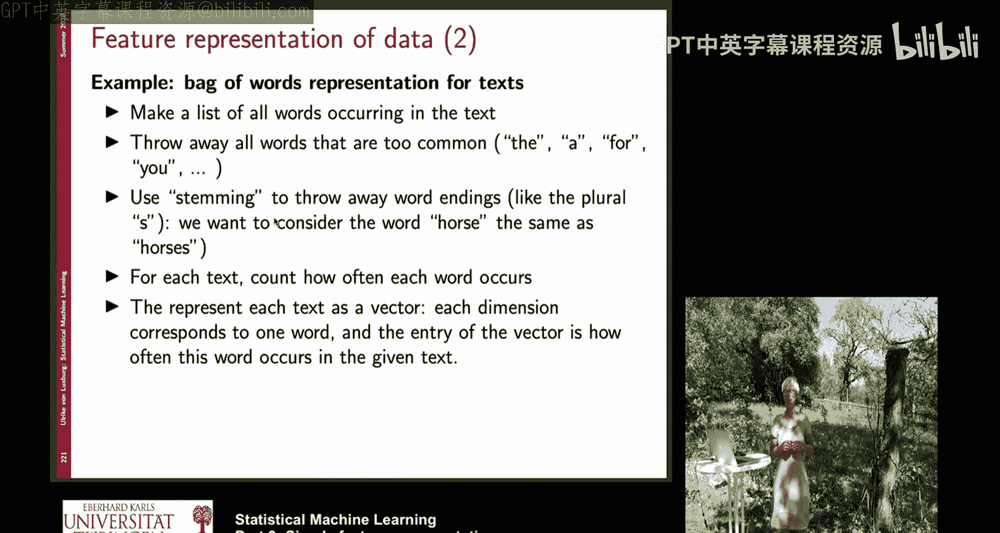

Let us look at an example， I have three texts， each of them are very short they just consist of one line。

 the first text is I like to play soccer， the second text is my soccer shoes are red and the third text is we move to a new house。

😊，Now what we do is first we make a list of words。 you can see this on the slide in the row so each row corresponds to a particular word。

😊，And now you have the texts， text T1， T2 and T3， and for each of these text。

 you simply put a1 if this word occurs in the text and you put a0 if this word does not occur in a text。

 for example， the word like occurs in the text T1 because the text T1 is I like to play to play soccer but it doesn't occur in text2 and in text 3 and this is the way you represent all your text。

And this is often a very useful or useful representation you can already see that for example。

 if you might want to class the text according to their topics。

 this is a representation that might work very well if you have like sports text you might have words like soccer and trainer and I don't know ball and win and lose and gold。

😊，But those words are rather unlikely to occur in a political text。

And they would have another set of words， which is very characteristic for political texts。

And this insight means that the spec of words representation is it might be a useful application。

 at least for some， for some context in which you want to represent texts。

And to summarize so the we are given this abstract text。

 which is a set of words and now we represent each text as a vector and like each column in this matrix here is the vector by which the text is being represented。

The dimension of this vector is very high， namely the number of all words that occur in all texts。

 And this can easily be a couple of thousand。So you have a high dimensional representation by the way it's also a very sparse representation because most words would not occur in your text because they are too specialized so you have many。

 many entries which are zero and then you have some entries which are1 so you have a sparse representation for your text。

A second example， which is very related， if you want to consider strings， for example。

 in bioinformatics， you might want to represent genes as a sequence of strings of the protein in code。

😊，You might might remember it from your school is AC T G， A， A C G G G。

 maybe this is a particular string that encodes the protein you're currently looking at。

And to represent this protein in a vector， what you can now do is you can look at substrs of length。

3 say。So you enumerate all possible substrs of length 3。

 So if you have the four letters for proteins then you and you look at substrs of length3。

 So you have three positions and each could be four different proteins。

 So you have four to the power of three many。😊，Substrs that potentially could occur。

And now you simply go through your text in through a string in some sliding window approach and you count。

 how often does each substr occur in your text？😊，Maybe this is representative for some application that you might want to have in。

 say， bioinformatics。Here's another example that also comes in fact from bioinformatics or from chmoinformatics dependent on what application you currently have in mind。

😊，Molecules， so assume you have a set of molecules， for example。

 because you want to design a drug for a certain disease and you want to find out which kind of particular drug would bind into a certain protein。

And now you want to represent all these particular molecules in a vector space representation。

And of course， by itself， a molecule is not a vector， so you need to do something about it。 Now。

 of course， what you could do is you could simply count the number of atoms that you have。

 but maybe this is still too simple because you might want to distinguish different forms your or like your molecule might have。

So you could consider your molecule as graphs。Like the vertices are the are the atoms。

 and then the links， the edges are essentially the links。

And now what you can do is you need to describe this graph and to describe a graph， you can。

Proce very much similarly， as we did in texts。 but instead of words。That we counted。

 We now count what is called motives。 A motive in a graph is simply a little subgraph。

 little structures like here on this on this slide。 And the simplest motive is， of course， an edge。

 And you can say， okay， how many edges does my graph have。F that's an obvious one。

The next structure you can look at is triangles。 So how many close triangles occur in my graph。

You could also look at open triangles， which is a sequence of two edges where the third one is not closed in your graph。

It's another motive。You can and and now you can， I mean， you can imagine yourself。

 if you can come up with a long list of different motives here。 For example。

 we have a star with four edges and one center edge and so on。

 So you can come up with all these kind of structures count how often does each of these structures occur in your molecule。

😊，And this is then how you represent your molecule。And again， after you've done this。

 your abstract molecule is now a vector in RD， where each entry in this vector denotes the count of one of these particular motives。

Of course you can make this arbitrarily complicated you could now have also annotations to your motives and say it makes a difference if in the middle I have a carbon atom rather than an oxygen atom or something like that。

 and then you would introduce more counts in more different variants of your motives。

 but the general principle is the same you come up with motives you're looking for and you counter or often do each of these each of these motives occur in your molecule。

😊。

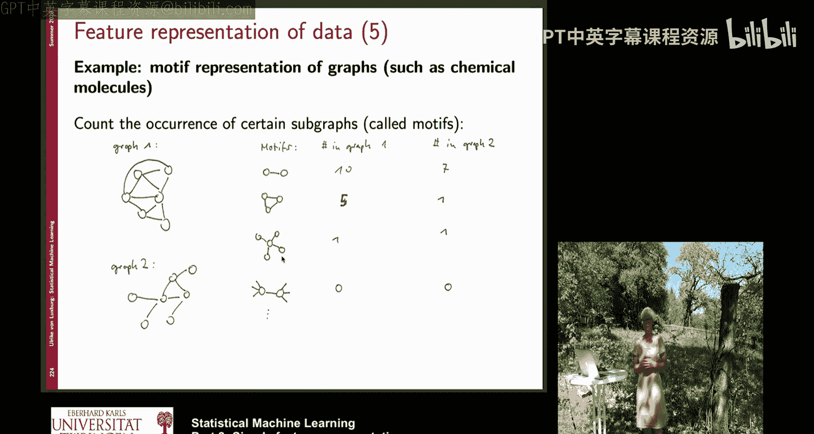

Yet another example that's very prominent if you're talking about online stores， customers。

 items that are being bought or sold， something like that。Here I have the example。

 books and users in Amazon。What you have is if you have some on online shop。

 you have users on this slide here， we have user  one， user 2， user 3。

And we know which are the items that this particular user has been buying。 So， for example。

 he has bought book 1 on book 2 and book so we list all the possible books and our user 1 did not buy book 2。

 a book 1 here and0。 user 2 didn't buy it， but user 3 bought book 1。And in this way。

 you can now fill out the tables of users versus items that the user has been has bought。

 for example。And now there are two different ways in which you can derive representation of this。

 For example， if you want to represent books。What you could now do is you could look simply at the row of this matrix。

😊，And say the entries in this row is my feature representation of this particular book。

 And the intuition is， maybe for a book， it is rather descriptive by which kind of users it has been bought。

And now you have sort of a unique string for each of the books that describes how often has this book been bought by very by all the different users we have。

 and you use this as a vector space representation of your set of books， Similarlyly。

 if you would do the same for columns， you can now look at representations of your user。

Its user is represented by the column of its entries。So essentially。

 a user is being described by all the things that the user has been has bought in the past。嗯。

And this is also in， in many。Like in many applications where you have the this binary。

 like users and items kind of situation。 This is a good representation of， of users or of books。

You can also do something like more complicated for a book。 So for example。

 you can describe books by how often they have been bought by the same user together。

 So you want to know you want to have a representation of book2。And now you ask， okay。

 how many users who bought book 2 also bought book 1， It was one of them。

How many users bought book2 and book well book2 and book2 that sort of doesn't really make much sense here maybe I should delete this line。

 but how many users board book 2 and book 3 jointly and again this gives you a vector space representation of all of the books it takes into account maybe how similar different books and how many users it of it's this kind of collaborative approach and we are going to talk about this later in the lecture where you simply collect implicit opinions by this assumption。

 similar users by similar books and similar books have been bought by similar users。

 something like that but anyway so at this point what I want to say is that even though maybe users are not an object that lives in a Euclidean vector space in a natural way。

 in such a scenario it's easy to represent this person in a vector space representation。Images。

 that's another object that's used a lot in machine learning and obviously I mean the most naive representation of images is using some kind of pixel based representation where for each pixel you say what is the intensity of color。

 I don't know， blue or depending on in which color space you are RTB red blue and green。

 what is the intensity of all these colors and this is essentially it's a matrix for each pixel。

 what is the color value of this particular pixel。😊，And instead of a matrix。

 you can also consider it's a very long vector， which has the length of the dimension of your matrix squared。

Again， even though an image is not a natural object to live in a vector space。

 you now have a vector space representation。There might be application where this is maybe not the best representation。

 but I would just want to point out that this is a natural way that you could at least consider。

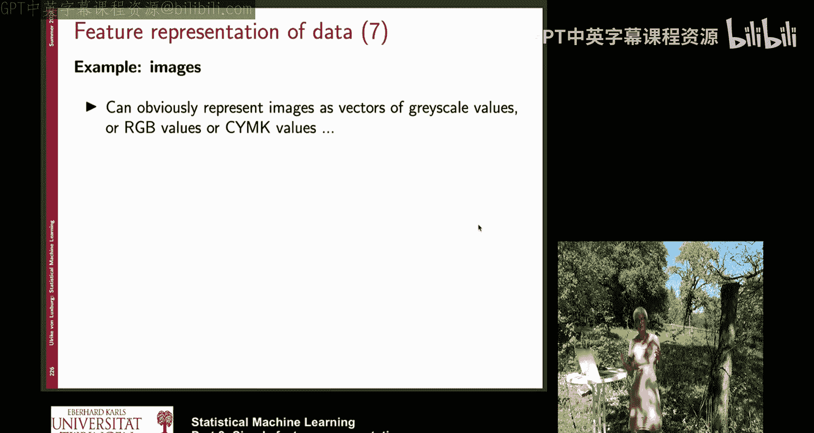

。There's also a general procedure that works quite often。

 And we have seen that a number of times already， at least implicitly。

 I have made examples like this in the past。Which is a feature space representation。 So typically。

 what you have is you have a set of objects。 And these objects are abstract things。Like molecules。

 like texts， like animals， whatever。 So it can be。Whatever objects you're interested in。

And now you describe these objects by simple features that can be expressed by numbers。

 How old is the object， how large is it， How much way is it， is it red or green， yes or no001。

 I don't know whatever like is it edible， is it not is it a plant it is it something handmade。

 whatever it comes to your mind you can use that as a feature。And of course。

 it might make sense to have many features that are are sort of related to the task that you're trying to solve on this data。

But never mind in the end what you have is we have the abstract objects which do not have any mathematical structure in the beginning。

 but now you sort of you bring them into a equilibriumuc space by this kind of feature vector representation。

😊，With this kind of approach， there's one comment to make is that the dimension often ends up being very large because I mean。

 you think of all possible features that that come to your mind when you think about this particular object。

 you don't really know which of these features is is very relevant or maybe only a bit relevant。

 You also don't know whether they are features that are sort of hint for the same kind of information So you could。

 in fact， drop some of them。But you know， if approach to simply collect all of them and then see what machine learning can make make out of it。

And it is maybe a bit surprising， but in many applications。

 this approach tends to work at least up to a certain extent。

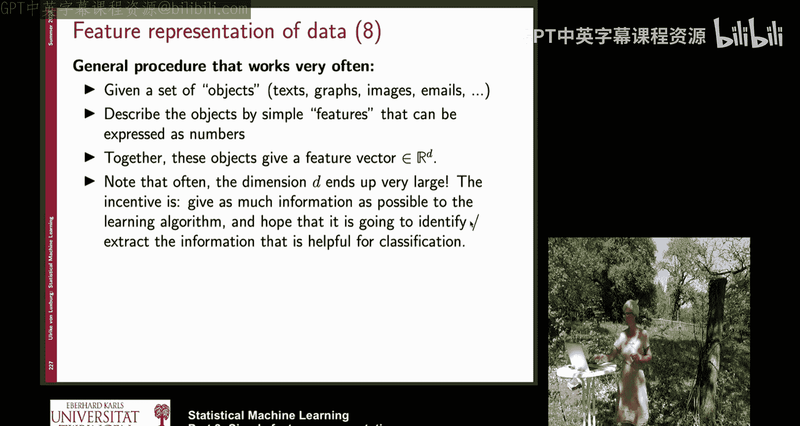

。As a general comment in machine learning this mapping from abstract objects to RD。

Is called the feature mapping， and we are going to see this term very often in future lectures。

And this feature mapping is always denoted by Phi for future mapping。

And to summarize this whole little small paragraph。

 this kind of feature representation in Euclidean data。

 it really makes sense because in many cases you can。

 at least there's an E representation by which you can bring your abstract object into a Euclidean representation and then you still need to evaluate whether your machine learning algorithm is going to succeed and maybe it's not always the best thing to do but at least as a baseline it's a useful assumption。

😊，The next thing that you need to take care of when you have such a feature representation。

Is you probably would like to normalize and standardize your features。

 And this is what I want to show you in the following。

。Just consider a regularization a regression example。 And again。

 consider you want to predict the shoe size of a certain person。

And now you have different measurements like age， the 18 years， which is a number between 0 and 100。

 say you have the size of the person millimeter， which is a number between I so don't know 1500 and 2000 millimeters。

 you have the income in euros， which is again， a number between 1000 and 5000。 I don't know。

 So you have。Many different measurements， and they all live on different scales。Now。

 if I want to try to build a linear function that says five times measurement 1-7 times measurement 2 plus 13 times measurement 3。

Then it would be of a big advantage if these measurements are all sort of on the same scale。

Because if if something is like it might make a difference if you measure the body size in millimeter or meter。

 simply because this scale is different and then this parameter w that you need to fix in your machine learning algorithm。

Or that you want to find。Has very different interpretation。

 So if I measure my height in millimeters and maybe then a parameter W of 0。1 is enough。

 which would lead to a small W1 norm。Or a small W norm。Whereas if I measure my height in meters。

 then maybe I need to to have the W weight increase by a factor of hundred to sort of achieve the same kind of result。

And then all of a sudden， if I start to regularize， this weight might。

 sort of the algorithm might push me to decrease the weight of this particular kind of feature。

So what I want is that all these features have the same influence。

And this is why we want to have this normalization。

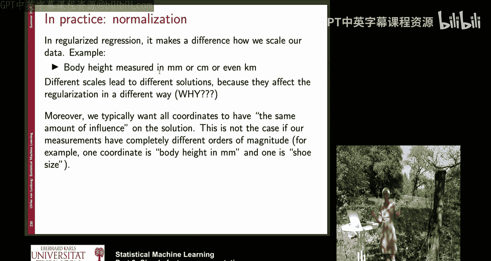

。Now there are two steps and these are sort of the standard steps and you might have seen that already before but if not here they are。

 the first thing that you always do when you work with a feature based representation of your data。

 you center your data。Centering means you compute what is the mean data point and you move the data such that the origin of your coordinate system sits on the mean of your data。

So you replace。 So you compute Phi I centered， which is simply。So， So you compute first of all。

 Phi I bar， which is the mean of your data， which is just like the mean as， as I've written here。

 So Phi I of xj is the mean。 So Phi Phi I of xj is the。I madamment of sorry。

You have data point Xj and you look at the I measurement of this data point and you normalize it。

 you compute the mean， and then you compute the center data point by subtracting this mean from your data。

For most machine learning algorithms， in principle， it shouldn't make a difference。

 but sometimes it does if if your data is very far， far outside。In some part of your space。

 then maybe there are sort of artifacts that occur in the algorithm that you don't want to occur。

 So you always do the center and that simply makes your life easier。And then you normalize。

 and this is essentially the step of making sure that the the arguments are on the same range or。

Have the same amount of importance in your data。 So there are different approaches。

 But one you could do is you resscale each of your of your features that such that this feature has variance one。

Or you， you re， you rescale， for example， in this way， you take。takeI mean。

 you start with the center data。And now you divide by the squared norm。

 so essentially this is the variance of your data， you divide divide by the variance or the standard deviation in this case。

 so all features have standard deviation 1。If you look at it in terms of the matrix。

 this means you center and normalize the columns of your matrix because the columns are the features of your data to have mean zero and normal this is sort of a standard approach there might be other approaches you can also try to fix the range of your features to be between0 and 1 I mean but all of these have sort of the same kind of gist you want them to be equally important so you need to do some kind of normalization。

Going to see in machine learning， there are a couple of steps that you can take to make or at least to look beyond linear functions。

 And here is sort of the simplest way。😊。

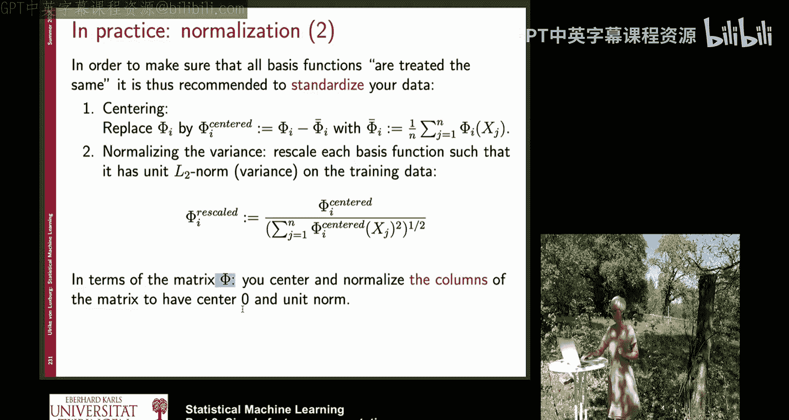

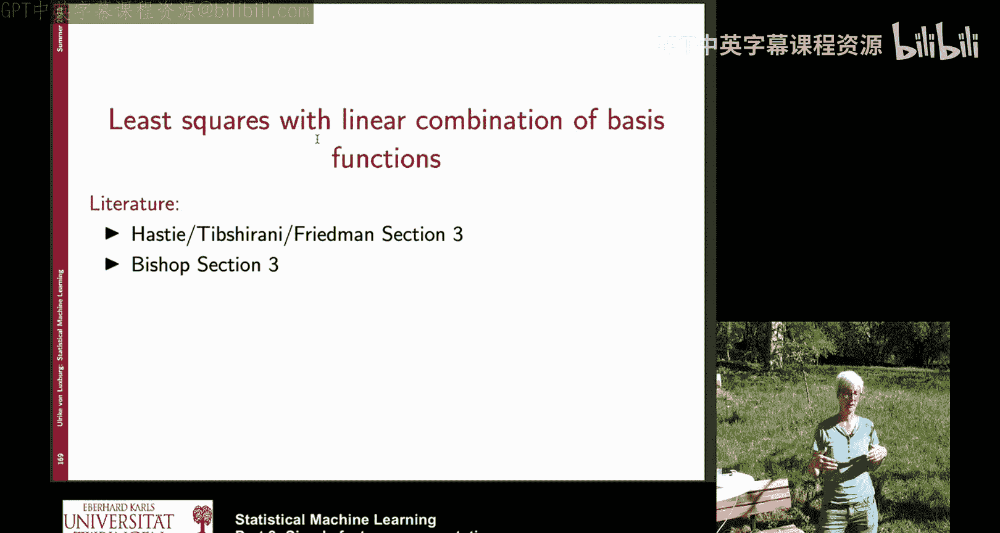

。The idea is that linear functions are often too restrictive so a linear function like if you a phenomenon doesn't have a linear trend then somehow there's not much point in trying to model it this way。

 So what we might want to do is instead is we want to learn a function which has the following form written on the slide F of x is again a sum of a wi these are the weights times phi of phi of x and phi I of x。

 It's not a basis function or some transformed function or a feature extraction function or a filtering function no matter how you want to target it so you take a data point and apply a function to it and then the result is what you want to want to use in your algorithm。

And so this function F， it is still linear in the parameters W。

So it's a linear function because W just occurs as a linear term， but it is maybe not linear in x。

 because if this function phi I is not a linear function。

 then the whole function F of x is not linear in x。 It can be something non nonlinear。

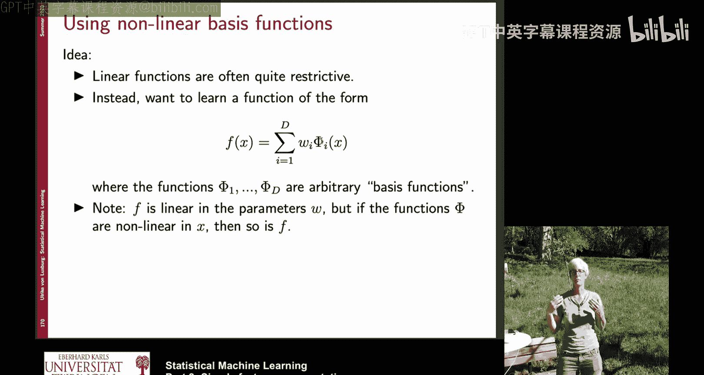

This is a bit abstract。 Let's just look at at one example。

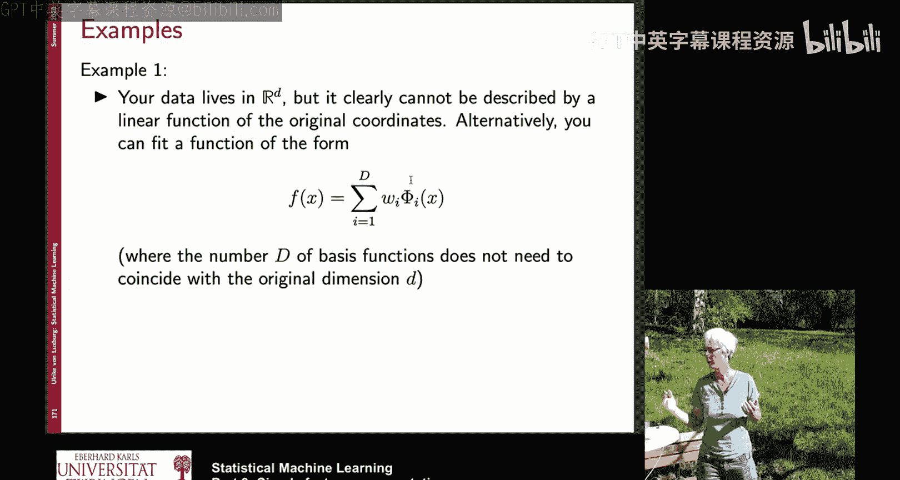

。For example， we want to learn a periodic function。 You want to predict this temperature。

At a certain point in time during the next day。Now， you know， I mean， there's not a linear trend。

 So temperature maybe goes up and down like this because during day， it is hot and during night。

 it is， it is cold， something like that。And so you might want to fit like you have lots of training data。

 you have recordings of temperature at different times of the day for the last five weeks。

 and now you want to predict the temperature at a certain time tomorrow。

Now what you might want to do is you might want to express to to consider using a Fourier transform or like functions of a Fourier basis。

 You take sine waves， maybe， and you want to express this kind of periodic phenomenon with the sine waves。

 So what you do is you take the first couple of Fourier functions。So， sign of。

K times x for k from 1 to d。So the first one is just slowly varying sign and the higher k gets the more it the more we it gets。

 And now you simply want to say， I want to fit my training data by a sum of sine waves。

This is typically what happens in， in many of the signal recovery problems。Or you might。

 So then this these sorry， the s functions are another functions Phi K， you would say this case。

In some other case， you might want to fit polynoms to your data。

 You would just say maybe my function is not linear。 it is a polynomial function of a certain degree。

 So then these functions Phi k are just the basis like x to the power of k。

And so the idea is now we still want to use an algorithm that has been designed for linear machine learning。

 namely we want to identify the parameters WI and everything is still linear in these parameters。

 but in the background we first have applied a transform to our data which is not linear so the result that we find is a nonlinear function of。

The input X。

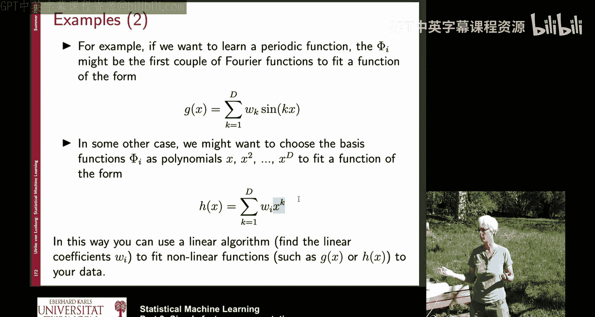

Another example where this is maybe a bit more explicit is if you consider these file functions as feature extraction functions。

 So maybe your data is a set of custom or like here I have an example where I have a basis of texts so I have many。

 many texts which I maybe crawl from the internet and now I want to I don't know predict something on this text。

 maybe how well is this text duty to sell my laptop or something。

And now you you use feature extraction functions and each function extracts a different feature。 So。

 for example， the function Phi1 counts the numbers of a currency of the word So on this particular tick and Phi 2 counts how often does the word team occur in this particular tick。

53 tells you， how many words does this text have。54， maybe if。

 maybe you don't look just look at text。 but it web pages looks at how many images are on this web page and so on。

 So you have many， many different features that you're going to extract based on your data。

And these extraction functions， they are not linear。 I mean， for example。

 because in in the case of a web page， this doesn't even live in in a vector space RD。

 So you wouldn't be able even able to say that there's a linear function on a text。

 You need to have a Euclidean representation。 And this is sort of a way to achieve such a representation。

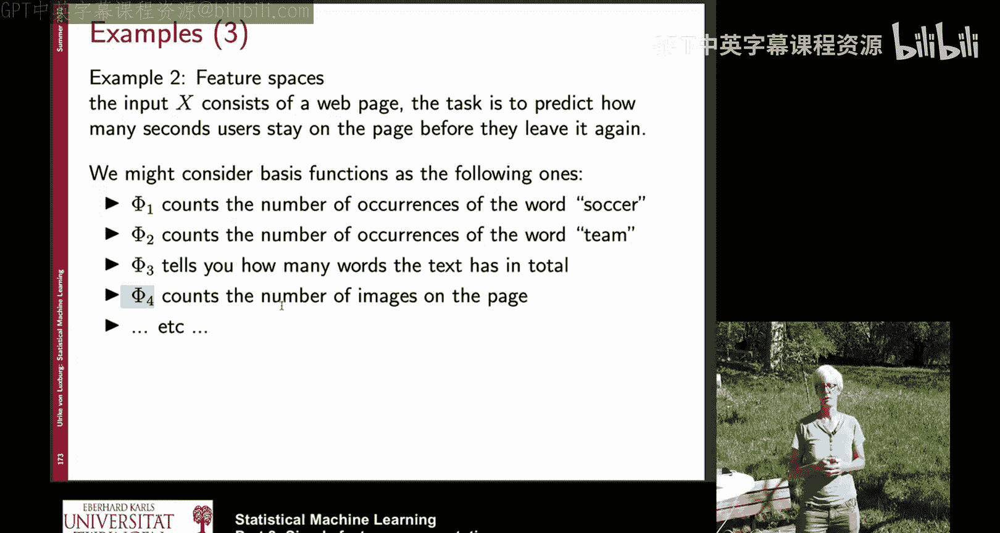

And now， how do we solve such a problem， In fact， that's now exactly the same as we had it before。

 just that our notation now has an additional phi everywhere。

 So what we now have is we have now our data and and we can write it into our data matrix as we had done it before。

 so。😊，We have the end data points。Which are in the rows。

 So you see here x1 is in the first row and x n is in the last row。So again， we have N rows。

 each one for each data point， and then the columns of these of these rows are the extracted features that we have。

嗯。So from Phi Phi1 to Phi D in capital D is now the dimension of the number of features that I'm going to use in this particular case。

Now Im back in the exactly same setting as before I have a matrix and want to solve a least square problem。

😊，So I want now to find the vector w is to minimize the difference between the true outcomes of the data and the predicted outcomes as predicted by this matrix by vector w on this matrix phi。

YouNow， this is sort of， it's exactly the same problem as we had before。

 just that the matrix is now called phi rather than x。

 So it has the same kind of solutions as we had before。 If the matrix has rank。

If it has rank full rank， then I get this solution。 if it doesn't have full rank。

 I need to use a generalized inverse here。As we have seen it before。

 So there's nothing that really changes。 It's just。

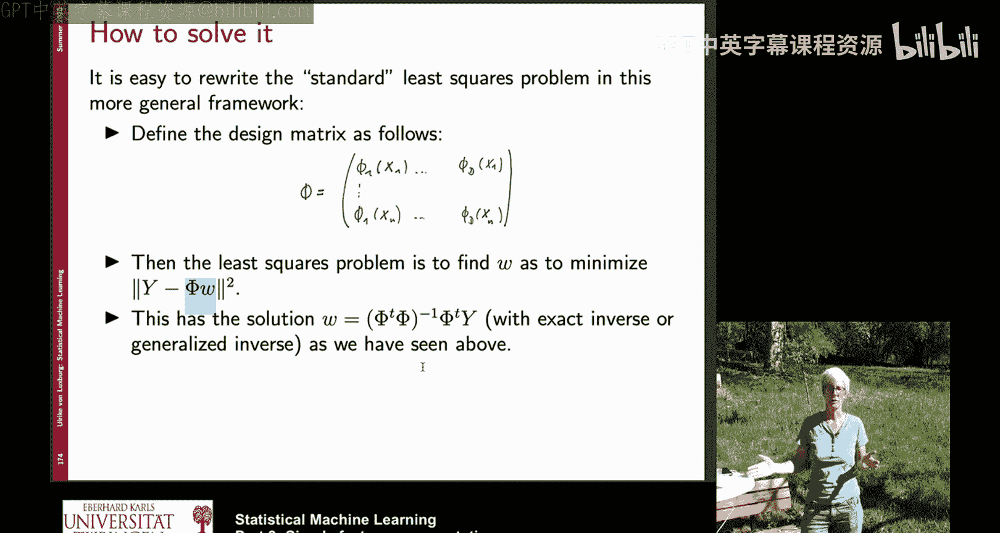

It's just another way of thinking about the same problem。

There are two or three remarks I would like to make on this scenario。

The first important remark is that in this scenario we choose the basis functions before we get to see data。

 but of course， based on our domain knowledge。 So if we want to do some kind of predictions on a webp page。

 we maybe know that the number of occurrences of certain words is important。

 the occurrences of certain images is important。 Maybe the text size is important。

 but then there are other things that are maybe not so important。

I don't know when is the date when this web page has been created or something like that。嗯。And so we。

 we sort of use our domain knowledge to first extract the kind of basis functions that we want to use。

And then we use them。 We fix the spaces function， and then we get to see our data。

There is another area of machine learning where you sort of do one step more and you also adapt the basis function to the data that you see and this is called dictionary learning and where you not only select the set of basis function that you have in principle based on your domain knowledge but you first look at the data and then you say oh to describe this data I probably need these couple of base functions。

This is much， much more involved from a theoretical point of view。

Because the function space all of a sudden depends on the， on the particular data set at。

 And then much of the theory breaks down。 and it's。

 it's not at all obvious how to solve this problem。

 And we are not going to discuss it in this lecture。 But if you're interested。

 this field is called dictionary learning， and it's used a lot。InIn many different domains。

 but it's simply more complicated than what I want to explain right now。The one。

 the second remark is that if you are the one who designs the set of basis function。

 you need to give a bit of thought into this parameter capital D。嗯。If you take D very small。Like。

 the number of features is small。You are less prone to overfitting。

 That is what we have already discussed。 So likely， if you fit your， your function space。

 like pick the best function in your space， according to the least square loss to fit your data。

 you're going to find one function。And you're not going to overfit。 It might， however。

 be that you underfit because maybe you cannot represent this phenomenon with just two input variables。

The other side， the temptation in in machine learning is， of course。

 to use millions of features and that that the algorithm try to figure out which of these features are important and what weights to use for each feature。

Then， of course， you are less prone to having to underfitting because your function space is really large and you can express more or less whatever you would like to。

 but you might run into overfitting problems。 And now of course this is sort of again。

 one of these typical tradeoffs the function space mustn't be too small it mustn't be too large you need to be somewhere in between and we are going to talk eventually about how to select all these parameters。

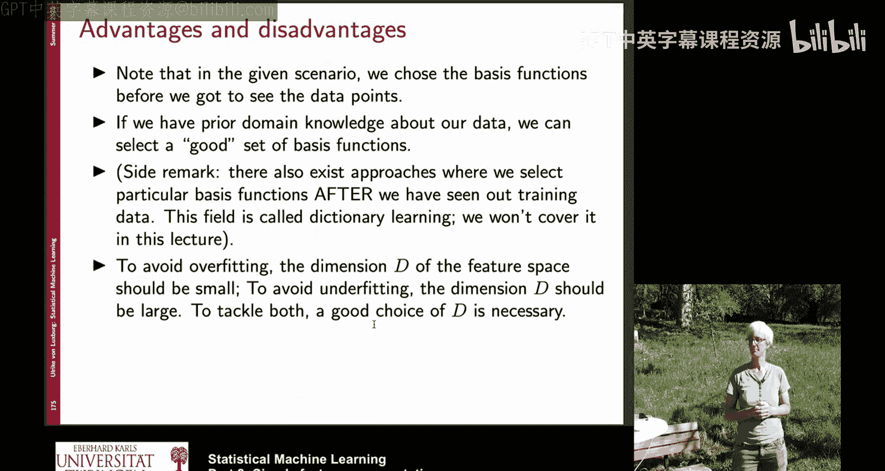

There's one more remark。That this small D can be quite restrictive about polynomial spaces。

 If you're interested in that， you can maybe read it on the slides。

 I just make the point that even if you look at a polynomial of degree 2 and your original data has a couple of dimensions。

 then the parameter。Like the like if T is the original dimension of your data set like like say you have points in R D。

 And now you want to use polynomials of degree 2。And essentially。

 there are these square many polynomials already in your input variables because you need to couple each input variable D I X I with each other input variable Xj。

 So you have a squared number of input variables and so your your feature space can explode very fast。

😊。

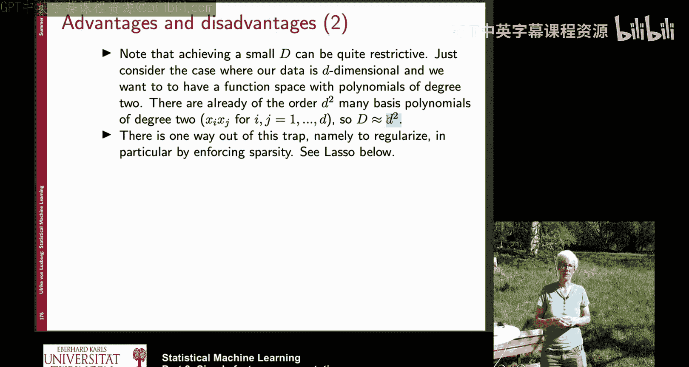

But this is maybe not so quickly right。