# 图宾根大学《概率和统计机器学习｜Tubingen Probabilistic and Statistical Machine Learning 2020》中英 p11 -11-Part 9 - Ridge regression.zh_en -BV1gso5YGE4s_p11-

Now we want to look at a regularized version of ordinary least squares。

 which is called rich regression。😊，We have seen in our last lecture that least squares。

 if we don't use any regularization might run into problems if the dimension of our data space is very high。

 at least we have started discussing it。😊，And there might be many other reasons which we are going to discuss in a second to why the standard setup of ordinary least square regression is maybe suboptimal。

And now we want to look at one variant of this algorithm， which is called rich regression。😊。

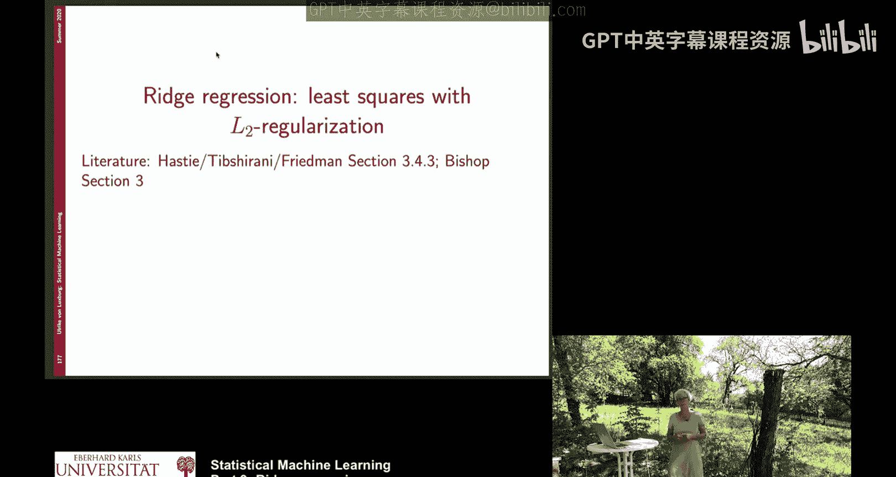

And we start from two different points of view。The first one is that if you consider again。

 what the theorem told us what the solution of ordinaryin least squares is， in particular。

 in the case where the data matrix has a rank that is not full。

 we had this problem of nonun solutions， so there might be many solutions to our problem and we don't really even know which one is good。

Also taking like if you take this。This pseudo inverse of the matrix。

 if you remember we need to take something like one over the eigenvalue lambda I。

 which if the eigenvalues get close to 0 also makes it numerically really unstable。

 so this is maybe something that we would like to try to avoid。😊。

The other point of view is that in this standard formulation of least square regression。

There is nothing that really prevents these parameters， these weights， WI from becoming very large。

And if these parameters w I become very large。😊，Then this introduces a lot of variance in our results。

 just consider a function f of x， which is like2 times x1。😊，Plus，100 times x 2。Plus， I don't know。

200 times x3。The fact that these coordinates here are really large introduces a high variance because if this if this value F x3。

There is just a tiny bit， the amount by which the function wiggles is pretty large and now assume you have a bit of noise in your data。

 these all your x's are going to wiggle a bit because this is the way the noise acts and now it could be that by having some parameters or some weights in our function that we have learned which are really large that then the result of this function or the prediction of this function has more variance than maybe would be necessary to find a good solution to the problem。

😊，And so to avoid this effect， we would like now to introduce a regularization that tries to reduce the size of these kind of parameters。

And at the same time， this is going to also solve the first problem about numericalital stability。

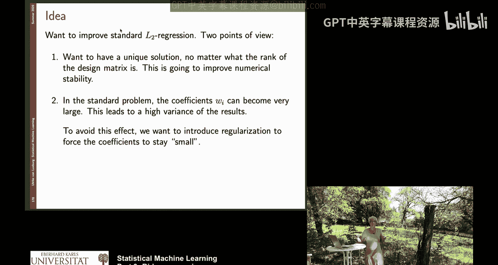

We now consider the following regularization problem。

Wwhichch is then going to be called rich regression。 So the input space is again an arbitrary space。

 the output space is x。 we fix a set of basis functions， D basis functionshi P phi 1 to phi D。

 and then we use a function。 We want to learn a function。

 a linear function in these kind of basis functions， W I sum of w I Phi I of x。

And now we want to use a regularizer that punishes the size of these coefficients W1 to WD。😊。

And what we do is essentially。We now define a function。The function is called omega of F。

 and this is always going to be the notation that we are going to have for the regularization term and optimization problem。

And this term omega of F in some way is supposed to measure how simple the function is or how easy or how well we like this function。

😊，And in this case， we want to say。And this function WF simply looks at the norm of the W vector。

ucidean the norm of this vector and the Euclidean vector space。

And we say we like a function if this norm is small。

And observe again if you can't remember what the norm is。

 the norm is just the sum of the squared entries， so if you now have a function or at least if we have the choice between two functions which are sort of both very good on the training data。

 but one of them has very large coefficients WI and another one has rather small coefficients WI then we want to prefer the second function。

😊，And the way we do this is now the following。So now we want to look at an optimization problem。

 which is on the bottom of the slide。The first part of the optimization problem is just the empirical risk。

 We want to minimize the empirical risk。 So the least squares loss between the true variables Y I。

 the true output variables and the predicted output variables phi times w。😊。

In terms of the squared loss， in terms of the L2 norm。

And now we add a little term here lambda is a trade of constant that we need to fix and we are going to talk later about how to do that。

😊，And then we have this term norm of w squared， which tells us what the。

How how much we like this function。And smaller is better。 We like functions more。

 which have a smaller term W。And now essentially what we are going to do is we want to minimize the sum of these two expressions and the sum is going to be small if hopefully both of these individual terms are small。

 so on the one side we want to have that the impilgrims is small， which is the first term。😊。

And then at the same time， we also want that the regularization term， this W squared。

 the norm of W squared is small as well。😊，And ideally， if you achieve both。

 then we find a function that fits the training data well because the first term is small。😊。

And the function that we like because it has only small coefficients W。

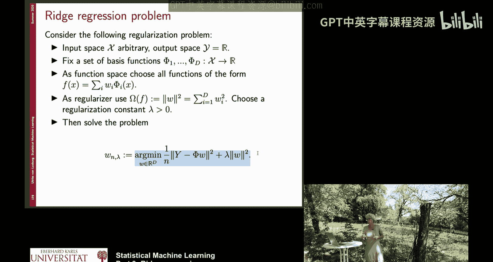

Now， this is the optimization problem we want to solve and now the trick is again this is a surprisingly simple problem we can write it down and we again have an analytic solution to this problem and it looks as follows。

😊，So these coefficients I now called an W N Lada。We N because it depends on N input points and lambda because it depends on this regularization constant and we will still have to talk about this。

But the solution， the theorem simply says these coefficients that solve this rich regression problem of the previous slide。

😊，Can be analytically given in this form。And this form is phi transpose phi。

Plus N Lambda identity matrix。Inverted， all of this inverted times phi transpose y。

And the notation just I is the D times d identity matrix。

 so the matrix which is one on the diagonal in0 everywhere。And now。

 before we actually look at the proof， let's digest what the theorem says。

So we do not have any assumptions any more about whether a matrix has full rank or not。😊。

We simply say no matter what our original date matrix or this matrix phi is。

This is always going to be the solution。The solution has a like and to the power of minus1。

 so it says the solution consists of inverting a certain matrix。

 implicitly this also means hopefully that this matrix always is invertible because otherwise the statement wouldn't make sense。

😊，And so so one aspect we would need to see is why this matrix here is always invertible。

And maybe the other thing is if you compare it to the solution of the ordinary least square problem。

 there is only one tiny bit which is different， it looks nearly the same as the original problem just this term here。

😊，This is an additional term that we wouldn't have had in the previous solution。And what does it do。

 So essentially， I mean， n is a constant that we need for scaling reasons。

 Lambda is the straight of constant that we have between the empirical risk term and the regularization term。

And then we multiply this by the identity matrix， so essentially what this does is I mean this blue marked matrix here is a diagonal matrix that is 0 outside of the diagonal and on the diagonal it has the entries n times lambda。

😊，So essentially what happens here is we have this original matrix that we also had in our previous program。

😊，On the diagonal of this matrix， we now add n times Lada everywhere。

 like for each entry on the diagonal， we add n times Lada。😊。

This apparently makes sure that the matrix is invertible and then we can compute the solution。

 and this is what we get。This looks surprisingly simple。

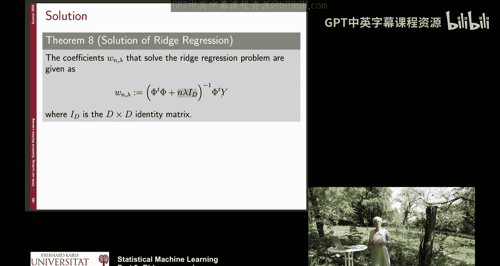

Let's first look at the proof and then look at many other aspects。So the objective， I mean。

 the proof goes essentially along the same line as what we have seen before。

 we have this objective function。😊，Which is the similar the same objective function that we had before plus the regularization term。

The first thing to observe is that this function is convex。In W。Because the first term as convex。

 this is something we have already seen。The second squared norm is also something that is it's a complex function and if you haven't seen that before you might want to try to prove it yourself。

 it is simple， but it might be a good exercise。And the sum of two convex functions is also convex if they are defined on the same domain and so on。

 this might also be an interesting exercise to try。So we have a convex objective function。

 the domain is convex as well because this is defined on all of RRT because W is what we want to find。

 it can be anything in Rt。So the objective function is convex。

Now we follow the same proof strategy as we had before。

 we need to take the derivative of the objective function with respect to w and set it to 0。

So we compute a gradient。And again， with the matrix calculus。

 we can do this very easily and we find nearly the same gradient as before。

 except that we have this additional term here。😊，Then we。

Sort of need to set it equal to 0 because we want to find a minimum。

And we sort of rearrange the terms， and this is not what we get。

So the necessary condition for a minimum of the objective function is that W satisfies this kind of equation。

If you now want to solve for w again， we would need to multiply by the inverse of this big matrix that is on the left hand side。

😊，And there we now need to see whether we can actually take the inverse of this matrix。

And I discuss it on the next slide。 So on the next slide we see that this matrix here。

 the big one here can always be inverted。 It has full rank。So we can invert it and solve for W。

 and then we're essentially done with the proof。😊。

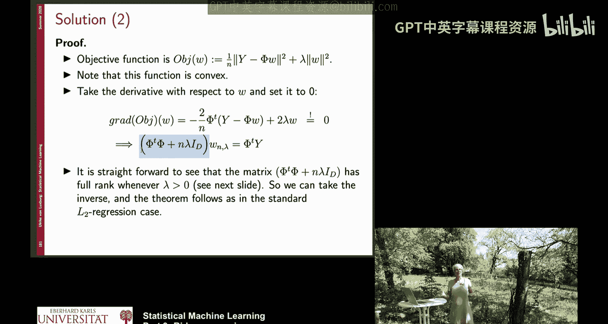

I still have to tell you why this matrix is invertible。And for this。

 I still would like to ask you to recap a bit。And want to ask you two questions。

So assume you have a matrix， which is symmetric。Any D times D matrix， which is symmetric。

What do you know about the eigenvalue of this matrix？If you don't know anything。

 please try to find it out in the recap slides or keep on watching the video but this is something that you need to know I am going to ask this question I guess 5 million more times you need to know if a matrix issymmetric。

 what does it mean for the eigenvalue。😊，You also the second question is assume you have a matrix which has the following form so we start with any matrix E and we have a real valued matrix E。

😊，We consider Zz transpose， so the dash here should be a transpose sign。 Now。

 what do we know about the eigries of this particular matrix？And again。

Think about it if you don't know it， consider your slides。Or at least remember it after this lecture。

 so you need to know that。

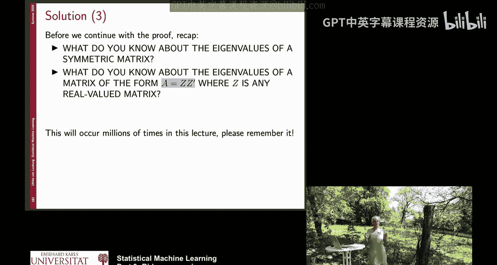

You will see on the next slide what the results are going to be。

So what we want to prove now is that this matrix is invertible。

We start considering this matrix the first is so here this one phi transpose phi。

This matrix is a symmetric matrix， simply because we take the product of a matrix and with its transpoposedse。

 that's always a symmetric matrix。😊，For a symmetric matrix， the bell that always needs syringus。

 if I have a symmetric matrix， there exists a by basis of eigenvectors and these correspond to real valued eigenvalues。

 so I can always decompose this matrix in some kind of spectral way with real valued eigenvalues。😊。

So one particular decomposition we can make is we can write this matrix A。😊，As v transpose Lada v。

 where lambda is the diagonal matrix that contains all the eigenvalues on the diagonal so Lada 1 to lambda n。

😊，And V is the matrix that has the eigenvectors as column vectorctors。

So for any symmetric matrix and can make such a decomposition。Now。

 the second observation here is and okay， and the eigenvalues which are in this matrix lambta。

 they are all real value。 this is， of course the key of the whole thing。😊。

So by the fact that it's symmetric， I know that they are real valued， but I know even more。

Because of this special form， this is essentially this matrix A is essentially something like taking a square of something。

😊，So all these eing values have to be greater or equal to 0。😊，And again。

 if you don't know or haven't seen that before， maybe to try to take it as an exercise size。

 this matrix is positive semi defite， all its eigenvalue are always greater or equal to 0。😊。

You might maybe if you want to prove it， I guess one of the easiest ways to maybe to proof by contradiction。

 assume that the eigenvalue is not is negative and then see what's going to happen。Now， in the end。

 we want to prove that this matrix has full rank and thisin， right？

So we know that a matrix has full rank if all its eigen upar。

 if if all its eigenvalues are greater than 0， if strictly greater than 0。

 so we now already know that we have eigenvalues that are greater or equal to 0 in this in this particular matrix phi。

😊，If I transpose five sorry？And now we want to show that this matrix we are interested in his evalue that are strictly larger than zero。

😊，To this， and we need to look at the sum of these two matrices here。

So essentially the way this matrix here has been written， we have a matrix A。

 which in our case is phi phi transpose， and then we have plus a constant times the identity。

And the general fact is now。If sigma is an eingvalue of a matrix a。With I vector V。

And now we consider this matrix a plus lambda the identity。

Then sigma plus lambda is an eigingvalue of this matrix with the same eing vector。

And this is very obvious because if we simply write it down a plus lambda i times v。😊。

This is the matrix we are interested in it's linear we can take it into the two different components。

 then we know that V is an eigenvector of a so this is the same asigma sigma times v。

Here we have it anyway because this is the identity matrix。 So this is the result we get here。Sorry。

 it's tough to to market。Okay， now what does it tell us？So if this eigenvalue is lambda。

 if lambda is an eigenvalue or sorry， if lambda is a constant that is strictly larger than 0。😊。

And the eigingvalue of a are already smaller equal than 0 than these eiging values are all larger than 0。

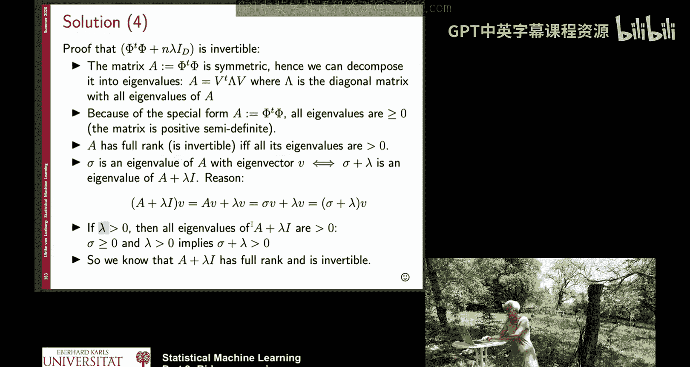

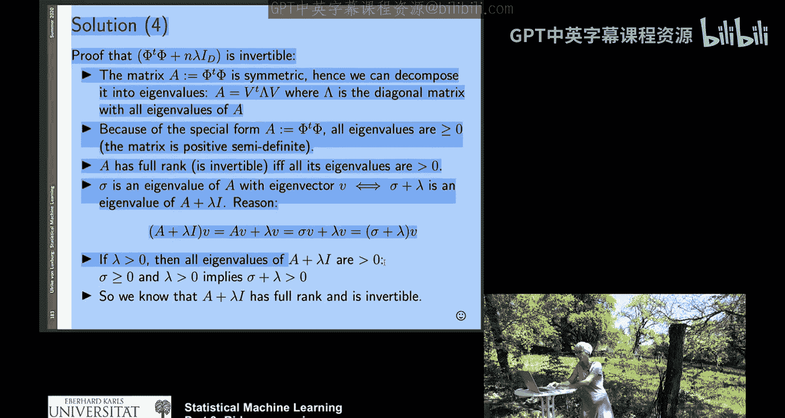

So if sigma is smaller or equal to 0， this is what we have already seen above here。

 so here it says all eigenvalue are greater or equal to0， these are the sigmas。😊。

And now if lambda is strictly larger than 0， then Sap with lambda is strictly larger than 0。😊。

So we know that all the eigenvalues of this matrix exist because are larger than0。

 so the matrix has full rank so we can invert it。😊，And this concludes the proof of our theorem。

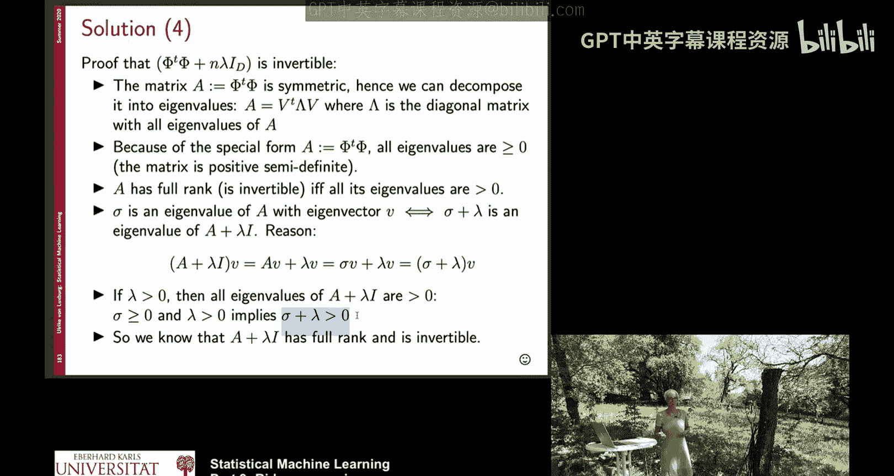

Now let's look at a very simple example for this particular application。We simply assume。

 sorry we have a true function here， which is a periodic function plus noise。😊，As basis functions。

 we simply take the first 10 Fuier basis functions。

 so the basis function we look at are the sine functions sine of k times x where k runs from 1 to 10。

So what we want to do is given some training data， we want to find the best function of this firm。

 some goes from 1 to 10。Wk sine of k times x， and we want to find this Wks。

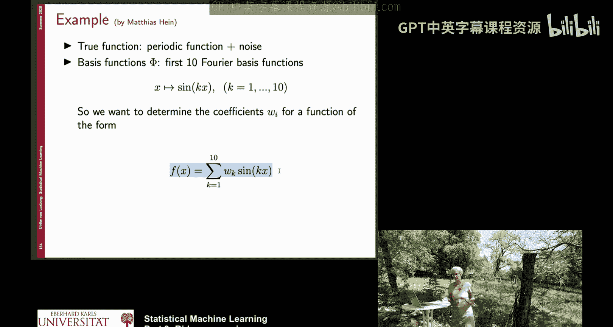

And here is an example which I took from Matthe。😊，What you see here， the black dots。

 I hope you can see them in the recording are the training points。

 so these are the points that we got so we have some mechanism forsembling points。

 the black dots are the training points that we get and now we want to fit this function which I've been talking about is sum of basis functions。

In this plot， the black lion。😊，Is the true function， the true underlying function。

 which in this is here called the regression function function。

 And if you remember back to the formal lecture， this is the expectation of y given x is x。

 This is a regression function， which is the true solution of this problem， the base solution。

 if you want the best solution that we could find。And now you see different functions here。

 the red one。😊，Is the linearly square fit， the one which we have without regularization。

And the blue one is fit by rich regression。And you can already see the red one is slightly more weak。

😊，Because it tends to overfit， or at least it has a higher variance。

The rich regression has a much lower variance。 It seems to be much more smoothly。

 It might even be the case that here it's a bit at this part here it gets a bit away from the black pest solution here。

 it's maybe even a bit underfitting。😊，It's not debatable which for this particular problem。

 which solution would be better， I wouldn't really know what to say。嗯。But what we can see here is。

 and this is what we want to illustrate the red curve is has more variance than the blue curve。

Now there' is one very important point that we haven't been talking about at all。

 but which is really important， namely the choice of this parameter lambda。

 so now we have the trade off so we have optimization problem says minimize empirical risk plus lambda times the regularizeror。

And of course， depending on how I choose Lambda， different things might happen。

And now I would like to ask you and maybe switch off the video and think about it for a minute。

What is the role of Lada， what happens to estimation and approximation error if I drive Lada very small。

 so in the extreme case Lada can be0。Or if I drive Lada very large， say 5 million or so。

And what happens in between and where do I have a low and high approximation and estimation error in this kind of machine。

So please think about it for a minute。

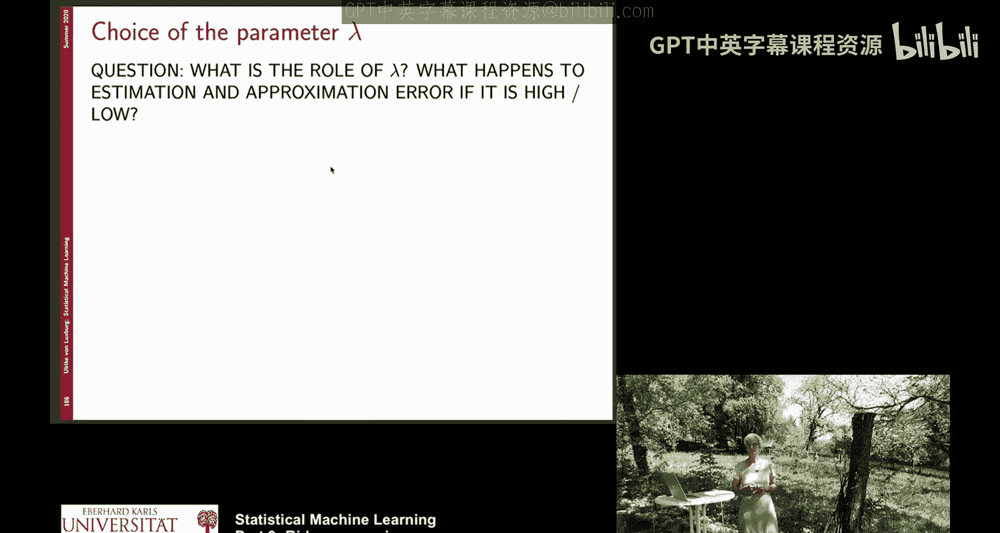

To answer this。I would like to illustrate it with a plot that I took from the bishop book。

What you can see here is a similar problem， as we had on the previous slide。

 so we want to fit a periodic function。😊，On the left hand side you always see individual fits so you take a couple of say 100 training points。

 you fit your function and you plot it and we did this 10 times so here we see the 10 or 20 or how many it is repition of the same experiment on independent training data。

On the right hand side， you see the green curve， which is the true underlying curve。

And the red curve， which is the one that is estimated by taking the average over all your lines that you have fitted on the left hand side。

Now， this is the difference between left and right columns。 and now from bottom to top。

 they solved this problem with a different parameter Lada。😊，So the amount of regularizationization。

Decreases from top to bottom， so it's hard to see， but here we have Lo Lata is 2。66。

 so Lata is maybe something like 100 or so here Lo Lata is already negative and here it gets even more negative。

 So here it's close to0 here it's a reasonably small number and here it is 100 or so。

And now we can look at the right side and what we see is if lambda is very low， is very large。😊。

It means we look at an optimization problem where we say minimize a trading error plus 100 times the regular riseor。

😊，So this regularisr really has a very high impact on the problem because if I want to bring the whole the sum of these two terms down and the last term is always my orders of magnitude larger than the first term then I'm only concentrating on this last term。

 so essentially I'm trying to pick a vector w that has very small norm because this is what I'm trying to regular I don't really care any much for the training error。

Now the outcome is is essentially this one， we learn a function that is in fact close to 0 because we try to push these w value so small that essentially the function is close to constant 0。

😊，The training error doesn't really。Doesn't really play a big role anymore in our optimization problem。

 So we don't really fit this function well。So in this case we have a very high bias of our function or the approximation error is high。

 the variance on the other side is low and you can see this on this side here。

 all these red functions more or less look like the same you repeat the experiments1 time。

 but there is not much variance in the result。😊，If we go to this other extreme case at the bottom of the slide here we have a very small regularization constant which is close to 0。

 so essentially we are closely to the setting where we don't regularize it all which means we only look for the training error and by all means try to minimize the training error。

😊，We don't care so much about the regularization。And you can see this here。

 the variance of these results on the right hand side is much， much loud than at the top。😊。

On average， it still works pretty well here。😊，We don't underfit and on average。

 we also don't overfit because we average over enough results， I think。

 but the variance of each individual。Fit to the data is very high。

This is something that again is not very desirable in practice because in practice you might not have enough data to fit like 100 functions and then take the average you fit it once and then you need to live with the results and it's hard for you to judge whether your result has a high or low variance you can't even really show that。

😊，And in the middle， you have sort of a moderately a moderate regime。

 The variance is not as high as at the bottom， but not as low as in the in the top。

 And you can see the function， the red function。At least it approximate a bit better。

 The green function or already reasonably well， It still underfis a bit here because it doesn't allow。

So high W value that you could really express the function with it。

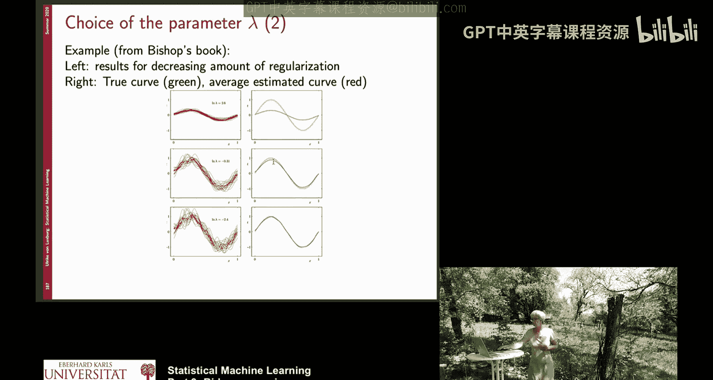

Here's yet another plot where we consider， again， the bias variance decomposition。On the x axis。

 we have log Lada。So here it if lock Lata is very small， Lata is going to go to0， if it gets high。

 Lata is going to be very high， so this is a log scale because often these parameters。

 it's not even clear， which is the correct order of magnitude。

 So often people choose it on a lock scale。 So here Lata is very small here it gets very large。

And now we on the Y axis， we plot a couple of terms。

 I think the absolute scale of this of this Y axis is not so important。

 but the sort of behavior of these functions is what you would need to look for。So。

The blue line is the bias of the function。And this increases。

Meaning that if we like if we are at the very left side of the plot。

 essentially we do not have any regularization。 So we also don't introduce any bias to our function space。

 We just see no matter which function we find it's okay。 so we don't have any bias。

The more we drive up the regularization， the higher the bias is going to be because we say you are not allowed to take any functions that have a high value of w。

 and this introduces a bias to always a systematic bias。😊，So as lambda increases， the bias goes up。

Similarly， the variance goes down so the red line here is the variance of the result in the beginning we tend to overfit。

 there is lots of noise we don't have any mechanism in place to prevent overfitting because we don't regularize so it's going to happen。

And then the higher we we regularize the less variance we have。In the extreme case。

 we might in underfi， but at least if we just consider the variance。

 it gets smaller and smaller the higher we drive， this Lata value。😊。

And so bias plus variance is this purple line， which is essentially or bias squared plus variance is essentially more or less the same as the test error and which in this plot is the curve here。

 So you see it sort of if lambda is too low。😊，This test error still is sort of somewhat higher than it decreases decreases decreases until we are roughly here at Lada lock Lada equals 0。

 so lambda equal 1。And then it increases。 So， and this is the typically of behavior。

 If you have such a regularization parameter。Typically， the test  error curves has some shape。

 or Often it has some shape like this。 And what you're like trying to find is the sweet spot in between。

And of course， I mean， this is a made up example， this is why you could plot all these things。

 so what you would need to find out in practice is that this value of lambda saying close to 0，😊。

It's the best regularization parameter that parameter that you could use to solve the problem。

In practice we are going to see this in one of the next lectures we would use cross validation to try to find that spot because it's not obvious by just playing around with parameter lambda。

 it's maybe not so obvious how to see that this parameter Lada equal or lock Lada equals 0 is really the best one that you could fit。

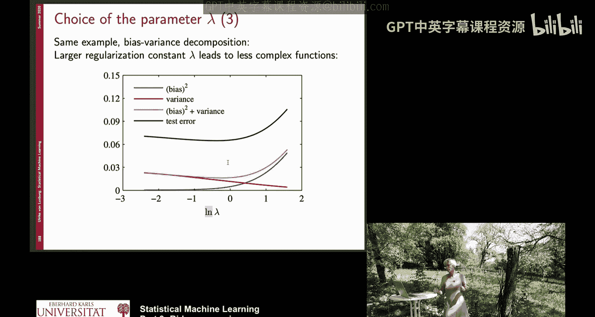

There are a couple of more slides which I don't really want to explain which say that the derivation of rich regression there also exists another derivation in terms of a statistical shrinkage method。

 so there's a whole field of methods where you can say if you want to estimate certain quantities there are situation where it's better to sort of try to shrink the average to underestimate a bit。

😊，And this is what is going to happen here， and one can show that rich regression can be expressed as a shrinkage operator。

😊，You don't really need to look at these slides if you're not interested in they're also not going to be part of the exam because they have a star attached here so this always means they are not relevant for the exam if you're interested look at them if you're not interested you can safely ignore them and it's not going to have any consequences。

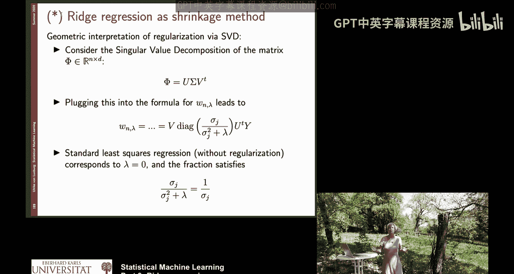

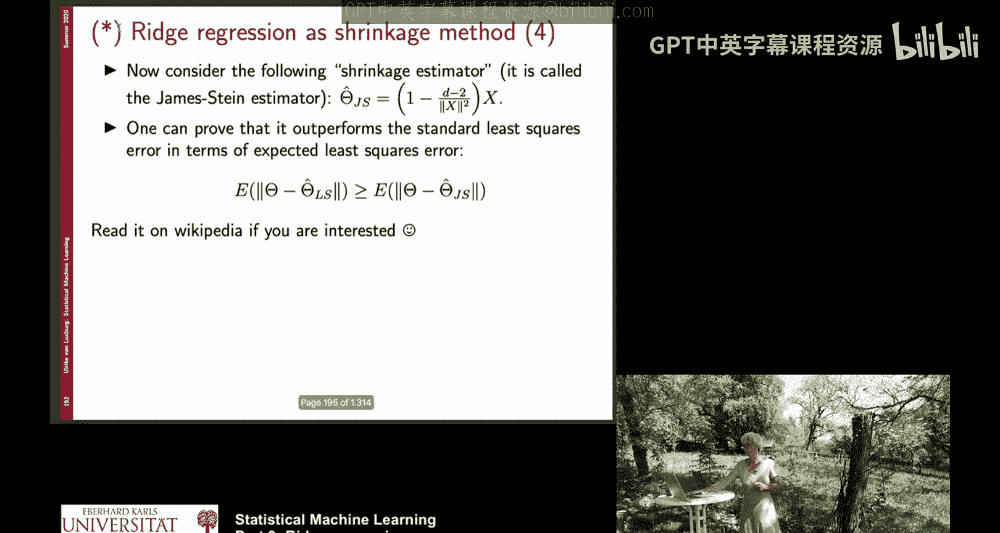

To finalize this chapter on rich regression， I would like to make a couple of remarks on the history and terminology。

😊，So a rich regression has been invented by Tiov， in fact。

 a Russian mathematician in 1943 in World War I。😊，In the context of integral equations。

There exists a publication。嗯。Here， tick off on the stability of inverse problems。

 and he really came from this point of view that I mentioned in the very beginning that if you want to invert a matrix。

 it's maybe good if if the eigenvalues of this matrix are not really close to0 because otherwise you run into numerical problems。

And by adding these terms on the diagonal， you actually make sure that all the eigenvalues increase at least by Lada。

 so it can prevent these very extreme cases and these very extreme numerical instabilities。😊。

The fact that he was the first one who published this also means that the algorithm is often called Tiion of regularization。

 So Tiion of regularization and retro regression is exactly the same。

 It's just two different names for the same kind of algorithm。😊，In the statistics literature。

 it has been introduced。 and apparently I read this somewhere。

 but I've never really looked at the paper。by her and Kenard Rich regression。

 bias inform estimation for non orthogonal problems in 1970。

Now already I think it's interesting to see also the years when things happen。

 so taking of regularization the first time this came up was in 1943。

 then in statistics it was sort of taken up in 1970 and in the next lecture we are going to see Laso which is already 1996 so that's already pretty close to our time now。

😊。

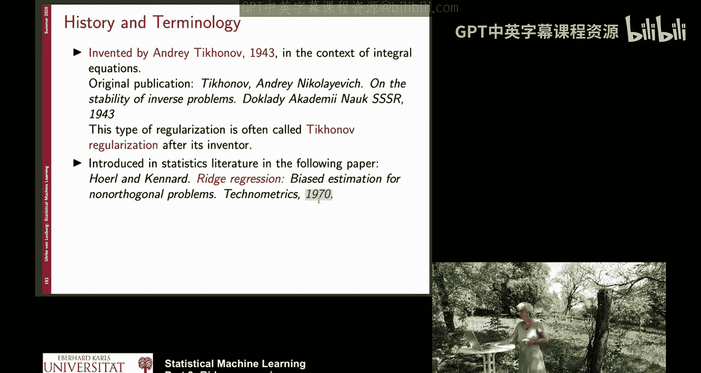

One more comment。 Why is it really called rich regression。 It this sort of a funny name。

 So a rich for those who don't know this English word is something like a Barut also in German。

 So a rich a mountain which is always like you have a steep part of a mountain。

 And then you have this rich going along the mountain。嗯。And the reason why it's called like this。

 there is an illustration that shows it。 So if you make a plot of your matrix and this this design matrix phi transpose phi。

 which essentially contains your data。 So what I did here is I made a plot of the matrix X transpose x for a random matrix X。

 and it might look like this。😊，So the height of， so essentially to understand this plot on the like the x and y x are essentially the sort of imagine you have the matrix there。

 And then the height of these little spikes is what is the entry of this matrix at this particular point。

And now if we look at rich regression we not only have the design matrix xspo x but also plus lambda times the identity and as I said lambda essentially adds something on the diagonal of your matrix and this is what the plot then looks like so on the diagonal we all of a sudden have pretty high values。

😊，And they are much higher than what we have outside of the diagonal。

And this now looks like a mountain， which。And this is why it's called rich regression。

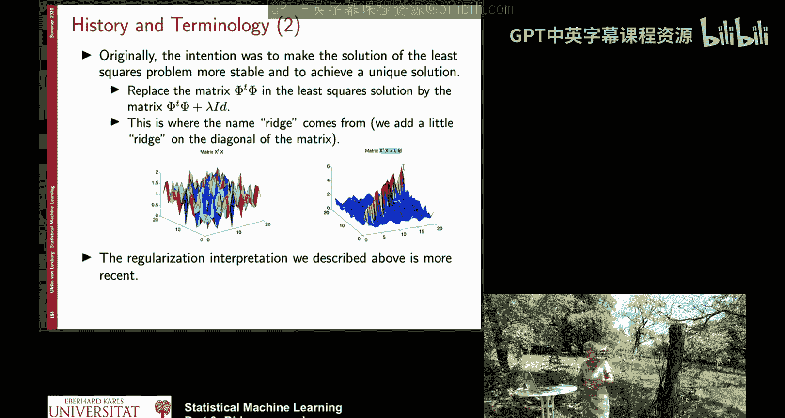

So to summarize。Our rich regression problem is to follow。

 We are still in a some kind of standard regression setup。

 our input data is RD or we have a function basis that brings us to RD。

 The output is R because we' are in a regression framework。We look at the squared loss。

The function class is linear functions， as we had before。

 we have linear functions parameterized by the parameter W。And implicly。

 also this offset B that we have gotten rid of as as we explained in the last lecture。

But as opposed to inordin least squares， we now have a regularized and MD repp function。😊。

And the amount by which we punish functions is by looking at what is the squared norm。

And we try to avoid functions that have a large square norm。

So our optimization problem we want to solve is。 We want to solve the regularization problem。

 minimizing the empirical risk plus the regularization。With a trade of constanttantta。

And interestingly， this problem still has an analytic solution as ordin least squares and it looks nearly the same as in ordin least squares。

 except that we have this little rich， the La that is going to be added on the diagonal。

 and this makes the problem numerically more stable and also helps to avoid overfitting。😊。

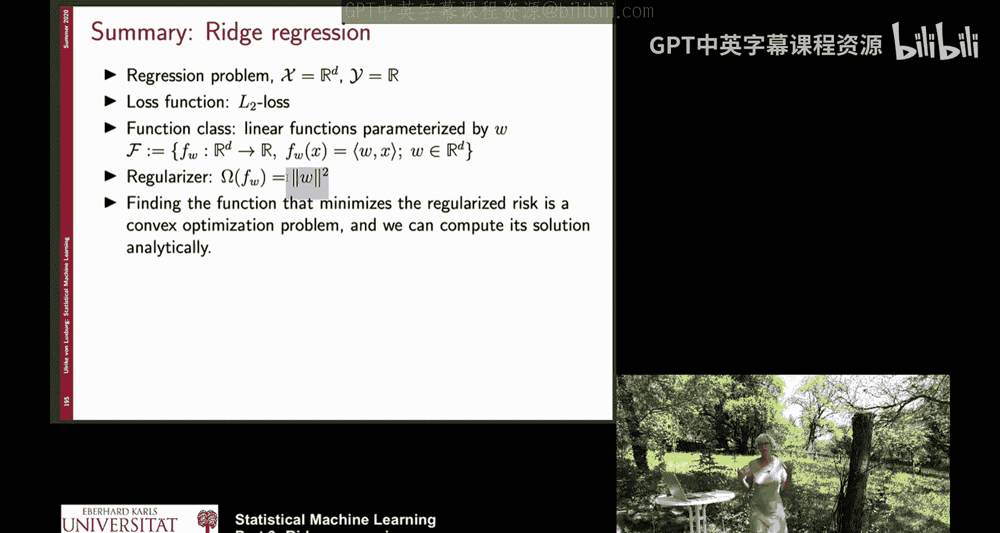