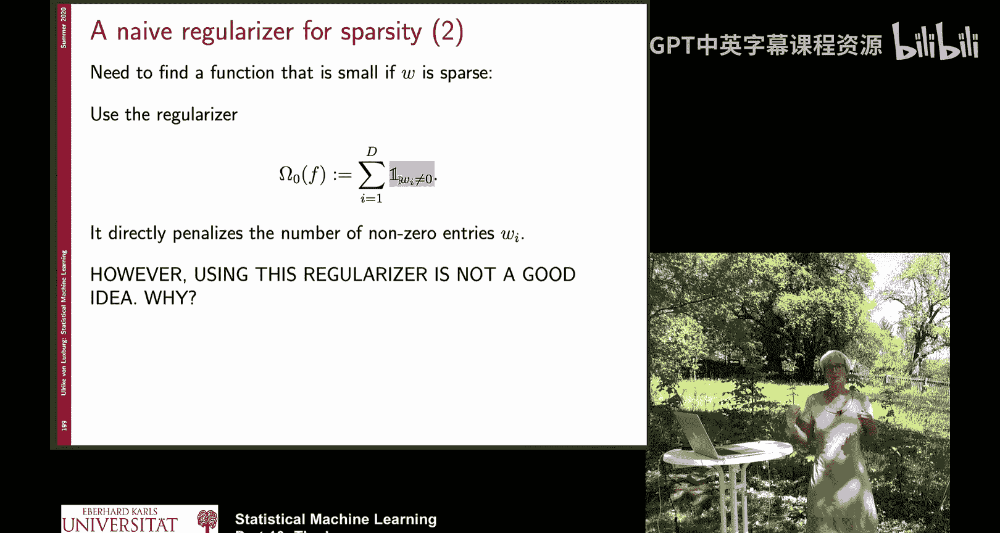
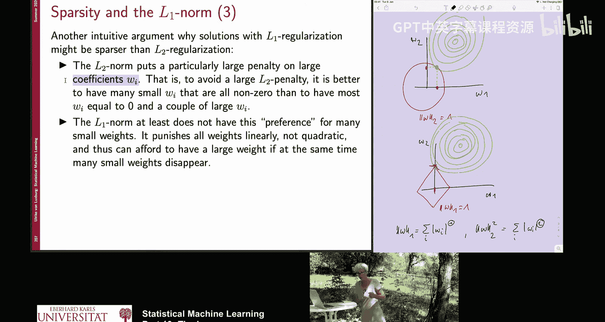
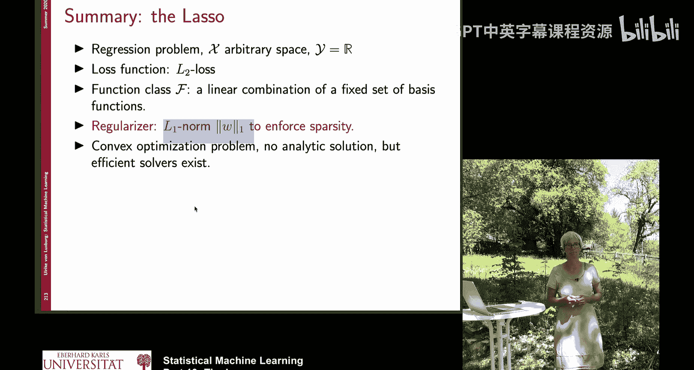

# 图宾根大学《概率和统计机器学习｜Tubingen Probabilistic and Statistical Machine Learning 2020》中英 p12 -12-Part 10 - Lasso.zh_en -BV1gso5YGE4s_p12-

The next algorithm that we want to consider is called the Lasso algorithm。It's， again。

 an algorithm for least square regression。😊，But it uses a different regularisor than in rich regression in which regression。

 we use the L2 norm irregularization。 we are now going to see that we use the L1 norm and this corresponding algorithm is going to be called Lasso。

😊，Just looking at history， so we have seen that least squares regression with rich regression。

 like with rich， the rich regression formulation in terms of the2re realizationization is already quite old。

 Now， this lasso is pretty new it from 1996。😊，The key thing we are after in this particular regularization formalization is that we want to achieve sparsity of our solution。

😊，Sparrsity means that we have all these many different parameters， W1 to W D。But ideally。

 what we would like to achieve is that many of these parameters are 0， so we can fit D parameters。

In these parameters， like each parameter， WI tells us how important this particular feature PI of the data is。

 and ideally what we would like to have is that many of these parameters are exactly zero。😊。

Why would we like to have that？There are two different reasons for that。

 The first one is a computational reason that's maybe not the most important one， but in fact。

 if we want to evaluate functions。And the dimension of the data is really， really large。

 say I don't know a million dimensions。 and maybe if you only need to evaluate 10 of these dimensions instead of a million that it might make a difference in particular。

 also in many other circumstances of the algorithm。

 if it's not just about evaluating but also multiplying matrices in these kind of setups and so on。

The other reason that's， I think even more important， at least nowadays。

 when it comes to regularization is the interpretability of the solution。

To understand that consider a situation where you have say a medical example that you want to solve。

 so you have certain features of a person， you have the temperature， you have the age。

 you have the diet of the person and you have measured lots of blood contents and so on。

 so you have all these measurements and now you want to make a diagnosis and you want to say this person has a certain disease or he doesn't have the certain disease。

😊，Now， imagine we feed our computer with， say， 200 different measurements of this person。

We run rich regression or ordinarily square regression， and then we see the vector of W I。😊，嗯。

Of the solution and many， many of the entries in this W I vector are have large components。

 So maybe then it's for us really hard to interpret the solution。

 So why would it really be be the case with this particular linear combination that to be trust the result of this algorithm。

What we would like instead is maybe the algorithm only picks， say 10 coordinates。And says， okay。

 what is really important is the blood pressure and the age of the person。

 but maybe what is not important is the diet of the person。

 And then we set the corresponding parameters in the optimization problem。

 they are going to turn out to be 0。And then if a doctor is going to look at the solution that the algorithm found for us。

😊，He can say， okay， we have 200 input variables out of these input variables。

 only these 10 are the ones that the algorithm considers。

 And now the doctor with his background knowledge can judge whether he really trusts the algorithm or whether he thinks it's really bulled maybe the age doesn't have anything to do。

 That's well known， but the algorithm found the age， then we maybe don't trust it。😊。

Whereas the other way around， if the algorithm found a blood pressure and you have already known that the blood pressure is something that is important in relation to this disease。

 you might trust the algorithm more。And in particular。

 if in the medical domain and in art and other domains where it's really important that experts look at the solution and trust what the algorithm is going to produce。

😊，This kind of interpretability is really important， and Laso is one way。

 at least a simple way to try to achieve a bit of interpretability。So hang on once back。

 So what we want to find see we are looking for a function at this in the same form as before。

 a function that is sum of W I FiI。😊，But what we want is that many of these coefficients W I are 0 in such a solution is called sparse。

 sparse always means a vector is sparse If most of its entries are 0。

 So the vector W is supposed to be sparse， so most of its entries are supposed to be 0。

 and only few of them are non0。Now here's a question to you and you might think about it for a couple of minutes before you continue watching the video。

😊，What do you think would be a good regularizer if you want to enforce parrssity。

 So the approach we want to take is， as in retro regression， we want to say。

 we minimize the empiricalpirr risk class lambda at times the regularisizer。Of the solution。

So what would be the regularizer that you would pick if you were supposed to solve this problem？

And maybe to help you thinking， like the regularizerr is the function that it's supposed to have a low value if the function is one that you like。

😊，Okay， so what other functions that we like we like to find functions where the solution vector is spaous。

 where the W vector is spars。😊，So why don't we simply say， well， as a punishment。

 we simply check how many components of our vector are on  zero and we are happy if many of them are non0 and we are unhappy if many of them。

Sorry， we are happy if many of them are0 and we are not happy if many of them are not0。

 positive or negative。So the naive way of putting this would be we as a regularizer we used the function that I called omega 0 on the slide。

 which is simply it counts for all that deco coordinates the characteristic function of whether this particular vector value WI is 0 or not。

😊，So as it's written here， this is a number between between1 and d or between 0 and D。

Which tells us how many nonzero coefficients we have。

This is the natural function that you would use if you want to penalize non zero coefficients。

However， this function also has peak drawics。And again。

 a question to you is what do you think are the drawbacks of this particular function in our context of regularized least square regression？

Please think about it for a second。 hopefully we have found it。

 The problem with this function is that this is not a convex function。 It' is in fact。

 a discrete function so。😊，This vector essentially just or this function essentially just checks。😊。

How many non zero coefficients do we have？This is a discrete function。

 and discrete functions are always hard to optimize。 And to get an intuition。

 just consider you have a vector w。

Which is 0，0。 That's nice。 And then you have 0。00123。See， this is our vector。

The vector all in all has5 coordinates， three of them are non zero， so we would have omega 0 of w。

Is three。 So we have three non zero components。嗯。All fine。Now observe that one of these components。

 the middle one， is very， very small。And it might happen that simply out of a。

 for noiseisy regions or noise reasons or for。Maybe convergence reasons this parameter hasn't really been gone to zero。

For whatever reason。 So the punishment for this vector is still 3。

 but now consider this vector w tilde， which is 0，0，0，2，3。And here we would have omega 0 is 2。

 So its and observed these vectors are nearly the same There's just one。

Little entry that is a tiny bit different in the search coordinate unit after the point。😊，嗯。

For practice， it probably doesn't make any difference which of these two vectors I take。

But the punishment is different for both of them。 And the point is。

As soon as I go from 0 to any non0 number， no matter how small the number is。

 the punishment jumps from 2 to 3。😊，this is something it's not a continuous kind of thing。

 So and in optimization， we are always looking for continuous things because you want to say I decrease a certain parameter。

 say I decrease a certain entry of this vector。 and then my punishment is going to in increase。

 But in such a situation， you can't do that because there these discrete jumps。

 You can decrease decrease nothing happens。 And all of a sudden you jump from 2 to 3 or from 3 to2。

 depending in which direction you go。😊，This is what makes these kind of optimization programs so hard。

So it turns out this is also the case for this optimization problem。

 all these discrete these optimization problems with half discrete components in their R NP heart。😊。

So this is all ice from theory。 We can say we use it as a regularized in practice。

 It is not going to work。What we are going to do instead is we are going to look at slightly different norms of the vector and before I can explain you what we are going to do。

 I need to tell you what are P norms。People in Ma would have seen this before。

 people in computer science probably have not seen it before。

So here is the definition we consider a vector w that lift in Rt。And now we define a norm。

 So P is a parameter， we can define it for p equals 2 P equals 1 p equals I don't know，1。3。

 it's any positive number， at least。And we define the p norm of a vector as this expression。

 this is the sum of the entries of the vector to the power of P。😊。

And then begin take one like we take the sum of all this and then take the P root of this thing。

 So to the power of one over P。If you consider the special case of p equals 2。

 this is the normal norm of a vector， the Euclidean norm， the square norm。

 however you want to call it， this is sort of the standard norm that you would use in a Euclidean vector space。

This would be p equals 2， but now they exist many other values for P as well。

 which might make use in different applications。Now， there are a couple of facts。

Whenever P is greater or equal to 1。This thing is， in fact， a norm。And it is a convicx function。

And if you can't remember what a norm is， a norm needs to satisfy certain axioms。

You might want to look at this again， and you can try to verify that this particular function here satisfies all these norms that are these axioms that a norm has to satisfy。

And so it's convex whenever p is greater or equal to one。

And this norm is then called a P norm of a vector。Now this is all nice if p is greater or equal to 1。

 if you go below1 you can define this for any kind of p or for example， for p between0 and 1。😊。

It turns out that this is not a norm。Please try to find out why and which kind of the properties is not satisfied。

 This is a good exercise。And also， it's not a convex function。This is also an interesting exercise。

 and I also want to show you on the next slide maybe an intuitive reason why this is the case。😊。

What I show here。You need to digest it for a bit are the unit spheres of the P balls。

So let's step back a bit。So we have in a two dimension space， so you see the coordinate system。

 the origin of the coordinate system is in the middle。And for example， the red lion。😊。

Is the line of those points that have Euclidean norm equals to  one。

So maybe I go again to my iPad Android once more。So the red line。Is this one。In the Euclidean space。

 this red ball is the set of points which have Euclidean norm1。

 So these are all the points that have So the Euclidean distance is sort of the normal distance that you would have in a Euclideanlectar space and all these points on the circle have distance one to the origin。

😊，So what we see here is this red line on the screen。😊，Is this boil。 It is。

The set of points where the Euclidean norm， the2 norm is exactly one。

Now we can do exactly the same kind of plot for different values of P， so the red line， as I said。

 is p equals 1。😊，Yeah， sorry， P equals 2。Now for P equals 1。

 we get a different shape of this unit ball named this blue one。😊。

This blue diamond kind of thing kind shaped thing is the unit ball if you have P equals1。

It looks different than the red one。 And we are going to exploit this in a minute。

The red ball and the blue ball both are convex balls。

 and an indication for the fact whether something is really a convex norm。

It's the fact whether its unit body is conviced。So the blue one is a convex set。

 The red one is also a convex set， and in fact， any P。

Which is greater or equal to one produces a convex set。 And I can go back maybe to， to the iPad。So。

 what we have is。The unit Paul for there。to long。The unit ball for the L1 norm。

 which looks like this。 Now， if you have any， any norm that is between one and 2。

 it would sit between these two balls。 So maybe I can try an orange one。

 So here maybe that's P equals 1。5。 It sits like my drawing is not really perfect。

 It sits between the two black lines of the one norm and the two norm。You can also go beyond two。

For example， we can try to do this one。 So if we go， say if we have P equals 5。

 it might look like this。It gets sort of。Outside of this black ball of the to on and as you can see on the screen。

 if you take P to infinity， eventually you are going to approach the screen line which is a square which is the norm of the which is in fact。

 the infin norm。Now we have defined the P norms。Now we still need to sort of relate these p norms to the objective function that we originally wanted to solve if namely this discrete function that simply counts the number of entries。

For this， what we can do。 and this is a bit sloppy in terms of notation， we can define a function。

For P， we want to fight to define something like a zero norm。And the definition is simply like this。

 We define the norms。 So recall the definition we had here。

This is only defined or I don't even have it on on this slide。 Well here I have it。

So this is only defined for P， which is strictly greater than 0。😊，Because otherwise。

 if you have p equals to 0， you would need to take one over 0。

 So this definition this term is simply not defined。

 So to be able to define a P norm P needs to be something that is not 0。

Now we want to define it if p is 0。And we now do a different definition。

W whichch is maybe not the most obvious thing to do。

 but essentially what we want to do is we want to take P like we want to look at a P norm and take its limit to0 for p to0 and the resulting thing this is what we are going to call a zero norm of a function。

And now you can see if you write down this expression。

 this p norm to the power of p is essentially the sum over this en to the power of P。😊。

Now we take the limit so D is fixed， W is fixed， everything is fixed just the P goes to 0。

 so the limit of this expression is w to the power of 0。😊，And to the power of0 means it's one。

No matter what W is， this is one。If well， if w is okay， if if w is not。

Now you need to define it in a particular way， you need to define the0 to the power of 00。😊。

And for any other number 8 to the power of series 1， this is well known。And if you have all that。

 then essentially this thing here is the zero norm because like in the sense that we have discussed before。

 then this expression is one if there is an entry that is nonze and it is0。

 if the entry is 0 and then the sum counts the one， which is it counts the entries that are non0。

So this is the kind of thing that we wanted to have as a remark。

 this is not a norm and this is why this notation is sort of a bit abusive。

 it suggested there would be a norm but it's not， don't worry about it。

 it is still called the zero norm in the literature but everybody is aware of the fact that this is not a norm。

 it doesn't even satisfy the homogeneity assumption if you look at this kind of property here。

 this is not satisfied so it can't be a norm。😊，But still people call it this year or not。Okay。

 so now at the end of this excursion， what we have seen so far is what we would like to use as a regularisizer。

Is what we call it a09， this expression here， because this is exactly the kind of naive regular razor that we came up with we simply want to count。

Now， on the previous slide， I already said that this is probably NP heart。

 this is not what we are going to use。😊，And the reason why this is。

 why this is so difficult can also be seen from this figure here， because。

If you look at the contour lines for p norms which are below where piece below 1。

 these contour lines all of a sudden get this kind of star shaped form。

And this is not a convex set anymore， you can see that this is， for example。

 the norm for peak with one half， this is not convex anymore。

So all the p norms for p between0 and 1 are not convex anymore， and in particular。

 P equals 0 is not convex， it's even discrete。Now， we want to have a solution。

 And now this is what happens in very many machine learning problems。

 You have a certain function that you would like to optimize， but for some reason you。

 you can't optimize this function because it's a non convex problem， for example。

Or it's a discrete function。And then what happens very often is people try to solve a relaxed version of the problem where we try to find the closest convex function that approximate the function you' are actually interested in。

😊，We will see this later a lot for loss functions， but now we have it in the context of a regularizer。

 we would like to minimize this the zero norm， we can do it。😊，Now。

 maybe what we do instead is we try to minimize some other norm。

 which is as close as possible to the zero norm。Now， if you consider this。

 maybe we go back to this image here to the pen norms。

 so what we would like to minimize is this pen norm for p equals0 so this would be so the shape of this function would be essentially just across。

😊，And now we say， what is the closest norm for which this would become a convicx set。

 So we increase P increase P increase P until we finally end up at p equals 1。😊。

And this is the first point where we have a convex norm。And now what we say is well。

 and we can't optimize this0 norm here， so we take a p norm for a value of p。

 which is as close to0 as possible， but convex， so we take p equals 1。And for now。

 this is only a heuristic， this is a rule of sum that you might want to do。

 and this is at this particular point， there is nothing that would guarantee you that when you do that。

 you end up with a solution that is still sparse or has anything to do with a solution that you would find if you would optimize the zero so far it's a heck。

😊，So what we are going to do is we settle for the one norm as ir regulargizerr。😊。

And the big question is really whether it is still going to give us spae solutions。

And there is at this point， no particular reason why this might be the case。

But we will see on the next slide that there is， in fact。

 a reason why its still why we still might believe that this is going to work。😊，Okay。

 and this is now a slightly complicated plot that I need to explain。

 and I maybe do it by withdrawing the plot。Now， what I want to show you is a bit of the geometry of this optimization problem。

So what we' are going to do is so our plot on this slide is the parameter space so be very careful about we are not plotting the space of input points。

😊，We are plotting the space of parameters。 So assume we're in a two dimensional setting。

 we want to learn two parameters， W1 and W 2。 And what I plot here are these two parameters。

 Im sorry， Maybe I use the same kind of colors as we have in the。嗯。sorry。Would it。 Make it black。

So here's our coordinate system。We have W1 here and W2 here。

 and the ws are the parameters that we want to learn。

What I have in green in this plot are now the con to alliance。嗯。Of the empirical error。

 So we assume so each point in the space of W12 is one potential solution of our optimization problem。

And now each of these solutions has a different training error。

And what I can do now is I can plot the contour lines of this training error。

So maybe the smallest training error would be at the center of this kind of ball in the plotted green lines and the further I go away the higher the training  error would be。

So what I mean here is like if a point on this contour line has the particular coordinates indicated for W1 and W2。

 then this contour line tells you what is the current empirical error and the error。

 the empirical error increases as we go to the outside。😊，Of course， it doesn't always look like this。

 but this is just a toy image to explain what's going on。So this is the empirical era。

 So if you wouldn't have any regularization。😊，Then we would pick the particular function。

How can we do that with purple indicated by this point in the middle。

Because this point in the middle has the smallest empirical error。This is without regularization。

Okay， and now maybe I remove this line once more。嗯。Yeah， no， I removed everything。

 I just destroyed once my， sorry。嗯。So now here's again， our coordinate system， W1 W2。

We draw again the contour lines。Offfiite empirical risk。

And now theres one other thing that I want to draw name the the value of the regularizer。

Because we're interested in what is the effect of a certain regularizer。 and what I have now is here。

 this is what I have in read in this plot。 Consider we use a2 regularization。😊，In the that this poll。

Is the set of points which have a constant W2 norm。 So say on this ball， we have W2 norm is one。

It's just constant。So it's from the point of regularization。😊。

All points on this red ball are equally nice。 all of them have or nice or not nice whatever you like that。

 but they have the same kind of regularizer， so all of them have value1 so from the regularization point of view all of these points on the red ball are equally well suited to solve our problem。

😊，And now we need to check which which one would be the solution that the algorithm would pick。😊。

We would now need to look at say say we know that we want to find a function that has regularizeder 1。

Then we need to find this function which has regularized  one。

 which has the smallest empirical error。So we need to look at the contour lines of the empirical era and see where do these conre lines meet with the red line。

 and this might be at this point。So for these particular parameters， W1 and W 2。We have。

The two norm sorry。Yes， the2 norm of w is 1， and it has like among all the points which have a2 norm 1。

It has the smallest empirical risk。Now， observe that this is a solution that is not sparse。

 So here we have W1， and here we have W2。Iposed of the0。Okay。So here。

 this regularization did not really encourage us to find a solution that is passed。

And now we want to look at the L1 regularization。 So I draw another figure。This is， I guess。

 easier than trying to erase it。 So we have W 1， W 2。 I plot again， the contour lines。So this is。

 again， the empirical risk。And the controltour lines of the empirical risk。

 And now I draw the ball of the L2 F of the L 1 norm。So。It is supposed to be the diamond。

So now these are all the points which have w1 norm equals to 1。

And now we want to check among all the points in this space if we want to optimize both the regularisr and say we achieve w1 equals 1 and now we want to have a small empirical risk at the same time which is the point we are going to pick。

And now maybe I extend the contour lines again a bit more。

And what you're going to find is hopefully that the solution is going to be this point here。

 So the point where these contour lines intersect with this red ball。Bul and like the diamond。

Sits on this on this Y axis。Which means that if we look at what is the。 So we have now this。

W2 value of the solution is non0， but the W1 value of the solution here is 0。In this sense。

 we have found a sparsa solution because one of the coordinates is signal。

Now you can even try to extend this and I'm not going to rer it once more on this slide。

 you can see it like if you even drive P smaller you get this diamond shaped or like even even more extremely shaped kind of unit balls and then it's even more likely that you end up with points that sit on some of the coordinate axis。

😊，And this is the intuition why we think。😊，That if we use the oneom as a regularizer。

 it still might help to help us to find sparse solutions。

There's another reason why one might argue that the two norm。

It's really less suited to find sparse solutions， as opposed to the one norm。

So the aloonum outputs a particularly large penalty if you have very large coefficients。

So what you try to achieve with two penalization is you want at all costs to avoid large large coefficients。

 W1。 You don't really care at all about whether you have many coefficients that are small because they don't really influence the normal lot。

You just care about defect sort of what is the maximum value in my W vector。

 And I try to get this maximum value as small as possible。 This is what the2 regularization does。

The1 one now does's a different thing， because these。

The way these large coefficients are penalized is not by the square。

 but but but just by the absolute value。 So if you again consider what are the formulas for L1 and a 2。

 So the w。😊，One norm of a vector is the sum of the absolute values of the W E。S goes away。

 And if you look at the W2 norm。Squared say。You have the sum of W。 I squared。In this fact。

 whether you have a square here or like a power of one here。

 this is what makes a big difference because the square， if you have a large number。

 the square is even larger， so it really， really， really punishes large numbers。

 whereas for the one norm， it doesn't punish these large numbers so so highly。😊，And in this sense。

You can afford to have。To have sort of small weights disappear and still have maybe a couple of high weights。

 but some of the small weights might disappear whereas the same thing would not happen in the tunnel。

Okay， now we have all our ingredients。We now have established that we want to punish by looking at an L1 punishment one regularization and how our problem is going to look as follows。

The input space is again an arbitrary space， the output space is the real line。

 we fix the set of spaces function P phi1250。Alternatively。

 you can say you start immediately with the space R to the T。

We use linear functions linear in these files， so we want to find this coefficients WI。

 and now we use this regularizer that I1 norm。Again。

 we have to choose a regularization constant and then our optimization problem looks like this。

 we need to， I mean we need to find the vectors w that minimize the sum of these two terms。

 The first term is the empirical error。Still measured in a tour norm。

So here we don't change the norm。It's still the toum that that considers our error。But the regularr。

By what we select， which are the functions that we would like to prefer is now the one regularizer rather than the2 regular riseizer。

And this is the lasso。 This is the the problem， the algorithm that is supposed to solve a regression problem given by the lasso。

Maybe again， consider this for a tiny bit， so this lasso objective function is convex。😊。

Again I go back， this is the least square。😊，Last function that is convex we have already seen this many times。

 the one norm we have discussed it also extensively is a convex norm。

 So the sum of these two convex norms is again a convex function。Now。

 as opposed to regression and to ordinarily squares。

 we are now in a situation where we cannot compute an analytic solution of this problem anymore。

 so we cannot really adjust sit down， take the derivative and already see from a formula。

 solve it and find out what the solution is and plug it into a formula。 in this case。

 we really need to run an optimization algorithm to find the solution。So typically what you do is。😊。

You now have your favorite optimization solve， you plug this optimization problem in your solve。

 and you find the solution。Now of course there might be solvers that are more suited to this kind of problem。

 but this is something we are not going to discuss in this lecture at all if you want to understand like what kind of solvers are most suitable for which kind of optimization problems you would need to attend an optimization lecture。

Here I just made a couple of comments in general。 you can of course， use any convex solve。

 It is going to work， but it might be slow， for example。

 because it's not really adapted to the particular structure of your problem head has。😊。

You can recast this as some kind of periodic problem。Wwhichch might help already to solve it。

 And then there exist other algorithms that are sort of essentially or adapted to the laso problem。

Coordinated decent algorithms into Znberg work better on this kind of problem。 But as I said。

 we are not going to discuss them。I want to show you one example。

 it's the same example as the one we've seen before。😊，Again。

 we have this kind of s sine wave that we want to fit。 We have the black points。

 which are our data points。The black line is the base optimal function in the previous plot。

 it was called the re function。😊，嗯。The red line is now the rich regression function。

And the blue line is the laserso function。So what you can see is， I mean。

 both functions fit it to a certain way。 I think this as by itself， it is not。Really so interesting。

 you see maybe that the rich regression has still a bit more more variances。😊，Then the laso。

 because of the effect la coordinates maybe introduce more variants。

What I think is interesting is this particular plot。

 which now shows how the different kind of errors behave and also the number of non zero components。

😊，So。You have two different plots in this plot which makes it a bit hard to digest so the first thing I want so okay on the x axis we have the regularization parameter Lada on the log scale again so here it means lambda is close to 0。

😊，We essentially don't have any regularization because the regularization part is essentially doesn't play any role anymore。

 it is so tiny that in the objective function， we only look at the empirical risk。

On this other end of the scale， the。Lambda is very large。

 so all the attention of the algorithm is going to be under regularization to try to find a small L one norm and not so much anymore on finding a small empirical risk。

😊，What you can see here is the number of nonzero components in the solution both for rich regression and for the laso。

And what you can see essentially for so this is at one so for it and no matter what the regularization constant is for rich regression。

 essentially all the constants are always nonze。😊，So none of these constants so we don't have a sparse solution。

 not even a single of these constants。Get zero。Which makes sense because in retro regression。

 we didn't pay attention to having to having any coefficients being0。

 So this is something we didn't really consider in this particular program but we also see it doesn't really happen by chance if we don't pay attention for it as as we do in retro regression。

 then we do not see any any non- zero any zero components。The green line， on the other hand。

 is the number of non zeros for Lasso。And we see at the beginning if the regularization part is too small。

 if the constant is too small， essentially we don't regularize。

 so we have the same kind of solution as for Laso， everything is nonzero。😊。

But as soon as the regularization starts to kick in。

 the number of non zero components drops dramatically。😊。

Until at the very end it is really exactly zero。 So here here we regular so heavily that all the components are0。

 which means well the regulariser is perfect but of course the empirical risk is not perfect anymore and this is what we now can also see。

😊，On these plots here。 So maybe we first look at the。At the test error for Laso。

 this is the black dash line。The training error for Laso is this one you see in the beginning the training error is so this is also on a log scale。

 it's not really large but it's larger than it drops up to a certain point here。

 which is the regularization parameter maybe being -2 or0 that's sort of the optimal。😊。

And then the training error increases。 And here， it's constant because essentially we learn the constant zero function。

So yeah， the training area is really large。And you see again。

 there is sort of a sweet spot for parameter Lata in this case， it's maybe around -2。

 which gives us the best training error， and this is， of course， what we would be interested to find。

😊，What you can also see is the test error of retro regression。

You see in this particular example that for rich regression in the end for a different organization parameter Lada。

 you also find a function that has more or less the same kind of test error as。😊，As we had for。

 for Laso。 So these  errors op something like。Where it's on the lock scale and I don't know what the base is。

 I guess two。Well， whatever。 So both of them have the same amount of error here。

Just for a different regularization parameter， which makes sense because why should the regularization parameter be the same for the two different optimization algorithms。

 that's not the case typically。And then it tends to increase and also goes to a trivial error。

Essential it's this is sort of， again， close to guessing level， I guess。

You can also see the so this was for the test errors， which is what you don't see。

Now we can look at the training error。The training error in Laso。In the beginning。

 if you don't regularize at all。😊，We pay lots of attention on the training error。

 but as we start to regularize so here essentially at this point we see the greenland dropping so here regularization starts to play a larger role and then we can also see that the test the training error slightly increases because our function tries to optimize the sum of training error and regularisizer。

😊，And now it's maybe better to have a slightly hard a larger training error。

 but have a better regularization。So the training error essentially increases here。

And the same is true for rich regression at the same time because it's sort of a similar tradeoff if the regularization constant is0 don we only look at the training error and as soon as regularization starts。

 we are going to take less weight on the training error and the training error is going to achieve for the benefit of having a better regularization term。

😊，Okay。Now we are more or less at the end of the Lasso election。

 I still want to give you a bit of a historic perspective。 So first of all。

 where does the name Lasso come from， it's a funny name for an algorithm。

 It stands for least absolute shrinkage and selection operator。

 So these are the first letters of these kind of words。😊，嗯。It has been invented。

 as I said already by Tirani in 1996， so this is when it has been published for the first time。

 at least when the journal paper has been published。😊，And there's an interesting。

 interesting also retrospective by Tipstirani as well。

 which has been published in 2011 about sort of what is the historic perspective of Laso。😊。

One has to say that this Laso thing， really。Started a whole new trend in statistics and machine learning namely this L1 regularization and we are going to see this a number of times in this lecture that sparsity is something that we really would like to encourage and that L1 regularization is one of the good。

 very good tools that helps you to achieve sparsity。😊。

This occurs in rich regression in in regression here， but we also are going to see it later on。

 for example， in low rank matrix methods where we try to approximate matrices by low rank other low rank matrices and have similar phenomena。

So the summary for the lasso， we start with an arbitrary space or output because the regression is's real valued。

😊，The arbitrary space here is a bit misleading because we still need to have a feature representation that brings us to the space RD。

😊，The loss function is still the L2 law， so don't be confused。

 It' is only the regularizerr that goes to L1。 The loss is still L2。

Our function class is still linear functions as we had before。

 but the regular riser is now in one norm and as opposed to all the other algorithms that we considered before。

😊，This is a convex optimization problem， but it does not exist an analytic solution。

 So we need to solve the problem by looking at some by throwing it into some convex optimization solve。

