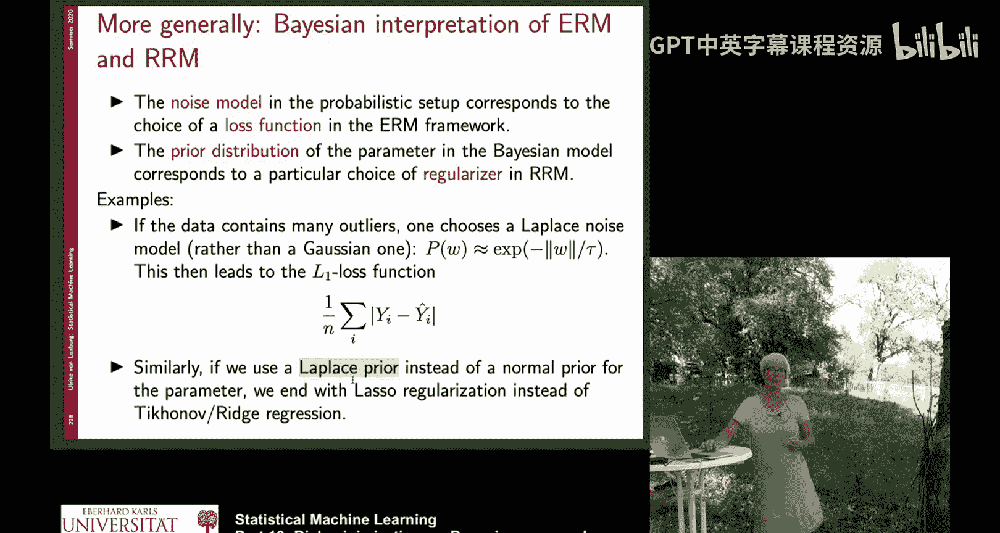
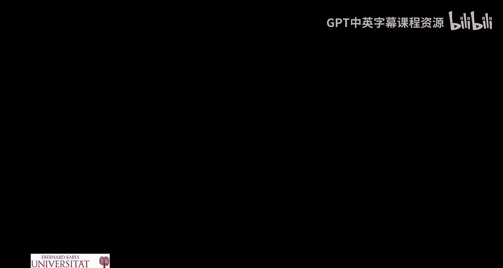

# 图宾根大学《概率和统计机器学习｜Tubingen Probabilistic and Statistical Machine Learning 2020》中英 p14 -14-Part 12 - Risk minimization vs. probabilistic approaches.zh_en -BV1gso5YGE4s_p14-

。The way we have motivated all this regression algorithms so far。

Was from the perspective of empirical and regularized risk minimization。

 we always started with the loss function。 We said we， we look at the least square loss。

 We might want to have a regularizer， and then we want to solve the regularized problem of minimizing both the loss plus lambda times the regularizer。

Now， many of you also attend the lecture on probabilistic learning in parallel that is given by Philip Henock。

 and there is a very tight relation between what we do in this lecture。😊。

From the point of view of empirical interleized risk minimization and what is going on in the other lecture。

😊，And here I want to simply give a glimpse on what is sort of a relationship between these two approaches and how you can translate。

 at least in some cases， our approach that we' are going to look at in this lecture to the approach that Philip Hening is going to look at in his lecture。

😊，I find this is a very interesting and also very deep topic。 At this point in time。

 I just want to give a glimpse on this topic。 I just have two or three slides on it。

 But I want to show you what are the relationships between these two things。

 And maybe if you're interested in you might want to read it up more generally， for example。

 in the in the book on， on probabilistic machine learning by Kevin Murphy。😊。

The first point I want to make is that this one kind of translation that we want to look at is empirical risk minimization on our side is pretty much the same as maximum likelihood on the other side。

And this works as follow。So as we said in， in our framework。

 we always start with the fact that we have a function class in the loss function。

 and then we want to find the best。Function in the class。

 according to the loss function that we define。In a probabilistic setup。

 you always start with with assumptions on the distribution of your data。And now， we assume。

And we are in a linear setup that the data is generated by a linear model。

So this is our model and this is how you read it also in many， many。

 many papers like in psychology and so on whenever you want to to fit some variables in a linear way。

 typically people start with such an equation where they say the output variable that we observe the y。

😊，Is a linear function of the input。Plus， some noise。

And this W is sort of the true underlying linear function。

 We assume that there is a linear mechanism that generates the data in this way。

And we would like to discover what this omega is， what this vector is。

 and noise makes our problem more difficult because we don't really see the true data and we just see some noisy versions of it。

And now we need to know in， in this kind of probabilistic setup， we now need to make assumptions。嗯。

And the first assumption is that the noise。is what we have here Fo a normal distribution。

 So this is sort of if you don't want to think about anything and you have a probabilistic setup you always say。

 yeah， the noise is normally distributed， for example。

 if you have measurements and there are many different sources of noise。

 then all of these sources if you if you sort of sum take a sum by the law of by the central limit theorem essentially the noise is going to be to follow a normal distribution so it makes sense in such a situation to have an assumption of anomaly distributed noise。

Now， this is exactly what we do。 We assume that the noise distribution。😊。

Is normally distributed with mean  zero and some variance that we don't know， which is sigma。

 no Sigma squared the variance。And we are in a D dimension setup。

 So we even assume that it's that the shape of the covariance matrix is sort of has the same。

Extension in all the directions。 So we have the identity matrix times the magnitude of our noises。

So if you translate this。 So this is the distribution of the no noise alone。

 So if you translate this now into what is the distribution of。The signal that you observe Y。

 given the input value x and the true vector w。This is now normally distributed。

 The normal distribution。 The variance comes is， is this term。

 and it is centered at the true data point that you would have。

 This is what you see also here on top。 the true the the。Variable that you observe is this true。

Variable plus some noise。 And this is now a normal distribution centre at the true variable。

With some additional noise。Okay， so this is the assumption that we make。And now。

 the maximum likelihood framework。Would tell us that we now want to find this parameter W such that the likelihood of the observations is maximized。

 So what is this， the likelihood of our observation is the probability to observe。W。

Given the input x and the parameter W。Observe at this point。

 don't be confused in the slides on Bayes decision theory。

 Why always was the output variable that we wanted to generate it was a slightly different setup here。

 Now what we want to learn is this w。And depending on whether you talk about the probability。

 the W has a certain value。Given the input。Or whether you talk about the probability that you observe Y。

 given W， that's the difference between the maximum likelihood andtation posterior approach。

 So here we look at the likelihood maximum likelihood approach。

Assuming that w is the correct parameter and we look at input X。😊。

What is the likelihood to observe the output way。And maximum likelihood says we want to find this parameter w that maximizes this likelihood。

😊，Now， in our particular form， we now made assumptions on the underlying distributions。

 and we had just seen on the previous slide that is P of y given x comma w is essentially a Gaussian distribution。

😊，And if you plug in the formula for the Gaussian distribution。

 it's e to the minus and then y minus x w squared over sigma squared。

And if you now check what is the value of w that maximizes this expression。

 you can skip the sigma and then maximizing this because sigma is just a scaling parameter and now maximizing this expression is the same as minimizing this norm here and this is what least square regression does。

😊，So what we can see here， when we start from this model based perspective and say we start with a Gaussian noise model。

And we use maximum likelihood。 Then we recover the ordinary linearist square algorithm。

And this is already a nice insight， and it might help you from time to time also to think about cases when you think that orin least squares might work well and when maybe doesn't it work so well。

 So if you are in a situation where now this Gaussian noise model might make sense。😊。

Then maybe this is the thing to do if you're in a different situation。

 maybe you would need to choose like if you don't believe that your noise is Gaussian。

 then maybe choosing this line this least square loss function here is maybe not the right thing to do。

We're going to see that in a minute。Now we want to look at regularized risk minimization。

Because we have seen like in linear regression we said we start with this very simple case where we just look at the training error。

 but later on， we wanted to prefer functions that have either a low L 2 norm or a low L1 norm。😊。

In our fact， the question， can we translate this as well into such a patient set。

So we start as a above。 We assume that the， the data generating process is similar as the one above。

But now， we additionally assume that we have a prior distribution over the parameter W。

And now this is really， if you think in statistical language。

 the difference between traditional statistics， like a classical statistics frequent statistics approach and the Ba approach。

In in the frequencies approach to statistics， you do not assume that this parameter that you want to learn。

 W is is a random quantity or has theres any prior distribution on this。

But in a patient framework where， you always say there's a certain prior distribution on your parameter。

And then you want to look at the posterior distribution after you've observed the data and update your belief on what this parameter is probably for your particular data。

So， we now assume。That。We have this prior distribution over the parameters and we simply say well the prior distribution for the parameters is maybe also a Gaussian distribution。

 it has a different variance called tau square here。

 I don't have any better guess for what this parameter should be so maybe I simply assume it might be anything in its Gaussian distribution so essentially this means I give a high likelihood to the fact that this w is rather small and the further I go away from0 the more unlikely I find it that this is really the parameter I want to find。

😊，And here in the beginning of the letter line， we still have the the model on our underlying data。

 which essentially says we have a Bay a calcium noise model。Now。

 if you look at the basin maximum posterior approach。

The approach would say we are supposed to choose the vector omega that maximizes the posterior probability。

 And what is the posterior probability。 It's the probability。Of observing W。

Given the input is X and y。AndNow you can rewrite this in terms of all the functions that you know。

 So this is essentially now the likelihood function。

 the prior distribution and here the conditional distribution。Now， if you write all this down。

 this takes a bit of time。And try to solve it and write down what the formulas really are。

 You can see。That this is exactly the same approach。

S solving rich regression where a rich regression is this problem here again we want to minimize the least squares loss plus lambda times w norm of w square where this parameter lambda is exactly the ratio between sigma square and tau square remember again sigma square is the variance of your original data and tau square is the variance of the prior。

😊，And this is somehow I find this so beautiful。 It is really such a nice translation because it gives some meaning to what we do in regularized risk minimization。

 You just say， well， I want to use the least square loss because it's convenient。

 and then I want to minimize we have this motivation。

 We want to minimize or have a rather small least square norm。😊，For our parameter W。

And this now you can translate it one to one and say this is the same as assuming that our data conditional distribution is normally distributed and we have also a prior distribution the weight on the vector w。

😊，And of course， it is this prior distribution that comes to the regularizer because， as I said。

 the prior here says it is very likely that w is small because it's a normal distribution。

 W is small， close to 0。😊，And then as we move away from0， we think it's more and more unlikely。

 So it would be rather surprising if for a data set， we would pick a w that is very far out here。

And this is exactly the same kind of motivation that we did for each regression where we said， well。

 we don't want to have a w where the two norm of the W vector is too large。

 we don't want it to be out there。😊，So it's two different ways of looking at the same kind of intuition of what we want to find。

😊，And the beautiful thing is that this really boils down to exactly the same kind of problem。

 And I find this really， really， very nice。😊，There is a more general translation table between Asianitian worlds and the statistical world as we consider them in this lecture。

😊，And this course， as follows。The noise model in the probabilistic setup corresponds to the loss function in the empiricalgrious miniization framework。

 And again， on a very， very high level， this makes sense。 If we fix a loss function。

 we essentially say， how do we weigh different deviations between our data。

 What are maybe deviations that we consider important or significant and which deviations that always happen and maybe we don't take so much into account。

 this is what we encode in a loss function。But this is the same as what you encode in a noise model。

 In a noise model， you also say there's my true data。 and then I add something to that。

And if that's something you add to， depending on what you believe how this looks like。

 you would also punish deviations much in in a much different way than if for some particular noise model than for the other particular noise model。

So this is the translation。 So noise model in the probabilistic setup is the choice of the loss function in the empirical。

 risk miniization framework。 And now the choice of prior distribution in the Bayesian model。😊。

It's the choice of regularisor in the regularization approach。 And as we said before。

 this also makes sense， I try to explain it previously on this Gaussian model。

And just to continue with a couple of examples， I mean。

 I've shown you least squares regression and the like the ordinary least squares which corresponds to a maximum likelihood and regularized rich regression least squares which correspond to this patient map approach。

😊，They are more like， okay， now with with Gaussian models in Gaussian prior。Now。

 there might be other assumptions that you can make。 For example。

 you could say instead of a Gausian noise， you choose a laplace noise model。

 this you typically do if you think it's much more likely that you have big outliers in your data。

 so a lapl distribution has a much more heavy tail so it's much more likely that you have very high deviations from the center of your distribution。

😊，And if you believe that， because you see that your data has very many outlier points that are far away from sort of the mean of your data。

 you might say I choose it a plus prior。😊，Sorry， the Laplace noise model and the difference is here that the norm in w is not squared as opposed to the Gaussian noise model。

And then if you do this translation， it leads to the L1 loss function。

 And this is not a coincidence because here you have the power of one and here you have， again。

 the power of one。And now， if you come from statistics。

 you might know that using the one loss function rather than the2 loss function is exactly what you do。

 If you think your data has many outlis， if you want。

 if people in statistics often call this robust statistics。

 if you want to have robust estimates that are not at。😊。

That are not so much prone to changes in the model if we have outlier points。

 then they use this L1 loss and this ba here you have it is what you also get from this patient kind of。

😊，And similarly， if we talk about the prior， if you now use a prior for， for the。

Prameter eplace prior。Rather than a Gaussian prior。

 we would also end up with a different regularizer， not the rich regularization anymore。

 but the less of regularization。😊。

