# 图宾根大学《概率和统计机器学习｜Tubingen Probabilistic and Statistical Machine Learning 2020》中英 p15 -15-Part 13 - Linear discriminant analysis.zh_en -BV1gso5YGE4s_p15-

We have already seen quite a number of methods to solve linear regression problems。

 We have looked at least squares， rich regression， laso and so on。😊。

And now it's maybe time to move to classification。And again。

 we are going to start with linear methods for classification and before we actually look at some particular algorithms。

 we are going to motivate what does it really mean to use linear classification in linear methods for classification。

😊，Again， we assume that our data lives in RD。Perhaps because we have made a feature space representation of some abstract objects。

And now we want to solve a classification problem， which means that the output is a binary vector。😊。

Why is plus 1 or -1。Later on， we are also going to see classification problems which have more than two classes。

 but for now I would like to stick to the case of two classes because it's the simplest of all cases。

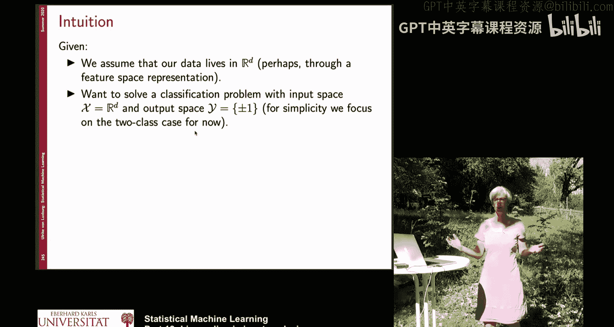

The idea that we want to use in linear classification is essentially。

 we want to find a separating hyperplane between the two classes。 So it's really as simple as this。

 We have data sets。 And in this particular case， we have a data set in R two。

 It lift with have points in a plane。And in this case。

 we want to find a straight line that separates the two classes we call everything that is on one side class1 and everything that is on the other side we call it class minus-1。

😊，And this is the goal of linear classification。 Now if you are in a space that has more than two dimensions。

 it is not a line anymore， it is what is called a hyperplane。

 a hyperplane is an object that has one dimension less than your original space。

 but the intuition is it is like a line in a two dimensional space or like a separating plane in a three dimensional space。

😊，Formerly， let us define what a hyperplane is。A hyperplanin RD has the following form。😊。

It is described by two parameters， W and B。And the hyperplane H is the set of those points in Rt。😊。

Where W X scar product plus B equals to 0。If you look at this from a geometric perspective。

 here is a plot， so we have to coordinate access。We have the hyperplane。 So the set of all points。

 omega x plus B is0 is such well in the two dimension case， it's such a line。

And what is the meaning of these two。Oomega or I sometimes say omega and sometimes I say w because it looks so similar omega a w。

 no matter how you want to call it it is a vector n RD and this is called the normal vector to your hyperplane。

😊，So it is one vector and it's orthogonal to your hyperplane so if you for example。

 if you want to describe a plane in r2 in r3， so we have this two dimensionmenal plane。

 we can describe the direction of the plane by looking at the normal vector so there's one particular vector and we look at all the other vectors that are orthogonal to this vector。

 this is these lift in a plane and then we have an offset B。

 if this hyperplane does not go through the origin but goes through cuts the x's in a different place。

😊。

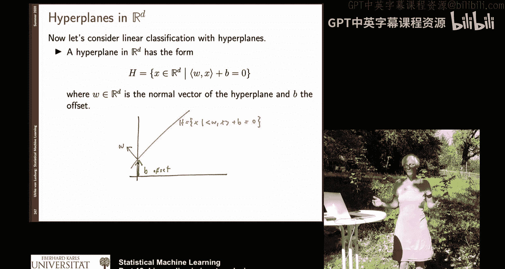

。If you now want to decide whether a point is on the right or on the left side of a hyperplane。

 what we are going to use is simply the sine function。

 so we just say so because the set of points on the hyperplane have exactly  zero。

 so omega x plus B for points on the hyperplane is 0。😊，Now。

 we simply say everybody who lives on one side has plus 1 and -1。

 and this is determined by the signine of this expression。 So omega x plus B。

 So x is the input point we are looking at omega and B are the parameters of the hyper planee。😊。

So omega x plus B is a function of x， and it takes a real value。 And we now look at the s。

 I it positive or negative。 And then we say the label is plus 1 or -1， depending on what the sign is。

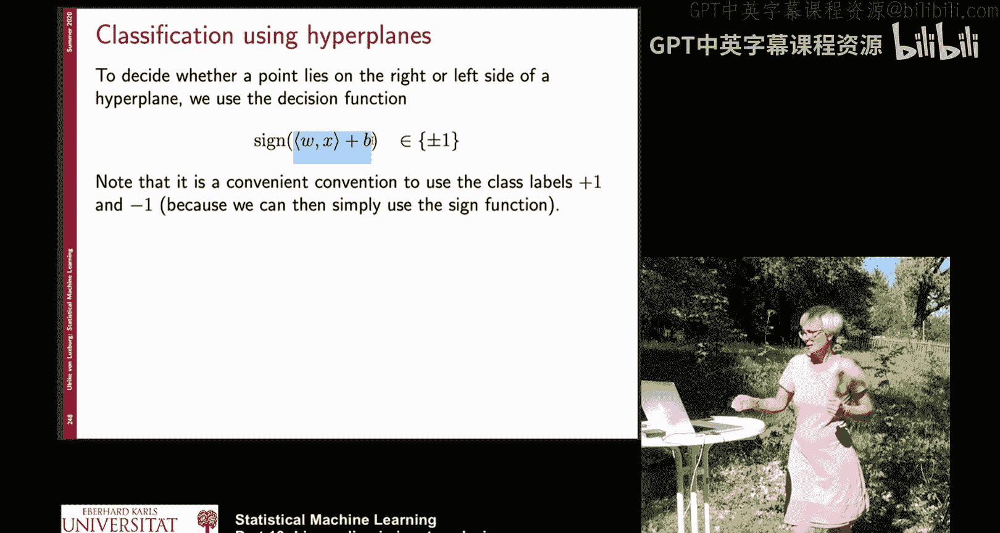

Another way to interpret these hyperplanes is， by the way of projections。

If you look at this linear function， omega x， the scalar product between omega and x。

 this is essentially a projection。 if you ignore the B for now。

So the scalar product between omega and x is the projection of x on the vector omega。So essentially。

 what you could say is the。This linear classifier projects everything on this one dimensional normal vector。

 this is not just a real number， so essentially this in this got this red line here is the direction of our normal vector。

😊，We project all points in our space on this normal vector。

And then the parameter B essentially tells us where。

 where on this line we need to decide between the class -1 and plus1。

This is another way of for some people， one representation and for some， the other representation。

 is my helpful。

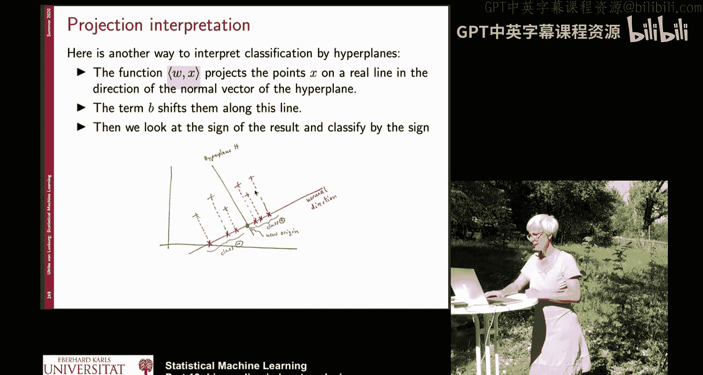

。No， in regression， we have so far only looked at least squares regression where we say the loss function is the least squares loss。

Which is maybe not the only way， but it's a classical way。

 at least the way it's solved in many of the more classical papers for classification。

 there are a different number of losses which are all being used。

 and there's not really a single best obvious choice that is used all over the community。😊。

We are going to see there are lots of losses， like。O。Depending on the algorithm。

 you have a different loss function。So in linear discriminant analysis。

 we use the least square loss in logistic regression。

 we are going to use the logisticlash loss and in the support vector machine， for example。

 we are going to use the hinge loss。😊，These are all different kind of loss functions。

 and we' are going to see that these different types of loss functions are going to to influence a geometric interpretation of the algorithm that we're actually using to select which hyper plane to use to classify our data points。

I now would like to start with linear discriminant analysis this is more for historic reason and maybe also to have an exposition of many different approaches to linear classification because I want to show you that there is not the one thing best approach to select a good hyperplane。

 there are many different motivations。😊，And I would start to like to start with linear discriminant analysis because this is one of the oldest algorithm that exists。

 it has been already invented by Fisher， who is sort of the founding father of statistics in the 1930s。

 and it's sometimes also called fiser discriminant analysis， or fiisher as linear discriminant or so。

We only go through this chapter very briefly because I don't want to put so much focus on the algorithm。

 because in the end in practice， it's not really used a lot。 But still。

 I think it's nice to get the intuition of this algorithm。😊。

And I would like to start with a geometric motivation。

So assume we have this data set that you can see on the screen here， we have a number of red points。

 we have a number of blue points， and now we have different hyperplanes that we can use we have the blue hyperplane here。

 which is called H 2。😊，So the hyperplan itself separates our data set into a bottom part and to a top part。

 if you would like to say it like this。The projection interpretation is this one if we look for the projection that is induced by this hyperplane on the normal vector。

 this is the normal vector of the hyperplane and all these red and blue data points if we project them on this one particular line here they end up on this one dimensional space like this one I mean this is just a sketch but just imagine it。

😊，We have this other hyperplane H1。 You can see it's separates more like left from right。😊。

And the projection， you can see it here， this is how the data points on the projected space on this one dimensional space look like。

And now the question is really which of these projections would be the better one if you have the choice between these two projections and these two hyperplans。

 you need to have a criterion to say which one you like more。😊，And the question is。

 what could be this criteria？

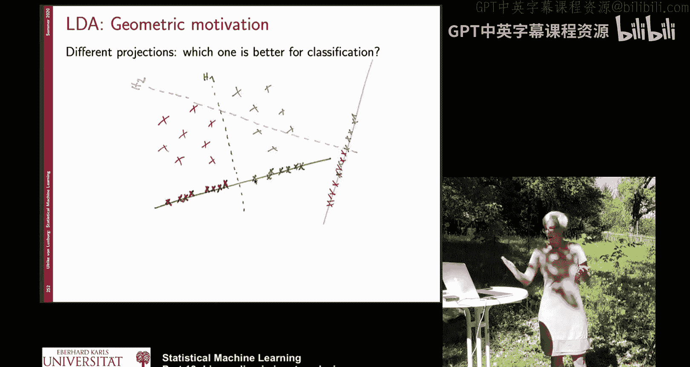

And this is now the motivation for linear discriminant analysis。

 There are two criteria that Fishcher has been inventing to look at this particular problem。

He says the following， assume we look at the projection of the data on this one dimensional subspace that is being represented like the projection or a normal vector。

What we would like to have is that points which live in the same in the same class， these red points。

Our close together after we projected them。So here the red points are close together to themselves and also the blue points are close together to themselves。

😊，And at the same time， what we want is that the two classes are far apart from each other because we want to separate them。

 and we would say the further they are apart， the easier it is to fit sort of to put a threshold between them and to be sure that who lives on the left and the right side of the hyperplan。

😊，So essentially， these are the two points the within class variance should be small。😊。

And the between class variance should be high。let's maybe go back to this figure we had previously we consider two different hyperplanes if you already look at this plot you would see that H1 is probably a better hyperplane than H2 because H1 I mean first of all it a zero training error and then also it separates these classes very nicely and this is what we can see here on this line so here are the red points there are pretty closely together and here as well and there's quite some distance between the two classes so it should be easy to solve this problem。

😊，Whereas here you already see， I mean you already see from the hyperplane that this is maybe not the best hyperplane it makes at least two or three points it puts on the wrong side。

 but even apart from that if there wouldn't be any training era we would say well here the classes are really overlapping after the projection and they are very close so if you would just look at these points here you wouldn't really see we had to put this threshold and if there's a bit of noise in your data your threshold might wiggle and you might get many misclassified points。

😊，And this is really the motivation of linear discriminant analysis。Now。

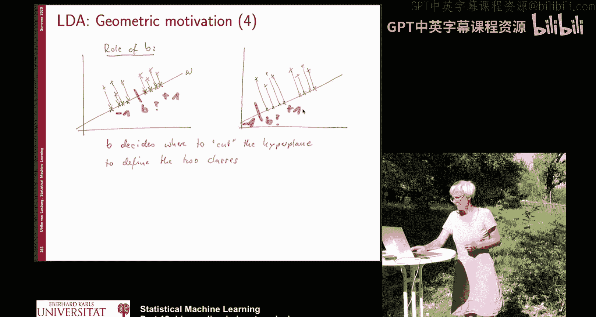

The algorithm of linear discriminant analysis I don't even want to talk about it。

 the fact is you can now write down this problem， you can even find an analytic solution。

 you can derive it as formulas for this but I don't really want to look at it it's called the phI criterion if you want you can look at the slides at home it's not going to be part of the exam in the end。

😊。

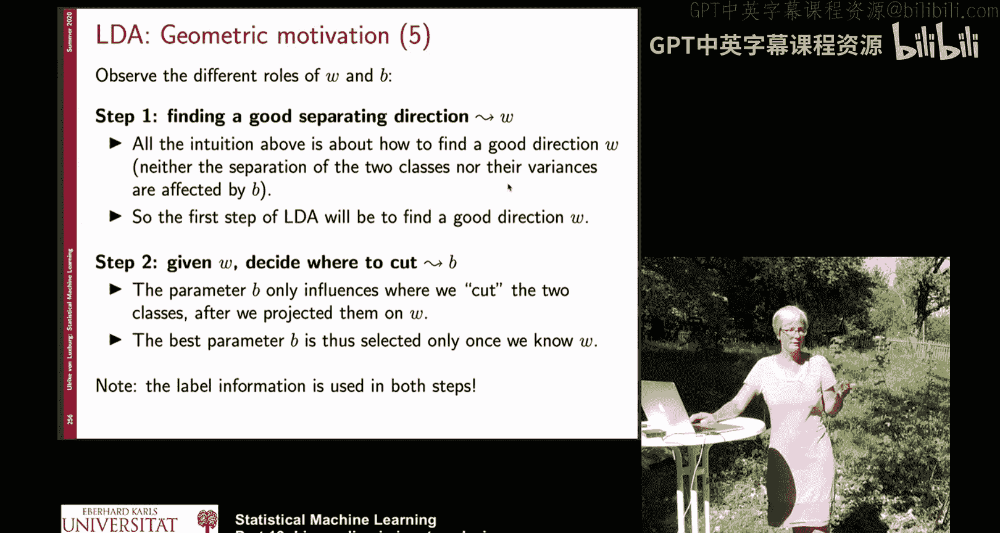

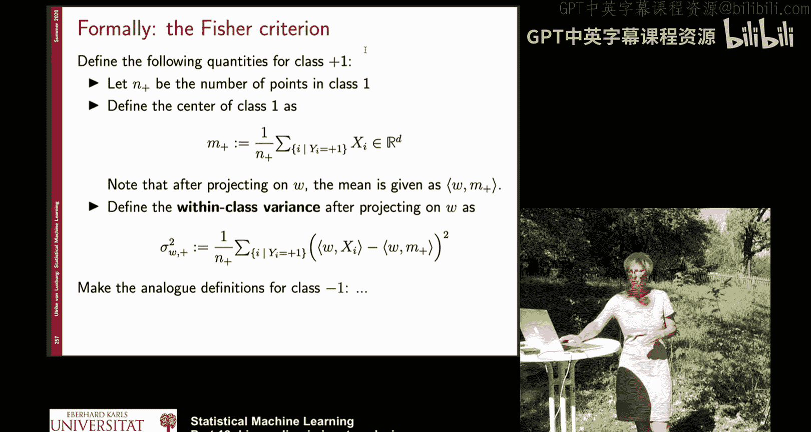

。

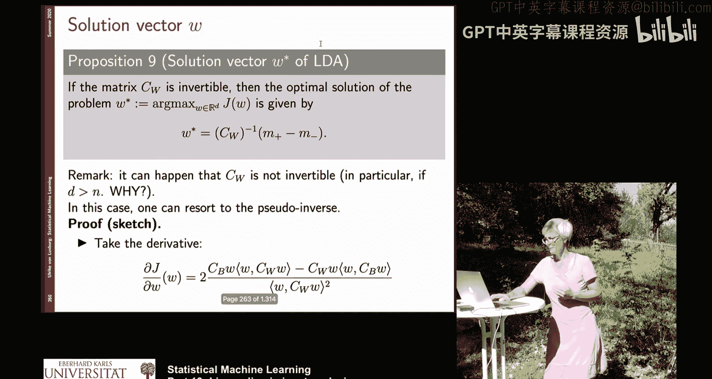

What I want to show you， though， is that there are a number of alternative motivations for linear discriminant by completely different approaches。

 So what we have seen previously was a geometric motivation where we say the within class variances should be small。

 the between class variants should be large。😊，Now we do reduce a completely different motivation。

We start with empirical risk minimization。 We don't have any geometric motivation， we just say。

We are going to use empirical risk minimization。What do we need to do for empirical risk minimization。

 We need to fix a function class， and we need to fix a loss function。

 and then we find the best function in our class， according to the given loss function。

 That's as easy as it is。😊，Now what are we going to do is our function class。

 we now use the file linear functions as we did before because we are in the chapter on linear classification。

 so logistic regression is a linear algorithm， we fix linear functions。😊，In this loss functions。

 we simply say why we don't really have a good idea， we just use the least square loss。😊。

And here you need to take care we compute the loss not between the original label and the predicted label because this would be either 0 or 1 and because the predicted label in the end is plus1 or minus-1。

But we are going to compare the true function， the true value that we would like to get out。

Minus the function value before taking the sign。 So remember the function value is it is written here。

 So to evaluate what is the classification result on a particular input point x。

 we need to compute W X plus B。And then we later on only we check which what is the sign of this function and then we say it's class plus 1 or minus1。

😊，Now， to compute the loss， we don't take the sign。 We look at the pure function value。

And then we take the square loss between these two things。We do not， of course。

 as in empirical risk minimization， we never make any assumptions on the underlying distribution。

 And also here， we do not make any assumptions on the underlying distribution。

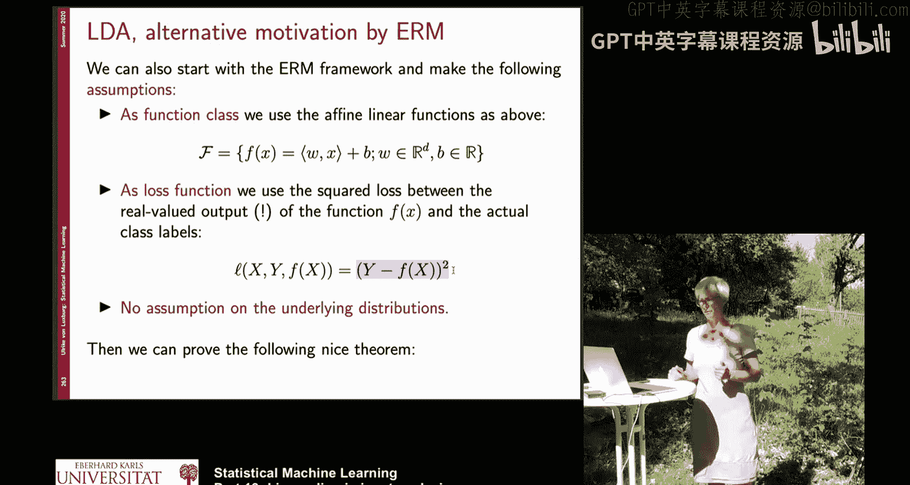

And now we can prove the following serum。That if you consider the linear square。

 the minimal square problem， as we have defined it before。

And the linear discriminant problem that we have， we haven't really derived the formula on the previous slides。

 then these solutions essentially agree。And they represent the same hyper plan。

And this is a somewhat curious thing because what you have now is you say， I mean。

 in one approach you start with this geometric motivation of saying we want to minimize it within class variances and maximize it between class variants。

😊，And the so this is a purely geometric motivation。

 You do not talk about the loss function and you also do not talk well you talk about a function class because in the end。

 you are going to look for a linear function。But nowm empirically risk me im my。

What you're going to do is you don't look at any geometry。 You just fix this loss function。

 This least squares loss function between the label。

 the true label and the function value that you predict。

And it turns out these lead to exactly the same kind of solution。

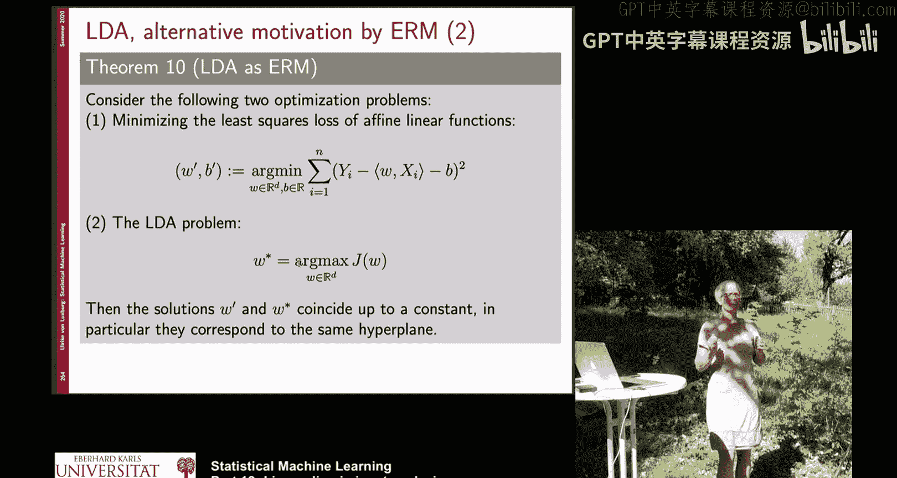

啊。

。Theres yet another motivation for linear discriminant， and I also want to briefly mention it。

 namely a motivation by Beijing decision theory。😊，Now we are yet another setting。

 we are in the patient decision you setting。And now we need to make assumptions on the class conditional distributions。

So assume we know something about the class conditional distributions。

 the distributions of class with label plus 1 and the distribution of class with label -1。

And we simply assume these distribution follow a multivari normal distribution with the same covariance matrix。

 but different means。 So essentially these two it's like this in this example。

 we had when we talked about basic decision theory。

 we had a one dimensional instance of that where we said with normal distributions the height of female persons and the height of male persons and they just shifted copies of each other。

😊，Now we can do the same in a multivariate setting。

 we have multidisional cows since each of them represented by this ellipse。

And the assumption is just each of these class conditional distribution does follow a calcium assumption。

😊，Which is from the empirical risk minimization point of view， a very， very， very strong assumption。

 We would never in empirical risk minimization。 The philosophy is we do not make any assumptions on the underlying distribution。

We just fix a loss function。And now here we say we make an assumption on the underlying distribution。

We also assume that the classes have have the same weights。

 so they are the same type plus one points as the one as the type -1 points。😊。

And now we know what Ba decision here is going to do。😊，And it selects the actual classifier。😊。

The Bayesian approach selects the classifier according to the maximum or postior approach。

 so it checks whether the probability is higher that the label is plus  one or whether the probability is higher that the label is minus1。

😊。

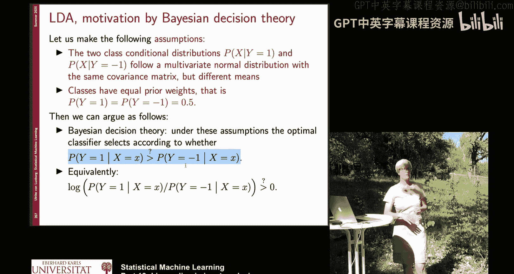

You can now rewrite this problem a bit and you can sort of evaluate it and then what you' are going to find is that the decision boundary between these two classes is exactly the same as the one you would find preliminary linear discriminant analysis。

😊，And this is yet again another curious thing。 So we started with completely different aspects。

 We started with the effect that we make a model for our underlying probability distribution。😊。

We simply say we want to find the base in the base posterior classifier。

We do not say anything about a loss function we in the purely patient setting。😊。

And then it turns out that the solution is the same as if we would have taken。😊。

An empirical risk minimization where we didn't talk anything about the classes。

 but we fixed the loss function， at least squares loss。😊。

And this is something that you might encounter a number of times it's maybe something that's not so obvious and we are not going to talk about it deeply in this lecture。

 but there are always very close connections between empirical risk minimization and patient approaches and the things that you always need to relate is the assumptions on the probability distributions。

😊，The assumptions on the losses and there are a couple of other things that you might want to relate。

 and then there's often a one to one correspondence between the patientes approach and the empirical risk minimization approach。

I don't want to talk about this any further， but if you want to look at the details you can for example。

 and look into the Hasty Tranni Friedman book they describe it。

 some of you might also attend the lecture by Philip panic on probabilistic machine learning which rather considers this other point viewpoint where you start with model based assumptions and this is sort of one instance where you see that maybe after all these two approaches are not so much different。

 at least it looks like from the outside it looks like completely different approaches but they are very close relations between these things。

😊。

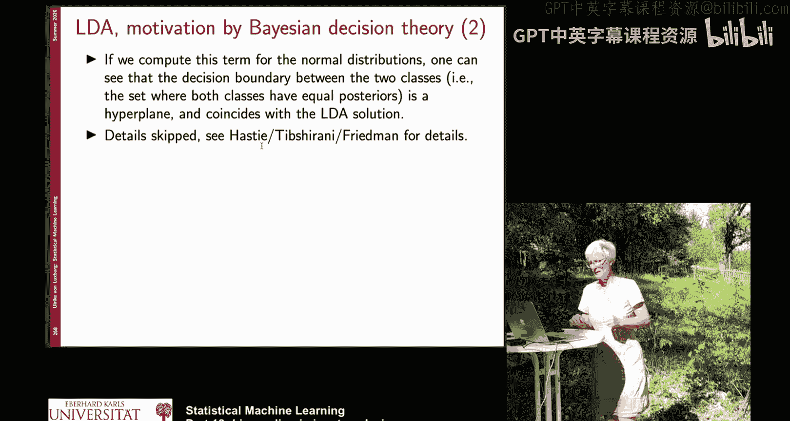

Okay。Okay， no we need to。Continue。That those wrong？嗯。W you what I'm here here。

嗯。

。I don't want to talk any more about linear discriminant analysis。

 just maybe give a short historical perspective， as I said in the beginning already。

 this has been published by Ronald Fisher in the 1930s already and Fisher was the founding father of all of statistics essentially it has in different names。

 linear discriminant analysis， Fisher's Line discriminant I guess cemon names。😊。

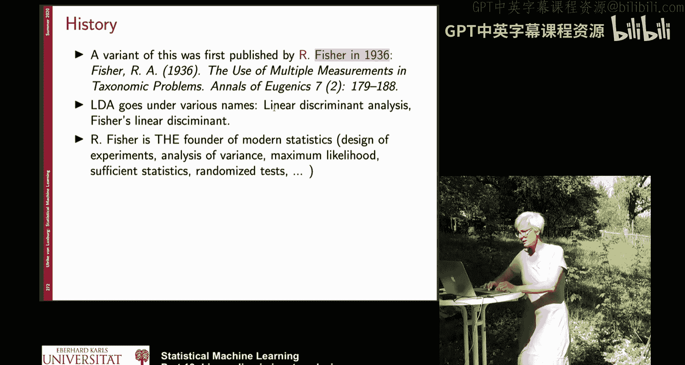

So the summary is this is one simple algorithm for linear classification。

 there are a number of intuitions why this algorithm might make sense。

 you have a geometric motivation that says classes should be we need to find a projection such that the within class variance is small and the between class distance is large。

😊，We have a motivation by empirical risk miniization where we say we use linear functions in the squared loss function。

😊，And we can have a model based probabilistic motivation where we say we use the base classifier and the assumption that the data comes from a normal distribution。

 both classes have the same variances and all these kind of motivations。

 if you do the mass lead to the same kind of algorithm。😊，As as in the simple regression problems。

 you can also compute the solution of this problem analytically。

 but as I said it is not used so much in practice。

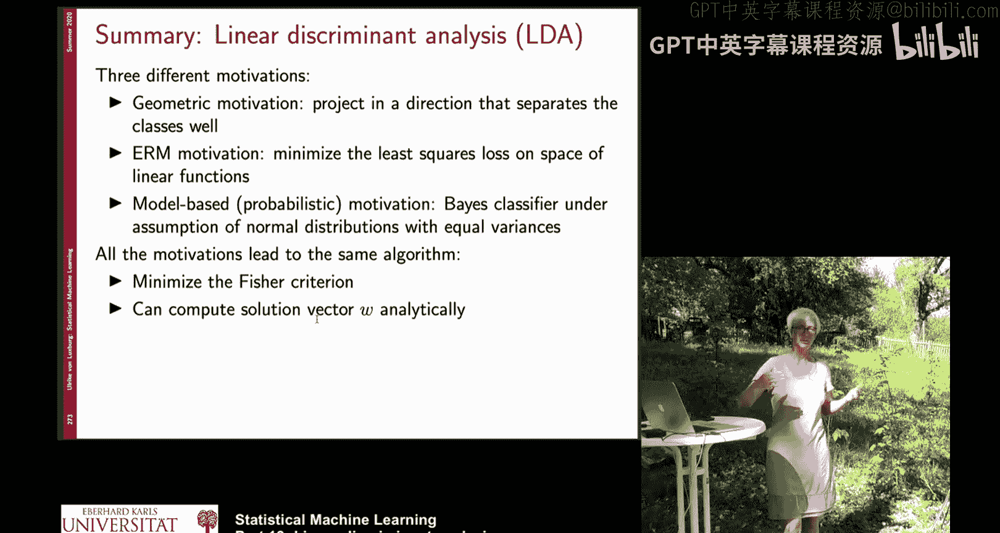