# 图宾根大学《概率和统计机器学习｜Tubingen Probabilistic and Statistical Machine Learning 2020》中英 p17 -17-Part 15 - Convex optimization, Lagrangian, dual problem.zh_en -BV1gso5YGE4s_p17-

Now I want to show you how we can solve convex optimization problems at least sometimes with the Lagrange approach in convex optimization。

 this is a very， very generic approach that can help in many cases。

 not always but in many cases and in particular its also going to help us in support vector machines。

 this is why we are going to introduce this whole approach。

The literature on convex optimization is really huge and there exist particular lectures who for a whole semester try to identify how convex optimizationization problems look like。

 what are their properties， how to solve them， what are all the different constraints under which you can source them in a nice way。

I try to squeeze all of this in one lecture。I start with giving the intuition and start then with giving a couple of formal notations and definitions。

 however this is far from being exhaustive and this is all on a very high intuitive level so if you want to know any details you really need to look in the literature or you need to go to a specialized lecture on convex optimization here we just do it so far that we can that we can in fact solve the SVM dual optimization problem。

😊。

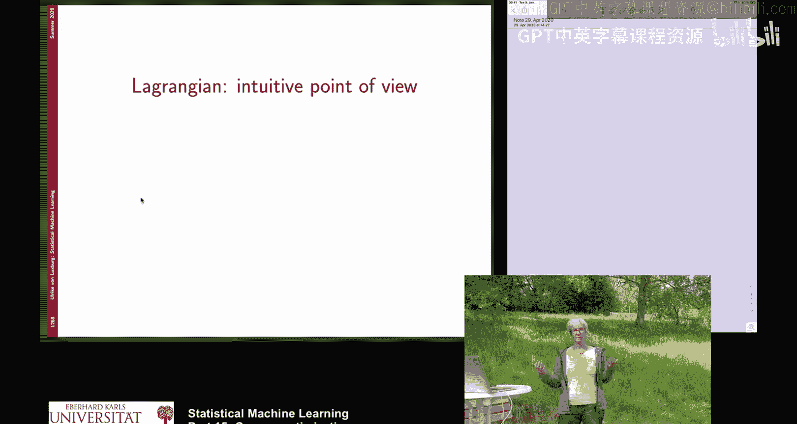

No， let's simply start。We are going to look at convex optimization problems。And as I said here。

 what we're going to do is something like a recipe。 It sometimes works and it sometimes doesn't work。

And in this presentation I make all kinds of niceness assumptions in particular。

 I assume that all the functions that we have are continuously differentiable and if the many of the statements still hold if this is not the case。

 but then the mathematical machinery is got much， much more heavy because we need to use convex geometry and this is much more involved then simply take gradients of a function。

😊。

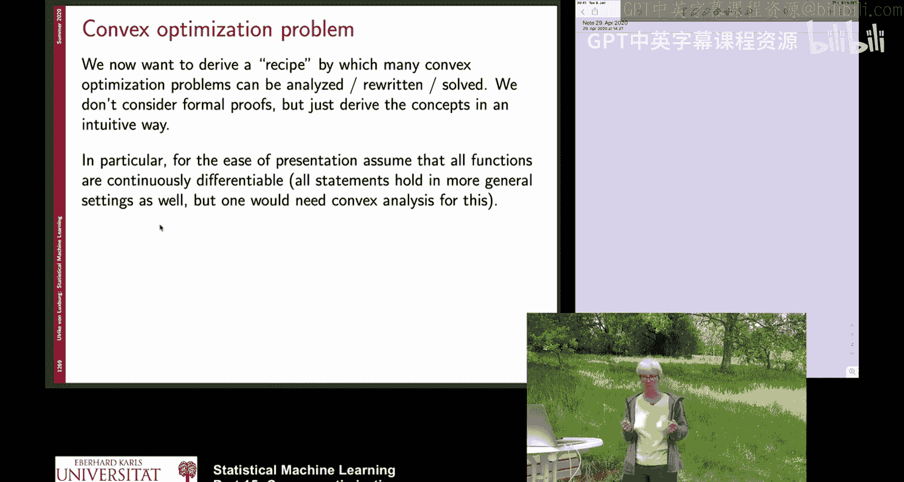

Speaking about gradients， here we are。Let's simply recap what is the gradient of a function just to make sure that everybody really knows that。

If we have a function that f that goes from Rd to R the gradient of the function is the vector of partial derivatives。

 So in each coordinate you can compute what is the derivative of the function with respect to this particular coordinate。

 For example here we have the partial derivative with respect to x1。

And now we have sorry we have D that coordinates for the D and so we give D derivatives and the vector of all these derivatives is a column vector and this is called the gradient。

And the notation of the gradient is is often the Nala operator， which I think comes from physics。

 But this is sort of the notation we are going to use now。

And just observe here to finish the notation I so because the partial derivative is a column vector。

 So if I want to write it in a row， I need to edit the trans post sign。

And I just realized heres an F missing。 So that should be D over D F， X 1， D over the F， X， D。

I'm sorry。 this F is missing。Now， the reason why we're interested in the gradient in optimization。

 I guess all of you know that， but still to make sure is that the gradient of a function always points in direction in the direction where the increase of the function is most。

😊。

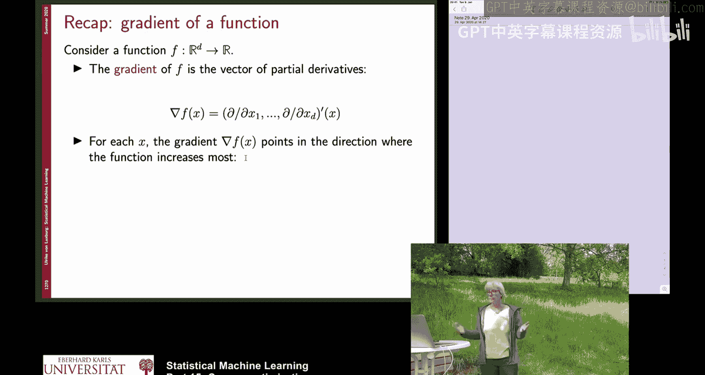

So here we have a little figure。😊，This is sort of a function that is defined on R2 and what you see is sort of the shape of this function so it's a three dimensional thing because the inputs are in R2 and the output value is to sort coordinate。

And what you can see here is these errors indicated at each point where the gradient points to。

 and it always points to the direction the of the greatest increase of the fund。

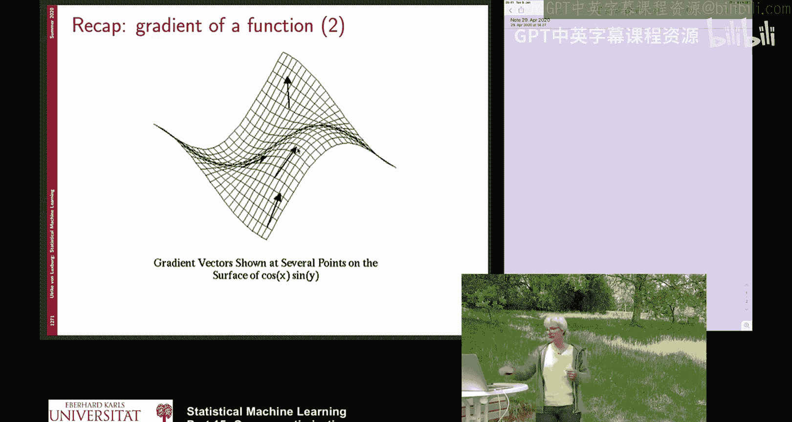

Now we want to consider a convex optimization problem。And we start with a simple one。

 which is called which has an equality constraint。 And just to make sure we don't forget it。

 I write it down。 And then we have it always side by side to the slide。

 So the problem we want to look at。Yes。We want to minimize。The function F of x。

Subject to the constraint that one function G of x。Is0。

And F and G are convex function because we only want to consider convex optimization problems in this particular part of the lecture。

Now， recall if。The function G， which is given， which gives the constraint if it's convex。

Then all the sub level sets of this function are convex we have seen that already before and what you can see on the slide here once more。

 maybe I draw it here。We have the set where the function G X G G X is0。

 So this is a set of so assume this is a function that goes from r2 to r。

 So what I plot here are all the points in r2 for which G of x is 0。Now。

 because it's a convex function， the set where the function is not equal to 0。

 but smaller or equal to 0 is called the subleve set。 And this is convex。

 And it's the interior of the set。 So the interior of the set is。

Where g of x is smaller or equal to 0。And outside we have the set where g of x is larger than0。Okay。

 so far so good。 we have seen that already。

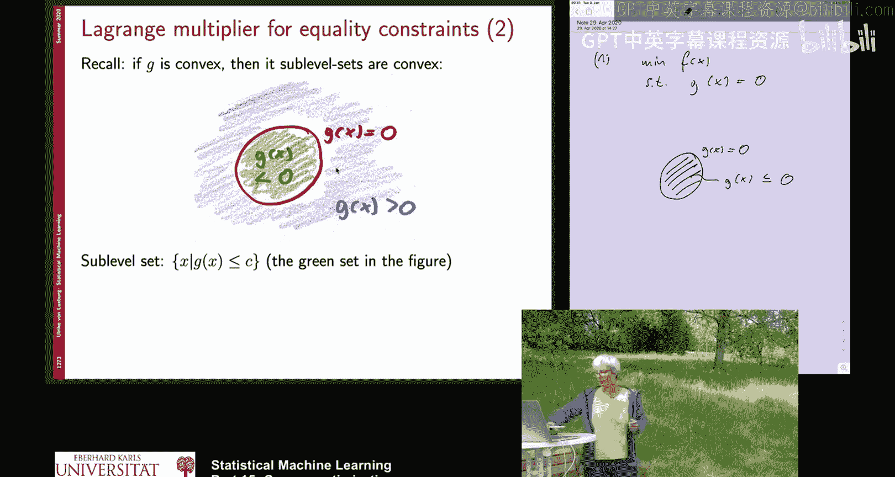

Now comes the first intuitive kind of insight。Remember。

 the function G is our constraint and we are currently looking at an optimization problem with an equality constraint。

 If you look again on the iPad， the problem is minimize f of x subject to g of x being equal to 0。

So all the solutions that we might want to pick of x are the ones that lie on the circular of x is 0 So these are all the functions we are allowed to look at the points we are allowed to look at we are not going to consider any other point。

No。We consider any point of the surface of this of this contour line of the red one and maybe now look at the slide。

 So here we have the red cont line where g of x is0。

 and we consider a particular point on the surface。For this particular point。

 what we have is that the gradient of the function G at this particular point is orthogonal to the surface itself。

And thentuition is somehow if you want to， if you would move along the surface。

 then G wouldn't change because the surface shows you where of is equal to 0。

 So whenever you walk along the surface。Then she is not going to change。If you want to increase G。

 you need to walk away from the surface。 You don't really know in which direction。

 but you need to walk away。Now， in which。And now the question is。

 in which direction is the largest increase of the function。

The point here is this needs to be orthogonal to the surface because otherwise。

 maybe I draw a figure。Here we have the line G of x is 0。And we consider this particular point here。

 I hope you can see it also when you have the movie。If I would walk， say in this direction。

 I can decompose this vector into two parts。 I can decompose it into the part that is goes along the surface。

And that goes away from the surface。Now the part that goes along the surface doesn't contribute to increasing G because if I walk along the surface。

 essentially I don't change G because G is0 on the whole surface。

 so the only component that makes sure that G increases would be if I walk away from the surface so if I want to find the direction in which I can walk say one unit and would get the highest increase then the best thing I could do would not be to walk in this funny direction which is sort of at some funny angle to the surface but always to walk exactly orthogonal to the surface。

So in this particular case， I would need to walk in this direction。

 and this would be the maximum increase。

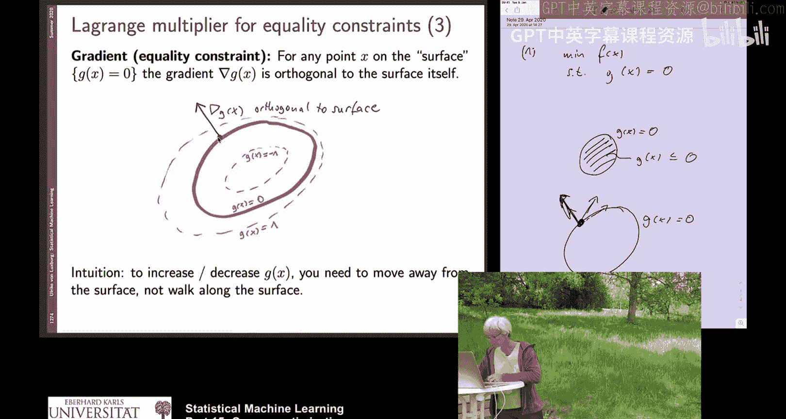

Of the function G。Okay。So far so good， what we have seen is at any point on the surface。

 the gradient is orthogonal to the surface。

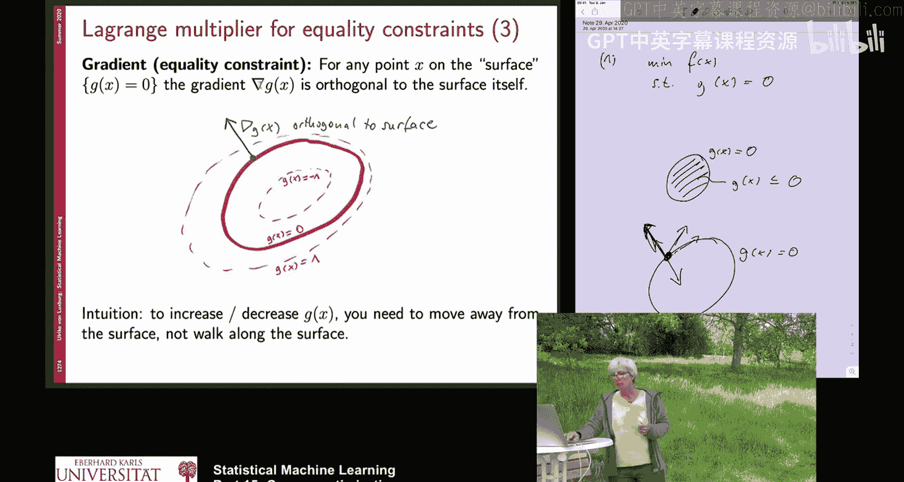

Just keep it in your mind。Now， we look at the second ingredient of， of an optimization problem。

 We have the objective function， as well。Now， we want to solve the optimization problem。

 minimize f of x subject to t of x being 0。The points where g of x is 0 is the red circle in this particular figure。

Now we would need to pick this particular point on the red surface where f of x is as small as possible。

And this point would be called X star because the solution of an optimization problem is typically denoted with a star。

Now， what we want to show is that if x star。是啦。If x star is the point for which f of x is really minimized this on the surface。

 we of x is 0。Then this point must have the property。Sorry。

 I can't really mark things here that the gradient of f of x is orthogonal to the circle。

And why is that。

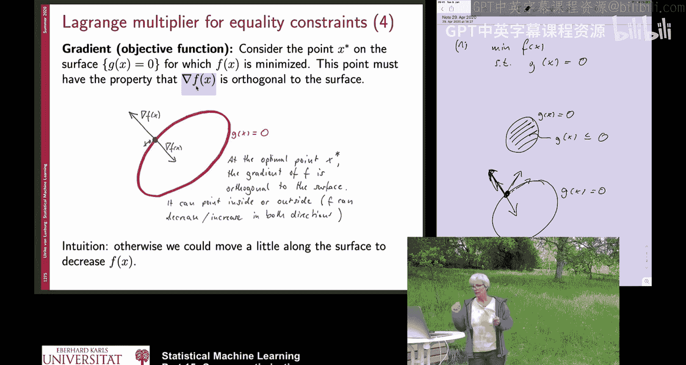

If the gradient would not be orthogonal to the surface。

 I could move a little along the surface and still decrease F and again I maybe draw another figure。

So here I have G of x as 0。Now， if， if now I am looking at the gradient of F。 Now。

 if the gradient of F would point in this direction。Then to decrease F， I could well， to decrease F。

 I would need to move to move in the other direction， and then I could move a little bit。 So。

 so say I would need to move in this direction。 And again， this vector has now two components。

 It has a component that goes in this direction and the component that goes in this direction。

And and so I could sort of move along the surface and find a point where f of x would be smaller But I started with。

 So this point I marked is x star。 So this is the optimal solution。

 The assumption is there does not exist any other point on the surface where F of x is smaller。

And this couldn't be the case if the gradient is not orthogonal。

 because then I could move along the surface a bit and and still decrease the。

So what we now find is a situation。If this is again， our point x star。

Where the gradient of G maybe points or。The gradient of T maybe points in this direction。

 and the gradient of F also points in this direction。 So currently。

 we are looking at the gradient of。

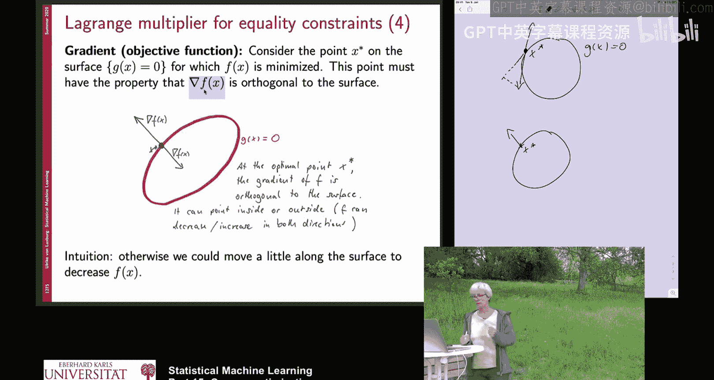

So what we have now is that if we're at this optimal point。

Both the gradient of G and the gradient of F point either inside or outside of the surface。

And in particular， they are unparalleled。AndNow， if you want to write this down formally。

 the gradient of G and the gradient of f are in parallel， what does it mean。

 It means that they exists a linear combination that makes all of them zero。

 So if we have they exist some constant new。Such cent gradient of F plus new times the constant of G0。

And this has to be true at the optimal point x star of this particular optimization problem。

 So we in this optimization problem minimize f of x subject to g of x is equal to 0。

If we have found a solution， X star。Then this particular condition needs to be true。

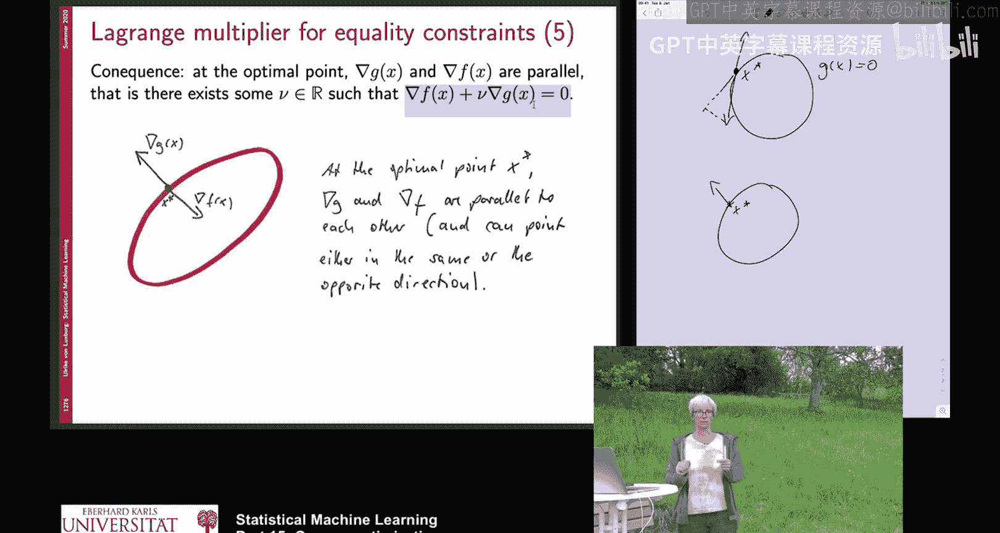

And now comes a mechanism that is a bit mysterious when you see it for the first time。

 but we are going to see that it works。 So for now simply take it as some funny definition。

 but we are going to get used to it。 So what we now do is we define what is called the Lagonian function。

😊，In take the oxygen function。

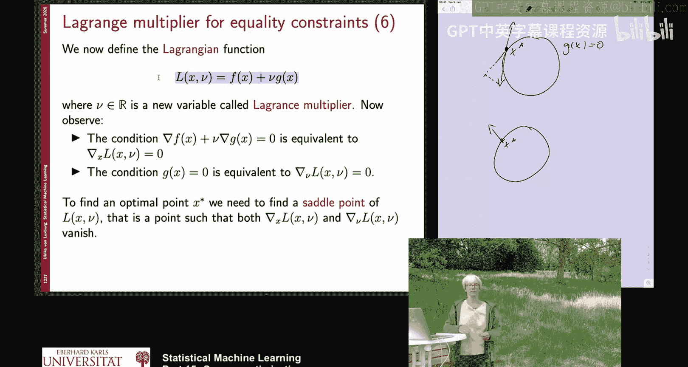

It's always a function that has the original variables this argument。 So x in this case。

And it has what is called the dual variables， which in this case is the new。

 this new constant that we introduced。This La function is simply defined as the original function plus nu times the equality constraint function。

In this parameter new is called the Laor multiplier。

And this whole thing is called the La function for this particular optimization program。And now。

 the reason why we do this， why we define this function is now that for this function。

 there are many， it's very convenient to now look at properties of the optimization program。

 So the first thing to observe is that this condition。

That the two gradients are in parallel to each other。

Is equivalent to saying that the derivative of sorry of this lagrange function with respect to x is 0。

Because the derivative of the direction with respect to x is just derivative of x plus nu times derivative of g。

 so this is exactly the same。😊，The other thing， this condition that g of x is supposed to be 0。

 So the constraint of our optimization problem， this is equivalent to saying。

The derivative of this laggrange function with respect to new is supposed to be 0 because if you take the derivative of the laggrange function with respect to new。

 so we the， I mean， this is if you consider it as a function of new here nu just occurs in a linear term。

 So what is the derivative of the lagg with respect to new， it's simply g of x。

So setting this partial derivative with respect to new to0 is exactly the same as requesting that G of x to be0。

😊，And if you take these two points together， what we can say is now to find an optimal point X star。

For our optimization problem， we need to find a saddle point of the solution。 sorry。

 of the Lagoe function。In a saddle point， it's always a point where both the derivatives in both directions vanish。

So we have the derivative with respect to x， sorry here。

And we have the derivative with respect to new， and they vanish。And typically。

 a saddle point is something where which looks like this。

 So the derivative in one of one variable increases maybe and or has a minimum the derivative of the other one has a maximum。

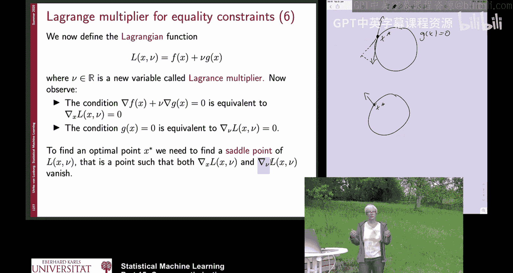

I think I have a， do I have a figure now。

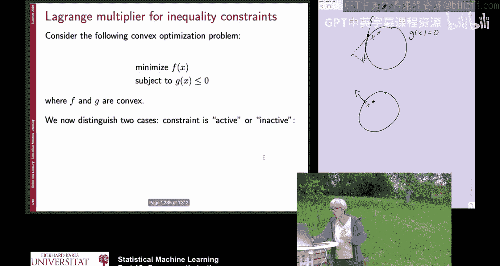

Sorry。Okay。

Now， this is all really， really abstract。 Now， let's try to take a simple example。

Here's a very simple optimization problem。 We have F of x。Which is given。

 So we have a two variable problem。 So both F and G are functions that go from R square to R。

And the function F is defined as x x1 squared plus x2 square -1。The function T。

 which gives the constraint is defined as x1 plus x2 -1。

So this is a typical quadratic optimization problem。 by the way。

 the objective function is quadratic and the variable is to constrain this linear。😊。

Now observe if you try， I mean， this is a very simple problem conceptually we have just two variables and you can even if you want try to figure out what it means geometrically。

😊，嗯。But now， how would you solve it。 So it's easy if you don't have any constraint。

 it's easy if someone tells you to minimize this function without any constraint。

 then somehow you take a derivative set it to0 and then you're done。But now。

 the problem is you have this constraint， and you don't even know whether this point where you。

hich would be the optimal solution。 if you wouldn't have the constraint it's the same solution now。

 typically， it's not。 And you don't really know how to how to incorporate this constraint。

And now here's the solution。 and it's really， really simple。And this is not a recipe。 And I also in。

 so for this lecture， I really encourage you to treat it as a recipe。😊。

If you want to understand all the details of this， you need to to visit some other lectures。

 So so now we take it as a recipe。 We are given a convex optimization program。

You always need to bring it to the， to， the， to the standard form。So minimize the objective function。

 that's fine。Subject to the equality constraint being 0 and the equality constraint。

 you always set it to being 0。 This is the standard form。 So you don't say for example。

 you could also request your x1 plus x2 equals to1， but this is not the standard form。

 and then the lag approach is going to fly apart。You always need to bring it to the standard form where it says equals to 0。

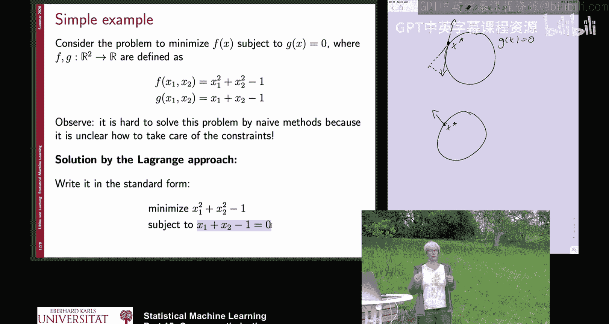

Okay， so here we have the standard form。Now， what we do is we write down the lag， and again。

 this is the recipe。 You take your original function。F of x1， x 2。Plus。New times。

 the constraint function。You just write it down this way。

 There's you don't need to think you just write it on。

The next step is you compute derivatives and set them to0。

So the derivative of Lagrsian with respect to variable x1 so here you have now your laggrsian function so if you take the derivative with respect to x1。

 so here we have x1 squared this gives2 x1 and else do here we have x1 which gives us new because it trust a courselimina。

And then you set this 0 to 0。You do the same。For all the other variables。

 so you derive this respect to x2 and set it to 0， you can do that yourself。

And then you also take the derivative with respect to mu and set it to0。And in this particular case。

 you now end up with a system of linear equations。 you solve it。😊，In B there's a solution。

 In this particular case， the solution is 0。5 and 0。5。That's it。 It's a really。

 really simple approach。

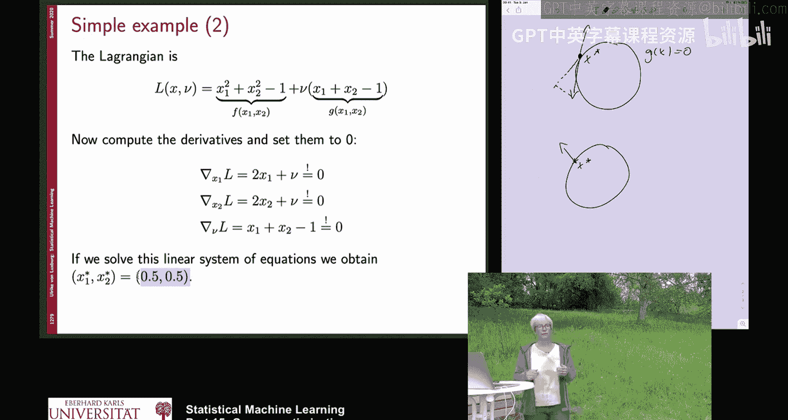

Now， we need to extend our considerations to problems with he inequality constraints。

 and in particular， inequality constraints are typically much more common than equality constraints and optimization。

So I write it down again。So the optimization problem we now want to consider is we minimize f of x。

Subject to the constraint， the G of x。Is smaller or equal to 0。Again。

 we assume that F and T are convex functions。And we're in the standard form。Again。

 where the constraint has smaller or equal to0 on the right hand。

 And this is always the standard form。 So whenever you have inequality constraints。

 you need to bring them to rearrange your inequality such that it says smaller or equal to 0。

 not larger or equal but smaller equal and not any number S than one than 0。

 So it always needs to read smaller or equal to 0。And now we want to do something very similar and come up with a similar intuition as we did before。

AndNow we need to distinguish two cases， active and inactive constraints。

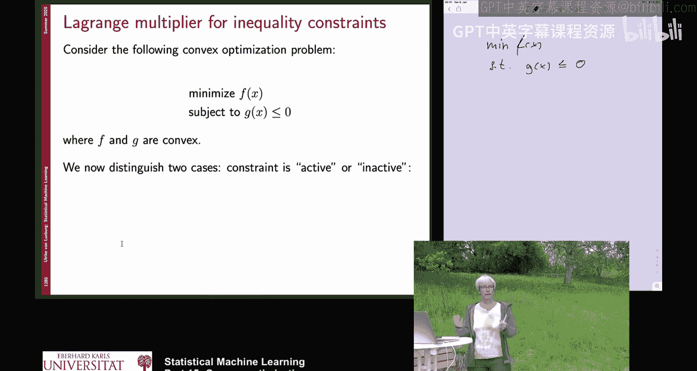

The first case， the constraint is active。And we say that a constraint is active if the solution of the optimization problem would be somewhere else if this constraint wouldn't be there。

 so maybe I。

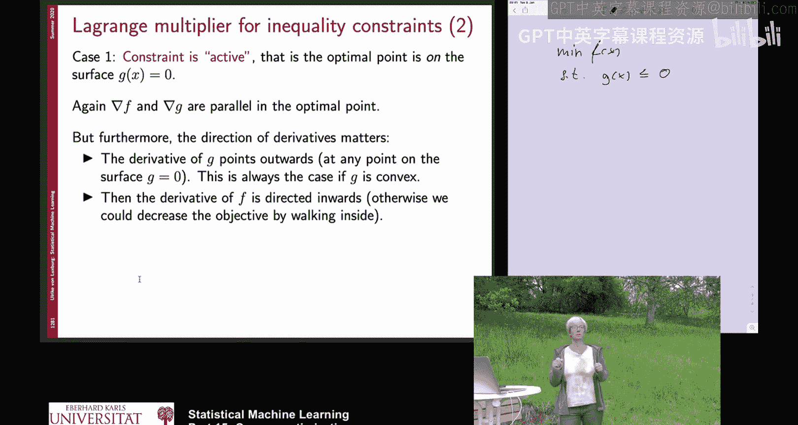

I try to draw a figure。 So here we have again， the surface where G of x is equal to 0。

And now we have another request。 We want to have the T。

 We want to find a point where F of x is as small as possible。

And G of x is supposed to be small or equal to 0。 So， in fact。

 we can consider all the points inside this ball and on the on the edge of the ball。

And there are now two cases， the first cases， the optimal solution sits on the boundary of this ball。

 So x star is somewhere here。And this， and here we say the constraint is active。Because the function。

这 so so。Probably it's the way that if we， we could decrease the function F of F， F of x。

 if we would still move outside of this sort of cont line of G， but we are not allowed to do so。

 So So G， this contrain is actively pushing us back inside this shaded region。

And then we call the constraint active。 So now we want to consider the case where the constraint is active。

 And again， this means that the optimal point of the solution， this x star。

 the optimal solution of our problem sits on the surface T of x。

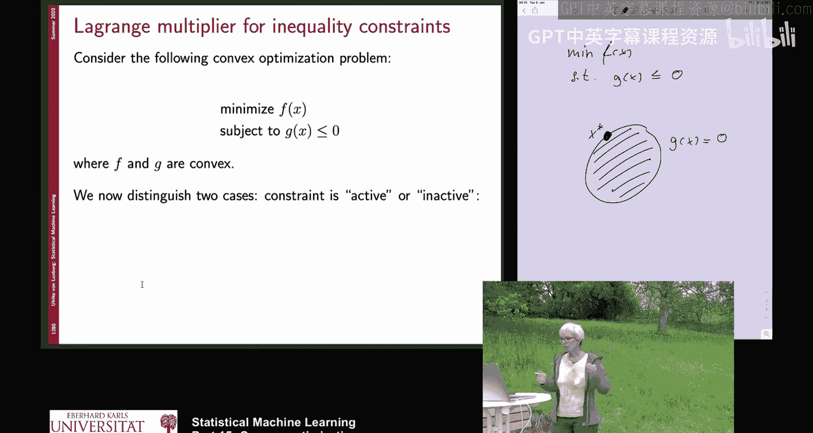

And not somewhere inside the sub level。What we want to see is that in this particular case。

 the gradient of F and the gradient of T parallel。And this is sort of as it was before。

 we are in a similar situation because for the same reasoning as we used before the gradient of T needs to point out we' invered gradient of f as well。

😊，Now， in this particular case， we need to look at the direction of these derivatives。So。

 the derivative of G always points outwards at the direction of G that' is always the case because G is convex。

The derivative of F。In this particular case， is directed inwards because otherwise。

 we could decrease the objective by walking inside。 And remember， we have a problem。

 We want to minimize F of x。And sort of maybe I draw again a figure。 So here's our set G G of x 0。

Now， the assumption is that this the solution of this sorry。嗯。Try to erase it。

 So the assumption is that the solution of our problem is this particular point here on the surface。

Now， if the gradient。Of F would point outside in this direction。

It would mean that we could decrease F by walking inside so we could walk a bit here and look at this point。

We are in an inequality constraint setting， so T of x would be small or equal to0 inside。

 so this would be still a valid point for our optimization problem， but we would have decreased F。

 and this is not allowed， so it cannot be the case。

So what we have is that the derivative of F has to point in what。

And we know that the derivative of T points outward。 So they are aligned。

 but they point in opposite direction。

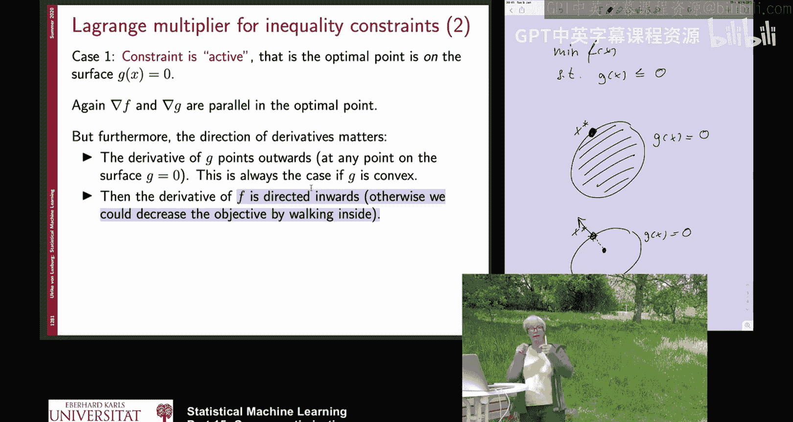

And here again， the figure， I think I more pointed it made it on the iPad as well。

 So here we have T of x， the derivative of F points inwards， the derivative of T points outward。😊。

And what we now have is if you take all of this together。

 we have that the derivative of f needs to be minus lambda times the derivative of G。

 where lambda now is a positive number， because the sine now matters。

 we want to have that they point into a post direction。

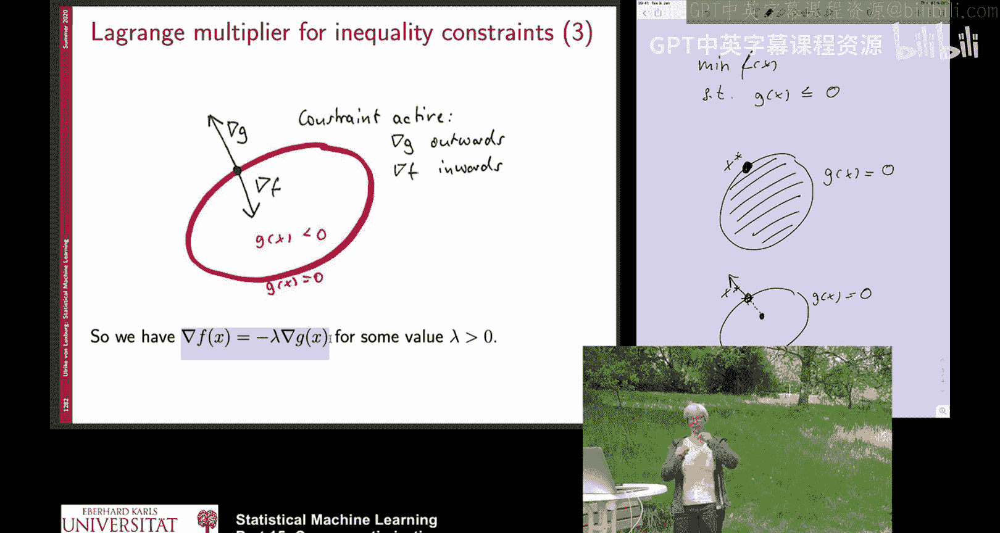

对。Yeah。The second case， the constraint is inactive。

 and this is the case that I already mentioned earlier。

 and the optimal solution sits somewhere inside this region where of x is smaller than 0。

And we call this inactive because this boundary condition doesn't really push us anywhere。

 It doesn't play any role。 The best point we could pick anyway is in inside this red circle。

 So where this red circle lies doesn't really matter for us。 The condition doesn't play any role。

Such a constraint we call inactive。So the optimal point here is not on the surface。

 but somewhere in the interior。So what we then have is that the derivative of f is 0。

 So this is as if we wouldn't have any constraint。We are in an like in an unconstrained optimization problem。

 and then the solution happens at a place where the derivative is0。Additionally。

 we do not have any condition on the gradientd of G because this the gradient doesn't really matter at this particular point。

 we're inside this direction and and the the function G doesn't push us anywhere。

 So there are no conditions on G。

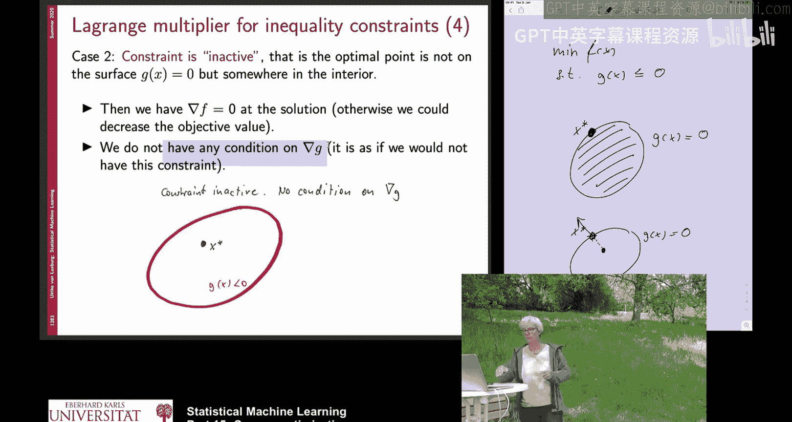

And again， now the trick is， we can summarize both these conditions by looking at the lage function。

Again， we refine the La function。And it looks pretty much the same as before。

 objective function plus lambda times constrained。Just that in this particular case。

 where the constraint is an inequality constraint， Lada needs to be a positive number。

 And this comes from the fact that the direction of the derivatives met。

Now consider both cases in the first case， when the constraint is active。

 what we are going to see is Lada is greater than 0。😊。

And then what we need to find is a saddle point where。

The the derivative of x and the derivative with respect to lambta need to be 0。

This is exactly the same or similar to what we have seen before。In the second case。

 when the constraint is inactive。What you're going to have is lambda doesn't play any role。

Then the laggoe function is only going to be f of x because lambda is 0， and this part disappears。

And then the derivative of the Lagon with respect to x is simply the derivative of f with respect to x is 0。

And the gradient with respect to Lada is zero anyway because lambda sort of doesn't occur anymore。

 it's a constant function。

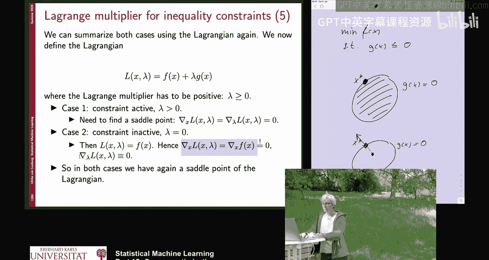

And so again， in case 2， we also have that at the solution we have a saddle point of the laboratory so no matter whether we are in case1 or case2。

 which obviously you don't know when you start an optimization program，😊，嗯。

No matter what is your situation， the solution is going to be a great a saddle point of the。

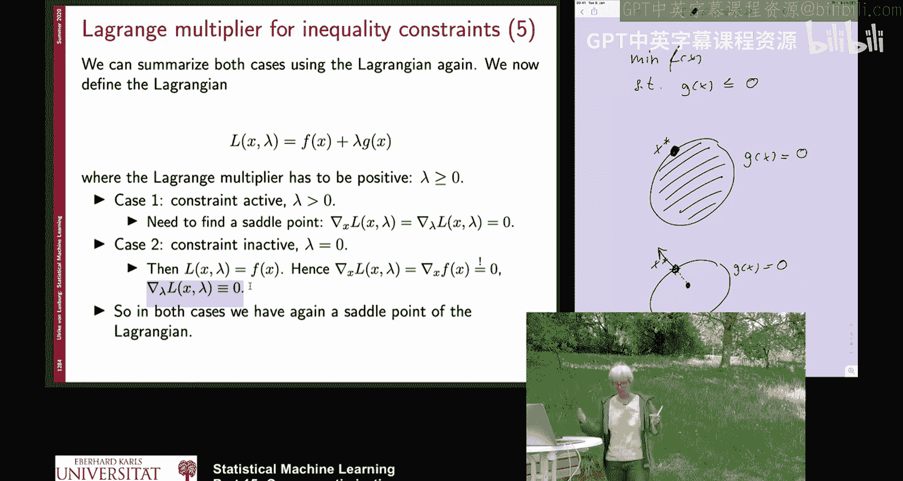

What you should also notice is that in both cases， we have lambda times g of x star where x star is the optimal solution is 0。

😊，So if the constraint is active， we have lambda greater than 0。

 but then g of x star is 0 because by definition the constraint is active and this happens exactly if g of x star is 0。

😊，If the constraint is inactive。Then we have lambda equals to 0。

 G of x star might not be 0 or well its not 0， but it doesnt matter because lambda is 0。

 So lambda times g of x star is also going to be 0。

These conditions are called the Ka contacter condition or KKT condition that also plays an important role in convex optimization here I've just shown it at some particular example。

 and there's much theory related to this condition and the question is when are these conditions satisfied and so on。

 but we are not going to discuss it much further。

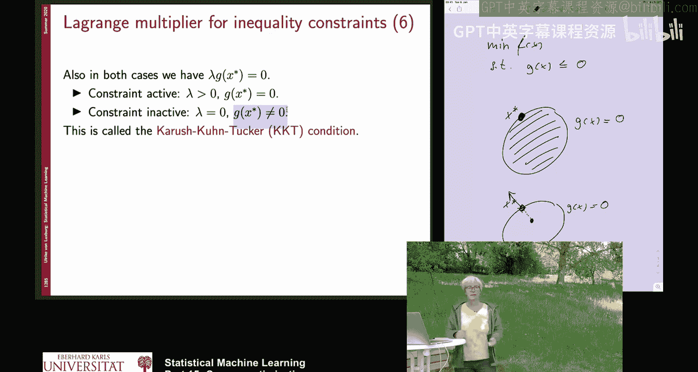

Again， I want to give you a simple example for an optimization problem with an inequality constraint and I can show you how the La orange approach works。

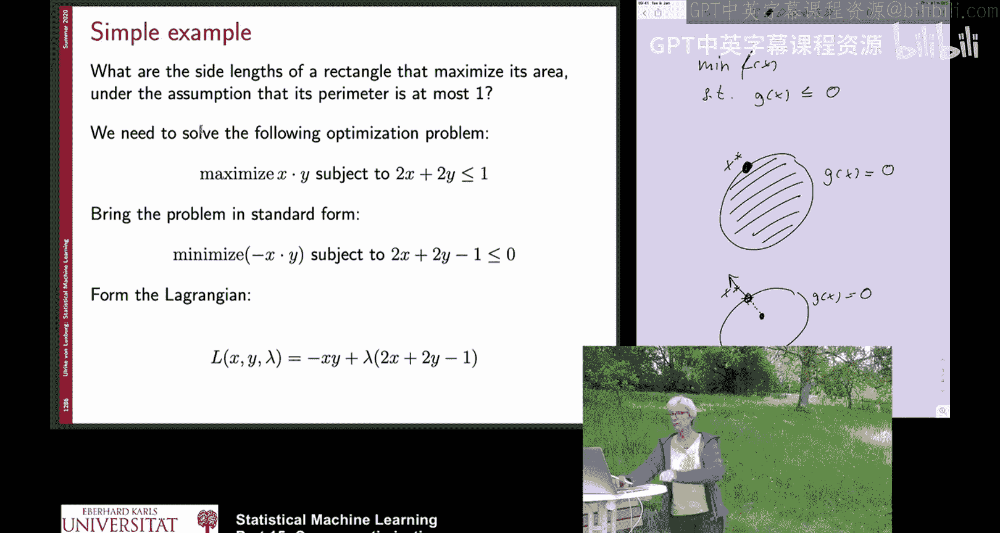

So the example I want to show you is what are the side lengths of a rectangular of a rectangular that maximizes the area under the assumption that the peri is at most one。

 so let me draw a figure so we have a rectangangle and it could have side length 0。101。

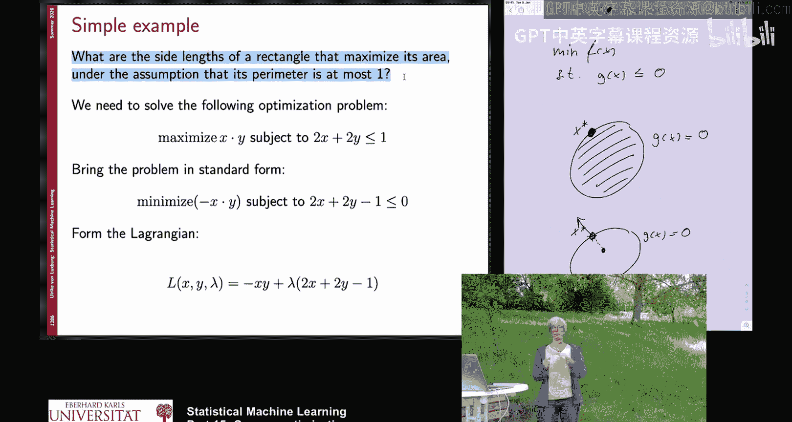

。4。4。Then the peri of this rectangle is one because the peri is the sum of all the four side lengths。

You could also consider a rectangle that has maybe 02 here，02 here。Pot3 here， point3 here and so on。

 So there are many different rectangles。All of them have peri 1。This is the constraint。

 And what we want to do is among all those rectangles， we want to find the one that has maximal area。

Okay， in the area， of course， is sort of the area that you have inside these rectangles。Now。

 if you write it down formally as an optimization problem。

 what we need to do is we need to maximize the area and so if x and y are the two side length ofangle of the rectangle so this is x and this is y。

The area of the rectangleular is x times y。the parameter is 2 x plus 2 y。

 and so the optimization problem we need to solve is maximize x times y subject to 2 x plus 2 y being smaller or equal to1。

And now， again， we follow our recipe。The first thing is we bring the problem in standard form。

The standard form says we are not supposed to maximize but to minimize。

 so we minimize minus x times y。And then we need to bring the constraint into a standard form and the standard form is smaller or equal to0。

So we write this inequality in this way。Okay， so this is now the optimization problem in standard form。

Now the next step is we build a Laconsian， so the Lagoian has now three different variables， x and y。

 the two original variables and lambda， which is the Lacoch multiplier that we introduced for the constraint。

And the formal thing is simply we write down the like honest is the objective function。😊。

With this minus， because were understand standard form。Class lambda at times。

 the constraint also intended。AndThis is simply the lag。 There is nothing to think about。

 This is a mechanism that you simply do。

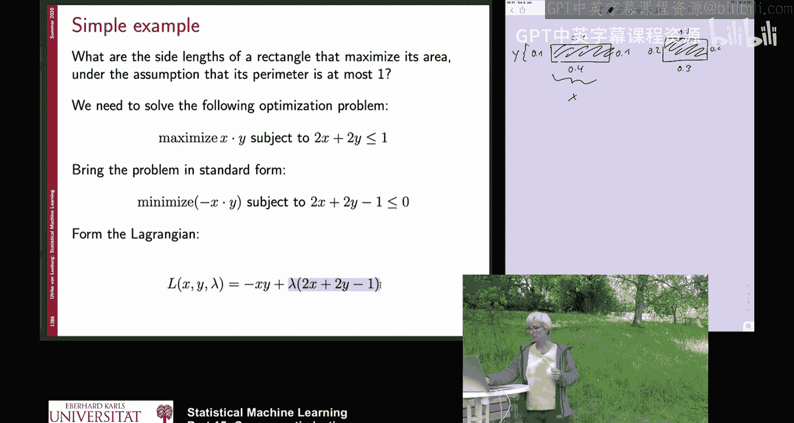

Now， what we need to do is we need to compute the derivatives of the lag because we want to identify a saddle point。

You can do that yourselves。 here are the derivatives of this function。

 and then we solve the system of the equations。And what we find is if you do that。

 that x equals y equals0。25。And this is the reced。I guess most of you would have known anyways。

 the rectangle that has the largest area inside， given a fixed diameter or a fixed perimeter is the square。

With both where x and y equals have the same length。

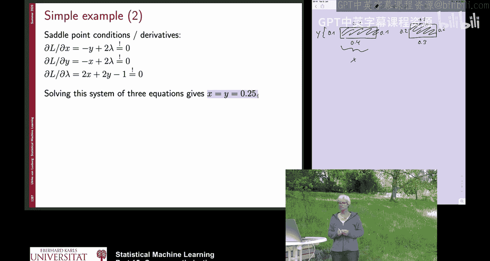

And again， if you look at this optimization problem， I go back once more。

 this doesn't look like an optimization problem that is particularly easy to solve if you don't have this Labo approach。

 but through this Laonche approach it simply works， it's easy。😊，Of course， I mean。

 I picked examples also where it's easy and where everything works out。

 And I haven't really told you under which conditions its really going to work。😊。

But this is sort of testoy example to illustrate how this approach might。

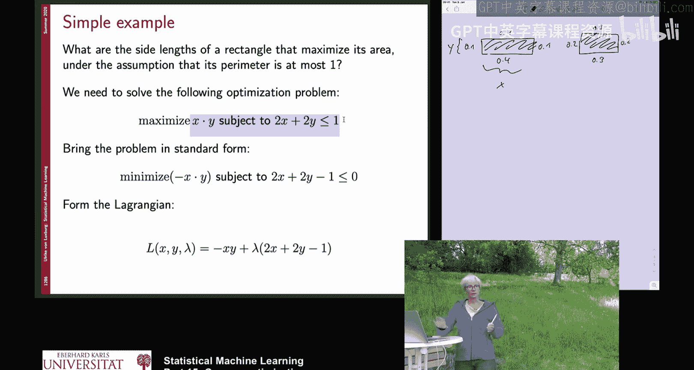

Okay， so far so good。 Now we want to look a bit more on the formal side of this whole approach beyond particular examples。

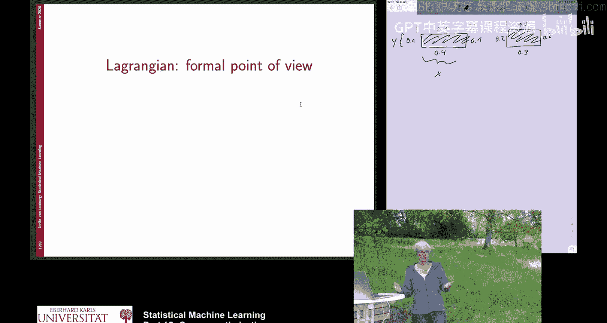

And this works as follow。 I now take a new page on my iPad。

We now consider a convex optimization problem in standard form。 And I take it again on the iPad。

 So we always have the notation here because that's not important。

 So the problem is we minimize F 0 of x。 So F0 is always the the objective function that we want to minimize。

And then we have two types of constraints。 We have inequality constraints and equality constraints。

And the inequality constraints are Fi of x。Is smaller or equal to 0。

And these conditions go from one to M。So M is the number of inequality constraints we have。

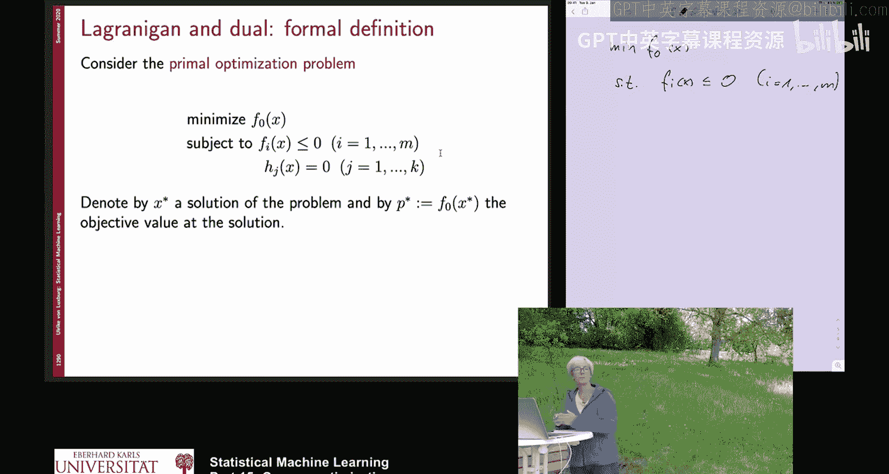

And then we also have equality constraints hj of x equals 0。In Jane， arranges from one。2 k。

 So K is the number of equality constraints。And what we' are going to do is x star is going to be the solution of this problem。

And P star， which is F 0 of x star， is going to be the value of the solution。

 So right an x star is the solution。And P star。Which is F 0。 So the。

 the objective function at the solution。That's called P star。 And P star。

 we are going to see that comes from primal as opposed to dual。

 So P star is the solution of this problem， and it's， it's called a primal problem。

And it's simply called the primary problem because it's the problem we start with。

 And then we are going to transform it to a dual problem。 And that's the second one we look at。

 And the primary one is the first one。 This is， there' is nothing secret about it。

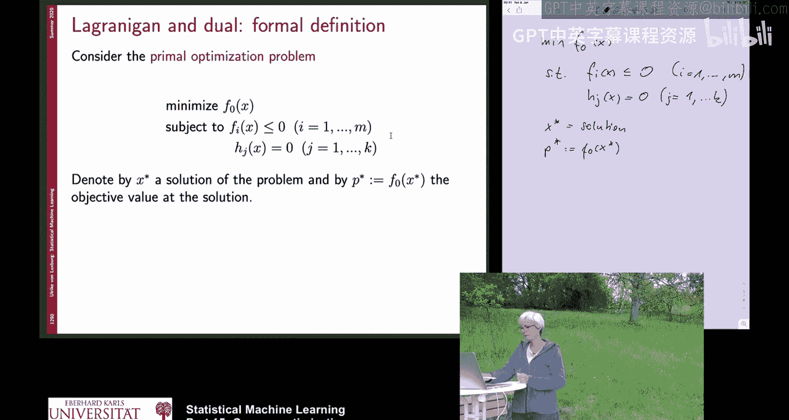

Now， we define the electrons informally。For， and the mechanism works as we have seen it before。

 So now for each equality constraint， J。We introduce a new variable that's called new J。

And for each inequality constraint， I。We introduced a new variable labai。For Ladas。

 we have to constrain that they need to be greater or equal to 0。For the news。

 we don't have any such constraintsstrain。And now， we define。

The lagrange function of the original variables and these new variables。

 So it's a function taking the original variables X。

The laggon multipls lambda and the lag multipl is new。

And this function is simply defined as the original function。Plus， now for each constraint。

 we introduce lambda times like for each inequality constraint， we introduce lambda times F of I。

 the inequality constraint。And similarly， for each equality constraint。

 we introduce I new J times Hj。This is exactly what we have done before。

 just that we now have more constraints all in the same equation。And this is the lagian。

 And maybe I take it down as well。 So the lagian of x。남도 안요。Is f 0 of x plus the sum y。Lata I F of x。

 if I of x plus sum U J。New J times H J。AndNow what we are going to do， I already mentioned it。

 we have a primer problem and we are going to have a dual program。😊，We now define， first of all。

 what is the dual function。And the dual function is now a function G that looks pretty funny。

We define G。Or yeah just write it down G of Lada and U， which is the infumum of all the x。

Of of the lag of x lambda and U。So observe the prim problem has the variables x。

The Laotian is sort of what is intermediate between the primer and the duall。

 This sort of this has a moderating effect。 essentially。

 the Laotian has both variabless X and lambda and nu。😊。

The dual function is now a function that got rid of the x。

 and only is a function in terms of the new variables， lambda and U。And for now。

 this is simply at definition definition， it is at this point。

 completely unclear why this might make sense。 And I'm going explain it in a minute。

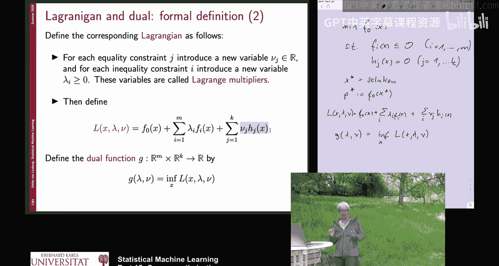

The first thing we might want to see is that the dual function is always a concave function。

And this is in particular， even independent of the whether the original problem is complexvex or not the tool function is always concave。

😊，If you， if you remember， concave is the opposite of convex。

 So concave is a function that looks like this。嗯。Convex is like this。

 and a function is concave if minus the function is convex。So the statement is the primer is sorry。

 the dual function is always concave。And this is simple to see because if I fix some x。

 this function de Laian。😊，As a function of x lambda and U is linear in Lada and x。

 And so it is a concave function。 like like for its particular fixed x。

 This function is linear and a linear function in particular， is concave。

And now the dual function is a point where it infu or minimum。

 if you want to think about over concave functions and the minimum over concave functions is concave as well。

Okay， so that's nice。 Something。 I mean， that's sort of， we get it for free。

Not that typically we are happy if things are convex because we want to minimize them。 In this case。

 we are going to be happy if G is concave because we want we are going to see that we want to maximize that one。

😊。

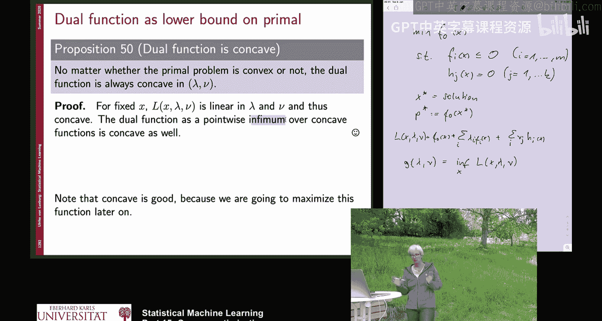

But this is going to follow in a minute。Now， what I want to show you is what is sort of the heart of this whole primal and tool kind of mechanism。

 namely that the solutions are sort of have some relations to each other。And maybe I。

 I start making a plot here。So here I have。 this is simply a real line。And assume I have here P star。

Which is the solution of my primary problem。What I now want to show you is that for all lambda I and new I new J。

The value of the tool function is a lower bound on the primal value。 So what we have is here。

 we have here some G of lambda and new。And this is always smaller than P star。

And observe the goal is， maybe I write to see a goal。Is to minimize。WellTo minimize P if you want。

 So P is the value of the primary problem。 how should I write this minimize F of x。

 a0 of x And P is sort of the value and and p star would be the best one。

 And we want to have P star as small as possible because we're looking at a minimization problem in the primary version。

😊，Now what I tell you here is that any value of the dual function is a lower bound。

 at least on P star so it doesn't maybe help us to find what P star is。

 but at least it helps to bound things and often in computer science maybe or in many other problems sometimes it's hard to find a perfect solution。

 but at least knowing that the solutions between two and5 might already help you。😊，Now。

 this is for now a statement， so the proposition is， no matter what lambta I U I I choose。

 if I compute G of Lata and U， then P star is like the G of Lada U is smaller or equal to P star。

And to proof。Is very simple， in fact。So now assume that X0 is a feasible point of the primary problem。

 The feasible point is always one that satisfies all our constraints。😊，For such a point。

We now have the following inequality。 And so these are sort of pieces of the La function。

 So if you consider lambda I times f of x0， F I of x0。X0 is a feasible point。😊，So if I here I。

 if you look at the sum starts to range from1， so the F1 F2 and so on are the constraints of our optimization problem。

So if I of x0 has to be smaller or equal to0， because x0 is a feasible point of our solution。

 It satisfies the constraint。 and this is exactly the constraints are that if I needs to be smaller or equal to 0。

We know that lambda I is greater or equal to 0 because lambda is a La branch multiplier。

 and we have to find it this way for the inequality contrain。😊，Similarly， we have for the new eye。

 we don't know anything。😊，But we know that H J of x0 is equal to 0。

Because hj is an equality constraint and we have a feasible point so hj of x0 has to be0 for a feasible point So these last terms are disappear。

 So we are just left with the sum of the first points which is always a product of something greater equal to0 and smaller equal to0。

 so the whole thing is smaller equal to 0。

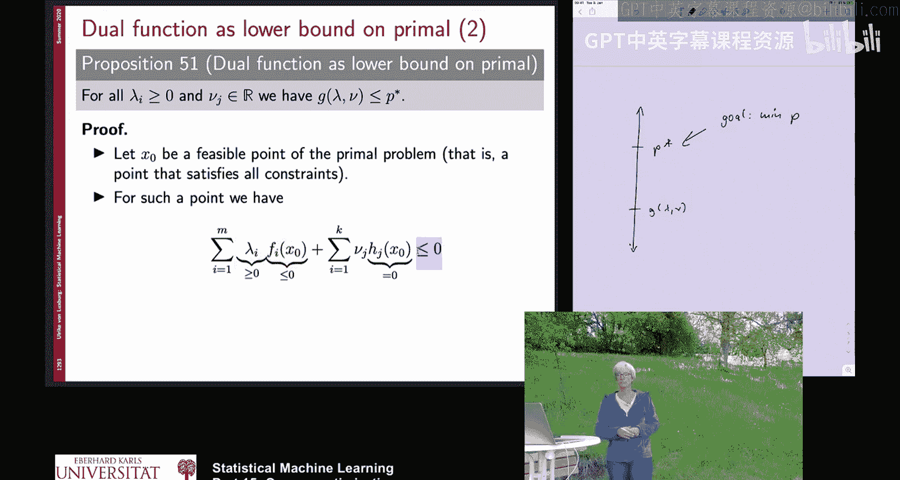

Now， what does it imply。We started with the Lagoian。Evaluated at this particular point x0。

 so the Laronian of x0 lambta n u here I've just written down the definition。😊，Now， satisfies。

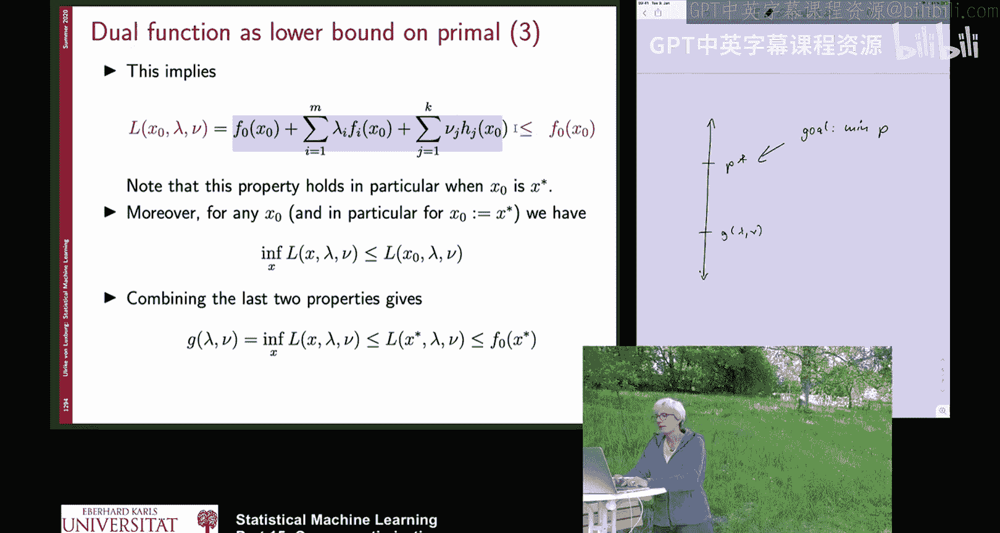

Hang on， Let me go back。 So here what I have said is this this term here is always smaller or equal to0。

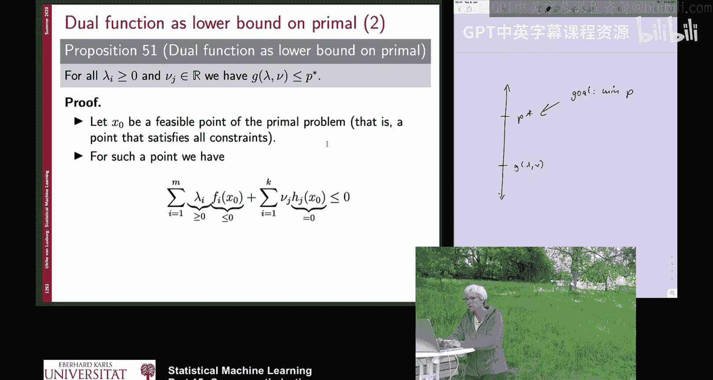

So this term here is always smaller or equal to 0。So by the property we have just seen this whole expression here is small or equal to the remaining part。

 which is the first part of the equation here。So this simply follows from what we had on the previous slide。

This holds for all values of x0 that are feasible points。

 it holds in particular for the optimal point x star because the optimal point x star is also a feasible point。

 but is also the best solution of the problem so in particular it holds for this particular point。

Take it as a note。 This property holds。And now for any X star。

 we also obviously have this following expression which just says the infimum of x over the Lagansian of x lambda and U。

😊，Is smaller or equal to the laggansian of some particular x0 in lambta N U and this is clear because on the right hand side。

 I have one particular evaluation of this Lagrange function on the left hand side I say try to optimize it over all the x values and then of course。

 only something smaller can come out it can be smaller or equal in the worst case it's equal if the best if the smallest。

 the things that makes it smallest is x0 in many cases it's going to be smaller。

And now we can combine all these properties because G of lambda and U。

 this is the dual function we' are currently looking at。

Is defined as the infim over the Lagosian of x。 We have just seen on the line previously that this is the same as the Lagosian that is smaller or equal to L of x star lambtannu。

And the line on the top of this line tells us that this is smaller than F0 of x star。

And this is what we wanted to show because f 0 of x star F0 is the objective function that we want to optimize。

 So what we have seen is that the value of sorry， that the value of。

The dual function is always smaller or equal to the primer value。

And this was the proposition that we wanted to prove。

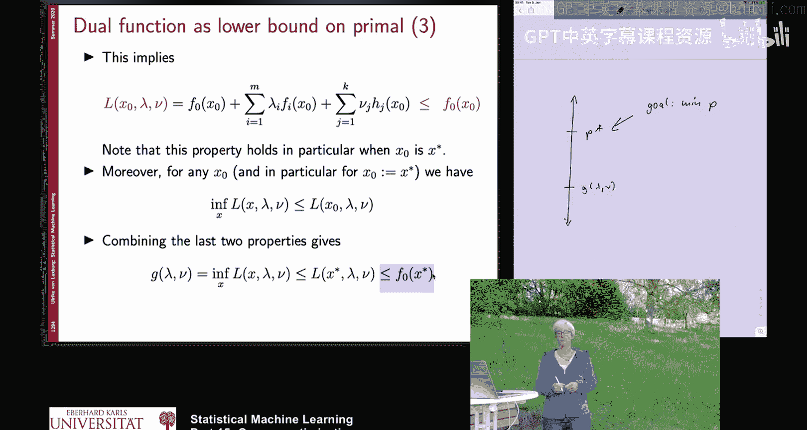

Okay， so far， so good。Now， maybe I continue again on this particular line。

 So go look again at the at the iPad thing。 So now I can plug in many different values。 So。

 say I have another Lada Lada prime， new prime that I can plug in。 and maybe I。

 I can now plug in many different values for G。And always try to find out what is the value that we get if you plug it in。

 So maybe here I have another G Lada tilde， new tilda。

 So for many different combinations of Ladas and news， simply plug it into G and check what happens。

😊，The reason why I might want to do that is because eventually I would like to approximate this P star。

 So what I'm ultimately interested in， maybe I try to do that in red。Is this P star here。

 I want to find the play。 I want to know what is this optimal value of my original optimization problem。

And now， by plugging in many values of G， I can always find lower bounds。

Observe that I can also find upper bounds on the P。 That's very easy。

 So I can for for I can also plug in try to plug in points into my my primal in in the primal objective function of the primal problem and this would give me give me upper bounds on the solution of the problem of the primal problem。

 So again here So I could put the F0 of some x。 So here simply plug in some x and see what is an upper bound at least if x is a feasible point。

And so now the idea is what I want to do is I want to find， I mean， I want to bring the the goal。

 maybe I do this in red again is I want to bring this down here。

 so I want to sort of find what is the lowest value of this P of this F 0 of x。

And now what can I do is I can sort of try to push from the bottom here。

 I can try now to evaluate the Gs。 And in particular。

 I can now write on an optimization problem that is well， if I try all different parameters。

 Lada and new， which ones are the ones that would give me the highest value for this one。

And this is now what the dual object to optimization problem is。So I have this function G Latannu。

Now I say for all combinations of lambda and U that I can imagine。

 what is the highest value that I can find。😊，And the。

 the only conditions I have to satisfy is that lambda is to need to be greater or equal to 0 for new。

 I don't have any constraint。And if I plot this in the in this figure here。 So then here。

 this is maybe G star。Which is the， the maximum。Of three of Lata and new。And this is the。

 the value I now want to find。 So this gives me a very good upper bound on the a lower bound on this。

 on this value P。And if you take some notation。Lambta are a new star are the variables where we attain this optimum if it exists。

And the objective value is called D star。And here again， So the D， sorry here I brought G star。

 I had should have written a D star。The fu dual problem star。And sort of。

This kind of illustration is why we might be interested in solving the dual problem。

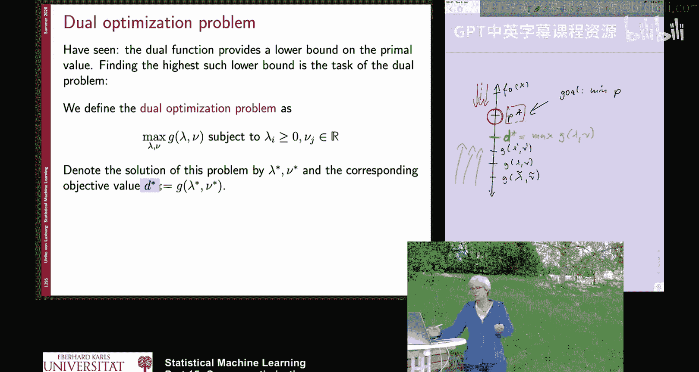

I have the same illustration here on the slides。

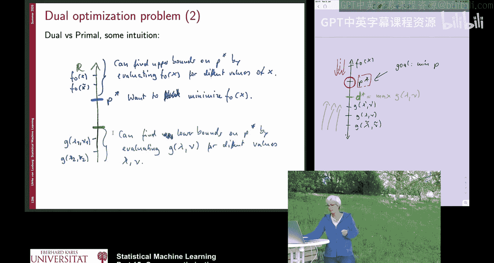

But I think it's mor。 what I have one day。 I p as well。Here have it again。

 So the primal problem find the best sort of upper bound on P star。

 like find the best P star and the dual problem is find the lowest best lower bound by optimizing D star。

 bringing it as large as possible。Now， of course， it's an interesting question whether Par and T might agree in certain cases。

 And this is， we are going to look at this in the next couple of slide。

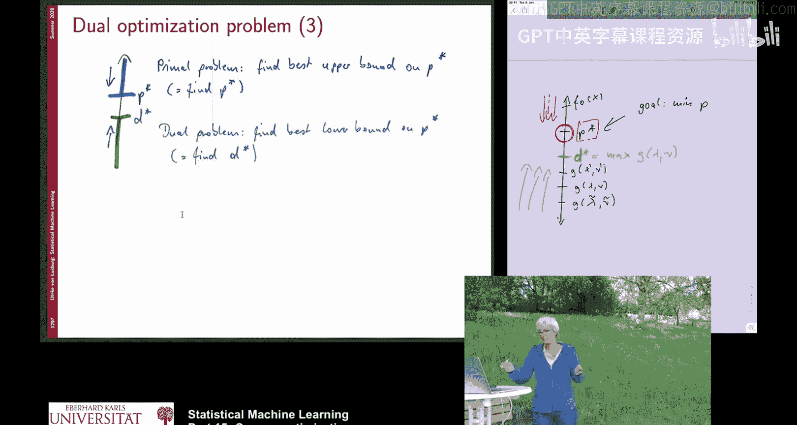

。So what we have already seen， at least I have indicated it by point by making these plots is that D star。

 the solution of the dual problem is always a lower bound for the solution of the primal problem and we have already seen this from the proposition before。

😊，This difference between P star and T star。Is called the dual gap。 So in my plot here。

 maybe I choose one。What， what color could I choose pink。So here this。

 the distance between D star and P star in my plot， this is it well again。It's hard to read。

And the question is， of course， under which conditions might the dual gap be small。

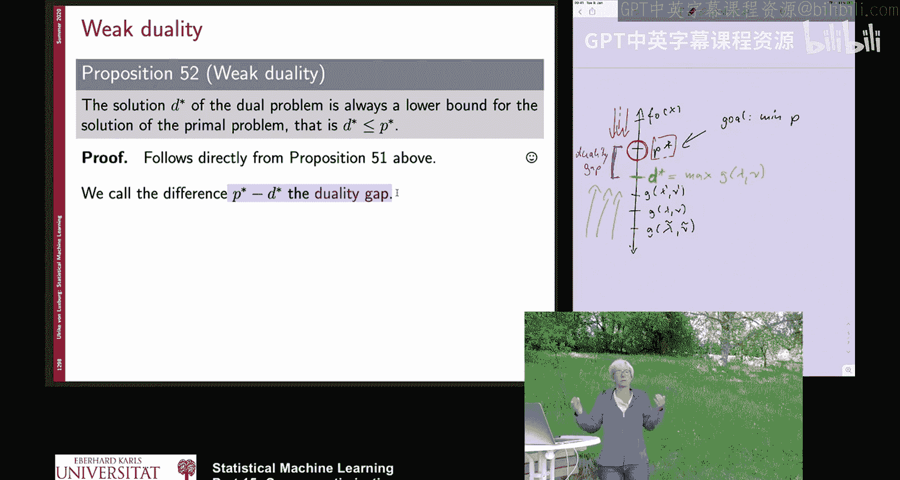

And here comes now the definition we say that a optimization problem satisfies strong duality if P star equals to D star。

 this would be the best of all situations， because then if we want to find P star and maybe we don't know how to solve the prim problem。

 we might still be able to find it by solving the dual problem。

The problem is now that it's not always the case that P are Star agree。 this would be really cool。

 but it's not。😊，And there are like in optimization literature。

 there theres a whole line of conditions under which we can certify that these star and pi star are equal。

 and these are called constrained qualifications in the optimization literature。And as I said。

Convex optimization problems do not always satisfy this but sometimes and in particular in the case is that we are going to be interested in the machine learning lecture and this is often the case。

 but of course this is for the hand selected algorithms where it works probably the lecture doesn't present all the algorithms where it doesn't work because then sort of the algorithm doesn't really work and it hasn't been developed。

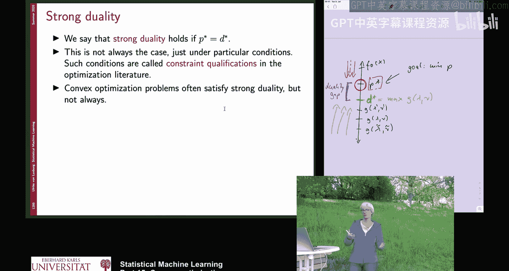

Do we know some particular examples where strong dual holds， Yes。

 linear problems always satisfy strong dual。 So if you start with a linear problem。

 you write down the lagganian， you derive what the dual problem is。

 It's going to turn out to be again a linear problem and you are going to have strong dual。

 And that's a very， very， very。A strong framework that we have in the for linear programming。

For ktic program programs， we also have strong dual。

 and this is what is going to matter for support vector machines。

 because if you remember the prim and SM problem。😊。

is a quadratic problem and what we are going to see after we finish this lecture is that it might be helpful to look at the dual problem for the SVM and this is again going to be a quadratic problem。

And strong reality is going to hold。However， there also exist problems that do not satisfy strong duality and here is an example and you can try to verify yourself。

 This is simply I mean I didn't invent this myself。 I took it from somewhere。

 this is an example of a problem that is convex you might want to convince yourself that it's really a convex problem。

😊，But there's a duality gap。 The optimal solution of the primal problem is one。

 and the optimal solution of the dual problem is 0。

 So it's not the case that whenever you have a convex problem， we have strong duality。

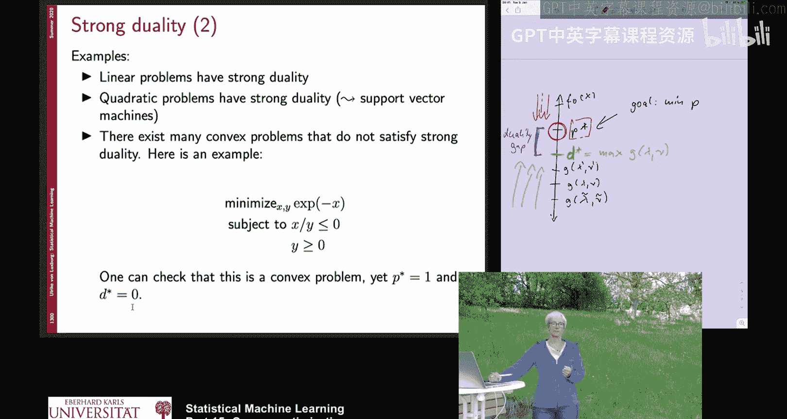

Now， assume we have strong dual。Then there's yet another question。

So what what if we go back to this plot on the iPad here。

 what strong reality gives us is we can identify。 So maybe I make a new plot。😊，然后。

So so here we have again our line here we have t star and then this is the same as P star because we have strong dual。

 so it means that by so the primaryal problem tries to minimize the P values the dual problem tries to opt to maximize the T values。

 the serumorem now tells us the solutions to agree。

And now assume you have solved the tool problem solving the tool problem means you found the variables Lada a new such that the tool function is optimized。

😊，But but you are interested in the primal problem what this tells you now is you know the solution the value of the solution of the primal problem。

 but you don't know these points， these points x for like the primal variables which would give you the primal solution and I have at least you don't know in Eively I've written here on the slide so assume we know that P are these are agreed。

And by solving the dual problem， we know these variabless lamb does are new star。

 but what we are interested in is these variabless X star。😊。

And I want to leave it as an exercise to you， not one for just one minute。

 but for sitting down in the afternoon and trying to solve it。

 how could you recover the prim variables once you have the solution of the tool form？Of course。

 for practice， this is often important。 It might not always be important， but sometimes it is。

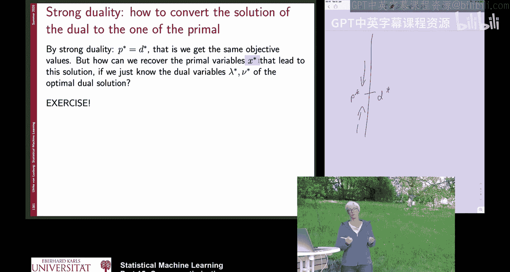

Now， we want to move towards saddle point conditions。

The first proposition I want to show you is that if we have strong dual。

Then the solution is going to be a saddle point of the Laian。Formerly， the statement is as follows。

Assume strong duality holds。And of course， if you start with an optimization problem。

 you don't know whether the strong reality holds， what I told you is that there are certain conditions called constrained qualifications。

😊，Under which we have strong quality。 And I assume we could check these conditions even without solving your optimization problem。

 I mean， it's always the hope。 So we have some conditions and they tell you for my optimization program。

 strong quality is going to hold。So assume you aren't such a problem。

And assume you have x stars the solution of the primer and lambda star a new star is the solution of the tool optimization problem。

😊，And the statement of the proposition is then the joint point consisting of x lambdas in use。

Is a saddle point of the Laonian。

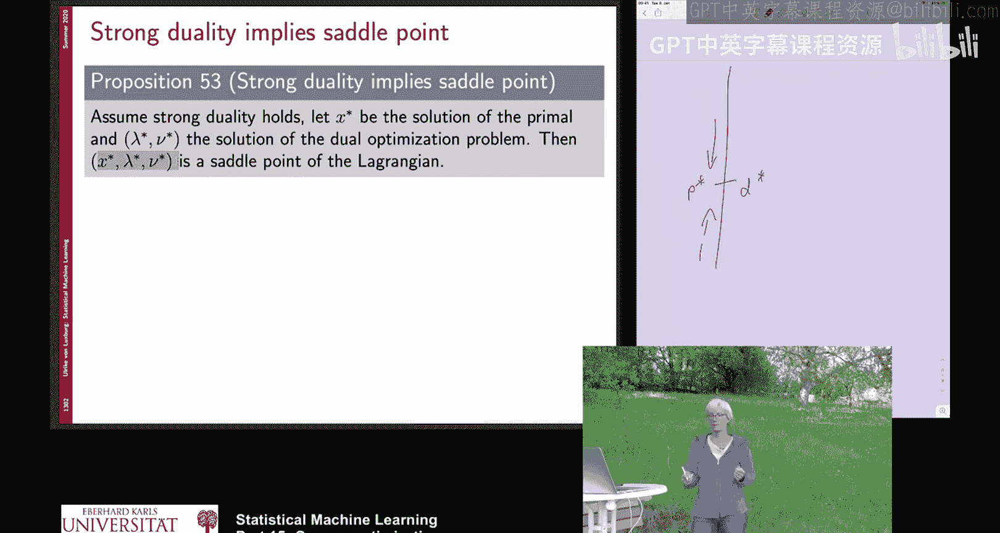

And here I now have an image of a saddle point。 The1 I've been looking for earlier。

This is now a saddle point， so it's a surface and it looks like a saddle。

 This is why it's called a saddle point。 What you have is you have essentially two coordinate directions。

 the direction of x。In the direction of the Las and news。

 And what we are going to do is we are going to minimize with respect to the access。

 So this is this direction here。And we're going to maximize the La with respect to the Lada and news。

 If you remember， we minimize the first， the primary problem。 we optimize the dual problem。

 we maximize the dual problem。And the statement is now。The solution， of course。

 if you take the solutions of the primer and the solution of the dual problem。

 consider it as a point in a space of all the variables。

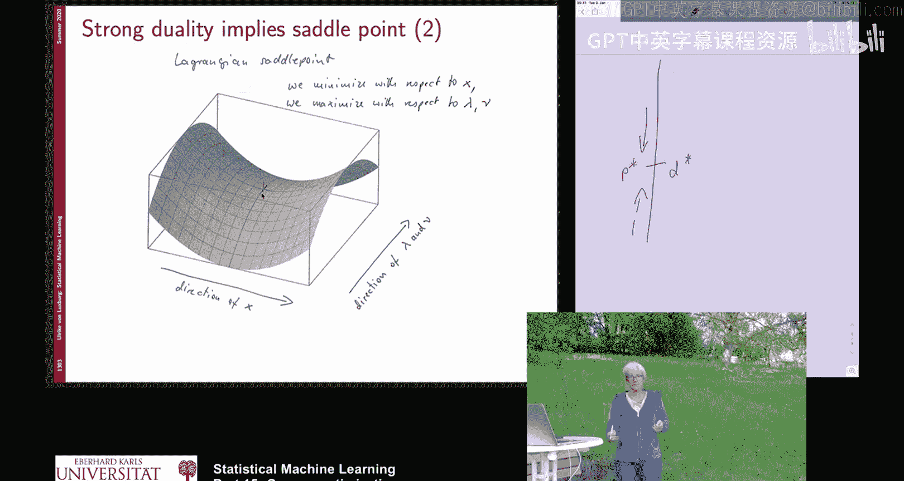

Then it's going to be a saddle point of the lag motion。

And I want to briefly outline the proof how this works。First。

 what we want to show is that x is a minimizer of the Lagoian if we fix lambta star and nu star。

 So if you go back here so。

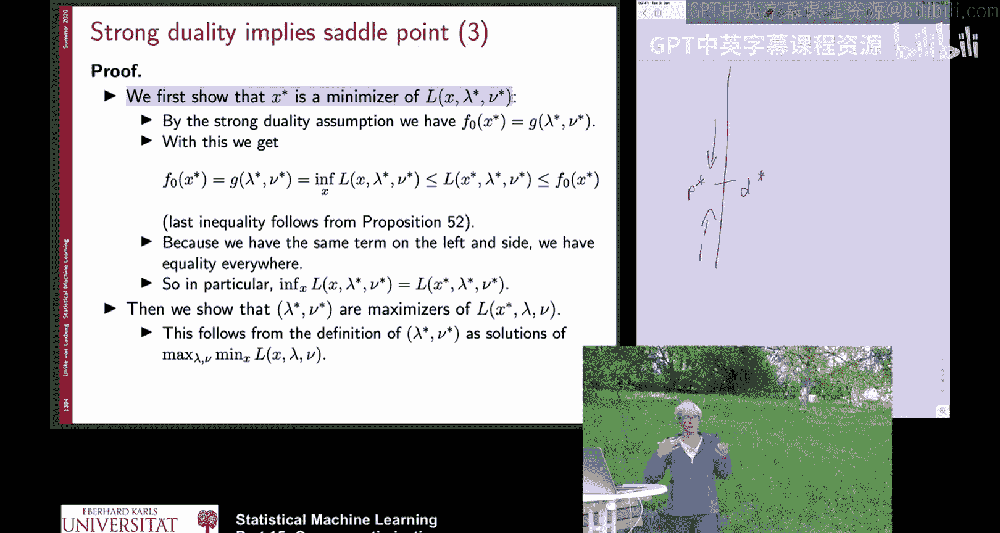

We fix in this direction here。 We have the Las in news。

 We now fix that we are essentially on this particular line here。

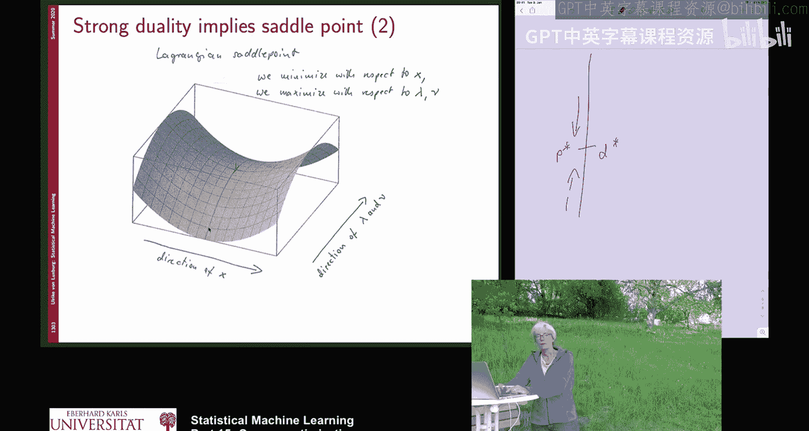

Ops around， it's a bit hard to show。 So so imagine we fixed a point here on this on this Lada axis。

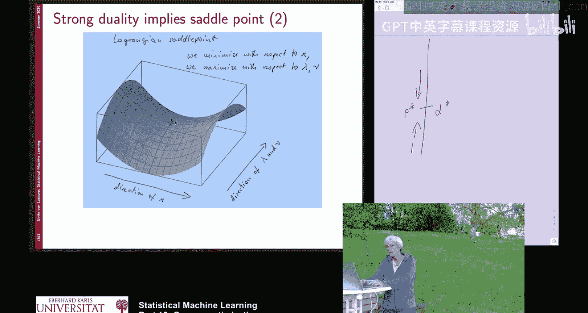

And we fixed Las are a new star。 And now we are all all we allowed to do is we are allowed to minimize the X。

 So this essentially means to walk along this line。To walk along this line here on the settle。

And what we want to show is that X star is， if you walk along along this line on the saddle。

 it's a minimizer。Okay。The proof course like this。By strong duality。

 we know that the solution of the primal problem equals the value of the solution of the dual problem。

And now we have a certain inequality here。 So we start with the solution of the primal program being equal to the solution of the dual program by a strong reality。

Here we have now the definition of。Of the dual function G， we just plugged the definition in。

Then we know that like if you take the in we have seen this argument before。

 if you take the infium over all x， this has to be small or equal to plugging in any particular value of x in particular。

 plugging in X star。And then we have seen already previously that this is smaller equal to the primal value。

Of extra。And now observe we have on the left term we have f0 of x star and on the right term we have f0 of x star and so all the inequality signs that are here in the middle have in fact to be equality science otherwise this whole chain of inequalities couldn't end up with the exactly same expression at both ends。

😊，So we have equality everywhere。 So in particular， what we have is。

That if we minimize the Laian with respect to x while fixing Lada star new star。

 then the solution is going to be x star。And this is what you wanted to show。

So this is one part of the saddle point condition。 Now we need to look at the second one。

Namely that if we fix x star is our variable。And consider the loor as a function of the remaining variables Lada and nu。

Then。These Lata tests are a new star， which are the solution of the tool problem。 in fact。

 also the maximizes of this function。And this follows， in fact。

 from the definition of of these lambdas are used or a solution of the maximum well because minimizing obs。

 sorry。This here is the the tool function， and this is。嗯。The dual problem is。

 is the one of maximizing this thing。

So， so this is is obvious from the definition。And if we take that now together。

 what we get is we know。That if。We have lambda and UR of three variables， but X is fixed。

 the Lagonian value is smaller or equal to if we have all the three variables fixed by according to the problems。

 which is again more or equal to what we have if we fix just the two variables。😊。

And so these three variables taken together are a saddle point of thela motion。😊。

And this is what you wanted to do。

Now， of course， there is also the other way around so what we have seen so far as if we have solutions of prim and tool problem。

 then we get a saddle point of the Laorian。Typically we are interested in the other way around because if you observe what we did in these tiny examples we did in the beginning like the one with the rectangular with the rectangular。

😊，We solved for the saddle point condition and then said here's a saddle point。

 so it must be a solution。And this is now this other direction。

This direction says if we have a saddle point of the Laian。

Then Istar is always a solution of the primary problem。

This is not really the proof is sort of along similar lines is what we have seen before。

 It's not really difficult， but I want to skip it because otherwise this lecture is going to take too long。

And maybe to remark， this proposition always holds not only under strong dual， which is really nice。

 So it gives sufficient conditions for optimality。 So if you find a saddle point。

Then you have found a solution of your program。At this particular point。

 it's not yet clear whether if you have not found a subtle point。

 it means that there doesn't exist a solution。嗯。And there are additional or that you might find other solutions which which are solutions of your primary problem。

 but which are not saddle point of your dark motion。There exist additional assumptions。😊，Again。

 constraint qualifications is such that you can prove that this proposition is also a necessary condition。

No， this is all a really complex approach。 And we've just scratched the surface of convex optimization。

 Why is this now so useful。😊，So what we can do is whenever we have a saddle point of the Laganian。

 we have a solution of our optimization problem。And that's really nice because it now says also what we did in these toy examples where I said we simply saw it for the several point。

 and here's the solution， this is really justified。😊，If additionally strong dual holds。

 we even know that any solution must be a saddle point。 So if you don't find a saddle point。

 you know that there doesn't exist a solution and you also know that there doesn't exist any other solution that is not par is not a saddle point us。

This is all particularly nice for convex optimization problems。

 but even if you like if your original minimization problem is not convex。

 at least the dual is concave。😊，And if the reality gap is small。

 a concave problem is something reasonably easy to solve。😊。

And maybe your original primary problem is something very nasty。

So the primary problem might be something that is completely infeible to solve。

 but at least by solving the you we might get lower pounds。😊，Typically， in such a situation。

 you would have a dual gap that is larger than0。😊，But at least you might get some intuition about your problem。

