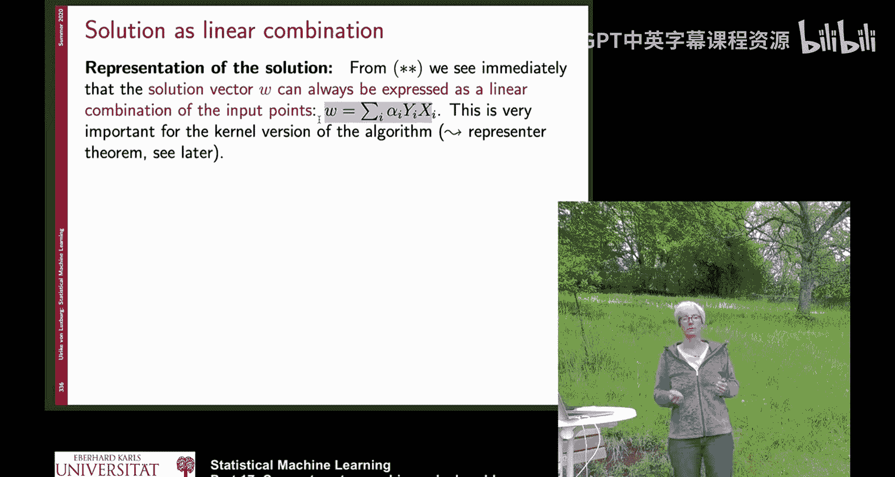
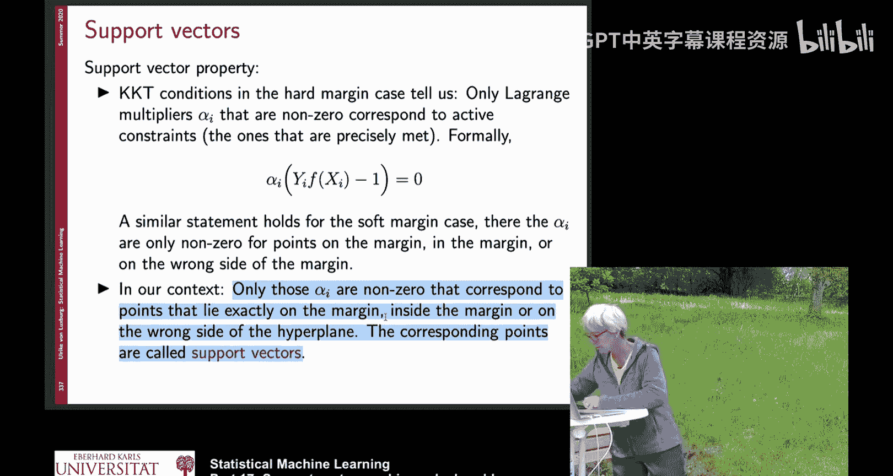
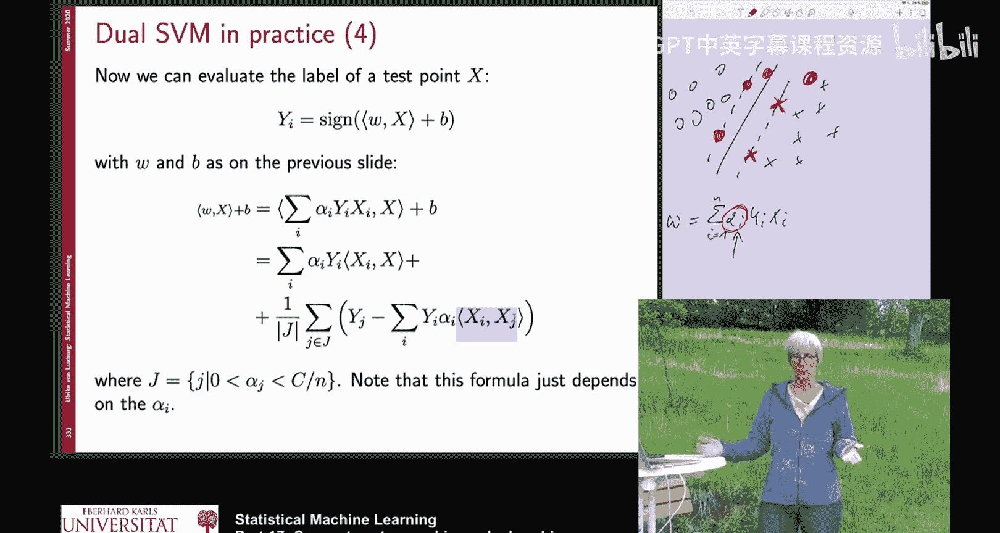
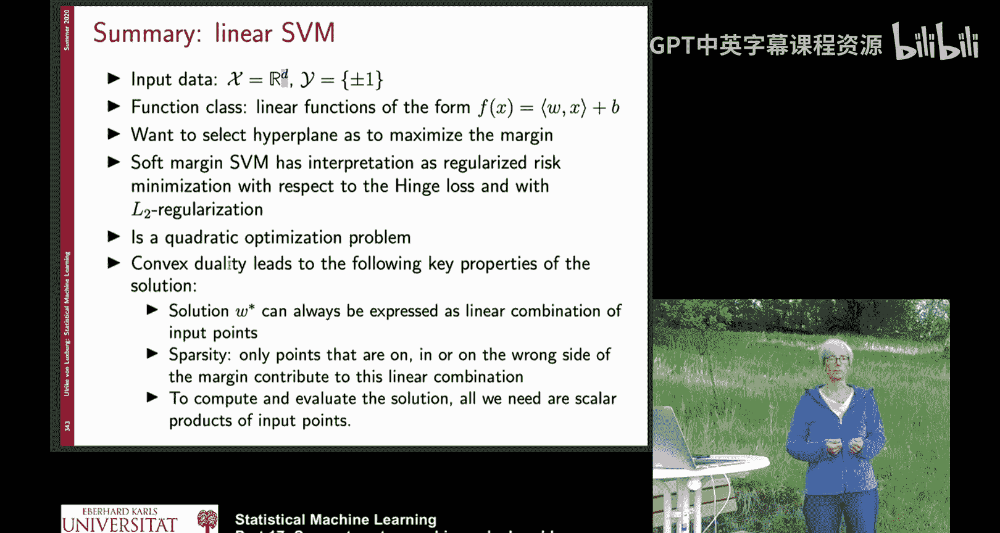

# 图宾根大学《概率和统计机器学习｜Tubingen Probabilistic and Statistical Machine Learning 2020》中英 p19 -19-Part 17 - Support vector machines_ the dual problem.zh_en -BV1gso5YGE4s_p19-

Now， we want to derive the dual problem of the software vector machine。

We have already seen in the last lecture what the primal problem of the support vector machine is。

 we wanted to maximize the margin under the condition that all the points are on the correct side of the margin or in the soft margin case。

 we have some little punishment parameter and wanted to still maximize the margin and have that most of the points lie as good as possible on the correct side of the hyperplanet the margin。

Now I hope you have in the meantime watched the video on Lae multiplayers and convex optimization because we are now going to use on the theory to derive what is the dual problem of the SVM If you haven't watched the convex optimization。

 you need to do that because otherwise you won't be able to follow now。

So now what we are going to do is we take the primer and then convert it to the dual problem of this upper vector machine。

The primary program just to recap that we have already derived in our previous lecture is the following in the hard margin case。

 we want to minimize the parameters of the Hyplane， W and P。😊。

Our objective function is the norm one half the norm of w squared。

 which corresponds to maximizing the margin。 If you remember， the margin was one over norm of w。

Now we wanted to minimize norm of w squared subject to this condition。

 which essentially encodes that all pis sit on the correct side of the hyperplane and also outside of the margin。

So now we have a problem if we abstract from the fact that it's a support vector machine it's a quadratic optimization problem。

 the first line is our objective function and we have n constraints and inequality constraints。

 one inequality constraint for each data point which says where the data point is supposed to be。

And now we follow the lacmotion approach and for now we again， as a first step。

 at least we simply follow the recipe。😊，So for each of the constraints。

 we introduce a Laboche multiplier and for some unconvenient reasons in the support vector machine literature。

 they are always called alpha and not La die。For each of these inequality constraints we introduce a Lagoch multiplier Ifi and it needs to be greater or equal to0 because its an inequality constraint。

 recall in the Lagche approach if you have an equality constraint you don't have any cons on your dual variable。

 we have an inequality constraint， and this gives us a greater equal to zero constraint for the dual variable。

Now we can use our recipe and write down the La。 the La is， first of all。

 it's a function of the original variables， omega and P。And Ifa。

And I are the dual variables and how does the look like we have the objective function of our primal problem。

😊，Plusas alpha I times the equality constraints， the inequality constraints sorry now here in this particular form if you you need to remember before you are allowed to do that you need to bring the problem in standard form。

So you need to bring the conditions to a condition that reads smaller or equal to 0。If you do that。

 you have a minus in there and this is where this minus here comes from。Okay。

 so far nothing has really happened。 We simply have defined what is the La function。

Now we can write down what the dual problem is， the dual function。

Is the one it is now the function in terms of the Is of our dual variables that we get if we minimize it a commission with respect to our primary variables。

The tool problem then consists in maximizing the tool function。With respect to the dual variables。

Subject to the constraints that the dual variables are greater or equal to 0。So again。

 we have an optimization problem that has one objective function and n constraints。

Now the problem is as it's written here， this tool function is not really obvious how to optimize it。

 so maybe let's try to simplify a bit。We first write down the saddle point condition because we already know that。

At the solution of the primer the southern point condition has to hold so in particular what we do is we take the derivative of the objective function of the Laian with respect to our primer variable B and if you do that and write it down I mean this is I think here is the Laian taking the derivative of this function with respect to B should be something very simple here B doesn't occur and here we have this B occurs essentially here。

Mipied with y I the alpha I in the sum。 So I guess everybody can do that。

 So you get this as the derivative similarly for w。 you can now either again， maybe I go back。

Do it in if you know how to how to invoke the vector calculus。

 you can do it immediately and know that the derivative of this function is W。If you don't。

 and the derivative of this function is simply like a linear function， I I Y， I X I。

 if you don't know it， you could also do it coordinate rise as we did it for linear least squares。

In any case， what you get is is this condition here。Now we can set the saddle point conditions to 0。

And we get two conditions which need to hold at the primer at the solution of the primer problem。Now。

 what we do is we want to simplify the Laotian and we plug these two conditions in the Laotian at the saddle point。

And we first exploit this first condition。 So here we have the Lamarium， as we had defined it。

We simply split in the linear terms here。And then now we know that this sum here is 0。

 This was the condition star on the previous slide。 So this term disappears。 That's nice。

 We have one term less。And now the other interesting thing is if we go back to this slide and look at the two star condition。

 essentially it says a w minus sum of these terms equals to 0。😊，And if you solve it。

 it means w equals the sum here。 So you have an explicit expression for W in terms of training points and the tool variables。

And so now what we do is we replace doubleware everywhere in this lag motion。😊。

By what we get in the In formulaula 2 star。So here， for example， I mean， we have w here。

 We plug in the formula 2 star。 We have w here， and we also plug in the formula  two star。

And now we can simplify the problem and I don't have that on the slide。 this is really simple。

 Everybody can do that。😊，What what you then obtain is the Lamarian in this very。

 very much simplified form。And now you can observe the dual variables sorry the private variables mega and B。

 they don't occur at all anymore in this Lacon because they have been replaced by formula formulaula 1 star made the B here disappeared and the formulaula 2 star explicitly made sure the w has disappeared so this is a form that only has dual variables left。

Which is nice。So the dual function is we need to minimize this expression here。at the saddle point。

 I mean， note that these kind of replacements only hold at the saddle point。

 This function is very simple because these variables， omega and P don't occur anymore。

 So our dual function is， is really this function here。

And this aspect that we in the function need to minimize with respect to the primary variables that has disappeared because all these variabless have already disappeared。

 They don't occur anymore at all。So now we finally can write down what the tool optimization problem is。

嗯。So essentially， our dual optimization program is we need to maximize the dual function。 It's here。

 This is the dual function。Subject to the constraints that the two variables need to be greater or equal to 0。

And we have this one more constraint here that， first of all， sounds a bit funny。

 And the reason why we still have that is。We still because these conditions star and two star as we have derived them only hold for the saddle point and now we need to make sure that while we optimize these conditions are still satisfied。

 otherwise this whole replacement certain that we had invoked in the previous slide wouldn't be valid anymore。

So we keep enforcing these two constraints and this constraint one star is what we see here in the bottom line。

And the constraint two star， we， this is one we can drop because it it concerns the variable W and W doesn't even occur here anymore。

 So there's no point in adding this constraint。 It wouldn't have any effect。

So what we have here is now the dual problem of the linear heart marosphere。It is a simple problem。

 It's again， a quadratic problem。 If you look at it。

 So the dual variables occur quadratically and linear in the objective function。

And linearly in the constraints。 And yes is also linear constraints， inequ constraints。

 So this all in all is still a quadratic problem， and it's a nice one。

And we're going to see later that from this problem。

 we will be able to derive a couple of important properties。

As we have done it for the hard margin SVM， you can do exactly the same kind of thing for the soft margin SVM。

 the similar strategy works。And what you are going to get is yet another optimization problem and it looks nearly the same as the one we had before there's just a tiny difference and it's this one here。

😊，So the tool of the soft margin SVM。It's exactly the same as the one we had before。

And this constraint is also the same and this constraint is obsolete。

 This constraint is also the same。 And the only thing that's different is instead of having alpha I bounded from below by 0。

 we now have a box constraint， it needs to be blown bounded from0 n from top by c over n and see。

 if you remember C over n was the trait of constant that we had in the formulation of the soft Martintnessm。

So now we have a very simple problem for the or like we have derived the dual version of the soft margin problem。

 and again， it's this kind of simple quaratic optimization problem。😊，Now， in practice。

What are we going to do， The way it works is we， first of all。Need to compute， I mean。

 if you know look at this， we need to compute all these scalar products between the input variables。

Then you have real numbers here。Then you can solve the dual optimization problem。

 and it's going to give you the dual variable Ifi。And now you need to evaluate what the support vector machine does for a label of a test point。

So you need to recover to， to understand like。To need to understand how to recover。

The prime variables from the two variables。Because now you need to know what is the hyperplan equation to know for a new test point on which side of the hyperplan is it going to be if you solve the dual problem。

 you first of all just have the alphas。And now this works as follows for the W。

 this is really simple because for the W。😊，You have this condition 2 star which we have already used which gives an explicit formula for w in terms of the alphas and the Yi and Xs so you can simply compute once you have to do a solution。

 you know the alphas， you anyway know your training data。

 X I and Y I so you can compute what is w immediately。Now， to compute。The parameter B。

 we need to be a bit more involved and I don't really have all the details here on the slides。

 we need to exploit these Co contactakcker conditions of the soft Martin S and I didn't really put all this on the slides heres just a quick summary so you know how it works。

If we know that I I equals to 0。One can prove that this means that the slacker of C is also0。

So the point is outside of the margin and correctly classified。If I I is between 0 and C over n。

Then this is the this corresponds to the condition that the poet sits directly exactly on the margin of the Svin。

 and in particular， what we have in this case is because it sits on the margin。

 it satisfies equals to1。And finally， if I I equals t over n。

 it means that the slack variable is greater than 0。

 so there is the corresponding point either sits on the correct side but in the margin or on even on the wrong side of the margin。

Now， if you know all of that， what you can do to compute B is to select a point that sits on the margin。

Which is case 2。So you need to find a point for which。

For which I for J is strictly between0 and CO N。And then you can now solve this equation here for B。

And then， you have P。So the whole point of this derivation is you need to find one point that sits on the margin because you know for a point on the margin that this equation needs to hold and then you can solve it for B。

If you want to make it a bit more stable from a numeratory point of view。

 you can try to find a number of points， not just one index shape for which which sits on the margin。

 but use all such points and average over over the resulting B to make it a bit more stable。

Now I know I didn't really put all the details on the slides because I don't find this extremely important。

 but if you want try to use the lage approach to arriveive it yourself。

 to derive the soft margin SVM and then use the current contacter condition to verify these three cases1。

23 above and then you can derive it yourself。Now， we can finally evaluate the label of a test point。

So now we have some test point x as an input。 So what we can now do is we can compute what is omega x plus B。

 Take the sign， and this is our predicted label for this particular test。And to do this。

 if you I mean， if you want， you can have the formula here on the slide。

This is how you need to compute it。 You just plug in the formula that we had on the previous slide。

Now， in practice， the question is maybe a bit why？Should I solve the dual problem and not the primal problem。

 both of them atic problem and it's not so obvious in the first place which one is better。

And in particular， because it's cortic problems， we know we have strong dual。 I mean。

 I didn't even mention it anymore， but this is， of course the reason why this whole approach works in the first place。

 And now the question is which one is better to use。

If you now consider maybe the difficulty of such a problem。The prim problem has d plus one variables。

 So D is the dimension of our space， because the variables in the prim problem are the W vector and B。

 The W has D components plus B。 So we have all in all have D plus one variables that we need to find。

Yeah， so T plus1 variables and n constraints and n is the number of training points。Now。

 if D is small compared to N。Then it might make sense to solve the primal problem。

Now if you look at the dual problem it has n variables which are these alpha I like for each data point in the original problem we have one La orange multiplier which is now an alpha and we also have n plus1 constraints because n constraints we get from the La orange multiplier that they are supposed to be larger equal to0 and this one constraint which came from the previous deriration。

Now， if D is very large compared to N， then it might be better to solve this tool problem because then you have less variables。

IIn most of the support vector machines library， the default is to use the dual program because sort of also traditionally when the SM came came was arrived。

 sort of everybody used the dual program。In particular， as we are going to see later on。

 when we invoke the kernel mechanism， the prim problem sort of doest work anymore because it doesn't exist anymore。

 and then we would go to the dual problem right away。Now， finally。

 I want to show some of the important properties of support vector machines that you can now see once you know all these optimization programs。

The first one is the representation of the solution。 So if you remember in the derivation。

 we had this condition 2 star。Which said that w is sum of I I， Y， I， X I。Now。

 if you think about this a bit more abstractly， it means that you can express the solution vector of your optimization problem。

It's a linear combination of your input points。And this is something that is going to be very。

 very important for the kernel versions of the support vector machine。

 because it's going to help us to go from an infinite dimensional space yet again to a finite dimension space。

 we are going to talk about this later。And this property also holds in more general for other optimization problems as well。

 and it's always called the representative theorem。It simply says you have an optimization problem。

 You want to find a vector W， and this vector can be expressed as a linear combination of your input points。

I mean， as it's written here， it sounds more less trivial。

 but it' is not always as trivial because it might be that you live in a very high dimensional space and there might be ingredients that are not under your control。

😊，And sort of that it's not just a linear combination of your training points。

 but some other points in that space as well。 And then you might run into trouble。

 So we are happy that in this case， in this situation， we too have this condition。

The next property we want to look at is the support vector property and this is in particular the property that gives the name to the support vector machine。

 what this property says is as follows essentially maybe we start with the bottom line。

Only those alpha I are non0。In the solution of the of the tool optimization program。

That correspond to points that sit exactly on the margin or inside the margin or on the wrong side of the margin。

 This is not a bit complicated。 Maybe I draw。

A small figure。 So here we have a hyperplane。 We have the margin。 We have， say， the points。

The two classes。Exes and circles。 And now maybe a few points sit on the margin。

And maybe some points are in the margin， and maybe some points are misclassified。

And now the statement is， we already know that w is a linear combination of alpha I Y， I X I。

 where I ranges from1 to n。And now the question we want to solve to look at is for which of the eyes are these alpha I in fact nonze。

 for which do we might we have a sparse solution and most of these alpha eyes are in fact 0。

 And the answer here is sort of yes。Because the statement is not only for those points， if is non0。

That either sit on the margin or are somehow on the wrong part of the space。

And maybe I show it here in this particular figure。 So this point here sits on the margin。

 this on the margin。 So it is so the alpha I corresponding to this these two points is going to be non0。

 The same happens for those two points here。Because they sit odd on the margin just from the other class。

And now here is a point that sits in the margin， and here is a point that is misclassified。

Also for those points， the alphas are going to be non zero。For all the other remaining points。

 the ones that I didn't mark in this figure。The alpha I are going to be zero because they are sort of safely outside the margin on the correct side of the hyperplane。

 so they don't even occur in this expression here， so all the alpha I are only non-zero for the points which are red marked red in this particular figure。

😊，This is， of course， cool。 At least if you live in such a low dimensional space。

 it means that the solution is spa。In a high dimension space one has to a bit more careful because all of a sudden。

 very many point turn out to be support vector。 So it's not such a cool property anymore。 but anyway。

 it's the property that gave the support vector machine its name and maybe support vector and Germany is st vector。

 So essentially it's sort of the the support vectors are the ones that。Support this hyperplan。

 This is why or the solution。 This is why， right。Has been named this way。Okay。

 I've already mentioned the things on this slide。The next property that is going to be the key property for all what follows is a property about scalar products。

And for this， I go back to the formulation of the support vector machines。

Here we have the optimization problem for the soft margin SVM。

If you consider how does the input how do the input points enter this optimization program。

They only occur inside a scada product。So the only place where the XIs occur are inside a scalar product in the objective function。

They don't even occur in the constraints。 And also in the objective function。

 there's not an X I somewhere alone。 It only occurs in terms of scalear products。

So what youre going to see。I'm going to exploit in the next lecture is that we instead of knowing the representation of all of the data points。

 the coordinates of the data points， it is， in fact enough to just know the scalar products between data points。

So if we have some function that given to data points gives us what is the scalealar product between these data points。

 this is enough。 We don't need to know anything else about our functions。

And the same is true about the evaluation of the function on test points。

And this is why I have the formula on this slide。 So again， here。

 we have only the scalar product between an input point and a test point。

You can take the sum out of the scalar product if you like。

 then you just have a scalar product of Xi。Time x。Oh， I have it here。

 So here it's already in terms of the scalar product。 and similarly。

 for this other part where you need to evaluate the B， again。

 the X only occur inside a scalar product。And this is going to be a key property when we are going to derive the kernel mechanism later。

I want to conclude this first lecture on SVMs by a bit of history。So Vladia Wpnik is by and large。

 considered as being the inventor of support vector machines。And in fact。

 Blooddiev Vpnik is also one of the inventors of statistical learning theory。

 so he's a Russian mathematician who has already in the 70s sort of figured out what are the important like in pure mathematics and statistics he had proof some theorems which then turned out to be really。

 really important when we are going to prove theory about machine learning and we're going to see all his contributions or some of his contributions later in some lectures when we talk about the Vpnik Chaonnki's dimension for example。

So he lived in Russia and then in the 1990s he got discovered sort of by the machine learning property by the machine learning community。

 and moved to the Bell labps in USA。Anyways， so the hard margin in SVM。

And the Carel trick which is we haven't seen the Carnal trick get。

 but this is sort of the one that makes SVM so powerful。

 was introduced in called 1992 so called as the Learning theory conference in 1992 is sort of the year where this whole thing happened。

嗯。Again， you see Vladimirabpnik occurring here as the last author Isabelguon and Vanakkoa。

And then this was for the hard margin SVM and essentially introduced the kernel trick。

 And then the soft margin SVM by coconutconoc Carus and V。Was introduced a couple of years later。

 I think， I think it had already been known more less much earlier。

 This is just a journal version 1995。嗯。Okay， so what is now the summary about the SVM。

We are still in the case of a linear SVM。 So our input lives in the space R D。

 Our output is binary because we have binary classification。

 We use linear functions to classify the inductive biases， or the the rational。

Of the algorithm is that we want to find。The hyperplan that maximizes the margin。

 at least in the hard margin case， we then have a soft margin case。That can relax these conditions。

 We can interpret this as a regular risk minimization approach where the loss function is the hinge loss。

And the regularizer is the two norm。For practice， it's important that it's a quaratic optimization problem。

 you can easily solve it and by using convexuality。😊。

Approacheachs we can prove that there are a couple of key conditions or key key properties of the solution。

 Naly the solution。 W star can always be expressed as a linear combination of the inputs。

 sort of this kind of represent serum。We have the sprsity。

 so only the points on the margin on the wrong side of the hyperplane are important to write down what is the solution to give nonzero coefficients for the solution。

And the most important property that to compute and evaluate a solution all we need are the scalar product between data points。

And in our next lecture， we are now going to see how the kernel mechanism can be used to make this linear support vector machine to turn it into a much much more powerful algorithm that can also use nonlinear methods in nonlinear。

Tools to solve general classification problems。

