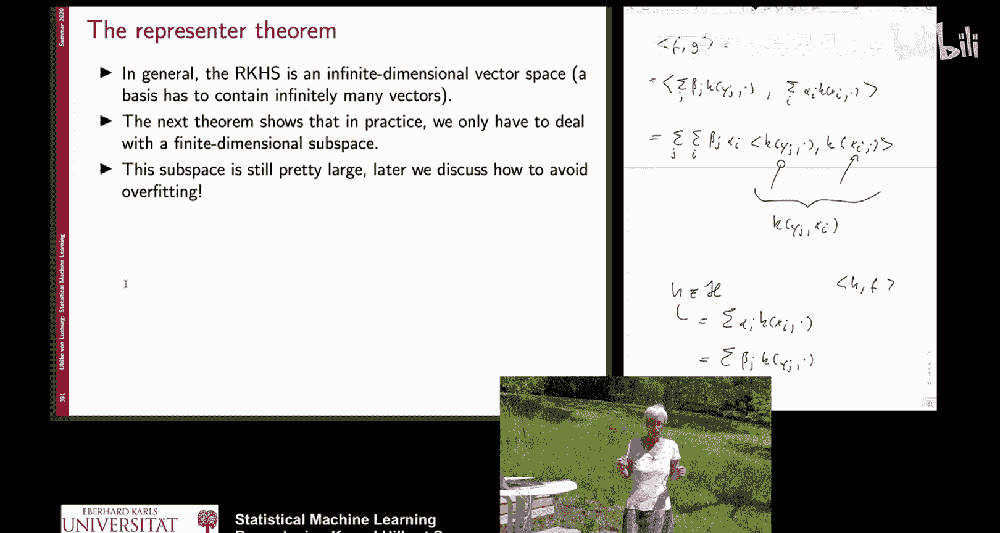
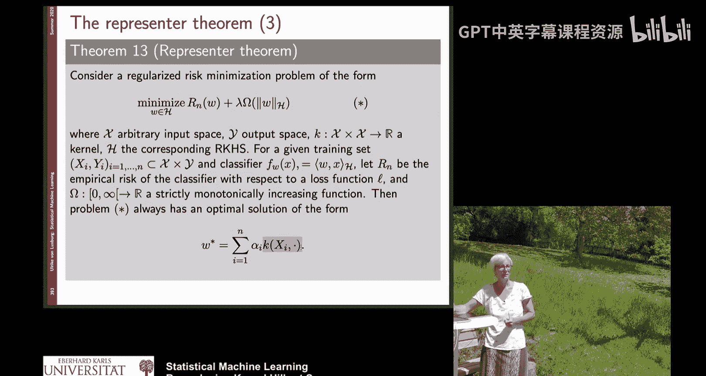
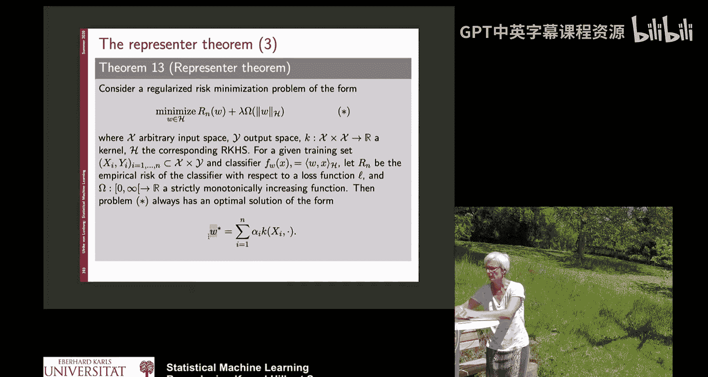
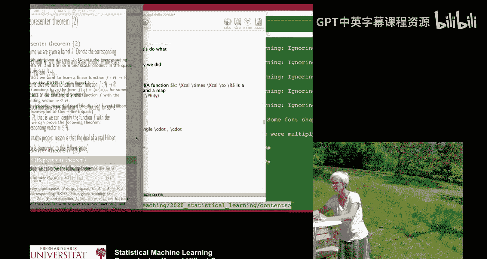
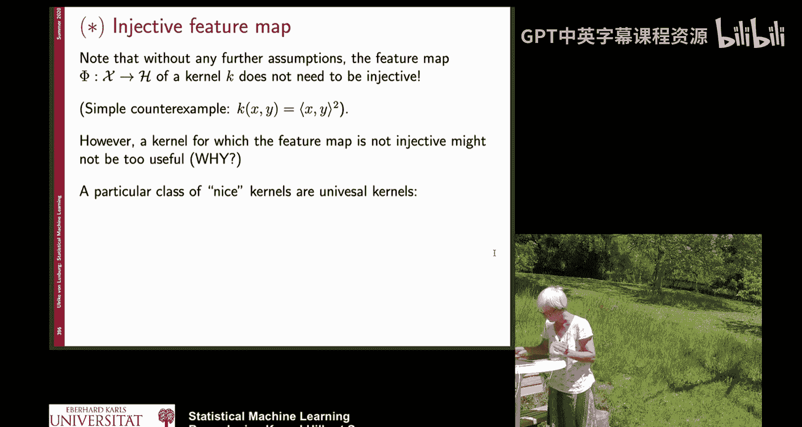
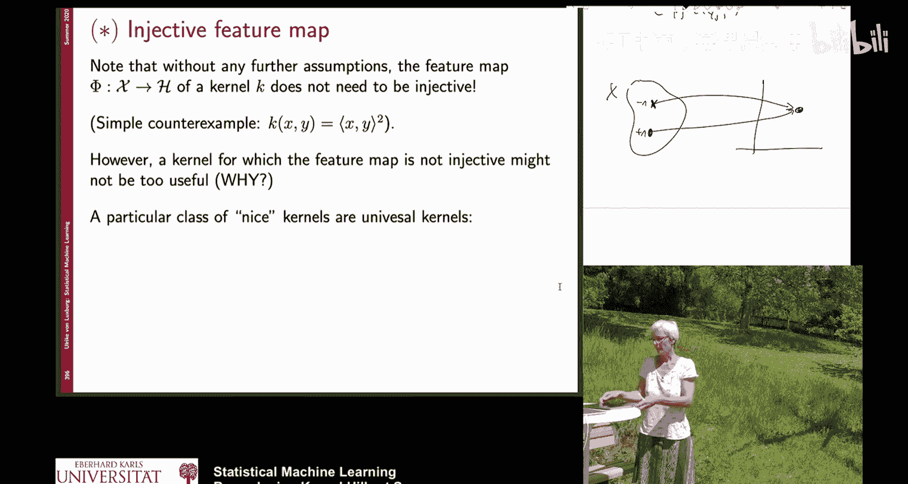
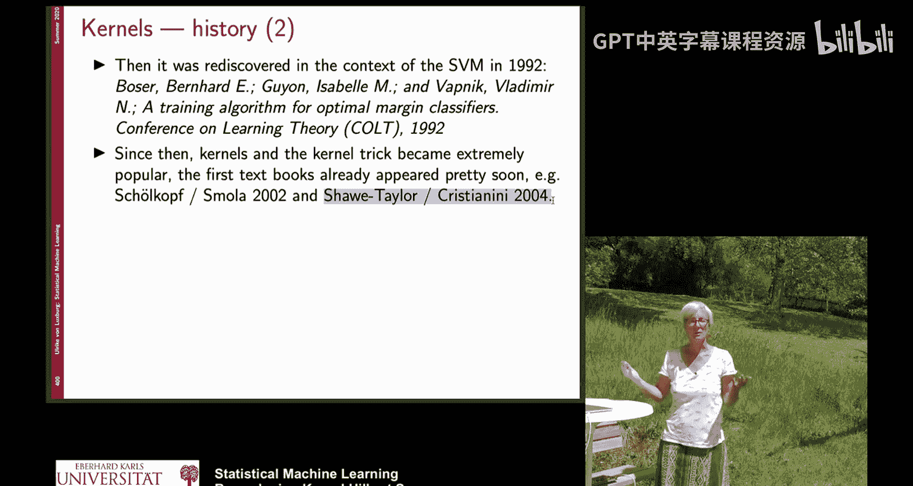

# 图宾根大学《概率和统计机器学习｜Tubingen Probabilistic and Statistical Machine Learning 2020》中英 p21 -21-Part 19 - The reproducing kernel Hilbert space.zh_en -BV1gso5YGE4s_p21-

In the last lecture， we started to define kernels。And now what I want to do is to give you the theoretical background that really establishes kernels as an appropriate tool in machine learning。

There's a lot of theoretical work on this field and I only give you the very basics and I'm also aware that we have many people in the audience who are not mathematics students。

 so there might be some notions that come up that you're not so familiar with。

 so don't worry about this I'm not going to ask you any specific questions about these mathematical constructions in the exam。

 but I still think that it would be important that you understand these constructions in principle without maybe knowing all the mathematical details that will come up。

😊，Let us maybe before we start， briefly recap what the situation current is。

We always assume we are given a data space。Curly X， which doesn't have any particular structure。

What we want to do is we want to have a mapping file。

That takes this particular input space without any structure to a space which we always call the Euclidean space RD。

In this lecture， we always， we will also see that it's a Hber space H。

Which is something more general than RD。 But if you don't know what a Hber space is simply don't worry and always think about RD。

Now， what is going to happen is we have two data points as our input points， x and y。

They will be map to two other points in our feature space。 So we have。This is phi of x。

And this point here is going to map to be mapped to5 of y。

And then what we want to do is we want to compute a scalar product。

 So we have this mapping scalar product that takes， in fact， two copies。

 So this diagram is a bit cheating。 It takes two copies of this space R D and evaluates a scalar product。

 So we get。Sca up between product between phi of x。And P of y。

And what we said so far and already sort of laid out what the intuition is is we want to avoid computing all this taking this detour and explicitly defining phi and then the scalar product in the ceber space。

 but instead we want to have a kernel function K。😊，Such that。Here the the scalar product K。Sorry。

 the current function K of X， Y is the same as the scalar product between Phi of x and phi of y。

And so far， I mean， we have defined the properties of a kernel。

 but now we need to prove that these properties really make this syrom work。

And here is now the theorem that tells us why this is going to work。Now， please check the the slide。

 Im going to read the serum。A a Phunom key。Taking two inputs and mapping it to some space R is a kernel。

If and only if there exists， a hilbert space age。And a feature map f that takes your original space to the future space。

Such that this kernel property holds namely K of X Y is the same as first applying the feature map and then evaluating the scalar product。

So， let's decrypt it to him。We have an if and only if statement， So we have two pieces。

 and they will be equivalent。 The first statement is。Kay is a kernelel。Okay， and the statement is。

 this is the case， if and only if。There exists a feature map and a Hbert space such that if I do this diagram。

 then the kernel is the short cut in this diagram。Now， if you have never heard of hillber spaces。

 don't worry about this。Simply think about a Euclidean space。

Maybe the crucial properties of a hillilber space are。I mean， a Huber space is a vector space。

 It has a scalar product， which is important。Then from a mathematically point of view。

 the space needs to be complete。Which means that all crsi sequence are going to converge。

And in particular， in a Hberd space， this kar product is always also related to a norm。

So the scalar product of a point with itself defines a norm in a space。

 But being a norm normed vector space is something weaker than being a hber space。

 So Hilber space is sort of the strongest mathematical construction of a vector space that you can come up with。

But as I said， if you haven't seen that before， simply think of R D and it's not going to hurt at all。

Okay， this is the figure that we have just seen on the iPad。啊。Here's a question to you。

In the theorem， I said， there are two directions。One direction is。If something is a kernelel。

Then there exists this feature space in the hub， this feature map and the hubber space。

 such as the diagram works。😊，This is one direction。 And the other direction is。

Assume there exists a feature map in the hillward space。

And we define K in such a way like it's the scalar product。Is Ka then a colonel。

So and if you want to prove that serumorem we need to prove both directions。

 And my first question to you is there is one easy direction and one not so easy direction。 In fact。

 not so easy is' maybe put in to wheatly the not so easy direction is's difficult。

 That's nothing you would be able to prove immediately if you're wood star on。

 But now I'm asking which one is the easy direction。

 Please stop the video and think about it for a minute or so and then figure out the easy direction and then we can talk about the not so easy direction。

The easy direction。is the one that goes from the fact that we have a feature map in the Hber space to the kernel function。

ThisThis is essentially what we have already seen in the last lecture。

 we said if somewhere there is a scalar product and we define the kernel as the evaluation of this scalar product。

😊，Then it is a kernel。 and this is exactly by the properties of a kernel M it symmetric and positive evidence。

So this is the easy direction。 This follows directly from the definition of a column。

 We defined it in such a way that this direction is true。😊。

The tricky part is really the other direction。😊，So what we have to prove is now。Assume， we are given。

Any space， it can be anything。 it can be text， It can be molecules， whatever you come up with。

And a kernel function on this space。 So assume someone gives you a function and tells。

 it really is a kernel function。 You know， it's positive， Definite in symmetric。

 But this is all you know on your space。 you don't have any structure。 You don't have a metric。

 You don't have a hibo space。 You don't have anything。 You might even not have a topology。

 You just have a space in this function。😊，And someone tells you， this function is a kernel function。

 according to the definition of a kernel。Now， what you need to prove is you need to prove that there exists a vector space H。

 sorry there's a typo on this slide， I don't know this shouldn't be there。There exists a typo。

They exists a vector space H。And on this vector space， there exists a scalar product。

And we are going to distinguish it by this little subscript H。

 So to really make sure in that one knows in which space we are currently working。

 So the scar product is defined on the space。And there exists a mapping Phi that takes the original points to the new space to H。

😊，Such that in the end， your kernel function exactly coincides with this kalar product on this new space。

And this has to hold for all x and y in our input space。

Now consider this is really not such a nice or like a simple statement because you need like given the kernel。

 you need to construct the vector space， you need to construct the scalar product on the vector space and you need to construct this mapping phi and all this needs to be constructed in such a way that this property holds。

 So this is nothing that is really obvious to do。The solution to this。

 once somebody shows it to you it is not so complicated anymore。

 but still its also not so easy the solution is going to be what is called the reproducing kernel Hber space and the short abbreviation is always RKHS reproducing kernelmal Hd space。

😊，And now we are going to see how this construction is going to work。

We first want to define the space itself。In this space is going to be a space of functions。

 So elements in our space in the space H that we want to construct。Are going to be functions。

Now what I'm going to do is I define So what I need to do， maybe I go to the iPad once more。嗯嗯。

I want to define a space H。And I want to define a mapping file。

Such that I can map like any element of x in the space H。

 So Phi of x is supposed to be in the space H。 So I start with a point X。

 So x is in my original space。And I want to end up in this silverilboard space。

Now what I'm going to do。 And I first take it down， and then I'm going to explain it。

I take some point X in my original space。And I'm going to map it。To some point。

 which is going to be called K X in the Hilbert space。And Kx。I define it。As a function， which is K。

 x comma dot。And Kx comma dot。This is。K X is a function that takes U from x to R。

And if you don't know this notation， the dot is where this argument is going to come into。

 So x is not an argument of a function in a parameter。 It's fixed。And why where we have this point。

 this is where we put the argument。 So a point y in x is going to be mapped to k of x y。 So again。

 y is the argument of our function and x is a parameter of the function。

And the notation K X that I used here， this one。Somehow tries to make this explicit Kx is a function that takes an argument y。

 and it's going to be mapped to k of x Y。Where K， of course。

 is this carbon function that we that we are given。And again， it's here on the slide。So。

 we have a point x。In our original space， it is going to be map to a function。

That is going to live in this new space。And this function Kx takes an argument why。

And maps it to K of X， Y。And again， to make it a bit more explicit。

 this is the figure I also have on the slide， but I like to withdraw it。😊，So here we have x1， x 2。

 x 3。In our original space， here we are in this new space。

 And so x1 is going to be back to this function K of x1。X 3 is going to map be map to K of。

X 3 and x 2 is going to be mapped to some K of x 2。

 So each of these original point ends up being mapped to a function in the new space。

This is already like for people not from mathematics， this is already a somewhat。Involved definition。

So what we have so far is we just defined the images of the points of the original points。

 so we have defined the mapping that takes our original points to some new points。

 but the new points so far don't have any vector space， structure or anything。

 but we want them to live in a hilber space。So now what we need to do is we need to make a hber space out of these points。

 out of this。 So far， we just have a collection of image points。For Hilber space structure。

 we need to be able to take sums to multiply by scalar constants and so on。

So now what we do is we now consider all the images k of x。

For all possible points that live in our input space。

And consider them as a spanning set of a vector space。 So if you remember， a linear algebra。

 a vector space can be or is always spent by a number of elements。

And then you need to define is what does it mean to take a sum of elements。

 and you need to define what does it mean to take by a scalar value。

And then you can look at all the points that you can reach by taking some since Kaalar and multiplicities from your original data points。

So。We need to。 So what we now do is we need to define a space。 And for now。

 it's called G because it's not yet define a space that we're going to look in at。

That consists of all finite linear linear combinations of these functions。 So what I do is now。

I have the original functions K of x， and I take all linear combinations。 So， for example。

 I have K of x 1， K of x 2， K of x 3。 So these are three images of， of points I have。

 And now I need to define。A new function G， which is maybe5 times k of x1 plus 2 times k x 2 minus3 times K x 3。

 So this is a linear combination of points。Now， by adding the functions and by multiplying them with a scalar。

 I really mean we add them as we add functions in a space。

 So the sum of two functions As we sum the the evaluations of these functions and taking a scalar product assist。

And so in general， what we have is we consider all possible linear combinations up to a length arbitrary R。

 so R can be any natural number。😊，We now fix any。 So here's R。 It can be any natural number。

 Al I can be any。 So for each I， we have an alpha I that can also be any real number。

 and then we define all。The linear combinations of the original functions K of X。

And take the sum of them。In this whole set， so far， it's still a set is now a much。

 much larger set than the one we started with。😊，In fact， it's a vector space already。

 and this is going to be called G。Okay， so what we have now is maybe I make again my figure。 Sorry。

 we need to have a cur X here。 This is our original space。And we now have defined this mapfi。

Which takes a point x to a point k of x。We started with， maybe I do it like this。

 So we started with many blue points， which， which were all the images of the original data points。

 So here we have some blue points here。 And the images are blue points on the other side。 Now。

 what we did is。We added many， many， many more points。

Which are all the linear combinations that we can reach in this way。

By the formula that we have on the space and the set of all the blue and G points jointly is now what we call G。

Okay， so far， we have definediant。Maybe for now， let's still call it a set G of more functions。

Then what we want to do is。We want to define a scalar product on G， because in the end。

 we want to have a little。 So G is already a set of vectors。

 There is some small property that we still need to prove that it's well defined。 But anyways。

 So it is， it is a。This isSo G is now a space of vectors。 we can take sums， we can take differences。

 we can multiply， so it is a vector space。Now， for a Huber space， I need to have a scalar product。

So now we need to define what is the scalar product between two elements in our vector space。

And we first defined the scalar product on these original images that we had so on the blue pins in the in the map here in in the image here。

 So what we need to do is we need to define what is the scalar product between a point Kx。And K， Y。

 So X and Y， X and Y live in our original space。We have mapped them to K X and K Y in the space G。

 and we now need to define what is the kar product in this new space。And as it's also on the slide。

 So if you spell it out， this K， this is k of x。Dot。K of y dot O know。

If you find this notation helpful， if you don't find it helpful， just ignore it。

 but what it is defined now。Sorry， the the definition now comes。

 So the first thing was just an equality。 And now I define what is the scalealar product。

 I simply define it as k of X， Y。So so for the original images of the data points。

 the Salar product is essentially their kernel value。

And note that this is somehow what we need to have， because if。Maybe I make it in red。

Observe this sky here， scalar product between k of x and K of y。

 This is the scalar product between phi of x。And Phi of y。

 because Phi is the mapping that takes a data point2。Disfunction， k。

So if we want that the thing in the end is a kernel， then it better should be the same as k of x Y。

So here， essentially， we don't have any choice。 The only way we can define this kar product if we want the whole thing to work out in the end is to do it exactly that way。

But now observe so far， what we have done is we only defined the scalealar product on the points that are images of points in the input space of the blue points in this previous plotier。

 which is in the middle of the iPad currently。On the right hand。

 the blue points are the images of original data points。

We now know what is the scalar product between these two points， between two of these points。

 but we also need to extend this definition to all other points that live in the vector space to the linear combinations。

 because the scalar function， the scalar product needs to be defined on the whole space。

And this is now what is in the middle of this light。Now。

 assume we have two functions that live in this space。 So function G。

Which is a linear combination of input functions。And we have a function F that is yet another combination。

 So these I ofs and betas in the two definitions are not the same。 and also the X I and the Y Js。

 Y I are not the same。 And also the length of this linear combination doesn't need to be the same。

So what we need to do now is。We need to define。What is the scalar product between these linear functions。

And now， again， there is not so much choice you have。 And I want to show it on the iPad。

So what we now want to do is the scalar product between F and G。And for now。

 we simply plug in what is the definition。The definition of F， it is sum of J， beta J。K of why。Zhi。

If it's a typo on this slide， it should be Yj。Commodade。And then G is sum of I， Al I K of X I。标。

This is the scalear product we want to define。Now， it is a scalar product for a scalar product。

 you know， it's linear in both sides。 So what you need to be able to do is you need to be able to write sum of J。

 some of some。Some of J， sum of I， beta J， alpha I。And then scale our product between K of。Y。

 J dot K of X， I。So far， I just exploit the de linearity of the scalar product。

 And if I want to define a scalar product， it needs to be linear。So there is no choice。

 This property has to hold。But now observe in this expression we have here the Y and the and the X Y J and X I。

 they are original points in our data space。And for those。

 I already have defined what the scalar product is。 Naly， I know that the scalar product。

Is now K of Y J X， I。This is by the property that we had earlier。Where we also didn't have a choice。

And this is now what we have on the slide。So， for。2 functions， F and G。

 which are linear combinations of the original data points。

We define the scalar product as it's written on this slide。Okay， and there was no。

 no choice it needed to be this way。Now， still， you need to think about a bit whether this definition is really。

 really valid。And the first thing is。You need to check that it's well defined。

 and this is a subtle property。Now， observe， it could be that there is a point in our space so call our。

H is a function in our in this in this space H。In the new space that we define in assume H is a linear combination。

 alpha I K of X I。Got。Okay， so it it's any linear combination。

It could also be now that this linear combination by which I reach2 points a new point H is not unique because maybe these functions K of X I are linearly independent。

 So it could be that this is also can be written as Peterta J K of Y J dot。

For different pets and wises。 so there are two linear combinations。

That both result in the same function age。But the linear combinations are different。

 and also these basic points， X I and X J and Y sorry， X X I and Y J are different。But now observe。

 when we define the scalar product， we used the explicit representation of these data points as a linear combination。

What you now need to prove is that， for example， if you now compute。

 what is the the scalar product between H and F and say F is the function we had previously。

Then this always gives you the same result no matter which of the linear combinations for H I I put into the definition。

If this wouldn't be true， then this definition wouldn't be well defined。

 Well defined in mathematics always means you make a definition which cannot rise raise any conflicts。

 if this property is not true。Then you would have conflicts because you have a point。

 and depending on how you express that point， you end up with different values for this kalar product that。

 of course， cannot be true。So the first thing you need to prove is that this is well defined。

And I don't have it on the slide。 you can try it at home。 It is really not very difficult。

 Please try it take two assume you have two linear combinations as we have on the iPad。

 computeute the scalar product of this function with yet another function and try to prove that you always will end up with the same result。

Then the next thing that you might want to prove is that this thing that we defined is really a scalar product。

 so it'ssymmetric and positive definite。As I already hinted， when we， when we build it。

 it somehow must be the case because we have built it exactly that way。 But formally。

 maybe you might still want to write down what are the properties that you need to prove and why exactly these properties hold。

 This is not difficult because we started with a positive， definite function。

But this is where we need the fact that it's positive definite， because otherwise。

 the resulting thing that we define so far cannot be a scalear product。Okay。

 and then I leave this also as an exercise。The last thing that you need to prove now and this is now only relevant if you know what Hber spaces are is a Hilber space is always a complete vector space。

 complete means if you take sequences of points in your vector space and and the sequences converge to a point。

 then this point also needs to be inside a vector space。So what we do is now。

 if you want to make this really a proper mathematically vector space。

 we need to take limits of all sequences。We need to take the closure of this particular set of points。

And this is what I say what I write on this slide to make G a proper Hu piece。

 we need to take the topological completion。And which is typically denoted by G with a straight line on top。

嗯。And then this means you at all points that are limits of sequences in your space。

And the resulting the resulting space H， this is then what we call the Huber space。

 This is a Huber space， and it is called the reproducing kernel Huber space。And by construction。

 it has the property that K of x， Y is the same as phi of x and Phi of y。Okay， so this is。

This is not really an easy thing in particular。 if you haven't seen this before。

If I would give a proper lecture， I would now probably repeat the construction and maybe I do it now as well。

 Maybe it helps。 So let us again， go through what we need to do。I do it a bit faster now。

 but try to again bring out what are the conceptual steps。What we need to do is we are given a space。

 the original space and the ka function。We need to construct this vector space H。

This feature mapping。And also， this kalar product on the space。Okay。No。To construct the space itself。

 we proceed as follows。For each input point x in our original space。

 we define what is the image of this point。So， and once we have done this。

 we have the future map already。 And the image of this point is going to be a function。

Which is called K of x dot， if you want。So we have defined the feature functionhi so far。

And this is what you see on the bottom image here。Now。

 we need to give this these image points a vector space structure。So first of all。

 we need to take all linear combinations of input points， so we end up with a vector space structure。

This is what we did here。So we take all linear combinations of input points。

 of images of input points。And add them to the space。 We call the resulting space G。

This is a vector space now， because we can take in this vector space。

 we can take arbitrary points in this vector space， limit。

Linear combinations multipied them by scalars and so on。

 and all the vector space laws are going to be satisfied， so we now have a vector space。

The next thing we need to do is we need to define the scalar product。

And for the Salar product we started with defining it how does the SCalar product need to look like input on the images of input points？

And there we defined it in such a way that it really coincides with the kernel。

This definition already ensures that then the property we want to have。

 namely that k of x y is the same as the scar product between phi of x and phi of y。

 that this property is true。😊，This holds once we have made the construction。

 but this is the line which says that this this needs to hold。

Once we define the scalar product on all input points or pairs of input points。

 we need to extend this definition to all possible functions in the space G。

 and we need to do this by the linear properties of the scalar product。Again。

 there was no choice in in how to do that。 This is simply if you want the construction to work out。

 this is the only way you can do it。Then we needed to prove that all this is fine。And well defined。

And then for mathematical reasons， we take this completion of the topological space。

 we add all the crosi sequences， and then we have our vector our Hilbert space H。😊。

You might wonder why this thing is called reproducing Colonel Hiilber Space。

 It's really a complicated name。 And in particular， where does this word reproducing come from。

 This comes from a very simple fact， which is called the reproducing property。

Name we assume you have any function in your space， which is， say。

 a linear combination of of input functions。Then what happens if you take the scalar product between this function？

And any other image of an input point。What you get back is Eifx。And the proof is on the slide。

 you can look at it。 This's just a simple manipulation of the linear property。

 There is nothing secret here。 I think everybody could do it at home， as well。

And this is why it's called the reproducing property。

 because if we sort of we reproduce the function F and it's sort of an evaluation function。Anyway。

 so this name reproducing K Hubert's face has been chosen a long time ago in mathematics。

 and this is the property that。Apparently made it。 Get its name。

I want to make a couple of more remarks， so reproducing Colonel Hibert spaces， as I just said。

 they are mathematically objects that have been invented I mean outside of machine learning and outside of kernel algorithms。

 of course there's a very famous paper by Arlenshin in the 1950s。

 I think 1950 and who essentially developed this whole space and the whole mathematical theory of the space of course completely independently of machine learning because in the 1950s machine learning didn't exist。

😊，And there's lots and lots and lots of mathematical theory and functional analysis about these spaces because they are really nice vector spaces。

 And here， I just want to list some properties for the mathematicians among you。

 The others simply ignore that it's not going to be important。

 It's also not going to end up in any exercise or exam。😊，But I like to mention it， anyways。嗯。

So one nice property of reprocing Huber spaces is the following one。

A Hber space is a reproducing Huber space。If and if all evaluation functions are continuous。

And there are now many things that are hidden here。And I don't want to go into any details if you're。

 if you're a mathematician and you're interested in it， you might open a textbook and read it。

 This is， in fact， a reasonable beauty pre。It's maybe again。

 theyre simple and not so simple directions。 If you have a reproducing kernel ht space proving that the evaluation functions are continuous is the easier direction。

 the other direction is the thing that is sort of difficult because it means you have some abstract vector space。

 you have an evaluation function and then you can construct a kernel such that if you build a reproducing kernel Huber space out of this kernel。

 this is identical to the space we started with or isomorphic to the space you started with。😊，Yeah。

 and this has， in fact， to do。With is reproducing properties that we have here。Anyways。

 if you're interested in read it up。What is also important is that the functions in an archH S are pointwise well defined。

 So if you have a function in the space and you evaluate it evaluate it at one particular point。

 you get a proper number out。Which is nice because in for example。

 in L2 spaces or L1 spaces you don't have that property because the functions are only defined almost truly。

This is， of course， important for machine learning because if we like in machine learning。

 if you evaluate a function at a test point， you want to know a proper value and you don't like an L2 function。

 you couldn't really say what is the value of this L2 function at the test point because it's not even it's only defined up to na sets and these sets。

So， so you cannot define a function value to one particular point。Again。

 this is a mathematical subtlety。😊，But Arch S spaces are really nice， in this sense。

Another thing that is also really interesting and nice and beautiful。If you're given a kernelel。

The arch S is unique。Up to isometric isomorphism。 So whenever you start with a kernel。

And you try to construct a feature map and a Hilbert space such that this whole diagram works。

 You will always end up with exactly the same hbert space。 So there is no ambiguity here。

And note also that this is also important for machine learning， because it could be。

That if you have different constructions that lead to different spaces。

 then somehow you have different interpretations of what this whole kernel framework does to your data。

And the answer here says， no， this can't be true。 It is always unique。Also the other way around。

 if you given the RHS and you would construct a kernel such that all this diagram works。

 it is also going to be unique。And then there's an even deeper remark that this whole stuff is very closely connected to the re representations here。

 if you know what that is， you might want to think about it， you might even want to read it up。

 Or if you're not a mathematician or not interested in it simply ignored。

 This is just to demonstrate the mathematical beauty of this whole approach。

 And I really find this very astonishing and nice and。Yeah， I like this whole framework a lot。

Now there's one more chapter that I want to discuss or brief property。

 which is called the Re serumem。And I have already mentioned it briefly when we discussed support vector machines。

 there we said if we are given， if we look at the solution of a support vector machine。The。

 this vector W， if you remember， the， the vector of the coefficients is always a linear combination of your input points。

This is now something that holds more generally。And now we want to look at this。And maybe sorry。

 before I continue， why is this important。Now assume we mapped our data。

Be this feature map into some high dimensions space into some hber space。

One remark I need to make it， I haven't mentioned this before the Hilber space。

 as we constructed it is typically an infinite dimensional space。

I mean， you can already see it， I mean， if our original data space has infinitely many points。

 each of them gets map to a new point in our space。

 if these points are linearly independent we already have， I mean。

 it's obvious that the space has to have infinitely many dimensions。

Now we have our say end data points mapped into this infinite dimensional many spaces。

And now we want to solve an optimization problem in that space。And it could， of course。

 happen that the normal vector of the hyperplane that we find for classification。😊，Sort of。

 I mean of course it needs to be a linear combination of some points but it might be that it's not points that live in our original data space and then we wouldn't know how to express this new point somehow we would run into or we might run into trouble it might live in a space that we simply cannot reach just based on the finite set of endtrain points that we have。

So it is important that the space is really restricted in this or the solutions that we need to look at are restricted to the subspace that are spent by our training data。

And this is what is the contents of this representative serum。The setup is as follows。

Assum we're given a cu。Okay。Deote the corresponding arch is with H。And we have， again。

 the norm and discs scalealar product in the super space。

And now assume we want to learn a linear function from the hybrid space to the output。

This is the whole point。 In the end， we want to have linear algorithms in the space。

And so a linear function in the space has this form We the function is given as a scalar product between F of x is given as a kalar product between x and the normal vector to W。

 S in a Euclidean space as well。So we can identify the function F with this normal vector W。

 S in our linear spaces in in in Euclidean spaces， as we had before， we need to learn this vector w。

And now there's the following theory that holds true， and it's called the Re's theorem。

We now consider a regularized risk minimization problem of the following form。So。

We need to search for all normal vectors in our space。

We want to minimize minimize a quantity over all those normal vectors。

And the quantity we minimize is some empirical risk value。😊，Clas， lambda times a regularizer。

And the regular riseor for that theem。😊，Needs to be something that depends on the norm。

Of the function the norm of the vector。 And if you remember in many of our examples。

 we used one norm or the two norm of a vector， and in particular for support vector machines。

 we used the two norm as a regularizer。Now it is the norm in this Hu space。

And what are the assumptions， So omega， maybe it's written here。 So x is any arbitrary input space。

 Y is any arbitrary output space。K is a corner function。H is the ArchHs。

The classifier we look at is a linear classifier。😊。

Our N is the normal empirical risk with respect to a loss function。 We don't really care about it。

And this regular is are omega。Is a function that increases mono monotonically。

 So it simply means if this we compute this function of the vector w and the larger the norm of w is the higher this regularization term is supposed to be。

So these are very mild assumptions。Essentially， that's always going to be true if you want to solve a regular problem in this context。

And then the statement is。😊，The solution of this optimization problem star in the top of the theorem。

Always can be expressed as follows。 It is a linear combination。

Of our input points of so the input points， because were in this RHS。

The images of the input points are k of X dot， so these are functions。

And the statement is， the vector double it on。Sorry， when did that happen。

嗯。To the screen。

The vector W starer here。Is the solution of the problem。

 and it can be expressed as a linear combination of or of the original training points。

 It doesn't have any components sticking into space into parts of the space where where we don't have any input points。

This is the main message。I only want to give you the intuition of the proof。

 it's not really difficult but if we don't have sort of this whole math notation。

 then it's difficult to write it up formally， but I think informally we can do it。😊。

We now split the space into two subspaces。H， and maybe I draw a figure here。 So we have。

Hard to see in the sun。 whether my iPad is on。Oh， temperature。

 my iPad needs to cool down before I can use it because the sun shines on my iPadh that's perfect。

 Then I need to do it without my figure。O。嗯。We split our space into two spaces。

The ones that is spent by the data and the one that is the complement。

 So without a figure trying to do it， and we have our。

So if you have a space and say say we're in a three dimensional space and we have two input points。

 they span a line now I can always describe the space in a basis where I have the first part of the space is the points that sit on the line and then I have a third part that points into a different direction。

😊，Now， in general， if I have an。Say a space of dimension 00， I have 50 input points。

 say these 50 input points span 50 directions， 50 dimensions of my space。

 then the whole space is a direct sum of the subspace spent by the by the images of the data point plus the rest。

And this is what I do here is I have H data。😊，Which is the one that is spent by the data points and the complement。

 which I can simply call age complement and the general the whole space age is now a linear combination or is is a direct sum of these two spaces。

This means that I can express each vector。In this space is a sum。

Some part it lives in the subspace spent by the data and some part which lives in the subspace ortho sogonal to this one。

Now， if I have now as assume we have two different vectors W。

 but both of them agree on what on their coefficients on W data。

Then what is easy to see is that the prediction of these functions with the same data part agree on all training points。

So no matter what I put in the component W comp， the result is not going to change on the training points。

So essentially， no matter what happens in the subspace that is not spent by the training points。

 it doesn't affect the results on the training points at all。AndNow in particular。

 it means that the loss of this vector omega is not affected by whatever I put in this W complement part。

Now， what we do in this regularization is we want to find the small like the。

 the vector W that has the smallest objective function。And of course。

 if I now have different choices for vectors w。And the loss only depends on the data part。

But the norm， of course， would change if w component is something large。

 So the norm of this whole vector w is particularly small if this part W component is 0。

 if it simply doesn't exist。And you can formally prove that given any W data。

 the norm is smaller If you put W come to 0 than if you use something else。So， essentially。

If your objective is then to minimize the norm。This W component is best to set to0。

 and it also doesn't play any role for predicting your loss。So in the end。

 the solution is going to be that this W component part is going to be 0。

And this is what is written here in the last line。 You can always find an optimal solution where W component is0。

And this is the sketch of the proof of this representative theorem。Maybe again， let's try to say。

 what does it mean intuitively。So we have already seen that for any given kernel。

 there always is's a feature space。But typically， this was an infinite dimensional hubber space。

And the representative here now says that can we only need to look at this subspace that is spent by our data point。

And these are N data points， and now this is sort of what gives the relief or should give a relief to all the computer scientists who have never heard about the Hilbert space before。

😊，We now know that our our results live or like the vectors we are searching for live in a subspace consisting of like spent by n data points。

And if we have a hilbert space and we just consider a subspace of n dimensions。

 this is always isomorphic to R N to the Euclidean space with n dimensions。So in the very end。

 we only we can forget about this whole issue that there are hber spaces in the background。

 we always work function in a Euclidean space of at most n dimensions if n is the number of training points。

😊，And this really is going to make our life much easier， both in theory， but of course。

 also in practice， because in practice， how would you search through some infinite dimensional space。

 This would be cumbersome。So。Okay， the next point that I simply want to touch very briefly。

Its about the injectivity of the feature map。So far。

 we didn't make any assumption on the form of this map file。And in particular。

 what you would like to have is that this function Phi is injective。

And if you cannot remember what injective mean， injective means if you take two different input points in the space X。

 then they are also being mapped to do two different output points in the in the space。

 maybe I try whether my iPad cooled down a bit。好，我。It did。I need to be fast。

 otherwise it's going to be heated up again。

So here's my figure， the input space X。And we have two points in that space， and we map them。

To our new space and if we would map them to the same point then somehow we would be doomed because what would happen say is these two points have a different label。

 say this is cross and his label minus-1 and this is circle and his label plus1。

 Now they are being being mapped to the same point then of course we wouldn't find any linear classifier that could separate these points anymore。

So what you really would like to have is that the feature map constructed in this kernel framework is injective。

Now， note so far， nothing has prevented us from having something very trivial。

 like everything being mapped on exactly one point， for example。So it's not really clear。

 given a kernel that a feature map has this nice property that it's injective。

So from a theoretical point of view， you need to prove。

That feature maps are injective， at least for for reasonable kernels。 And this now depends observe。

 It will depend on the properties of your kernel function because this feature map is entirely defined by your kernel function。

And now there's a particularly nice class of kernels。

 which are called universal kernels that have this property。😊。

And I'm not going to go into much detail but just a couple of minutes。

 and this is again not relevant for any exam or so。嗯。

We say a continuous kernel on a metric space is called universal。If the arch s of k stands in c of x。

Now this is again， if you haven't seen these notions， please ignore it， as I said。

 it is not relevant for the exam。 If you know what that means， I try to explain it。

 So C of x is the space of all continuous functions on this space x。

And we say that a continuous kernel。Is called universal。 If that space H is dense on x。

 that means you can approximate any continuous function on your original data by a linear combination of kernel functions。

And this is in the infinity norm， because this is the norm that lives on Cx。

And from a conceptual point of view， this is a very strong property。

 but also a very desirable property， because in combination with the representative theorem。

 it's going to say that no matter what our decision surface is， as long as the decision surface。

Between two functions is continuous。 We will be able to We will be able to find it。

 So if we have our data space X。And say the decision F surface between the two classes。

 The best one is this one， a very curly function。But it is still continuous。

If weIf we have a universal kernel， then we will be able to express this complicated function。

As a linear combination， or at least to approximate this function with a linear combination of kernel functions。

 And this is what is going to happen， for example， in a support vector machine。And this is the intu。

 So this is what when formally the definition is of a universal kernel is the one on top。

 the intuition is we can approximate all continuous functions。

 and this is nice because we can then realize any kind of continuous classification functions。

 And for example， I mean， just to come up with a first example。

 the Gasian kernel with a fixed kernel width is universal。😊，And we are going to see later on that。

For this。This is important if you want to prove that a support vector machine is consistent。

 You need to have this universality property of the kernel。Okay。

 polynomial currents are not universal。嗯。Okay。That's nothing I want to discuss now。

And what I wanted to mention is that many of the cons we look at in machine learning are universal and in particular。

 the ones that are successful and in particular， the Gaussian kernel。

If you want to know anything about that， there is this book by Steinvat and Krisman support reactctor machines。

They are both mathematicians， statatisticians who have written all the theory about kernels supporting the machines and related algorithms from a very mathematically deep point of view。

 I mean， they really took care of all the details about measurability and all these kinds of aspects and wrote down the theory。

 So if you're a math students and you're interested in all any of the details about kernels and for example。

 the property of universal kernels， then you might want to look at this book。English Steinld。

 in fact， came up with this definition of a universal colon many years ago， and he's in Stutgart。

 He's a professor in the math department in Stuttgart。To finalize this lecture。

 let's simply look at a bit of history， I always like to put things into context and to remind you when things have been developed。

 As I said， these arch essays have been developed by A andshine already in the 1950s in a surprisingly readable paper。

 So often if you open papers from this time， they are tough to read because they are written in a style that was very different from how you would write papers now。

 this one is an example of it could even be a textbook。 I think if you open it。

 you will be able to understand much of it if you have the mathematically background。

Then this kind of feature space interpretation apparently has already been published by Iisezaman in 1964。

 but it has been completely overlooked， Nobody really understood the impact of this whole approach。😊。

And probably he didn't notice it himself。And then this whole thing was weiscovered in the context of the support protect machines in '92 in this paper by Isaabberg Guon and saw on uppick about the support protect machines。

 which introduced the kernelel trick to the machine learning literature。And then it sort of took off。

And in the time after that， essentially， there were many。

 many papers which tried to explore this whole framework on kernel learning。

And the two textbooks that are sort of or at this time were the leading textbooks by Ban Chriov。

 who is ining and and Alex Muer。Washo at Em now and John Cha Teda and Kiini appeared in 2002 and 2004。

And since then， counter methods are around， and they have been thoroughly explored。

 and we are going to see much more in the following lectures。

