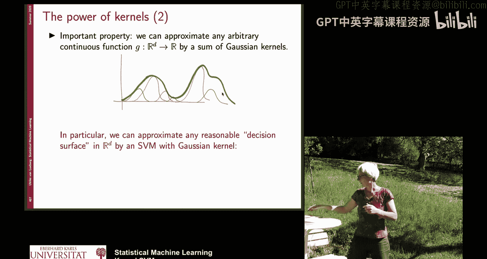
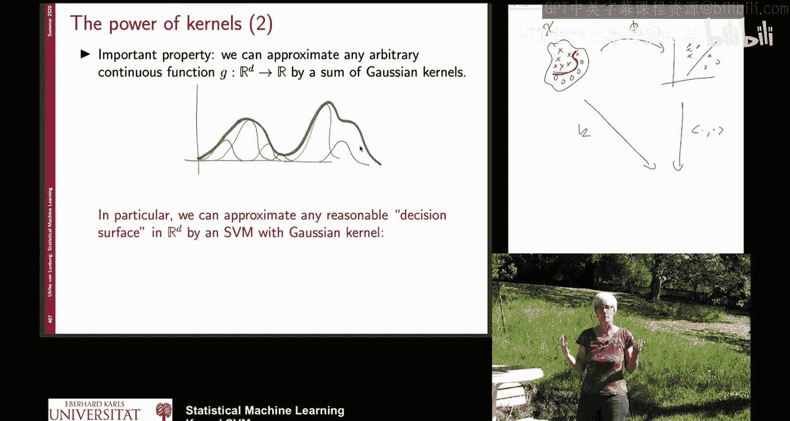
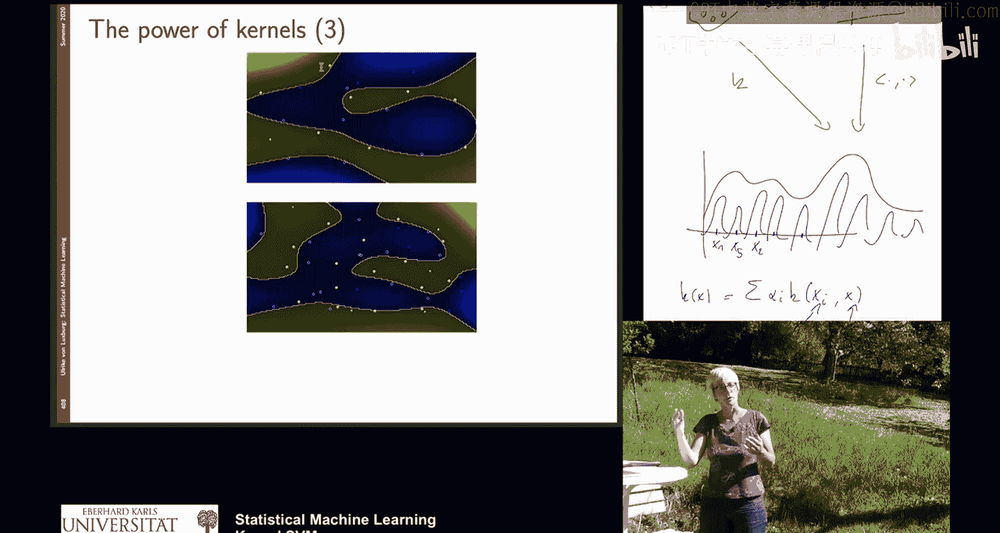
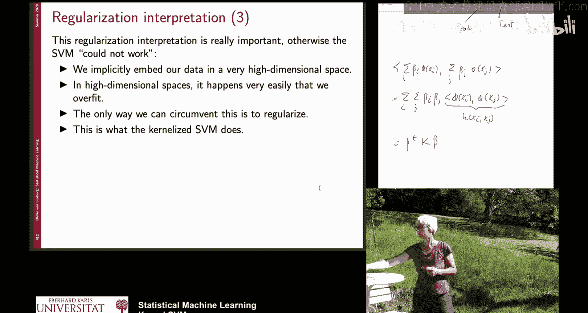
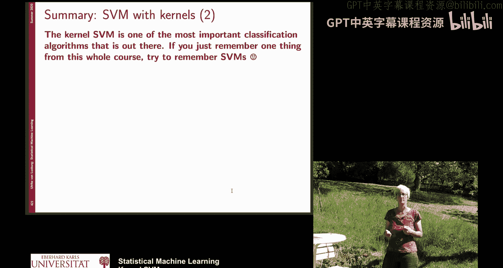

# 图宾根大学《概率和统计机器学习｜Tubingen Probabilistic and Statistical Machine Learning 2020》中英 p22 -22-Part 20 - Kernel SVMs.zh_en -BV1gso5YGE4s_p22-

In our last lecture， we have derived what kernels are。 We have put up the definition of kernels。

 We looked at certain properties of kernels。 We also looked at the reproducing Colonel Hillber space that explains some of the theory behind kernels。

And now we want to apply this framework to our first algorithm， namely to support vector machines。

We now want to kernelize support vector machines and to kernelize an algorithm means we first have the algorithm in a linear space written in a linear way such that we only need the scalar product between the points。

 then we replace the scalar products by kernels。And then get the algorithm in this reproducing Colel Hilbert space as we have defined it in the last lecture。

Let's now look at how this works。In the case of support vector machines。

 we start with the dual problem。 Remember， when we derive the support vector machine。

 we first of all， started with this geometric motivation that we want to maximize the margin between the hyperplane and the training points。

We then wrote that what was the optimization problem， it was a quadratic problem。

And then we use the Laange approach to derive what is called the dual problem of the support vector machine。

And this is now the problem we want to start with。So consider the dual problem。

And as we have already discussed when we looked at it in this dual problem。

 the only way in which the training points affect the solution of the problem or the enter the optimization problem is in terms of a scalar product。

 So they never occur alone。 I never would need the coordinates of my points。

 I only need the scalar product between two such training points。Now。

 kernelizing means we take whenever we have an expression like this。

 the scalar product between two training points， for example。

 in our expression of the optimization problem。We replaced it simply by the kernel version kernel between X I and X3。

Let's look at how this works。So here is the dual support vector machine problem。

 so we are given the input training points X I Y I for 1 to n and we are also given the kernel function。

The optimization problem is now essentially what you have seen on this slide previously when we derived the dual support vector machine problem just that previously we had at this point we had the scalear product X I X Y。

😊，IXj， sorry。And now we have kernel X I Xj。Now we simply plugl in the kernel。😊，And this is。

D kernelized a vector machine problem。 We can solve this problem。

 and then we get the dual variables alpha。What kernel you use this really depends on your application。

 as we said before the kernel is supposed to encode some similarity between your data points。

 if you're in a Euclidean space it could simply be the Gaussian kernel or if you want to classify people in a network we said it could be like in a graph you could say use the graph kernel。

 whatever fits to your application。😊，Once we solve the optimization problem。

We now need to be able to compute what is the result of the problem on a new test point。 And again。

 remember， we had this expression where where we derived， once you solve the dual problem。

 How does the primal problem， How do the primal variables look like。

 Because we need these variables W and B to compute what is。

The solution of the support vector machine given to a new test point。

And if you remember the formula has looked like this， W was given a sum of alpha I Y， I Xi。

 where alpha I are the tool variables， the ones that we found in our dual optimization problem。

 the one that involves the kernel now。😊，X I are the training points or I are the training labels。

And we also derived an expression for B which is a bit more complicated。

 so this offset parameter for the hyperplane you first of all have to find some data point J such that this expression here is true that Cn is strictly greater than alpha than and strictly greater than 0。

😊，I for I remember is to dual variable。 C is the straight of constant of the subprotractor machine and n is the number of training points we have。

😊，And then once you have such a point， you can compute B by plugging it into this formula。

And so the label for a new test point is then given by simply using the hyperplane equation。

 we apply W x plus B for our new point x and then the result we look at the result and take the sign and this is the new label we give to this test point。

😊，You can of course， now express all of this internal language。

Where we now replace the scalar products at every particular place by kernels。

 so here observed in the first line， maybe we have a scalar product between Tra point X I and test point X。

so and here this still everything is inside the scalar product， but because of linearity。

 we can pull out the sum and the alpha and the Y I are just real numbers。

 They are coefficients that we can take out。And then we are left with some alpha I。

 Y I scalar product X I X， and we replace the scalar product by this column expression here。

And similarly here at the， at the end of the formula。

And now what you can see is that once you solve the dual problem and you have the alpha is and of course。

 you know what your kernel function is， then you compute can compute also the labels of a new test part。

This is typically how this support the machine is used in practice。Now。

 why is this kernel approach so powerful， It's really， I mean， I'm going to come to that later again。

 but it is the approach that made support vector machines really successful and gave a break through too much to the whole field of machine learning in principle。

 Why is it so successful。😊，To explain this， I want to look at one particular example。

 the Gaussium kernel。So what we have seen is that this decision function of the kernel SVM has this particular form。

嗯。Well I think instead of pizza， I probably one would like to have alpha A let me just go back。嗯。

Why did I use Peter， I don't know。I think this should be alpha here， I need to check that。So， it in。

So the decision case， the decision function is a linear combination of kernel functions。😊。

So here we have a sum， we have coefficients， and then we have these kernel values。😊。

And they give us what the result of the function is on the test point x。

Now let's simply plug in if K is a Gaussian con， it's just a linear combination of Gaus cons。

 where sigma is here the kernel width of the parameter we have already discussed it。

 It tells you how wide the Gaussian curve is that you're currently looking at。

So all the functions that we can learn。😊，Have this particular form。

And now why is this something successful？If you now consider an arbitrary continuous function in your space。

 and here I just plotted it for a one dimensional case。

Then it is a fact that you can approximate such a function by a linear combination of such gaus functions。

 And here I tried to show that。 So the green function， this is really a one dimensional case。

 The green function I might want to approximate。It's a complicated function。 It's not convex。

 It doesn't have any nice properties beyond being continuous。

And now I can approximate this function by a sum， maybe of these kind of functions here。

 so if I take these little Gaussian bumps that I have just plotted underneath and I take the sum of all these Gaussian bumps。

 then what I get is something that is really， really close to this green function。😊。

And you can prove mathematically that it's always true that no matter which continuous function you take。

 you can always approximate it by a potentially long， linear combination of gaus functions。

And this means in practice that whatever your decision surface might be in your original space。

 you would be able to approximate this by a Gaussian curve。

And if you remember the figure we've always drawn when we had this， maybe I just it once more。

 just to recap。

So the figure was we have this complicated space X where our data comes from。

 it doesn' not have any particular structure， we have data points in this space。

And we might want to classify these data points by a function that is really something not nonlinearia。

Typically， the decision function is still continuous as eitum。But beyond that。

 we don't make any big assumptions。And then what we did is we did this whole kernel approach。

 we did this mapping to the feature space where hopefully this function results in something that's linearly separable because the space has such a high dimension。

 namely the number of data points that it's highly likely that we can or at least in many cases we would be able to separate the data points and then we did sort of evaluated the kernel。

 the scalar product in the space and we replaced this by our kernel function key。

What I want to show you is this linear function here that we have in the input space。

 this red function here。This is a function that can， for example， if if we live in a Euclidean space。

 might be， we might be able to approximate it with a sum of Gausian functions。😊。

And I have some examples here on this slide。Where can see how this works。 So this is。

 So there are lots of these interfaces， Java interfaces online where you can just。

 you can play with them。 you， you。Put in some points， you choose a kernel width。

 you choose sub sigma， and then the interface shows you how the support vector machine solution would look like。

 And here you can see that So we have the training points which have different colors。

 they are white and blue。😊，And you see the decision surface， it's this white line here。

And then yellow and blue， blue， these colors mean it's one class or the other class。

And what you can see here， this support vector machine can really realize very complicated function。

😊，Now， of course， it depends on the choice of parameters and in particular。

 also on the choice of the kernel which sigma。 So sigma is really， really large。

 Your Gaussian functions are very large as well。 and then maybe you cannot approximate any function which with just few。

Cuse functions， if it's very small， you， you， you are able to approximate many things。

 So maybe let me show this again in a， in a plot。On the iPad。 So here is a coordinate system。 again。

 assume we're in the one dimensional case and say。The function we want to approximate looks like this。

And now I want to show you two cases， maybe one where we have Gausss with a very。

 very large kernel width。 So maybe the Gauss we have have this kind of shape。So。

Because you can already see on this plot that we might not。 I mean， if we have many， many。

 many such curves， we might still again be able to approximate this red function with many of these blue functions with different weights。

But if we have say just 10 such functions， it's not so likely that we can approximate this red function by the blue functions by some of the blue functions。

In this case， the parameter sigma， which gives us the width of the Gaussian。

 has been chosen much too large。What we observe then is essentially underfitting。

 We have a high bias， and we cannot really approximate a solution very well。The other thing。

 the other extreme case， may be a trile。I don't know whether that works。

 whether I can erase these broadcast。 How perfect。And do it once more with other curves。

 So now assume we have colorcins， which are very。Have a very。A narrow cart。In principle。

 with these cow， since I can more or less approximate everything if I have enough such blue curves。

To the to the extreme case that in this case， I might even be overfitting。

Observe maybe also one more thing to note here when I do these plots。

 typically the Gaussians that I plot here they need to be centered at training points because our solution K of x has the form。

 it is a sum of alpha I k of X I X。So x is the test point。And X Is are the training points。

So all these little Gaussians are centered around training points。 So maybe this is R point x1。

 This is R point， x2， this is R point， x5 and so。And so the trade of between sigma tells which like the the choice of sigma somehow tells us how。

Fine grained functions we want to look at。 And if you look at and this is why I started this whole discussion at the plot on the slides。

 of course， depending on how you choose sigma， you might be able to realize very complicated decision surfaces or only very not so complicated。

 smoother decision surfaces， which give sort of smaller variations along the space。

But if you're interested in this， maybe just try to search for for。Some Java applet that gives you。

 I mean， the are millions online just type Java applet support vector machine。

 you will find some immediately that can show you where you can sort of visualize these kind of things and play with the parameters。

I have already mentioned this before， but just to make sure M kernels like the Gaussian kernel are called universal cons because they have this property that you can approximate any continuous functions with a linear combination of such kernels up to arbitrary precision。

😊，And the Gaussian kernel is such a kernel。 This is why it is so powerful。

The downside of this universality condition， of course。

 means that we are in a huge function space in principle， because observed。

 we can approximate any continuous function。 So no matter how complicated our function is。

 And you have seen complicated functions maybe also on my laptop on my iPad right now。

We might be able to realize all of them using linear combinations of gauscoms。

And this means that if we don't regularize， we might be prone to overfitting because our function space is all continuous functions and this might be too large。

So all the more important it is that our algorithm does regularize and the regularization in the support vector machine happens in indirectly in terms of the margin。

😊，And if you remember how this works。😊，So in the primary linear SVM problem。

 what we said is we wanted to maximize the margin。 and then we said the size of the margin is essentially what is giving us the regularization term in our optimization problem。

 So what we said is in the primary problem。It leads a regularis of of norm of w squared in in R D。

 So this is the two norm in R D。Now， let's look at what is the regularization term if we now have our kernelized version of the algorithm。

So the loss function didn't change because the loss function is still the sum of the parameters ciI in the optimization problem。

Sort of by how much we walk inside the margin or even to the wrong side of the margin。 at this time。

 we didn't change anything， so the loss function didn't change。 It is still the hinge loss。

But the regularisizer is changed because， I mean， it is still。Remember， we。

I draw go again back to this figure we had in the beginning。

So I'm again in the top figure on my iPad where I show the kernel approach。😊。

The regularization happens now in this space。Because this is where we applied the linear algorithm and in this linear algorithm。

 we recognized by the norm in this particular space。

 and this is now the norm in the reproducing kernel Huber space。😊。

It is not the norm in the original space。 The original space is this one here。

 and it might not even have any norm。 Sometimes it has。 if we start with R D。

 but if we start with a set of molecules， it does not have any norm。

So the regularizeror is now the norm in the feature space。And now how does this look like how can we。

 this is again very abstract like regularizing in this stupid hybrid space so you don't really get a good feeling So what does it really mean。

 you can now spell it out， So if you write out you know what the formulation for w is W is this linear combination of input points。

😊，And phi of X is the future mapping of the point X。

So this is formally the norm of W in the silboard space because。By5 we went into the sboard space。

 And if you now spell it out， you get essentially you can take out the the sums and the better eye better chase out of the sum And what you get is essentially this expression here。

 maybe I simply show it on the iPad because it's here so we have。

The scalar product of sum over I beta I phi of X I。S over J beta J phi of x J。

And now because of the linearity， I can write sum over I， some over J。Beta I， beta J， Sr product。

 Phi of X I。Phi of Xj。And now because of the kernel framework I can replace the scalar product。

 so this is now the kernel between Xi and Xj。And now if you write this again in matrix formulation。

 this is a chratic form and it is exactly beta transpose k beta where K is the kernel matrix that has all the kernel the particular kernel values as entry。

😊，So this is what the what the regularization term is now in our， in our Huber space。

 So we regularize so the。The statement is now， when we are looking for a good solution in our reprocing Can Hilbert space。

 we regularize and the expression that we try to get as small as possible is better transpose K better。

😊，So we have this column matrix here， which implicitly acts or enters our regularization term。😊，Now。

 of course， it is not so easy to get any intuition on what that does so and in particular what the geometric notion is so what is a function if I give you the space of all continuous functions or say all linear combinations of kernel functions and I ask you which one is a function that has a small regularization term to which one is a function for which is beta transpose k beta would be very small。

At least I would have a hard time to answer that right away。

 because I don't have any geometric in interpretation of what that really means。So I。

 I can't give you an intuition or and it end at least for me。

 it is really hard to look at a common function and say， okay。

 this is a regularisr that I might prefer。 And this is 1 I might not prefer。So this is for me。

 is' too complicated。 So what the way I think about this is simply。

This mechanism is a mechanism by which we restrict our function space。

 and the smaller this term gets。The smaller is the function space from which we pick our solution。

 And this is why regularization gives us something useful out。

I don't have any better explanation for what it means geometrically and I also think that there might be some people out there。

 but it's at least nothing that is known in the literature or that people could sort of would know how to argue about like if I give you two kernel functions and you would say geometrically which one of the two functions has a better behavior。

😊，This would be hard to argue。There are some arguments。

 You can look at the spectrum of this kernel matrix and then make some statements about this。

 But this is， again， much more implicit again。 So it's not like you can say geometrically。

 this is something like a margin or this is something else。 So you have sort of it's more implicit。

This light here again essentially repeats what I have already said if we wouldn't have this regularization。

 the support vector machine couldn't work because that function space is so large that without regularization we would hopelessly overfi。

😊。

Now， assume you want to apply the support vector machine in practice， how would you proceed？

Here on this slide is the vanilla port。So the first thing that you need to do is you have your training data。

 you need to come up with a kernel。😊，If your data lives in RD。

 you would probably start with a Gaussian kernel。And then you only need to fix what is the kernel with sigma。

However， there are often also situations where this kernel doesn't work。

 And then you might need to have something else。 And in particular， if your data is not Euclideian。

 you need to come up with your own kernel function。

And this is sometimes easy because there are obvious things to do。

 or maybe there also exist already exist。 some kernels in the literature， for example。

 kernels on graphs。😊，But there are other cases where this might not be the case。

 and then you need to design a kernel function。Once you have a kernel function。

 you train an SVM and typically you would do this within a toolbox you wouldn't I mean of course you can also program everything from scratch but eventually you are probably going to use a toolbox。

And then what is really important。Is that you make sure the toolbox sets the parameters across validation。

 So you have this parameter C， which is the trait of parameter between the regularization term and the empirical risk。

And if you use the Gausian kernel you also have the kernel with Sigma or many other kernels。

 for example， the graph kernel we have seen in the other lecture has a parameter K that tells us how large is the size of the neighborhood that we want to take into account。

 Most kernels have such a parameter and you need to set these parameter by cross validation。

 Some packages don't do that automatically some packages simply have a default choice and they see equals one and sigma equals5。

 This is our default choice and of course then it's not going to work on your problem you really need to set these parameters by hand on your particular data and you're going to use cross validation to do that。

Okay， and this is sort of the vanilla approach later on we are also going to discuss that there are。

 of course， many， many more steps that you're supposed to do before you eventually can apply your support vector machine so typically you have to clean your data you might have to normalize it you might have to remove outliers you might need to reduce that I mentioned there are many many steps that you might want to do before。

 So what is here on the slide is simply the vanilla approach to apply the SVM directly to your data。

Now， there's an interesting question。Whether why we actually started with a dual version。

 couldn't we simply have the primal version and derive a current algorithm from the primal version。

 the primal support vector machine problem。And maybe as an exercise before I give the solution。

 you might want to think about it。 So here on this slide， we have， again。

 the primal formulation of our problem。Of the support vector machine and the way I've written it here is already involving a feature map。

 so I assume we have this map we have already done this mapping are like that takes us from the original space into that feature space so we are in a framework where we work in this feature space and now you might want to derive a kernel version of this algorithm。

😊，And maybe before you continue watching the slides， you might want to think about for five minutes。

Whether you think it is possible for this problem to colonize it at all。Okay。

 I assume you stopped your video and thought about the question the answers。😊，A priori。

 you cannot do that because let's go back。The key feature is that we need to have the training points as inside a scalar product。

 I mean this is true here， but the scalar product here needs to be with a vector W that lives in your feature space so。

If you don't know what this vector w is before， you will need to evaluate this。

And this scalar product in the feature space， Because how else should you do that。

 There is no way rather than simply computing what the scalar product here is。

 There is no shortcut because W is not typically， it's not just an image of a training point。

 It is a complicated linear combination that lifts in your feature space。そう。A priori。

 there's no way in which we can do it。However， we can now again invoke the representative theem。

The representative theem told us that if we have an optimization problem of such a form。

 as we had on the previous slide。😊，Then the solution vector can always be written as a linear combination of input points。

And if you invoke this kind of theorem， then all of a sudden it works because then what you can do is。

 for example， here in this term that we had in the。In the optimization problem。

Instead of having scalar product between w and phi of xj you can now plug in the linear combination and then get and pull it out of the sum of the scalar product and then you have all of a sudden the scalar product just between P of Xi and f Xj so you only need to know the scalar products between training points。

And for this， you can again use the kernel function。 So here's the kernel function。

You can replace it and for this expression， you' are fine。Now， once you've done this。

 you need to go through your optimization problem and see whether you have more occurrences where this might be a problem。

Now， this norm of w， of course， maybe I go back here。

 the norm of w also is like if you wouldn't have any features like。

If you want to solve this optimization problem， of course， you need to know what W is。

 somehow you can solve this problem without looking at W and W is lives in your in your。

H but space directly， so it seems hard to replace that。Unless again。

 you make the assumption that w is a linear combination of kernel functions， if you do that。😊。

Then you can replace it again。 So W norm of w is， of course， this cater product of W with itself。

Now you can replace that by plugging in this like for W this formula and exploiting the kernel。

 you can again write this。😊，I beta JK of X I X J。So in this sense。

 you can also colonize the prim of the support vector machine if you want。And here's again。

 the solution， how it looks like。Now， why are support vector machine so successful or so well known。

 And I think you need to to understand that we need to go back a bit in the time when they。

 they've been invented。 that was in the 1990s。And at that time。

 pattern recognition was still a reasonably young field before Sa vector machines。

 people had often used neural networks。 old day neural networks。 That's what I wrote on the slide。

 I don't know whether old day is an English word that you can use。

 What I mean is maybe old fashioned neural networks。So at that time， I mean。

 a lot of effort went into how do you exactly construct the architecture of your network and then people。

 of course， also use spec propagation to optimize the network。

 but it didn't really work very well at the time because people didn't really have the computational power that we have now for GPUs and also you need to have lots and lots of tricks and I mean。

 right now in in deep learning people， there are so many people working on deep learning。

 they have discovered many tricks at these older days。

You know network was something that only worked for specialists。

If you're very a specialist in neural network。Sorry。If you were。🤧う嗯。If you were a specialist。

 then you were able to apply neural networks to your problem and get really good solutions。

But if you were not a specialist in neural networks， it was very hard。

 So if someone in bioinformatics had a classification problem， they typically couldn't just sit down。

 design a neural network， optimize it and get the solution。

 You would need to think about it for half a year or so。And now came some vector machines。

 and they are so simple。You test have these two parameters C and maybe sigma。😊，You plug it in。

 you press a button， it's a convex optimization problem， you always find a global optimum。

 so you're not going to get stuck in local optimum。

 need to restart millions of times in tweak parameters and do lots of tricks。

You simply press the button， and you get a solution。

And this is something that even people could do who are not experts in machine learning。

 but who are applied computer scientists， for example， in bioinformatics。

And this is what made the support vector machine so successful。

 It was an approach that more or less everybody could use and get pretty good resultss for many。

 many problems that were out there。😊，The other thing。

Support vector machines are also appealing from a conceptual site。 So this is why many people also。

 in theory， like the support vector machines， because you can really prove。

And which conditions does it work， there's lots of stuff that we also going to see some of it late in the lecture。

 you can prove generalization balance， you can look at kernels and really prove properties like universality or other properties which tell you at least in ideal cases。

 these algorithm stberg so you can give mathematical proofs， for example。

 that a support vector machine is universally consistent。

And this is then also appealing for theoreticians because it means at least we know that under idealized circumstances。

 the algorithm gives us good results。 so why not try it on my problem。😊。

Whereas there might be other algorithms for which you can't prove anything in really hard to understand。

 and then you might trust them less。Now nowadays， I often get the question well why do we still need support vector machines They are deep networks。

 We simply use a deep network for our problem and that's going to solve it。😊。

And the answer to this question is， yes， sometimes。😊，So nowadays， of course。

 deep networks are very powerful。 you have lots of computing resources。

 There are millions of tricks that are known， and there are many problems in particular in everything that has to do with speech and images when neural networks outperform whatever you could else do with other algorithms。

😊，嗯。However， neural networks need a lot of data。So you can't like and in particular。

 if you think about， for example， a scientific application in bioinformatics。

 you have these 20 patients。😊，And you have genetic evaluations of these 20 patients。

 And you now want to learn to classify whether such patients have cancer or not。

If you just have 20 training points， you don't even need to start training on neural network。

 It has millions of parameters。 It's not going to work。And in such cases。

 support vector machines are still a very， very important tool。😊。

And there are many other cases as well。The second thing is that from a theoretical point of view。

 neural networks are not really understood at all。 I mean。

 there are many things that we do in neural networks that are completely counterintuitive。

 For example， neural networks are being trained until they overfit like hell。 I mean。

 you train them until they have zero training error。

 and it's clear from also from what we've looked at in the beginning of the lecture that this is a massive overfitting。

And only now， very slowly， there are some first results from the theory community。

That start explaining what goes on， Why does it still work， Why can it still generalize。

 even if this neural network overfits。And there are many other properties of neural networks。

 which are also undesirable， like robustness properties， for example。

 you have all these adversarial examples and so on。Which I I。

 and I don't want to say the neural networks are bad。

 I just want to say there might be applications where you cannot afford something like that。

 For example， you have a safety， critical application。 You are flying a plane。

I can't imagine currently that someone would write a control problem for a plane using a deep neural network simply because we cannot trust it。

 We don't really know how it behaves。 There are no theoretical guarantees whatsoever。We need。

 if you have something that is really critical， you need to know what you're doing。I mean。

 now the question is， whether for driving a plane， you might want to to use machine learning it all。

 maybe this is a bad example because I'm not sure I would trust a plane that has been programmed using an SVM。

 but I would trust it much more because for SVMs， at least it's， it's very well understood。

In principle， what they do and what they don't do。So the bottom line here is there are SVMs。

 anti deep networks and of course there are other algorithms as well like probabilistic approaches which I even haven't talked about。

😊，And all of them have their cos of problem or their set of problems on which they work well。嗯。

And it is really important that you understand that you cannot solve all the problems of the world with deep networks。

 You need this other side of machine learning， which is also why you're supposed to attend this lecture。

 at least the machine learning masters students need to attend this lecture on Sta learning and also the one on probabilistic learning。

So to summarize。SVMs with kernel， so we are given the data points in a space and we need a kernel function。

 so this is in many applications the critical step to invent what is the kernel function。

They solve a classification problem。😊，By the kernelron trick。

 we have this embedding of data points into this abstract feature space。The inductive principle。

 maybe think a bit back is when we started to discuss what the support vector machine is supposed to be。

 we said we want to have a large margin。And this is still the principle that stands behind。

The support vector machines is also in the hbot space。In the end。

 we have a convex optimization problem that's really， really nice。

 We can solve it by some convex optimization。 We are going to end up in the global optimum。😊，It is。

 I mean， there are lots of important properties that people have looked at this a support vector machine property representative through and so on。

And if you look at it in a kind of regularization interpretation。

 it corresponds to minimizing the hinge loss and the regularization is the norm in the feature space。

😊，So if there is one thing that you want to take home from this lecture。

Then use support vector machines as your prime example。

 So this is really the algorithm that is used in classification beyond neural networks and beyond probabilistic models。

 If you have one to solve a simple classification problem you use in SVM and this is likely going to succeed。

 Well， if your data contains some signal， the SVM is likely going to to solve your problem。😊。

