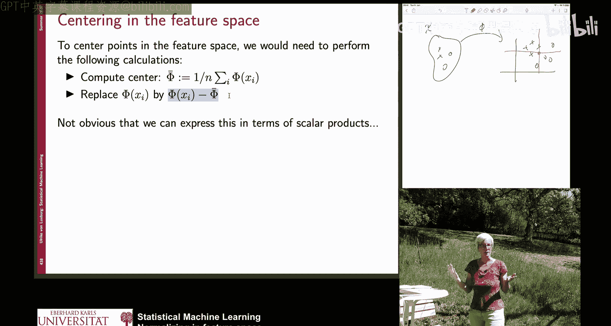
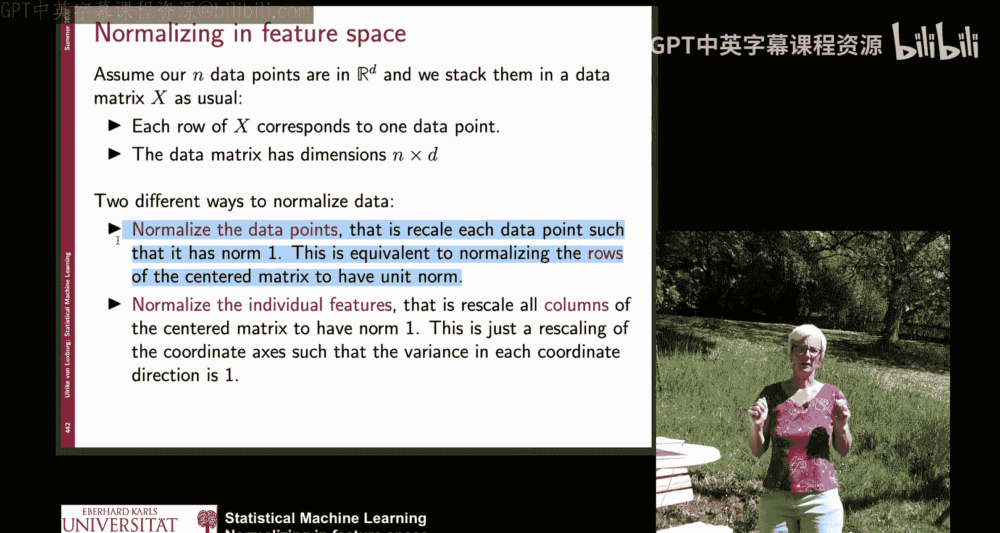
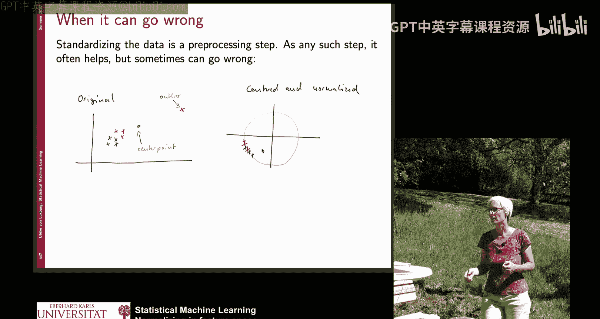

# 图宾根大学《概率和统计机器学习｜Tubingen Probabilistic and Statistical Machine Learning 2020》中英 p24 -24-Part 22 - How to center and normalize in feature space.zh_en -BV1gso5YGE4s_p24-

By now we have seen how kernel methods work。😊，But we only started to look into it。

 and we only have seen a couple of algorithms and how to kernelize them。

Now there is one important thing that I always mentioned in the beginning of the lecture。

 namely if we work in an explicit feature space， say we have several measurements of a person like body height and write and so on and you want to predict something about this person you might want to normalize your features and you also might want to center your data in the feature space。

😊，Now the question is how could we do that in a kernel version。

 not it is not obvious at all because observe maybe I draw it on the iPad very quickly。sorryrry。嗯。

So the standard figure that we have， we have that space X。 We have this transformation Phi in our。

Why doesn't it work。We have the transformation file。That goes to our future space。

And then the points simply end up somewhere in a feature space。And as I've already drawn it here。

 these points are not centered。So if the points， if I wanted to center the points。

 I would need to shift the coordinate system。For example。

 that the coordinate system sits somewhere here and the origin is here。Now the problem is to do this。

 you would need to have the coordinates of your points。

At least if you think about it naively because you to sort you need to shift your coordinate system and how would you able be to do that without ever looking at the coordinates of your point。

So on first glance， it looks like this is pretty much impossible to center your points in the feature space。

The next thing we looked at is to normalize the points that we said that for example。

 if we have these kind of measurements， if they have the height of a person。

 we might not want to have the height in millimeters。

 but we want to have them in a unit such that the variance along this dimension is one in its center。

😊，Again， it seems difficult to achieve that without looking at the features themselves。

 at the coordinates of your points。And now in the next section。

 we want to look at what you can do and what you cannot do。No。

So formally what do you need to do if you want to center points。

 Forly what we would need to do is we would need to compute the center of all data and the center is simply the weighted sum the nominist sum of all the points in the feature space of course。

And then we would need to replace all data points by their centered version， so we sub。

 we take the original points and sub the center。Another question is。

 how can we do that if we just see kernels？

Now to start with simply assume that we would be able to do that。

 So what we now want to do is we want to compute the kernel version。

 the kernel values between data points as they are centered。So here I now I deoteed by Ca Tilda。

 so this is supposed to be the colonel after we centered。

And I simply plug in the kernel value of the center data point。

 so we have the centered version of XI and here in the right hand we have the centered version of Xj。

And now we simply proceed and try to calculate it。 So what we do now is we for this Phi I bar。

 which is the center， we now simply plug in the formula， this one here。

We do the same on the right part of the scalar product。

And then we can again see that we can pull out many things and in the end we are left with kernel values because observed I mean you need to split the sum so here we have for example phi of X phi of xj。

And this is what gives us this K X I X ray， and if you split up all the sums and so on。

 you will end up with a formula as it is written here the last two lines。On the slide。

 where every scalealar product has been replaced by some kernel。And this is not interesting。

 these are the original kernels。 So Kx Ixj are the kernel values between the uncented data point。

 So the kernel we started with。😊，And now what this equation says is we can even derive a centered version of our kernel。

Starting from the original kernel values and compute how the kernel value would look like if we would be able to center the data。

And this is cool because the formula here only again only involves the kernel versions。

 it does not involve any particular data points in the future space anymore。😊。

So we can compute what is the centered version of our data we can apply a kernel algorithm to this and we simply replace the original kernel that we had before by this new kernel here。

😊，And then everything happens as if we would have centered the data points first in our feature space。

And this is really cool。 I think it's surprising that this works。 I think on first glance。

 you wouldn't believe that it works， and it's really simple。 it's just plugging in a formula。😊。

You can also write this in matrix notation if you now want to have the new kernel matrix in a matrix notation。

 K Tilda， it essentially is。😊，I mean， if this is the same formula on the previous slide。

 just written in matrix notation， and you need just to note this vector 1 n here is the n times n matrix that contains one over n in each entry。

And then。If you want to see that this is really the same as on the previous slide。

 I such as you simply compute one entry of this particular matrix and you are going to see that it is exactly what we have on the previous slide。

So this is cool， so centering doesn't seem to be a problem。

 we can easily center our data in feature space。And here is one more figure that explains it。

 I think it is more or less the same figure as we've seen it many times just that so we have original data。

 the feature mapping go to the new data space and now we apply the centering operation。😊。

And then apply the kernel matrix， and we can now。Weplace this by the centered kernel Cailda。

So this is really nice。The next thing that we might want to do is to normalize the future。

 and this is often even more important than centering。Now。

 there are two different ways in principle how we can normalize data。

There is the one way that we have already discussed in the beginning of the lecture and this is what I have on the bottom of the slide here。

😊，So in the beginning of the lecture， like a couple of weeks ago。

 we said that we want to normalize each individual feature such that the variance of this feature is one and the minus。

 for example。😊，And this is something that will not be possible in the feature space and there is no approach that could give us that back because to do that we definitely would need to know what the original features are in the feature space so we would need to know the coordinates。

There' is another way of normalization that however works。That is。

 we normalize all data points to have norm norm1。And maybe if you think about your data matrix maybe assume you're in the space RD。

😊，We have the data matrix X， each row corresponds to one particular data point。

The second wave that we've talked about here。Normalizing the features means we normalize along the columns of this matrix。

Now what you also can always do， of course， is you can normalize the rows of this matrix。

 and this means you bring each of your data point to have norm 1。

At least what this ensures is that there is not one data point that has such a huge norm and everybody else has a very small norm。

 such that this one data point sort of has a huge influence compared to the other norms。However。

 it does not solve the problem if you have individual features that are sort of not equally weighted。

 but sort of it might give you sort of an equal weighting of your data points。

This is something that we can do。And I have here some figures that show these two effects。

 these two ways of normalizing。 So here is some original data set。

 It's just some random data set I generated。 it's just colored to see maybe different classes。

 if you like。嗯。Here from here original data to center data。

 I didn't do anything but centering the data that is I moved the origin of the coordinate system you see that here the origin of the coordinate system here we have zero on the x axis and here zero on the y axis so the origin is roughly here after centering the origin is somewhere here in the middle of this plot。

😊，So this is all nice， we don't see anything it's just the coordinate axis have changed。

Now if I sent to there。😊，The features， this means that in each direction。

 So both in the x direction and in the y direction。

 I apply a normalization factor such that after normalization。

 the variance along these x's is about is is 1。😊，And what we see here is I mean if you look at the original data it might have been a bit more elongated in the y axis than in the x axis after this kind of normalization。

 sort of the elongation in x and y axis of this data is sort of the same in both plots。

 This is what you can achieve when you normalize the individual features。😊。

But this is the thing that we cannot do。If you want to go to a feature space setting with kernels。

 because you would need to have access on the x and Y values， otherwise， you can't do it。

This other plot here at the bottom left。 This is what you might be able to do in a feature space。

 It means to normalize the points。 So after normalizing a points in a vector space。

 all the points sit on the unit sphere。😊，And it's just the angle that you preserve about these points。

This is， for example， we also discussed that sometimes this is done in if you have word documents and you have some kind of bag of words processing and you want to compute a cosine similarity。

 you might want to use this normalization before you do the similarity computation。

And what it does is like， I mean， essentially to see what happens is you sit at the center of your data at the origin of your coordinate system。

 and then you simply you don't look at how far away a points you just plot all of them on the unit sphere。

😊，And this is the here。So in this particular case， the centering might sort of have some reasonably good effects because after centering we see here we have green points。

 blue points， red points， black points reasonably separated。

 so at least it didn't hurt that we applied this kind of centering。However。

 I mean there will be cases and we will discuss it in the end where this hurts this is definitely not something that you always have to do and you can already imagine some data sets which and we see some in the end where this kind of normalization is maybe not the best idea to use。

😊，Okay， so this is essentially what I've already said。

 we will be able to normalize the points in this kind ofpheric fashion。

 we will not be able to normalize the points according to the individual coordinates。Now。

 to achieve this normalization by points， this is， in fact， not extremely difficult。

 So what you need to do is。First of all， I mean， this normalization only makes sense if your data is centered in the first place。

 if its not， then this is simply not useful to do so you first center now but now assume it is already centered and assume the kernel is being computed on the centered data points。

Then what you officially need to do is you need to normalize each vector in your feature space to have norm 1。

 so you take your original vector here phi of x and you divide by the norm of this vector。

 So afterwards it has norm one。And now， of course， you can do all of that again in terms of scalar products。

 So observe that。If you now look at this so we call this M Phi hat and if you now compute the scalar product between this kind of normalized vector。

Again we see that there are some useful things that happen so we write it again we write the definition in this scalar product so this is now the normed version。

 the norms which and the denominator here are real number so we can pull them out of the scalar product so we have the scalar product on top and at the bottom we have simply the two norms and now of course the norm of a vector is just the scalar product of the vector with itself。

😊，And the scalar squared。Well， the square norm is the scalar product。

 and so you can replace that by a kernel。 So the norm of phi of x。Cant market anyway。

 the expression phi of norm Phi of x is a square root of the kernel of x with itself。

 and we need a square root because the squared norm is the scanner product。

 And if you don't have the square， then we need to use the square root here。

And in the top expression we can replace by the kernel value directly and so again we have an expression by which we can starting from the original kernel function derive a new kernel function such that the data points after we apply this new kernel function are normalized in our feature space so they sit on this unit sphere。

😊，Again， this is really nice and it's also easy。And so what we can do to so this is sort of the bottom line of this normalization if you want to use this normalization。

 you can simply replace the kernel function by this new kernel function。And then， you're fine。

Maybe as an exercise， you also might want to verify that this is indeed a kernel and maybe also the one we previously derived that these are really indeed kernels so we do operations that make sure that what we have in the end are still valid kernel functions according to our definition。

😊，Here I have a slide which says that this also can go wrong sometimes。

 so here I have a toy example where one can see that it goes wrong。

 so we have this original data set。😊，Which is maybe not even centered。

 it consists of a couple of points， and here we have an outlier point。

Now we center our data what is going to happen is the center of the data might sit here because there is this big outlier that has so much influence on the mean of the data that it pulls the center quite far outside so the center of the dataset sits here。

If we now apply if we now normalize our data， all these guys which are here in the bottom part of this plot will end up completely intermingled here on this unit sphere。

😊，So after we have done this kind of normalization to our data， the classes might not be se anymore。

 whereas is here in the previous plot we might easily separate these points by a hyperplane so an SVM on the original data might work。

But an SVM on this data somehow can't work anymore because we squashed the two classes on top of each other。

 so no SVM in the world is able to separate this animal。So what we can see here is it can help。

 but it can also go wrong。And in particular， this kind of normalization。

 if you want to know whether this normalization is a good idea or not。

 you might want to use cross validation， you once run your algorithm with a kernel。😊。

And you once run it without a kernel。So， you once run your algorithm with normalization。

 the second time you run it without normalization。 And by cross validation。

 you check which of the two gives you better results。

