# 图宾根大学《概率和统计机器学习｜Tubingen Probabilistic and Statistical Machine Learning 2020》中英 p25 -25-Part 23a  -  Random forests_ building the trees.zh_en -BV1gso5YGE4s_p25-

In this and the following few lectures， we want to look at a couple of classification and regression algorithms that are rather inspired from principles from statistics than so they come more from the statistics community than from the machine learning community but are very。

 very successful algorithms and are built on simple principles。😊，The field of methods。

 I call this randomized classification or regression methods bagging， boosting in friends。😊。

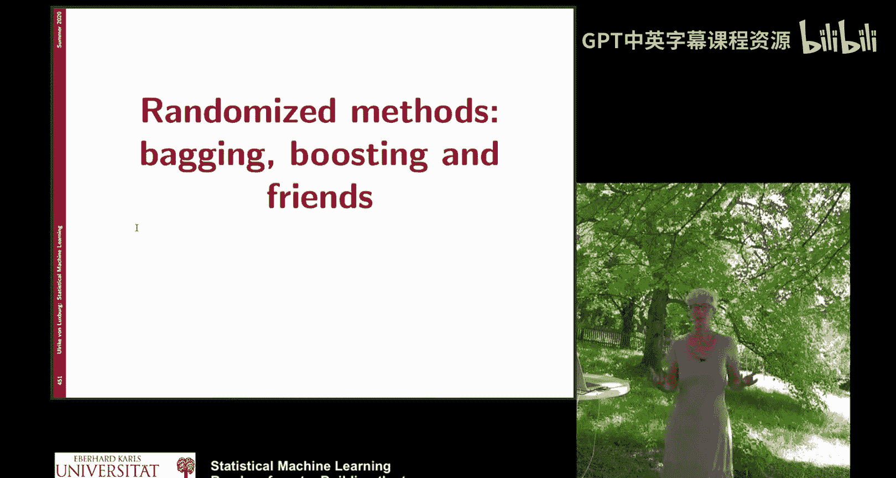

And we would start with random forests on this slide you can see a lot of literature it is also covered in many of the standard textbooks so for example in the elements of statistical learning or in understanding of machine learning there as a chapter but there are also a couple of nice overview papers and also the original paper by Bman about random forest is something that is easy to read and there also couldn't resist putting some references to our own work which has been published recently about consistency of random forests。

😊，The background of this whole field of research is ensemble methods。

 so in an ensemble method the idea is we not only train one particular classifier to achieve a particular task。

 but we train many classifiers and we train them in a slightly different manner so for example we either train many classifiers on training on different parts of the training set or we take different parts of the features or we might even train different classification algorithms like a decision tree and a canna classification algorithm and Ion a neural network。

😊，And we know that each of these itemss has strengths and weaknesses。

And the idea is now that if you would know about the strengths and weaknesses in the end。

 if we combine all these methods and maybe do something like a majority vote or so。

 then perhaps the result we find in the end is better than the result of each of these individual classifiers。

😊，And on a very high level， this is the idea of ensemble methods。

 So ensemble methods always refers to the area of research where you have a set of classifiers or an ensemble of classifiers。

or regression functions or whatever you are trying to solve。

 So you have this ensemble of individual solutions and then you combine them to produce a new hopefully better solution to your problem。

😊，The background on the field of statistics that from where this comes is maybe the fit of bootsrap and peing。

And as an example， we have seen something similar already namely the method of cross validation。😊。

So we call in cross validation， what do we want to do， we want to estimate a certain quantity。

 namely the test error， this is one particular number and we want to have an estimate for this number。

So what do we do？We take random subsets of our training set because in cross validation。

 we do these random splits。And another set for testing。And then we not only do this once。

 but we do it a number of times on hopefully if possible on independent test and training sets。

 and in the end we ever reside and hope that the estimate we get in this way is better than the estimate we would have gotten if we just would take one such split and train and test。

Now let's maybe do a small outlook to what is bootstrap in statistics。

 maybe some of you have seen it before but maybe some of you haven't so I want to briefly outline what this is all about。

So consider a standard statistics setting， so you have a sample of points that come from some space。

 it might even be a nice space， you're creating in space or so。😊。

And assume you are interested in a parameter。 So， for example。

 you might want to estimate the mean of the population。And you produce。

 you have some nice estimator and it produces an estimate theta hat of the parameter theta。

And now you want to know the distribution of this parameter because， for example。

 you want to have a confidence interval for your estimate。

And now point is if you know something about the distribution of your sample points。

 then it's often easy or not easy but at least in some cases it's possible to compute what is the distribution of your estimated ahead you to compute it analytically and then you can also analytically compute formulas for your confidence sets。

😊，But if you don't know anything about the distribution of your training sets of your training points。

 then this is impossible you simply if you don't know the distribution。

 you need to do it somehow more empirically。😊，Okay， and here is now what we do empirically。😊。

So we draw a subs samplele of Mpoint of our original training sample。And now。

 depending on your philosophy and which corner of the bootstrap literature you come from。

 you do it with or without replacement。😊，And now on this sample of endpoints on the subsample。

 you compute the estimate So you have your endpoints。

 you compute an estimate of the parameter you're interested in。And then you do this again。

 you again subs samplele points and compute an estimate and so on。

 So in the end you repeat this procedure B times。 So B times you draw a subs sampleampble of points and compute an estimate。

 So you end up with B estimates of their parameter Theta 1 hat to Theta B hat。And now sort of。

 you can look at the distribution these of these estimates， and this somehow gives you an indication。

 for example， of how large your confidence interval should be。😊。

Maybe I give a small illustration on the iPad once。So assume we're in a one dimensional setting。😊。

So of the standard situation in statistics， you assume I don't know you have data points therefore for the an normal distribution。

 you sample a couple of points， maybe these points here。😊。

Now you want to compute the mean or you want to estimate the mean of the distribution。

 What do you do you compute the empirical mean， it might sit here。

And then if you know that your original points have been drawn from a normal distribution。

Then you know that this estimate， so this is your estimate theta hat。

 So theta in this case would be the mean。And see the head as your estimate of the mean。 And now。

 if you want to know to put a confidence。 So somehow you would like to have a statement which says that if the true parameter。

😊，For example， if so it's a bit more complicated confidence intervals。

 but intuitively what they do is you want to say that with high likelihood。

 the true parameter sits in this interval。 This is not what they really do， I'm aware of this。

 but just for the simplicity of explanation。 let's keep it like this。

 So you want to have an interval around your estimate where you say well。

 this is sort of where I would expect this estimate to sit。 And if this interval is small。

 then you can rely on it。 And if the interval is very large， you would say。

 I'm not sure I can rely on this estimate。嗯。Now， if you know that your data points， for example。

 are normally distributed， then you know something about the distribution of this estimate Cta head。

 it's t distributed， and then you can analytically compute the limits of this confidence interval。

Now， the other situation is you have no clue how the distribution of your original points looks like and maybe it looks like this。

 So this is the distribution that generates your original data points。

 but you dont even know that like you don't know anything about this distribution。And now again。

 what can you do you draw some sample points， you would get a couple of points。Again。

 what you do is you compute the mean and in the sample， it would maybe sit here。

And now you want to know is this mean， I mean， is my confidence。

 can I be sort of sure that this is more or less where this means sits or could it be that it's very far away？

😊，And in this case you don't have any any you can't make any distributional assumptions and now this is where bootstrap comes into play so what you do now is you say okay I do this process again and again the one of computing the mean but of course if you keep the original sample nothing is going to change so what you now do is you draw sub samplesles。

Maybe let's put them in green and you like maybe you draw this these are 15 data points。

 you draw subemmbers of say，10 data points and compute the mean and then you will find sort of。Maybe。

These couple of means， I mean this is not very likely in this particular case。

 but assume you would find these kind of means and you would say。

 well I've done it 100 times so it's reasonably likely that the mean would sit somewhere here。😊。

In the green bar and then you can decide well can I now trust this threat estimate of the mean or maybe do I think this bar is too large。

 the green bar and I need to have more data or do something else。

So this is sort of the basic intuition of foodt。Now， of course。

 there exists a lot of theory in the statistics literature that proves under which circumstances this kind of approach makes sense and would lead to consistent estimates and so on。

😊，What makes all this literature a bit complicated is that these estimates cta B。

 of course are not independent because if you draw from the same sample。

 like you have one big sample and now you draw sub samplesamples and these subsempers are not independent but they would overlap a lot。

And now the most complicated part。Is to sort of disentangle this dependency and find out under which circumstances you still have consistency of these estimates。

So this is my one slide on my two slides on bootsottrap it is a very important field of stat and of courses lots and lots and lots of literature。

😊，There is a very popular textbook， for example， the introduction to the Boottrap by Eon and Tpsrilai。

 who are sort of also the ones who invented this or contributed a lot to this area。

 there's another one that I like the Jackknife and Bootstrrap by Shao and To， but there are many。

 many more textbooks out there。

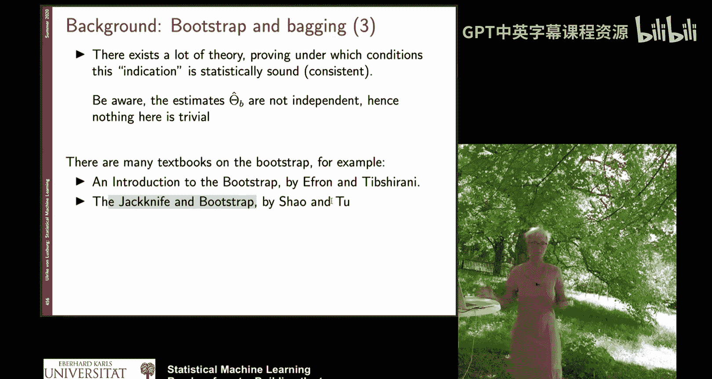

The other thing I want to briefly explain is the method of beging。

Begging is an appbbreviation for bootstrap aggregation。

 so here you see bootstrap the B and X from aggregation， so you end up with begging。😊。

And this is now what is close to what we do in machine learning。 So as in bootsottap。

 you now have an original sample。 you want to estimate something。

You now generate P bootsstrrap samples。Of your original sample again。

 so you draw subsamples and compute your parameter theta。

 your estimate theta hat and you again get these B different versions of Cta hat。

And now in this case you are not even interested in any confidence intervals or the distribution of this estimate you just maybe want to know what is now your final estimate and then you in the simplest case you simply take the mean so you have now be different estimates and you say well I take the mean of these estimates。

Now thinking a bit about it， why would this make sense because you could also say I mean I have my original sample and I can make a bootstrap。

 I can simply compute my estimate on the original sample right away and why do I need this bootstrap procedure？

😊，The idea is that dispute puts the procedure。This bagging procedure can lead to an estimate that has a much smaller variance。

 than if you simply do one estimate on your full sample。And the intuition is the following。😊。

So if this estimate Cta B would be independent。from each other， which they are not。

 but simply assume for now that they would be independent and each of these estimates would have an variance of sigma squared。

😊，Then the variance of this combined estimate would be sequenced squared over P because the variance if you have P sum of P independent random variables。

 it is easy to compute the variance of the overall thing。And it decreases by this factor of P。

So you have a variance that is smaller by a factor of P。

 which is of course good because in the beginning a variance maybe was that large。

 but now it's so small so you can sort of rely on this estimate much more。😊，However， of course。

 in practice these estimates are not really independent。

 but now you can still think about what would happen if they they still have the same distribution but they have a correlation。

😊，But maybe this correlation is not so large。Say the correlation is raw。

Then you can again go through the exercise of computing what is the variance of this begging estimate and then what you're going to find is this one the variance of this new backed estimates。

嗯。sEssentially， so here you see if row is。If row is 0 which means there is no correlation they are independent we recover the result which we had in the previous line so then row is 0 the first term disappears and then the second term we leave sigma squared over B so we have this massively reduced variance。

😊，But now if there is a positive correlation， then what we are going to see is that this part decreases a bit and we get an additional term depending on the correlation。

😊，And so in the extreme case， when the correlation is one。😊。

This last term disappears and we retrieve as the original variance of the original estimate。

And so essentially this approach of backing gives you the possibility。

 at least if your correlation is small， you achieve a variance that is much smaller than the original one。

 if the correlation is not small you also don't lose so much because in the worst case lot of you would recover the variance of your original estimate。

😊，Okay。And now the idea is that we want to apply this principle to something like classification or regression。

 so what we are going to do is we were given a set of training points。😊。

We now repeatedly take sub samplesles of this training set and compute a classifier or a regression function based on this training set。

And then for a test point， we simply average the outputs of each of these individual models。

 so we have a test point X。😊，We now compute what each of the baseline classifiers would give you as a result。

 so what I call baseline classifiers are all these individual classifiers that we could train。😊。

And then we simply average over all of this， and this is going to be the result of our packed classifier。

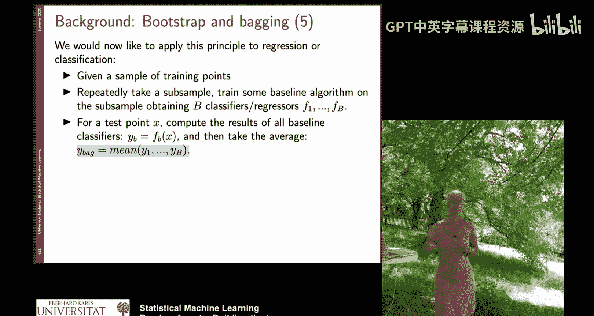

And now by looking or thinking a bit closer about what the mechanism here is。

 you can already make a couple of remarks on what you think would be good baseline classifiers because of course you now can choose everything you could say I choose SVM so I choose deep neural networks so I choose whatever you like as a baseline classifier。

 I do it often on many subemmbers and then I combine the result。😊，But there might be。

Baseline classifiers， which are better suited than others。 and here are a couple of remarks。

So the first remark is that this is of course expensive from a computational point of view because you need to train a model B times on M data points。

And if your data is large， M is large and you need to do it often。 B is large。

 then this is really a lot of computational effort。

So it might make sense sense to use a reasonably simple baseline algorithm for training。

 don't use a deep neural network as your baseline classifier if you need to train it a thousand times then this is maybe too expensive。

嗯。And so typically what people I mean， what a simple method。

 it could be something like a can nurse neighbor method， it could be a decision tree。

 it could be maybe if you want still a linear method， but something that is reasonably easy to train。

The next thing is。What we've seen on the previous slide。

 begging is supposed to be an approach that reduces the variance。

 and this happens most if these classifiers are as independent of each other as possible。

 so this is something we should aim for making these classifiers independent。

And the last comment is begging is all about reducing the variance of your estimate。

 It cannot do anything about the bias。 So if your method is your baseline method is biased。

And for example， your estimate of this parameter Theta always ends up much too high。

 Then if you average over these estimates， which are much too high。

 then the result is still going to be much too high。

 So begging cannot do anything about the bias of your method。 It can just reduce the variance。

 This is also important to keep in mind。And now the standard choice that we are going to see in the following bit of the lecture is that we use decision trees as our baseline algorithms because they are simple and also have the potential that we can make them more as independent as possible from each other。

😊。

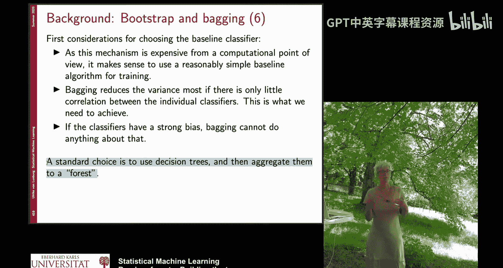

🤧。So let us briefly start with decision trees。I guess most of you have seen decision trees。

 but if not here is sort of the image。 So the intuition， what a decision tree does is。😊。

You have typically， you have a set of like points， persons， whatever patients in a medical example。

And each point or person is described by a set of features。AndNow you have a decision tree and you。

 for example， want to decide whether the patient should get treatment one or treatment B。

And now what you do is you sort of look at the features and the decision tree always tells you it is sort of a treat that routes you to a treatment。

 so for example here's an example you could say at first look at the age of the patient if the patient is above 50 I go in this branch。

 if the patient is below 50 I go in this branch。😊，Then for the elderly people to say。

 I need to look at the blood pressure。😊，Because this is most important for this population。

 you check is it below 120 or above 120， and then you suggest treatment one or2。😊。

And maybe for the younger people you say， well the blood pressure is maybe not so much of an issue。

 but the diet is very important so if the person a vegan person then we。

 for example cannot use treatment X， we need to treat use something else and if the person is not vegan we do them to something else and so on。

😊，And the idea is that typically the important variables occur somewhere in the top of the tree and then the less important variables occur somewhere at the bottom of the tree。

😊，Okay。So this is the general principle of a decision tree。😊。

And now there are millions of ways in which you can build decision trees。

 and there's what you typically use in random。😊，Forests。

 as we are going to see or want to explain them in this lecture。

 we are going to use spatial decision trees。

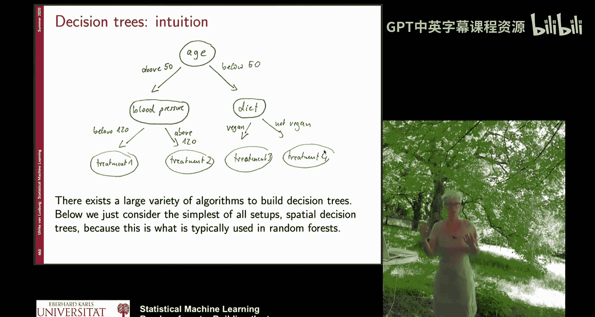

a spatial decision tree is not something that you might have seen implicitly already。

 it's something like a kD tree if you've seen algorithms before。😊。

It it is a kind of tree structure that splits your data space into different cells in the end。

Let me explain how this works and maybe I think the easiest way would be to explain it on the iPad。

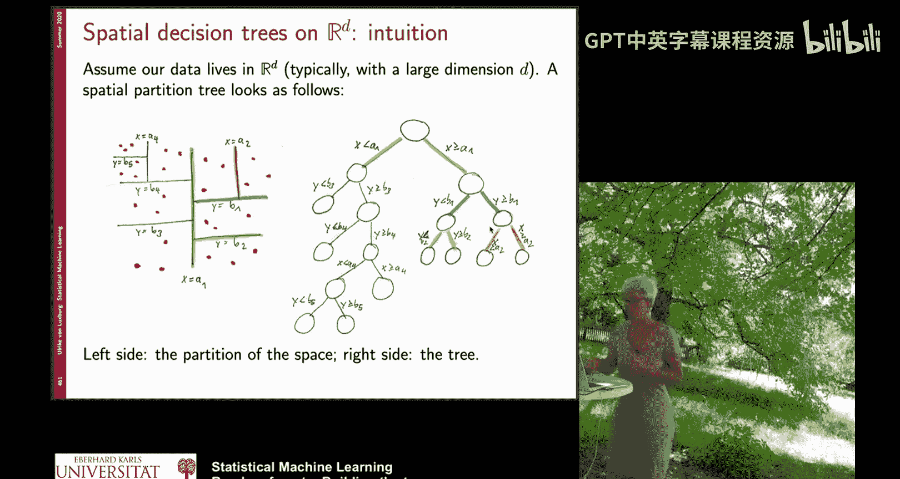

So assume we have a data set。I just draw one。Yeah， lots of data points。

And these are just the points they might have labels because later on we want to solve a regression or classification problem。

 but now what I'm going to do I want to introduce a split to my data and all splits I'm allowed to consider in this at least basic spatial decision trees are split that are parallel to one of the coordinate axis so here I'm in a two dimensional space I can either split vertically or horizontally。

😊，And now maybe what I would do here， let's put my example like this。

 so here's the coordinate system。I would say typically so often what you can do is you can。

 for example， say you look at the variance of your data in the two directions and then you split in one direction where the variance is smallest。

 for example。😊，And you would split here。No， this is not a very good。 maybe sorry。

 I need to make this a bit nicer。 let's put it like this。So this is my first grid。

 so I have now left and the right side。😊，This is maybe a bit too big。

And now I have two cells and this is in my tree， so here I have now the question is the x coordinate so this is maybe 5。

 this is the line x equals 5 and now if I build my tree，😊，m sorry。I have now， a first。

The root of my tree contains the x coordinate and I'm asking is it smaller than five or is it larger than5？

And now in one size， if it's smaller than I go left in the other case I go right and now I look at I do this recursively。

 so I I now look at the different sides， so maybe what I now do is I split the left hand side。

And maybe what happens is I would split it in this way。

And then I would add a new vertex to my decision tree， which would sayops。

Now here we look at the y coordinate and we check if this is maybe 10。

 we check is it smaller than 10 or is it larger than 10。And on the right hand side。

 what might happen is I again split in the in the y direction。 And then here I would。

I would add the coordinate x because I need to check。 Maybe this is x equals 7。

 I need to check if it smaller than 7 or is it larger than 7。So larger than 7。

And so you continue recursively。

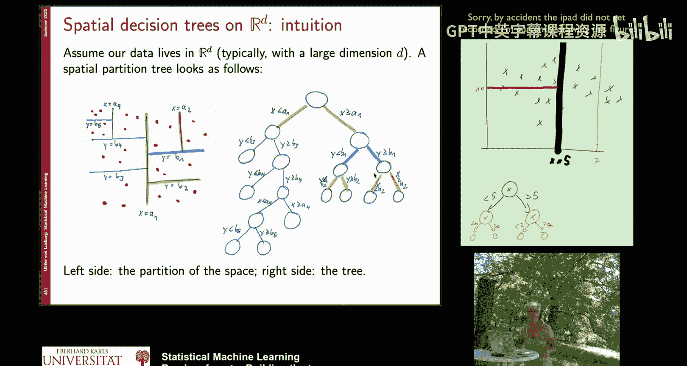

So what you have in the end you can also see it now on this slide。

 I have a figure here you have data points。😊，And you see essentially where each of the lines introduces a new split of the data set。

And so on the left hand side on the slide， you see the spatial cells that emerge from this kind of tree。

 and on the right hand side， you see the tree that is going to emerge。嗯。And typically， I mean。

 to construct such a tree， you do it recursively。In each step you need to select one dimensions along you want to split and then you need to also decide what is the best point so if you decide you want to split along the X axis you need to still find where exactly do you want to split。

And you keep on splitting and splitting until you achieve that each cell only has a certain small number of points that you fix in advance。

 so you say a split until each cell has only 10 data points and then you stop， for example。

Now what you need to do is assume you have this tree structure you have constructed it already how do you use it for prediction so that's not very simple you now want to predict say the label of a certain point so what you now do is you have your test point here in this image it is this red Cross so you check in which cell is with this point live and you can do that by simply walking along the tree and at each note decide like is the x coordinate of this point smaller than5 or larger than5 and so on。

And then you end up in the cell。And then to predict the outcome of this test point here。

 you simply average over what you have in your cell in this final cell。

 so here this point ends up in this cell which has three data points left。😊。

And now in classification， you would simply take the majority vote for these three data points in regression。

 you would simply take the average labor and this is what you would predict for the test point。

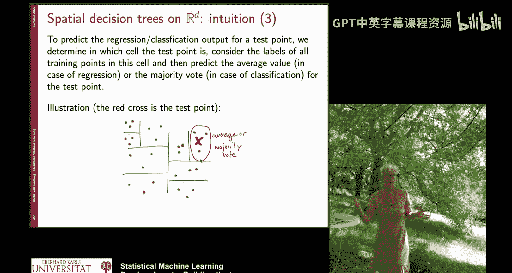

Here is again an illustration in case of classification。

 so this is maybe one of these spatial data structures that you might achieve in the end and you see sort of you have different points like white labels or black labels and what you also see is like the color of the cell indicates now what is the prediction for this particular cell so for example here we have three white points so the prediction would also be white for for every test point that ends up somewhere in the cell。

Here， for example， at this cell cell at the bottom， we have three black points and two white points。

 So the majority is black。 So every test point that would end up in the cell would get a black label。

So this is really a very simple straightforward data structure。

 there is nothing really secret and mysterious about this。

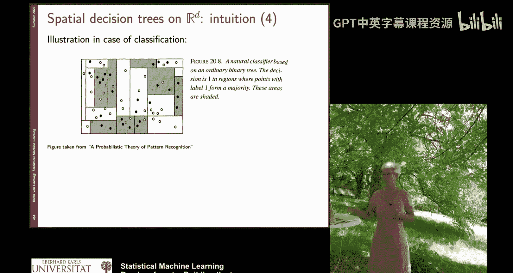

Now to build the tree， there' is one more thing that we need to fix。

 namely how do you determine the splitting criterion and when you want to find where to split。

And there are like in the literature there are many， many， many such criteria。

 but here is I just want to show you an obvious one which is you sort of look at the test errors that each of the splits would induce。

 but sorry at the training error that each of these splits would induce。😊。

So what you would do is you consider a split into two different parts and want to say， okay。

 would this be a good split or a bad split？😊，AndNow you assume that you would do the split and then you would compute the test around the left side and on the right side and would compute the mean。

 so let me simply show this with an example。

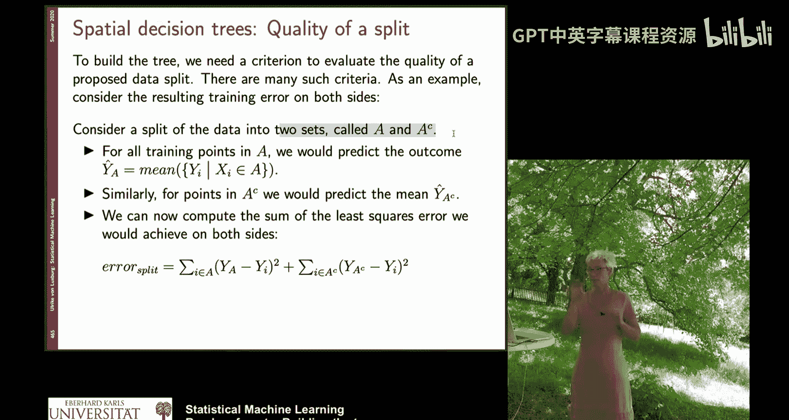

So here I have two like it's twice the same data set and I want to decide whether I want to take this split on the left hand side that goes vertically or whether I want to use the proposed split on the right inside。

 which cuts it horizontally。😊，So what do I do， I look at this， I first of all， look at the left side。

 look at the split。😊，Now if I would use this particular split on the right the so I have now a left part on the right side of the split so on the left side I have it's a regression example。

 I have once the label plus 1， once the label 0 and once the label 4。😊，Now。

 the prediction on the right end of the sorry of the left side of the split would be the average。

 so this is 5 over 3。Now I can compute， for example。

 the L2 error that this would have on the training points on the left hand side。

 so for the first point the true label is plus 1， but I would predict 5 over3。

So thearrow would be 1 minus5 over 3 squared。Then the same for the middle point which has labeled 0。

 thearrow would be 0 minus5 over 3 squared， and for the last point the error would be 4 minus5 over 3 squared。

And now you can compute it， and the error would be 8。6。

You do the same on the other side of your split， the arrow would be 4。6 in this example。

 so the overall2 arrow here would be 6。6。😊，Now， you do exactly the same for the other proposed split on the right side of the image。

😊，Youll find that the error would be 3。6， and you would say， well。

 the split on the right hand side is better than the one on the left hand side。

 So this is the one I use。Okay， so you essentially look at proposal splits and evaluate which of them would produce the smallest training error on my training set。

 and then this is the one you use。😊。

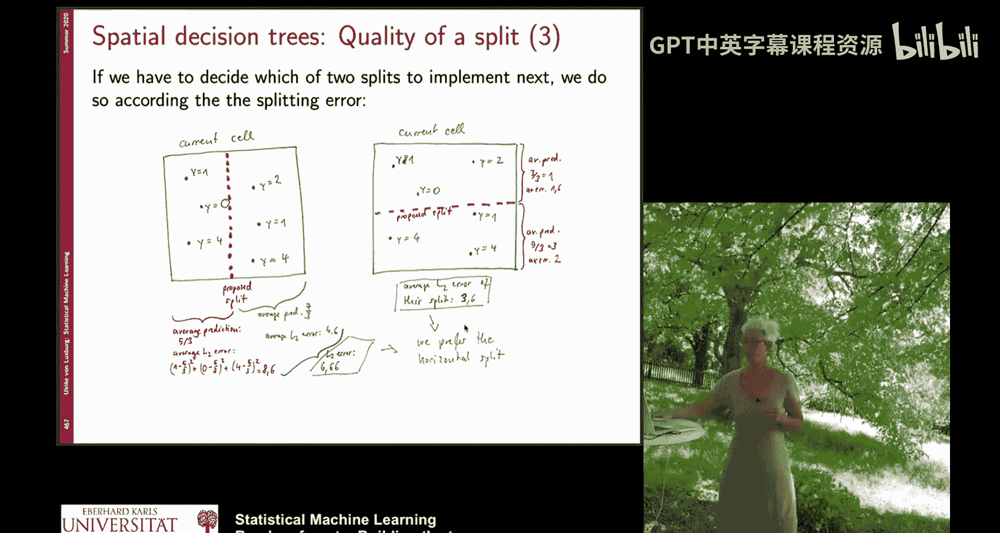

And so typically what happens is you first of all， you need to select the splitting dimension because the trees。

 as I explained， they always use excess parallel splits so for each of the dimensions。

You you evaluate， would it be good to split along dimension  one or to split along dimension 2 and so on。

So you have a for loop that says four all dimensions。😊。

And now for a fixed dimension you need to find like say you want to split in this direction。

 you still need to find out where on the x axis for example what I need to put the splitting point so essentially now what you do is you evaluate different splitting points。

Al compute the L2 error and then select the one that is best。

And if you want to do it computationally， I mean， you can sort of。

 you need to really think about computation time here because this operation happens often and often and often。

In particular， if you have many trees， also， so typically people use a greedy procedure here。

 some kind of search procedure to find a good position to split。😊。

And then you compute what is this error for splitting along this part like the best one you find in this particular dimension。

 you do this for all dimensions and then you finally use the one。

 the dimension which achieve the best error in this particular way。

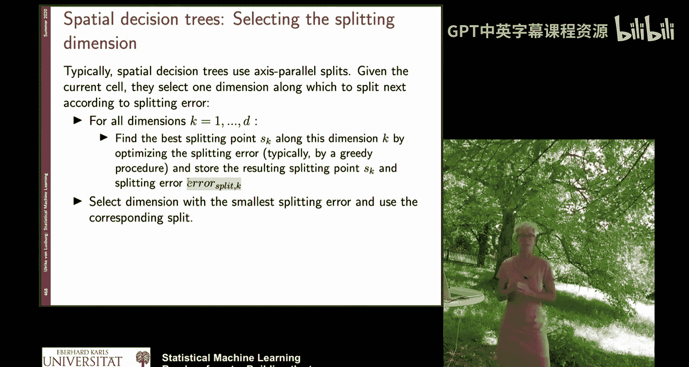

The other thing you need to consider is what is the depth of your tree。

 so how many levels do you go down？And typically。The way this is done is you fix a number that is called in leaf on these slides。

 so the number of points that you want to have in the leaves of your data structure。

And there are two different regimes that are important in the literature。

 One is what is called shallow trees。So in a shallow trees， you don't have too many layers。

 And now what you want to do is you want to have。The number of points in a leaf。

Grow at least slowly with the overall number of data points。 So， for example。

 if you have n data points in total you would say the number of points in Malli should do something like log N。

If you do this。Then you would see that the that the。

Tree you construct in such a way is also statistically consistent。 And here。

 I want to refer to this chapter on on learning theory。

 And I think there is also an assignment in this chapter where we look at this excess parallel。

 I mean， we look at a slightly simpler case， but in this learning theory lecture。

But it's sort of the same gist。 And what you need to achieve is that the diameter of these cells slowly shrinks。

 So if you would have。The number of leaves being a number like a constant fraction of n for example。

 then the diameter of these cells wouldn't shrink it would stay constant。

 more or less at least and then if you average over something you would always average over a huge part of your space and this is not something that so you would end up with a step function as your classifier this is probably not what would give you consistency so you need to make sure that the diameter of all these cells shrinks but at the same time you need to assure that within each of the cells you have enough data points you average over because if you just have a fixed number of data points and this number doesn't grow with n。

Then you average over the same finite number of points。

 and the variance of your estimate is not going to go to 0。

So you probably would need to achieve that the number of points per cell increases and this is like if you want to achieve both。

 for example， you can choose the number of points as log n and then you have achieved both that the diameter shrinks and the number of points within each cell increases and you get consistency。

And so if you just want to use one single decision tree， this is what you' are supposed to do。

 you try to train the tree until you have lock n points in your leaves and then you use it for classification or regression。

😊，Now， what happens in random forests is a bit funny because people observe that in random forest。

 like random forests are going to be， we use many of these trees in parallel as in a begging procedure。

 And I'm going to explain it on the next slides。 But just to already give the catch away in random forests。

 people have often observed that。😊，That it is better or achieve better result if if you train the trees to what is called deep trees。

 so you really only train to a constant number of points in the extreme case you train until you justify have one point that remains in your leaf。

And then you train the tree and if you do this， but and each of these trees would not be consistent。

 it's like a one nearest neighbor estimate， essentially so this is not a consistent estimate it has a certain error。

Because the variance doesn't go on。But if you combine many of those trees by combining these trees。

 we get again the variant small enough， and in the end， it can be consistent。

And there's also a geometrical explanation。 So somehow what you're going to achieve， like。

 maybe I try to illustrate it on my iPad once more， sorry。So， if you have。A tree。

Maybe it looks like this， I don't know。And you have。

So sort of this this regime where you have lock n points in each cell looks a bit like this。

 so the diameter is going to shrink， but you still have enough points in your cell。😊。

Now if you if for the same kind of data set you now would construct a deep tree these cells would be tiny right。

 you would have essentially one cell around each of the data points。

Which would not be lead to a consistent estimate。 But what now happens is you have the same for many trees。

 and you sort of now need to consider you overlay many of these trees。

 So I try to make a figure that is a bit larger。 So here's the data point。

And here is maybe the cell that you achieve by the first tree。

 it just consists of this particular data point。So on itself。

 this would not lead to a consistent estimate。 but now you have many trees。

So maybe in the next tree the cell looks like this in the next tree it looks like this and then it might look like this and like this so overall what you're going to have is if you look at all these three combined。

Then again， the cell would have a considerable size and the way it would end up is also like in each of these cells。

 of course you have a number of you have say one data point because you train until you have one training point left。

😊，But taken together， if you now， take many of these leaves。😊，Then again。

 you have a large number of training points over which you average。

 and then the whole thing can get consistent again。Okay， I mean， this was an excursion。

 it's not important you don't need to know this in the exam。

 I just want to give you a bit of intuition here。Okay。

 so what are the final remarks about these spatial decision trees。

 like if you just take one particular tree？😊，And one advantage is that they have a nice interpretability because you can。

 as I said in this decision tree， you could say， like if one axis is the blood pressure and the other axis is the age。

 you can say okay， for this patient to end up in this particular category。

 it is important that the blood pressure is below 120 and the age is about 50。

 so this is something that at least potentially you can interpret。😊，嗯。

And there are also many suggested ways to compute course about how important a certain feature is in such a random forest like in a decision tree。

 but also in a random forest。 And there's lots of literature on this。 So in principle。

 this is a class of algorithms for which interpretability is something that is in reach。

Now I've only shown you like the spatial partitioning tree as one example for a decision tree。

 There are many， many examples out there。 like a very popular one is the C C 4。5 algorithm that。😊。

Tries to order the variables according to some information Theore quantity。

 So which of the variables is most important regarding the decision we want to take later on。

 and the important variables end up on top in the tree and the less important variables end up somewhere in the bottom of the tree。

