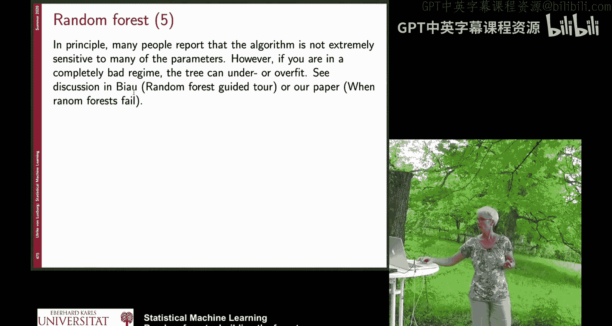
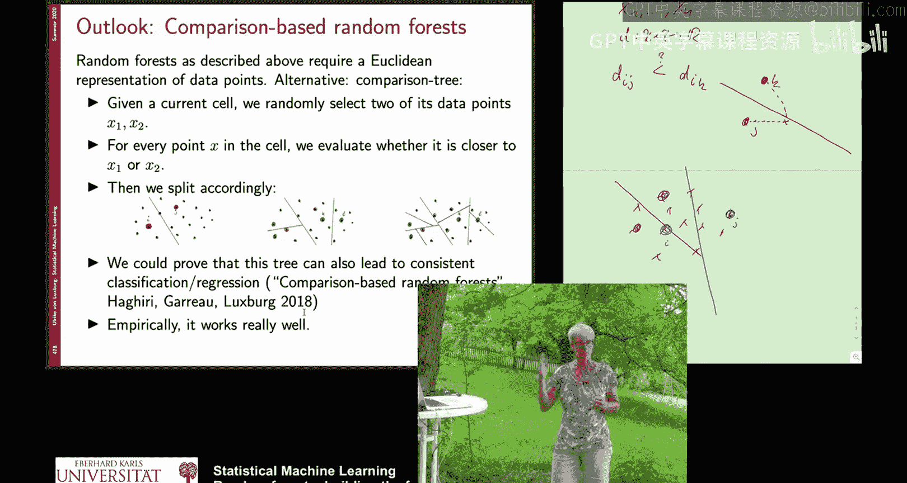
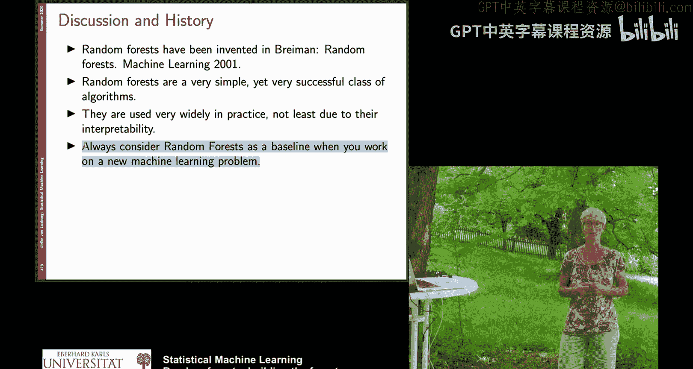

# 图宾根大学《概率和统计机器学习｜Tubingen Probabilistic and Statistical Machine Learning 2020》中英 p26 -26-Part 23b - Random forests_ building the forests.zh_en -BV1gso5YGE4s_p26-

In the last lecture， I started to explain the principle of begging and started to introduce spatial decision trees。

Then I got interrupted by a family emergency case， and now I want to take it up from here。

 so we have seen individual spatial decision trees and now we want to use the principle of pegging to combine the individual trees to what is called a random forest。

😊，So in a random forest， the key idea is that we have many trees。

And that each of these tree is constructed in some sense randomly。

 so there needs to be some random aspect about the tree。

And the random aspect in the standard construction could be to build the tree based on random subsets of your training data。

But also on random subsets。Of the features on which we do the excess parallel splits in order to provide the tree structure in the end。

So here is a piece of code， I've taken it from the Tiiptirani book Elleement of Statistic Learning。😊。

嗯。And this is sort of the rough outline of how a random forest works。

So our data lives in RP so this is now a book that comes from the statistics literature and in the literature and statistics。

 the dimension of this space is typically called P。

 at least if we assume that the dimension might be something large in the high dimension statistics case P is always the letter that is being used for the dimension so if de noted this by hand on the top of this slide so the data point live in R where P is the dimension。

😊，And our random forest has a number of parameters。😊，Which are circled in in the in the code。

Let simply go through it。 So we have a far loop that goes from B equals 1 to capital B。😊。

So B is the number of random trees that we are going to construct in the sense of of the beging literature B or bootst。

 B is the number of bootst samples， or in this case。

 the number of trees that we are going to construct。Now。

 how do we proceed within each of these like within the for loop。

 we construct one tree and this works as follows。 We first of all， draw a bootstrap sample。

Of this highest n from our training data。 So capital N is now the number of training points that we draw。

And we can either say we draw endpoints with replacement or without replacement that now depends on your philosophy。

 The standard bootsstrrap philosophy says we draw as many points as we have data points。

 but we draw them with replacement。😊，So it could happen that a point is being sampled a couple of times。

But you could also go ahead and simply sample a smaller number of points without replacement。

 if you like。 So both have their pros and cons。So we draw the sample。

And now we need to grow a a random tree TB， So a lowercase B is now the index of the tree。😊。

And it says we grow this tree to the bootstrap data by recursively repeating the following steps for each terminal node of the tree until the minimum node size n min is reached。

 so what the says is we want to build a tree we build it recursively and the recursive depth is as long until we have a certain number of fixed points in the leaf of our tree and this number of points that we want to have in our leaf is called nmin here。

😊，And how do we do that， How do we recursively iterate and split and split。😊。

So at each point when we need to split。 So assume we have already built a tree up to a certain level。

 Now we sit at one particular vertex of our tree and we want to split it further。😊。

So now we select M variables at random from the P variables。

 So now here we draw a random subs samplele of the dimensions， so we have P dimensions。

And we just draw a random random subs samplele of M of them。And essentially。

 we throw away the rest of the data of these dimensions， which we do not want to consider。

 and we just keep the dimension of the like those dimensions， which we have selected。

And then we say pick the best variable split point among the M。

 So we do what has been described on some of the previous slides。

 Now for each of the potential dimensions along which we might want to split we。😊。

We compute what would be the best split according to this dimension。

And we compute the best splitting point here and then we pick the best variable split and here it doesn't even say according to which criterion there might be many criterion we have looked at the test error but there are many other criterions around。

And then once we found the best dimension along which we want to split。

 we split the node into two order nodes。 we do this recursively until we only have n min many points in our in our leaf。

 and then we stop。ok。And then the fall loop stops， and now what we have done throughout this fall loop is we constructed a capital P many trees。

😊，And each tree is a random tree in the sense that it depends on random data and random splitting directions。

And then we output the ensemble of trees okay that' is sort of the preprocessing phase and now a prediction phase。

 what do we do to make a prediction at a new point x。😊。

We now build essentially a weighted linear or an unweighted linear combination of all the treess。

 so we check out what is the prediction TB of x that the  tree be。😊。

Would make on point x and how do we do that， You route the test point down the tree until it ends up in a leaf。

 and then if you are in classification， you typically do a majority vote in the leaf or if youre in regression。

 you do an error value in your leaf。😊，This is your prediction of 3p and now you average of all these predictions and in the default case you simply use the same weight for each of these trees so you take the mean。

😊，And here it says， again， if you're in classification。

 then you do the majority vote and in regression you do the average。😊，And that's it。

So its very's a very like once you already know what what spatial decision trees are。

 this is just a set of spatial decision trees。😊，Now this algorithm has a number of parameters and I think it was four parameters also。

 and if youre in machine learning and you always already think all four parameters that's already quite a lot。

 at least like if I think about a sub vector machine， I typically only have two parameters。

 sort of the trade of parameter and the kernel width for example。On the other hand。

 if I think about neural networks， you have millions of parameters， so maybe not so bad after all。

 but running across validation over four parameters would already be a challenge。😊。

The good news about these decision trees is that the choice of parameters is not as crucial as it would be。

 for example， to fix the trade of constant or the kernelel widths。😊。

And there are some good rules of thumb out there， which can help you to set these parameters。

So the first parameter is the size of the subsample on the previous slide， I think it was called it。

😊，And what was we called capital N， so how many training points do you draw？

Typically you do this reasonably large because you want I mean you want to use as much of your data as you can。

 but still you want to have some randomness in these random trees so you can either say you choose n on the order of magnitude of your original sample size and drug replacement or maybe you do a bit smaller I don't know two thirds of n。

 something like that。Then the next U Sal。The next parameter that we need to pick is the number of dimensions along which we are allowed to split at each particular vertex。

 so remember each vertex we randomly select a subset of dimensions and then we choose the best split among those dimensions。

And typically， people choose something of the order D over 3 where D is the original dimension of your data。

I think it would probably be P on this slide because on the previous slide。

 the dimension was called P。 this is again， the contradiction between the notation in statistics and machine learning。

 So it's the dimension and typicallyically people choose D over 3 and that tends to grow a good job。

 So this is not a parameter you need to play around with a lot。

Then the number of trees that you use this number should be reasonably large。

 it probably wouldn't be enough if you just pick 10 trees。

 this would be a number really large as large as you can afford because of course its also a computational question and also a storage question in the end but B should be a large number。

😊，And then the last parameter is the number and min of points in the leaves and Ive already discussed this in the previous lecture depending on whether you believe in shallow trees or deep trees。

 this a min should be something either between。😊，Like lock of n。

 if you are in a shallow tree or in the extreme case。

 even going down to n equals 1 in the case of extremely deep trees。Okay， and here is again。

 the slide that tests that all this parameter might not matter so much。😊。

So what I wrote is that in principle， many people report that the algorithm is not extremely sensitive to many of these parameters。

😊，However， if you're completely wrong， then of course things go wrong as well you can happen like if your trees are too shallow。

 then you will probably underfi if your trees are deep and you don't have enough trees for example。

 then you're going to overfit and in one of our papers that we published last year or two years ago。

 it was called when random forests fail we examine the choice of parameters from a theoretical point of view and make again some recommendation so you might if you're interested into more you might read that paper or also the paper by Bu about the random For guided tour。

Now， the question is from a theoretical point of view is of course。

 when are these random forests consistent， like do they always lead like are they universally consistent or maybe just consistent with respect to certain situations with to certain probability distributions do we really get base consistency or just consistency with respect to a particular function class。

😊，And here are the main resultss。So a single spatial decision tree。

Can be consistent if it's not too deep。And I think I outlined in the last lecture already the argument when this is the case。

 so if in a single decision tree you can achieve that the diameter of all the cells goes to zero。

 but at the same time the number of vertices sorry the number of data points that are in each cell grows to infinity。

 then typically you would have a consistent tree。😊，If you want to know the details。

 for example you can read this up， I mean these results are really old already。

 this is it's essentially like a spatial decision tree it's a very simple data structure and the proofs are also very simple。

 essentially they use something like the serumem of stone or so it sort of it's a really well knownn argument。

😊，If you want， you can read it up in in chapter 20 of the probabilistic of pattern recognition。

 This book is already 20 years old， but it's still correct， of course。Now。

 this is sort of the na Eve case。 So if each of these trees is consistent。

 then it's reasonably easy to see that then also the random forest is going to be consistent。

 And this， if you want， you can read this up， for example。

 in this paper about the analysis of a random forest modeled by Jerabiio。

Of course this is sort of the somewhat boring result because it doesn't really explain why do we need the forest so if each tree is already consistent。

 so why go through the effort of having many trees？So from this kind of f， this is not obvious。Now。

 the interesting thing is what is mentioned here in the last in the third point on this slide。

 that a random forest can be consistent， even if all the individual trees are not consistent。

 And this is sort of the fact where it becomes interesting。 And in particular。

 if you train very deep trees， then each of these steep trees is not consistent because the variance is going to stay too high。

 it's not going to converge。But if you combine many of these deep trees， it can again be consistent。

 so let me explain briefly the intuition why it can happen that a deep tree is not consistent but an ensemble。

 a forest consisting of deep trees is consistent。😊，The argument goes as follows。

So assume we have a number of data points here。And assume we train a tree。In a deep fashion。

 so let's just plot the extreme case， we train a tree such that only one point is left in the leaf cells。

 So what we might have here is。So we might have a leaf cell that looks like this。

 it consists of one data point。And I assume this round Ga here is the test point that we're interested in。

😊，So if I would just。Have this one tree， it would predict the label of this black point。

 which is in the cell。 and this is not going to be consistent。But now I have many such trees。

 So what might happen。 So now I have a second tree， and maybe I train the second tree。

And maybe the cell that corresponds to the second tree and contains our test point looks like this。

 and now it of course needs to contain a data point as well because we train until we have one point left。

And now I already have a secondary tree。 and now I keep on doing， I have， I said， as I said。

 we have many random trees。 So what is going to happen is。That there are going to be many cells。😊。

Which are all sort of which all contain this one data point。

 this one test point and one other data point， but we will have many such cells。

And now the trick is if we now check which are the data points that are all contained like in the ensemble of all these cells。

 all of a sudden we have lots of data points it's not just one and even in the figure on the iPad we can see here is one point。

 here is one point， here is one point here might be one here might be one and here might be one so in the end again the data points that are being taken into account when I now take the average prediction of all these cells。

😊，Here it might again be the case that this number of data points goes to infinity。

And yet this the the sum like sort of the set that is now outlined by all these red cells might still go to0。

 So what I mean by this is so the the number of blue points now now the ones which the data points that are contained in one。

 at least one of these red cells is going to go to infinity so I can maybe。😊。

Number of these ci points goes to infinity。And now the other thing is that the diameter。

Of this red thing here。 and by the red thing， I mean， really the outline of of the sorry。

Of the whole。Of the whole set， or something like。Yeah， this year。

If this is the outline of the overall of the union of all these cells。

 the diameter of this whole thing also goes to0。Let's write it down。So this diameter goes to zero。

 and then I can have consistency again。So this is just the intuitive picture。

 of course the mass is a bit more complicated， but this is sort of what at least for me。

 this is an explanation that I can understand where I see the reason why it might be that each individual tree is not consistent。

 but a random forest is again consistent。😊，So there is lots of papers about the consistency of random forest and it's really curious because there is still a lot of research going on on this。

 because the problem is that in what happens in practice is that when we select the best split。

 the split is being selected by looking at the training points because as I said we for example。

 look at at the training error of each split and then select one that is best。

 but this makes it very complicated to prove anything。😊。

Because all of a sudden we get so many dependencies and many of the proofs that existed previously sort of ignored this step and just said we do some random splits here and there or we split at the average position or something like that。

 and then you can prove consistency but they are still still working into proving the consistency for the algorithms that are actually used in practice。

😊，And there is lots of discussion in the literature。 and as I said。

 we also have a paper which looks which looks at some cases and also shows that some of the cases some of the suggestions that have been made in practice are。

 in fact not correct。 so you need a reasonable amount of randomization。

 otherwise these trees are not going to be consistent。😊。

Now I want to have a small outlook to another set of random forests。

 another construction for random forests， simply because this is something we've also been working on last year。

 we've published this last year and maybe it helps you to see a bit what kind of research we do in our group。

😊，Let me explain it very briefly。 and I think I do that on the iPad。

So here we are in a scenario of comparison based learning。

 So assume your data points do not live in RD。 so to construct this standard that spatial decision tree。

 you need to have points in RD and then you do access All splits。😊。

But now consider you in a scenario。Where your， for example。

 just have similarity values between e points。Or in the extreme case。

 you don't even have similarity values。 You can just compare similarities。

So the idea is there might be many scenarios where， for example， for humans。

 it's easy to say this movie is close more similar to this movie than to that other movie。😊。

Or these two pieces of muses sound similar， but these two pieces of movies sound very dissimilar。

 So what you get are so you have data points x1 to xn。😊。

And you know there exists a distance function from the data space to R that in principle measures distances in the space。

 but maybe you can't even access these distance values。

 all you can do is you can say if I have a data point I and J。😊。

Is the distance between I and J smaller？Then the distance between I and K。So in images。

 you have a point here。And you have a point here， Jk。And now you ask， is the data point I。

 is it closer to J or to K？😊，And if you think about what this means。

 such a question if you can answer it for arbitrary combinations of data point。😊。

It construct a hyperplan in your space， so you can now ask for this for this test point here。

 test point I is I closer to J or is I closer to k。And of course。

 if these points would be in a vector space， what you could say is you can construct the hyperplane or the separating plane between these two points。

Which has the same distance from both points。 And then this question is going to answer is point I below the hyperplane or above the hyperplane。

 Is it on the same side as J or on the same side of SK。😊，And the good thing is。

 you don't even need to have hyperplans or vector spaces to ask these questions。

 All you need to have is essentially a space in which you can measure distances and ask these questions。

😊，And now the idea is。You can use these kind of questions also to construct random trees and random forests。

 and the idea is now as follows。 So now here we have a dataset set。😊。

And now we want to construct our first split， and in spatial decision trees。

 we now would select one coordinate axis and would find a split that is parallel to this coordinate axis。

Now， what we are going to do is different。😊，We now randomly select two data points from our from our data space。

 simply uniformly at random， we maybe select this one and this one。And now。

 for every other data point。 So this is now what we。On this slide。

 this is called I and this is called J。These are two pivot points and now we ask for everybody else or other data points。

 are you closer to I or are you closer to J？And implicitly。

 this is sort of going to construct this hyperplane。😊，And for each data point， we now know。

 is it on the left or the right side of this hypog。This is now the first split。

 and now we can do this recursively we can again now I use a different color。😊。

Which colour may be pink。 I don't know whether you can see that。 Now， I'm on the left side。

 I recursively want to find a split。 Maybe I select this guy and this guy。Ask all the questions。

 It's going to introduce a hyperplane， and so on。In this kind of tree we call this a comparison based tree。

and， of course， once you have a tree， you can also construct a forest。

 This is now a comparison based random forest。And here the randomness， you。

 you can induce randomness in various levels。 You can induce randomness， of course。

 by looking at sub samplesamples， but there's a natural randomness inherently in this tree construction。

 namely by picking the two pivot points for all these splits。And what we now proved in our paper is。

 I mean， we looked at the construction of these trees。

 we looked at the theoretical arguments and could prove that under certain standard conditions。

 this kind of random forest also leads to consistent classification results。😊。

This has been published in 2018， comparison by Roman Fors。Empirically， we compared it， of course。

 to other random forest in particular， in cases where you have Euclidean data。

 and we found it sort of。Behaves equally well。Which doesn't mean so it's always it's sort of unlikely to find an algorithm that outperforms everybody else。

 but we found one which is sort of on par on some data sets it's better on some dataset sets it's not as good。

 but on average like if you compare it it looks pretty much the same kind of behavior。😊。

But now it holds into in a much much more generalized setting so you can also apply these trees if you just have similarity based data or even just comparison based data。

 So in this sense， it's a big generalization of the random forests as they come from spatial decision trees。

 which are access aligned in Euclidean spaces。😊。

Let us finalize this chapter with a bit of discussion in history。

So random forests are surprisingly unoldd if you want， surprisingly young。

 so the paper that has made themp has been published in 2001 by Bman， who is a statistician。😊，嗯。

By now random forests are really one of these standard data structures that many people use as baseline algorithms。

 like random forests is it's really so easy if you if you click in data。

 you can just apply them out of the box， you don't have to waste so much time with parameter tuning because sort of it's not very sensitive。

 you might even get explainable solutions or at least you can convert your solutions to give you explanations of what are the important variables。

😊，And this really makes them very widely applied in practice。

And I think it's one of the most popular algorithm in machine learning maybe next to support vector machines。

 Canius Neva and deep networks on the other side。My suggestion is whenever you have a classification or a regression problem that you want to solve always consider random forest as one baseline algorithm。

 They are really good， of course if if you know more about the structure of your problem。

 you might achieve better results with other algorithms but this doesn't cost you much and it already gives you some intuition on maybe what you can expect on this data set and sometimes these random forests are already so good that you say well I don't need to spend another half year to trying to improve the algorithm for my for the purpose I have this algorithm。

 maybe random forests are fine。😊，And then you're done。

 So this is really a baseline algorithm that you always should consider when you have to solve classification or regression problems。

