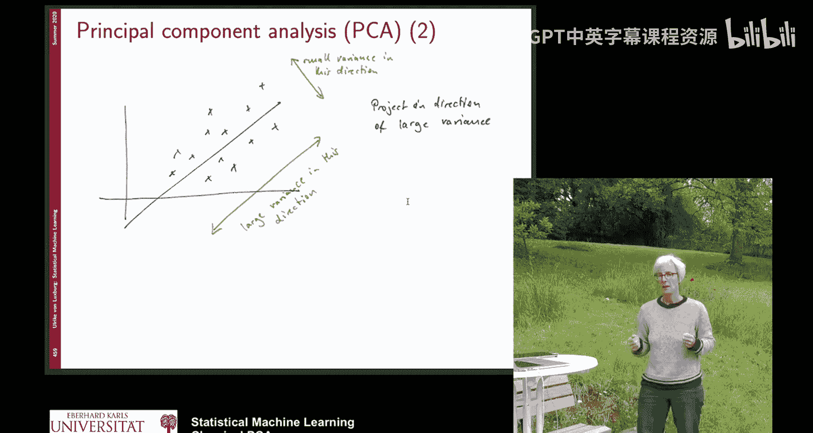
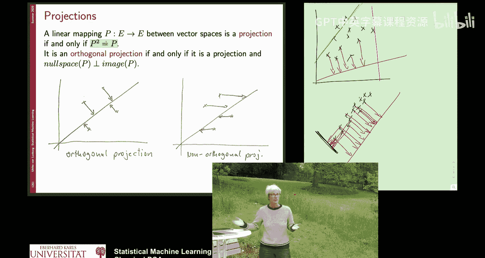
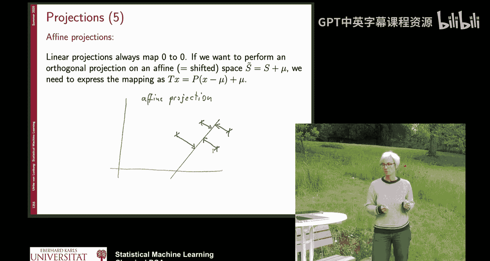
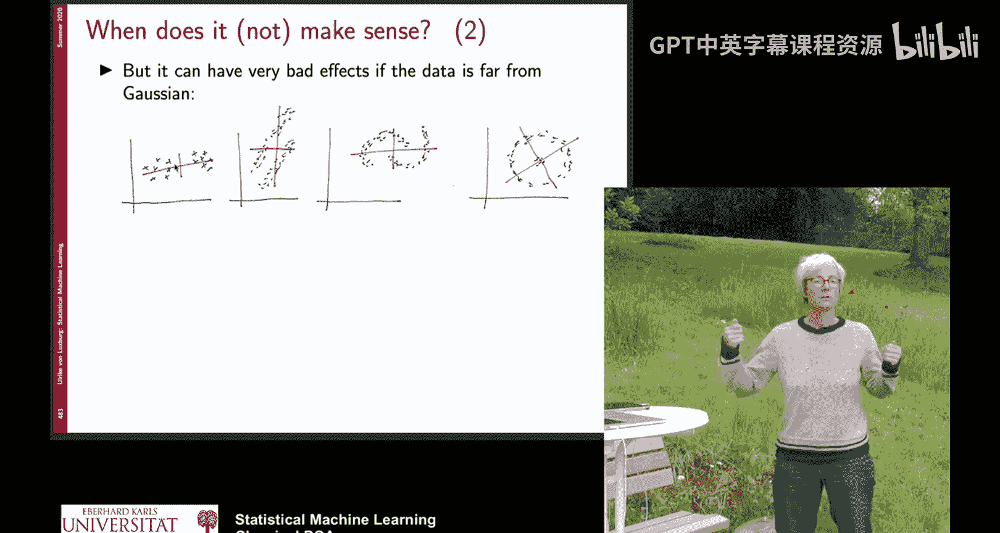

# 图宾根大学《概率和统计机器学习｜Tubingen Probabilistic and Statistical Machine Learning 2020》中英 p28 -28-Part 25 - Principle Component Analysis.zh_en -BV1gso5YGE4s_p28-

In this lecture， I want to explain the classical principle component analysis。

It is really one of the very old algorithms in data analysis it's being used all over the place in all the different disciplines that we data。

 and it's a standard tool for dimensionality reduction。

In this lecture I am going to show you how the classical variant of this algorithm works and then in the following lecture we look at the kernel version of this algorithm。

😊，What is the goal of PCA principal component analysis， the abbreviation is PCA。So。

 the situation is you are given data that lives in a high dimensional space。

 so the data lives in a Euclidean space， first of all。😊，But the dimension is high。

 whatever that means in your application， at least it's higher than what you think your algorithm can digest or you can digest。

So what the goal of PCA is is to project your data down to a lower dimensional space。

And then hopefully by projecting down， you don't lose too much information about your data。

 but after the projection you can work in this low dimensional space which might be better suited for because you have less overfitting in this space and maybe also less computational demands。

So this is the overall basic ideas as notation we are going to have so we are now going to see a couple of lectures on dimensionality reduction and I always use the same notation lower case D。

😊，It's always the dimension of the original space， the high dimensional space。

And then typically we have some L。And this is the low dimension in which we want to project L for low dimension。

 So D is always the original dimension。 And L is the dimension we want to。

 which we want our data to have after we did this projection。Here is PCA on one slide。

 so what is the general idea？On this slide， you can see a data set and what you want to do is So this is a toy example where we project from two dimension to one dimension。

😊，So the idea is we have， in this case， just this two dimensional data set that is sort of elongated in the space。

😊，And now you want to project it to a one dimensional space。

 because maybe you think that there is some noise in your data and you only need one dimension to describe your data。

Another question is。

In which directions should you project。Now， there might be many different lines on which you could project。

 and maybe I should simply draw a figure here。Sorry。😔，So this is our data set。

 it lives in in the two dimensional space and now we can think about projecting it perhaps on this line。

 which would mean intuitively that all of the data points get moved on this line。

 This is a projection。😊，But there are many other possibilities， right。

 I could also project on this line， or I could to could project on， I don't know。

 this green line here， which is essentially impossible to see。 Let's make it darker， sorry。

On this line。And the question is now， a bit like the question we asked in。

 in supervised classification， which is the best hyper plan to use for to classify our data。

 here the question is now which is the best。😊，One dimension is space in this。

 in this example on which we should project。Now， the idea of principle component analysis is that we should project in such a way that we lose as little information about our data because PC is used as a preprocess step。

😊，AndObviously， you don't want to destroy the information in your data。

 but hopefully you might get rid a bit of the noise that is in your data。So the intuition is now。

 as you can see it on the slide， if you consider the variance in different directions of your data or if you want the elongation of your data。

 then there are some directions in which your data has a very long elongation。

 So this might be an important direction in your data and then theres this other direction where where the elongation is very small。

 the variance is very small。 So if I show it here in the figure in this direction you only have a very small variance。

 so maybe if you get rid of this small variance， it doesn't hurt so much。

 maybe this is just a bit of noise that has been added to your data in the measurementment process。😊。

And maybe I draw again a figure。Just to make the point more clear。 again， we have here our data set。

 and now Android draw it。Very elongated。If we would project this data set on this direction here。

Then the figure would look like this。 So all the data points get on this direction here。

And you can already see from the way I draw it here。

 most of the data points will end on top top of each other。

 They get all intermed and you lose a lot of information。😊，There is。

 if we do the same here and we project in this direction， the data still seems to be reasonably。

 I mean not so much here there might be some points which end up on top of each other。

 but you keep the structure much more well preserved。😊。

And so the idea of principle component analysis is what we want to do。😊。

We want to project in the direction such that the variance after we have projected our data is still as large as possible。

This is the basics by which we can now start to derive how principal component analysis works。

So we start with a reamp of projections。A projection is a linear mapping。

 So in order to talk about a projection， we need to have a space。

 and this space needs to have a vector space structure。 Otherwise。

 you cannot speak about a projection。Now， if we have this vector space in。

And we consider a mapping P P for projection， which takes points from E and maps at to E again。

 We say that this mapping is a projection。If p square is P， what does it mean。

 P square means I apply the linear mapping twice。And then it should be the same as if I only had applied the linear mapping once。

Intuitively， if you think about it， what happens if you project so you have your data。

 your project on the line now the data already sits on this line， if you know will project again。

 nothing changes。😊，And you can now keep on projecting。

 but nothing changes because you are already on the low dimensional subspace。

And this is the formal definition of a projection。 So a projection is a linear mapping such that if you apply it twice。

 it is the same result as if you only apply it once。

You might remember from your mass background that there are different kinds of projections and we are interested in the orthogonal projections and these are the ones that one also typically has in the mind if one talks about a projection。

 So here you see on the left hand side we have an orthogonal projection where the points are projected on the low dimension subspace and the vector by which they are projected is orthogonal to the subspace to which we project。

Here on the left and， on the right hand side， just to make it complete would be an image of of a projection that is not orthogon。

 But this is not what we care about。Formerly， the definition of an orthogonal projection is。

That a projection is called orthogonal。 If the Nive space is orthogonal to the image space。

 the N space are these points that are going to be mapped to 0。

 and the image space is the thing that we made。 So in here in in this particular in this particular figure on on the left hand side。

 the Nile space is the direction， which goes along the where these arrows point because essentially these errors are like after the projection。

 they all have flan 0。 So this is sort of the nuile space。

 these vectors are all going to be mapped to 0。And the image space is the one that remains。

And this particular line， in this case。And when we talk about projections。

 there are always two points of view。 And this is now important for also understanding principle component analysis。

And I called them view 1 and view 2。 This is not a standard notation。

 It's just an talk name I came up with to sort of talk about these two different ways。

 So the first view is。Where we， we project our points。

 but still see them as elements of the original space。 And maybe let me go back。

 So here if we look at this figure on the left hand side， we take that point。

 And after the projection， it sits here。 So it is still。A point in two dimensions。

 But all these points sit on this one dimensional subspace。

But we still consider it like if I would write this point was it coordinates。

 I would still put two coordinates here。This is what I would call you1。

 So we look at a projection that goes from RD to RD。

And then the second view is where we essentially we look at this projection that goes from R D to our L。

 So in this case we get rid of all the coordinates that we don't need anymore and only look at what remains after the projection。

 And if we go back here on this figure this low dimensional subspace will just be the lion。😊。

And each point， after this projection would just be described by this one coordinate that tells where on this line it sits。

 but we don't see any more that this line might be embedded in a higher space。

And this is important in machine learning， because depending on what you want to do with your with your principal component analysis。

 So in data processing， of course， ultimately you want to look at the second part where you where you decrease the dimension of your of your space。

 So here we are now in this lower dimension space or L。

 and then we can proceed in working in the lower dimensional representation。

But sometimes if you want to understand what is going on to your data。

 and it might be helpful to look at this first view， And we're going to see this， for example。

 with hundred digtits where you might want to look at how do look。

 how do you do these ditits look like。If I would only present represent them with L coordinates rather than with D coordinates。

But were going to come back to that later。Here is again a figure that tries to illustrate this。

 So here we have RD， the high dimension of space。 we have these original blue points。😊。

If we look at view1， we still have this high dimensional space。

 but all our points sit on the blue line， but its still as as points in a high dimensional space。

Whereas here in U。We sort of get rid of these alternative coordinates。

 and we only look at the blue line in this case， which is not the low dimension space。😊，Now。

 what is important is what are the mathematically formulations for these different views？

And let's maybe start with view two， where we project， for example， on a one dimensional space。

Now I a second projection on a one dimensional space， which is spent by this vector a。😊，Okay。

 step back。 If you have a one dimensional space， it is spent by one vector。

 that's called this vector A。And this projection can now be expressed in mathematical terms as simply so the projection goes from Rd to the low dimensional space R in this case because we are currently talking about a one dimensional thing。

😊，And like if you start with point x in your highly dimensional space to compute where on this line。

 does the point sit after the projection you simply take the scalar product between a and x or you compute as plus x if you want。

 that's the same。😊，And a is the vector that describes the direction of the line。Now。

 if we want to do the same， but we want to project on an L dimensional subspace rather than just a one dimensional subspace。

 the principle is the same。We just need to now represent this a low dimensional subspace with L vectors because if you have an l dimensional subspace。

 of course we need to have a basis for this vector space it has L vectors。

 so we take an autonormal basis consisting of vectors V1 to VL。

And now we stack these vectors in a matrix as column。

 so we have this matrix V and each column of of this matrix is one of these vectors。

 all of these spaces vectors。And then to compute the mapping this low dimensional representation again。

 it is the projection that take us from RD now to Rl and L is now some arbitrary dimensional space。😊。

Where L is smaller than D or smaller or equal to D at most。

And the point x from the side dimensional space is being mapped to the point v transpose x A V is this matrix which has this vectors of this linear space in its column。

And this is how this thing is going to be computed in the view too。There's a helicopter。

 I hope it doesn't disturb so much。In view1 you want to represent the point still as an element of your high dimensional space and then what you do is you define this projection matrix P which has to form V V transpose where V is the same matrix as we had before。

And then you map the point x to the new point p times x and this point p times x knowledge again in the original high dimension space。

 this is what V 2 does。And maybe as an exercise or like as， as a small checkup。

 what you always should do is， if you see some arguments like this。

 you should check whether the dimensions of the matrices and the vectors fit。 So what I。

 what I say here is it is a mapping that goes from RD to RD。 So better the matrix P should be。

A D times T matrix， for example。And so please check whether P is really a D times t matrix and then whether you can multiply this D times t matrix with your original vector x and similarly here。

 so because it's so easy and also if you implement these these algorithms it is so easy to sort of switch the dimensions of the matrix and then everything gets granteded。

😊，There also exist a fine projections which I do not want to talk about。

 Just remember a linear projection always maps 0 to0 and then a fine projection would be one that also shifts the data space。

 but this is nothing we would do in in kernel principle or neither in principle nor in principle component analysis because we would always first center our data so we don't need to really talk about this。

So now let's look at this from the formal point of view。

So what we are given is we have these data points that live in the original high dimensional space。

We are given this parameter L， which is the dimension of the space we want to project to。

 and L is obviously something that should be smaller than D if it' is equal to D。

 the algorithm still works， but we only will do that if it' is smaller than D otherwise it doesn't make sense。

So what we want to do is we want to find this projection PS。

P for projection and S is the sort of the letter of the subspace on some subspace S。

Such that the variance of the projected points is maximized。Now， here I wrote a fine subspace。

But a fine mass is always annoying because you have to deal with that shift。

 and typically in data analysis， whenever you have something that is a。

 you first try to get rid of this a fine so you center it。😊。

So what we now do is we simply assume that the data points are centered in the original space。😊。

This means that the mean of the data points， if you take the sum and normalizedize by one over n。

 that is0。If this is not the case in your data， which typically like if you start with a data set。

 it's not centered， then you simply center your data set， as we have discussed earlier already。

 which essentially means you replace your data points by shifting them then by this vector X bar to the center。

 So afterwards that。And from now on whenever we talk about PCA。

 we only consider the center situation and we don't talk about defined linear projections anymore。

 we just talk about linear projections。So here' is another one dimensional space。

 the one dimensional case。So we start assuming that L is 1。

 we want to project on a one dimensional subspace。Now。

 what we have to do is we have to solve the optimization problem。Maximize okay。

 a is the parameter that we are looking at because we in for one dimension subspace。

 we just need to find this vector a， which tells us， which is the direction of the subspace。

 So we maximize over all possible directions in R D。😊。

And because we are only interested in directions， we only look at vectors A that not have no one。

And what is the expression we want to or the objective function that we want to maximize。 We project。

 we take our original data， We project it on。The on this direction A。

 and then we compute the variance。And by this notation， I somehow mean the shorthand version of this。

 This is a shortened notation for the variance of the data after， after projection。

Now how does this look like？😊，The variance of a center data set is simply defined。

Is the sum over the squared entries of the squared elements of the data set。

 So what adjusted here is I replace now the variance。

Which in the one dimension case is really easy by the sum of the squared numbers in the data set and the sum goes from one to n because we have endpoints in our data set。

I also replaced this condition which I had here that the norm is supposed to be1。

 I just wrote it here。 subject2 a trans plus a is1。 that's the same。

 And it makes it a bit more easy to digest。Now from this line to the next line， what do I do。

 I now know that this projection on this vector with direction A is simply expressed as a transpose x。

So I replace the definition of the projection。And now by looking at this expression。

 we can see that this is again the standard squared norm of the vector x times a。

 this is like if if you don't see it right immediately。

 maybe you simply write down this norm expression and write it out and then you see that it completely agrees with the term on the previous line。

😊，So what we see is known。This problem of maximizing the variance。By which we started。

 its the same as finding this vector a such that this the norm of this vector is as large as possible。

Another question is， how do we want to solve that。Now we have already seen a couple of lectures on optimization。

 so there are different ways now and by which we can see what I'm going to derive now。

 but I now chose the Lagoian approach because we already know that。😊，So what we do is， again。

 we have a constraint optimization problem。 We have an objective function， and we have a constraint。

So we simply write a like of motion。So La motion consists of the original function。😊。

And then you need to bring the constraint in the standard form。You need to so。

 so that it says small or equal to 0 or equal to 0。 What do we have here。It's equal to  one。

 so we need to say this needs to be equal to0， so we need to bring the one on the other side。

Then we're in the standard case， and then we add this like most multiplier as a factor in front of it。

Okay。And now， we simply。We simply reformulate this。 So instead of writing norm of x times a。

 we can also write a transpose x transpose x A。So if nothing has really changed。

So this is now the recognition of the problem we want to solve。Now， what do we need to do。

 We need to find a saddle point， So we computed partial derivatives。

And we start with a derivative with respect to A。 So if you make the derivative again by using matrix calculus or by doing it element wise。

 whatever you prefer， it's easy to see。The the derivative is two times x transpose X A。

 So this is the first expression。Observe this is sort of like like a quadratic term。

 So the x x transpose x like a like a constant because a is the variable we're interested in。 And a。

 we have it as a squared form。 So we have a here and a here。 And so it makes sense。

 at least that you end up with two times a here because if you take the derivative of a square。

 you would get two times a。 So this is sort of the intuition by this is true。 And similarly here。

We have a squared intuitively here times lambda。 And this is why we get two times lambda times a。

Now we set this thing to 0 because we know that this partial derivative needs to be zero at the solution of our problem。

And now we sharply look at this， what does it mean that this guy is zero？😊，So， a is a vector。

This is a matrix，2 times x transpose x。And two times lambda is a real number。

And so if you re write this， this equation essentially means that。😊。

Vectctor a needs to be an eigenve of this matrix。This one here。So you can if you want。

 you can bring the tool to the other side and then you don't have the tool anymore here。

 So a needs to be an eigen vector with eigenvalue lambda of the matrix x transpose x。

And this is not a necessary condition that the solution has to satisfy because the partial derivative of the clock function needs to be civil。

Now， the next step is we now know it needs to we now have this necessary condition。

 and we substitute this in the original objective function。 So what we get here is。嗯。

So here we have x trans a transpose， x transpose X A。And here we have most of sorry。

 most of this term here already。 so we write Lada a in this part。 So what we get is lambda as plus a。

My name is Laantton。嗯。Now， if you look at this expression。

 this is not the expression that we need because it's the original objective function。

 this is the expression we need to optimize。So we already know it needs to be an eing vector。

 but so far we haven't known which eing vector。 and now we know。

The value of the objective function is exactly the eigenvalue that corresponds to this eiglect。

And so if you want to maximize this expression， we need to look for the eig vector that has the maximum eigvalue。

😊，Of this particular matrix。So here' is our conclusion if we want to maximize this expression。😊。

This is。Maximized for this vector a that has the largest eigenvalue of this matrix x transpose x。

And this is。How is it sort of the first inside with respect to principal component analysis？Now。

 the next thing we need to observe is what is really this matrix x transpose x。嗯。

This matrix is going to be called C and we can already see or you might have seen this already this matrix is the covariance matrix of your data。

 think a bit about how it works So x the matrix x that we always have is a matrix that has the data points as rows so we have npoint and d columns so x transpose x is a d times d matrix。

And because the data is centered， this is exactly the definition of the conveyvariance matrix of our data。

So what we need to do to solve this projection problem for the one dimensional case is so we need to compute the covariance matrix of our data。

And then look at the largest eing vector of this covariance matrix and when I say largest eing vector I often say this。

 but what I obviously mean is the eing vector corresponding to the largest eing value。😊。

And this is how PCA works in case l equals  one。Now we need to look also what what we do we need to do if we look at the case of L larger than one。

And you can now do exactly the same kind of argument and I don't want to go through the formal proof。

 but what you can show is that instead of projecting on this one vector that corresponds to the largest eigvector of your data。

 you now project on the L largest eigenvectors。So what you do is you have your covariance matrix of your data。

😊，You have your number L， you compute all the eigen vectors of your covariance matrix。

And maybe if I say this as a side re mark， you should always think， okay。

 why can't she conclude a vectorctors of this matrix， does it exist？

The answer is yes because it's a symmetric matrix， So for a symmetric matrix I mean it has even more properties but for this part I mean it is even positive semi deffinite。

 but in principle it is a symmetric matrix so we can compute eigact。

 we can look at the we can sort them， we can look at the L largest eg values。😊。

And then we also get a look at the the ag vectors corresponding to these Nlar ag vectors。

And we protect on these vectors。And this solves our optimization problem that we've been looking for。

So here is maybe a first sort of toy version of PCA in Su code。

Let's try to recap We have the data points and data points living in RD where D is potentially a high dimensional space。

We have this parameter L which needs to be given in advance。

The first thing we do is we center the data points。

 we compute what is the mean of our data and we shift everything so that that the mean of the data is zero after we have shifted the data。

Then we compute the matrix the covariance matrix， so essentially I mean， we have our data matrix。

 which has the data points as rows。The center data points。We compute the sample covariance matrix。

 X trans so here， I can't even market。C is x transpose x， so that's the data covariance matrix。😊。

Then we compute the eigen decomposition of because now we need to know what are the eigenvectors of this matrix and the eigenvalues。

 so we compute the eig decomposition。Which is just。You find this matrix v。

 which contains the eigenvectors and the matrix D， which is a diagonal matrix that has the eigenvalues on the diagonal。

You do this in Python or meta or R or whatever programming language you use。

Now we only need to look at the first L of these eigen vectors。

 so we truncate the matrix v which contains all eigingvalue to just contain the first L eigenvalue。

And then you can now compute your projection， your print of your component analysis。

 and now depending on whether you're interested in this view  one， where you end up in the。

highigh dimensional space of U2， where you end up in the low dimensional space。

 you do different things。If you want to compute the low dimension projection。

 you simply multiply this matrix V。😊，VL， so containing these L vectors。With your data points。

 and you need to make sure that the dimensions fit， this is why you need to edit transpose here。

Or if you want to stay in your height dimensional space。

 but simply project everything on this one line， you first compute the matrix P。

 sorry the projection matrix which is a product of we end with itself once transposed。😊。

And then you compute the new points， which are p times x P times the odd points。

And this is how PCA works。 It's a really simple algorithm。

Maybe as notation or like how do people talk about this so the first these eing vectors that we've been mentioning are called the principal axis or the principal directions or the principal components of your data。

😊，And then there are two more important terms。In view 1。

 this distance between a point and the projection is called the projection error。 I go back to the。

 sorry， to this figure。Anyways， I go to this figure and the， the distance which you have。

 if you go from this data point to the to the line on which you project this is sort of it measures the projection error or the reconstruction error。

 very different terms for this。ね。We contract an error or projection error。

So this is always in view 1。 You cannot compute it in view 2 because it's a distance that can be only measured in the original data。

Essential， is by how much do the data points shift when I project them。

And I want to simply show you one little demo for how this works。 It is a Matla demo。😊。

It is really adjusted why demo demo saw you go， sorry， I maybe need to close everything first。

And I hope you can see it later on on the video。 So what I have here ism sorry I want to show it other figure。

This one。What I have here and I'm trying to rotate it so you can eventually see it。

 So I have these red points there are the original data points。 they live in R D in in so in R3。

 it's a three dimensional data set so I can visualize it。

 so we have these three dimensional data points。嗯。And the blue points are projected on on a hyperplane or on a plane in this case on a two dimensional plane。

 And this is the principal component direction。 So what I did is I simply drawn some point。

 compute the first eigen vector of the covariance matrix to the projection。

 and this is now what view 2 looks like a view1 looks like where you remain in the original space。

So the blue points still sit in a three dimensional space。

 but you can see that they live on a two dimensional plane。

If you would look and this is the other figure， there' is not much to see on this figure。

 here you just have the points in the two dimensional space。

 this would be this other view where we project into the low dimensional space and consider our data after projection in the low dimensional space。

Okay。嗯。Yeah so this demo is maybe not particularly insightful but it might be insightful for you to program it make to make sure you really get it it's just a couple of lines and I'm not going to show you how it works but essentially you have the pseudo code already on your slide so it should be easy to do。

😊，Sometimes these things still take surprisingly much time because and then this is typically the case because your matrix dimensions don't fit so whenever your code doesn't run。

 try to figure out whether you need to transpose a matrix or a vector or so。

I want now to show you yet another demo which is maybe more interesting。

 it contains the 100 digit data USPS， you have already seen this data set in some of the other exercises。

 but now we want to apply PCA。And I have a little demo here， which first of all。

 opens many different figures。And let me first sort the figures。

 This is the first figure I want to start with。It is simply shows the figure we are currently looking at。

 it is figure 6。 So what we want to do is we we want to reconstruct this first digit from the data set using principle component analysis。

Now， what I have here is how the first principal components look like。

So these images here now okay now I need to explain a bit so assume we have this USPS digit data set I probably talking I dont know 500 points also from this data set。

😊，Compute the data covariance matrix and then compute the eigenvectors of this matrix。

And then now an eggigen vector， so we have 16 by 16 pixel images， so it's a vector of length 265。😊。

256， sorry。And now each of these principal components is also a vector of 256 dimensions。

 and I can again plot this vector as an image because it it is just like the vector lives in the same space as the image it has all grayscale values it is just some numbers。

 so I can plot the first eing vector。And this is what you can see here。

 This is how the first eigen vector of the covariance matrix of the USB data set looks like if you plot it as an image。

And you now can see so here is the first principal component analysis here you see the second one。

 the several and so on up to the ninth one and you see I mean you can't really recognize much about the digtits here but what you can see is it sort of it extracts how should I say that。

It looks at different structures that you might be able to see in an image。Of 100 and digit。 So here。

 for example， I mean， maybe it's important in 100 digit。

 whether you have something circular or there。 And maybe here you have something that has two blobs because maybe。

 for example， for a two or or one or so you would have a white line here and then something dark or there and so on。

 So all these different eigenvectors capture some structure that is important to describe images。

And you now need to understand when we do principal component analysis。What do we do。

 say we want to project on a three dimensional subspace。

 We now take the three first eigenves here this。And then we use linear combinations of these three vectors to try to describe all the other digits which are in our data set。

And so the figure。Somehow shows you what is the。What are。

 what are the things that you could be able to express with just looking at three different aigenvectors。

 the first three principal components。And now I can also show you the resultss of how this looks like。

So again， we start with a digit 6， I've showed it again。

 So this is the digit we now we want to reconstruct。And now we want to reconstruct the first digit。

 so it says dig6。And this is， if you do the reconstruction with just one eing vector。

 we can only essentially what we do is we project the dig on this one eing vector。😊。

And then we just see how much like how much contribution does this one egg vector do have to have to this stitch it and there's and you can't really see anything more than the original eggg vector scaled up。

 maybe， but maybe we don't see that even in the gray scale。

Now if you project on the first three eigenvectors you already see a big change and now what happens is essentially here are the again the first principle components。

 so now you try to describe this digit 6 in terms of a linear combination of these first three digit or eigenvectors。

From the USB data set and the result。Its this one here。

So if you reconstruct with in three eyeing vectors， you can see， I mean。

 it also doesn't look like the original image anymore。

 So definitely three dimensions are not enough to describe this digit 6。

And now you can go through this figure so here we have four or five you also don't see here we have start reconstructing with 10 eig vectors。

 you already might guess vaguely that this is sort of a digit 6 but not it could also be still a zero so maybe 10 aigg vectors are also not enough。

😊，Here we are now with 50 eigenvectors， 50， 100 and then 256。And with 50 eigencs。

 essentially you have recovered the dig at6。So what does it mean we now project it on a 50 dimensional subspace so the original dimension of our data sets is 256。

We projected on this 50 dimensional subspace that is spent by the first 50 principal eigen vectors of the covariance matrix。

We reconstruct in this space so reconstruction means I look now at how does the dig look like and when I express it just in terms of these ag vectors。

And this is how it looks like。Here on the end you have the reconstruction with 256 evectors and because the original dimension of our data set is 256 so there it needs to be the original figure because we don't lose anything anymore we project on the original space we don't make any dimension reduction so of course then the digit 6 should look exactly like the original digit6 and if it doesn't we that some mistake。

😊，And so you can also compare if you know， so this is essentially the original digit。😊。

And here on the left hand side， we have the one reconstructed by 50 angacts。

 and you can hardly see any difference if you just look at it from。😊，With like on。

 on the screen like this。There's one more figure I want to show here。It is this one here。

So these are Ive got singular vectors singular values， but also you can think of eigenvalue。

 these are the eigenvalues of the original matrix。😊。

Because the question is now we live in a 256 dimensional space on which dimension should we project。

 So is it good to project on 10 dimensions on 20 and 50。

So we have seen on this one example of a picture at the 10 dimensions it was this。

It was this example here with 10 dimensions you still can't really see the data anymore whereas was 50 dimensions。

 you can see it， so maybe 10 is too little50 might be okay。

 but is there maybe a better criterion than just looking at individual things。😊。

And here is at least one criter and I don't know whether it's much better than looking at individual things。

 but at least it's a bit more systematic。😊，So what you can do is now you look at the eigingvalue of your matrix and what I did here is I have a plot of all the eigingvalue of the matrix so you can see there are 256 entries。

 one for each of the eingvalue。😊，And you see a typical behavior so in many data sets。😊。

If you plot the eigenvalues of the covariance matrix。

 what happens is there are a couple of directions in which you have a very high covariance。

 meaning that the eig a high varianceance in this particular direction。

 meaning that the eigen eigenvalues here are large。

 and then there is a long tail of directions in which essentially you don't have any contribution of your eigenvalue of I mean。

 the eigenvalues are so small that these directions， I mean， they exist in your data。

 but they essentially are just noise or don't have any significant contribution to your how your data looks like。

And what you could do in principle you could say I look at this plot of the eiging vectors and I start to cut off where the eigingvalue get so small that I'm sure they don't even contribute a lot and we are going to see this on a slide essentially the reconstruction error you make when you project on a L dimension subspace can be bounded by the sum of these eigingvalue in detail that go beyond the once you're interested in so by looking at this plot you could for example say oh 100 after 100 all the eigingvalue are so small I can definitely be sure that when I project on 100 dimensions I sort of kept most of the data。

😊，然后。Where this cutoff is good。 You， I find it always hard to interpret。 I mean。

 it's somehow clear that it doesn't matter whether you have 200 a vectors or 150。 That sort of。

 doesn't change anything。 whether we have 50 or 40 or 60， I wouldn't really know， but。

At least you could guess that this is maybe a good order of magnitude of dimensions to look at。

Here's one more example。 you can also do the same for faces， so this is has been done。

Quite some time ago already for faces so people had these phase data sets and then like in the digital data。

 they essentially took the data set， I mean， the faces were all taken from the I mean this is all timed data so faces were taken from front hair was away and so on it was very very clearly curated data so your image really only contains the face of the person。

 nothing else， no background and so on。😊，They took this data set then you can do exactly the same as you did for yourSp。

 you simply compute what is the mean vector of your data， you center your data set。

 you compute the covariance matrix you compute the eigen vectors and then this is how these eigenves in this case look like so。

😊，These are the first principal components of a set of faces。 And at that time。

 they called this the eigenfaces that was a fancy name for the eigenacts of discovervariance matrix。

Okay， and then you can also do reconstructions according to phases。

 And this is what they did in this particular study when they first invented this kind of。 I mean。

 they didn'tvent PCA， but they applied it to this phase that。

Now we have seen one approach to PCA and the way we derived it was we take the we want to project on the direction where we maximize the variance so after the project the variance is supposed to be maximized。

There also exists another derivation。Namely， you want to minimize the reconstruction。

 This works as follow。 So you say， now， again， we are interested in finding which is the direction of in which we want to protect our data。

So we want to find this direction such that the distance of your so for each data point you compute。

 what is the reconstruction error of this point。 And as I said。

 it is you take the original point and the projector point and then。Compute to distance。

This is here what is written in this man。You sum the reconstruction error over all the over all your data points。

 And yet then you say now this is the So the sum is the overall reconstruction error to reconstruction error of your data。

 And you simply say， I want to minimize this overall reconstruction error。

So you say maybe going back once to the very to the figure in the beginning rather than saying here we said I want to maximize the variance。

 you now say I want to minimize the reconstruction error。And this is a different starting point。

The a priorri is not clear that the two starting points end up with the same algorithm， but they do。

It is a bit like in classification。 We had also different motivations。 We had， for example。

 we said linear discriminant analysis。 We want to separate the classes， as we also want to project。

 and we want to make the within class variance very small And the between class is large。

 This was one motivation。 The other one was for our first project machine where we said we want to maximize the margin。

And it is not clear whether that two such geometric motivations lead to the same algorithm。

And in case of the SVM and early A， it did not。But here it's not the case。

 we have two different geometric motivations， and it turns out that they actually lead to the same algorithm。

And this is not on this slide。So we now have the second approach。

 which says we want to minimize the reconstruction error。

And here you can sorry here you can see a figure that explains it。

 so the sum of the reconstruction errors is essentially to sum of these littlearrow on the line。😊。

on on this figure。And now you can prove that this approach leads to exactly the same algorithm as the one we have seen before。

So even if you start with a different motivation， you end up with exactly the same algorithm。

 namely looking at the eigenvectors of your covariance matrix。😊。

Here is now once more less heuristic about the choice of the parameter L the dimension on which you want to project。

This is the plot that we have already seen for USP S with these 256 data sets。

 And here's now the formula that are already hinted it at if you look at the reconstruction error of your。

Data points， when you project。On L dimensions， so。L is here。 It's not on the slide。 So here it is。

 This little L is the dimension。 So we protected an L dimensional space。

 And now we want to know how large is the reconstruction error after we projected on average。

And the result is the average reconstruction error over all data points。

 So I runs here from one to n， I didn't write it on the slide。

 So over all data points you sample as a reconstruction error。This can be bounded。

By the sum of the remaining eigenvalue。 So you project on everything。

 essentially including lambda1 to lambda K。 and now you sum from Lada K plus1。 sorry。

 Lada l plus1 to the end。 And this is what gives you your bound on your reconstruction。

And this sort of justifies a bit heuristic of looking at this avalue plot here and saying， okay。

 we cut at some point where the tail of these anglevalue becomes so small that we think it doesn't have any influence anymore。

😊，Because youre know saved。The reconstruction error on this little part is。sort of isn't。

 isn't really large anymore。 So we can get rid of it。 And PCA also by this other motivation。

 you can also say it minimizes the reconstruction error。

 So sort of putting all these heuristics together， you can sort of try to make an argument why you don't really choose。

 So， for example， in this data set， maybe protecting on five dimensions wouldn't be enough because theres so many large anglevalue that you would say we sort of lose very significant structure。

 So this is definitely too low。E I think on the next slide。

 I have another suggestion what you can do。 And this is the one that people actually do in practice。

 So this。😊，Image with the eyevalue plot is always very nice in theory in practice。

 it doesn't really work。 And you don't really。 It doesn't really help you a lot。

 Maybe it helps you a bit to decide between 5 and 500， but not between 100 and 200 or so。

But what you would do in practice is typically this。

 at least if PC is used as a pre processingcess step for your algorithm。

 L is just a parameter as any other parameter in your algorithm。

 So you have an say you have a trade off parameter for the regularization term La term。

This is a parameter。 And now you have one parameter more， which is L。

 the dimension on which you should protect your data before you start。

So if if you have your dimensionality reduction approach。And the idea is。

 if whenever you have a parameter， you choose it by cross validation。

 And this is also what you do here。 So this parameter needs to be chosen by cross validation。嗯。

And it is not really clear， I mean in some data sets。

 because this PCA is a linear prepros of your data。It's not always clear that it really helps。

 it can also hurt。And this is why you really need to be careful about choosing L And。

 This is why I have here this note that a period it's not really clear。

 whether it's best good to choose L small or not。😊，Sometimes you have computational constraints。

 and you simply cannot afford to have。A higher dimensional computation。 And then， of course。

 if you cannot afford it well， then you choose the L as large as you can afford， and that's it。😊。

But sometimes you can afford and you just think in some cases。

 dimensionality reduction is a method for reducing the noise in your data set and it decreases the classification performance。

 for example。😊，But in other cases， it's not， and this is nothing that you could see in advance。

 really， you probably need to try it and the way you try it is back cross validation。

And here are a couple of more remarks。 I wrote global。 So what is really important here is that PCA。

Minimizes a global objective function。 For example。

 if you talk about the average reconstruction error。

You try to minimize the average reconstruction error。

 but it does not mean that for each particular data point。

 the reconstruction error couldn't be large。 There can always be data points like this one here on the slide。

 which is an outlier point， which has a huge reconstruction error。嗯。

And the guarantee that you get by PCA is just on the average reconstruction error。

And this is important to realize so you don't whenever you use PCA， you do something on average。

 but you don't know whether something really bad happens to some individual data points。

 and this is something you should keep in mind。Now， if your data has lots of outliers。

PC A probably is not the algorithm that you might want to use or you would need to remove the outliers before。

 because also， the outliers would have a large effect on your， on the result of your data。

 So this is really a bad situation。Just as a side also， there are many。

 many different dimensionality reduction algorithms。

 there also exist algorithms where you can reduce the dimension and get a guarantee that the the data points don't shift too much。

 that the distances between your data points sort of roughly get preserved。And theres this。

 for example， if you use random projections like the trans algorithm， it would have this property。

 and there you really get guarantees pointwise。For PCA， you don't。

 And this is important to keep in mind。 And if you need to have something like a really point less guaranteed than PCA is maybe not the algorithm you might want to use in the first place。

The other slide I want to show is when does PCA really makes sense。嗯。

So here I have a data set where you would say PCA probably makes sense。 And what you can see。

 this is a typical Gaussian data with a you have a two dimension Gaussian it has a covariance matrix。

 which is sort of elongated in one direction and not so large in the other direction。

 If you now project on the first principal component。

 That's sort of the prime situation where PC does's what you would like to do。

 you reduce a bit of the variance， you get rid of the second dimension here。 But still after project。

 you have kept most of the properties of your data。Now。

 here are a couple of examples where you need to be careful about what happens。😊，So for example。

 I mean， we can start with the obvious one on the right hand side。

 wherever you would project on this right hand side。

 you would sort of lose important structure of your dataset because you have these two concentric rings and after projection。

 everything gets just quashed on top of each other so you lose everything interesting about your dataset。

What also can happen is， for example here in this say the second figure here， if you project， I mean。

 maybe what I plotted here， the red lines are sort of supposed to indicate what might be the principal components。

 And of course， you always can compute them。But they don't need to be aligned with your classes。

 So if you have two classes and they consist of these two bbs， these two blue blobs of data points。

 the principal components are not necessarily aligned to these classes because they take， again。

 they take this average point of view。And they don't know anything about your classes or the two blobs that are in your data。

 So if you project， depending on where you project， you also lose lots of the structure of your data。

In this very first plot， what would happen is you have two classes and they are very far separated。

 if you apply a PC A with one dimension again， you sort of you would still keep these classes separated as soon as you also。

 But if you would， for example， projecting this from the from wrong direction。

 everything would get lost。So you really need to be careful when you apply PCA because you have this linear projection。

 and it simply does not always help。 It only helps if your data set has。

 or at least your cluster structure or the date or the class structure is somehow linear and you don't lose too much information by。

 by this projection。

