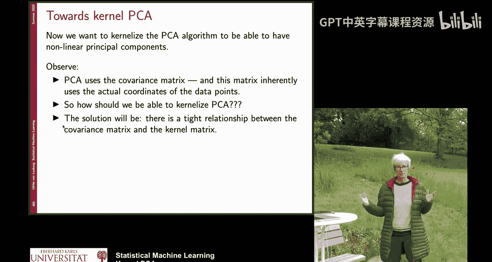
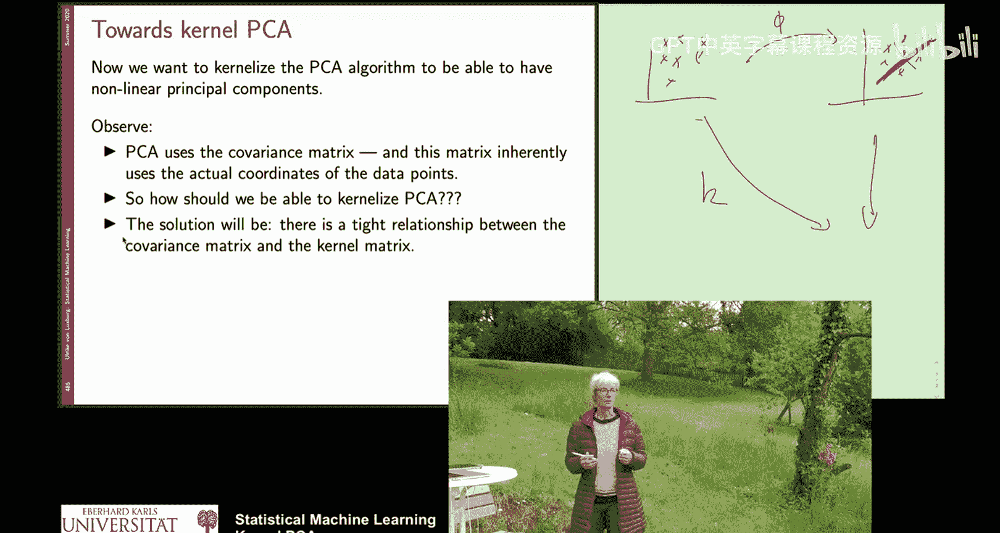
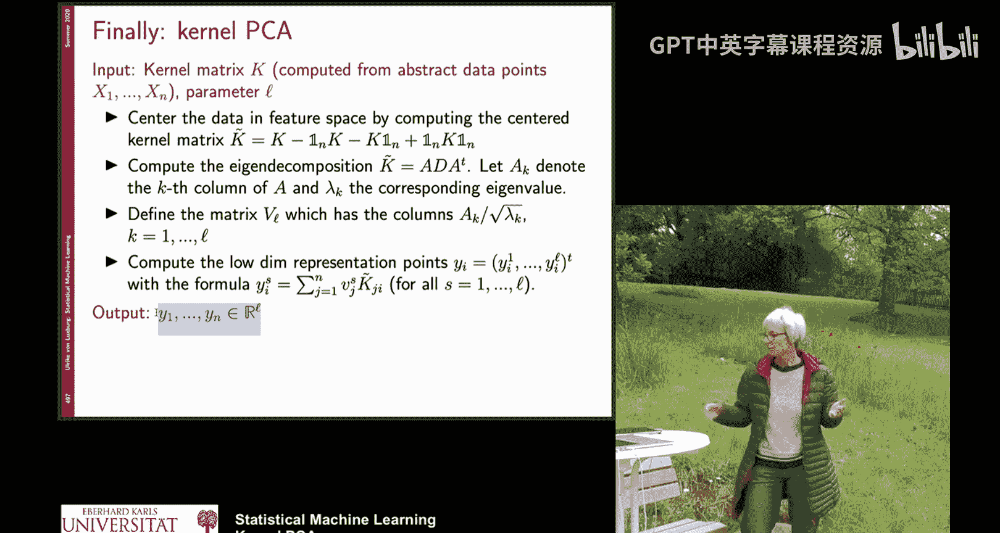
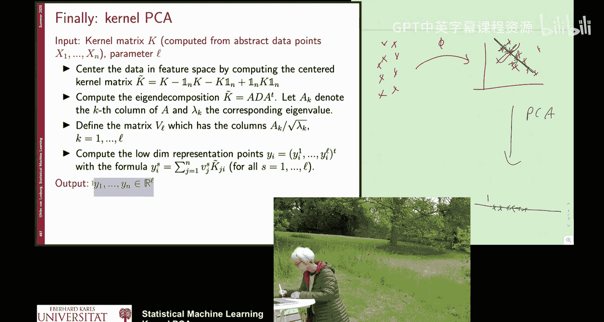
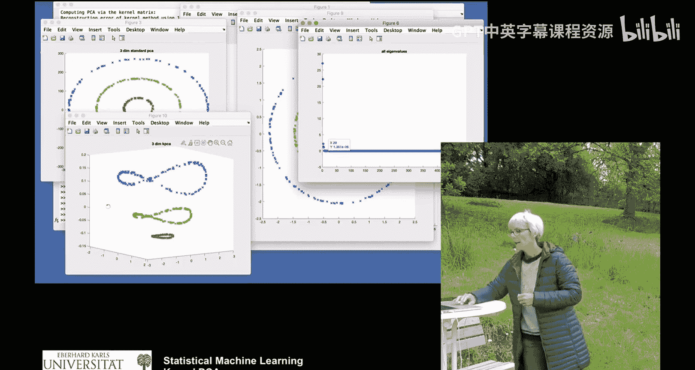
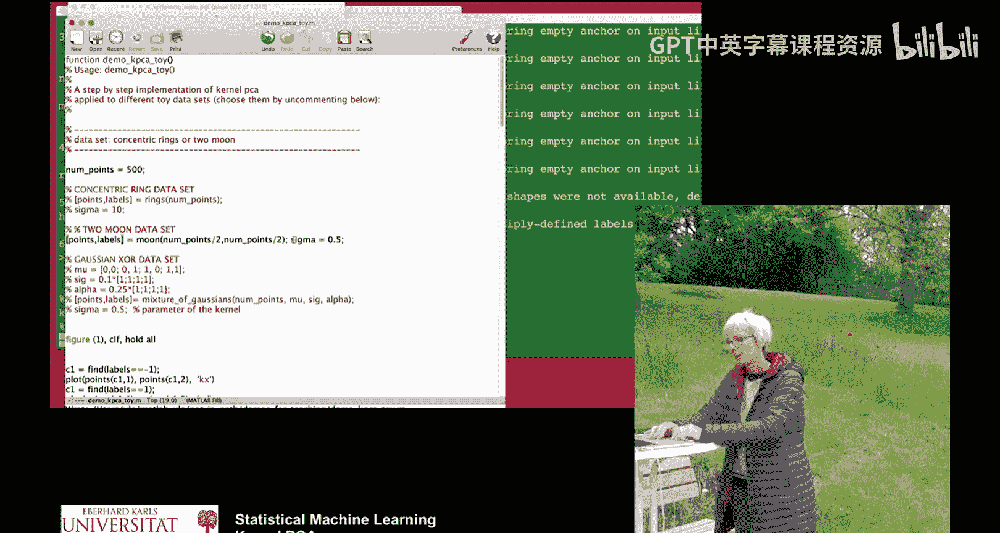
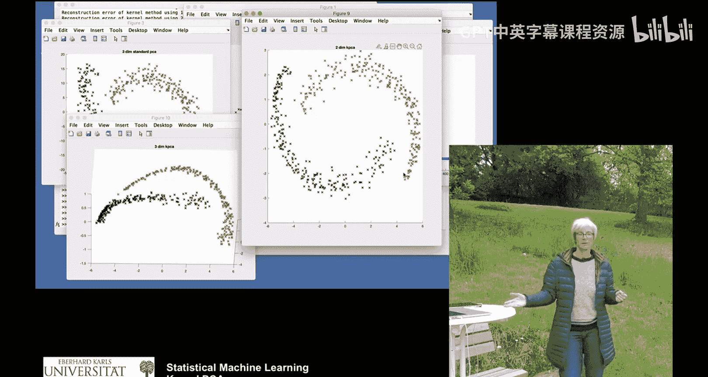
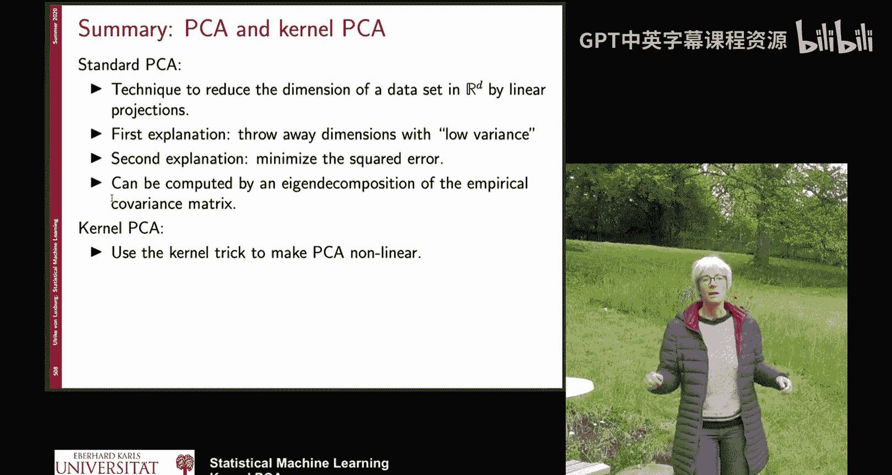

# 图宾根大学《概率和统计机器学习｜Tubingen Probabilistic and Statistical Machine Learning 2020》中英 p29 -29-Part 26 - Kernel PCA.zh_en -BV1gso5YGE4s_p29-

In the last lecture， we have seen the standard classic principle component analysis。

And now what we want to do is we want to kernelize this algorithm and derive what is called the kernel principle component analysis or kernel PCA。

Now， if you think about it， a concept like kernel PCA sounds sounds a bit strange because remember what the kernel approached us。

We are， and maybe I draw a figure once more。Just to recap。

 we have some data sets that live in some original space。 It might be a vector space。

 but maybe it's not。 it could also be some other space。

 but here I know plot it is as as a vector space。Then typically what we do is we have this feature mapping that is often given implicitly。

😊，That tries to map the data points to some feature space， Tp。

 they were producing kernelel Hilbert space。And then we have the data points mapped in this feature space。

 and then we want to apply a linear algorithm in this feature space。And in this case。

The linear algorithm would be a PCA。 So what we might want to do is we want to find the principal directions of the data and then project onto these principal directions。

And then we， we might want to apply some other learning algorithm and sort of do something in between or like to do this as a pre processingcess step and then follow up with a different algorithm。

And now the question is really， I mean， the whole trick is now that typically the kernel approach works like this。

 we now have some algorithm that does something on this linear space and the idea is that we want to have this shortcut involving the kernel such that we don't need to take this detour that takes us via this explicit future space。

😊，But now what we want to do is we say we want to do PCA and PCA is sort of the algorithm that most of all seems to need to have access to the coordinates of your data points because what do you need to do for like PCA here。

 you need to find what is sort of the direction of maximum variance。If you need to， first of all。

 find this direction， then you need to project。To get rid of the other directions。

For all of these things， you need to have coordinates。 and also， you need to look at it。

 like if you think about how the。PC A algorithm works。

 We look at the covariance matrix of our data and the covariance matrix is。

 is the matrix that contains information about your coordinates because it's a D times D matrix when D is here are the dimension of your space。

 And it sort of tells you what is the correlation between the different dimensions in your data。

 And somehow it seems very strange that you should be able to do something like that。😊。

Without explicitly having the， having the representation of your data。

And the really cool thing is that the yet is a way that works around that and that you can use do useful things with that and in this lecture we are going to see how that works。

😊。

To see where the trick is going to come from， we need to recap again。

 what does PCA do and also what is the covariance matrix and what is the kernel matrix。

And to make it explicit， I have a recap slide here so。

Assume we have data points x1xn and for simplicity， assume they live in RT。😊。

And also assume that they are centered， so we don't need to take care about centering the data points first。

And now as usual， we put the data points in in in a matrix called capital x and we put it as rows。

 This is how we always do it。 So our data matrix is called capital X。 The points are rows。

 So we have N rows， one for each point， and we have D columns。😊。

One for each of the deco coordinates of all points。Just to introduce a notation。

 we now denote the K column of this matrix by capital x and then in parent uses k。嗯。

And now I have already hinted it in the last lecture。

 but what I want to say now once more is that the covariance matrix of this data set。

Is given by x transpose x。Remember， the covariance matrix tells you what is the covariance between the coordinates of your data points。

 if you don't know what， if you haven't seen a covariance matrix yet。

 it's time to go to your recap slides and recap a multivariate statistics and look at what a covariance matrix is。

 This is really important to know。But I guess you know it。 So。

 and what I want to say now is in this case， the covariance matrix is given by x transpose x。

And I here try to make it very explicit why this is the case。

 because I think it's important that you really understand that point。

 So what is the entrance K L of this covariance matrix， So we enroll K column L， What is the entry。😊。

It is the one dimensional covariance， and I explicitly wrote this curve one dim because I wanted to make sure that this is really the one dimensional covariance。

Between。The K coordinates and the else coordinates。

 so you now have you restrict your data just to coordinate K。And you restricted to coordinate L。

 you now have n realizations of the random variable of the case component。

 and you have n realizations of the L' component， one for each data point。😊。

So you have and now you can compute what is the covariance between these two sets of variables in the standard one dimensional case。

 because each of these variables is just one number。And because we know the data has been centered。😊。

The covariance is just given as the sum of the products of the two entries。In this formula。

 you should know this is the one dimensional covariance of of centered data points。

And if you now transform it again to matrix notation。

 it is the same as computing x transpose x and then checking entry KL。

So this shows us why the covariance matrix is really given by this formula x transpose x。😊，嗯。Yeah。

 this is more or less the same thing once more。1， what you always might want to check is also that what you get is really a D times D matrix。

 This is because， as I said， X is a n times D matrix。 So X transpose is a D times n matrix。

 Then x transpose times x is a D times D matrix。 Just make sure that all these things sort of work out。

嗯嗯。Now， the other thing that you might want to look at is su matrix， and if you remember。

When we introduced kernels， I said the kernel matrix of the linear standard linear kernel is x x transpose。

 So it's the same kind of product just the other way around。

This is an n times n matrix because x is an n times t and x ispo d times n。

 so the product is n times n。And we have already seen that the common matrix of a linear kernel if the data is centered is given in this way。

And if you want， you can also again， I mean， here's the proof if you look at entry IH of this matrix。

😊，嗯。You can now， I mean， you do the math。 what is what is the definition of the matrix product。

 You just write it out。嗯。And then in the end， you end up with the fact that this is the linear scalar product between vector Xi and vector Xj because this is really sort of it it's the same notation。

 I mean， this is x transpose X transpose Xj transpose is the same as the scalar product and this is the formula if how you multiply two vectors with each other right so they have two dimensions you need to go over all coordinates and multiply the entry mice。

Okay， now what we have what we see on this slide are now two interesting things。

 the covariance matrix。😊，It S x transpose x。And the common matrix is xx transpo。

And this sort of star， we should start to get thinking。Now， what do we need for PCA。

 we need to know the eiging vectors and eigingvalue of the covariance matrix。Which is x transpo。

What we have in a kernel approach is the kernel matrix， and， of course。

 we can compute its eigenvalues and eigenvectors。 and that's the matrix X x transpose。

And now the big question is whether we can make a relation between the eigenects of this covariance matrix and this kernel matrix。

😊，They somehow just， it's the product taking the other way around。

 and it doesn't seem completely impossible， at least if you look at it from this place。

 that there might be a relationship between the eigingves of C and the eigenvectors of K and similarly for the eingvents。

😊，And this is sort of the main theme that we need to figure out when we want to derive kernel principle component analysis and that this is not what is going to happen on the next couple of slides。

And I have a couple of propositions that try to shed light on the different directions。

 So we have relations from key from the current matrix to the covariance matrix and the other way around。

😊，We start with this particular proposition， which in shorten just means eigenvalue of k or eigenvectors impliesly something about the eigenvalues and eigenvectors of C and I just appbbreviated by eig。

😊，So let's first try to read the proposition。 So again， were given end points that live in R D。

 This is our standard setup。嗯。And I think the points need to be centered。

 and I forgot to put it on the slide in the proposition here。

 my we we see it when we go through the proof， but I think I don't do N any centering in between。

 So my so I also assume that the points are centered。And now。

Assume we look at the current matrix first K。And assume that lambta and a are eigenvalues and eigenvectors of the current matrix So I mean we given the data。

 we can compute the current matrix and they now assume that a is an eigenve of the current matrix with eigenvalue Lata。

 This means it satisfies k times a is lambda a。😊，All this is given now we define a new vector V。

Which is just x transpose a。 X transpose is a transpose of all data matrix。

 A is this eigenvector of the current matrix。Okay， and here's just a formula how this looks like。😊。

Now we make two statements。The first one is if this vector v that we just find is not 0。

Then it turns out to be an eig vector of the covariance matrix with the same eigvalue as we had before。

Which means if you write it down explicitly that c times v is the same as lambta v。Okay， so。

Let us again start。 we start with the data， we compute the kernel matrix。

 we take one of its eig vectors。😊，Then we compute some new vector that depends on the sig vector A。

 and we call this new vector V。And this new vector is now an eigenvector of the covariance matrix。

And we also know something about the length of this vector， if a。

 the original eigenvector of k we started with， if this has known 1。

 then this new eigenvector in the way we define it above here。

 this V has known square root of lambda。Okay， for now let's simply， first of all。

 look at the proof and data digest and what this means。So。

 the proof is done with the first statement and in fact the proof is very simple。

 we know that k times a is lambta a because a is an eigenvector with evalue lambta now I simply replace the formula of k with these x's。

😊，And now I do a trick。😊，I multiply the equation that we have here。

From the left side with x transposed， so you can see that here。

 so x transpo X TA is what we had in the line before。And on front。

 we now have this extra transpose and similarly here。嗯。This is x trans post times this line。

 simply I put La out again because La is a scalar and you can move it somewhere wherever you want to have it。

Note that here we have now an employee。 so previously I mean here this was an equivalent relationship because this was simply the definition of the kernel matrix that we used here that goes in both directions。

😊，Here we now just have an imp error because if I start with an equation and I multiplied on both sides with something but the same thing。

 I know that the outcome is again the same thing。 so this is why we have this implication。

 but whether the other way works or not we never know because for example we could multiply with something that is0 or whatever I mean it's not always clear that the other direction works and we don't need it here So we just have one direction。

😊，And now this last thing is now again equivalent to saying that c times v is lambta v and y is this the case observed what is the vector v？

😊，V is x trans plus a， It is this vector here。And then this matrix here is the covariance matrix C。

And here on this side， we again have the vector。So this is what we wanted to prove for step one。

 and it was really simple。 We just， I mean， you just needed to multiply with x transpose from the left。

 and then everything sort of comes out naturally。For two。

 we need to look at the norm of this vector and this is also simple。😊。

We want to compute what is the norm of this vector V。

We put in the definition this vector v is defined as x trans plus a。

 and if you write it down in this way in this formula so this is inside the norm now simply plug the definition of V。

Now we spell out what is the norm， the norm is to taking the norm squared is the scalar product of the vectors itself。

We exploit the the scaleator for dys linear and take out the sum anti coefficients。

And now we observe that these guys here are the scalar products。

 which in the case of the linear kernel corresponds to the kernel here。

So what we have now is this quaratic form involving the kernel， it transpose K。

Now we know that k times a is the same as lambda times a because a is the eigenvector of k。

 this is where we exploit this property。And then we know that H a has norm 1。

 This is how we define the vector a in the part2 of the proposition so we can take the lambda to the front and we have a transpose a。

 which is norm1。Square number one doesn't matter。 and we are left with Lata。

So what we have proved is that V the norm of v squared is lambda and what we have in the proposition we just didn't put the square here。

 the proposition says the norm of v is squared of lambda。😊。

So this is a surprisingly simple proposition and what it says now on the high level。😊。

If we start with eigenves of the kernel matrix， we get eigenves of the covariance matrix by this mechanism。

Now observe if we want to apply current PCA， we also need the other direction because what we want to do is we are so the PCA algorithm says we take the covariance matrix and then we compute its eigen vectorctors。

😊，So what we now need to look at is the other direction， we take the covariance matrix。😊。

And if we have the eigenvectors， do they also correspond to eigenvectors of the column matrix。

Because later， this is what we want to do。 We want to replace the eigen vectors of the covariance matrix by those of the current matrix。

And this is now this other proposition that shows the other direction。It' is now Pro 16。

 and it says the eigingvalue of C implies something about the eigingvalue and eg vectors of k。😊。

Here I now explicitly say that the data points are supposed to be centered。😊。

And now assume that V and Laantta are eigenvalues of the covariance matrix。😊。

And now so we start with the other matrix。C times we Islam today。This is the a equation。

And now I again， define another vector， I define the vector A。And how do I define it。

 I simply say you compute x times v and you multiply by one over lambta。

Then you end up with a vector in Rn， and this might be something you might want to check that this vector really is a vector in Rn。

And the proposition process。This is now an eigen vector of K with eigvalue lambda。

So what we have is the eigenvalueular equation for K。Now let's look at the proof。The first。

 the proof proceeds in a couple of steps。 it's a bit more， it's not complicated。

 but its a bit more complicated than the previous proof。😊。

The first step says that the non zero eigenvalue on sorry eing vectors of the covariance matrix can be seen as linear combinations of the input points。

Let's see how this works。So by assumption， we know lambda v c times v because we assume that V is an eigenvector of the covariance matrix。

 so this is the equation that states that。😊，We know that the data is centered hence the covariance matrix is given by this formula that we have already seen before。

😊，So now let's start， we start with me。嗯。This is one over Lata C。

 This is essentially this equation here， which comes from this assumption。

 it's just bewritten and we divided this equation by one over Lata。So we have this equation here。

Now we plug in the definition of the covariance matrix。

 nothing really be changed so far we just plug in the definition。😊。

And now the trick is we need to go to this formula here。

 and the trick is here to see like if you have。Several multiplications of vectors or matrices you can sort of group them as you want and I now want to so it doesn't really matter in which like if I would consider putting parentes it doesn't really matter where I put them and I put the parentes here and Xj transpose V。

It's the same as xj。Scaar product V。This is what we have here。It's exactly the same thing。And now。

 we can check。This here now corresponds to if you check now， what is the definition of a？

A was the vector that we defined。Sorry， a is the vector that is defined here。

 so we define this vector A in this way。Such that this equation here holds。So this is， I mean。

 in the theorem， of course， it standard the other way around。

 we start defining a and then proof that this property holds。嗯。Excuse me。Got a bit cold today。But so。

 of course， how you derive this proof， you start with you start with this calculation and then you define a such that this equation is true。

 And it turns out that you need to define a in this way。

 And then you have the equation that were looking for。

 So we have now if you read if you read from left to right， we have now V。😊，Equals。Essentially。

 arons plus x。And here it's sort of this is the formula。Okay。

 so this was the first step that we wanted to， to look at。

And now the second step is we now want to express the eigen vectors of the covariance matrix with those of the current matrix。

😊，Let's see how this works。So again， we start with the eing value equation for the covariance matrix。

What we now do is we plug in all the definitions。 So here we plug in what is the definition of the covariance matrix。

 here is the definition of this vector V。😊，Here is， again， the definition of the vector V。

And now we do various transforms， so here we simply take out the sums and exploit linearity it。

Essentially， this is sort of easy。Here we didn't change it now comes again one step that only goes from the first statement to the second statement。

 but not back。Again， what we do is we multiply with something suitable and in this case we simply pick some core some data point s。

 it doesn't really matter at this point which one it is just any of them and we multiply with this vector xS transposed from the left side。

😊，So here we have no x trans post and the left side and here we have x transpo X s transposed and the right side。

 and again I already moved the x trans post here inside this expression here。And now again。

 you can start grouping vectors and we group it this way that we group X S and Xj here。😊。

And then we group X I and Xj here， so to do this we need to move this Xs inside and we can do that pi linearity。

And similarly here on the right hand side， we also replace this by the scalar product。😊。

And now we can replace the scar product by the corresponding entry of the kernel matrix because were in the linear case。

😊，And then if you look at the chart， you will see that this left hand side here is exactly the same as k squared A evaluated at S。

😊，And the right hand side is lambda times K A evaluated at S。So far so good。So what we have obtained。

So far。Here is sort of again recap， so we start with this vector。Be defined in this way。

This is an eg vector of C。Then for each S， this is the error that adjustment in one direction。

 What we get is that K square a index S is the same as lambda K A index S。And in matrix notation。

 now we have that for all S from one to n， so for all coordinatedinator we have the identity。

 so the identity also holds for the vectorus themselves。So。Observe caseker a is a vector。

Of n dimensions and the same holds here。 So we have that for now these kind of vectors are the same。

And now comes sort of one important step。嗯。We want to come to this statement here。

Which intuitively means we need to divide by k。What does it mean to divide by k？

We need to take the inverse matrix。And why can we do that。

 So we need to multiply with the inverse matrix and this inverse matrix exists because case a positive definite matrix。

 And this is also where we need a kernel。 if it wouldn't be a kernel。

 then at least we wouldnt know at this point that it's positive definite。And once we have this。

I mean， this is the eigenvalue equation that we wanted to show。

 we can see that a is an eigenvector of k with eigenvalue lambda。😊，Okay。

 so we have also approved the second proposition。So what we have now is we have these two propositions。

😊，The first proposition says， you know， start with an eigen vector of C to some manipulations。

 you end up with an eiging vector of k。😊，And the second proposition says， you know。

 start with an ag vectoror of K do some manipulations and you end up with an agnor of C。So。

 this looks really good。嗯。I wanted to convince myself that nothing goes wrong on the way。

Because I mean， there are all these massive things going on and it's so easy to make mistakes。

 so maybe you might want a sanity check here's one。😊。

Because you can apply these two propositions one after the other， you can say weserv C。😊。

The fast proposition tells me the corresponding angleigvalue of k。

And now the second proposition tells me how I can convert this again to an eing value of C and hopefully the two things coincide。

😊，And here is this sort of salanity check。So we want to apply both propositions one after the other。

So we start with an eigenvector of C。And we call this vector V and the avalue is lambta。

We define a as in the first proposition。And know that by the first proposition。

 then k times a is lambda a。😊，Now we do what is set in the second proposition。

 we now apply x trans plus a sorry I switch the numbers of the proposition here and now we apply the first proposition。

The first one tells us how to go from K to C。So we do what the first proposition tells us so we know that C times vtilde is the same as lambda times vtil liver vitilde is the vector defined in this way and now what we would like to have is that V and viilda are the same。

😊，Because sort of we did the circular argument。And now let's see whether this is true。

The definition of viilta is x transpose a。😊，Now I can plug in the definition of a。

 which is 1 over lambta x。Times V。Now I can pull the lambda in front。 So we have x times B here。

 A X x transpose x， sorry， which is the covariance matrix。 So we end up with this expression。

 And this is exactly V because V was an a vectorctor of the covariance matrix。

So we indeed find that we heard as we。😊，Which is reassuring thats a tiny little thing I mean at least you need to have make sure that this eigenvalue is not0 and this might be something you might want to think about and we are going to see why this might matter in a second。

😊，But third of this first tenity check is okay。Which is always good。 And it's。

 so it's always important if you also， if you derive theems like that。

 even if you just want to understand theems like that to do these kind of sanity checks to make sure。

 I mean， there could also be many typos on my slide to really make sure that it's true。

 I simply want to encourage you whenever you stumble across propositions also do a sanity check。

 whether these kind of propositions might make sense。

 And this is one of the sanity checks you might want to apply。

 If you look at these two propositions jointly。Let's maybe also try to fix to think about the dimensions because this is again something that can be really confusing。

 so the covariance matrix is a D times d matrix。😊，So by default， it has D eigingvalue。Now。

 K iss an n times n matrix。 And by default， it has n e values。 I mean。

 both these matrices are asymmetric。 Maybe that's the first thing。 So for both matrices， we can。

 in fact， compute decomposition in terms of  values。But now。

Somehow it doesn't seem to fit quite because we now say you know。

 start with an ag vector of C and then you end up with an a vector of k and also start with an ag vector of k and then you end up with an ag vector of C。

 But now the numbers of ag vectors doesn't match in one matrix we have T and in the other matrix we have n ag vectors。

 So how can this be。And this is really a question I am not going to answer in the video。😊。

I would like you to think about it and really figure out what the issue is here。

 We have seen a similar issue already before。 Please try to figure out what really the problem is why or or what is if there is a problem or if there is not a problem。

And this is important to understand the whole concept。And you probably can't do it within a minute。

 So you might want to either stop the video now and take an hour to figure it out。

 Maybe you also know it。 and it doesn't take so long or do it later at some point。Now。

 we want to come to the algorithms。So the first algorithm is we can now compute the aiging vectors of C。

😊，By looking at the a de compositionposition of k and this is sort of what we would know。

 what we would need to have if we want to use something like a common PC。

Lets see what the slide says， so again， we assume that we have data points that are centered in ourD。

😊，And what we now want to do is say we want to compute the earth eye vector of the covariance matrix。

Now what we do is。We compute the kernel matrix of the linear kernel and its L eig vector。

 we call it a。We make sure that this ag vector a is normalized to a equals  one。

 as it also is is stated in the proposition and in in most of the like a mat levelarrow。

 So typically when you do an a decomposition of a matrix， the result is big normalized。

 but maybe you might want to check that。And then we compute the vector V。Excuse me。

We compute the vector V。As defined in the proposition as one of us square root of lambda。

 this is the normalizing factor we need to get this  one，22 norm1 times sum of AI X。嗯。

So this is a first step。What this says is。If someone gets me the k matrix。😮。

And the data points because we still need the data points here。

Then I can compute the eig vectors of the covariance matrix without explicitly computing the covariance matrix itself。

And here I have this note that is really important。 So this algorithm here， as it's written。😊。

If you want to compute this vector， you still need to have the original， I mean。

 if you want to compute the vector V。Then we still need to have these coordinates of x。

 so if we wanted to perform this in the feature space。

Then we would need to have this coordinate of our data points x in the future space。But note that V。

 of course， is also a vector that lives in the feature space。

 So somehow if you want to express this vector itself。

 there's no way you could be you could do this without really looking at coordinates in the feature space。

The trick is going to be。That in practice， we never want to compute these aig vectorctors directly。

 we just want to use them to project。😊，And to project。

 we again need to multiply a matrix containing eiging vectors with data points。

 and this in the end is going to be a scanar product again。😊。

So this is maybe what we should look at the next slide。So assume。

 we want to project on an eigenvector of the covariance matrix。😊。

And we have already seen this kind of expression a couple of times on the slides。😊。

So now how does the projection look like the projection on the vector V？😊。

Off some other data point X。I mean it is defined as v transpose x and now we can plug in the definition and sorry v transpose x you can also write this as the scalar product of V with x andxi sorry。

😊，So here we have the scalar product and now we also replace the vector V by the definition here。

And this is now a sum involving coordinates of a or living to a。😊。

And which comes from the kernel matrix？And the scalealar product X X J， X I and the scalar product。

 again， we can sort of tool。 this is our current value。So if you。So this is the first segment。

And this is just for one vector， but if you want to project on an L dimension vector， of course。

 the same kind of principle applies so that the previous formula just shows it how to do it in a one dimensional subspace for an L dimension of one sort of you can more or less do the same。

 for example， do it like for dimension 1 dimension 2 in dimension 3 and so on so you can see that it essentially works。

So the big thing is， again， to compute these projections， we only need scalar products。😊。

And the protection is all were interested in， in the end。So we can do the kernel PCA。

 we can sort of do this as a kernel algorithm， and it's going to end up in kernel PCA。你听 that go。

So the input of the algorithm is only the chron matrix that has been computed from all data points。

And the parameter L。So what we do first is we center in the feature space because most of the computations we did were we're assuming that the data is center out so better we do that first。

So we send our and we have seen how that works， so we send it the feature space。

Then we do the I think the composition of this new centered kernel matrix。

And we let ak denote the case column and lambda k the case I vector in value。😊。

Then we refine this matrix VL。Which we need to compute the projection。

And this matrix is simply this original vectors a divided by square root of lambda K。

 which is which we needed to normalize them to norm 1。 We do that for all K between1 and L。😊。

And then we can compute the low dimensional representations of the points。And with this formula。

So here's for all。 So I， I really did it explicitly here for all S between1 and L。

 So S is now the coordinate。 the S coordinate in the in the low dimension space。

You can compute the formula in this with this way， just by using。The sum over， over。

 so this is sort of the standard formula that just spelled out for individual coordinates。

And then you can do that for all data points， of course。

 and then your output this in new points and they live in RL。

And this is something that's really cool。 and maybe I want to go back once to the iPad to say yet again。

 why this is really cool。

嗯。Sorry， so we start with this abstract data points here。

These can be points that already live in someucucan space。

 or it can again be something very abstract， like molecules。What we want to do is implicitly。

 we do this feature mapping that takes us to the Hilbert space or to the high dimensional space if you want。

诶。Have a representation here， sorry。So this is maybe how the points look like in this high dimension space。

Now we do a PCA in this high dimension space， so for example。Say we do a PCA on one dimension。

 we protect on this particular line， so all the points end up on this line。

And what we return is essentially the representation of the points on this one dimensional line。

So this is what we do so we do PCA。😊，In the original space and the projection and the output of the algorithm is going to be this projection。

So here these are the projected point。

Check that points。And they live in our L， where L is this parameter that we choose the dimension vector of the vector space。

And now the really cool thing is that again the kernell trick works here so you can do this all this implicitly by doing this computation on the kernel matrix directly and you end up with a low dimensional representation。

😊，Of your data points in R。And this， I find this very， very surprising。 I mean， of course， I know it。

 but it sort of if you you wouldn't think that something like this works because PCA is something that is so inherently tied to coordinate that it seems very surprising that it works。

😊，I want to make one more remark here。 And the remark is。

That now also something funny can happen regarding the dimensions。So， assume， for example。

 our original data。😊，Say it lives in R2。Two dimensional data set。Now we use a Gaussian currency。嗯。

I just， I don't write it here。 so we just consider we use a Gaussian kernel and do a feature mapping in the reproducing kernel Huber space。

For the calcium come。Typically， the if you be end data points， no matter from where they come from。

 after embedding them into the RHS， you have an n dimensional subspace。

 Each point spans its own direction。So now in the case of the Gal income。😊，This space is RN。

 so it's a reproducing kernel Hber space， but just n of the dimension。

 so it's an n dimensional subspace of a Hber space this is isomorphic to RN。😊。

And N is not the number of points。And here we started with R2 on the left hand side。

 we had just two dimensions。Now I'm in R N。 I can do PCA in R N。

 and I can decide maybe I want to embed on a 10 dimensional subspace。

So then here this R L in the bottom of the plot might， for example， be R 10 now。

 because I decide that L is 10。So what happens now is that if you go from the original data。😊。

And directly to this kernel PCA， you in fact， even increased the dimension because we started with two dimensional data。

😊，And the output is tenderal data。So。By doing this de of the kernel trick。

 we would reduce we would not reduce the dimension in this particular case。

 we can even blow up the dimension。 And of course， the question is whether something like that would make sense in practice and there can be cases because sort of the kernel。

 Now the kernel does this very complicated non nonlinear transformation between your original space and this hilt space。

😊，And maybe in the remote space， you have a good structure that now if you reduce it to。

 say a 10 dimension space still helps you in your data。😊。

So it can make sense and we are going to see an example in a minute in a demo where in fact。

 something like that can happen。Okay and now I want to show you this Mat lab demo for K PCA for a couple of toy data sets and we start。

😊，With a funny dataset， which is a two dimensional data set， just consisting of concentric rings。

And let me try， this is the original data set。😊，So it's a two dimensional data set。

 and I just color these rings in three colors to be able to see what happens to them。

 So this is simply a toy data set。And now we can apply different algorithms。

 different PCA algorithms to this。 So for example。Let me see。

We can do kernel PCA with now and we need to see which kernel did I choose here？

The kernel matrix is the calciumlo cone。As you can see here so I mean。

 it's always important which kind of kernel I use， I use the Gaian con and the kernel widths。

That I defined for this data set here， is sigma。Oh sorry。

 this is a huge sigma that doesn't make sense。So look at the data set。

 maybe let's go through more slowly。😊，So here the scale of these data sets is。Something。

 I don't know。 It goes from -5 to plus 5 or something like that。

So what would be a good con width the current width should be something like the intuition I always have is so if these maybe are 200 data points you should have the current width such that the sort of 10 closest neighbors are safely within sort of the spell curve that is useful for your that sort of is given by the Gaussian current so maybe you might want to have a con width here that goes from。

😊，This may be one or two。So maybe I choose kind with Sigma as one。Sorry。And then we apply the album。

I dont know， let's see。Okay。Now something funny that already happens。Again。

 so this is original data I now have come with sigma is1。

 which means that points are considered similar to everybody who has more or less distance one or two from each other and beyond that。

 it is sort of considered unsimilar。In particular， points on this blue circle are all more or less considered similar。

 maybe except here there might be a gap where in fact these two points are not really similar anymore。

😊，Points between blue and green line or green and red lines would not be considered similar because the Oco is so small that they wouldn't sort of touch it each other anymore。

Now what happens I can apply a two dimension current PC， and this is the outcome that we get。

And admittedly， this would be nothing that I could ever have predicted。My guess is what happens here。

 this blue line sort of is now an opened line， it's not a closed circle anymore and this is exactly my guess is that this is because we have this little gap here。

😊，That or maybe it's also the cap down here， it's a bit unclear。So if it would be。

 I'm going to repeat it in a minute with a slightly larger con， then maybe these gaps don't occur。

But you can also see the red circle is sort of still there in the green circle is somewhere there。

 And admittedly， I wouldn't be able to predict that at all that this kind of a happens。嗯。Observe。

 we go from a two dimension space again to a two dimensional space。 but because we have the kernel。

 this non nonlinear transform in the middle， something happens。

 So if you would do a classic PCA on your original data set and embed in the same dimension as your data。

 of course， nothing changes。But here in this current approach things can change。

 this is what we can see here。And now， I want to show you。Sorry， it just doesn't make sense。

 Where is the figure。3 dimensional PCA this is now。

The three dimensional embedding that you would get。So this is a bit funny。

 what we would see is now if for example， you would try to apply a linear classifier after this embedding。

The red circle， if you would look in this direction。

 you could easily fit a hyperplane between the red and the green part。

 the green and the blue one would be hard to separate。

My guess is now and we are going to try it I haven't tried it before。

 but I hope it works if we now choose the kernel width a bit larger maybe three let's see。😊。

So what would happen then if you would choose the current width equal to 3？No。

 I'm not sure because then here probably these two different different drinks would also be already be considered as similar。

 but we are going to see。😊，So here is the one I'm interested in。 so what you see now is。

And this is something really cool and surprising and somehow also something that I would never ever be able to predict that you now do an embedding in a three dimensional space and all of a sudden this set of concentric rings。

😊，Get separated so essentially what you do is you go to this high dimension nonlinear space you go back to three dimensions but it looks like now you have added one dimension to your data set and this dimension seems to split these different concentric links。

😊，嗯。We can also try。Play a bit with sigma， so if you now increase sigma to 10 or even 100 as we had it before。

 this is of course a value that is ridiculously large。😊，And then the question is really what happens。

 I mean it seems that it still bars。😊，And probably this is true because even the small variations that you get in these different kernelal values are enough to sort of separate these structures。

But as I said again， this is nothing that I would ever be able to predict。

 it could also have happened that in this data said nothing interesting happens。

So I find it just curious that this happens， but I don't really understand why I didn't try to understand the geometry behind these things。

Maybe one more thing if you plot the eigen values of the kernel matrix。

Here we see that it's two or three。Little points which indicate angle is at a large than zero and the rest is more than zero。

😊，Maybe you can also think about why this is the case。

 This is related to the question we had previously。

 how it can be that the different numbers of eigenvalue and eig vectors of the covariance matrices and current matrices still match。

😊，嗯。So here we have two or three eigenvalues that are non0 and the rest is0。

 This is the point I wanted to make。I want to show you maybe the demo。

 I also have a couple of other data sets here。😊。

Just for。Curiosity。And my Em currently doesn't do what I want this is why I need to do it in an inconvenient way。

看来成真。😔，So here I now have the Kaing data set that we have seen before。😊，嗯。Let me just show it。

 whoops。So this is now the Gaussian Xor data set， the two dimensional data set。😊。

The original data set is this one， it's two dimensional data。

You see essentially a mixture of four Gaussians arranged like on a checkerboard。

And now you can apply， for example， three dimension a PCA and it gets projected in or projected as maybe a funny word in this case it ends up in a high dimensional space and it has this funny kind of saddle shape。

But what is really cool is also if you now imagine you would like to do a classification algorithm and maybe separate the blue points from all the rest。

 you could do that so there would be by a linear algorithm so if if you now would apply a linear algorithm you sort of can now find a hyperplan that cuts more on this here and it would separate a blue and the rest of the class。

😊，You can also， I mean， this would be something that you might even be doing when youre able to do in your original data as well。

 because you could say you would sort of try to cut off this one particular corner here。😊。

But now for example， if you say the green and the blue points should be in one class and the pink and the red points should be in another class。

 this would also work because here you have now this funny saddle shape so if you put it like this you could now sort of to a horizontal line and separate the green in the blue point。

😊，After。From the the pink and the blue and the red points。

And sort of it shows you that after applying this kernel。

 so it's again a calcium kernel I imagine with let me check the kernel width。😊。

So the signal of the current width is chosen as 0。5。It sort of makes sense。

 it's sort of this kind of distance here。And it means that if you go to the kernel space。

 then you can solve thisor classification problem， which otherwise you wouldn't be able to solve with a linear algorithm and this is sort of shows it gives you an indication why this is true because if you look at the first coordinates or the first principal components it already gives you all the information that you would need。

Let's see， I think I have one more data set here。😊，嗯。This one。It's a to data set。

 we are going to see it in a minute and just already note that sigma is 0。5。😊。

あ know。So the original data set is this one this is a standard toy data that' is used all over the place just a two dimensionsal toy data which has a non nonlinearmar structure and you want to see whether I don't know clustering algorithm or classification algorithms are able to do that so this is this one moon is supposed to be one class the red guy is supposed to be another the other moon is the other class。

😊，Now， let's see how this three dimensional。PCA looks like it also does something funny。

You can see it if I rotate it and again， you could now apply a linear algorithm and sort of cut here。

😊，And you would be able to separate these black and the red guys。

Again consider the current width a sort of 0。5 this is something that makes sense 0。

5 might be even considered a bit large because here you would get connections like points these red points might be still be considered slightly similar to those red points but I think it still works because the similarity is not close to one its maybe1 half or so so it is still going to work we can maybe see what happens if we change sigma。

Maybe let's put Sigma to。int1 here。And。Now something completely different happened， so Sigma is no。

Again， look at its 01 So  point。1 is really small。 This means everybody is maybe similar to its nearest neighbor。

 but not more similar to anybody else。 This often means that you start to to lose all of the global geometry of your data because you often you。

 for example， I mean， this point here isn't going to be similar to anything else。What happens now。

And again， I want to say that I would not be able to predict this。

 but this is sort of the outcome you would have the red moon is going to project it on this guy here and the black moon is going to project it on this guy here。

For whatever reason， this is the secret of current PCA and the current geometry， I can't predict it。

 but this is simply what happens。You can also check the other way around if you do sigma。

 maybe two that's really large for this data set， let's see what happens。In this case。

 sort of we get this kind of structure， which now means that if you wouldn't want to apply a linear algorithm。

 it's not so easy anymore sort of this structure doesn't seem。

At least this the fact that we have now three dimensions doesn't bring out anything new in the data set it more or less leaves the data set a bit like it is it just curves it a bit。

😊，And again so the sigma was2 if we go now to this plot sigma is 2 this means that everything between0 and 2 is really considered similar and even between0 and 3 or4 is considered similar so it means also that these bridges are not going to be separated anymore and so you would have sort of bridges between the black and the red set。

😊，And this is maybe why at least it's not considered so dissimilar anymore and in KPC maybe it ends up in this way。

 but again I want to stress this is nothing I would be able to predict that if you choose sigma in a useful range that then something interesting happens to this data this is just something that you can try in practice and sometimes it works and sometimes it doesn't。

So let me summarize。We have looked at the K PCA algorithm。

 which tries to bring the standard principle component analysis into the kernel space。

The mathematically mechanism that we needed to invoke is that the eiging vectors and eigenvalue of the covariance matrix are sort of can be expressed in terms of the eiging vectors and eigenvalue of the common matrix。

And this is done sort of their simply math equivalentvalence is why this works。😊。

What happens geometrically is you take your original data。

 put it in this very high dimension space with the kernel approach。😊。

At least if you use something like a Gaussian kernel so you end up in this high dimension space and then in this high dimensional space you apply a projection that then brings you to some low dimensional space Rl。

😊，And by the corner approach， you can do this direct link without going this detour over the corner space。

 you can do the direct algorithm。Which means that you start with any arbitrary data set。

 it could have a e instructor but it doesn't have to。

 so a set of molecules and you end up with a representation in RL that hopefully describes your data in a nice way。

😊，And sometimes in practice it is going to help you and sometimes it is not going to help you and there are no in many cases you can't really predict it but you can always play with it and try it and if it does help then simply add it to your preprocessing chain。

😊，Maybe to look a bit at the history of PCA and kernel PCA。

So the classical PCA was invented by Pearce and we have seen this person before he is one of the fathers of statistics in 1900 something he worked and there are a couple of papers around this area。

 so this is the original paper， 1901 that's 120 years old， that's really cool。😊，And as I said。

 it's one of the most popular classical mechanisms for data analysis everybody who works with data in biology。

 psychology， physics， everybody who works with data knows PCA。😊。

Sometimes they know it under different names， there might also be slight variations。😊，嗯。

But the principle is always the same。And now the kernel PCA was invented more as exactly 100 years later and maybe 1999。

😊，But Vanha Chov and Alex Muer and Klaus Gobert Mu。

 that was in the rise of the kind of algorithms we have seen the support actor machine it was invented a couple of years earlier at the kernel version。

 I think 1996 and that was when everything started and then this is again yet another breakthrough in。

😊，Field of co algorithms， because this is sort of something that is really surprising and also cool that you can do that。

 So it was it was published 1999。 And I guess many of you know Bha Chov is inter in as well。😊，Yeah。

 I think that's here's my summary， but I already did a summary earlier。

So I don't need to repeat the summary。 maybe just to say that current PC is really an important algorithm。

 both conceptually， but also to understand how kernelizing works and maybe also to show that it's not always so straightforward to kernelizing an algorithm as for the SVM where。

 which I see there is cater for like we replace them。 Sometimes you really need to invest quite some。

