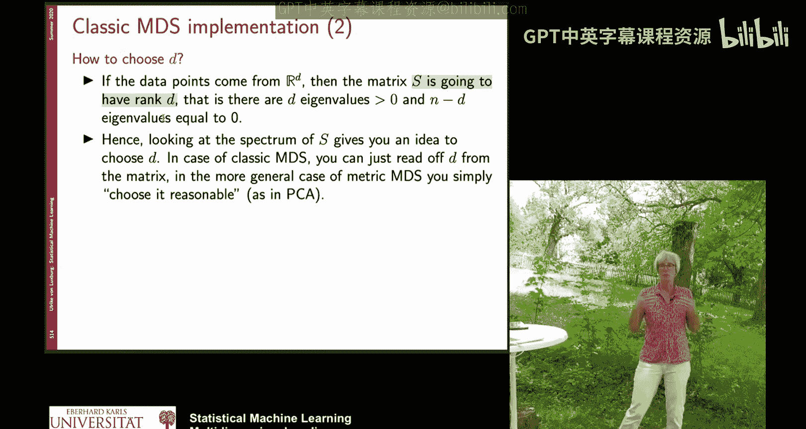
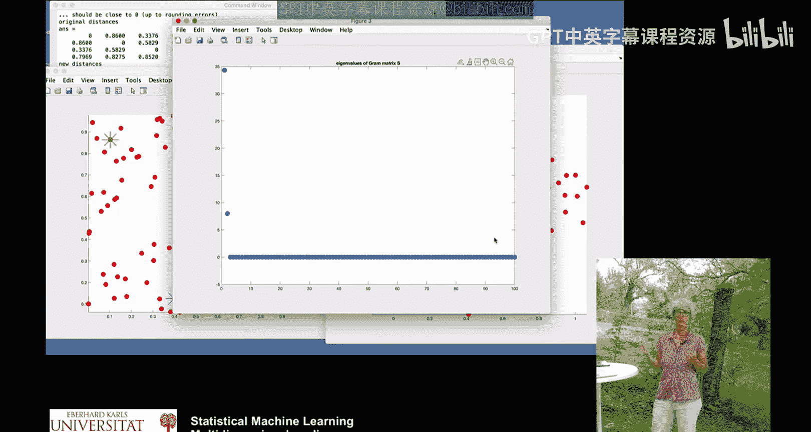
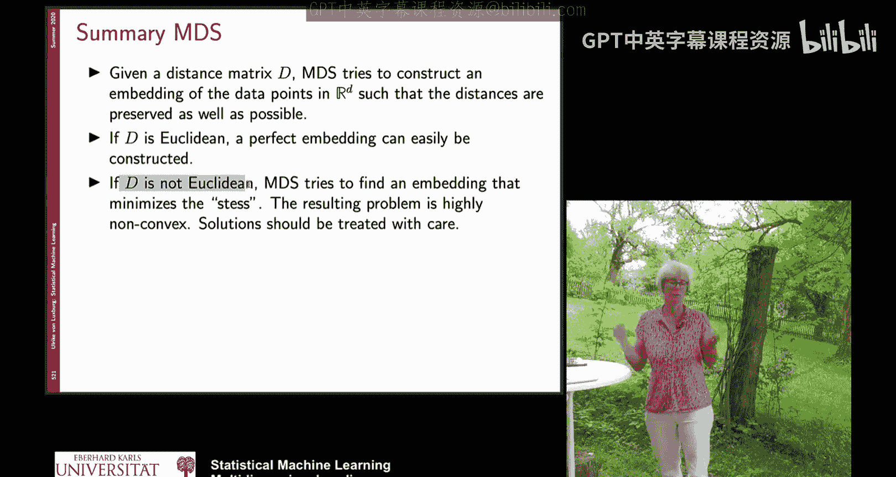

# 图宾根大学《概率和统计机器学习｜Tubingen Probabilistic and Statistical Machine Learning 2020》中英 p30 -30-Part 27 - Multidimensional scaling.zh_en -BV1gso5YGE4s_p30-

Today， we want to discuss embedding problems， and we are going to start with a classic algorithm that is called multidisional scaling。

Let us maybe first introduce what is an embedding problem。

Consider the following scenario you are given abstract objects。

 say molecules or texts or whatever kind of objects you have。

And you have a way to measure the distance between objects so you can take。

 say two molecules and assign a certain distance value to these molecules。

 and you can say these two molecules are rather close。 Their distance is 0。3。

 and these two molecules are rather far from each other。

 Their distance is maybe 5 or something like that。Now， assume you're given in such objects。😊。

And we have all pairwise distances。If you want， you could stack all these pairwise distances into a matrix that is called a distance matrix on your data。

 This is an n times n matrix realizing all the distance distances between pairs of data points。

The question is now， if someone gets this distance matrix to you。

Can you find points in a Euclidean space in R D。Such that these points that you have been selected have been selecting。

Realize the distances that you are given about your abstract objects。So formally。

 it's written on this slide。So we are given these abstract objects， X1 to X N。

 They live in some abstract space。 It doesn't need to be a e space。 It can be anything。

And we have distances， this is maybe written up here。So if our objects come from the Euclidean space。

 these distances would be the norm between the two data point between the different distance of the data points。

 but in general， it can be any distance function。And the question is no。

Can you find an embedding that is a mapping that takes the original space into RD。

For some value of T that you might want to know in in advance。

Such that if you compute the distances between the embedded points in the Euclidean space。

These distances exactly coincide with the distance values that you have been given in advance。

And such a problem is called a metric embedding problem。

An embedding problem always means we are given certain objects of our data and want to embed them into a space。

 ideally by keeping certain properties fixed， and in this particular case we want to solve this embedding problem of fixing the distances。

Now， here's a question for you。Do you think that this problem always has a solution？If yes。

 does it have a unique solution， If no。Why not。And I would like to ask you maybe to switch off the video for a moment and consider that do you think that this problem always has a solution。

 yes or no？😊，Okay， maybe you have made some ideas about whether you think the problem can be solved or not。

 Here are two particular answers that I want to give you right now。😊，The first one is。

If we want to find an embedding such that the distances of the embedded point exactly coincide with the distances that we are given。

This is only going to work if the data points that we start with come from a Euclidean space。

Typically， a Euclidean distance function has some very strong properties。 Now。

 if we start with any arbitrary distance function between molecules。

 it would typically not have all these properties。 So if you try to realize them by a Euclidean distance function。

 it somehow cannot work。😊，What might be possible is that we can approximate these distance functions by points in a Euclidean space。

 but we cannot recover them exactly。So there are now two variants of the problem。

The first one is here。This is the first point， sorry。I can't market。Anyway。

 the first point is if these data points come from a Euclidean space， yes。

 there exists a perfect embedding， of course， for example， the given point configuration。😊。

The second point is if the distance matrices are general distance matrices。

 typically we cannot find a perfect solution for this problem。

 we might be able to approximate the solution。In any case， there is also the issue of uniqueness。

 and maybe you have thought about it a bit。The problem cannot have a a unique solution。

 because if I have an embedding of my data points and I shift all data points per shot。

 but the same vector。Then the distances between these points don't change。

 so whether I take this embedding or this embedding， both of them might be perfect embeddings。

 and I cannot decide which one is better。Similarly， if I rotate the data points， so the embedding。

Can be realized in many different ways， and all these ways are related to each other by isometric transforms。

But maybe this is not so much of the issue right now。 for now， we are trying to find， first of all。

 one particular embedding that is going to solve our problem。Before we look at solving this problem。

 the question is， maybe why is it useful in the first place， I mean， everybody can pose a problem。

 but the question is always， does it have some meaning for real world data analysis。So again。

 I would like you to switch the video off for a couple of seconds minutes and think about what might be applications where you could make use of such an embedding。

The next slide provides a couple of answers。 This is definitely not a unique list。

 there might be many more reasons， but here are some I came up with。The first one is visualization。

 and to my。In many applications， this is sort of the prime reason to use a metric embedding。

consider you have your set of molecules and you somehow want to understand border test structure do these molecules maybe have certain certain classster structures。

 which molecule is sort of similar to another molecule so we can sort of group them together in certain neighborhoods。

And this is what， in fact， happens really often that experts of a certain area。

 say molecules want to have such a map that they can look at in 2D or 3D。😊。

And sort of look at the map and try to find relations about their data。

 maybe also to come up with hypo about that they haven't seen before， for example。

 there's a certain group of molecules consisting of 10 molecules and you already know nine of these molecules。

 but you never really thought about this tense molecule， but it seems very close to these other guys。

 so maybe you might want to invest whether this tense molecule that you were not aware of in the first place has similar properties for your particular application。

😊，So， in this sense。One of the goals of metric embedding might be visualization。

 and in typically in such cases， we always embed in two or at most three dimensions because otherwise we can't really visualize it。

The second reason might be maybe you have a data analysis algorithm。

 but it only works for Euclidean data， say you want to do principal component analysis and for some reason you don't want to consider kernel PCA but you want to do a standard principal component analysis。

 then you need to have a Euclidean representation of your data otherwise you can't do that。

So if you now start with a set of molecules and you say， I want to do a PCA on the set of molecules。

 you need to find that you're clicking representation of your data。

And then maybe embedding might be one way to achieve such a representation。

 there might be other ways， and sometimes you don't need it explicitly because， for example。

 you use a kernel mechanism， but maybe in other circumstances。

 you really need this Euclidean representation。The third interesting application is that sometimes your data really lives in a high dimensional space。

😊，But implicitly， the dimension that you need to describe your data is much lower。

And this is called like a dimension reduction technique。

 And we' are going to see a particular algorithm in the next lecture when we talk about isom。

 where this is going to be made much more explicit。So these are all valid and interesting goals。

 The other thing that you always need to ask yourself when you start to introduce a new algorithm or a new methodist。

 can it hurt。😊，And in this case， the clear answer is， of course， it Kin hurt。

 if you start with a data set that has a metric structure that is not Euclidean。

You will not be able to find a perfect embedding， you will introduce some distortion to your data。

Now there are millions of theoretical results about how much different versions of distortions are for particular embeddings。

😊，But these are typically theoretical results and in practice you really don't know you have geometric you can embed and you can now see I mean you can of course measure like the distance before the embedding and after the embedding but definitely you are going to introduce some distortion and it' is always a bit unclear whether this distortion that you introduce to your data。

😊，Really would hurt the next data analysis steps or maybe it doesn't hurt and then it also it's not so important。

 but this is something you need to consider。😊，So as all data analysis techniques。

They can be really helpful sometimes and they can hurt in other cases and you need to find out which is the case that you're currently looking at。

Now， they exist many， many different embedding algorithms。 and currently in this lecture。

 we are only going to look at what is called multidimensional scaling。

 which is a particular family of algorithms。And we are going to focus on one algorithm。

 which is the classic multidimensional scaling。Where we start with the situation that the distance matrix is really a Euclidean matrix。

 for some reason we know that， and we just want to recover the point configuration。😊。

The other situation is metric MBS， where we start with more abstract objects like molecules。

 we have some distance function which might not be a completely distance function yet we want to find an embedding that as good as possible tries to preserve the metric structure that we have in our data。

😊，We use often different types of algorithms for this kind of scenario， and this is called metric MS。

The third point that we are only briefly going to touch in this lecture is non metric multidimensional scaling。

 this is if the information that you have about your distances doesn't even consist of distances themselves。

😊，But only about comparisons between distances。 So you don't really know that the distance between these two objects is 0。

5。But you only know that these two objects are closer to each other than those two objects。And again。

 you might want to try to recover。An embedding that realizes these kind of inequalities that you know between the distances。

 and this is called non metric multidimensional scaling。We start with a classic algorithm， which is。

 in fact， surprisingly simple。And now let simply go through the math。

So we assume that we are given a Euclidean distance matrix D by a Euclidean distance matrix。

 I mean there is some space in the background that maybe we haven't seen so far。

 but the points come from the space， we have measured the distances between points by the Euclidean distance and someone gives us this distance matrix。

😊，And now the whole trick is going to be to revrite this distance matrix in a slightly different form。

And maybe let's go through the derivation first， and then we see why it makes sense。

So the first thing， so what we what we want to achieve is we want to express the entries of the ground matrix。

 the scalar product matrix， the kernel matrix if you want for the natural linear kernel on the space。

In terms of distances， and we see later then that once we have the ground matrix。

 we can sort of decompose it and find the point configurations。

So what we now want to do is we want to in a eian space。Compute。

 what is the scalar product between two points， And we want to compute this just in terms of distances between points。

And it is really simple once you have seen it and it works as follows。 So by definition。

 we know that the square distance in a Euclidean space is given by the squared norm。

 That's the definition。 The squared norm is given by the scalar product of the distance between these data points。

 X I minus xj with itself。😊，And now because all of this is linear。

 we can decompose it into this form， that's clear。😊。

Now we can rearrange the whole equation and essentially we are going to solve for this sorry。😊。

For this expression here， which is the mixed term the scalar product between X I and xj。

 because this is what were interested in。 So if we sort of rearrange the equation。

 what we get is the scalar product between X and Xj can be expressed as one half times。😊。

The expression in the parent thesesis， which is the scalar product of Xi with itself and the scalar product of Xj with itself minus the distance squared。

So now we have this rearranged equation。What we see here is this is I mean here we have a sorry here in the back part we have a distance squared this is fine once were given the distance matrix this term became compute here we still so far have terms which involve the scalar product。

😊，But now observe that this is the scalar product between XI and XI， so this is the norm of XI。😊。

Which is， if you would express it in terms of distances。

 the distance of the origin to the data point X squared。Right。

And here we have the distance between the data point xj and the origin squared。Now。

 in our distance matrix so far， we do not have any information about the distance of particular points to the origin。

But now we need to remember that， in fact， the origin is not something that is really fixed。

 we can find embeddings and move them around in our space and still realize all the all the metric inequ or the metricequalities。

😊，And for this reason， we can choose what the origin is supposed to be。

So here this is what it said here on this slide。 we are free to choose the origin as we want。

 and now we simply do something very simply。 we simply say the first data point x1 should be the origin of our coordinate system。

 It could be any other data point， but let's for simplicity， simply choose the first one。😊。

And then these terms that we had on the previous slide。

 the distance of the origin to the data point I now become the distance of the first data point。

 which is the origin to data point I。Similarly here， this instead of the origin， we now have theta。

12。 xj。And this term is unchanged。So what we see from this whole equation is that we can now express the entry in the ground matrix。

😊，The scalar product between Xi and Xj purely in terms of distance values that we are given in our distance matrix。

So this is already nice， so we can now for all pairs of data points。

 we can compute the scalar product。😊，Under the assumption that we used the first data point is our origin of the coordinate system。

And now comes the trick。 We know the scalear product matrix is a particular matrix。 It is a positive。

 definite matrix。😊，And so we can decompose this matrix into this form。

It's hard to mark here so we we can write the matrix S in terms of two matrices times x transposed。😊。

Where x is a matrix that has the dimensions n times key。 So n is again， the number of rows is。

Is the number of data points。 And D are the columns。

 these are the coordinates that we are going to look for。

 So we want to embed into a D dimensional space。Now。

 I simply said you can make this decomposition if you don't see why you might want to think about it for a moment。

Maybe stop the video now and try to think about it。 if you don't find the solution。

 I'm not going to reveal it here。At least not on this slide。

 but I guess it is going to come on the next slide。

But please take some time to figure out why this is really possible to make this decomposition。

 And if you really can't find it。Please ask in the inverted lecture or maybe you can discuss it in your tutorials。

So this is really important to me that you sort of get used to all these matrix manipulations otherwise。

 I mean， this is going to happen all over the place and I simply want you to learn this。

 this is why I do that。😊，So the first exercise is how exactly can you achieve this decomposition so what would be like if you want to program it in Pyon。

 what is the command that you would type into Pyon if you have the matrix S？😊，And then maybe also。

 what is this dimension going to be， There are some issues that you might want to think about regarding the dimension。

Now， assume we have this decomposition。Then essentially we have found what we are looking for because we can now take the rows of this matrix S x。

😊，S decos of our data points。 So we consider the the matrix has n rows。

 So each row consists of one point and each row has d column， so each point has decos。

And this is what we are going to use as the representations of our data points。

And now maybe let's try to see why this is really what we sorry， I don't have a slide here。

 So maybe then you also might want to take it as an exercise。 So why can we now really。

Take the rows of x。And have now found what we wanted to find。

So why is the representation that we find？And through taking the rows of this matrix x。

 why is this really going to， to follow the representation， the distances between these data points。

Again， maybe take it as an exercise and if you don't find it let' us discuss it in the inverted lecture or in the tutorials。

😊，So here on the next slide is now the summary of how this algorithm works。 it's really。

 really simple。😊，So we are given this distance matrix D。

What we now do as the first step is we are going to compute this scalar product matrix this gra matrix S。

And the formula is simply as we had it on the previous slide， this one here。😊。

We compute all the entries of S and have the matrix。

Now what we do is we compute the eigenvalue decomposition now we need to find this product x times x transpose。

 How do we do that？This was the exercise I've been asking before。

 We now need to solve the eigenvalue problem。 So what we do is we take the eigenvalue D we compute the eigenvalue decomposition of the matrix S。

And again， whenever I write， you take the evalue decomposition。

 you need to ask yourself does it exists。😊，And of course， the answer is yes， otherwise。

 I wouldn't suggest it here。 but you might want to think about why can I do that。

 Why do I really have a decomposition in terms of eigenvalue in this way where I mean that we have N real valued eigenvalue。

😊，And we have this matrix view containing the ag mattress。Okay。

 but in this case we can always do this it is going to work。

 And now what we are going to do is we define this matrix x。😊。

Ss v times square root of lambda and now this is a bit of an at notation。

 so consider here in this eingvalue decomposition so V is the matrix consisting of the eing vectors。

😊，And lambda is the diagonal matrix that contains the eigenvalues。

 so its zero outside of the diagonal it just has the eigenvalues on the diagonal。

Also and now what we are going to do is we are going to take the square root of all these entries and this is what we then call the matrix square root of Lata。

 so it is simply the matrix that has all the square root of the little e values as entries。😊，Again。

 at this point， you might want to ask yourself， could it be that I have a negative eigenvalue on my diagonal because if it would happen。

 then this definition somehow didn't work out So the question is again。

 why can I make this definition take this square root of Lata and why does it still reside in the correct Why is this a matter like。

Why is this an allowed mathematical operation in this particular context？

So what we are going to achieve if we do this kind of expression。

 we are going to find a representation。😊，Of data our data points consisting of n coordinates。

 because consider this matrix x for now it is an n times n matrix。B is an n times n matrix。

 and lambda is an n times n matrix， so this whole thing is an n times n matrix。

But now we wanted to embed into D dimensions and not necessarily into n dimensions。

So what we' are now going to do is and we need to find out how we can sort of reduce this representation to T dimensions and this works as follows。

😊，So we fix that dimension deep。Smaller or equal to n up obviously and then we define this matrix VD。

😊，Which just consists of the first D columns of me。So it's an n times n matrix。

 but sort of we get rid of the last couple of columns and just keep the first D columns。嗯。

And then the matrix so this is what we call the matrix VD， so we simply shrink it from its end。

And then this matrix lamb that D， we just take the first D eigenvalue instead of the diagonal matrix that has like is n times。

 and we now take the one the block that is smaller D times D with the first D。😊，Ayingvalue。

And then we can define this matrix x， which is now the product of Vd times square root of lambda d。

Now this， if you do the math and you might want to convince yourself that it' is really true。

 if you do the math， this is going to be a matrix that has n rows and D columns。😊。

So this is exactly what we've been looking for。And now each row of this matrix x is going to give you the coordinates of the point that we have been searching。

And this is the classic MS algorithm。 It's really a very simple algorithm。

Essential you just to an a composition of your， of your scalealar product matrix。 And then that's it。

 It's as simple as a PCH just that it achieves a different goal。😊，Of course， in practice。

 the question is， as it would be in PCA as well， what is the dimension that you might want to pick this parameter D？

😊，So if you know that your original data points comes from the space RD for some given D。

And you choose the same D。In your algorithm。Then you' are going to recover the perfect representation of your points。

If you would choose the large act， you would also still recover a perfect representation of your points。

 if you choose the smaller than that， the representation might not be perfect because then your dimension is too low to sort of be able to realize all the complicated structure between your data points so then you might get some distortion to your data。

So what we formally can say is if the data points come from RD。

Then this matrix S is going to have rank D， so you can in fact see from looking at at your matrix S。

 what is the original dimension of your data space。嗯。So。Yeah， and and then of course you。

 you would see that like you only have D like in practice。

 you would see that you only have D eigingvalue that are larger than0 everybody else is0 than you can sort of do the shrinking procedure that we described on the previous slide and you have a D dimensional representation。

😊，Now， in practice， of course， typically you don't know the。

Your data might not come from an exactlyuc space。But now S in PCA you might want to check what is sort of a suitable dimension which we bat and now you have a similar heuristic as for PCA。

 you now look at all the eigenvalue。You plot them in increasing size and you would say， well。

 maybe there are 10 eigingvalue that are really much larger than0。

 so I would maybe embed in 10 dimensions and then the remaining eigingvalue are all pretty close to  zero so I can get rid of them。

😊，This would be if you do an embedding to which sort of tries to introduce as little distortion to your data。

 yet has a reasonably small dimension。If you go for visualization。

 you simply choose D equals 2 or D equals 3 because everything else you would not able be able to visualize。

I would now like to show you a very simple MAL demo that simply illustrates multidimensional scaling。

Demo MDS what you can see here is I simply chose an original data set of points that live in our two in this particular case。

 you can see this is sort of I simply draw random points and I marked a couple of points with sort of these stars so you can later recognize them in a new embedding。

 so this is the original data。😊，This goes into our so what what happens in the background is we now compute the distances between these points and gives them to the classic MBS algorithm。

And then the algorithm is going to produce an output。 and in this case， the output looks like this。

And when you look at these two outputs， essentially， the point configuration is the same。 it is just。

 it might be on a different scale。 I'm not really sure。 So this。It seems， seems to be a bit extended。

 and it's also rotated。 So， and this is why I have these。 So here's， for example。

 the pink point here and the black point here。 And here we have these more or less。

 so it's rotated by maybe 45 degrees or。But otherwise。

 you can compare the to images and it's going to be the exact same point configuration。

And it's the same point for configuration because we started with points that come from R2 and we also embed in R2。

 so the point configuration is exactly the same。We can also look at the eigingvalue here is a plot of the eigingvalue of the gram matrix and as predicted by theory there are exactly two eingvalue that are non0 this guy and this guy and everybody else is exactly0 so in this particular case looking at the eigingvalue is going to perfectly reveal what is the dimension of the underlying data space and which is the dimension in which you are supposed to impactbed。

😊。

What we have seen so far is the classic multidimensional scaling algorithm that works in terms of the eigen decomposition of the ground matrix。

😊，In more general cases， when your data set does not come from a Euclan space。😊。

One typically uses a different type of algorithm。And there is a large variety of algorithms I just want to outline here how it works。

😊，So typically what one does is one defines what is called a stress function and the stress stress function is something like the error of the embedding。

 it is going to quantify what kind of like how much how large is the error that we are going to make and then you can try to minimize the stress function by some kind of gradient descent method。

On this slide you see one particular example for a stress function and it realizes some kind of squared loss between the original distances and the distances of the embedded points。

 so what we can see here is in the numerator of this expression we have the DIJ which are the distances between your data points the original distances that you are given。

You have the distance in the Euclidean space， so if X and Xj are your current realization of the data points。

 Xi minus Xj， the norm gives you the current distance and sort of this expression in parent is what is the current error that you make with this particular choice of points。

😊，You sum over all these errors for all pairs of points， I。

And then essentially you put a scaling constant in the denominator which is sort of the sum of all the distances that we have。

 this is to prevent because we have the degree of freedom of scaling the data points and this sort of makes the problem have a better solution。

There are many， many more stress functions that are in the literature。😊，嗯。

And different people have different conventions。 Typ what is the property of all of them is state that they are non convex optimization problems and they are typically solved by some kind of gradient descent methods in many different flavours and variants to try to find an embedding that is as good as possible。

So when you use multidimensional scaling， there are two different sources of error that you could make。

The first error is sort of the approximation error that comes from the fact that your original distance values might not be Euclidean distance values。

And then what you have is even if you would find the global optimum of your stress function。

 the embedding that you can find might not be。😊，A very good embedding。

 or there's at least some distortion being introduced because if your original data is not Euclidean data。

 but you embed in a Euclidean space， then maybe there are some arrows that occur in principle。

 and there is nothing you can do about it。😊，These types of errors have been thoroughly characterized in the theory community of computer science in particular there's a large also not even in the machine learning community。

 but in the theory of computing like stock Fox， this kind of conferences there has been a time maybe 10。

 15， 20 years ago where there were many， many papers about what is the distortion issue inbed data points from some certain metric space into some other metric space。

 how can you quantify the distortion and so。So this is。

 in principle nothing that you can do much about， I mean。

 either you decide to use an embedding and you need to live with this principal distortion that is going to come because of the geometric reasons。

😊，But then there's this other problem that you might run into because the stress function that you're trying to optimize is not a convex function。

 so you will only find a locally optimum and here you can try to invest some work to find a better locally optimum to find a better algorithm for like or at least restart your algorithm many times and then use all these typical heuristics that you do to improve solving。

Non convex optimization problems in terms of creating descent。

I want to just give one bit of outlook about nonmetric MBS。

 because that this is a field that my group has been working on during the last couple of years。

 and I simply want to show you what this is all about。😊，I have already hinted in the beginning。

 So instead of having the distance values between all pairs of objects。

 in this particular case of non metric multidimensional scanning。

 you just have comparisons between distances。😊，So you might know that the distance between object I and J is smaller than the distance between object I and K。

And the point is that these kind of comparisons are sometimes much easier to extract from certain types of data than actual distance valuess。

 and in particular if humans are involved， for example。

 you want to judge similarities between different images。

Then this is something for which a human is sort of easily can make a guess and for example。

 if you has these three images here and you have the top image and then you are asking which of the two trees on the bottom is more similar to the tree on the top。

😊，This is an answer that a human can easily provide for many kinds of images。

 or if you want to compare CVs of people or whatever like text documents or like whatever kind of things where you have more information as a human or like the information is easier to access as a human on a qualitative level but you wouldn't be able to say I don't know the similarity between these two images here is 0。

3 and the similarity here is 0。5， you wouldn't be able to do that， but you can say these two images。

 the left one on the top one are more similar than the right one and the top one。😊，So in this sense。

 this type of data is easy to get。Or it sometimes easier to get。

And it also has the advantage that in some other applications， it could be the case that。

That even if you compute distances， the values are not really so much so reliable。 So for example。

 if you have a function that computes distances between molecules。

Maybe it is not really important whether a value is 0。5 or 。7。

 but what is important is sort of the relative ordering of the distance functions。

 the distance values。 And this is the information you might want to give to a machine learning algorithm。

As soon as you give this more precise information， but maybe you' are not even sure about the precise information。

 say a distance is 0。5 rather than 0。6， of course the machine learning algorithm is going to use that information and it might treat it seriously whereas you might say whether it's 050。

6 I don't really care， but what I do care about is this ordering between the distances。😊，Now。

 the field of non-metric multidimensionalal scaling really deals with the question how you can solve these kind of problems。

 whether there's a unique solution and so on。 So if you're interested in that you might simply check I want to check out the publications we have on our webp page I think there are some from 201415。

 that was sort of the time when we looked a lot into this non-metric embedding problem。😊。

Just as a bit of history， as I said， the classic multidimensional scaling and also the metric multidimensional scaling problem with the stress function is really old。

 the first algorithms come from the 1950s so this is this one breakthrough paper by Todaan。😊，嗯。

And then this was the one where you have the classic multidimensional scaling in terms of the scalar product matrix that you in this a decomposition and then this non-metric multidimensional scaling comes again from the same community as in the psychometric scaling literature。

 Sheppd Kska and so on in the 1960s， you might know these two people from minimum spending three algorithms。

 for example， I mean they have invented quite a number of things that are still used today。

As I said in the beginning， there is more to say about embedding problems and there's a huge literature on different embedding problems。

😊，And this is sort of this， I just want to hint what what are these papers looking at。 Typ。

 what these papers do is。As assume you have a certain assumption on your metric。

 Maybe you know it's not a Euclidean metric， but metric， but maybe you have other assumptions。

 for example， I mean， at least a triangle inequality if you have a metric or there might be more assumptions depending on what kind of structural problems you look at And then the question is。

 given these assumptions in what dimension should you impactbed。

And what are the kind of guarantees that you would get under distortion？

And I just want to give you a couple of pointers to the literature。

 so there's one very famous theorem， the the of Boin。😊。

Whenever you start with an endpoint metric space， no assumptions beyond a triangleular inequality。

 it just needs to be a metric。You can always embed it in a Euclidean space with distortion at most over of log in。

There is also a very famous theorem， the theorem of Johnson English which Law where you can achieve a distortion of also of lock N。

So these are the type of results that you can expect from the theory of computer science literature。

😊，And there's also many many， many overview papers。 And one of them is， for example。

 by Puyoto Indc and Gil Mausek， low distortion embeddings on finite of finite matrix spaces。

 This is already from 2004。 This was sort of the time in the in the 20002000 to 20 to 2010 or so when this was a very active area of research。

 It is still active right now， but maybe not so much anymore。So to summarize。

 multidimensional scaling takes a distance matrix。It tries to find an embedding of the data points into RD。

Such that the distances are preserved as well as possible。If your original data matrix。

 the distance matrix is you cling， you can realize perfect embedding。

Typically the is not youruclideine and then you try to find an embedding that has as little error as possible。

This leads to a non convex problem and it can be problematic in certain cases for various sources of error。

 either approximation errors or also because you simply don't find a good local optimum of your gradient of the objective function that you' are trying to optimize。

