# 图宾根大学《概率和统计机器学习｜Tubingen Probabilistic and Statistical Machine Learning 2020》中英 p31 -31-Part 28 - Random projections and the Theorem of Johnson-Lindenstrauss.zh_en -BV1gso5YGE4s_p31-

Today， we want to look at the theorem of Johnson Lyinch Towers。

 which provides us with a different way of achieving a low dimensional representation for data that originally lives in a very high dimensional space。

😊。

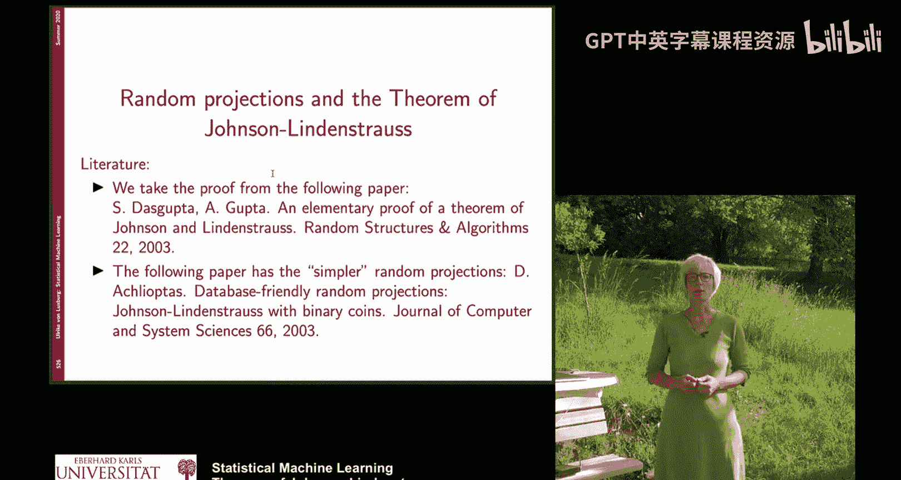

The theorem is a really really cool theorem I like it a lot and it is used not only in machine learning but also in the domain of theoretical computer science where it helpss to reduce the complexity of certain algorithms and we are going to discuss it in a moment。

😊，If you remember what we have seen so far as we looked at different methods for dimensionality reduction。

 for example we looked at PCA or also multidimensional scaling if you wish and in both cases we have a guarantee that sort of is a global guarantee over the whole space where you say I try to I try to minimize the average error for example in PCA the average reconstruction error。

😊，What we do never get from PCA or also from MDS。Is any guarantee on really point bias distortions。

 like how far does a particular point move when I do this projection。

 There can be really bad things that happen。Now the theorem of jump Di laws has a different direction。

 it tries to prove guarantees on all pairs of distances。😊。

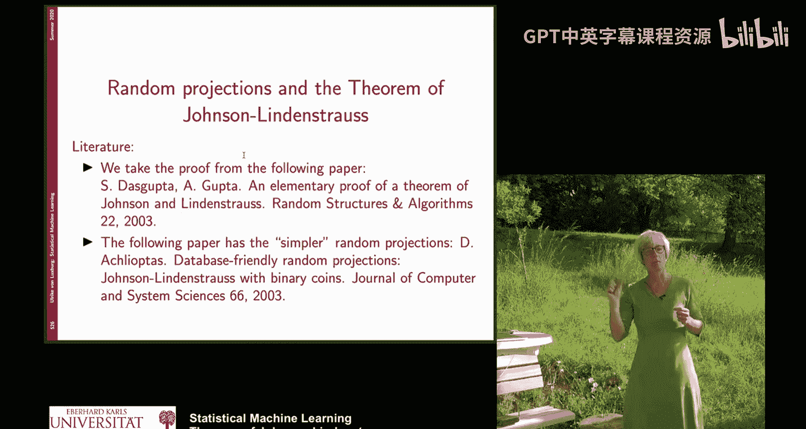

Let us look how this works。The general what we want the general idea of what we want to do。😊。

As in the previous settings， we have points which live at least in this particular proof in RD in a high dimensional Euclidean space。

So D is supposed to be a large number。What we want to achieve is we want to have a projection in a low dimensional space。

 so here K。😊，Okay， it's much， much smaller than。And what we want to achieve is that we find this projection from the high dimensional space to the low dimensional space。

 such that all the distances are nearly preserved， so what we want to achieve is if you consider the distance between two points Xi and Xj in our original space which is indicated by this little subscript RD。

😊。

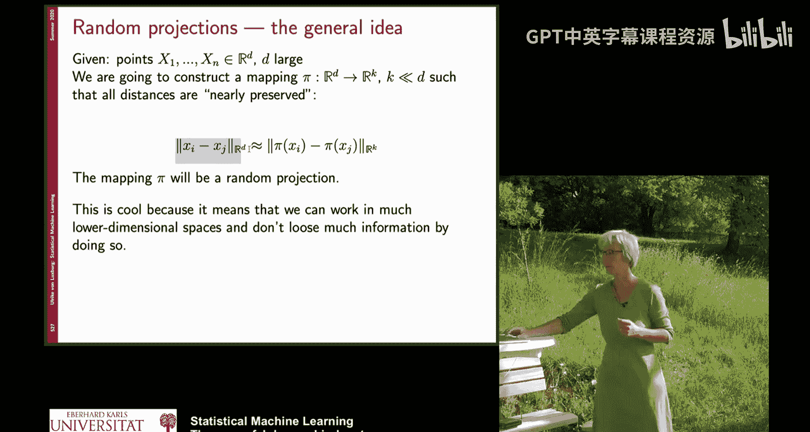

Then we want that these distances roughly coincide。😊。

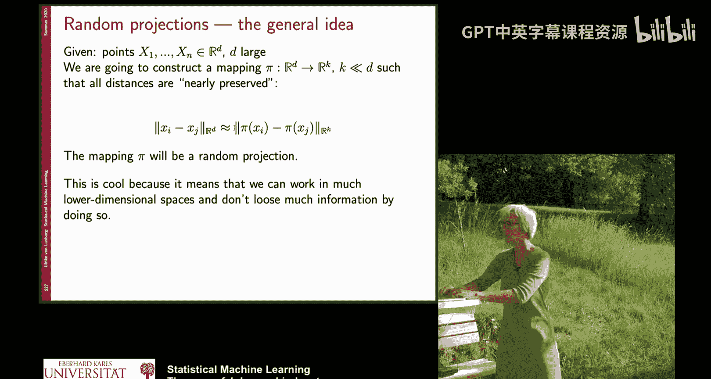

With the distances these points have after we applied the projection pi。

Where now this distance is measured in the slow dimension space R。

And what we are going to see during this lecture is that we can construct such an embedding。

With such a projection， it's going to be a random projection。😊。

And we can even achieve that this guarantee holds pair wise for all pairs of points。

 not only on average or something like that。And what this really means is we can reduce the dimensionality of our space and we are going to see by a lot so we can go from some exponential dimension to a polynomial dimension。

 for example。😊，And still we don't lose so much information about the underlying data set because the distance is only changed by a very tiny amount。

😊。

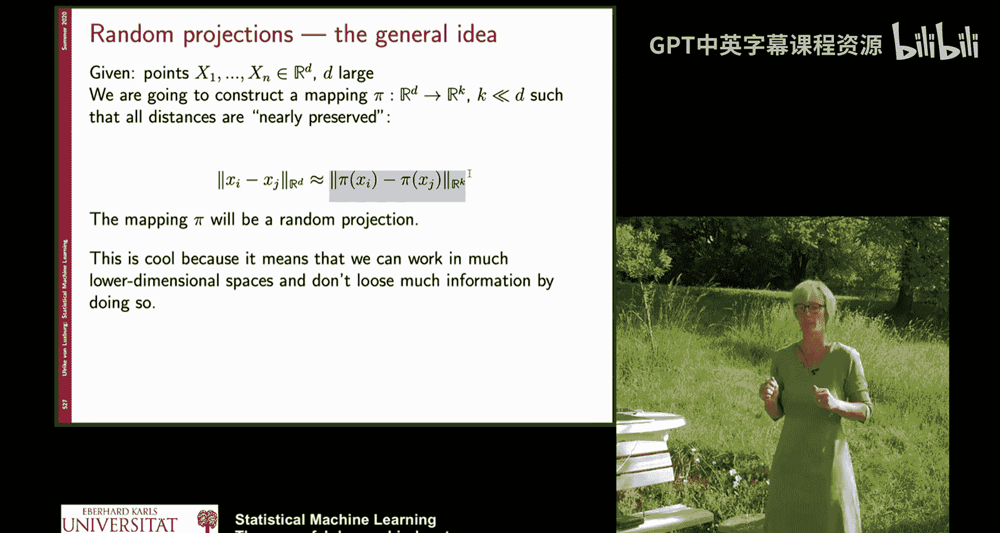

So here's the famous theorem of Johnson Lyla， which we are going to prove during this lecture。

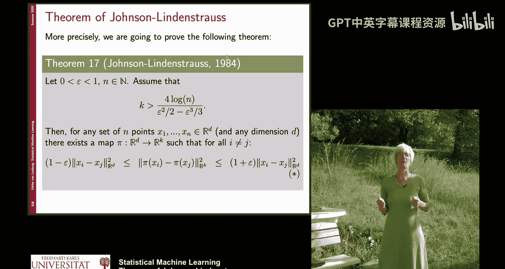

And we are given two numbers N is the number of data points that we have an actual number。

The epsilon is a number between 0 and 1。 This is going to be the error we are allowed to tolerate。

Now to decrypt the theorem we now make a statement about the dimension that we can afford and we' are going to look at the formula later but for now just assume there is like K is going to be the dimension in which we need to project and K needs to be larger than a certain quantity and we are going to look at it in a minute。

😊，But assume we have such a nice K。Then we can prove the following guarantee。

For any set of endpoints。That you might want to start with in the high dimensional space。

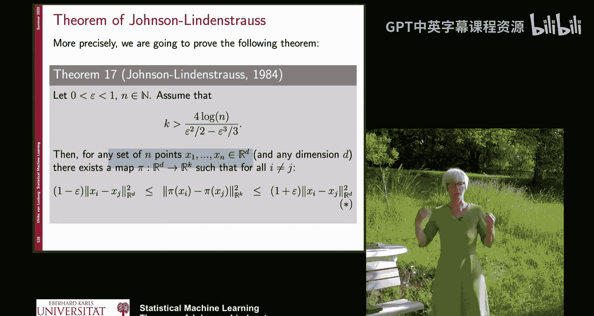

There exists a mapping pi。

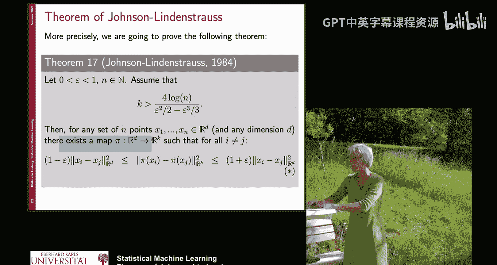

That brings you from the high dimensional space to this low dimensional space where this dimension is given has to satisfy this formula on K that we have above。

Such that for all pairs of points， I not equal to J。

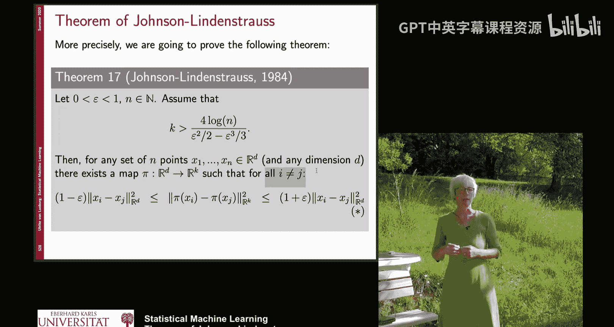

We have the following guarantee。If you take the original。

The original distance of the points in the original space in the high dimensional space。

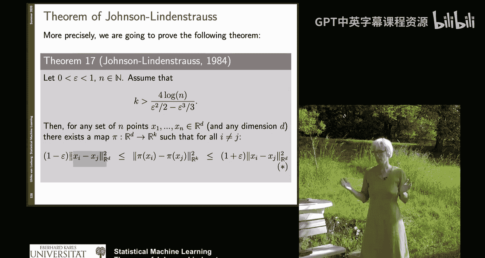

And you compare them to the distances that these points have after they've been projected。

Then what you can see is so in the middle， we have the new distances and in the left side and in the right side。

 we have the old distances multiplied by a small deviation constant。 So in the left side， we see。😊。

They can only deviate by one minus epsilon。And on the right side。

 we see they can only deviate by one plus of epsilon。

 So the new distances that we achieve after the projection are bounded by one minus epsilon or one plus of epsilon times the distances in the original space。

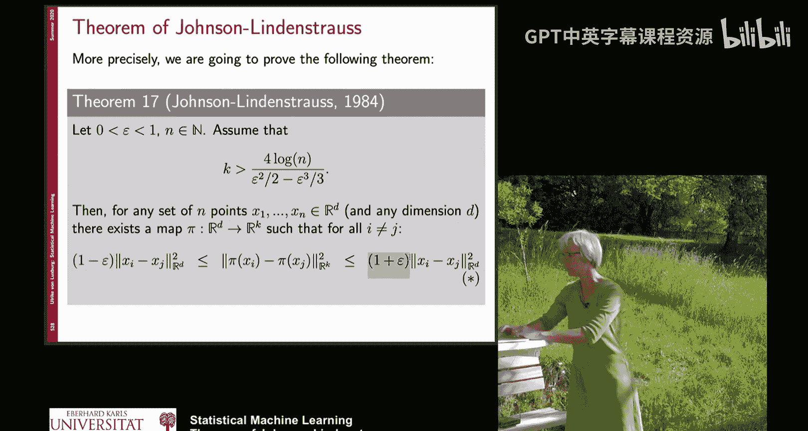

So the distance like and this is really cool for all pairs of points， individual pairs of points。

 the distance can only change by a factor that is at most one plus epsilon or  one minus epsilon。😊。

Now what is this formula on k let's try to look at this the formula says K needs to be larger than this fraction that we have here on the top we have the logarithm of n。

😊，Which is nice because if n is something large， lock in is too big there something really small。

And in the denominator we have the terms Epsilon square and Epsilon cube。😊。

And if you sort of consider like Epsilon is supposed to be a very small number。

 this term is dominated by Epsilon square。So essentially ignoring all the constants。

What we get is something like lock N over Epsilon Square。

And what does it mean is we start with endpoints and I say， oh。

 I think I have a slide on the next side where I am。😊。

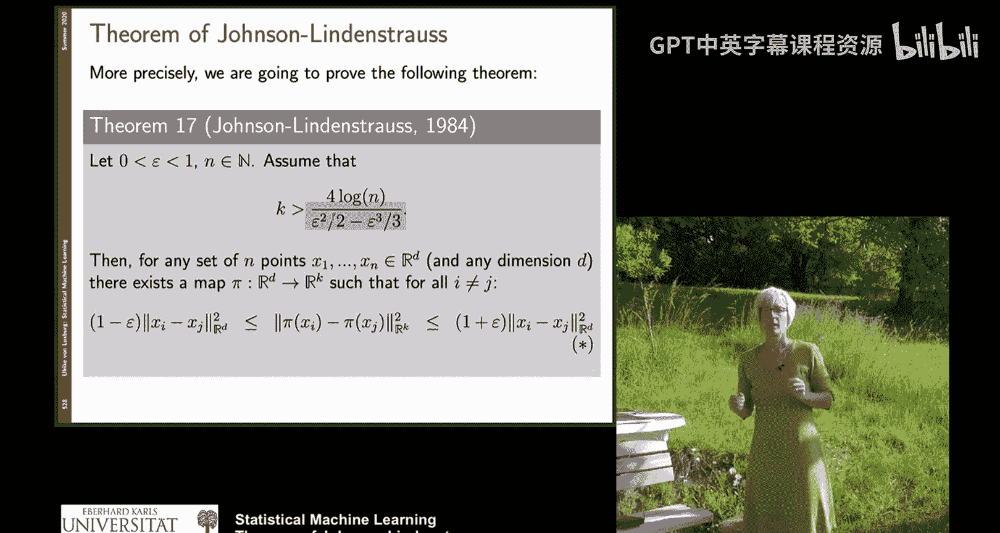

Explain this better。So we have a set of endpoints， the Li in RD and D can be arbitrarily largely dimension。

Now if you think a bit about what does it mean that D can be arbitrarily large。

 if you have end points in a very high dimension space they always sit in a subspace which is spent by at most n minus one dimensions so if all these points are linearly independent。

You can at most achieve a subspace of n-1 dimensions。So mentally。

 you can consider D to be something like of the order of n in the worst case。Now。

 assume we have these endpoints that live in a space of dimension n。

And how we fix a deviation that we are going to tolerate。

 this is going to be the parameter that we need to set how much deviation do we want to have or can we tolerate in our particular application。

😊，And then the theorem says we can embed these points into a space of dimension lock N of Epsilon squared。

 roughly ignoring all constants and so on。And all distances are close up to a factor of 1 plus or1 minus epsilon to the original distances。

And why is this so cool because we start with a dimension that is on the order of N？😊。

And we go to a dimension that is of the order of lock N。

All this is moderated by this epsilon square so you can see the more the closer you want to get to your original distances。

 the more difficult its become so if epsilon is something really really really small eventually k might grow to infinity and become larger than the original dimension but in principle if you say you put epsilon to a constant 0。

1 or 0。01。😊，This is sort of still being in in a regime where， where things work out。Also note。

 like if you look at such a theorem， you should always note that sort of。

The general outline of the theorem makes sense， so here it really makes sense that if we want to increase the accuracy of our embedding。

 we need to increase the dimension。😊，Because so if we decrease epsilon。

 we might make a smaller error。 The dimension K needs to increase。

And that makes sense because we need to have more space。

 we need to have more room to wttle our data points to really achieve a low dimension and in the extreme case the dimension gets as large as our original dimension then of course we can achievearrow 0。

😊，But we also haven't gained anything。 But in this sense。

It makes sense that this epsilon term is in some way in the denominator of the of the fraction。

 and then the nice fact is that we have the lock and de numerator。

Now why is this so cool from an algorithmic point of view。

 consider there are many algorithms and you might remember some from your one or one algorithms lectures that depend on the dimension in an exponential way。

😊，Tpically one would be something like a kd tree where the construction of the tree depends on the dimension N in some exponential and the dimension increases like the complexity of your algorithm increases exponentially with your dimension N。

Which means that if your data listener two or three dimensional space， all is fine。

 but if you would be in a space like we often have in machine learning in a very high dimensional space。

100 dimensional space， you could never construct a Kd tree on 100 dimensional space already for complexity reasons。

 There might be many other reasons why you might not want to do that， but complexity is one of them。

And with this kind of tool， what you can now achieve is you can take your original data。😊。

You project them into a space that has dimension only the lock of what you started with。

Then you apply your algorithm， you are going to have a small distortion because your distances have been distorted by this project。

 but they only have been distorted by a very tiny amount， so maybe in the end。

It doesn't really hurt your algorithm so much。But now now in the new space。

 in the lowest dimensional space， if your algorithm depends exponentially on the dimension。

 it now depends exponentially on lock N。which would be only polynomial in n and this is something at least in this kind of regime of theoretical computer science where youre always worried about whether something is exponential or polynomial。

 this brings you from a regime that is exponential to a regime that is polynomial and that is really cool。

😊，The tool by which we are going to achieve this miraculous mapping is going to be a random projection。

Remember a projection we say we want to project on a one dimensional vector。

We call this projection a random projection if this vector has been chosen by some random process。

Now what we want to do in this particular case， we want to we don't have any preference in which direction we project。

 we project on we want to project uniformly with the same probability in all possible directions。

Which formally means that we would pick a unit vector from the unit sphere and RD and use this vector to project on so here I have a figure on this slide so the unit sphere is just the surface of the unit bar。

If you are now in a two dimensional space， the unit field just consists of aling。

We now pick a point uniformly from the circle。And then we project on this particular vector that we have picked。

In a higher dimensional space， it's not a circle。 in this three dimension in the case。

 it's the unit sphere。 It's sort of the there。诶。The shell of this of this unit pe the unit pulled the surface and in a higher dimensional space。

 it's in more context， it's a unit sphere。

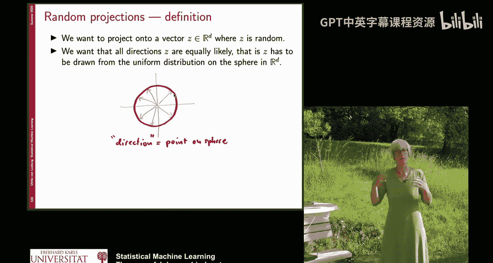

Now here's our first definition。We now define what is a random projection。

 and I one dimension a space。 So let's Z be a vector drawn from the uniform distribution on the unit's sphere。

 This is， in fact， for those who know from probability theory。

 it's not such an easy object to define。But we can do that。

 So assume we have a distribution on the units sphere。😊。

That has gives the same probability to all particular directions。 So assume we have such a vector。

And then we call the mapping pi Z， so subscript D which indicates the vector on which we project。

 which simply takes a vector in RD， maps it to R， and in the thing is a projection so if we have the argument V a unit vector or any vector in RD and we put it into our projection。

 we simply need to take this kar product in RD。And then we get the random projection out。

So this is the random projection on a one dimensional space R。

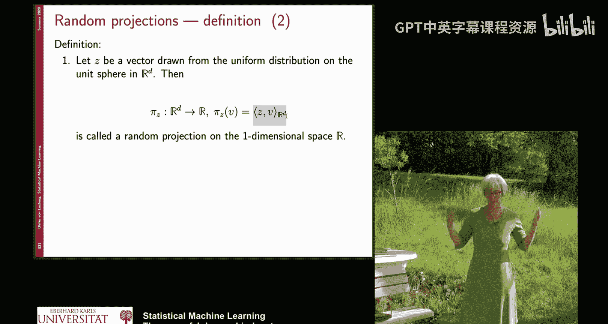

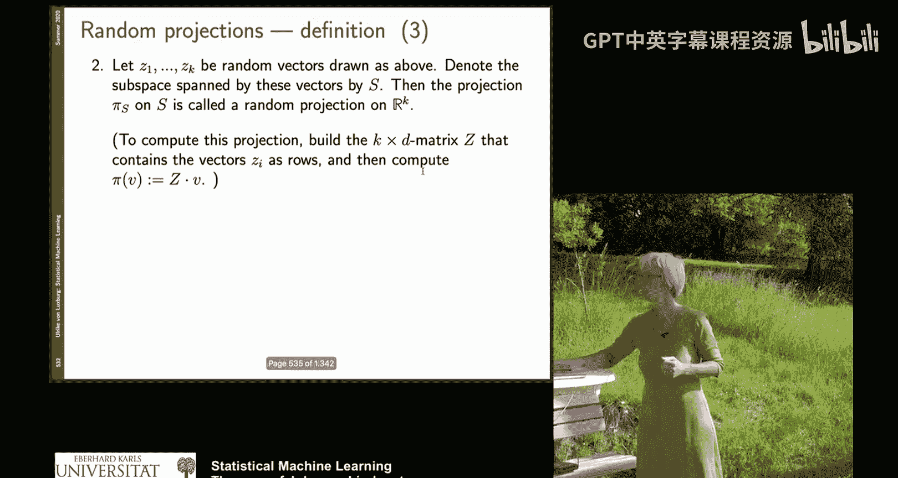

Of course we can also do this onto a K dimensional space and I guess you already know how this works based on all the other things where we went from one dimension to a couple of dimensions so here it's sort of the same kind of principle。

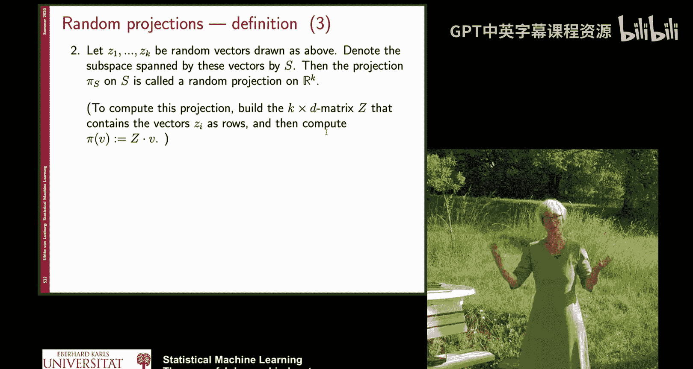

Instead of drawing one vector。From the unit sphere。

 we now draw cave extras from the unit sphere independently from each other。

These vectors are going to spin a subspace that we are going to call S。

And then the projection we are going to denote it by PS， which is the projection of under subspace S。

 and this is now called a random projection on RK。Now there is one little thought that you need to have is of course it only projects an R if all these vectors are linearly independent in principle it could happen that the vector。

 like if you pick vectors uniformly at random in principle you could pick them in such a way that they are not linearly independent so they would spin a subspace that it has even a smaller dimension than K。

It is very， very unlikely to happen。 And this is why I'm not going to discuss it at this particular point。

 For now， we just assume that the vectors we have picked。A linearly independent。

 So we really end up in a space of dimension K。嗯。If you want to implement this random projection and you are given the vector Z。

 how are you going to do that， build you stack all the vectors into this matrix。

 which we call capital Z。😊，And then the random projection is simply the multiplication of the argument vector V with this matrix C。

 as we have seen it very often already in this lecture。

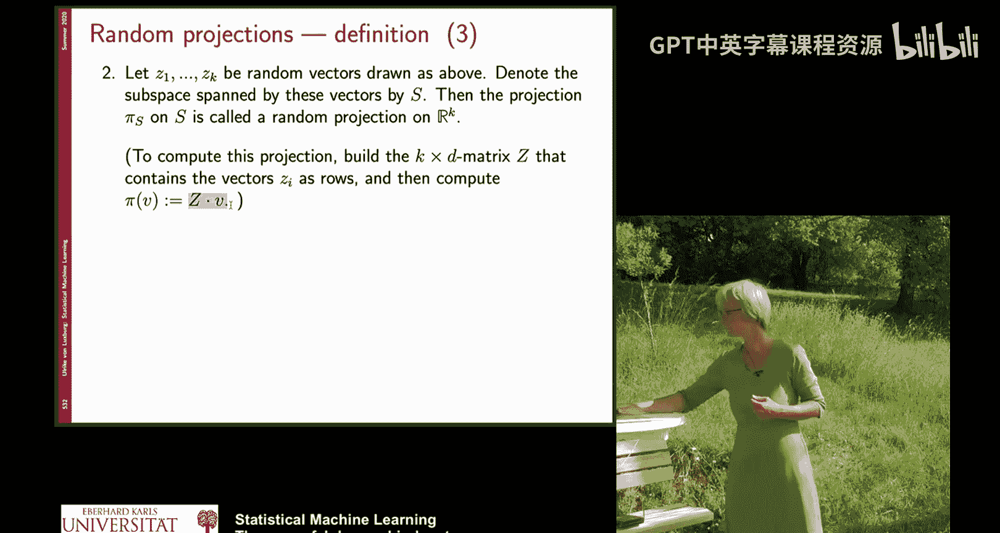

Now， here comes our first proposition， which is about the expected length。

That the vector has after we have applied this random projection。

So the theorem or the proposition here reads as follows。Assume that x in our original space。

 R D is a fixed vector。And assume that this vector has length one， so we start with a unit vector。

 which makes our life a bit easier and the proof。Now we consider its random projection。😊。

PV on the random vector V。And V has now coordinates V1 to VD。

 so this is a one dimension vector with D coordinates given by these P coordinates。

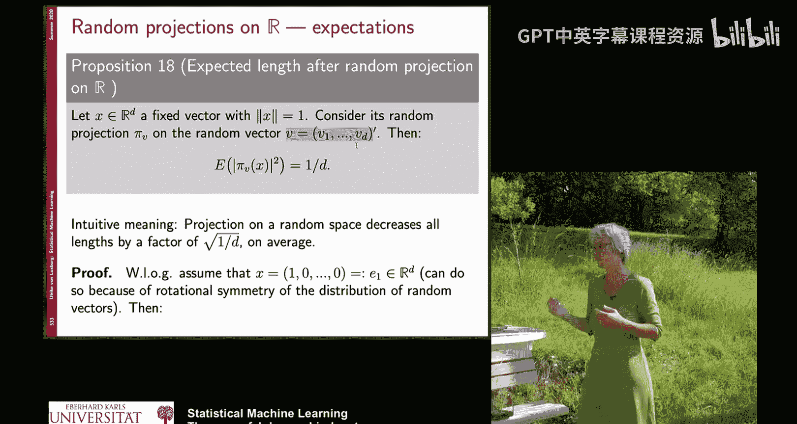

And then the statement of the proposition is the expected length。😊。

Of the result of this random projection。Is one over0。

And consider here and we mapped to the one dimensional space。

 this is why I didn't put the norm here but just absolute values。

 it's a real number and I'm just interested in the absolute value of this real number。

 which is the length of this one dimensional vector。And， in fact。

 we look at the squared lengths and not at the。Square root of it。

 So the expected squared length of this vector。Is one over the。Which means that compared。

 we started with a vector of norm1。After this random projection。

 we end up at least in expectation with a vector that has norm 1 over de。😊。

So if we want to rescale this mapping， this random projection such that。

We again have a mapping or that our mapping preserves the expected value of the length。

 Then we need to rescale this mapping by a factor one over1 over D square root。

Okay， so this is a first proposition that we want to prove。And heres how it goes。

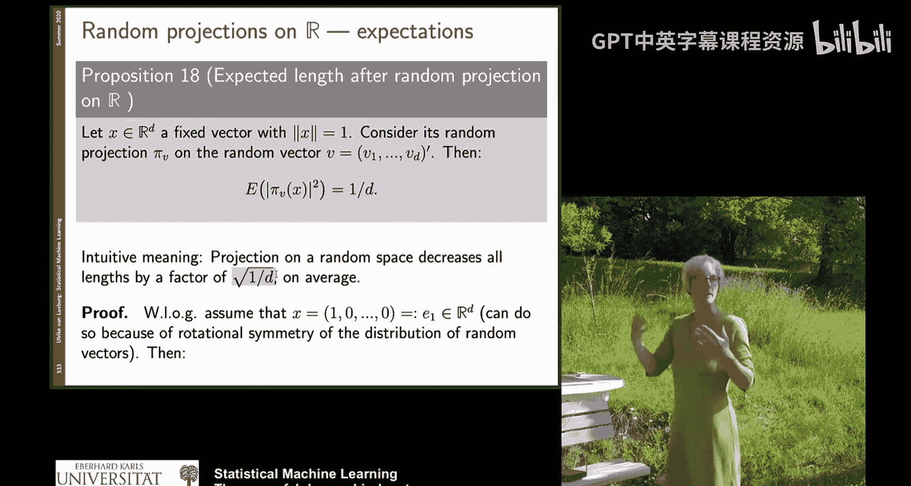

So without loss of generality， we assume that x is the unit vectorctor in Rt。

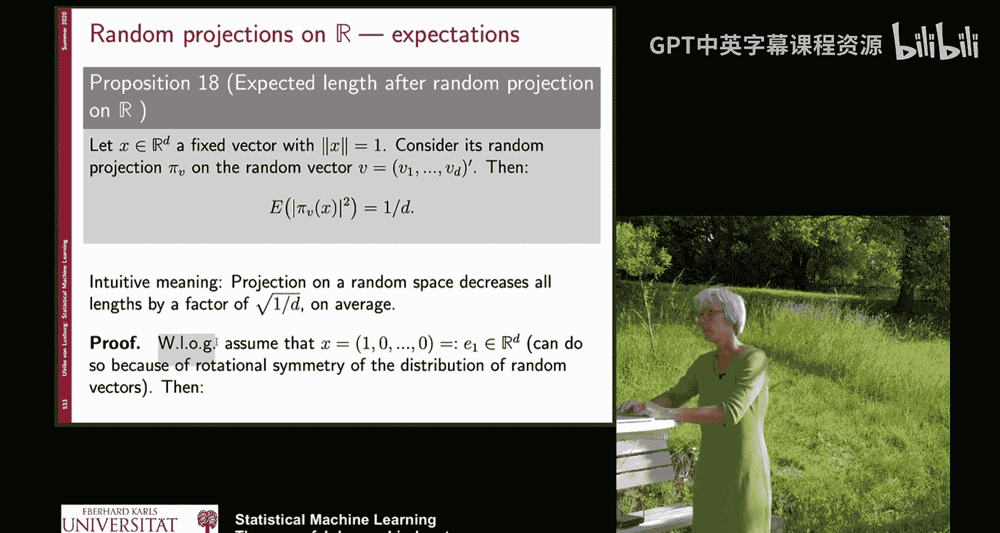

The point is now and this is an important thing to notice also for a later aspect of the proof。

 everything that we do is invariant with respect to rotations because the random vectors that we choose have a uniform distribution on the unit sphere and whether I first rotate my this existing fixed data point x such that it is a unit vector and then apply a random projection or whether I don't do this rotation they result on the length will be the same。

😊，Because of this rotation of symmetry。So without lots of generality。

 we can simply say we start with a unit vector which also makes our life a bit easier。😊。

And then we compute what is the length of this unit vector after the random projection。

 and this is going to coincide with the length of any like the expected length of any other vector as well after the random projection。

😊。

Now we simply do the math。 So what we want to know is we want to know the expected length of this vector after the random projection。

Now we already said that instead of any arbitrary vector x。

 we look at simply the unit vector E1 in our space。Now we plug in what is this random projection。

 namely， it is this scalar product between V and this unit vector。

And now we know because we look at the unit vector。

 the scalar product of any other vector with a unit vector simply consists of the first coordinate of this vector here。

😊。

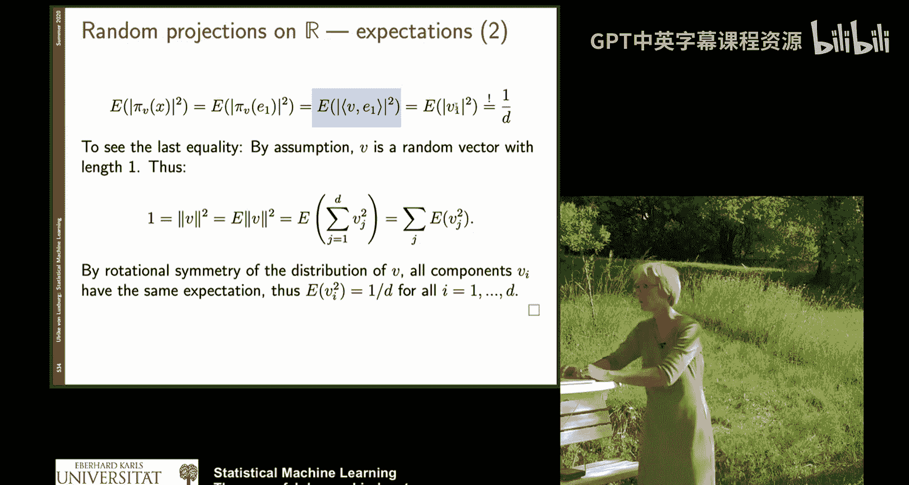

So and what we have so far is the expected value of the first， it's the expected value of the first。

Sorry， the expected length of this。Unit vector x after the random projection coincides。

With the expected value of the first coordinate of this unit vector that we draw randomly from our sphere。

Now we need to prove that this expected length really is 1 over D。This is how it goes。

We start with this vector V。Which has length 1 by assumption。

 So in in the proposition we said assume we pick a unit vector from the units here。

 So by assumption this vector has has length norm 1 or its a squared norm1。

Which also coincides with the expected value because if all values have norm 1。

 then also the expected value of the length of this vector is 1， so we have this equality sign here。

And now we simply do put in the formula so what is the expectation of so what is the norm first of all。

 we believe the expectation and have the norm which is just sum over the squared entries of the vector。

And now this is a linear expression so we can pull the expectation in and the sum out。

And now the trick is again， so we now we have the sum of the expected values of all these individual components。

😊，Now， again， we have rotational symmetry because we have a unit distribution on this sphere。

 so all different coordinates have the same expectation。

It can' be that coordinate one has a higher expectation than coordinate5。

So all of them have the same expectation， so if you now have a sum over D terms。

 all of which are identical and they need to sum up to1。

 then the only value these D terms can take is1 over D。😊。

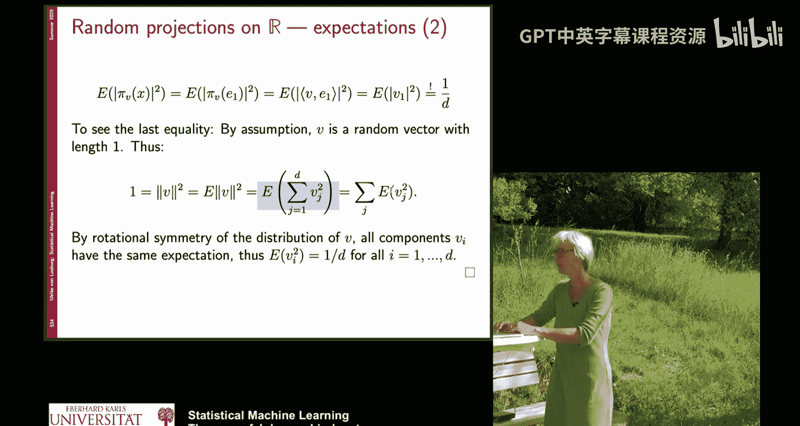

So each， for each of the components， we have that。Expect the length of this component is one over2。

And this improves what we wanted to prove。

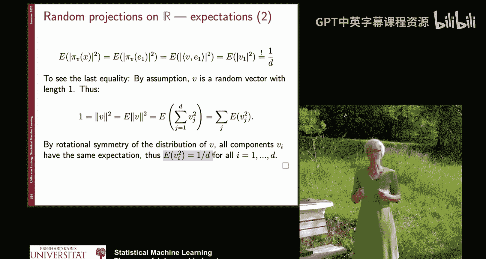

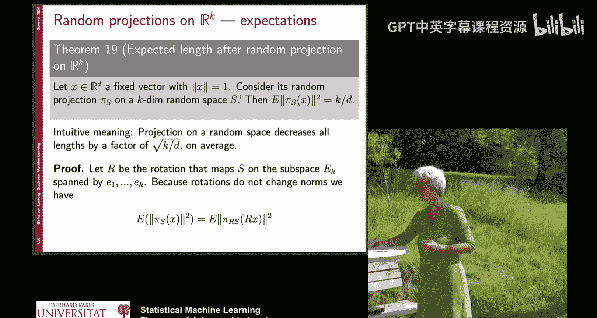

What we have seen so far was what is the expected length？😊，If we apply a random projection on R。

 like on a one dimension subspace。Now we need to look at what is the length if we project on a K dimension subspace。

Let's look at the proposition， so it says again， let x be a fixed vector。😊，from the units here。

 consider its random projection now on a K dimension subspace S。Then the expected length。

 squared length of this vector is k over d， so we gain a factor of k rather than just。

 so we don't have just1 over d but k over d where k is the dimension of the subspace。Again。

 the intuitive meaning previously we had the intuitive meaning that the random projection decreases everything by a factor of 1 overD now we have a factor of k overD。

Squarewood K over， sorry。Now， let's prove this。 I think many of you might be able to prove it themselves once they've seen the proof for the for the one dimensional case。

 But again， let me look at here's a particular way of presenting the proof。

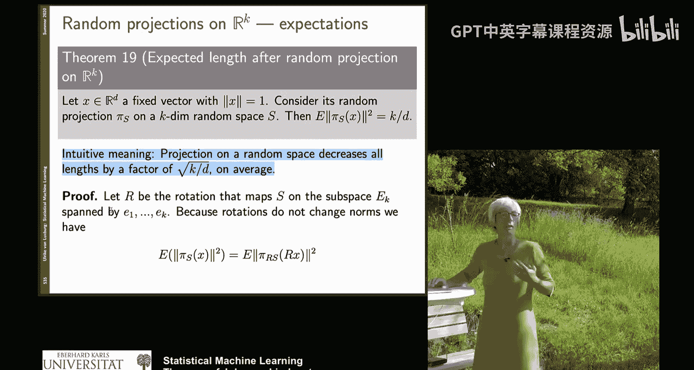

So， now。I want to be a bit more explicit on this rotational aspect。

 so that R be the rotation that maps S on this unit on the unit subspace EK so EK。😊。

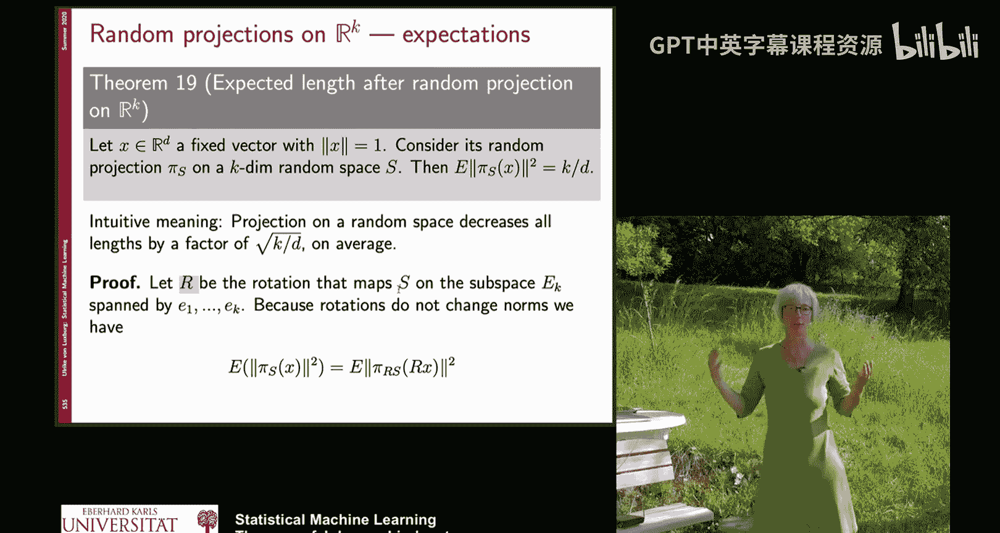

Is now this the subspace bent by the unit vectors you want to EK。

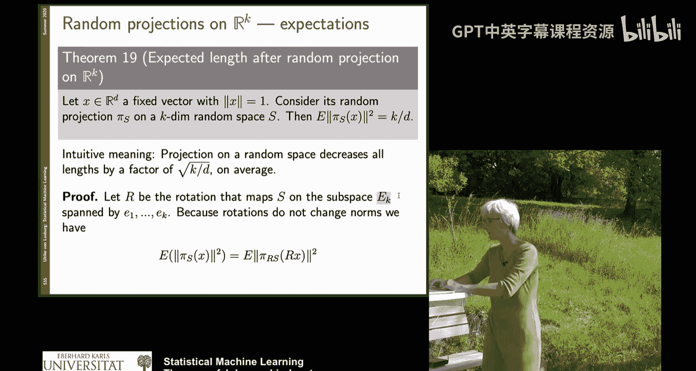

And what I now want to do is I want to like in the previous proof。

 what we said without lawsaw of generality， let the vector we are looking at let this be the unit vector and we want to do something similar here。

😊，We want。

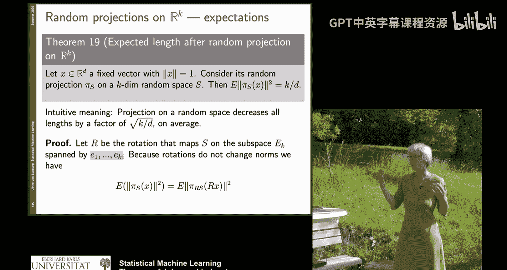

And we need to introduce this rotation to be able to talk about this rotation that brings us to this unit here。

 sorry to the unit space。So given we have the space S， this is the randomly drawn space。

That R be the rotation that maps the space S on the space Ek。

And now the trickest rotations do not change the norm of any vectors。 That's clear。

 So the expected value。Of the vector x。When projected on S is exactly the same as if I first apply this rotation R to x and to S and then compute the expected value so nothing changes by applying this rotation before we compute the expected value。

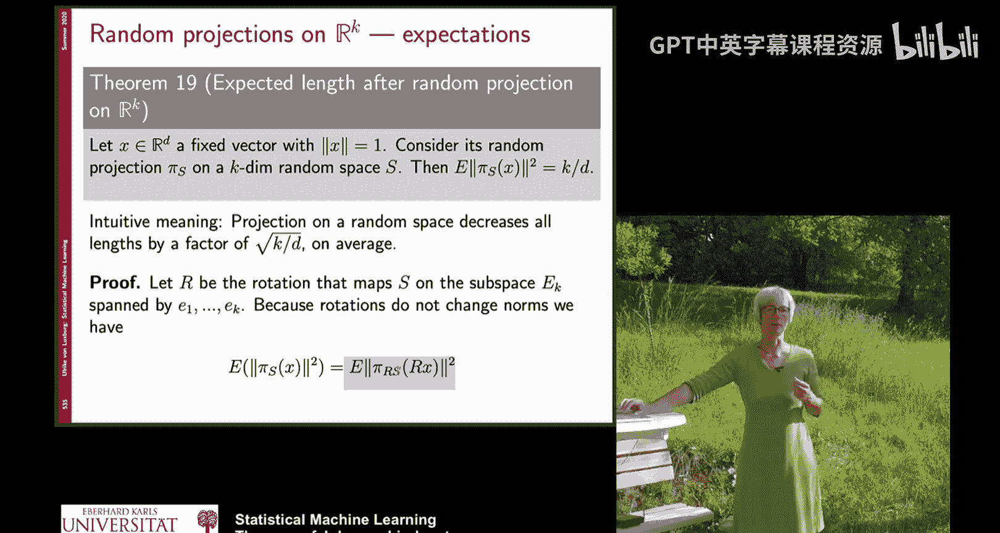

And now， what we want to do is we now define V。😊，Ass the rotation of this vector x。

And the trick that we are going to exploit is now that the length of a unit vector。

 when we project it on a random k dimension subspace。😊。

Has the same the same distribution as the length of a random unit vector when we project it on this fixed K dimension subspace。

 So let's read that once once more because this is really the key to the way this proof is written the length of a unit vector。

😊，When projected on a random kilometer subspace。So here the unit vector is fixed。

 the element that we want to project。And the space on which we protect is random。

And the statement is it has the same distribution。It's the length of a random unit vector。

 so now the starting vector is random。When projected on a fixed k dimension subspace。

 which is going to be EK in our case。So what we now do is in this proof， we now consider V。

a random so instead of previously we had x which was the fixed vector projected on this random subspace and now we sort of swap the rolls。

 we now consider V as a random vector where V is defined like this vector after the rotation。😊。

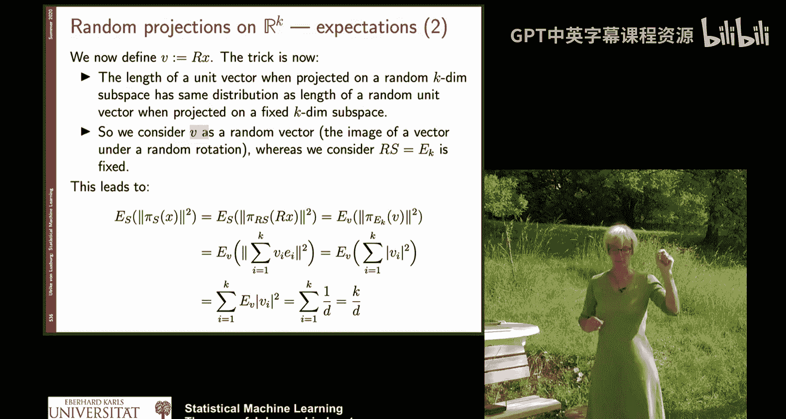

And then we consider the subspace， which is going to be EK as a fixed space。

This maybe requires a bit of thinking， but it's and of course， you can also write it down formally。

 but it takes a bit of space。 And I think intuitively， it's clear that this is true。

You know is why do we do that， what is the result？What we want to compute is the expected so what I do here is maybe a bit of notation is a subscript to the expected value I put what is the random quantity so in this expression S the random subspace is the random quantity so this is what we start with we have a fixed vector S we project it on this random vector S。

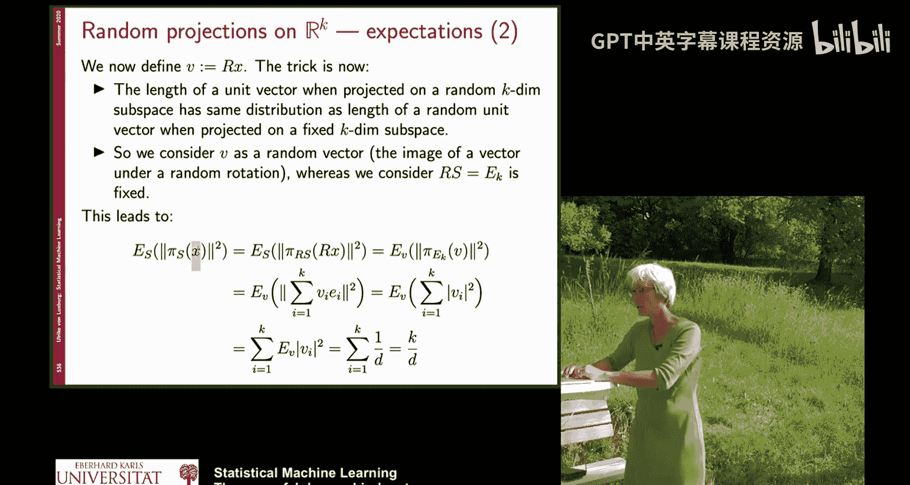

And now we want to compute the expected value where the randomness comes from drawing us。Now。

 the first thing I do is I apply this rotation and we have already argued that nothing is going to change by this。

And now comes this argument that we had on the previous slide that I can swap the roles of the randomness in some sense and now consider so our x here。

 this currentside is V。😊，And R S coincides with EK because this is exactly how I have defined all the quantities。

And now I can swap the randomness and shift it to V and this is so the expected value is the same as if I would draw V randomly。

😊，And projected onto this deterministic space， E K。Once we have done this。

 everything else is sort of very simple。Now we plug in what is project the norm after the projection。

 we need to take the scalar product。So we need to plug into project and then compute its norm。

 that it's what we have here。Again， now the scalar product between the product between VI and the vector EI is just the value of VI。

嗯。Now from this equation to the next one， we can pull out the sum because its a linear expression and now we already know。

The expected value of this one dimension random projection is 1 k1 over D， sorry。

 and now we have k of them， so we end up with K over D。

Okay so I think the only trick in this proof is really to swap the roles of what is considered a random quantity to really make sure that this works and then you simply do the computation and youre done。

😊。

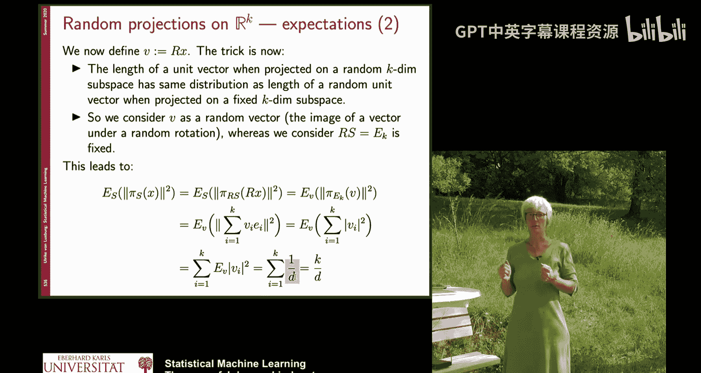

So what we have achieved so far as we now know， what is the expected length of a vector after we apply a random projection。

😊，But now this is only the expectation， so in principle， of course。

 there can be a high variance in the statement of what the actual length of ur projection is and the next part we are going to deal with is we want to take care of this variance of the expression。

What we are going to use here is a concentration inequality and we are going to see concentration inequalities in many other contexts of this lecture as well in particular in the learning theory part。

In principle a concentration statement looks at how far is the variance like if you have a certain random variable with a certain expectation。

 how large is the actual variance of the random variable。

 if you really look at realization of your random variables does it sit very close to the expectation with high probability or is it distributed all over the space？

😊。

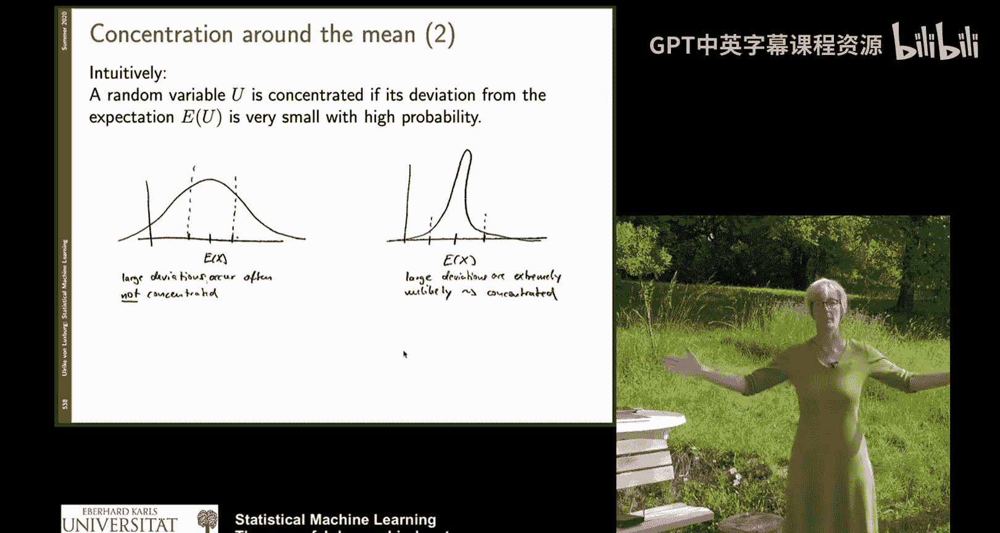

So typically what we the image you should have in mind is the following。

 so here you have just as an illustration a one dimension random variable here I have the expectation of x。

😊，And now what you're wondering is whether the variance of this random variable is very large and maybe this is a distribution。

😊，That is wide and maybe also has a heavy tail， it's not a Gaussian distribution。

 but something that decreases much slowly for example。

 or you might have hopefully that's always the hope something where the majority of the mass of the random variable sits very。

 very close to the expectation and as soon as you go away from the expected value the likelihood that you achieve this value is very。

 very low and this is what we call the concentration。😊，Now this is， of course， the informal picture。

 there are more formal things。

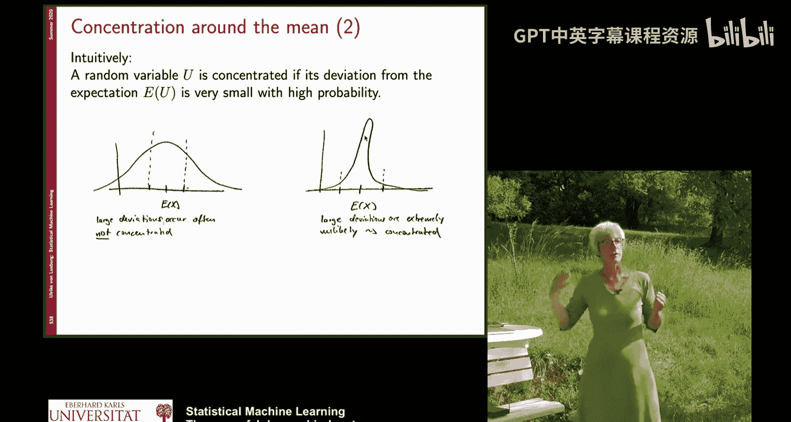

And there' is a whole toolbox on concentration inequalities which are very very important in statistics。

 for example， or in learning theory or many other also in the field of randomized algorithms。

 for example， when you prove results about random algorithms you sometimes need these kind of statements to say that with high probability。

 the algorithm really behave as you would expect it in the average case， in the expected case。😊。

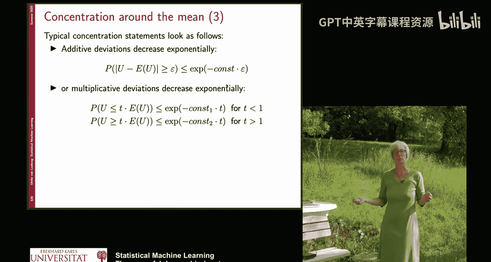

And there are typical ways concentration inequalities look like here is one way。

 one typical concentration inequality is an additive。

 one way you say assume we have a random belt with U。😊。

What we want to make a statement about is what is the probability that the actual random variable U？

Diates from its expected value by more than epsilon。

And then we want to have a statement that hopefully says something this probability is small and ideally it should be some term that is exponential in this deviation epsilon。

If you remember your probability class， probably you have seen the Cheby Chef inequality。

 which also looks at this term。😊，So this is an important term。

 and you might have seen an exercise is why you in practice， need to control this term。

But the Chebobyev inequality is too weak on the right hand side it has a much weaker dependency on epsilon。

 So what we are typically looking for at least in this particular proof and in many other fields is that this decrease is exponentially fast with epsilon here。

😊，And the other kind of deviation inequality or concentration inequality is a multiplicative deviation。

 So instead of saying we want that the expected value des from the。

True value by more than an additive term of epsilon， We now say。

 and we want to have that that the deviation in terms of a multiplicative constant T is really small。

 And here again， we want to have that this M decay exponentially fast with T。

So this is sort of just a background on concentration inequalities we are not going to prove any of them in this lecture there is a very big toolbox out of there for many。

 many concentration inequalities and in many applications you can simply try to find one that suits your purpose and if not then you can also try to prove a particular one even though。

😊，I think the easy ones have been proved， and the other ones might be a bit complex。

 There are whole books out of there， for example， there's the book by Lagozi。

 which is like a 500 page book just on concentration inequalities。

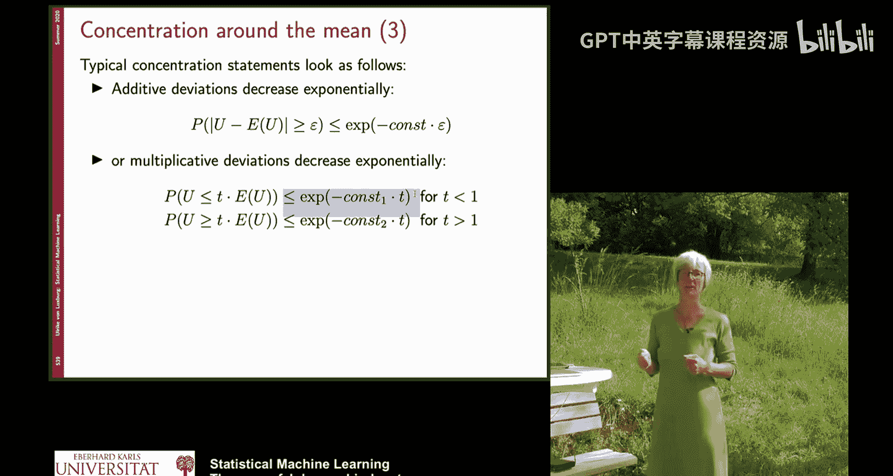

Now here's what happens if we apply concentration inequalities to random projections。

Let us look at the statement。So for any beta between 0 and 1。

 beta is going to be the deviation constant。 So here we are what we are going to see here is。

 and we are going to look at such a multiplicative deviation inequality。 So we look at the。

Actual value of the projection of this fixed random fixed vector x on the random subspace S。

 so this is the realization of the random vector， what is the actual length after we took this vector x and projected it onto this random subspace S。

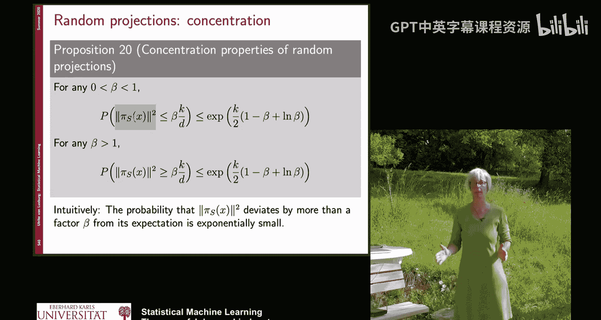

And we want to compare it to its expected value， which is k over d。

And we want to look at how much what is the deviation and the deviation is going to be quantified in terms of PE。

😊，So this is what was the teeth in the previous statement。

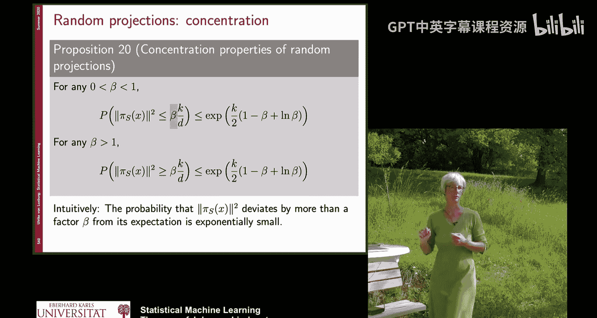

On the previous slide。And now the statement is this deviation is bounded by an expression that is k over 2。

And then， some。Expression， which is a bit funny in terms of Peter and that simply comes out of the proof。

 there's no intuition why this term happens exactly this way。

 this is simply what you get out of the proof。So this is for deviations for Peter smaller than one。

 so this means。You dev to the lower end like you have the expected value and you ask what is the likelihood that I'm much lower than the expected value and now we have the other side we now want to look at what happens if we are like what is the likely probability that we are larger than our expected value and larger than a constant multiplicative effect repeat that is larger than one。

And this inequality looks exactly the same。 the right inside。Okay。

 and now we simply take this inequality as it is， we don't prove it and now we want to apply it to our random projection scenario and see what comes out if we combine all the statements that we have so far。

😊。

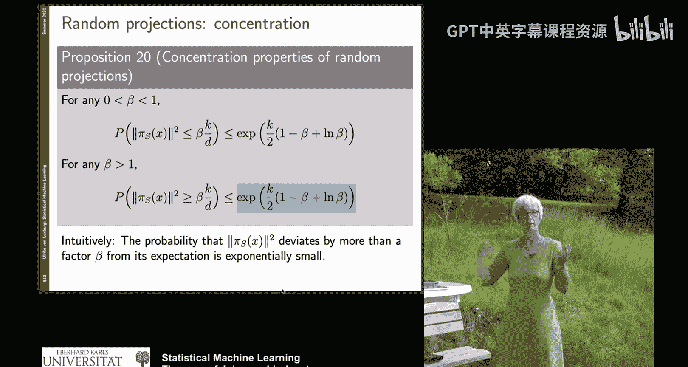

So now we want to prove the serumor of transent stars。And the idea is， in fact。

 I mean the high level idea is on this slide and it's pretty simple。😊。

The proof idea is we use a random projection on this K dimension subspace where K is chosen as in the theorem。

😊，So we make sure that K satisfies this condition that we have in the theorem。

And we rescaled this random projection by this factor that we already know the scared of theobque。😊。

Now， by Pro 19， which was about the expected value。

 we already know that if we start with a vector of length 1 and then project it。

 it will have length 1 again。😊，So this is nice。And then by the concentration inequ。

 what we are going to see is that this actual value of the projection is going to be very close to one as well。

😊，And this is going to be the final statement of all through。

Now， let's look at the details a bit more closely。Now we consider two points in Rd， X I and Xj。

We let P be a random projection with K is in the serum。

And now what we want to prove is that this equation that we have in this heem holds for the vector p of X minus p of Xj。

😊，So maybe I have it it is easier to see here what is the vector that we want to apply this random projection tool。

 we want to apply this to the vector Z which is the difference between the two points because what do we want to say we want to say we pick two points from our space we look at their distance。

😊。

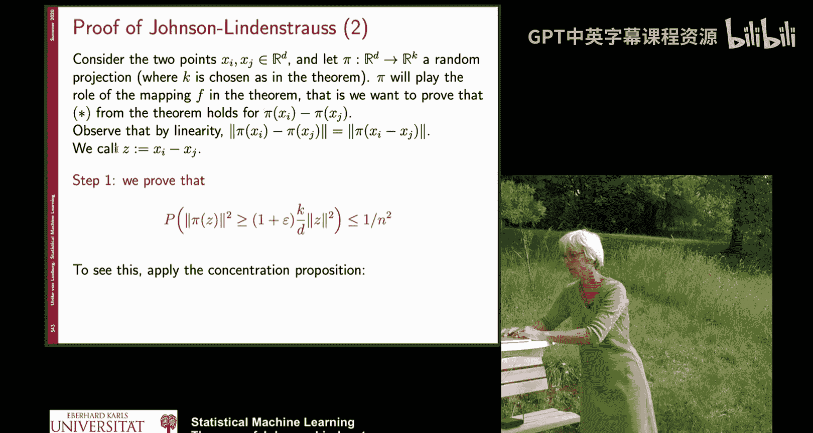

Before project and after project and the distance wouldn't be changed。

So and because we don't want to apply this serumorem to two vectors。

 we just want to apply it to one vector and the vector is going to be the difference between the two because we are interested in the distance。

😊。

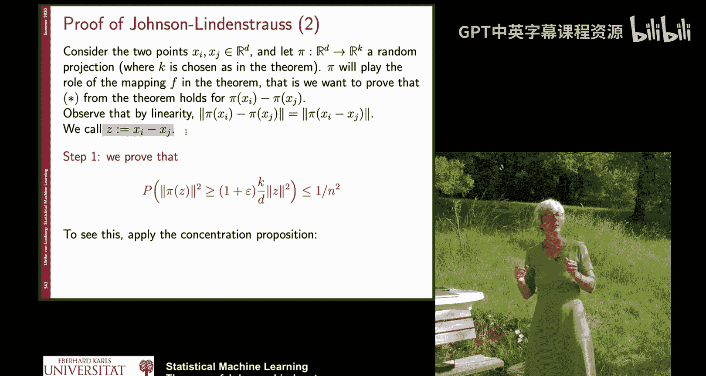

So we now call z this vector xii minus xj。Okay， now we there are several steps according to what we had on the previous slide and we start with the first step。

hich she says？We now look at the。The actual length。Off this vector Z after the projection。

Which is the distance between the original between the points X I and Xj after the project。

So and then now we want to know。What is the expected length？

Of this vector after projection and how much does it deviate from its expected value。

 So remember the expected value if we project on a if you start with a unit vector is K over D。

Now if C is not a unit vector which typically is not in this particular case。

 then we have to multiply this by the squared norm because this is simply the like then everything gets multiplied like if we have a vector of c square from a unit vector to this vector of length C square。

 then this is what we have here。And the deviation term that we are interested in is one plus epsilon。

 So this is again， the T that we had in this concentration inequ。

And what we are going to prove is that the probability that the deviation of this length is larger。😊。

Then one plus epsilon times its expected value。

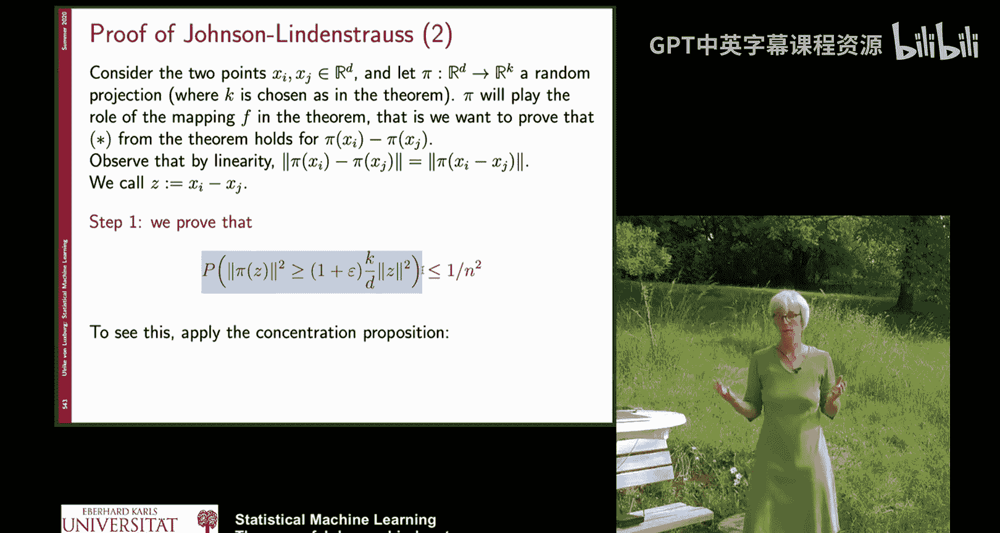

This probability is very small， namely it's one over n squared。

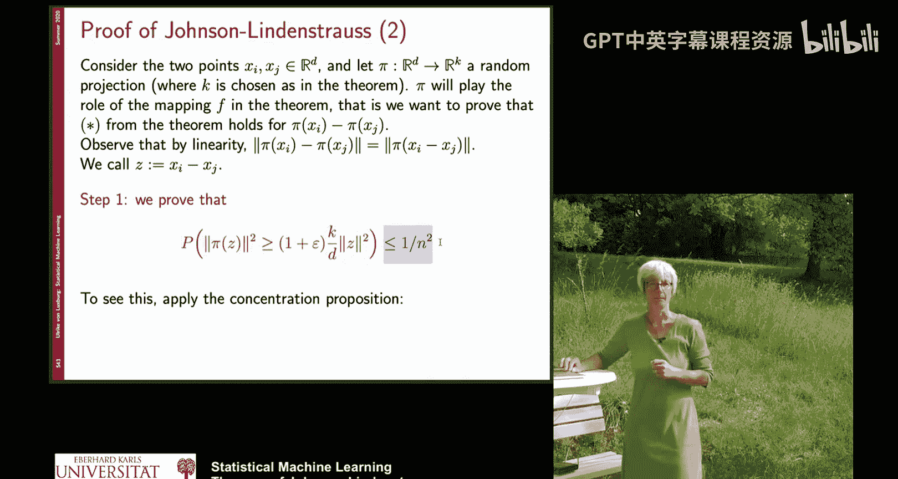

And this is now a consequence of this concentration inequ that we've seen previously。

 so it works as follows。嗯。By the concentration inequality。

 we can bound the probability of this event that we've just been discussing by plugging in the concentration inequality。

😊，In this way， because now this one plus epsilon is the deviation term。

 we can simply use the theorem out of the box。And now the only thing that's left to do is to simplify this expression on the right hand side to something that is a bit more readable than what we have here。

😊，So what we use is that you can express the lock of 1 plus epsilon。

 this is the typical kind of ta decomposition and you can always bound it by this expression here Epsilon minus epsilon square over 2 plus epsilon 3 over 3。

 epsilon to the power of 3 over 3。And now we apply this。So we get this term here。

And then what we sorry， we haven't applied it yet。We apply it to go from here to there。

 and the second thing that we apply is we plug in the value of k that comes from the theorem。

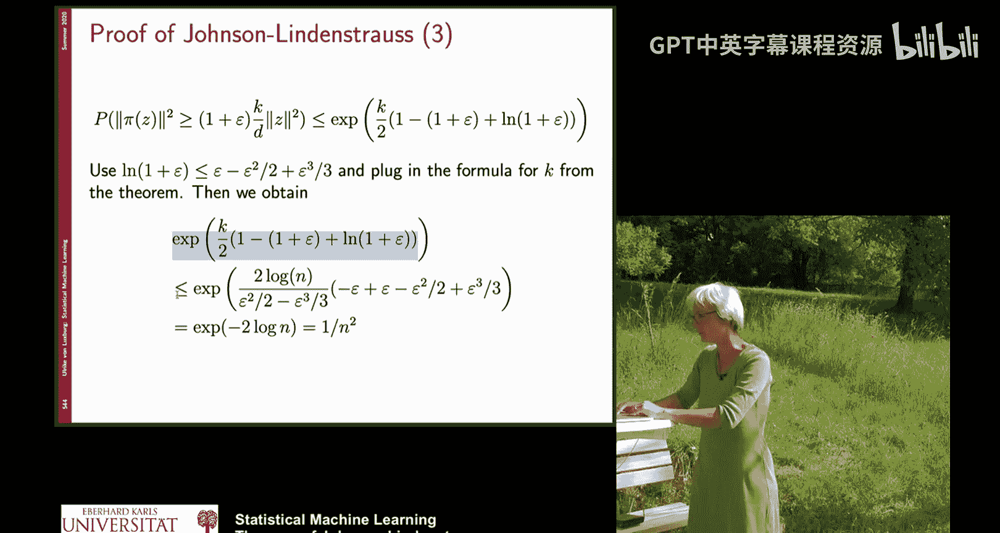

Because the statement is if k is chosen in the serumem。

 the statement is if k is chosen larger than this lock n over epsilon squared per something。Then。

The theorem holds， so now we plug in this bound on K that comes from the serumem。

And we plug it in here。 so we have k here。 that's the dimension on which we project。

 so we now plug in this bound。Here。And then we plug in these formulas for like the simplification of this lock formula here。

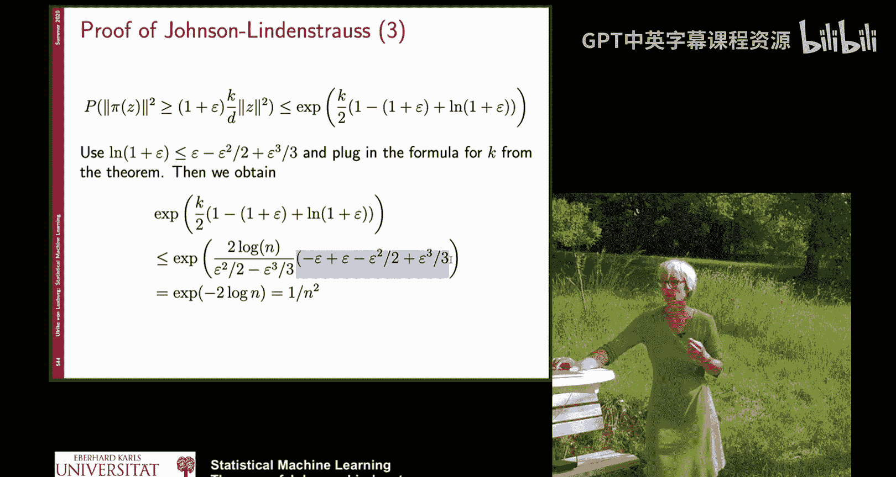

And then what we get is this particular bond。

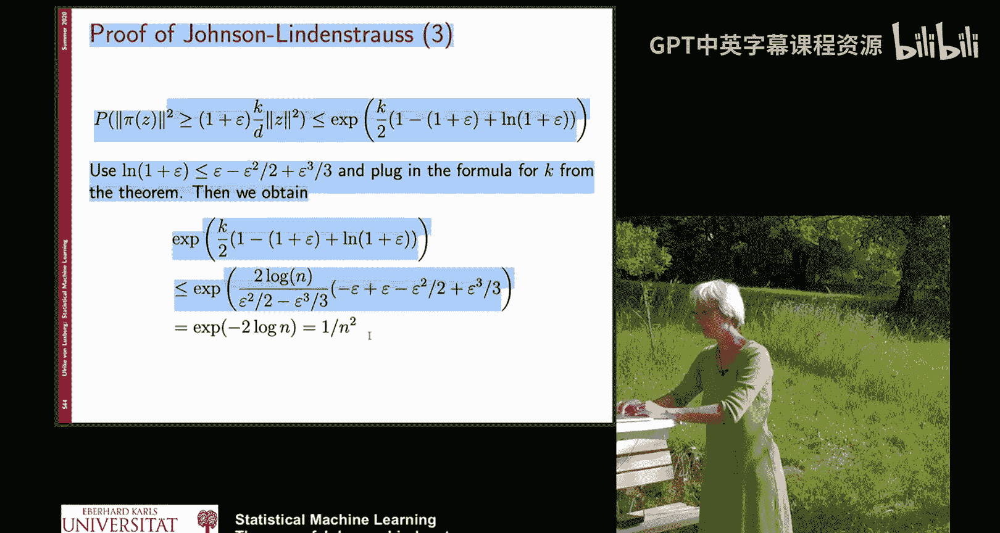

So there's， this is nothing secret。 This is sort of。

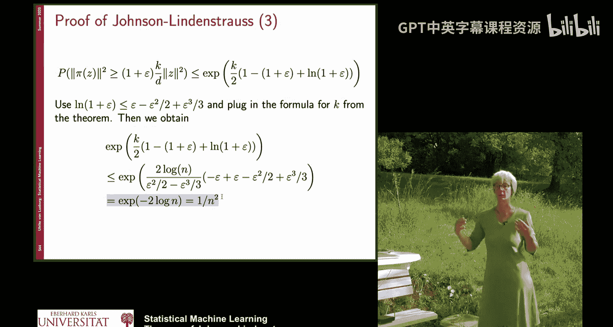

Just cranking the handy。Of course， obviously when you try to prove such a theorem yours。

 you don't know what K is so you reverse engineer so you first do the math and then you try to find out for which value of k do I get a small enough constant out here but if you then want to prove it and want to write up the proof nicely you already know K and you can just plug it in and it comes out。

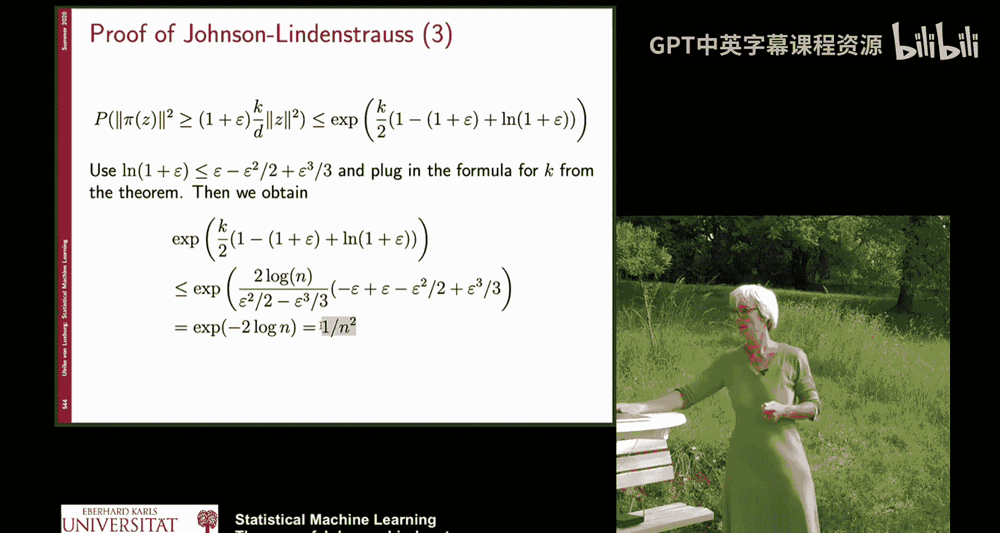

So what is not this consequence of step one？The probability that this deviation that we have in the serum。

 the star is the formula that we have in the transcendentialal serum。 so the probability。😊。

That these deviations do not hold。Is bounded by2 over n squared。

 We have one over n for the concentration inequality that goes in one direction。

 lower deviations and one for the upper deviations。 We have both of them。

 so we need to multiply by a factor of2。And here again。

 we exploit that we used this vector Z and looked at the difference between2 points x and xj。

So for any fixed pair and this is also an important aspect。

 so we fix X ion and xj for this fixed pair I mean it can be arbitrary。

 but these are two fixed points。😊，The probability that for these particular two fixed points。

 the theorem does not hold。

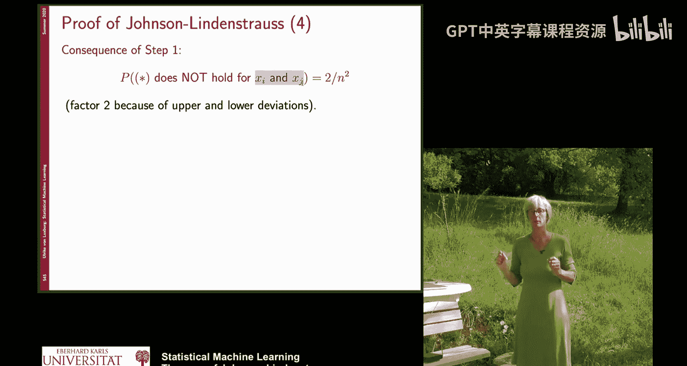

Is bounded by two over and squared。Now we want the serum to hold for all pairs X I and Xj。

And intuitively， it is more difficult， like if you have a certain probability that an event fails。😊。

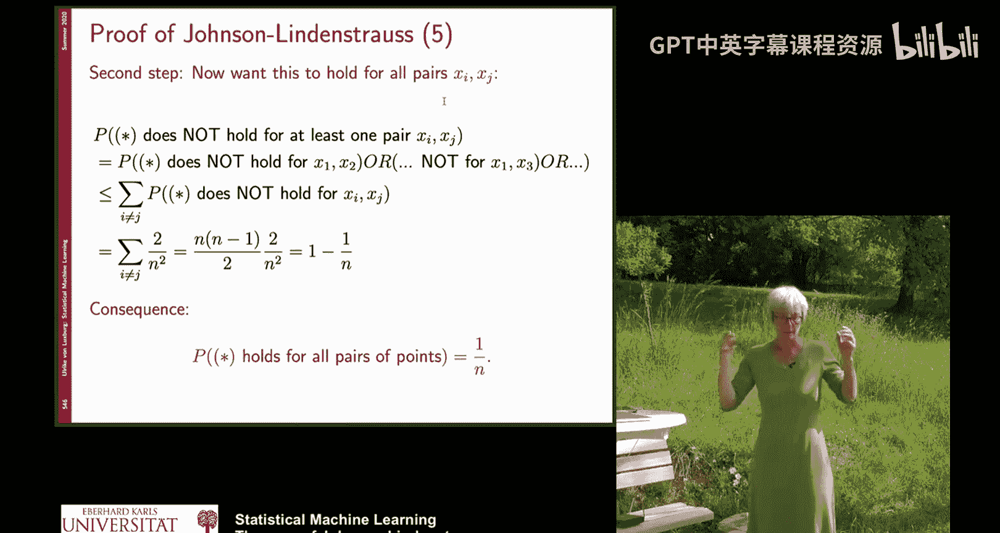

And you'll repeat this very often independently。 Then all of a sudden the likelihood can become higher that there is one pair of things for which it fails。

 and we need to control this part。So what we now are interested in is the probability that this equation from the theorem of Johnson di clauseus does not hold for at least one pair Xi and Xj。

😊。

Remember， the theorem says for all pair X and exchange the thing holds， what is the neation。

 the in neation is there exists at least one pair of points for which it does not hold。

 This is what we have here。😊。

Now if you know your logical rules， you have a not statement and you can translate it in this particular way。

 this for at least one pair means。This thing does not hold for pair x1 x2 or not for pairx 1 x3 or not for pair x 1 x4 and so on。

 so you have this or kind of statement at least one means or there needs to be at least one for which it does not hold。

Now you have a combination of many orura statements。

And if you remember if you have the probability of event A or event B。

 you can always bound it by the probability of event A plus probability of event B。

This is not the perfect bound， that you might lose something。

 it might be a lose up a bound depending on whether these events intersect or not。

 but currently we don't care we have a smaller or equal sign because we don't care about these kind of intersections。

😊，So this is smaller or equal than with sum overall pairs IN J。😊。

The probability that this event does not hold for this particular pair。And this term。

 which is currently in blue on the slide， we already know thats what we computed on the previous slide。

 this was two over n squared。😊，So now what we get is we have the sum over all these different pairs of2 over n squared here。

And now how many pairs do we have， we have n n times n minus1 half many pairs。

 and then this results in if you do the math in 1 minus1 over n。

So what we have proved is the probability that the thing does not hold for at least one pair。

Its 1 minus-1 over n。If you now go to the opposite event。

It means that the probability that the expression holds for all pairs is1 over n。Now。

 if you look at this at first glance， it looks a bit weird because you would like to say like ideally。

 what you would like to have is that the probability is high。 And now we have just one over n。

 So what is now。

The clue here， the clue is in the serum first of all about existence。😊。

And this is essentially an application of what is called the probabilistic method if you want to prove that a certain object exists。

 namely this mapping pi。😊，If you can prove that under certain circumstances。

 the probability is larger than zero， that that thing happens and there must exist a mapping that satisfies that otherwise it's impossible。

😊，And in fact， that's a method that can be very powerful if you want to prove in particular statements about existence of particular algorithms or effects about algorithms。

😊，So the final step first of all to simply prove the theorem is so here the probability that a single random projection does what we want is positive so there exists a mapping that has to desired properties and dis proves the theorem。

😊。

So first of all， this is the proof of the theorem which just talks about existence。Now， of course。

 in computer science we are not so much about existence it's nice that the thing exists。

 but we actually want to compute it。😊。

And the trick is now if you want to compute it， you might simply draw random projections and wait until find until you hit one random projection that has all your desired properties。

😊，So what you do is you draw a random projection。😊。

Then you check for all pair of points whether they desired property holds。If it doesn't。

 he would draw another random protection。This is maybe from an algorithmic point of view not the most efficient kind of thing to do because you need to check for all pairs of distances thats n squared like if you have n points that's n square many distances so one such random checking one such random projection is of the complexity n squared。

😊，And now how many of these random projections do we typically need to draw before we at least in expectation。

 find one that works， well if your likelihood that you draw that one of them satisfies the thing that you want is one over n。

😊，Then you need to draw in such random projections。

 such that in expectation you have at least it works。And if you want， you can try to do the math。

 why do you need to draw on the order of N many random protections in order to find one that works？

And now if you sort of sorry， I lost track so if you now look at the complexity so checking for one of them is n squared。

 now you need to draw on the order of NS such random projections to find one so all in all it's N cube。

To find to actually find and construct a random projection that has to desired properties。No。

 andC is not great as an algorithmic complexity， but at least it's also not completely out of bound if you don't have a data set of 10 billion points。

 but if you have a data set of reasonably many points it's going to work。

 It might take a bit of time， but it's going to work。

Now there's one little but important detail left how do you actually construct such a random projection？

And maybe for right now， I。

Go back to the slide and you don't look at it anymore， I would like to ask you。

How would you construct such a random projection if I have an exercise sheet assignment sheet and give it to you say please implement a random projection which draws a unit director from the units here。

And then you project on the vector。How would you do that。

 Please think about it for a couple of minutes。 And then when you。Think you have a solution。

 then please come back to the slides， and I'm going to tell you what my solution is。

The point that is really important to notice is that there is a method that typically is the first one that you come up with and it is wrong。

😊，And the first message that you might come up with is。Looking at polar coordinates。 So typically。

 I mean， you would consider like you imagine like that's at least that's what I want would would do。

 I would say， okay， I want to draw a vector from a units P And RD。 This is something I can imagine。

 You think about the polar coordinates。And you represent each point by a polar coordinates and you randomly draw points according to a uniform distribution on the polar coordinates。

 so if you look in polar coordinates， each point is represented by two angles， pi and phi。

Like which tells you where in this direction you need to go around the globe and where where in this direction。

 you need to go around the globe。All these vectors are between 0 and 2 pi or these these angles and now you say I look at the uniform distribution on this interval I randomly pick one for psi and one for phi and then that' is my random direction。

😊，Of course， you can do that。 That's going to end up。 It is going to be a random vector。

 but it is not going to have a uniform distribution。

On the unit's view。 And here's the reason why。If you simply look at this particular picture。😊。

This is sort of the kind of like how you would see a globe of the Earth， for example。

These lines have the same distance in angles， for example， it's like。

 I don't know every 10 degrees or so you put a line。

But what you can already see is that the area of these little squares， I mean its not really square。

 but let's talk about them as if there were squares。

 like the area of this little square here is much much higher than if I go closer to the pole of this sphere in this coordinate system。

😊，And each of these little squares would get the same probability because it sort of encompasses the same angle。

😊，It say， say the angle goes from 0 to， I don't know。 pi over 10 or so。 And in both directions。

 but the area is smaller。 So points are much okay。

Maybe here's a simulation。 what is going to happen is。You will have many。

 many points sampled at the sphere。

Then at the equator of the sorting。And this is because here。

 I mean all each of these little squares have the same probability。

 so you could say I first pick a little square uniformly a randomum and then I pick a point in that square。

😊，And then if you pick a point randomly in that square。

 do you have much much less space than picking it here。

 so the points will be denser at the pulse of the scope in this particular coordinate system。

You can try that if you want edit it， and this is a reside so it doesn't work。😊。

So this is something to be aware of。 So this is a wrong method of， of drawing a random projection。

Now， a simple method that really works and that you can also easily implement with sort of more or programming languages。

Is to make use of normal distributions。 So what you can do is。To present， I mean， first of all。

 on a one dimension space。So sorry， you are in RD and you want to project on the one dimensional space what you do is you look at like you look at the D dimensional normal distribution。

 which is typically implemented in nearly all of the at least the like you have in MAap and Python and iron and whatever you have functions to do that。

So you look at the normal distribution， draw random vector according to the normal distribution。

And note that the normal distribution is rotational invariant。

 at least the standard normal distribution， so each directions have the same probability。

 just that the normal distribution also looks at the length of a vector。😊。

Now what you do is you normalize you first draw a vector， which you call z1。

From the normal distribution in the de dimensional space。

 and then you normalize this vector to have lengths1。And then networks。 So you have now found one。

 one vector which is been being distributed uniformly at random over， like over the sphere。

And now what you do is if you want to project on a K dimension space， you do with k times。嗯。

You make a sanitity check so you you draw K vectors from this normal distribution and make sure they have length one。

You check whether these vectors are linearly independent。

Because you really want to project on a K dimension subspace and not on some subspace that has a smaller dimension。

This has a very high probability to happen。 And in fact。

 you can prove that very similarly to these kind of expected lengths of these random vectors。

 you can also prove。Like that the likelihood that vectors are linearly independent is really high。

So if you're unlucky， it happens once or twice that your vectors are not nearly independent。

 but with high probability it's going to happen if it hasn't happened to repeat。

And so you have found Z independent vectors and then if you want to proceed for the projections。

 you for example， try to make an autonormal basis out of them so you can proceed in an easier way later on。

This is the one first version of， of Johnson English noise。

There is also another version that is very elegant and makes this sampling even even simpler in this project。

And this has been discovered by Imitrius aliopus in 2003。

So essentially what he does is so remember if you want to project on a K dimensional subspace。

 we have this matrix capital C where we have all the all these K vectors as columns。

 so we have an n times t matrix which has entries essentially drawn as a normal distributions normalized to have one column norm1。

Now， what he observed is。Instead of this matrix C。We can also look at a matrix that we know called R。

 which has the same dimension， but the entries instead of drawing the entries from a normal distribution we just randomly flip a coin and put plus 1 or minus1。

So we have a matrix R for each entry， you randomly flip a coin and either put plus one or minus1。

So you have a fair coin， so it has the same probability。

And then the projection that you can implement with this kind of method has all the same properties as as the random projection that has been considered by Johnson Ins on this unit sphere。

 So what you get is。Typically， all the， like all the。

Vectctors have like at least if d is large enough your original dimension。

 if you look at the norm of the columns of this matrix R。

 they all have the length of about square root of D that's the same as like we proved for this random projection kind of thing in the translin conum and we also looked first of all is what is the expected length。

😊，And then we sort of say a high variance around the norm or not upon this expected value or not。

 And that's the same here。 So the expected length。Is clarity and it is concentrated。

 This is what we mean by have nearly the same lengths。And also。

 all the column vectors are typically orthogonal to each other so you can use them as a basis to spin a K dimension subspace。

And so what you can now do is you can instead of using this matrix as we just constructed it earlier based on this normal distribution。

 you now simply use this much simpler method with random plus minus1 entries。

And then you get same the following theorem。

Which is now the very end of Johnson English Policy Bu。

 but as has been stated in this other paper by Archopus。So again， we're given end points in RD。

A is our data matrix with with the vectors as columns。We have these parameters， Epsilon and Peter。

Which sort of the deviation kind of coordinates。We choose K S in Johnson English clause。

 The constant is a slightly bit different， but it doesn't really change。

Like conceptually doesn't change the result。So we have again lock N and de numerator。

 we have epsilon like the denominator is the same。As before we just have this factor here is a bit different because we have this factor beta here。

And beta is going to be the one that controls the probability with which。

So we now have two deviation terms。 Epsilon is the deviation in terms of the distances allowed in trans English House and beta is now this is a slightly。

More subtle formulation of the serum is the probability by which you want that as whole。

So you can fix Epsilon and Pia。Use。Let R be a random K times d matrix that has these independent entries plus minus1。

 as we've described before。You project your data points by using this particular matrix withcal it by square root of 1 over。

Sorry， one over a k to account for the length in terms of the dimensions。And then。

With probability at least one minus n to the minus beta。

 this probability of the John Limus theum holds for all pairs of prox ion X。

So here we have the whole statement now in one statement we don't have a statement that says。

 oh there exists， a certain mapping， and then you can find it by repeating a process and times or so here we just have it in one go。

The theorem says if you draw this random matrix with plus minus1 entries with a high probability。

 namely this one here。

The theorem holds as we wanted it to have for all pairs of points。

Here again， why is the theorem of Johnson Den clause so cool， I've already mentioned it。

 so in many algorithms the running time of algorithms depends exponentially on the dimension。😊。

And so we can bring this down to a polynomial effect， at least。This is cool for algorithm purposes。

In machine learning it could also be cool now because that's our context to simply say well we have this random project from like our data lift in a really high dimensional space。

 but we can project it in a low dimension space， we can visualize it in that space。

 we can work in that space。😊，And we know we have a point best guarantee on all the different distances between the points。

 so in particular if we have an algorithm like the Can nearest Na algorithm， for example。

 that really works with distances。😊，And not with any other kind of concepts。

Then if you like apply a Can neighbor such algorithm。

Before your random projection after your random projection。

 hopefully you don't have many changes and then this works and you are in a much lower dimension space。

😊，It's not always clear whether this now I need to make a caveat so you don't have any guarantee right now。

 even if the distance is only changed by some epsilon that the canest neighbor，😊。

There might be many points which have very close distances， so if you're in a high dimension space。

 or if you protect them down。There might be still things that go wrong even in the say in the Canous neighbour algorithm。

 even if you all your distances are just MTVed by a small term。

 but at least it's something that you might want to try。😊。

The final comment is what we have seen so far is just the very basic version of the Johnsonorum that exist many。

 many， many such kind of serumems out there， mainly proved in the theory of computer science community。

😊，One set of results， for example， concerns， if you don't start with a Euclidean distance。

 but you look at some other kind of distanceP distance， for example。

Then you have the LP distance and instead of Gaussian distributions you then end up with P stable distributions which is a concept。

 so Gaussians are two stable distributions and their exist a more general concept which is P stable distributions。

Which is then what you need to exploit in this particular case。

I think for machine learning this doesn't really have a big impact because typically you wouldn't work in any LP or I don't see an application where it's really important to work at least on the data space by looking at the distances in say a one distance rather than the two distance。

 but it's still nice from a theoretically point of view to know that these results exist。

There's also many， many other theorems on。Brananddom。

 well on embedding data points in a metric space， I'm not sure I think I've mentioned it in the lecture before。

 but if I haven't used for example， Boga serum， which is a very very famous one which says any metric space of endpoints can be embedded into auc space of dimension or of lock N。

With the distortion that is is most off fken。So here this is a bit like in Johnson Ly stars。

 we have the distortion that sorry the dimension of the space decreases logarithmically and here the general statement is the distortion is also just something logarithmically in N。

😊，It's a different variant and of course， the proof is different of the serum because we don't start with points in a Euclidean space so we can't apply a random projection because we don't have projections we just in a metric space。

Anyways， so there are many， many such results out there。 We have just scratched the surface。

 If you're interested in just check out the literature there。 also I think overview papers。

 for example， by Puyto Inic， I think there is one。😊，嗯。

Which is all about embedding of metric spaces into Euclan spaces with having low dimensions。 In fact。

 we also looked at a different notion in a recent paper about measuring the distortions。

 which is maybe a bit more appropriate。 So theres still。

 there's lots of research out there and it's still ongoing。 If you're interested。

 just check out the literature。 Thank you。

