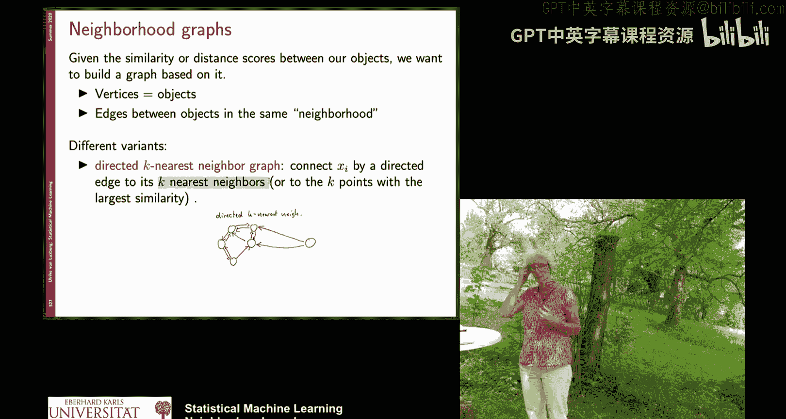
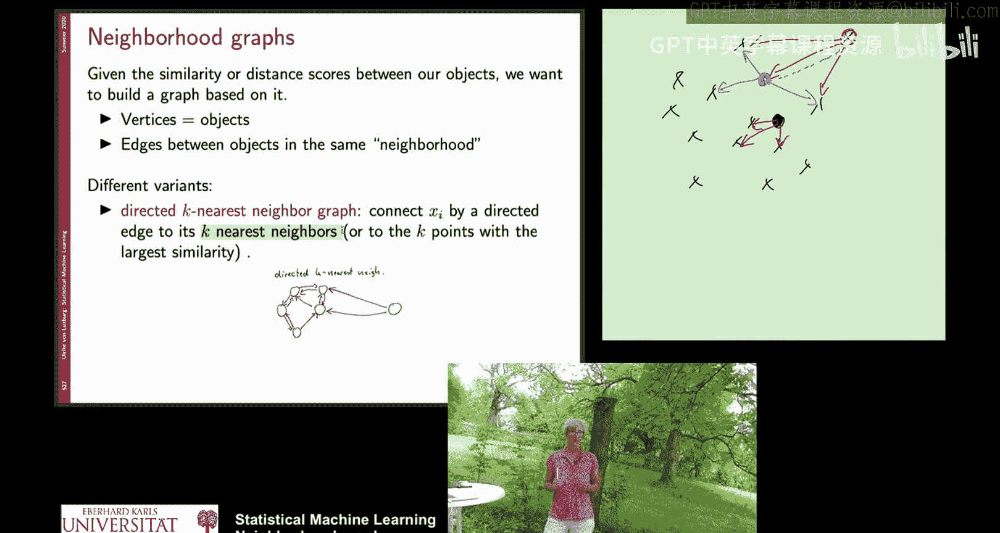
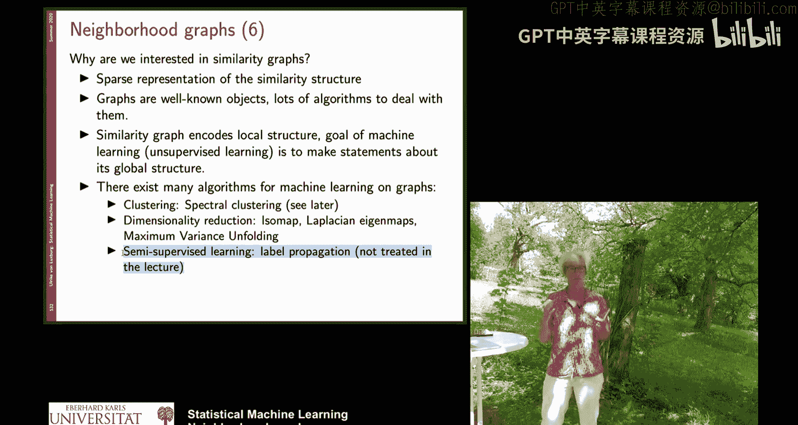

# 图宾根大学《概率和统计机器学习｜Tubingen Probabilistic and Statistical Machine Learning 2020》中英 p32 -32-Part 29 - Neighborhood graphs.zh_en -BV1gso5YGE4s_p32-

In machine learning， they exist a large subfield that deals with graph based machine learning algorithms。

😊，Here the idea is to represent the data in form of a graph or a network。😊。

And then run algorithms on this graph or on the network to analyze our data。

And typically there are two different scenarios the first scenario is that our data already has an interesting graph structure by itself。

 for example， if you want to make inference on people and our data is a Facebook graph then we have already a graph where we have edges between people whenever they are friends。

😊，And now the objects in this graph are the persons and the edges in the graph are the friendships。

 and then we can start our analysis。There are other fields of research where we don't have such a natural grass structure by itself。

But we can easily construct a graph。And this is what I want to explain briefly in this short lecture about neighborhood graphs。

 which is sort of the standard method to construct a graph。😊。

If your objects are not by themselves already represented in form of a graph。

So we're going to look at neighborhood graphs right now。

A neighborhood graph very roughly tries to encode the following concept， the objects in our graph。😊。

The vertices in the graph are the objects， so if you want to make inference on molecules。

 the vertices are molecules， if you want to make inference on text， the vertices are texts。

 if you want to make inference on I dont know people then the vertices are people。

So the vertices are what we typically call the points Xi in the standard notation of our machine learning lecture。

😊，And now we want to encode into a graph。When are certain objects similar to each other。

And we want to connect objects that are very similar to each other by an et and over graph。

 and then the resulting graph is sometimes called a similarity graph。

So here we have it on the slide so the vertices in the graphs are always the object that were interested in and the edges are whether objects are sort of in the same neighborhood or similar to each other。

😊，And now the question is how do we measure whether points are in the same neighborhood or whether they are similar to each other。

 this now works as follows， there are a couple of different kind of ways in which it can be done。😊。

So the first thing we can do is we construct what is called the directed K nearest Ne graph。😊。

And it is defined as photos， so we want to connect the data point X。By a directed edgech。

So this is important here。To its came nearest neighbors。So sorry， K nearest name。

 so K is a parameter。And we simply connect everybody to its can neighbors。

 and lets simply make a figure。

Here are data points which live in the Euclidean plane and if I want to do say a three nearest neighbor graph and I want to look at a directed3 nearest neighbor graph。

And I start with this vertex that I just marked with this big blo。

 I need to find out what are the three nearest neighbors and I insert a directed edge so let's maybe make the edge。

😊，In red。So here maybe this is the first neighbor， this is the second neighbor and this is the third。

 so we have directed edges here。We do this now for all vertices in the graph。

 and then we get a directed graph that is called the directed Canousne graph。😊。

Observe that sometimes the edges， there might be edges in one direction。

 but not in the other direction。 For example， I simply。At one point。To our data set here。Now。

 if I want to know who are the three three near， so this is the point I'm not interested in in the right top corner。

😊，So the three nearest neighbors of this point are maybe this guy in this guy in this guy。

 So here I have a directed edge。But now I try to do it in blue， maybe。

If I look at the nearest neighbor of this blue point here。

Then maybe it's this guy and this guy and this guy。So in particular。

 there is no link that goes from this blue point to the red point in the right corner。

 no directed link in this direction。This is because simply it can be the case that one person is an like here here in this figure。

 we can already see if one vertex is an outlier vertex。

 sort of the edge that goes from this vertex to the。To the normal vers is quite long。

 but then the vertex that is going to be hit by the target of this edge has neighbors which are much closer by。

 so the edge doesn't go in both directions。😊，Okay。Now this is of course something you can do you can construct a directed can nearest Negraph now it turns out that in many machine learning applications it's really inconvenient to have a directed graph because very often what we do is we want to look at say the adjacency matrix or the graph lapplian matrix or some other kind of matrix that is related to your graph and you want to do an e decomposition and for this first of all we would like to have a matrix that is symmetric and the adjacency matrix of such a graph is not symmetric。

😊。

And so if we now have this directed graph， but we would like to make it into an undirected graph。

 there are principally two different ways by which you can do this。

 you can simply say you ignore the edges， sorry you ignore the directions and simply put an edge whenever there is at least one arrow printing between the two vertices or youd say I only put an edge if there are two directions of the arrow in the original graph。

😊，And here this is formulaized on the slide。 So the one way to achieve that is what I would call the standard that can nearest Ne graph。

 So what you do is，You put an edge between X I and Xj。

If one of the following conditions at least is true。

 if either X is among the can of Xj or vice versa。😊，In the image we had seen before。

 it means whenever an arrow is going to point in at least one of the directions between the two vertices。

 you simply put an undirected edges。 So you could say you simply ignore the directions of the edges in the undirected in the directed graph。

Then you obtain an undirected graph， and this is what we would call a standard Canous Ne graph。

And this is the graph that is most widely used in machine learning。

The other option is what is called a mutualaneous Ne graph。😊。

And the important difference here is this word end instead of aura。😊。

So if you want to know whether there is an undirected edge between vertex XI and Xj。

 you need to check whether both is true that XI has a directed link to Xj and Xj has a directed link to XI if both conditions are true。

 then you put an undirected edge。😊，And you can see this graph here on the slide。

Its the same iss sort of the two versions of maybe I go back。

 So here on this previous slide we see this directed Canous Ne graph。😊。

And on this slide which we have here， you now see the two versions how we can make this directed graph into an undirected graph。

 this is the standard undirected graph， and this is the mutual Can name graph。

What you can always see and that's also obvious from the definition。

 the edges in the mutual undirected graph is always a subset of the edges in the standard undirected graph。

 but not vice versa。😊，So these were the variants of the K nearest Ne graph。

There exists also another concept of graph， which is often called the Epsilon nearest Ne graph。😊。

Which is even simpler， and you simply connect each point to everybody else。

If the distance between these points is smaller than some threshold epsilon。

And maybe to get some kind of feeling for how these graphs really work here is a slide that makes a little illustration。

 so what we can see here is I simply have drawn some data points from R2 a random set of points。😊。

These are the blue points。😊，And then what I show are of course， the edges of the graph。

 and I look at all the different undirected graphs。

 So what we have here is the standard k nearest neighbor graph for k equals 5。

 So the K is the number of neighbors that we' are going to look at。 In this case。

 we look at five neighbors。😊，On the right hand， what you can see is the same nearest Ne graph。

 but the mute like for the same value of k， but the mutual nearest Ne graph。

And you already see that there are quite many fewer edges then in the graph on the left hand side。

 for example here， I can't market， so here we have for example。

 these two points that are connected by an edge but they are not connected to the rest of the graph。

😊，Whereas here this canous Ne graph tends to be nicely connected。And this is， in fact。

A property that happens quite often。 The mutualaneous neighbor graph is very。

It can easily be disconnected and in particular in cases where we have outliers in our data and this is sort of the kind of thing that we have seen on the iPad as well。

 if we have this one outli in the data， it might have edges to the rest of the graph。

 but there are never edges that go the other way around and so this outlier would be an isolated point in the mutualaneousna graph and this is also what you see here。

 for example here on the bottom you see a couple of isolated vertices。😊。

And the reason that they are isolated is is they have their nearest neighbor all here in this region。

 but in this region， everybody else has their neighbor also in this region and it doesn't connect back。

😊，What I also show is if we， of course， if you increase the parameter k in this case。

 so here we have k was 10 for the mutualcanous Ne graph， of course you get a higher connectivity。😊。

And eventually the graph sort of get a bit similar undirected to the standard Can nearest neighborhood。

However， you still， I mean， here you still see an outlier。So whenever you have the choice。

I would always use the Can nearest Negraph， the standard Can nearest Negraph。

 not the mutual Can nearest Negraph， and in fact I don't know of any anybody in the field who would use the mutual nearest Ne graph。

 I think there might be some very specific circumstances when it makes sense。

 but typically you would always use the standard undirected Can nearest Negraph。

What you can also see on this slide is the Epsilon graphs。

And you also see already on this slide you can see what are the disadvantages So the epsilon graph have similar problems as the mutual cans and Ne graphs。

 if we have outlier points， of course their distance is larger thanil if you choose this epsilon parameter useful somehow what you want to achieve is that everybody is connected to a couple of neighbors but of course you don't want to have the whole dataset connected with millions of links and here like if you would need to choose epsilon so large that this point is connected to this point here so you don't have a disconnected graph then epsilon needs to be really。

 really large and it means like here within this high density essentially everybody is connected to everybody else and to a certain extent this is already the case here in the graph you can't even distinguish the individual lines anymore。

😊，So for an epsilon graph we also have the problem first of all that the graph tends to be disconnected or if you choose Epsilon large enough。

 then the graph is connected but you don't see the structure anymore because nearly everybody is connected to nearly everybody else。

😊，So the take home message from this particular slide is if you are about to construct an undirected graph from your data。

😊，Then you always use the standard Canius Ne。Now， the next thing that you can think about are edge weights。

 So so far， all the graphs that we have seen。Didn't have any edgeu weights。 They were unweighted。

 but in many applications， it might make sense to add edgeu weights to your graph。As I said。

 a prior these graphs are unweighted。😊，Now， if you。Work with canous Nes。

 which is always my recommendation。Then it often makes sense to add edge weights。

And the reason is as follows， if you look here on this canous neighbor graph in the top figure。

 you see that there are edges that are rather long。😊，And there edges that are rather short。

And you might want to know or to give the information about how large these edges are to your algorithm。

😊，How long these edges are and you can do this by edge weights？

The important thing is now the edge weights should encode similarities and not distances。😊。

And the difference is if you look at the unweighted graph。😊。

If you represent it as an adjacency matrix the entry is either  one or0。

 depending on whether the edge is there or not， one means there is an edge，0 means there is no edge。

Now if we introduce similarities， of course you want that the edges correspond to high values and something that does not have an edge or very long but not so informative edge should correspond to a low value。

And so it's important that you have similarity weights on your edges。😊。

And the typical choice that you can make， for example， if you have Euclidean data。

 you can simply put a Gaussian kernel as edge weight on the graph。😊。

So essentially you compute the similarity between two vertices by a Gause kernel。

 you choose the kernel with sigma。😊，By the same roots of thumb as you would do it for all other algorithms so you could say sigma in this particular example might be maybe 1 or maybe 0。

5， I don't know something such that a point is similar to maybe 10，15 neighbors。

 but it definitely should be the case that the point that is on the left upper part on the right upper part of your plot is not similar to a point that is somewhere in the other end of the part of the graph。

😊，And so by giving by using the canous neighbor graph， but on top using the similarity weights。😊。

You sort of can convey more information to your algorithm than you would have if you don't have the edgeways。

I tried to explain this again on the slide so you should never use distances because it destroys the logic behind the neighborhood graph so if you have two points which are very close to each other sort of the distance would be nearly zero but these would be the edges that have an the points that would have an edge in the graph so it would be one so some of this doesn't get together。

😊，For epsilon graphs， typically we do not use edge weights because this epsilon already is some kind of distance information and somehow it's not so important whether a distance is really epsilon or epsilon over two or something like that。

 you should choose the epsilon in such a way that it anyway only connect local local points in local areas in your data space and then it doesn't happen that you would have very long edges which you might want to distinguish from the short edges so all edges in an epsilon graph are about the same length up to epsilon so it doesn't really make any sense to use edge weights for this kind of graph。

So why does it in the first place make sense to represent your data as a graph？Now。

 there are many different reasons。And I just listed a couple of them here。

The first one is that we have a sparse representation of all similarity structure。

 So if you just consider something like Facebook you have a couple of million users a billion I don't know。

 you might not want to have a distance matrix which is sort of 1 billion by 1 billion because you would never be able to store this matrix anywhere。

 So what you want to have is you just want to know similarities between close by friends and everything else essentially youre not you don't care about。

 and the rationale also in machine learning is。That often it's the information between similar and close by object that is really important。

 So if I want to use want to solve a classification problem。😊。

Like the naive Igri Misscanist neighbour， which just needs to know who are the neighbors of my data points。

 And I don't care about all the points that are far away。 I just care who are the neighbors。

 And then what are the labels。 And this information about the neighbors is exactly what is encoded in this neighbour graph。

And up to a certain extent its similar in the epsilon graph where we just say we consider everybody that has a similarity up to a certain threshold and maybe then do a majority vote。

 I don't know over the labels， but we don't really care about whether somebody like if I want to know want to solve a classification problem for a certain point。

😊，I don't really care about what this other point in the very far end of the space does。

 It's too far away。 It doesn't have any influence on what is going to happen here right。

 right at my particular point。嗯。So in this sense， it helps helps you to give a spa representation。

 First of all， this is efficient from a computational point of view。

 Then maybe the sort of for convenience， of course。

 like people in computer science know many things about graphs。 I mean。

 everybody has been some kind of algorithms lecture。

 So you know lots and lots of algorithms or graphs。

 And these are objects that are often very convenient to express relationships between objects who。😊。

We know graphs， so it might make sense to use graphs。

And this is the point about the similarity structure that the local structure is important。

 I already try to explain that a bit， so if you want to solve classification。

 we only care about local neighborhoods but we don't care about what happened somewhere else in the space and this is exactly what is being encoded by the Canous Ne graph or the Epsilon graph。

😊，And we are going to see here I just have a list of a couple of algorithms that are based on this kind of graph based machine learning approaches clustering。

 for example， spectral clustering is one of the very prominent clustering algorithms is entirely based on graphs we are going to see it in a couple of lectures。

😊，Then many of these dimensionality reduction techniques。Are based on the graph structure。

 for example， Io map， which we're going to discuss in the next lecture。

 And then also in semi supervised learning， many， many algorithms use this kind of graph based framework。

 For example， the standard label propagation kind of algorithms。

 which we're not going to discuss in the lecture。 But you could look at up in the literature。

 if you're interested in。

