# 图宾根大学《概率和统计机器学习｜Tubingen Probabilistic and Statistical Machine Learning 2020》中英 p33 -33-Part 30 - Isomap.zh_en -BV1gso5YGE4s_p33-

In this lecture， we now want to discuss the IOmap algorithm。

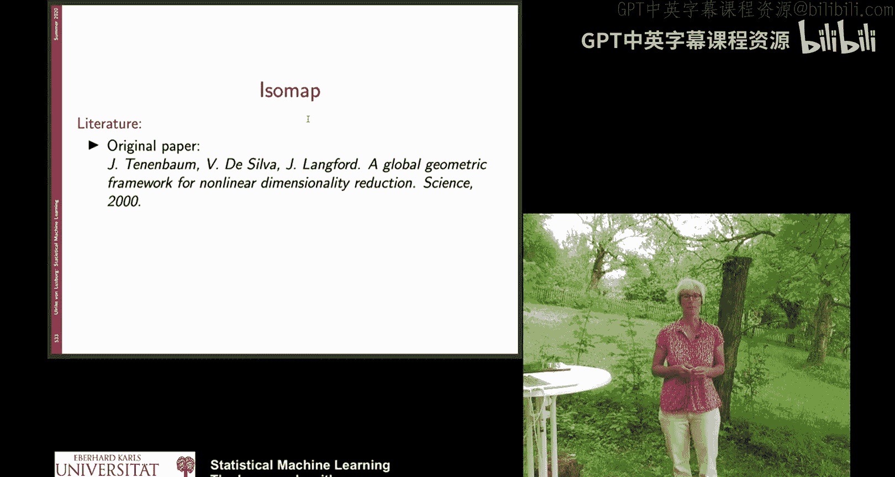

It is an algorithm that has been developed around the year 2000 and at the same time there are a number of different algorithms and all of these algorithms share one particular goal。

 namely the assumption is that the data even though it might live in a very high dimensional space。

 inherently lives on a low dimensional structure and the structure can be encoded in terms of a manifold。

😊，And the goal of ISOE and all these other embedding algorithms is to find this low dimensional representation of the data and sort of to embed the data in this low dimensional space。

 but by taking into account the kind of manifold structure that the data has and we are now going to explore how this works。

😊。

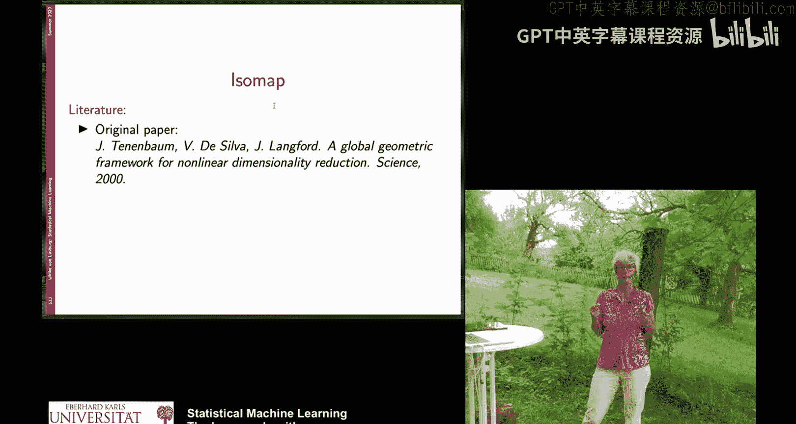

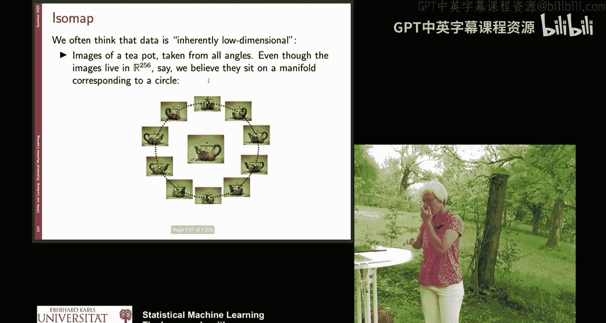

Let us start with a bit of motivation。In many data sets。

 there is an inherent assumption or it makes sense to have an inherent assumption that even though the data might be recorded in a very high dimensional space。

😊，The structure of the data， sort of the relationship between the points to each other。Might。

 might be represented with a much lower dimension structure。

 And I want to start with this one particular example。

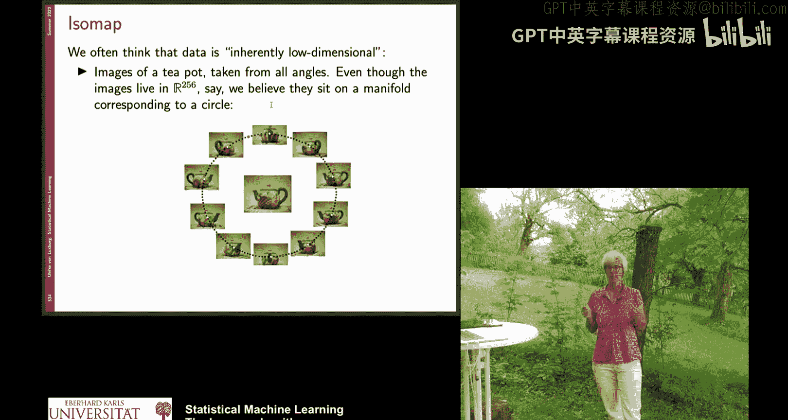

This is a famous teapot data set， So what you can see here is there is this teapot that you can see in the middle of the slide。

😊，And now the people who invented this data set took an image of the teapot by walking around to the teapot and taking an image from all different orientations。

And so you can see the images here arranged on the circle。😊。

So you always have an image of the teapot， but your perspective always changes with each of these images。

Now， if you want to explore sort of what are neighborhood relationships or geometric relationships between the images in this data set。

 you could arrange these images in a two dimensional space。

 namely sorry you could arrange the data on a circle。😊，And sort of the neighboring。

Teapot images on the circle are the ones where the perspective is nearly the same and maybe just as5 by one or two degrees。

Inherently， this is even something like a one dimensional structure because there is only one parameter that you need to describe where on that circle you are。

😊，And at least if you have enough information on your data。

 this one parameter sort of is enough to include the neighborhood structure。😊。

Between the different images in this dataset。And this is what we mean by a low dimensional structure。

There are many， many other examples where this makes sense。😊，For example， consider， I don't know。

 you want to record voices of persons。Now， the voice of a person is characterized probably， I mean。

 if you record it， you have a sound wave and it's a very， very high dimension stimulus。

But now if you consider how this sound is being produced。

 I mean there are lots of muscles in this throat， I don't know how many maybe there are 20， 30， 40。

 50 muscles that are all involved when I speak and maybe you need to know the dimensions of my throat。

 all these different elongations but once you know all these parameters maybe you could reasonably well predict how my voice is going to sound。

😊，So you probably don't need like 50，000 parameters to describe like my local geometry of my throat。

 maybe 50 parameters are enough in order to roughly know how my voice is going to sound。😊。

And similarly there are many， many other examples where the data。

 like if you just consider images like image databases or image。

 like an imageNe or whatever you have images that are being recorded with a reasonably high resolution。

 maybe you have1 megapixel image or 10 meapixel image but probably if you have a database of images you don't need to have like 10 million parameters to describe all these images。

 it sounds a bit too much。😊。

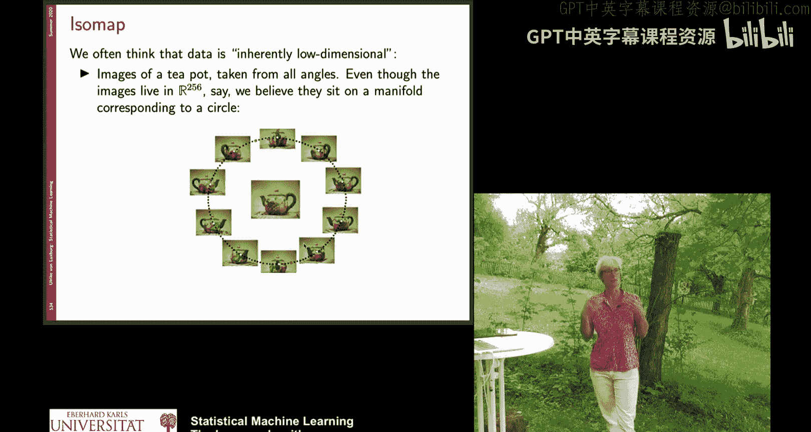

So maybe there's an inherent structure。

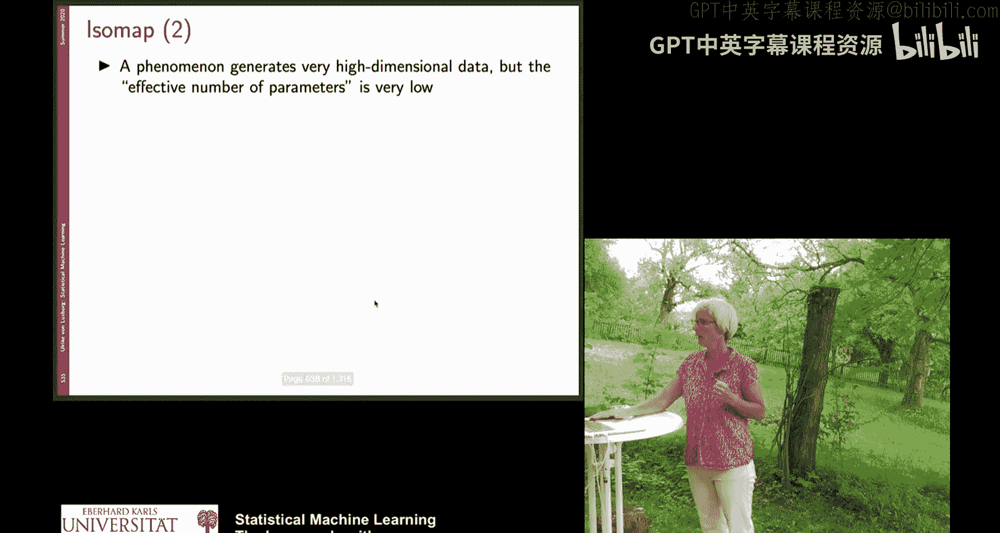

Here's another example。 I hope you can see it in the in the MP4 movie and if you cant， then maybe。

You need to look at the slide。 So what you can see here is images of hands。

 so there was a person who has like put his hand in different positions and also made sort of different gestures that opened and closed the hand it could be turned and so on。

 So what you can see here the all the blue points。😊。

That you can see here represent one picture of a hand。

And what they essentially did is they recorded the scent from all these different perspectives in these different shapes and so on。

 and then did a two dimensional embedding。And what you can see here now is different particular images in this database are shown here。

 so maybe here this red circle around this blue point means that this hand here corresponds to this particular point。

😊，And now you can look at this embedding and try to make sense of it。And what you know can see。

Is that if you go along the axis and if you see what happens from when you go from left。

 if you go to the right。What you see changing is the wrist rotation。

 so on the left side here close to the coordinate axis， the wrist is always upright。😊。

And the more you go to the left， the more， I don't know， horizontal is the hand。😊。

So what you can see and this is， but this you can of course。

 only interpret in hindsight is that this first direction of coordinates。😊。

That has been identified in this embedding controls something like the wrist rotation。Similarly。

 if you go from the bottom to the top along the Y axis。

 what you can see is that at the bottom the handss are always closed， there' is a fist。😊。

And at the top， the hand is always opened， so the fingers are all extended。

And so you could say also in hindsight that in this particular embedding。😊，The Y axis。

Gives an indication of how extended the fingers are or how close the hand is to a fist。

And this is somehow it seems a bit strange that this comes out because when you apply the algorithm。

 of course you didn't tell the algorithm anything about the images you didn't also tell about meaning of the images about wrists and rotations and fingers and so on。

 yet if the algorithm tries to find an embedding of the dataset。

 in such a way that similar pictures are sort of embedded close to each other，😊。

Then this is what comes out and so you can see here a two dimensional representation of this data set already encodes quite a lot of information about these different images of hands。

😊，And this is sort of the intuition why we think that such a manifold approach might make sense。😊。

That even though these images might have been recorded or the figures the pictures have been taken with a high resolution camera。

If you just want to know about the local geometry between these couple of images。

 two parameters are a good description for what is going on in this particular data。

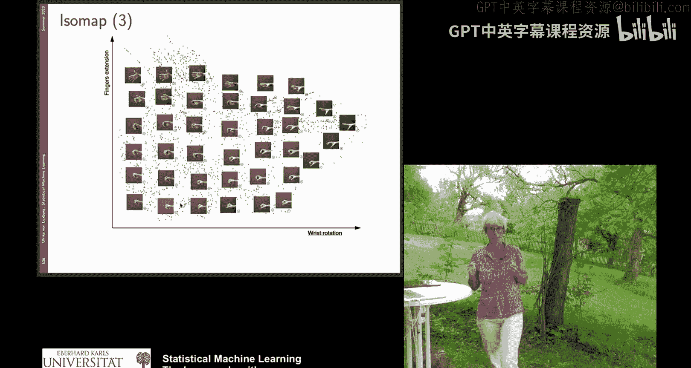

Now I have often used the word manifold and many people of you Im well aware probably don't know what that is and here comes maybe a first illustration。

😊，So。Intuitively。A manifold is something like what you can see here on the left figure。

 it is a low dimensional object。😊，Say a two dimensional can be also more。

 but maybe imagine a two dimension object， like a piece of paper that is embedded into a higher dimensional space。

And it's not necessarily embedded linearly。 So if you have a piece of paper， of course。

 you can sort of put the piece of paper in a three dimensional space and it's still flat So sort of there's no difference to a two- dimensional representation of this piece of paper。

😊，But here， if sort of this piece of paper is a bit scrambled like this landscape that we can see here on the figure。

😊，This is what we would call a manifold。And the idea is from an abstract point of view。😊。

That we assume that the data set we're looking at has such a manifold structure。

 that the number of parameters that we need to describe this data set is much。

 much lower than the dimension in which this dataset set is living。

 And here in this particular figure to already introduce a bit of notation。

 the intrinsic dimension of this data set would be two， it is something like a flat surface。

 so which is a two- dimensionmensal thing。😊，But it lives in a three dimensional space in this particular case。

 so the extrinsic dimension of this data set is3。😊。

And the idea is now what such a manifold algorithm or embedding algorithm based on manifolds is supposed to do is。

😊，So you assume your data has such a shape。You know， sample points from this manifold。

And you sort of， say you take figures of hands or pictures of teapots。So you get individual points。

And now you would like to sort of flatten this manifold。 So here， I now want to so。

The intuition is in the ideal case， I would discover that the structure that describes these data points is something two dimensional。

😊，And then I want to find a two dimensional representation that sort of brings out the structure and throws away all the additional information and dimensions that I don't need。

😊，In this sense， it's S in PCA or MDS and a dimensionality reduction technique is start with objects that are being represented in a very high dimension space。

😊，You discover what might be parameter that are not so important。

 and then you embed into the low dimensional space and try to recover what is still important about your dataset。

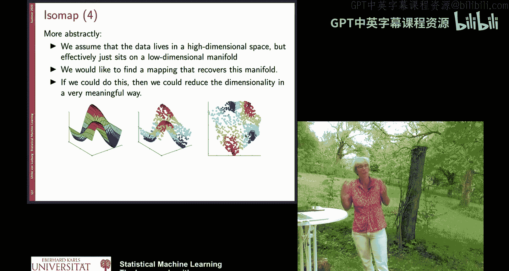

Here are some other examples。So for example， here we have this S shaped。

Kind of it's like a shaped piece of paper， a plane， a two dimensional thing。

 you have it in you sample from it and you would like to make it flat or you have this sort of sphere that has a hole on the top。

And disemble from it， and then you sort of can flatten it out。In particular， in this last example。

 what you can also see it might happen that in this particular。😊，Step of flattenning。

Some distortions happen to your data because if you， at least if you， if you know a bit of geometry。

 there is no way to flatten like something like a spherical thing with a top to make it flat without distorting the distances。

 And if you think about this，Andtuitively， it makes sense if you have say if you have built something like that out of paper。

 so maybe you have one of these paper lamps that look like this。

 if you would like make to flatten it， you would either need to cut it somewhere or you need to scramble it somewhere else。

 so this is not going to work without。😊，Without distorting it。

 But maybe that's not so important for machine learning， because in the end， we often。

Mainly interested in local neighborhoods as we have already discussed in this sort of graph based section。

 at least I have hinted it already， so maybe it's fine if you sort of at least keep the neighborhood structure and some of the global geometry might change。

😊。

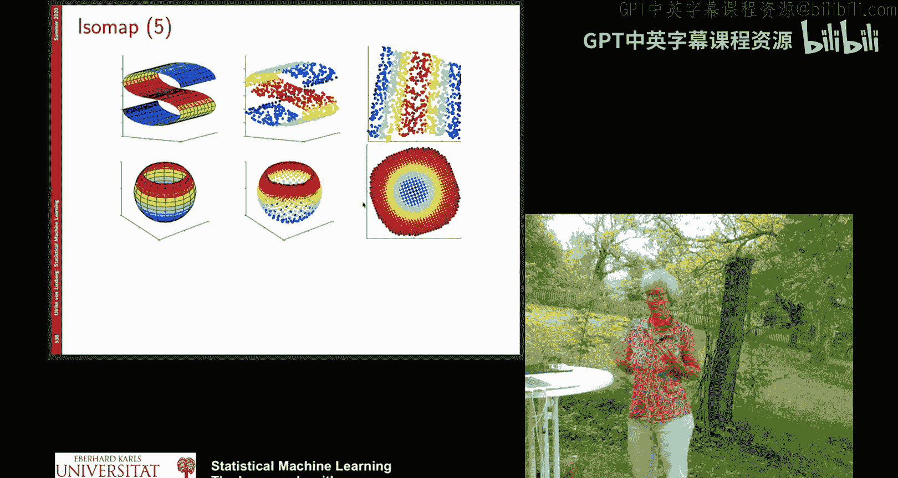

Now， here's the intuition of what the isOap algorithm is supposed to do。In a small local region。

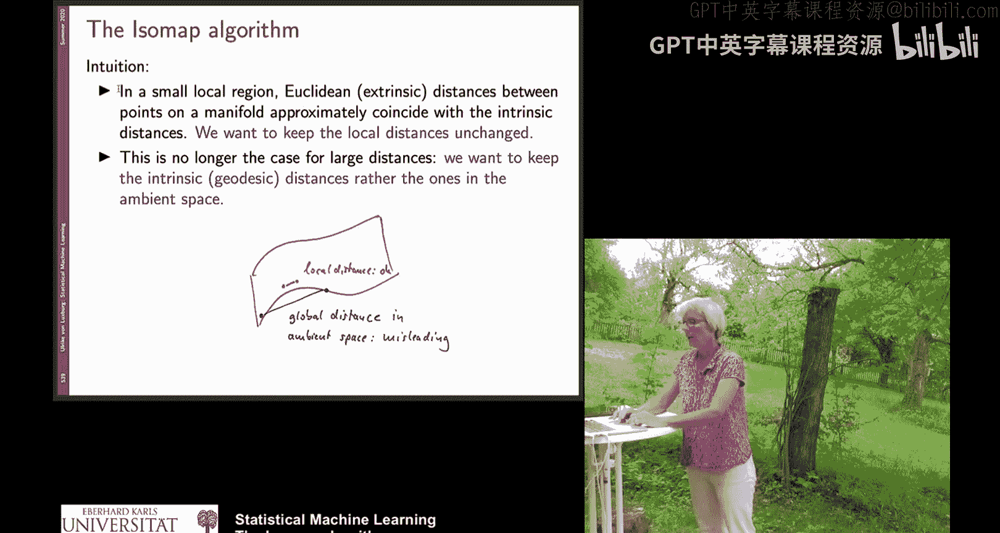

The distances between points on a manifold approximately coincide with Euclidean distances in the space。

And in fact， if you are from the， if you have a mass background you might realize that this is more or less in the definition of a manifold。

 the definition of a manifold is that locally you can describe the manifold by local maps that are low dimensional Euclidean spaces。

😊，But globally， you need to glue all these maps together to get the full image of what is going on。

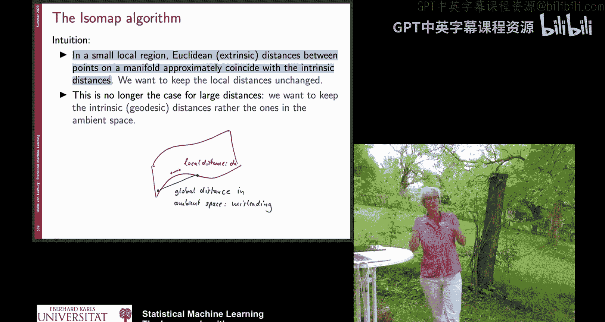

So maybe I go back to this figure here so locally so if you just assume me in one of these little rectangles。

 for example， that are drawn here in this S shaped thing。😊。

Then each of these rectangulars is nearly something flat that looks really like a plane。

 even though the whole figure is something like an S， but its little region。

 local region of this thing looks like a two dimensional plane。😊。

So it means that if you have a distance between points that are very close to each other。😊。

Then if we measure the distance between these points。😊。

In the okay now I need to go back so now I can measure the distance between points and say heres something like the red thing is something like this S shaped thing if have two points which are very close by and they take their coordinates and compute simply the Euclidean distance。

😊。

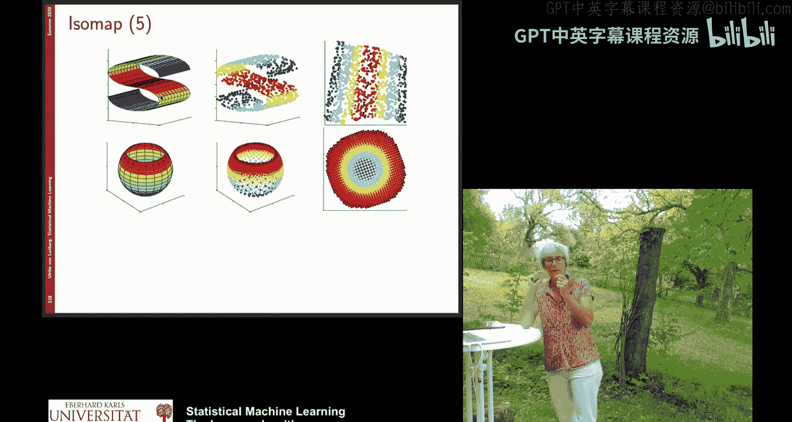

As given by the coordinates， which means in the extrinsic space。

 I don't know anything about the manifold structure， I just computed， I mean。

 I have my points they live in this high dimension space and I simply compute that distance according to the Eucliidean distance。

😊，Then this distance sort of coincides with a distance。That these two points have along this。

 along this manifold structure。However， if I look at these two blue points which are further away from each other。

 if I simply take the coordinates of these two blue points and compute the Euclidean distance，😊。

Again， in this ambient ex extrinsic space， then this this distance would compute the shortest part like。

The Euclidean distance between the two points， which is sort of indicated by this blue line here。😊。

And this somehow does not describe the manifold structure anymore because if I would walk inside the manifold。

 then my distance would somehow be longer。And I have an example on the next slide where I'm going to show it。

 but maybe let's first read the slide finally。😊，What it says is in a small local region。

The Euclidean distance between the data points， as we are given the data points which in this high dimension space。

Approximately coincide with the intrinsic distances and the intrinsic distances are the ones along the manifold。

😊，And for large distances， this is not really true。 this is the key to the algorithm。

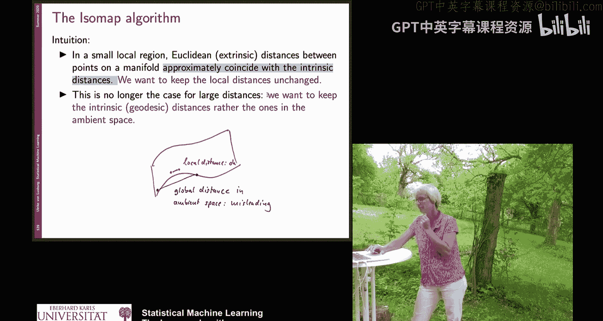

And maybe let's now look at this particular kind of figure here。

 So if assume we have this kind of rolled up piece of paper。And we want to flatten it。

If you now would compute the distance between this blue point here and this blue point here and would do it simply naively and take the Euclidean distance。

 and we would get a distance that is much shorter than the one than if you would walk along the manifold。

😊，In this distance of walking along the manifold is called a geodesic distance。

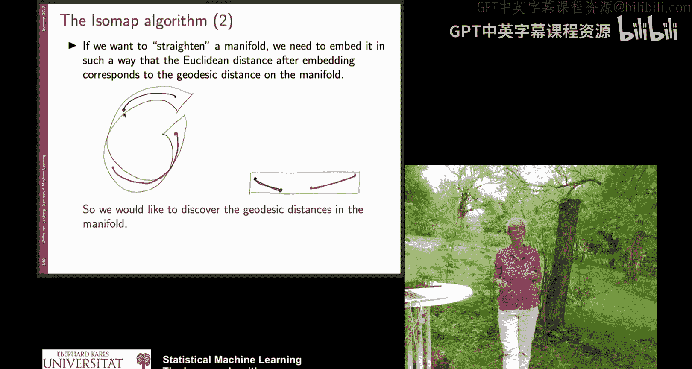

Maybe as a different example， if you take the earth。😊。

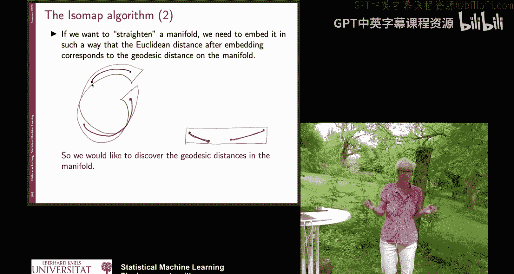

Now consider the earth as an object in the three dimensional space， so we are somewhere in the space。

😊，We are a stars and many stars around us and you take the coordinates of Germany and Australia in this three dimensional space and you compute the Euc equilibriuman distance。

 you would simply compute the distance which goes through the Earth。😊。

Which maybe is not really what is representative for what is going on on the earth because on the earth we would need to walk around all of the globe。

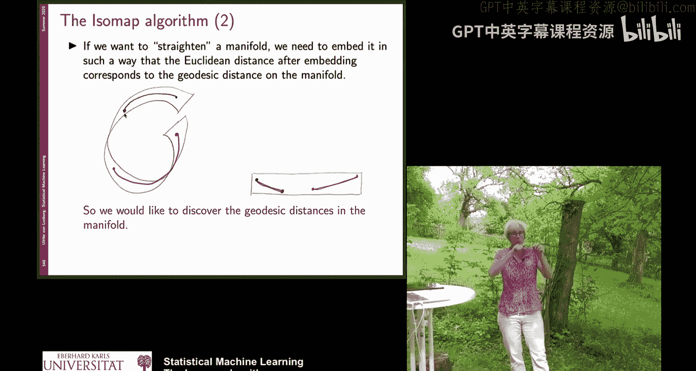

And this is the geodesic distance， so the geodesic distance is the shortest distance between two points that you can realize while walking on the surface of the object that you're currently considering。

😊。

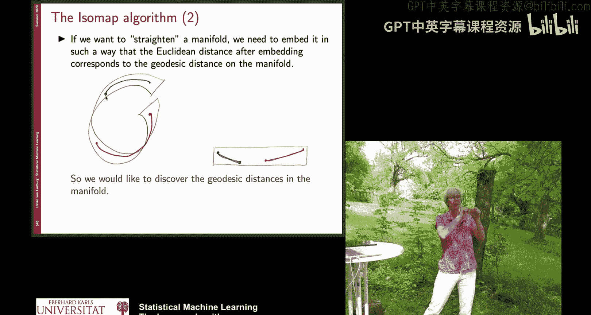

And the idea is now。😊。

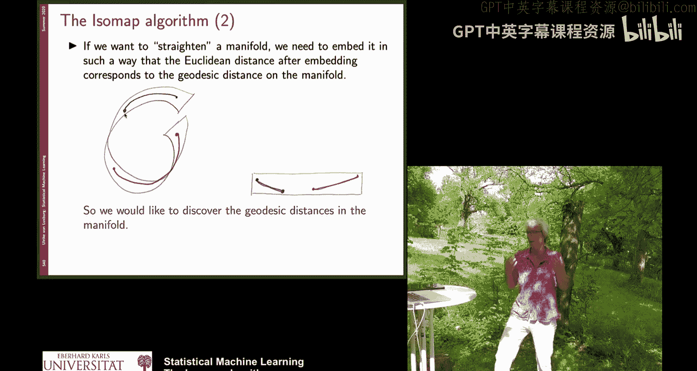

If you want to flatten this manifold。 So in the end。

 what we want to find is an algorithm that discover the two like in this particular example。

 the two dimensional structure of the data， we sort of what to want to unroll this kind of rolled a piece of paper。

😊。

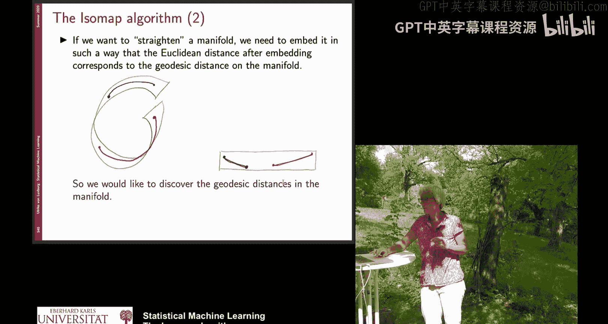

And then we would need to know to be able to unroll the thing what should the distances be after we enrolled data we unrolled this kind of role structure。

😊。

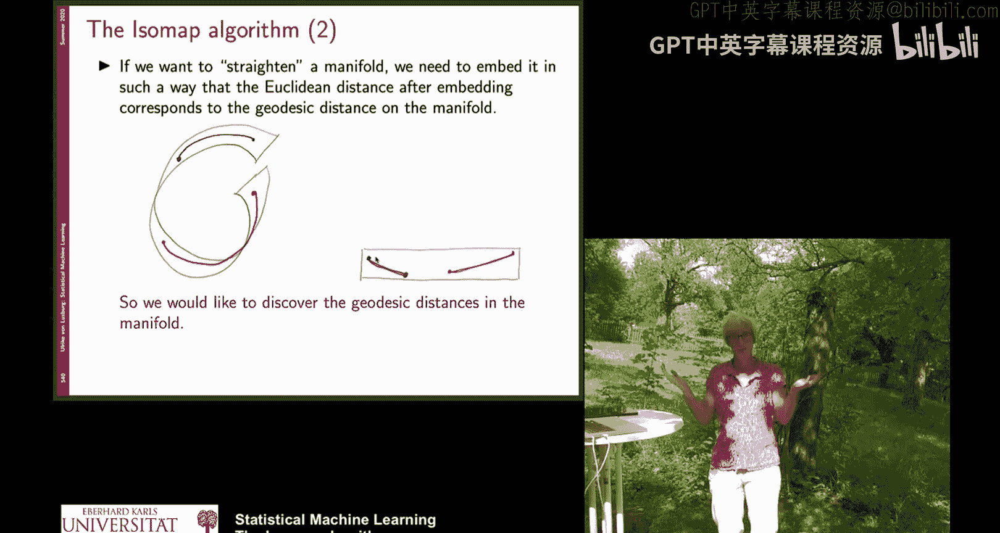

And if you now want to know， what would this red distance be between the two points after we have in。

Unroll the data structure。Then this is represented by walking along the surface of the manifold in the original data space。

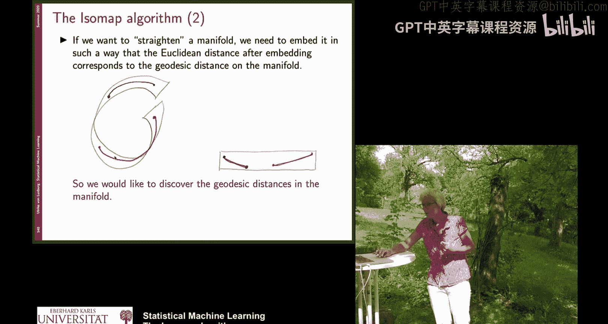

So what and the intuition is now if we want to manage this sort of unrolling of the manifold。

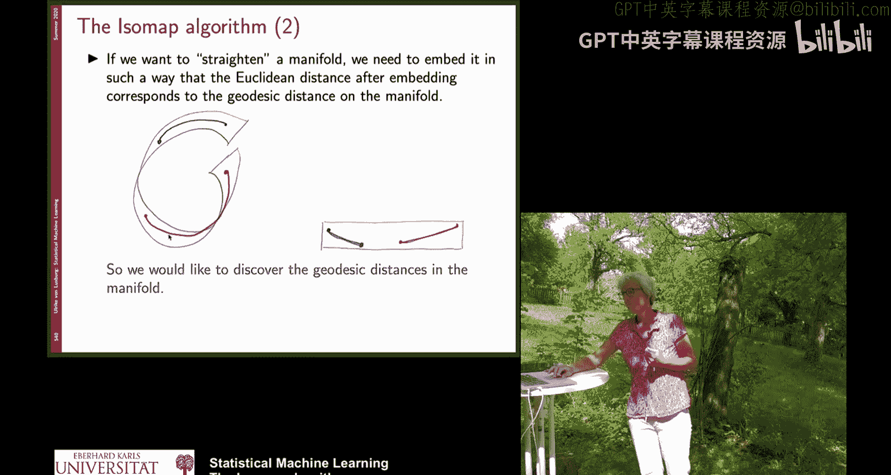

We first of all need to estimate what would be the geodesic distances between points？

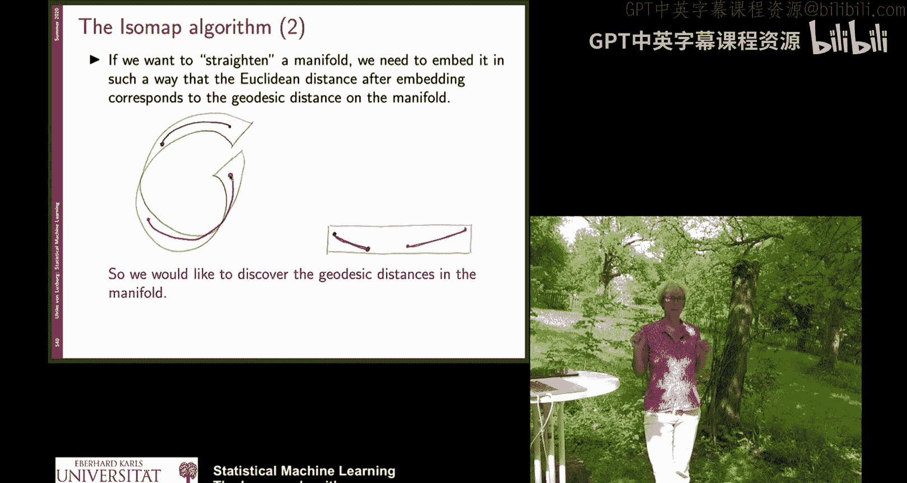

For example， how long is this red line here？And how long is this blue line here？

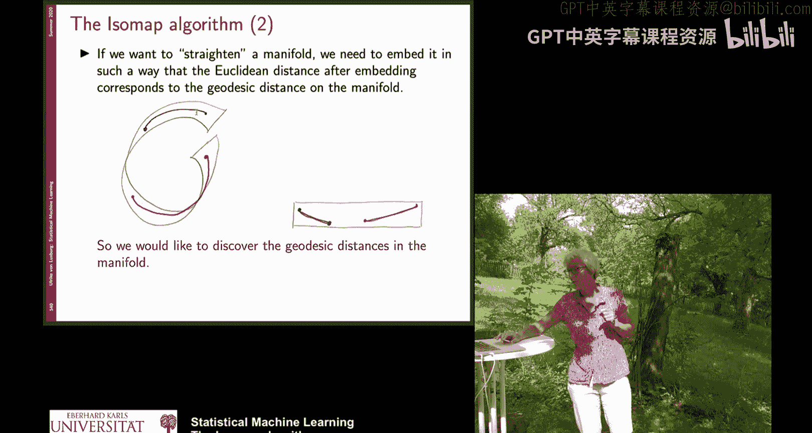

And once we know all that， then we can try to find an embedding of the data points in a two dimensional space that realizes these kind of data these kind of distances。

 and this would then then be the result of the algorithm。😊。

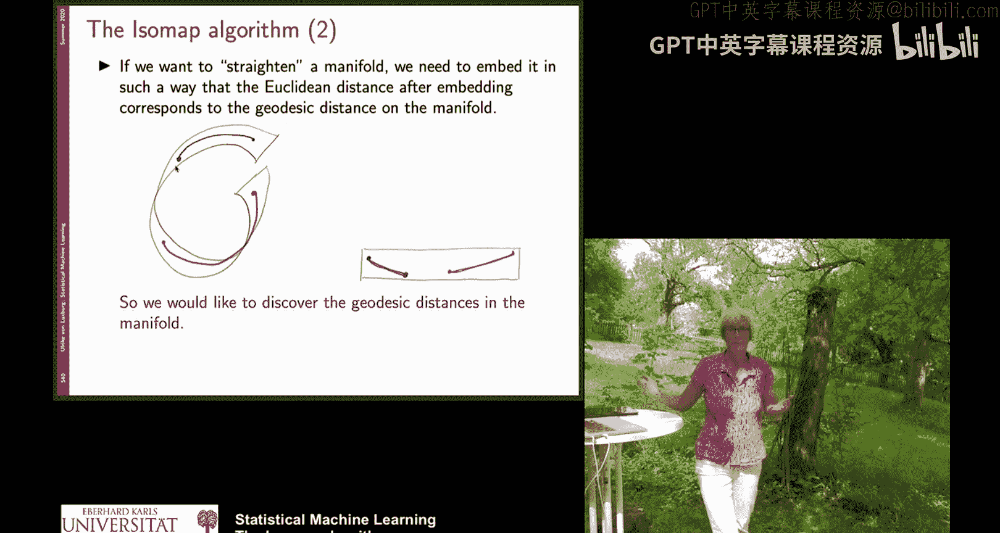

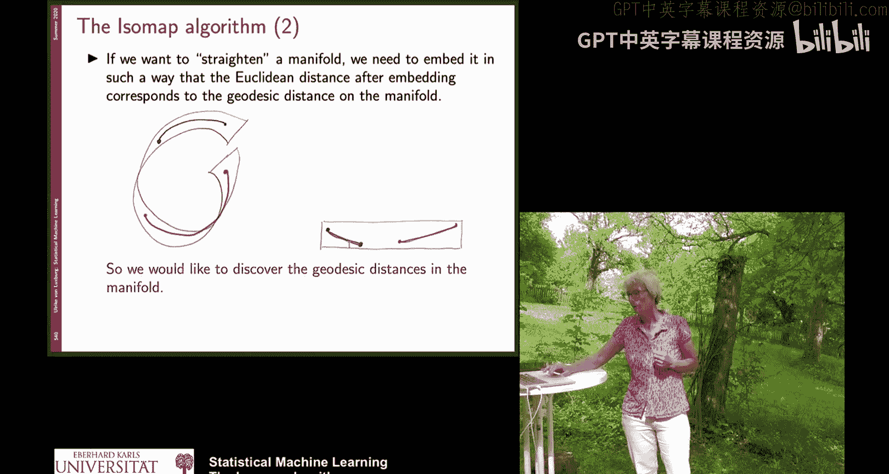

So this is the intuition of the isac algorithm。 So the first thing we need to do is we need to discover。

😊。

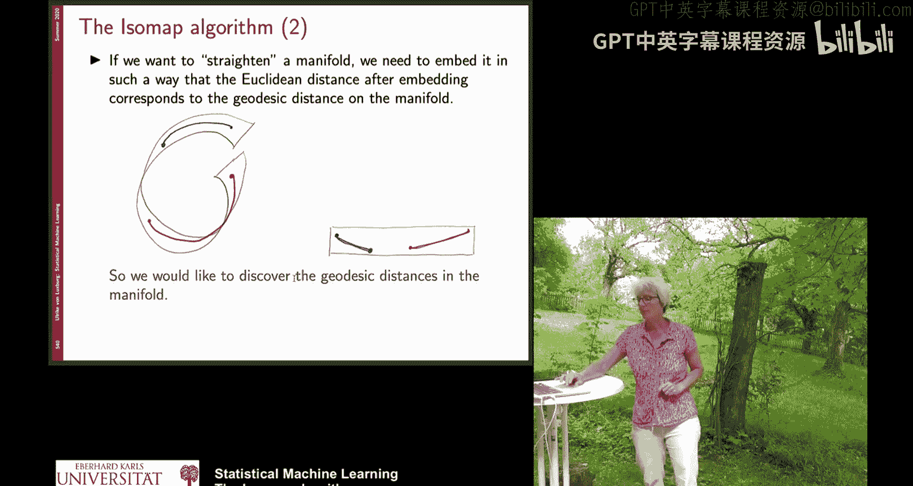

What might visit your basic distances in the manifold？

And now comes our first application of neighborhood crafts。The idea is not the following。

So assume we have a sample of points like these colored things from this rolled a piece of paper。

By the way， this is often called the Swiss roll data set in the Manifold literature and the Swiss role as far as I know。

😊，We already in June， there are strawberries out there。

 So you know these kind of strawberry cakes where you have a bit of of tao。

 and then you have cottage cheese or whatever on top with strawberries， and then you roll it up。😊。

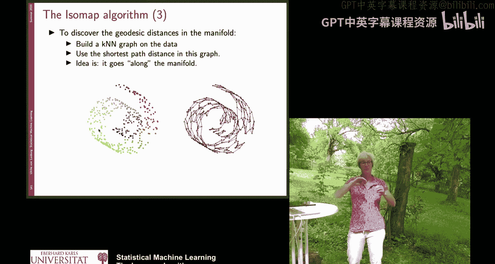

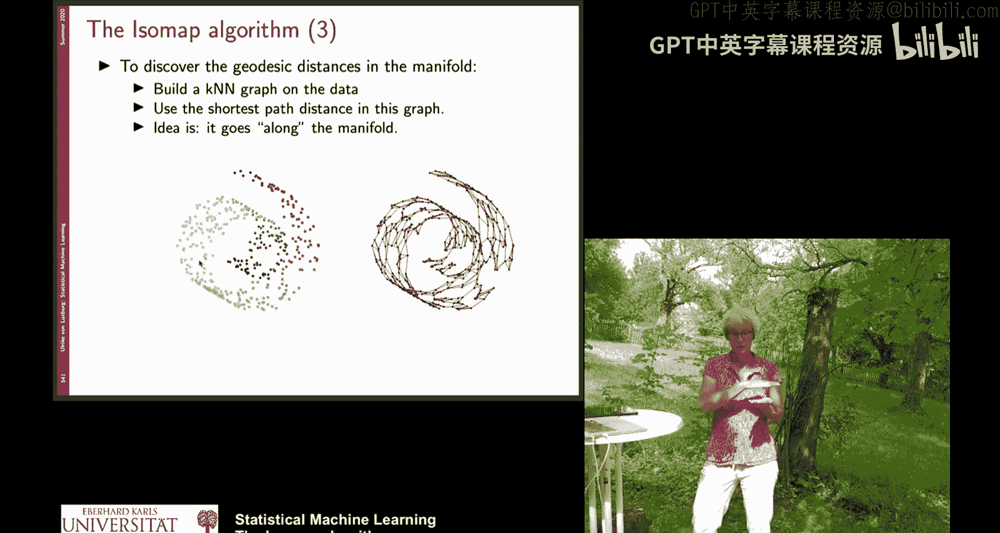

And as far as I know this is called a Swiss roll and this is why this kind of straw。

 this rolled up strawberry cake has a similarity of this kind of data set。

 this is why it's called a Swiss roll。😊。

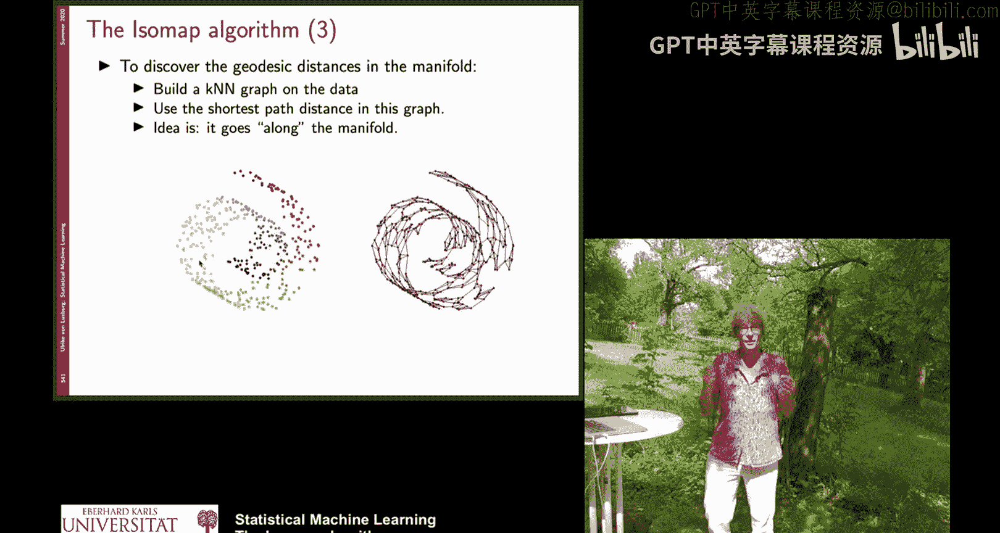

So assume our data lifts on such a Swiss roll， so we have a couple of samples and here they are just color coded so we can sort of distinguish them better。

😊，And now we would like to figure out so the particular key of this whole thing is that this red guy on the very top。

 for example， is in fact reasonably far away from these light blue points here because if you would walk along the manifold we would need to take the whole tour inside the manifold。

😊，To go from this red point here to the blue point here。

And this is definitely different than simply taking the E distance between this red guy and this sp guy because this would simply be measuring this way rather than measuring this way。

😊，And now we want to find a way。To measure this way， because we don't know this manifold structure。

 All we have are coordinates of data points。 So remember， we， we don't know anything。

 We might have images。 They have might be 100 by thousand00 pixel images。

 and we want to discover this kind of structure。So how are we going to do that？

Here is not the idea on the right hand。 so what we're going to do is we build a neighborhood graph on our data points and here for example。

 typically people use the can neighbor graph So what you do is you take all your data points。😊。

You connect every point to its can nearest neighbors。

 where Cane is a parameter that we need to choose carefully。

But assume like in this image， maybe K was 5 or something like that。

 So here is nearest here is the K nearest neighbor graph for these data points that come from the Swiss rule。

😊，And the idea is that this k needs to be chosen so small。😊。

That sort of we connect neighborhoods along the manifold。

 but we would not connect anybody across the different layers of the manifold。

 So we do not want to have an edge that goes from this red guy here to the light blue guy here。

Because this would introduce a shortcut that does not exist on the manifold。 we want to have。

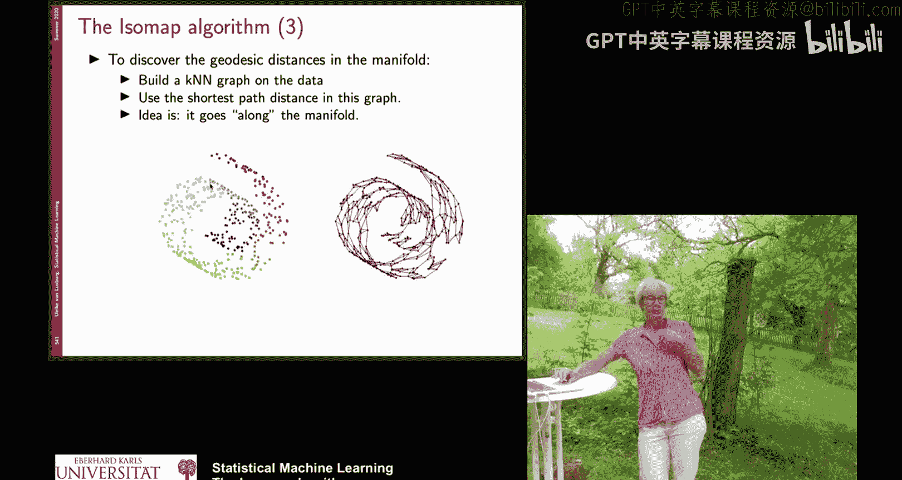

The Kae needs to be chosen such that all these guys which are neighbors on the manifold are connected。

 but we do not introduce shortcut connections between different parts of the manifold。😊。

Assume you could do that and you would end up with the graph it might look like this。😊。

Now you want to estimate what is the distance between a point and some other point far away on the manifold。

😊，And now the trick is we can now walk along the graph and try to compute what is the shortest past distance in the graph。

So essentially like at least on a high level， what you do is you want to know what are citizens between this red guy and the light blue guy here。

😊，And to find the distance at youric distance on the manifold。

 you now do all these little loadus steps。😊，You walk along the edges of your graph。

And try to find the shortest path distance in this neighborhood graph。

And now comes the manifold intuition back into the play because now these local edges of the graph。

 they are really short， so if we now compute the length of such an edge。

 we can simply use the Euclidean coordinates of our data point and compute the Euclidean distance in the ambient space without doing anything special。

😊，We just take the original high dimension coordinate， compute the local distance and this。😊。

Even though it's the distance in the ambient space sort of coincides with the distance that we would also have on the manifold。

And this is true for all the edges because the edges in the graph are short pieces。

 so for these short pieces， the Euclidean distance information is accurate now。😊，So if you want。

 you put the Euclidean distances on as weights on your k nearest Ne graph and then you compute the shortest past distance and now as you walk along this nearest Ne graph。

Of course， for example， to go from this top point here to the bottom point here to this light blue point here。

 you realize that you need to walk around on this whole spiral ones and the distance would be rather long。

😊，And this is now what you are supposed to do in the IO mapap algorithm。

 you build the nearest Ne graph for all pairs of points， you compute the shortest past distance。😊。

And this length of the shortest past distance。Is what you take as an approximation of the geodesic distance in the manifold？

And then you can use some kind of MDS algorithm， for example。

 to embed the data into a low dimensional structure that represents these distances correctly。

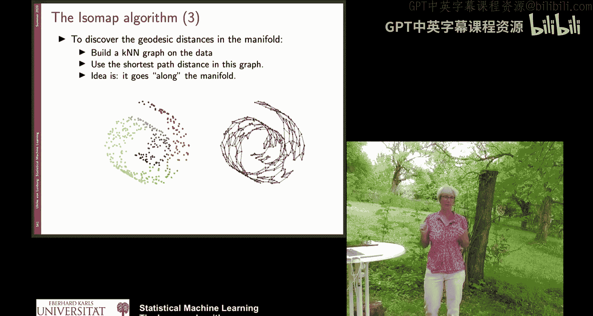

Heres yet another figure for the ISOap algorithm， it's a figure that I got per metus hi。

 he has generated and I generously am allowed to use it。😊，So here you have a data set again。

 it's sort of like a two dimensional surface that is embedded into a three dimensional space。

 and you can see now how the Can nearest Ne graph is realized。😊。

What you can see in this particular figure is that here on this top part。

 the cameius an nevergraph really does a reasonably good job。😊。

And if you compute the nearest neighbor distances here， it's sort of。

Like the shortest past thist sort of coincide with what you would find in the manifold。

Maybe something that is a bit suboptimal is already that there is no edge between these two points。

 so if you want to go from this point to this point here，You already need to take some detail。

 which ideally shouldn't be there。So maybe the parameter decay should be a bit larger to sort of close this gap。

😊，But then you also see here so the manifold has a very strong curvature at this particular point and there of course you see shortcut edges edges and you somehow can't avoid them because the manifold here。

 the two parts of the manifold are so close that when you choose K the edges are maybe have this length and this is sort of the distance that you that already would connect the two pieces。

 the two sort of。Parts of the surface。So what you can see is again。

 there is a compromise between how you choose K and particularly if the manifold has very strong crvature。

 it gets more and more complicated。😊。

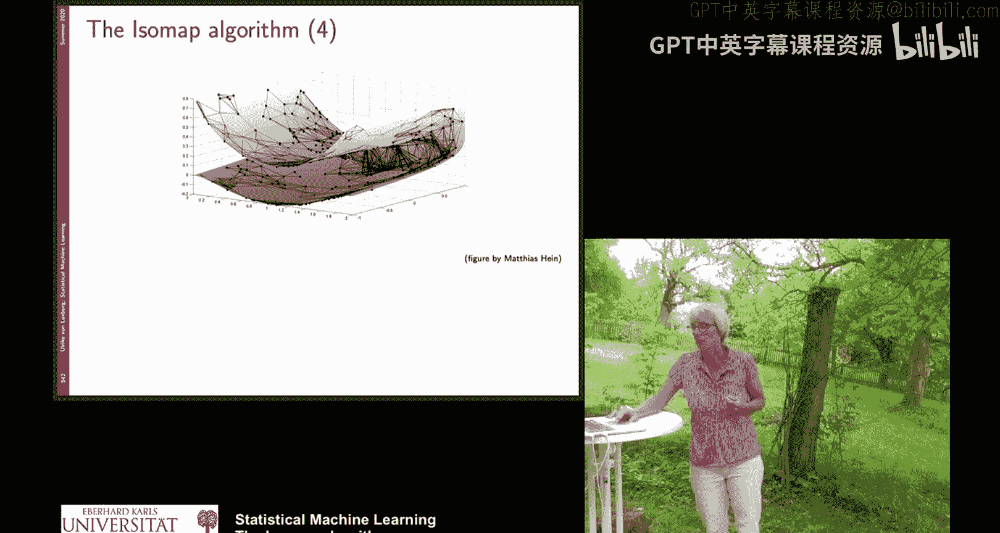

Now， I think we have already seen most of the ingredients for the IOap algorithm here is now how it really works。

 so you given abstract data points。😊，And the distance function。So in general。

 we don't start with points in RD， we start with anything。

 we start with molecules with text with images。😊，We have a function that evaluates the distances between points。

And we hope at least that on a local scale， this distance function does something useful。

 It is not really important whether distance on a global scale are very well well。

Well I described this function， but locally it should make sense。

Now what we do is we build a k nearestna graph for some parameter K that we need to fix carefully。😊。

And the edges are weighted by distances， this is about the only exception to the rule I set in the chapter nearest Ne graphs so in all other algorithms you would weight the edges by similarity but here we want to compute short past distances so we look at the length of an edge is the weight that we put on the edge。

😊，And the idea is that these edges in the graph sort of encode the local distances。😊。

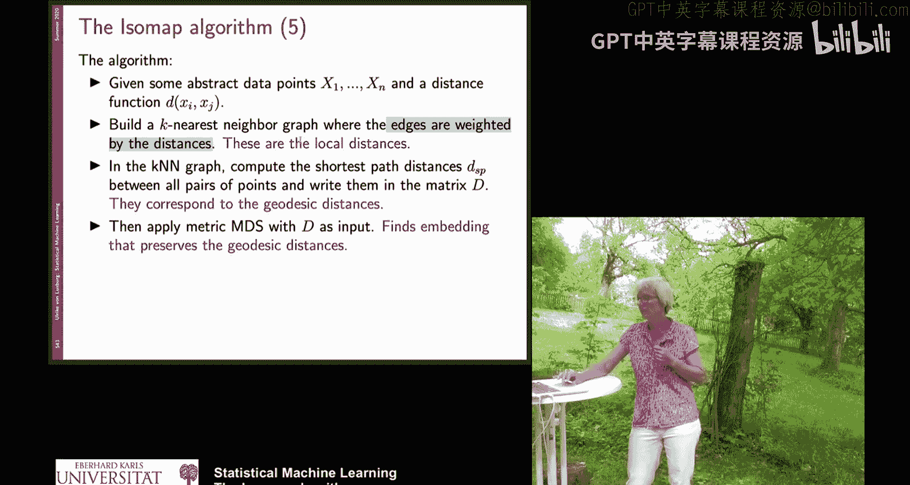

now we need to find the global the geoic distances。

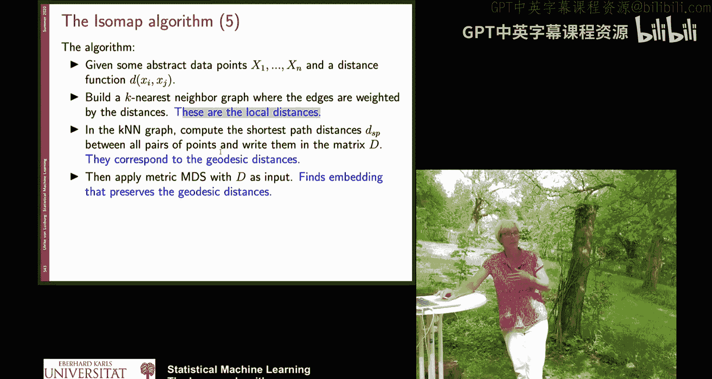

So what we do is in the Canius Ne graph， we now compute the shortest path distances DSP shortest path between all the pair of points。

😊。

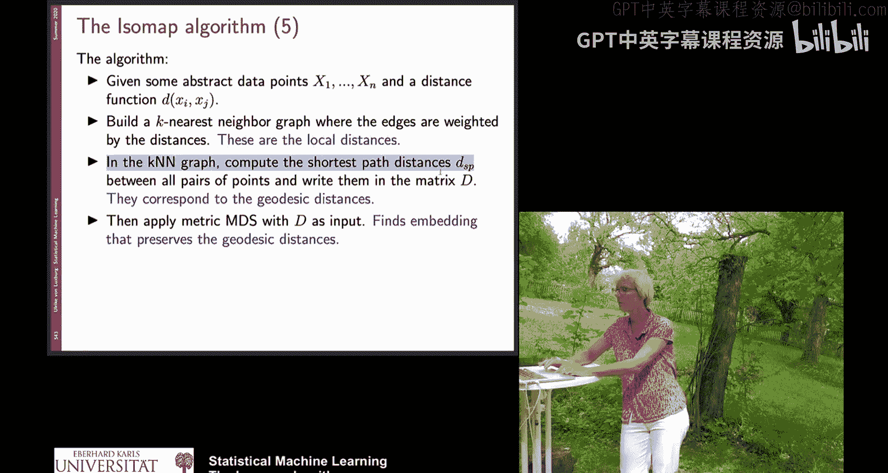

And put them into a matrix。And this is now the matrix of the global distances that we want to recover when we now find a low dimensional structure or a low dimensional embedding。

嗯。And so maybe if you're a computer scientist， you might think about your algorithms one or one lecture。

 how you compute the shortest past distances or the oil past， shortest past problem。

 what the complex is and whether this is something terrible or not。😊，Just as a sort of recap。

 if you haven't seen it before， don't worry， you don't need to know that in this lecture。

So we have done that now， we have computed theaneous Ne graph in the shortest past distances。

And now we simply use multidimens scaling。😊，With this distance matrix DSO input you can now decide on which very of multidimensional scaling you want to use conceptually it doesn't make a difference you always want to solve the problem given a distance matrix find a low dimensional embedding of your data point of your data points such that these distances are preserved that it's a really conceptually a very simple algorithm。

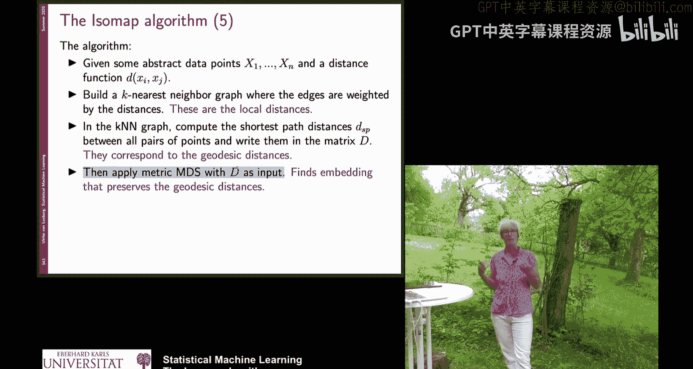

And I also find it very beautiful from a mathematical perspective because you sort of really exploit what is this kind of definition of a manifold you encode it into the nearest neighbor graph and then you sort of embed using classical and multidimensional scaling or metric embedding。

😊，Techniques。

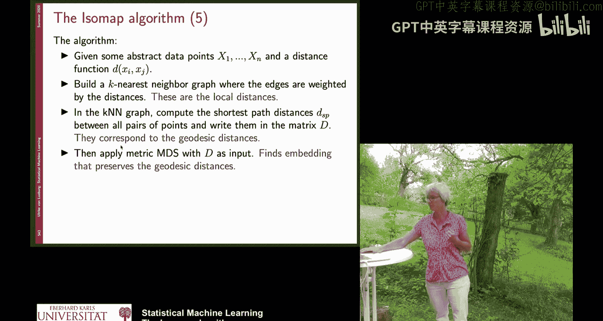

The other nice thing about the IOab algorithm is that you can in fact。

 give strong mathematical guarantees that this algorithm really works under certain circumstances。

 at least。😊，So in the original paper， the authors have proved the following kind of statements。😊。

If the data points。A sampleed duli formally from a nice manifold。

And I don't explain you really what nice is， but nice means that it needs to be a manifold that you can put in a flat space。

And it doesn't need to have too stronger curvature。 It has a nice boundary and so on。

 so there are certain niceness assumptions that you need to make。

 but assume you have a nice manifold youemble points from this manifold uniformly so there are points everywhere on your manifold。

Then。If the number of points goes to infinity， end you choose k of the order of log N。

Then the shortest past distance in the Can nearest Ne graph。

Converge to the geodesic distances on the manifold。And this parameter K equals log n。

 this is a parameter that occurs very often in this sort of canous neighbor techniques。😊。

Later in the section on learning theory， I might hint a bit where this comes from。

And this is sort of the。There are some statistical reasons why you need to have K growing with N。

Otherwise， the whole estimates are too much dominated by noise。On the other side。

 what you would like to have is that these edges from which you estimate the shortest past distances are getting shorter and shorter because you want to have that these edges locally converge to what you see on the manifold so the edges need to get shorter and shorter。

In the limit as n goes to infinity and this you can sort of satisfy by choosing K。

Of the order of lockin。So this first statement is if there' is any money for this lies。

 the geodesic distances that you compute using theaneous Ne graph are sort of converge to the two values to the true geodesic distances。

😊，And then the second step is once you know that you have a good estimate for the geodesic distances。

 you need to say under which circumstances does MDS recover the correct embedding and this is true if you can make the manifold flat。

😊，This is， in fact， a very strong condition on a manifold most manifolds from a mathematical point of view are not flat。

But then you would encounter some distortion， like， as I said， for if you have this kind of sphere。

 this paper ball lamp that we discussed in the beginning， you probably would， I mean。

 you definitely would have some distortion， but at least what you could do is you could estimate the geodesic distances correctly on this particular man。

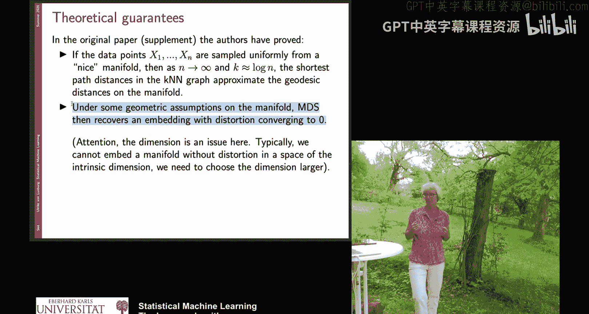

I also brought your attention。 the dimension is an issue。Of course， now。

 what I just said is whether you can make this， this paper lamp manifold。

 whether you could make that flat， maybe you can't embed it perfectly in a two dimension space。

 but maybe you can embed it into a higher dimensional space。For this paper lamp。

 it wouldn't make sense because it already lives in a three dimensional space。

 But there are lots of results also in， in， in standard。Geometry。

 which tell you like if you have a manifold of a certain dimension under which circumstances can you embed it into a sly a higher dimension space and still preserve all the total distances？

😊，But this is not our concern here。This is a somewhat a more complicated， mathematical topic。

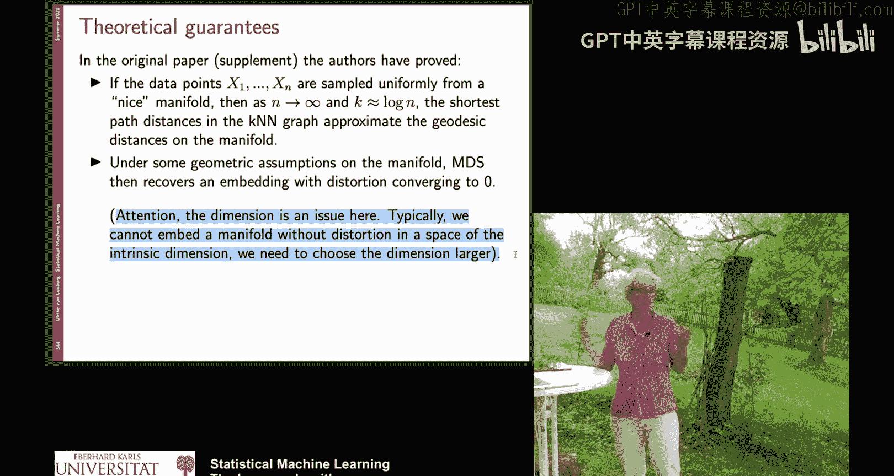

A bit of history。So manifold methods， as I said in the beginning。

 they were very much onvo in like around 2000 and a couple of years， five years， maybe after that。😊。

Ioab is one of the algorithms that came out first， theres also lapblastian eyeing maps。

 there is also local linear embedding or maximum variance unfolding。

 they all share this kind of isoab philosophy。😊，And maybe also as a， as a slight outlook for。

 for why this manifold approach was very fashionable and powerful at that time。 So somehow。

 if you people were。Wondering why， why the heck is it possible to make inference on very。

 very high dimension objects。 and still this inference works。

 So if you think about images or something like that that are being described by millions of parameters。

From a statistical feeling， you would say if you just have a couple of hundred images and each images needs 1 million parameters to describe。

 how should it be possible to learn something about these images？😊。

There are so many parameters I can't just learn a million of parameters from 100 images。

 so somehow this should be doomed， so why does machine learning work？

And there are a couple of reasons or assumptions that you can make。

Why it works And one is this manifold assumption where you say， well。

 we can learn because in principle， the dimension of the data。

 even though it might be represented by a million parameters， in fact。

 we don't need this million parameters， we just need 20。😊，谁。

And then all of a sudden if you have maybe 100 point and 20 dimension is maybe still a bit sparse。

 but maybe you see thes so if you have less data points and they don't live in two high dimensional spaces intrinsically。

 then at least from a conceptual point of view you can understand why machine learning might make sense。

 why in principle it should be possible to work on finite dataset sets yet discover interesting phenomena。

😊，The other such mechanism that we're going to see later in the lecture is infects parrssity。😊。

So sparsity is the other second big class of assumptions that you can make。😊。

So if you assume your data lives in a space of1 million dimension。😊，But for each data point。

 only 50 dimensions have an actual value that is that is not 0。

 This is yet another way of assuming that you need less parameters to actually describe your data。

And then from a statistical point of view， again， you're sort of more on the safe side。

 or at least you you can conceptually understand why in principle。

 it might make might be possible to do inference on these kind of data sets。

So the Manifoldt assumption， this is what we exploit in IOMap。

 Sprsity is something we will see later in the lecture and these are two big classes of assumptions。

😊，That people make at least implicitly to explain why machine learning works on finite sample and not just on the limit for in going to infinity。

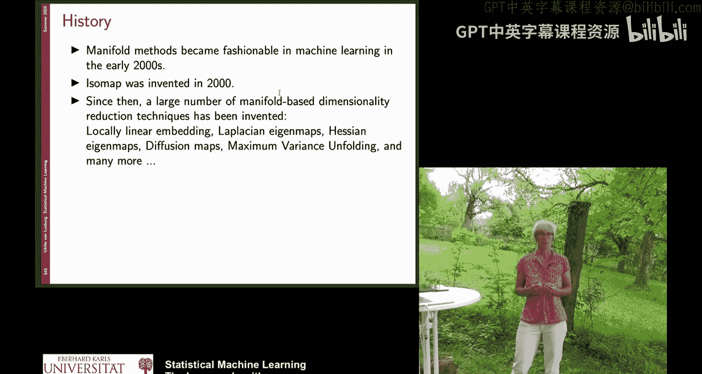