# 图宾根大学《概率和统计机器学习｜Tubingen Probabilistic and Statistical Machine Learning 2020》中英 p35 -35-Part 32 - Introduction to clustering.zh_en -BV1gso5YGE4s_p35-

In this lecture， we want to consider the field of data clustering。In the unsupervised learning。

 this is sort of the biggest area， there is dimensionality reduction。

 there is embedding problems there might be out there detection。

 but I think the most important field in unsupervised learning is clustering。😊。

In this short lecture I want to give you an overview of what clustering problems are in general and what are different types of clustering problems and then in the following lectures we are going to discuss various algorithms to solve clustering problems。

😊，What do we want to do in data clustering？Typically we are given a set of data points， x1 to xn。

But we don't have any label information as in supervised learning Claing is sort of the most unsupervised learning program that is out there。

😊，But the goal is we want to discover groups in this data that exist without someone telling us that there are groups。

You might want to find subtypes of a certain disease and you suspect there might be different types of the disease。

 but you don't really know， but this is what you would like to discover。😊。

Or you would like to discover different types of your customers or different types of bird species that are out there。

So you always suspect that there might be groups in your data groups of things that belong more closely together than maybe between different groups。

😊，But nobody really tells you what is there， and the algorithm is supposed to discover it by itself。

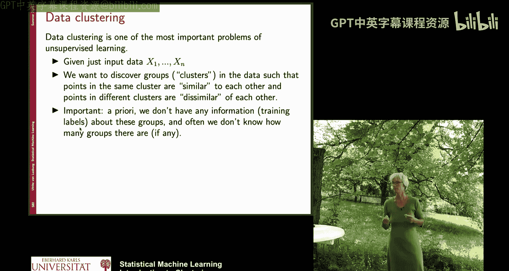

Here I listed a couple of applications， I've already named some other ones。

 you might want to find genre of songs， for example。

 if you have some kind of recommend system for songs you might want to classify songs into different genres。

 different groups of customers， and different types of cancer based on gene expression data。

Or you might want to discover proteins that have a similar function。And there are many。

 many more applications。

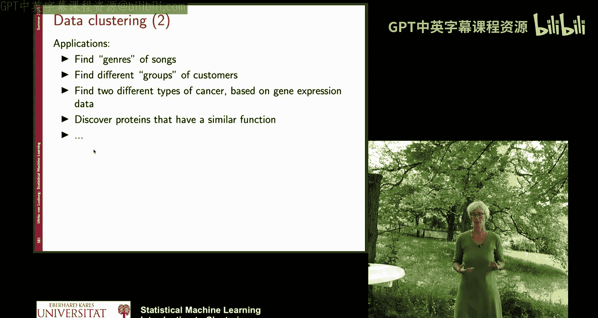

And there are two big main reasons why you might want to do this。The first one。

 and I think this is what many people have in mind when they talk about clustering is you might want to do this for exploratory data analysis。

😊，For example， if you look at different proteins， you suspect that there are certain functional groups of your proteins but you don't really know and you might want to have a way to look at these things。

So you might want to have an algorithm that tells you well these couple of proteins。

 they seem to look similar， they seem to have a same function。

 and maybe you sort of as an expert can verify the 10 proteins that are in the set really have a similar function but now there's this protein in number 11 that you haven't been considering before。

 but which now comes to your mind oh well maybe in fact this protein 11 might have a similar function as the other ones that I've known before。

😊，And this is always called exploratory data analysis。

 you want a tool that presents data to you as a human in such a way that you can start looking at the data and form hypotheses about your data。

😊，This often goes together also with visualization in particular in clustering when you try to visualize your data and then the data is being visualized in terms of groups so you can maybe see which points belong together and which are very different from each other。

😊，The other application for clustering is that for computation。

 for either statistical or computational reasons you might want to compress your data。 For example。

 you could say， well， there are different types of cancers and I want to treat them completely separate。

 I want to have run one analysis that runs on this type of cancer and the other analysis runs on that other type of cancer。

 so you could， for example， separate the two groups completely from each other。😊。

Or you could do something like you have millions of customers out there。😊。

AndNow you want to run a very costly complicated algorithms that can only swallow say 1000 customers。

 So what you do is， I mean， of course， you could now say I sample 1000 customers from my original data and run the algorithm on the subs sampleample。

But you could also proceed in a different way and say。

 well I know there are different subgroups in my data and maybe there are some subgroups that are not really large。

 so if I just randomly subsle I might miss them but these subgroups maybe are very important to you。

😊，So what you then might want to do is to run a clustering algorithm that first of all finds all the subsets of your data and then picks a couple of representatives or in the extreme case only one representative for each of your customer groups。

 and then you run your algorithm on these groups。These different applications。

 either exploratory data analysis or on the other hand。

 this data compression kind of aspect are very different in the nature and also very different from the terms of evaluation。

😊，If you work in the data compression setting it's。😊。

At least conceptually easy to set the parameters of your algorithm because in the very end。

 say you first select some customers as representatives run your classification algorithm on top and then you can check the accuracy afterwards and can also use cross validation to set the parameters of your clustering algorithm。

😊，Thereas in this exploratory data analysis setting it's often very difficult to evaluate the quality of a clustering because like if you really would like to do it properly you would need to run like simulation studies with human expert sitting there staring at your interface and trying to evaluate which kind of clustering is better maybe forming hypothees and you evaluate which hypothesisthees is more likely to be true this is really really complicated This is one of the reasons why the field of clustering it's a bit elusive。

 I mean there is lots of theoretical analysis but not there's not one ground tools that you can pin down and then that's what you want to find。

😊。

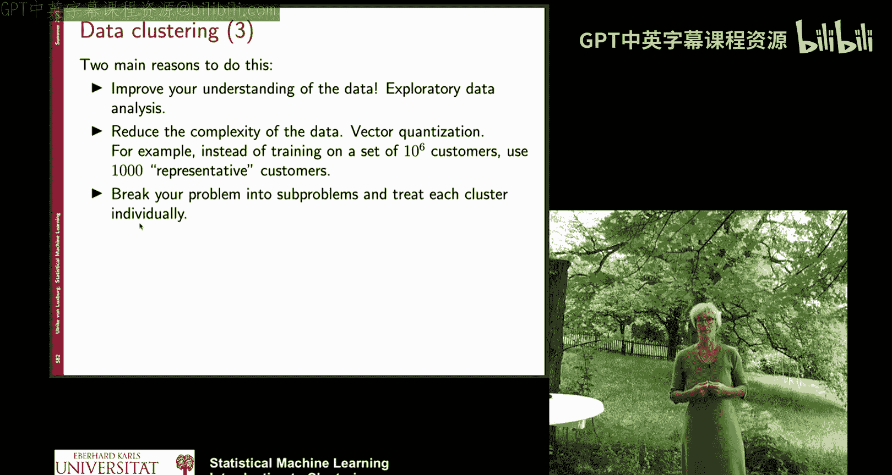

I simply want to show you a couple of examples of clustering algorithms here。

 for example is an example for clustering gene expression data and what you have is the rows in this data set correspond to different genes and the columns correspond to different measurements on your gene。

😊。

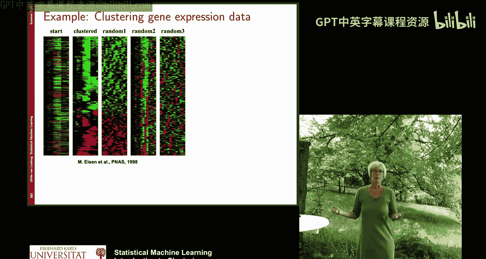

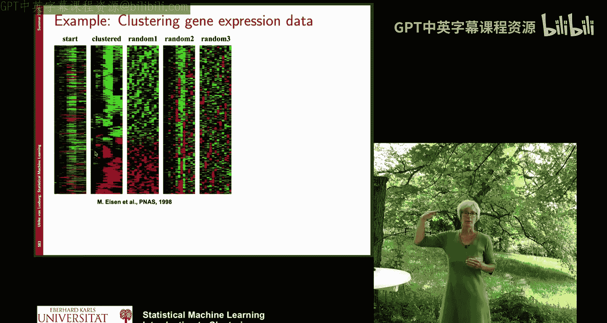

And now you want to cluster the genes according to how active they are and under certain circumstances。

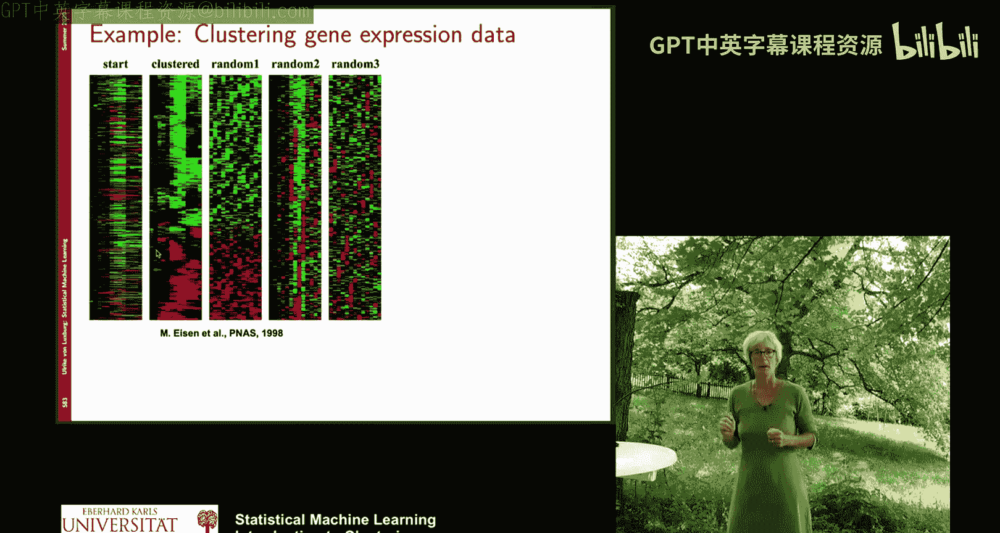

What we here have is a protein in interaction network。😊。

Essentially the vertices in this network are proteins and they exist edges between two proteins if they tend to interact with each other。

 and now you might want to find functional subgroups meaning you want to split the graph in separate pieces such that there are only few connections between the different pieces but many connections within the same piece。

 so you want to identify groups in this interaction network of tightly or closely interacting proteins which are not so closely interacting with other proteins。

😊。

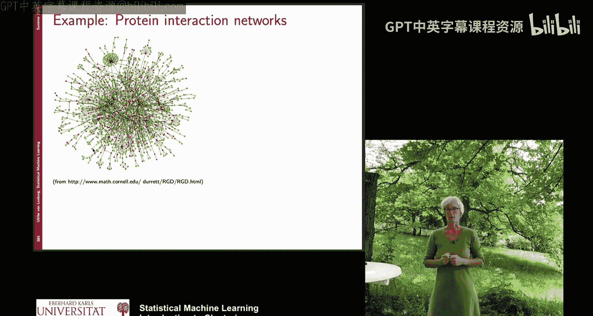

Here's an example of corporate email communication。😊，That was very fashionable Well。

 nearly 20 years ago。 so what you could do is you could， for example， you have your company。

 you analyze the email traffic between different people and now you can look at things like。

 is it true that the class tests like if you know identify groups of people who send emails to each other very often。

 for example， do they agree with project teams or do you find out that if you would apply this clustering that in fact。

 there's this project team consisting of 10 people， but they don't communicate to each other。

 but everybody communicates to someone outside of the project team perhaps indicating that you might want to redesign your teams。

😊。

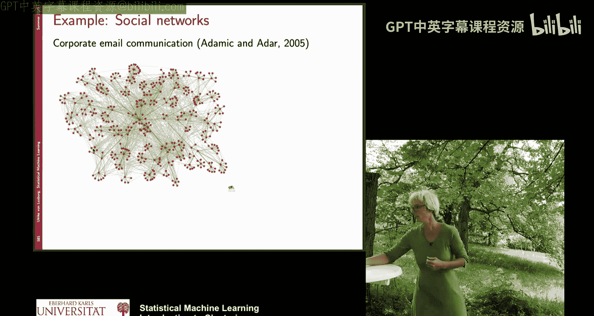

Another big example is image segmentation where you want to find for example， an image is foreground。

 you want to separate foreground from background， or you might want to find different objects in your image。

 here's an apple， here's a pi， here's a purse， here's a car。

 this is also often used or solve by clustering algorithms。

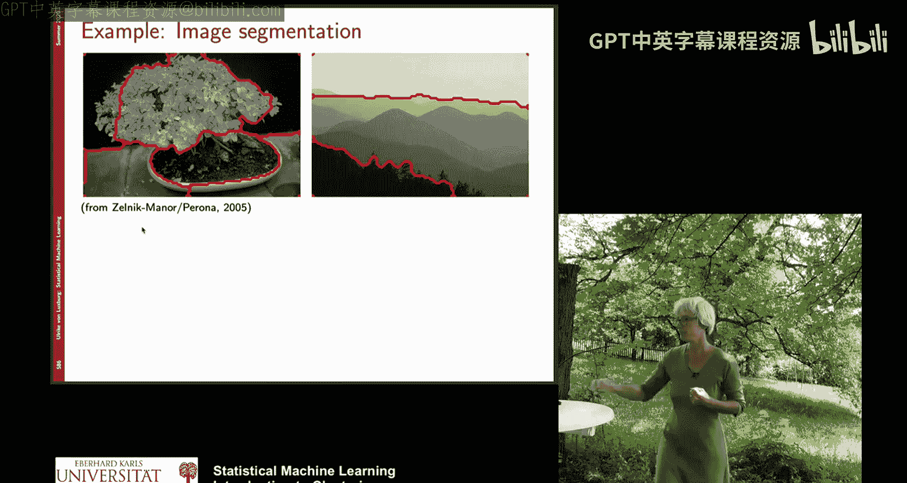

And then there exists completely different clustering problems which try to build a hierarchy so in the previous examples when I said there are two groups of customers and I want to find them or two groups of cancer and I want to find them。

 this is what we call a flat clustering， there is simply one number of clusters that we consider the right number of clusters。

 whatever that means。😊，And then we want to find partition the space as good as possible into this number of clusters。

Now here， what we see on the slide is a hierarchical clustering。😊，Where you say， well， the。

 the thing I want to describe cannot just be described by one particular clustering of my dataset。

 But there is some hierarchy that evolves， for example， here， we have。

Genetic distances between mammals where you can see on the image， I mean。

 essentially this is called a dentroogram。😊，At the very end， you see the small clusters。

 like the finest resolution is here on the right hand side。

 so you see a cat and the house mouse and a red and then a possum。😊。

These are different species and now some of these species belong together， for example。

 the red and the house mouses are sort of similar and they form the branch of rodents here。😊。

And here you have。Different life here， for example。

 you have primates and then you see primates split into a givenon and then there are different kinds of other primates and you can get a fine and find a hierarchy。

😊，And another application where， where something like this happens is， for example。

 if you want to classify text into topics， you can say， well。Here is sports， a text about sports。

 and here is text about politics。Now within politics。

 we have maybe politics in Germany and foreign politics or in sports， we have soccer。

 and then we have tennis and whatever。 so you have a whole hierarchy of different topics which go from a very rough granularity to finite finite granularity in your clusters。

 and this is called hierarchical clustering。😊。

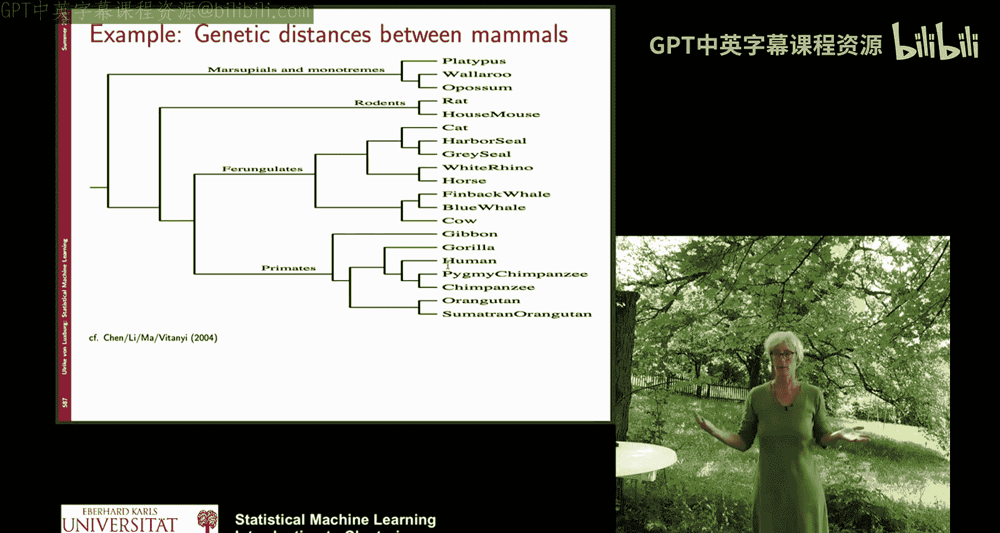

So on a very， very high level， the typically approach by which clustering problems are solved is the following。

You say。I have many points in my data space and how could I define what a cluster is， I could say。

For points that belong to the same cluster， their distance should be really small。

There is points which on different clusters which have a large distance。

Or you could also formulate it in terms of similarity。

 proteins in the same cluster should be very similar。

 whereas proteins in different clusters should be dissimilar to each other。😊，And now， what。

What many clustering algorithms do is you need to define an objective function that you can optimize because remember。

 in the end， machine learning is nearly always solving an optimization problem the same here。

 So we define an optimization criterion that says。嗯。For example。

 like here to find a good partition of our data space we look at what is the average within cluster distance between points and this should be very small because I want to have points within the same cluster tidy together。

😊，And I look at the average between cluster distances with the thing in mind that they should be large away from each other。

😊，And for example， I could then build a fraction where I put the average within class distance in the denominator。

😊，Under between cluster distances in the numerator。 And then I minimize this whole expression。

Of course， there is there are a couple of big problems with this kind of approach。

 Naly which objective function to choose， depending on which objective function I choose。

 I will get very different clusterings。And you need to remember always when you solve clustering problems。

 this is just a proxy for what you really want to do。

 So it's not clear there is not the best clustering objective out there， depending on your problem。

 there might be one objective that works a bit better than the other one。

But there's also a lot of arbitrariness。 So whether I use like here。

 this kind of expression or whether I use this square of it or I use some other， I mean。

 there are millions of these measures out there。And a priori。

 it's not really clear which one is the best one， and。Maybe to even say it a bit stronger。

 typically that is not the best one out there。There is a lot of choice here。

And this is what sometimes makes clustering a bit， a bit annoying also from from an application point of view。

 because you really don't know what is the best thing you can do and you also don't know how far you are from what would be the best thing to do。

 So you there's lots of。😊，Playing around in clustering。

The other problem that is associated with these objective functions is typically they are NP hard to optimize。

 they are typically not objective and not convex， but they have arbitrary shapes。😊。

And what clustering tries to solve in the far end is like some kind of discrete partitioning problem because say if you wanted to find two clusters and you have an objective function。

 you could try all different ways to separate your endpoints into two clusters。

 but there are two to the end many of these different possibilities。And in many algorithms。

 it turns off many objective functions， it turns out。

That there is no efficient algorithm by which you could avoid sort of looking through all these exponentially many partitions。

And then， of course， your running time is exponential， and the problem often is NP hard。

There are for many algorithms there， then either the possibility to simply try to minimize it anyways and end up in a local optimum and hope that the optimumum is sort of okay for your application。

😊，Or to find a relaxation that maybe solve some related problem that is easier to solve。

 We will see that both approaches are being used in practice。

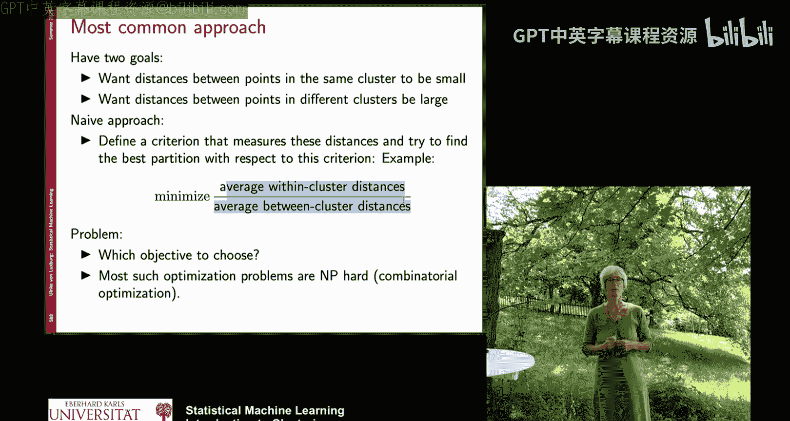