# 图宾根大学《概率和统计机器学习｜Tubingen Probabilistic and Statistical Machine Learning 2020》中英 p36 -36-Part 33 - k-means clustering.zh_en -BV1gso5YGE4s_p36-

The first clustering algorithm that we want to consider now is the K means algorithm。

This is a very traditional algorithm it's been out there for， I don't know， at least 50， 60 70 years。

 it is used very， very widely， it is pretty naive but still it serves as a baseline and in fact by practitioners is used a lot。

😊，It exists in a normal variant， and then we later also see that there is a kernel variant of this algorithm。

 but let's now start with a standard K means algorithm。

It can algorithm tries to solve one particular objective。

So let's look at the parameters weve given endpoint that live in subuclidean space Rd。😊。

And we want to separate them into K different clusters。

K is a parameter that we need to give to the algorithm。

 it is typically not so easy to set but sometimes also not so important for now simply assume that we simply know how many clusters we are looking for say 10 clusters so this is K。

😊，The way this algorithm now proceeds is， we want to construct。😊，For each class。

 a representative of this class， which essentially is something like the center of this class。

 these are called M1 to M K in the following because means M。And to find these kind of centers。

 we look at a particular cost function， namely。We look。

At each particular cluster and so the clusters are indexed by k in this particular sum So K is a sum that runs from 1 to capital K。

 the number of clusters。 So lower case k is the index of the current cluster。 we look at its mean。😊。

And then for all points， I that belong to this particular cluster C。😊。

We measure what is the square distance between the point and the cluster mean。

And then we sum over all these kind of square distances， and this is the cost function。

And the idea is that we want to minimize this cost function。😊，Both across the means of the clusters。

 but more importantly about across the assignment of points to clusters。

 so what we want to achieve in the end is we want to find a partition of our space into K groups。😊。

Such that this global objective function becomes as small as possible。

Here is maybe a tiny figure to explain that， so assume that we have the red points which are all data points So what we are trying to find are these blue points。

 the cluster centers。😊，And each cluster center represents one group of points and in the beginning we don't know the assignment of the points and hopefully in the end we know which point belongs to which of the two clusters。

😊，And typically the algorithm by which this objective function is being minimized is thelotes algorithm that's very old。

 I think from the 1950s and it' is a heuristic to try to optimize the objective crion that we've just seen as good as possible。

 it works as follows。😊，So we typically start with an initial set of centers。

 so we simply randomly pick k， for example， randomly pick k points from our data set。

 or there might be more a better initialization strategies。

 but so we start with M centers which come from somewhere。😊。

And then there are two steps that we always need to repeat until conversionvergence， namely。

We always assign the point to like。Assume。We have we are given the centers now for each point in our data set we check which center is the closest of all the centers indeed that we currently have and they assign each point to what is the closest center。

And then once we have the groups。😊，We define the new we reasign the centers。

 we shift the centers to these groups。

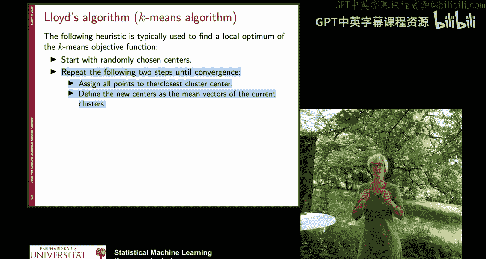

So let us start with a simple demo。😊，What we see here in this big figure， first of all。😊。

Is an initial data set？嗯。Which maybe has a more or less clear cluster structure。

 you can now debate that。And we have three initial centers which are marked by these red kind of diamond shaped things。

 so these are simply random data points that we selected from the existing data set。

And now we look at the different panel， this one， which makes it easier to understand what's going on。

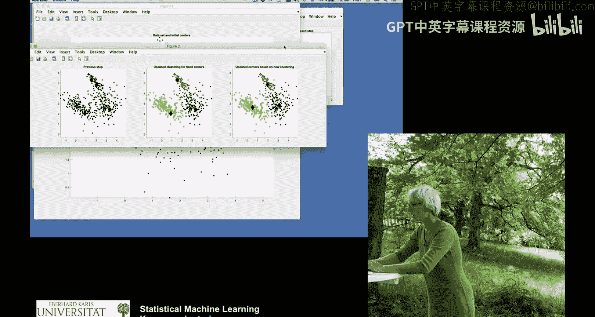

So here on the left hand side， we always have the result of the algorithm as it is now or the previous step。

 so this is in this case the initial step。😊，And now we always do two steps。 first of all， we update。

The centers are fixed。And we assign every data point to its closest center。

 So what you can see here now is in the middle panel。

For each of these diamond shape centers and we assign points。

 so for each data point we check is it closer to which diamond is it closest and then we color it。😊。

For example， all points， the green ones are the ones that are closest to this guy。

 the red ones are the ones that are closest to this guy and the black ones are the ones that are closest to this guy。

😊，This is the first step of the while loop。The second step is now we can reassign the number of the data points to the sorry。

 we can reassign the center of the data。 So now， for example， I mean。

 this is maybe not such a good example。Because these initial centers were already quite good。

 but for example what we can see is in the black class the center has moved now from the previously it was here and now it gets moved a bit up so the new center is simply the mean of all the black points。

😊，And the new center of the green points is the mean of all green points。

 and the new red center is the mean of all red points。

And this is one iteration of a while loop and now we keep on continuing。😊。

I need to tell Me to perform one more step。Okay。Now again here you always see what was the situation in the previous step and what is the situation in the next step so now again comes the step where we update the cluster assignments。

 the colorss of the points so we check whether for example here this black guy in this image it's still black in this image it's red because it now became closer to the red cluster center than to the black one so it changed its color so from from the left to the middle figure we essentially change the color of the points according to who' is closest to which center and then from the middle to the right we again move the centers a bit such that they are really the mean of the particular class。

😊。

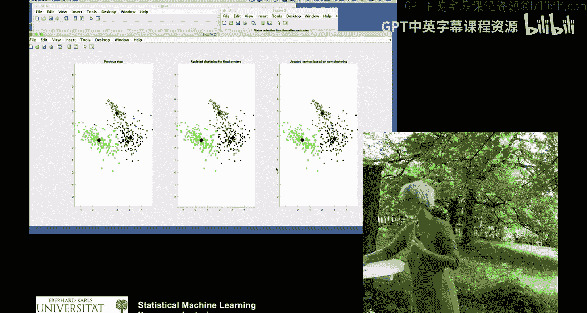

And then we continue。Let's see。 I think this is already。Pretty close to convergence。

 we can now continue this a couple of times。

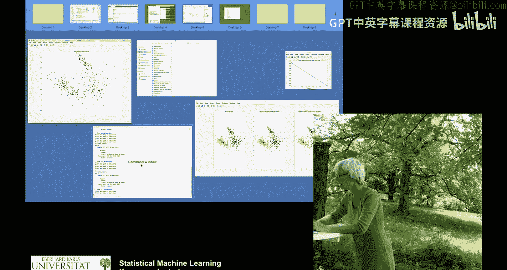

And then the algorithm converged。What you can see here on the y axis here is I have a different plot maybe I make it a bit larger。

 This is the value of the objective function after each of the steps so we can see that in the beginning it was not so good and it decreased pretty fast and here we already could barely see in the figures that any change happens and also the objective function essentially was already converged and here it finally converged the algorithms in a local optimum and it stops。

😊，Let's maybe try to find I run the algorithm once more on a data set。

 which is maybe where the initialization is maybe not as good as it was here。 I tried to find one。😊。

Okay， here's a different one。 So what what I do in this simulation。

 I simply randomly generate data points。 and then sometimes it's good to demonstrate stuff。

 And sometimes it's not then I rerun it。 So here we now have a particular example。

 if you would look at this data set。Maybe you would say there are two clusters。

 maybe theres this cluster group up here or maybe up here。And then there's another group down here。

Again， we have three random centers that we picked in the beginning。

 and they now all happen to be somewhere in this bottom part of the figures。

And now we run the K mean steps。So what we can see here is so this is our initial data set。😊。

Now in the middle we see the assignment of points to this initial dataset。

 so here we have just a couple of red points which are the ones closest to this bottom in its then some more green points which are closer to this guy and then we have the black one which has the big majority of old points currently。

😊，So from left to right we just essentially assigned the colors to the data points and now from the middle to the left to the right。

 we need to move the centers of the cluster and now we see something happening in particular in the black cluster。

 the center is clearly not the center of all black data points。

 if you compute the center of all black data points it sits here and this is what we now can see on the right inside。

Similarly， in the bottom and in the green part the class， has moved a bit， but not so much。

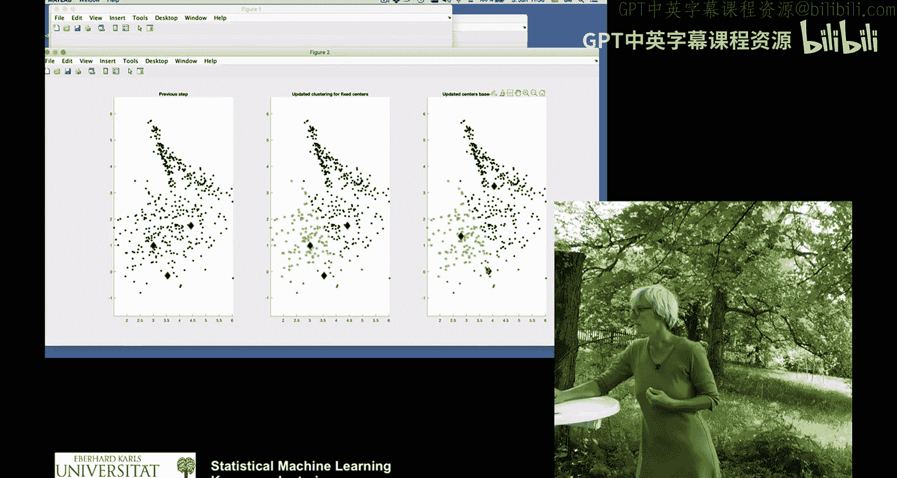

And now let's do another iteration of the algorithm。😊。

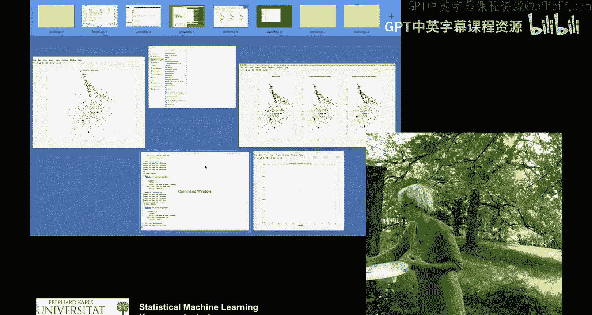

So this was the assignment now on the left hand side was the assignment we had previously。Now， again。

 we reassign colors。So what we now see the green color goes much further to here。

 the red color goes much further to here simply because these data points。

 because the center of the black cluster has moved up quite a bit。

 so then these data points which were sort of on the boundary between green and black now tend to be assigned to green。

 so this is changed。😊，And then again， we start moving the cluster centers。

From the middle to the right and now we iterate this I simply let it run for a couple of times until the algorithm has converged。

 I just need to keep on pressing the button that its supposed to continue。 it still hasn't converged。

This this a bit slow to convertverge。Now， it has converged。Maybe let's first look at the results。

 so this is the final result of the clustering algorithm。😊。

Like if you told me to separate this data set into three clusters。

 I' am not sure whether this is what you really would like to find。

 but this is what the clustering algorithm means is going to find here。😊。

One maybe also has to say that this data structure doesn't really have a clear cluster structure。

 and then it's often up to the algorithm which kind of reside it fines and sometimes its useful and sometimes it's not so much useful。

 This is sort of the difficulty of clustering。But never mind， so here this is the result we have。😊。

At least it makes sense to separate this sort of dense black group that's also what is already what I guessed in the beginning and then the rest remaining group was split into two parts and this is simply how it happened。

If you look again at the value of the objective function we now see it took many more steps。

 nearly 20 steps to converge， it did converge。😊，And typically this is how it always happens in the beginning there's quite a steep increase in quality of the clustering so the objective function gets smaller and smaller and then at the end sort of it fades out to like a couple of points maybe one or two points are always moved and then the center moves just a tiny bit and it just takes a bit of time until it converges but it always converges。

😊，We are going to see that later。Maybe just for the fun of it， let's make one third demo of ks。

I try to find one which is which I consider useful in some way。 This is not a useful one。Oops。

This one might yet be one that is sort of at least interesting to see what happens so here on the left hand side again we have our original data set initialized with three centers because we told the algorithm to F centers we see the first assignment half of the data gets assigned to the red guy and then some points to the black and sometimes to the green。

😊，Cluster in the next step， the cluster centers are being moved and maybe let's now simply speed through it to see it is how it converts in the end。

So the final lasting it finds then。Is at least one that would make sense from my point of view。

 at least if you asked me to find three classes it finds this red group here。

 the green group and then the remaining black group here。So it sort of makes sense。Again。

 looking at the objective function， it monotonly decreased。And it took seven steps。Okay。

This is the essence of the Kmin algorithm。 Now let's go back to the slides。

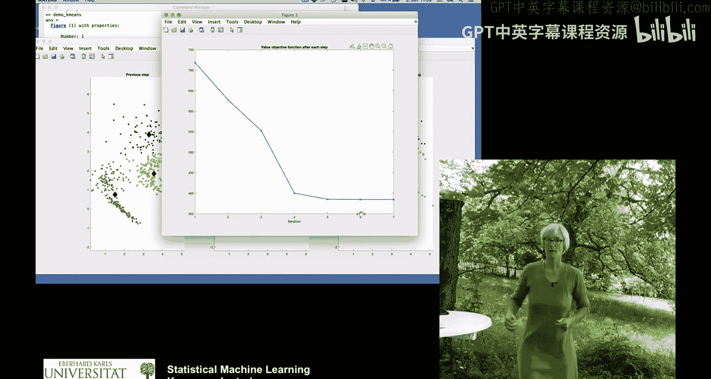

Now here's the formal Kmin algorithm if you write it in serial code。

 so the input of our data consists of endpoints in a Euclidean space RD and the number K of clusters that we want to find it's an input parameter。

We randomly initialize the first set of centers。And we are going to talk about how to do that in a minute。

 but simply say we we， we use M randomly select K randomly selected data points。

And then we have a while loop。😊，That runs until convergence。

And in the while loop we have the two steps assign the data point to the closest cluster center。

 this was always from the left to the middle image where we changed the color of the data points。

And the criterion if you formally write it down is this one but I think that' is clear so for each data point you check is it closer to the cluster center MK or is it closer to ML and then you assign it to the one to which it is closest。

😊，And then once youre assigned， you recol the data。

 you compute the new cluster centers by in each cluster simply computing what is the mean of the data in this cluster and this is your new center。

 and you iterate until conversions and then you output depending on what you like the cluster themselves or the cluster centers。

Now when you invent an algorithm and it has a while loop and the while loop says until convergence。

 you always need to ask yourself， does it always terminate or could it be that it simply runs infinite？

😊，In this case， it always terminates and the proof is nice and elegant。 So the statement is。

Given a finite set n of points in any space RD。Then the Camune algorithm terminates after a finite number of iterations。

The proof sketch adjust provider sketches in each iteration of the wire loop。

 the objective function strictly decreases， so it gets smaller and smaller， so it cannot increase。

 And if you remember in the matter demo we have also always seen that it decreased monotonically。😊。

And the statement here is it always happens。 It was not just pure chances that we had these nice kind of examples。

 but it always happens。And it strictly decreases。 So it's not。 it couldn't say remain the same。

 It always needs to decrease。And then there are only finite many partitions that we can inspect。

 we have n data points if we have k class there are K to the N many partitions that could be there in principle。

😊，嗯。And at latest， after we have seen all these different partitions。

 there is no way the algorithm could still increase。😊。

Because by increasing of course it needs to choose a different partition each time of the while loop we need to choose a new partition and the point is now it can't happen that we have say say we are with some particular partition now we iterate for a couple of steps and then come back to this very same partition this cannot happen。

Because in each step the objective function strictly needs to decrease and as it cannot remain the same and as it cannot increase again。

 there is no way it starts decreasing here and all of a sudden comes back to an increased value earlier。

😊，So each partition can be visited at most once。 We only have finite many partitions。

 so the algorithm has to terminate。This is of course just a proof sketch if you want you can try to bright it up formally。

 it' is not very difficult， but you of course you need to do in particular。

 the first step to prove that the objective function really decreases you need to do a bit of work。

 but it's not difficult。Now， the one question is always， if you have an algorithm， does it terminate。

 We have seen the answer， yes， the second question then when it does terminate is how good is the solution。

😊，I've already hinted in the beginning that many clustering problems are NPhar。

 and we will see later that Cammins is also one of them。😊，So in principle。

 it can happen that we get stuck。 I mean， we convertge to a local optimum。😊。

But this local optimum can be really， really bad。 and there are no guarantees whatsoever how far this local optimum can be from the global optimum。

 and we cannot give any guarantees on that。And I have a very simple example that demonstrates that。😊。

It's a toy example， but it demonstrates a point， so we just have four points that sit on the real line。

 so our data is a one dimensional data set consisting of 4 points， x 1 x2 x3 x4。

And the distances between these points， as indicated in the figure， simply got a name name A。

 B and C。😊，And now different things can happen depending on how I initialize the data point。

 say I want to find three clusters。😊，And assume I initialize by picking random data points and I happen to pick these three blue data points here。

😊，This is what I call inization 1。Now what is going to happen is the algorithms converge within one step to the solution that each of the data each of the points x1 and x2 remain their own cluster。

 and then x3 and x4 get assigned to one joint cluster。

And now the objective function of this particular clustering like here x1 and x2。

 they don't incur any error because the distance between the points and the cluster means is 0。

And here， the points include a littlearrow， which is just T half squared。😊，Times 2。

 so we have two points， each of them has distance C over 2 from the cluster center and then we square a distance and but we have two of them so the value of the objective function is this one。

Now， assume we take a different initialization， this one initialization 2 where we have initial cluster standardss x1。

 x3 and x4。😊，And then we converge to a different solution。

Where now points x1 and x2 are assigned to the same cluster。

 and the value of the objective function is now a squared over 2。AndNow， of course。

 if you want to construct an example that is arbitrarily bad。

 you can play with C and A and the factor can be as bad as you want by picking a large A in the small C。

So， you can see。That the Kmin algorithm， depending on the initialization。

 ends up in different local optima。😊，And they can be arbitrarily far from the global optimum。

So there's no guarantee whatsoever。Now， as in many of these local search。

 it's essentially some kind something like a， maybe not really a local searcheristic， but well。😊。

You could say it's a local self heuristic。😊，Maybe I don't know。

 Maybe some people would call it like this。 maybe some people don't。 Anyways。

s it's a heuristic by which you try to find a good optimum。

And many of these heuristics always depend on how good is initialization。

And in this particular case there are two very， very common ways to initialize your data。

 your cluster centers， either you randomly choose data points among your data points at have as cluster centers。

 this is sort of the standard thing that most of the toolbox also do。

And then theres a way that is much， much better， which is called the fatherthest first heuristic。

 And it works as follows。 You first pick a data point。😊，Anyone randomly。

And now you look at all other data points and you compute the distance of all the other data points to the one you already have。

😊，And then you select the cluster sender proportionally to the distance。

 so because what you want to achieve， maybe I draw a figure here， that's easier。😊。

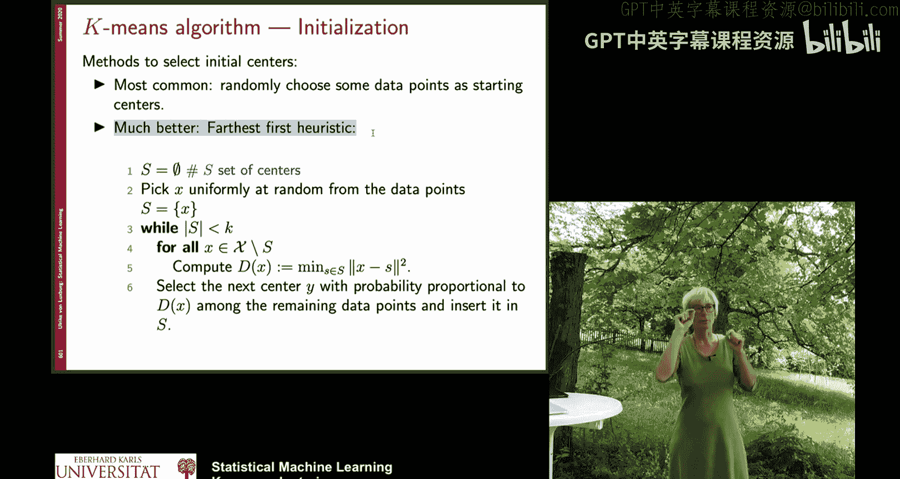

嗯。

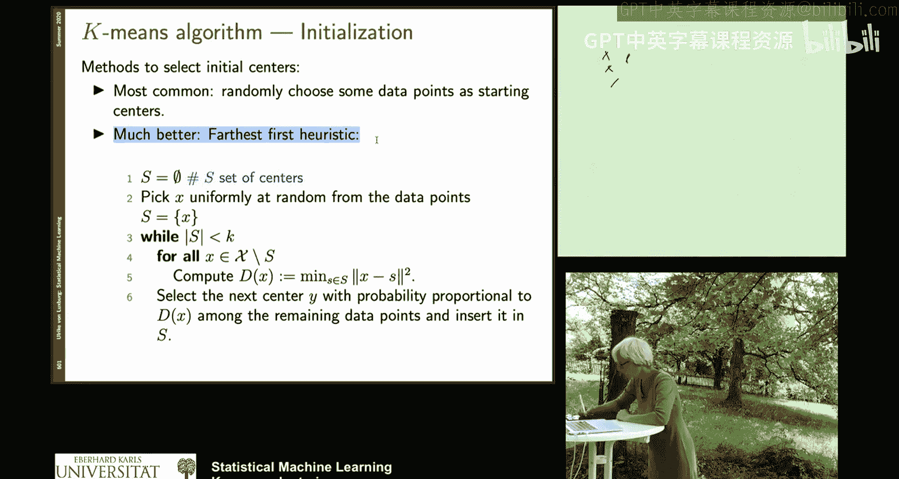

So these are some data points we have。And now assume we want to cluster our data points。

 we pick a first initial center， say we pick this one， the red guy。

Now what we want to achieve is that in the initialization the space is more or less covered reasonably well we don't want to have that each that all the centers sit in the same corner。

😊，So what we want to do now is we want to say well the red guy sits in the left upper corner。

 so maybe we should pick the next one should be one that sits in the right bottom corner of the data set So what we do is we compute the distance of all other data points to the red guy。

And then depending on your implementation， you either pick the data point that is the farthest from the one that you already have。

 which would be maybe I don't know this one here。Or sometimes you also do it randomly and then you assign you randomly pick one of the other data points as new cluster center。

 but you increase the probability the further these guys are away。😊，Those options are possible。

And then once you have found two cluster as assemblys， maybe I try to erase these red lines here。

Works。So now we have these two cluster centers。 and now again。

 you now to pick the third cluster center， you now compute the distances of all points to these two that you already have。

 So you compute。Say whether if you want to know whether this is a good new cluster center。

You compute the distance of this guy to everybody to to the cluster centers you already have。

And then you take the minimum of these two distances and you make it as far as possible。

And this is what we also have in this slide， if you now look at the slide。😊，So for all so。

S is going to be the set of initial centers that we want to have。

 we initialize it with one particular data point and as long as we still don't have K centers。

 we proceed as follows for each data point that is not yet a center。😊。

We compute the distance of x to the set S， which is sort of the minimum。

For all like you compute the distance of x of x to all the other ss。

 you take the minimum and that's now the distance of x to the set S。

And now you select the next center with a probability that's proportional to this distance。Okay。

 and this is。If you want to use a good initialization， this is typically what you should use。In fact。

 if you go this heuristic， the resulting algorithm is often called the K means plus plus algorithm。

 and it comes with reasonably strong guarantees on approximation thats in fact。

 has been proved not so long ago， maybe 10 years or so the reference is going to come later in the slides。

😊，There are even more options by how you could select the center you could also say you initialize by using a different clustering algorithm or maybe you have some background knowledge that already tells you that you have already like 10 classes in your data and you still would like to find five more then of course what you would do is you would assign like the first centers of your。

😊，like for the first 10 clusters， which you already have。

 you would pick their centers as your initial centers and then pick five more and let the algorithm run。

 So if you have prior knowledge you， of course， exploit it by initializing your data， your clusters。

Now， as it is a local self heuristic。And it depends so strongly on the initialization what you typically do is you restart your algorithm a couple of times。

 say 10 times 20 times with different initial centers and then among all the outcomes that you get you select the one where the cost function is the smallest one。

This is sort of the standard procedure。You also need to check when you use a toolbox。

 whether this happens implicitly or whether you need to do it explicitly。

 if the toolbox doesn't do it implicitly you should always do it like repeat it 10 times at least and then I mean you don't need to repeat it a thousand times but say 10 times and that's typically then better。

😊，There are a couple of details which are not so important right now。

 but still I want to mention them， it can happen in the course of the algorithm that a data a center loses all its data points。

 like in the step of reing the data points it could be that there is a center and the center is not a data point because remember after one step the centers are really the means of the data so it's not really like an actual data point its just some point in the space and it could happen that all the points it used to belong to this particular center and the next step get a center to somebody else and this cluster is empty。

😊，AndNow either you can live with the fact that you have a bit fewer clusters than you had hoped for or you can try to。

 I mean， either like create a new cluster by say picking a new data point randomly and saying this is not a new center point and then you keep the algorithm running。

 you could restart your algorithm。 I mean there are millions of heuristics that you can use it's in fact not so important and I think the most common one is to simply reassign a new data point as a cluster center and then go again。

Then as with all search heuristics， you can of course try to do some post processing to even improve the result。

As I said， you can restart that very often you can now also once you have a final result。

 you can start looking at neighboring clusters and swap individual points and see whether it improves your result。

😊，You can also remove one cluster completely introduce a new data point as a cluster center and keep the algorithm running in the hope to find something better。

 you can merge clusters and introduce a completely new cluster center so there are millions of things you can do you can split a cluster into pieces。

All these heuristics， I don't think that this is particularly common for K means typically you just restarted a number of times and then you're sort of happy with what you get out。

😊。

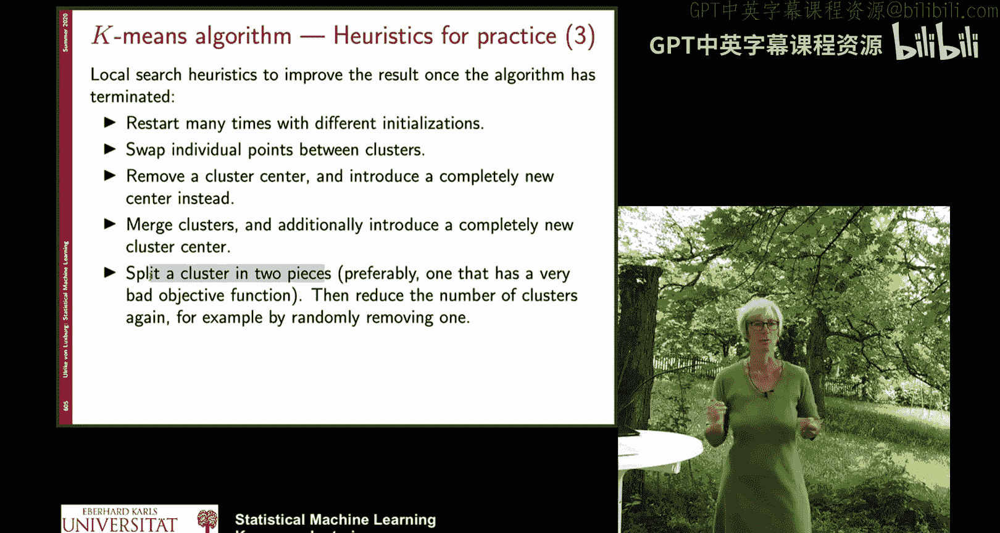

I have one slide which also gives you a slightly different perspective on the Kmin means algorithm what the way I've introduced it is I have said we have this iterative procedure by which we try to reassign the cluster centers and then the global objective function that we want to solve is this cost function that minimizes the distances to the cluster centers。

😊，It's the one that is on the bottom here。There exists also a different formulation that is more in line of what I said in the introduction to clustering where I said often what you do is you look at within cluster distances between points and cluster like between cluster distances。

 where you say within the cluster the distances should be small and between the clusters it should be large。

😊，Now you can see that in the particular case of Kmins。

 the problem can be specified in terms of within cluster distances。😊，Namely， what you can say is。

Consider the problem to find a partition of your data such such that the within cluster distances are minimized。

😊，And the within cluster distances is essentially the square distance of all points within the same cluster。

And what the proposition says。The problem of optimizing this first objective function where you say you want to find a part that minimizes the within cluster distances in this square eucli de norm。

Is equivalent？To the problem that we've started with namely finding these cluster centers and minimizing the distances to the cluster centers。

The proof， I don't have it on the slides。 It's really elementary。

 It's just juggling with different expression。 I think everybody should be able to do it。

 but it's a bit lengthy。 It takes one or two pages to sort of come from the first formulation to the second one。

😊，I would like to stress that at this point it's not completely obvious because in the first formulation we don't have anything to do with cluster centers also。

And it's like at least from the first glance， it might be plausible that by finding these class to send us this is what really happens here。

 but it's not completely obvious。😊。

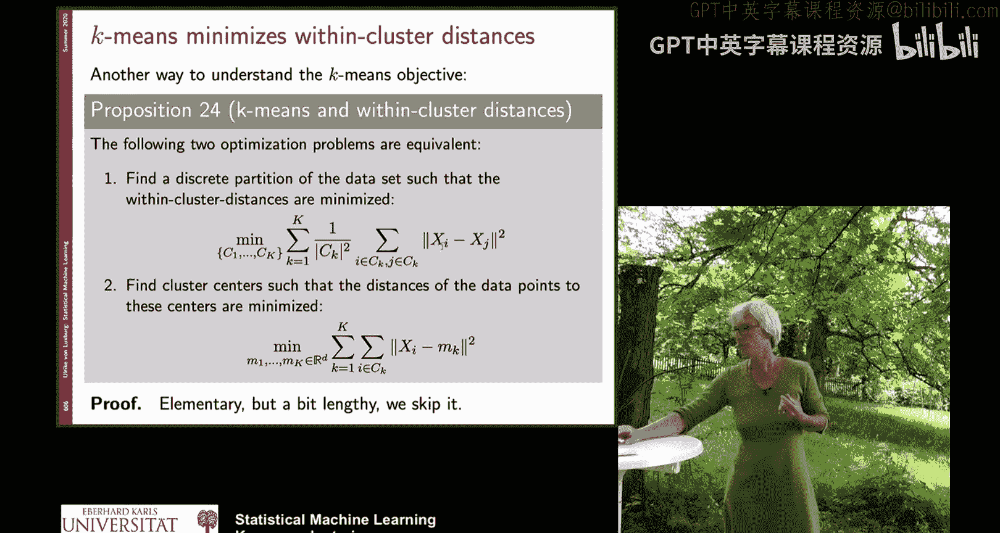

And in particular， maybe going to the next slide， what we can see from this formulation in terms of the cluster means is that what the K means algorithm produces is avolnoy partitionvolno partition is just something like you can see here on this image the yellow points are cluster sends。

😊，And then cluster boundaries are piecewise linear。Because in this cluster mean formulation。

 for each point you check， is this guy closer to this center or to this other center？😊。

And the separating line between two clusters for this reason like here a line or in the higher emission space。

 a hyperplane， it's a linear separation surface。And something like that is called avoloid diagram。

And that this happens is obvious from the formulation with the cluster means。😊。

But it is not obvious from this formulation because here in principle。

 you could also come up with other geometric objects which might maybe even find better partitions than the one with the cluster means。

But as the proposition says， it's not the case。Now， looking at this figure。

 this also tells you a bit about the limitation of an algorithm， so you need to， I mean。

 advantages and disadvantages。😊，And I think I even have it on the next slide。嗯。

One advantage of that thing is all cluster boundaries a linear and you can already in the back of your mind start thinking why this might be an advantage and I'm going to reveal it a bit later。

😊，But I think you might be able to guess it already。

The other thing is that you sort of get some intuition on what shape the clusters have that are being constructed by the K algorithms。

Namely， they are these kind of convex objects。 I go back to the figure。 they are always convex。

Because of our oil partitions always have like all the cells in this partition are convex。

And this also tells you maybe what kind of clustering problems you might be able to solve and which kind of problems you perhaps might not be able to solve。

😊，And here I have a couple of examples。For example， if we have three sayaus。Nicely separated。

And we initialize Kmins with three centers， then with a reasonably high likelihood。

 Ka means is going to find the correct clusters。If we have a data set like like this one here and we initialize with two centers。

 Kminin is never ever going to succeed because you might。

 I mean the question anyways in this plot it's supposed to be the to moon's data set。

 but so you might want to have the disguise one cluster and thisguise the other cluster。

 this is not going to happen。😊，Because these， these shapes are not what like these are not convex shapes。

Similarly here， what would happen very often in the bottom left figure if you want to find two clusters in this data set。

 it' is often going to split these very long elongated clusters and try to make it more compact。😊。

And something like these rings here， it would again split in a completely arbitrary way and you probably wouldn't get the result at least maybe this is what you want to find you can now debate what a good clustering of the status set is。

😊，And whether there exists one at all。But simply this is what Kmes would probably find in this data set。

And this geometric intuition is good to get some interpretation on。

Whether your result is really what you would like to find or whether maybe it's completely。

 it's not really what you would like to find。I've already said。

From terms of computational complexity， optimizing the can means heuristic is NP hard。😊。

And now in theoretical computer science now you can start debating about what are all the variables that I really mean to enter the statement。

 for example， you could say maybe it's easier like if I have K and arbitrary value， maybe it's hard。

 but maybe it's not so hard if I just want to find two clusters， that's not true it's hard。

 maybe it's easier if I'm in a two-dimensal space， for example。

 because for certain geometric reasons， there are things that happen nicer， that's also not the case。

 So no matter which kind of variant of your problem you're looking at it is going to be NP hard。

And there is one thing that confused me a long time ago I was really confused about this until I understood it。

 this is a bit curious because there are geometric results that say there is only a polynomial number of differentvolnooid partitions like if you give if I give you endpoints in a de dimensional space。

😊，There is only a polynomial number of bornnoi partition that in principle。

 can be constructed out of endpoints in a D dimensional space。

 and it's polynomial in and in the number of points。嗯。

So you might think why why the heck can then the algorithm be exponential if there are only polynomly many possibilities that I need to look at。

😊，And yes， in principle， if you would be able to enumerate all these polynomly many organoid partitions in some efficient way。

😊，Then the algorithm of looking through all these these polynomial in manyvoloid part and simply computing their cost and finding this the smallest one is。

 of course， easy， polynomial。The trick is here that there doesn not exist any efficient algorithm by which you could enumerate all these polynomially manyvoloid pathogens。

😊，And this is something that took me a while to really grasp what it really means。

 so you also might want to consider it a bit and think about what this really means and why can an algorithm be NP hard or a problem be NP hard even if there are only polynomly many possible solutions out there。

😊，So if you want to look at this here， I mean there are millions of references， here's one。

 for example， even if you have well this is with plainar Kmins prove problem。

 I think they mean the two dimension Kmins problem that's still empty heart and there are many references in this paper as well for further papers。

😊，There' is another notion of complexity， which I simply want to mention here。

 but I find this also very interesting。😊，Namely， that' smooth complexity。

Now if you think about computational complexity， I hope all of you know there is like the definition of an NP hard problem right。

 you look at the worst case instance and you want to say in the worst case that doesn't exist a polynomial time algorithm。

😊，Now its often the case if you do these proofs and if you know a bit on theoretically computer science to find out that a problem has a worst case complexity that is not polynomial。

 what you often do is you construct an instance of a problem。😊，That is very hard to solve。

 and for which， for which you can prove that in principle， it's not。

 you cannot solve it by an efficient algorithm。And often these hand constructed instances are something that's very symmetric。

 So for example， for K means you could say I take points on a circle with equidistant and then sort of I try to find the best clustering and somehow it doesn't exist or so no that's a bad example for Kas。

 but anyways， I mean， typically you have these very hand designed kind of problems which are often very symmetric to make the problem extremely hard。

😊，Now in theoretical computer science and people have been wondering for a long time whether there are other notions of computational complexity that are sort of more adapted to what happens in reality because there are many problems out there which and the most famous one is that solving。

😊，So that is the first。Nhar problem by the theorem of Cook that's been proved in 1970 or so it was the very first NPhar problem that was proved to be NPhar yet in practice people can sort set instances on very very many points so somehow this worst case complexity doesn't reflect that in typically examples in practice it's reasonably fast。

😊，And now there are many different ways by which you could try to get out of this trap。

 you can say I only consider average case complexity， which is nice in some cases。😊，For example。

 in quickot， you have an algorithm where the average case complexity is really nice。

 there are other algorithms。 So， so where the average complexity sort of tries to or shows you。😊。

That at least there is some difference between worst case and average case。

 but there is also a different concept。 and this is one I like a lot that' is smooth complexity。😊。

And smooth complexity essentially intuitively says the following。

 you assume you have a number of data points out there。😊。

You can construct an example that's supposed to be hard。

 But now sort of we only look at the complexity of this example。

 if I'm allowed to wiggle all the parameters by some value of epsilon。 For example。

 if you want to find a clustering problem。Someone gives you the set of points。

 but now you are allowed to wigle them by some epsilon and then apply the algorithm。

And then you check how like what is the complexity of this algorithm after I have applied this epsilon wigling。

😊，And the trick is now that this kind of epsilon wigling often breaks the symmetry and all of a sudden makes problems easy that were had earlier。

😊，And the idea why we think this is a good idea to look at complexity in these way is because we say。

 well， in practice， if I give someone gives me a data set， Of course。

 there is no hand constructed symmetry， There's always measurement errors and so on。

 So the idea is that if I look at a data that comes out there from some practical application。

 this wigling。😊，Whatoo has happened in the background anyways。

 And if now the complexity is very good， and then I can be very sure that my complexity of all the problems that I see out there is good。

😊，This concept is called the smooth complexity because we have this epsilon smoothing。

And it has first been applied to linear programming I think where people proof that linear programming in principle is NPR。

 but the smooth complexity is polynomial and this was one of the first proofs that could sort of show why linear programming which is supposed to be NPR but is used all over the place we have also been using it already and why this essentially works in practice。

Okay this was a long introduction for one line on this slide now what you can prove is that the Kaine algorithm does have a smooth complexity thats polynomial。

😊，And that's been proved in 2009， not so long ago about 10 years ago in Fox Fox is sort of there two very good conferences for theoretical computer science。

 Fox and stocks。Foundations of， of computer science。Is this one。

Then the other interesting result from the theoretical computer science perspective is nearly at the same。

Same time， 2007 appeared in Zda， which is sort of one of the best conferences for algorithms。

 symposium on discrete algorithms。Which is that there is a constant factor approximation。

 So if we are in theoretically computer science and in computational complexity， I mean。

 we can look at the worst case complexity and ask whether it's NP hard or not。Then if it's hard。

 we can also ask， well， is there maybe maybe it's difficult to find the very best global optimum。

 but maybe it's not so difficult to find an approximation。😊，To this optimum。

 give an give a guarantee on the on the approximation and then solve the problem efficiently。

And this can be proved for ks and the resulting algorithm is k meanss plus plus I've already mentioned it。

😊，So essentially what they proved is you consider the fatthest first rule for initialization。😊。

And then you can prove that the expected objective value that you find like the in expectation over this initialization。

Is it most a factor of lock K worse than the optimal solution。

And K typically is considered a constant in many applications， it can be considered a constant。

 So we have a constant factor approximation to the solution。

 meaning that the algorithm is high probability or at least an expectation。

Finds a solution that is whose objective function is only worse by a constant factor。

Then the very best objective function or the best illusion that you could find。

What else there are many more variants of the Kmin algorithm and the most important one that you might want to know as well as called Cammeian。

 that is what you use you dont live if your data doesn't live in a Euclidean space but in a more general metric space。

😊，Maybe you might want to consider for a second。 what is difficult if you would like to apply apply K means in in an arbitrary metric space and not in a Euccleidean space。

 Maybe even switch the video off for a minute and try to think， why is it difficult if I。

Have just points and distances between points， but they don't have any Euclidean representation。

 why is it difficult to apply keys？I hope you've seen it。 So the problem is。

If you want like the Ka mean as the two steps， we assigning data points is simple。

 but then computing the mean of a data set of course is something that you can only do in a vector space。

 you can compute the mean of points in a metric space。

 This object doesn't exist there might not even be a point at the place where you think this mean should be。

😊，So then what typically you do is the variant that is called k media。嗯。

So you only allow centers to be data points and in the beginning you do a random initialization as before you pick centers and then you reassign cluster points and now the step where you need to shift the mean of the cluster。

 you try to shift it to the best data point in the cluster so instead of computing the mean of your data you say for all points in the cluster。

 if I compute the distance of everybody else in the cluster to this point and square it and summit which gives me the best value and then this is what you compute as your next cluster center。

Now the other variancess weighted kmin where you have weights for individual data points。

 for example， because you think some data points are more important than others。😊。

They exist a common version of cames and we are not going to discuss it in the lecture。

 maybe we are going to discuss it in an assignment。嗯。And this， I mean， if you want。

 you can also read the paper， this has been published in 2004 in the time when all these kind algorithms were popular。

And it's still been used today， and it's also still a reasonably popular algorithm。

Then there is what is called soft K means if you don't want to have an assignment that for each point deterministically says。

 well you're in this cluster， you're in this other cluster。😊。

You can also try to generate a soft output， where it says well with。Some likelihood say 0。

8 I think this point will be in this cluster but there is a small likelihood of 0。

2 that the point is in this other cluster， this is called a soft clustering。😊。

You can also do this with cames。And then finally， there's。What is called the EM algorithm。

 the expectation maximization algorithm。Which is a generalized version of K meanss。

Or maybe one should say the other way around Kamins is a simplified version of the EM algorithm which fits a Gaussian mixture model to the data and also has these kind of iterations you have expectation and maximization in one step you try to find you maximize something the likelihood of your data and in the expectation step you do this kind of taking the expectation and again you iterate similarly as in Kmins。

😊，This is also an algorithm you might want to look at if you like。

 or maybe you've seen it in some different lecture already。😊。

So what is the summary about the Ka means algorithm？You represent clusters as data centers。

You write down the objective function， which tells you which essentially encodes how fast everybody from the cluster centers。

This results in a non convex nasty optimization program that's typically NP hard to solve。

They exist a simple， heuristic to solve it named Ellis algorithm。😊，In many， many variants。

 but the vanilla version typically works reasonably good。This one is really really easy to implement。

 and it's very widely used。😊，嗯。And maybe my personal opinion。

 so K means this may be good as a baseline。😊，In general。And。

It works very well if you are in in this kind of setting where you want to find many clusters。

 for example， to find representatives of your data。

 So you have a million customers and you want to find 1000 representative customers。 Then case 1000。

And then in such a setting， it's maybe not so important where really the cluster boundaries are and which customer is closer to which other you just want to find some kind of covering of your space in some kind of evenly space distances and communitiesune is going to achieve that。

😊，嗯。Typically it does not work so well if something if you do something for this for a small number of clusters in particular。

 if this number of clusters might not be convexed as in these images that we've seen on the previous slides where you have this kind of moon moon shapeped objects and for these kind of applications I think it means it's often too simplistic you can of course run it as a baseline but then you should go over to something more solid that is more specialized on small clusters of arbitrary shape。

 for example spectral clustering as we are going to see it later in this lecture。

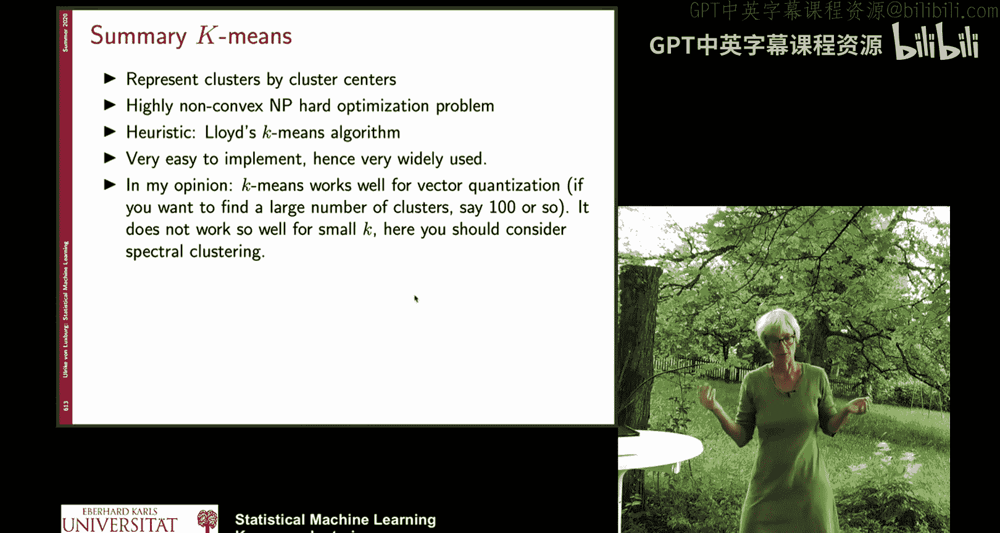