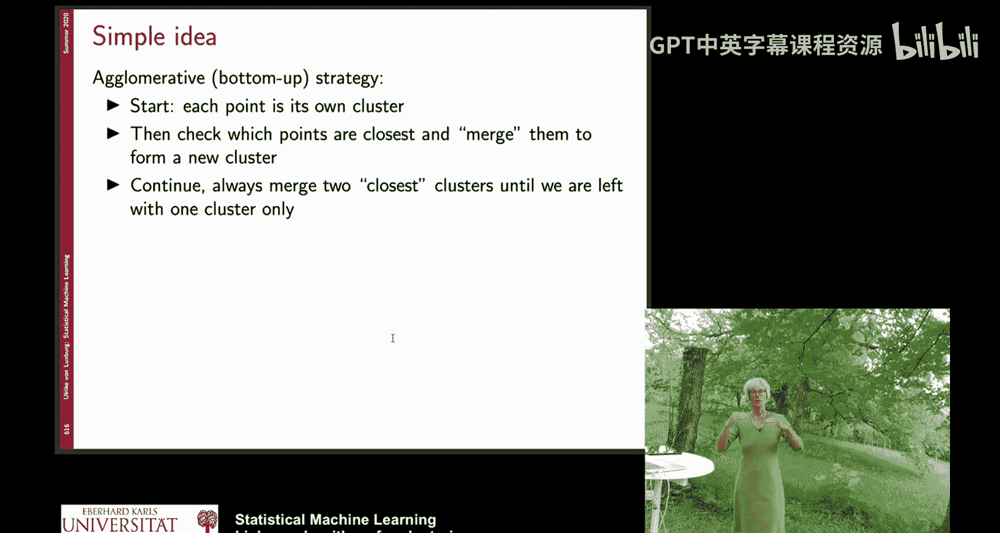
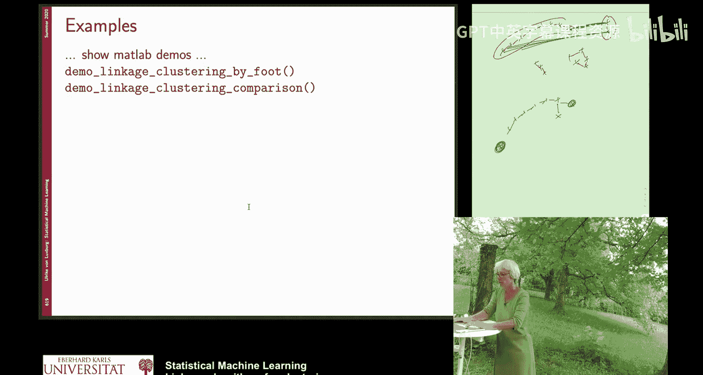
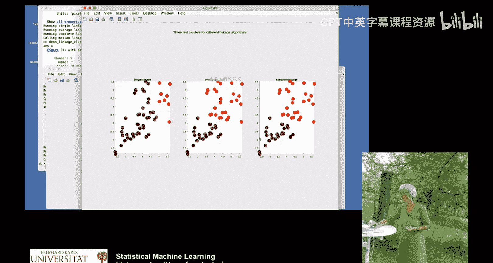
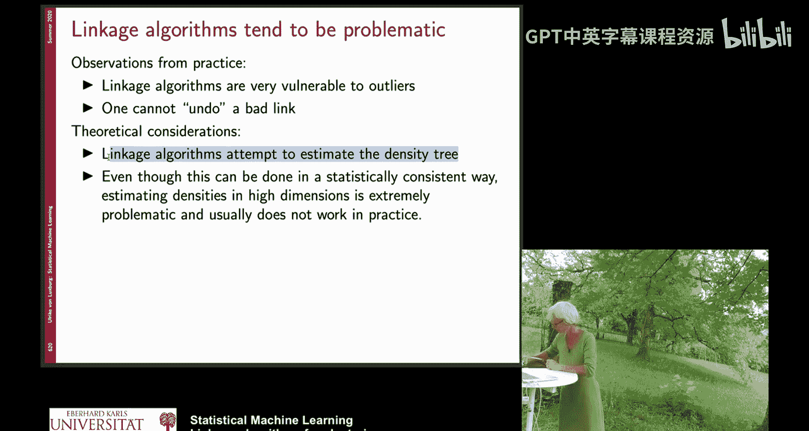
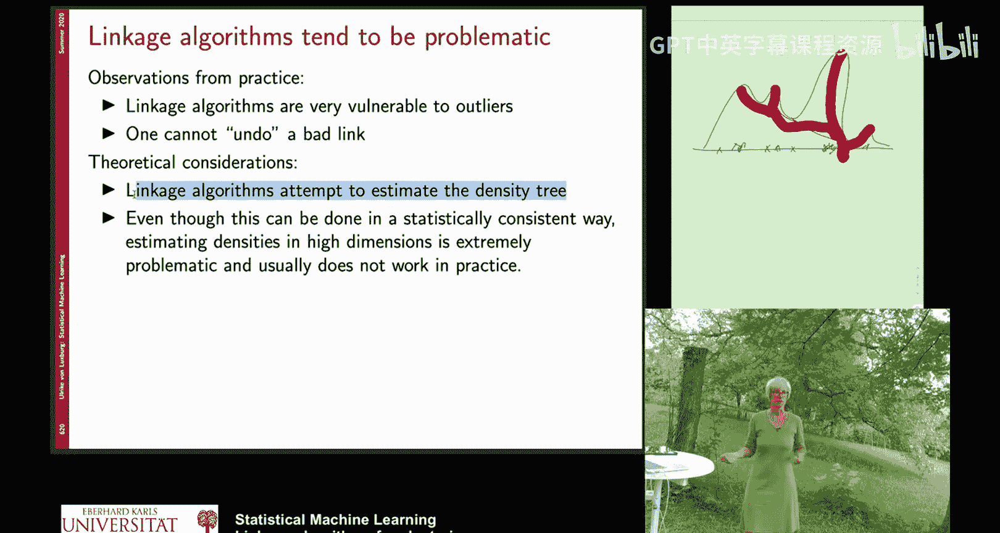
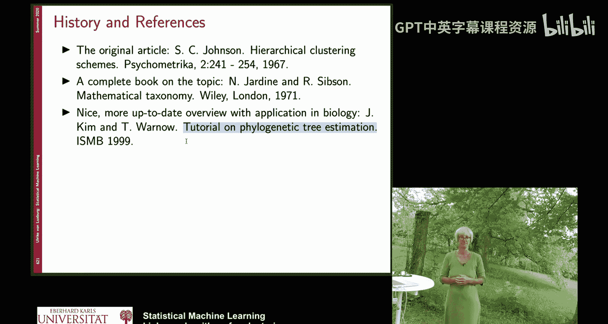

# 图宾根大学《概率和统计机器学习｜Tubingen Probabilistic and Statistical Machine Learning 2020》中英 p37 -37-Part 34 - Linkage algorithms for hierarchical clustering.zh_en -BV1gso5YGE4s_p37-

In the last lecture， we considered the K means algorithm。

 which is a very simple algorithm to produce a flat clustering。

 You give the algorithm a number of clusters K and then the algorithm is going to produce this particular number of clusters。

😊，Now we want to look at a different class of clustering algorithms that try to solve the problem of hierarchically clustering。

In hierarchically clustering， we do not want to commit to a single number of clusters that we are going to look at。

 but we want to generate a whole hierarchy， a whole tree of clusters。😊。

And the family of algorithms that is going to achieve that is at least in the simplest case。

 the family of linkage algorithms， they are also very。Somewhat simplest。

Still I used a lot in practice。 This is why I briefly want to introduce them in this lecture。

The goal of hierarchical clustering is to produce something like what you can see on this slide。

 a dendroogram。A dentroogram typically you read it from top to bottom。

 but on the slide it' is not from left to right and consists of a hierarchy of nested cluster。😊。

So each cluster is nested in in some or clusters are nested inside each other and smaller clusters can be merged to form larger clusters and so on。

For example， in this particular image， you have a cluster of different animals。For example。

 you have the red and the house mouses so here on the slide on the right hand side you have the finest granularity of oil cluster so you have say rat and house mouses each consisting of their like being their own cluster。

😊，But now you can merge them， and then they give the cluster of rodents， for example。

Or here on the bottom you have all primates so it's a huge cluster consisting of many。

 many different kinds of primates and now you can sort of start distinguishing different kinds。

 for example you have a gorilla here and you have a human here and you sort of see the length of this denalogram tries to indicate at which point different species are going to sort of split off the general cluster。

😊，On a very high level， this is what we are trying to achieve in hierarchical clustering。

 and I don't want to become more specific about this because I think like the intuition is sort of fine and to define these things takes a lot of time and you don't gain so much insight。

😊，Now， the standard strategy to solve these problems is， as I said。

 the family of linkage algorithms and they have a very， very simple strategy。😊。

You start with an it's an a aglomerative bottom up procedure。

You start with everybody being their own cluster and then you keep on meing closer clusters until finally you have mergeed everything into one big cluster。

😊。

And maybe let's illustrate it with a simple painting。

Sa this is our data set just consisting of seven eight points。Now what single linkage is going to do。

 it's the simplest of all these algorithms。It looks at this data set and asks。

 so currently everybody is their own cluster that's the beginning of the algorithm and now a single linkage wants to merge to clusters and it' is going to merge those two points in this case which are closest to each other。

😊，So in this guess what would have linkage would merge these two points which are now connected by a red light so they now。

And then came in iterates and in the next iteration checks again。

 which are now the two points or the two clusters that it wants to merge next。

 so maybe it might want to merge these two points next。😊。

And then maybe again it checks which is now the closest pair of points that I could match。

 I would match those points so in for example， in this particular state of the algorithm the algorithm would have four clusters。

This would be one cluster， this is the second one in each of these data point consists of their own cluster。

And it proceeds in this way until everything has been merged into one cluster and then it terminates。

Now， if you formally want to write it up， there is one specific thing that you need to fix。

 namely how do you define what is the distance between two different clusters？😊，Let me trade it with。

A drawing。So assume we have these points。And we have。哦， say maybe we have。One more cluster here。

 So now assume we are in a state of the algorithm， where are。Okay I draw this now。

 so these two these points and these points and these points have already been merged into a cluster。

 so we now have three clusters， so we're looking at the bottom part of this slide。

And now the question is which of them to to merge next。

 So now what we need to do is we need to define what is the distance between any two of these clusters。

And there are now three popular choices that are used in linkage algorithms。

The simplest one is single linkage， S linkage just checks if it wants to compute， for example。

 what is it this。😊，On the left top and the bottom cluster。

What it does is it checks all pairs of points in the two clusters。

 finds out which is the closest pair of points， and this is what it says is the distance between these two clusters。

 So in this particular case， I guess these two points are the closest one。

So the distance between so if this is cluster C1 and this is cluster C2。

 the distance between cluster C1 and C2。Is the minimal distance that you can achieve by points in the different clusters。

 And it's the distance given by these two points， as I just indicated in the plot。Now。

 the opposite of this is what is called complete linkage on the slide its here。

 it's at the bottom of the slide。In completete link so okay。

 maybe let's look first at the definition。 So in single linkage here is the formal definition we check for all pair of points。

😊，Like 1 point in one cluster， x， Y being in the other cluster。 What is the distance。

 and then we take the minimum。The opposite， as I was just about to say。

 instead of taking the minimum， we can also take the maximum。

Which resides in a different kind of distance function， which is then used in complete linkage。

 So in this particular figure here that we have on this slide and the distance between these two clusters C1 and C2 would be maybe given by the furthest pair of points。

 which is maybe this pair of points。😊，So it's different distance function。

And then twin single linkage and complete linkage there's average linkage as you can see on the slide what is going to happen here is like you look at all pairs of points。

😊，You compute the distance， and then you take the mean。

And then this is what you consider the distance function between the two clusters。

And now the linkage algorithm procedures is follows， so here we have a slide。

 the input is simply a distance matrix between the data points。😊。

And if you want to be really formed a function disk that can compute a distance between two clusters。

 typically you use one of these functions that are just set the average or complete or single linkage。

 the minimum， the maximum or the average。Now， what you do is you initialize your cluster in such a way that in the beginning every cluster that just consists of exactly one data point。

😊，And then you have a wire loop。Do you iterate。So currently。

 if you start with n data points of n clusters， you run your while loop until you have only one big cluster。

😊，And what do you do， you find among the classes that you currently have。

 you find the two which are closest to each other。😊，And you merge them into one cluster。

And that's it。 And then you output the whole hierarchy of things that you have match。嗯。

Maybe for an intuition， what is the difference between the single linkage algorithm and for its complete linkage algorithm typically the distance occurs in a situation like this one。

Say， we have。A data said it looks like this。Okay。So assume we want to ask the algorithm which kind of cluster is it supposed to merge so both I think complete and average linkage would start and also single linkage would start off I do it in a different color merging sort of close pair of points in this particular case。

 maybe you get merged like this。嗯。But now the question is which next cluster to emerge。

And now what would happen if you， for example， consider this long cluster here。In this cluster here。

In single linkage， they are not very far from each other。 So I now take it a different colour。

 So in single linkage， the distance between these two clusters would be given by the screen line。

So eventually， it would happen that they could or， I mean。

It might happen that they get mergeed in the next step。Whereas in complete linkage。

 the distance would be the distance between these data points here。😊。

And so they would be merged as the very last thing that you can merge。And typically。

 what this means is。In single linkage， it can easily happen that you generate these kind of chains of。

Where you have many data points that are maybe so they generate these elongated shapes。

Which typically does not happen in complete linkage because the distance between one point like if I now have one more point here and I ask should I match this point to the cluster in complete linkage。

 the distance would be computed based on this point and based on this point which is very。

 very far away from each other。😊，Okay， so this is sort of the intuitive difference between the two algorithms。

 or the three algorithms。I have a couple of matla demos that I briefly want to show。

So here I have simply a random data set consisting of very few points。

 I'm not sure whether we can easily see it and I suggest that you look at the bottom。

 say the bottom left figure because it shows you what single linkage is going to merge and I go through the demo。

😊，It's hard to see。So what you can always see is for example in this particular step。

 you can see on the left hand side you can see the state of what you have merged in one iteration of the algorithm and here you see it after the next iteration so here for example you see from here to here the next iteration merges these two clusters here。

😊，Similarly on top what you can see is you have color code at the clusters。

 but admittedly it's a bit hard to see here， for example we have still two clusters。

 the orange one in the dark one and here they convert like they got merged to one big cluster。😊。

And let me try to run this again on a different data。嗯。

It's all random data sets so I always need to check what comes up。

 but this looks good so here we have again a data set I start marching。😊。

Now we see things happening so here at the bottom for example we have already merged these two points and these points here these three points and in the next step we are going to merge these two points。

Now， if you do one more iteration。We are going to match this edge to the cluster， and this edge。

This edge。 and this edge。And this is how a single link is going to proceed。

 I think it's pretty clear。I have yet another demo。系。

Which tries to compare average and complete linkage。Let me see。

So there are a couple of things that I want to show you here。

So these are it's the same data set and it has been clustered by single linkage in the left。

 average linkage in the middle and complete linkage to the right。😊。

And you see the state when it comes to three clusters so and in the denogram you can sort of in the bottom you have n clusters and then you can walk higher and higher up to any arbitrary number of clusters and now we walk until we have three clusters left。

And then this is the current clustering that we get what you can see on this particular slide is at least these clusters look a bit different。

😊，But admittedly， not very much。呃。And then you can also see the resulting denograms。

 So these are the denograms。The length of the edge in the dental room that connects the cluster is always the length of the edge by which you need to connect these two points。

Or these two clusters and you already see something that is very complicated about hierarchically clustering。

 it's really， really hard see in the dendroogram and in particular it is hard to compare dendroograms。

😊，And this is already a problem。 In fact， it's a serious problem。 For example。

 if you run single linkage twice on a data set with a bit of noise。

 you get denalograms that look completely different。 at least if you look at it from from such as。😊。

Like on your screen。 and it's really hard to find distances。

 And even from a mathematically point of view， it's really hard to define a notion of distance between the enfograms by which you could。

 for example， say， oh these two the enfograms are similar in a certain way。

 but different in another way。This is very hard。Anyways。

 let us try to run the demo once more with a different data set where we maybe can see more。😊。

Here we have a data set。Where you can see like what happened in singing linkage is you have these two clusters and then this last point is its own cluster。

😊，And the reason why this outlier point remains its own pla is because the edge between this outlier point on here is pretty large。

 so it gets connected pretty late in the algorithm。😊，In fact。

 this happens also in average linkage in complete linkage， it looks a bit differently。😊。

Because it tries to find more compact clusters and probably this cluster is not compact enough。

 so it prefers to connect the orange guy earlier in the algorithm。Let's try one， one more example。

Here again we see the tendency of single linkage to produce an outlier point here now we have this red guy which is an outlier point。

 it only gets merged in the very end of the algorithm。😊。

Whereas in average linkage it gets merged earlier and in complete linkage you still have more compact clusters。

 so you also see the tendency complete linkage on the right inside rise to make clusters as compact aspherically as possible。

😊，Where a single linkage doesn't trade it。And this is simply due to the properties of the distance function where you。

 in one case， take the minimum and in the other case， take the maximum。I try one more。Okay。

 that's a similar phenomenon as we have seen before。Get another one。Okay， I think that's。

Not much more interesting that we can see from these kind of demos again。

 I mean you've seen this in more or less every kind of demo。

 so far single linkage produces this outlier point and the compact ones are from computer linkage。

Now， there are a couple of things that you might want to note。

There are observations from practice which we， in fact， could already see in our demo。

 the linkage algorithms are vulnerable to outliers and in particular single linkage。😊。

What is always problematic about algorithms like single linkage or the average did linkage is of course it sometimes heuristic and you cannot undo a link so once you connected something and later on youre meing well maybe that wasn't the best choice there's no way you can undo it。

😊，From a theoretical point of view。Linage diagrams are also not really great。

What they attempt to do is to estimate what is called the density tree and maybe I can briefly show you the concept on the iPad and assume you have a one dimensional we have a data that has just one measurement。

 a one dimensional measurement and say the density of the measurement looks like this。

Now what you would like and now you sample from this from this kind of density。

 So what you would get is you get many， many points here。

Because there you have a high density you get points here you get points here and sort of in the ideal case if you if you have enough data points and if they really reflect your density of course the number of points in each little square or little area on the line is proportional to the height of the density so here you might have some data points also and here may。

😊，And then it fades out。Now what you might want to do is to construct a density tree in the density tree。

Is essentially a tree that connects the mode of a density。It's a tree that looks a bit like this。

 sorry， that's wrong。 It should be connected to here。To hear these guys get merged。

 So what you see from here is， I mean it's a very rough sketch。 you see a tree。

That sort of the fast you split off this this fast here。It's not a very good drawing。

 so maybe I need to make it a bit thicker too。Be able to plot it better。😊，Yeah。I'll do it。 Okay。

 so this is the first mode that we try to get。And then it continues。 And sorry。

 here we may be split off to this mode。And here， again， it's going to split。

And here it goes in this mode。And this funny thing that I've tried to draw here is called the density tree。

And you can prove that linkage algorithms try to do this density tree estimation。😊。

But in practice like estimating densities is something that is very hard。

 you need a lot of data points and in particular in high dimensions its not going to work and this is why you also can prove that single linkage is very vulnerable to outliers and all kinds of effects that take place in high dimensional spaces which single linkage simply cannot cover。

😊。

Okay， single linkage and all these algorithms are really old， as I said already before。😊。

Funnily they come again， if you look at that in psychometrica。

 that's this kind of journal where we had number methods as well。

 like multidimensional scaling for example is also from this community。

 infecting linkage is closely related to minimal spending tree it in fact generates a minimal spending tree。

😊，And that was also invented like or looked at， particularly in these times。

 If you look at the algorithm for spinning trees， for example。

 that's the coast color algorithm that was invented at the same time。嗯。Okay。

 if you want to have more literature， there's a whole book， an old one。😊。

Wwhich is called mathematical taxonomy， so at that time in the 70s there was really tried to formalize all these methods of having arbitrary measurements and bringing them into some kind of structure and this taxonomy that's another way for what we are doing here is sort of it was the attempt to have a mathematical theory of taxonomies it didn't really work out in the end。

 but it's really interesting to look into these books。😊。

If you want to have a more recent kind of overview paper， there's， for example， one。

 but there might be other ones as well tutorial on phylogenetic tree estimation。

This is all I wanted to say about single linkage and its relatives。

 it's a very important family in the sense that many people use it。

 I don't think it is something particularly useful because it is very vulnerable to outliers and very very non-rot if you change your data in a slight bit you get completely different results and this is too big not what you would like to have in practice。

😊。

