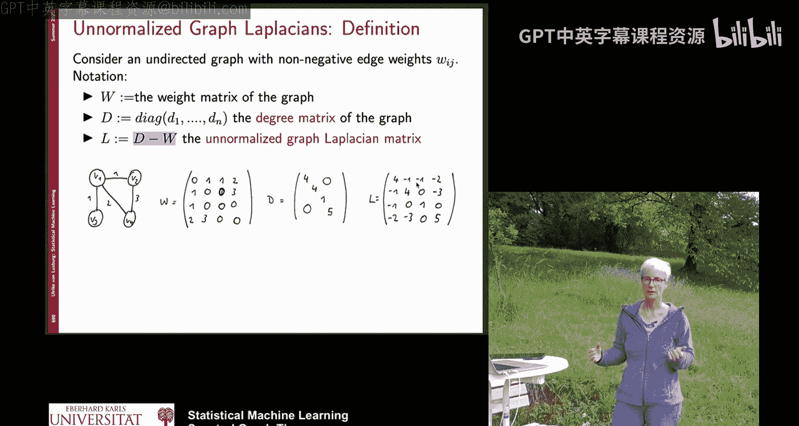
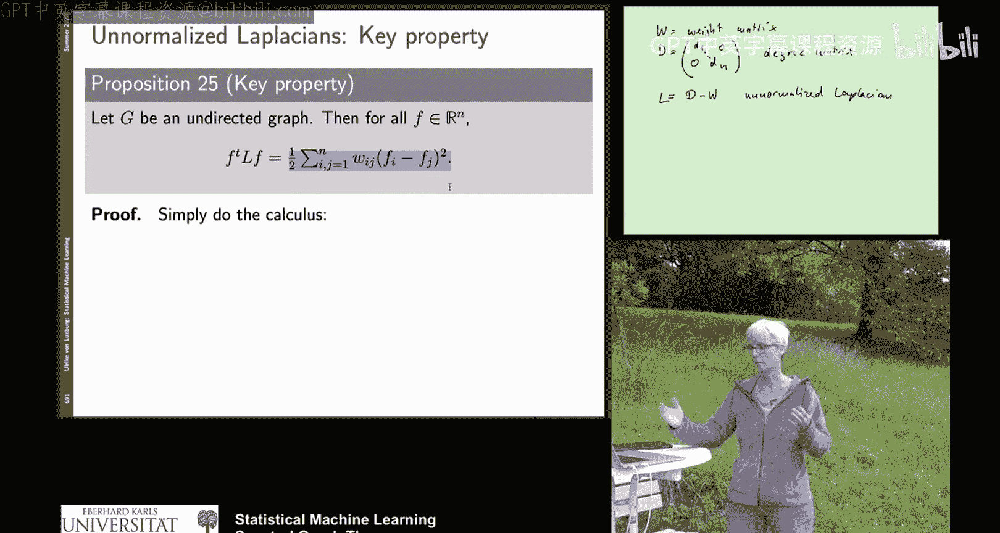
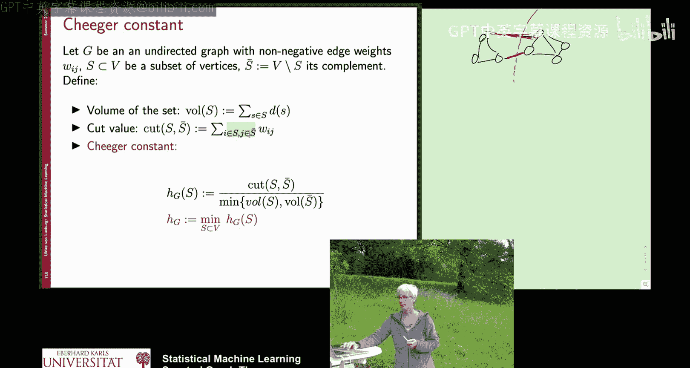
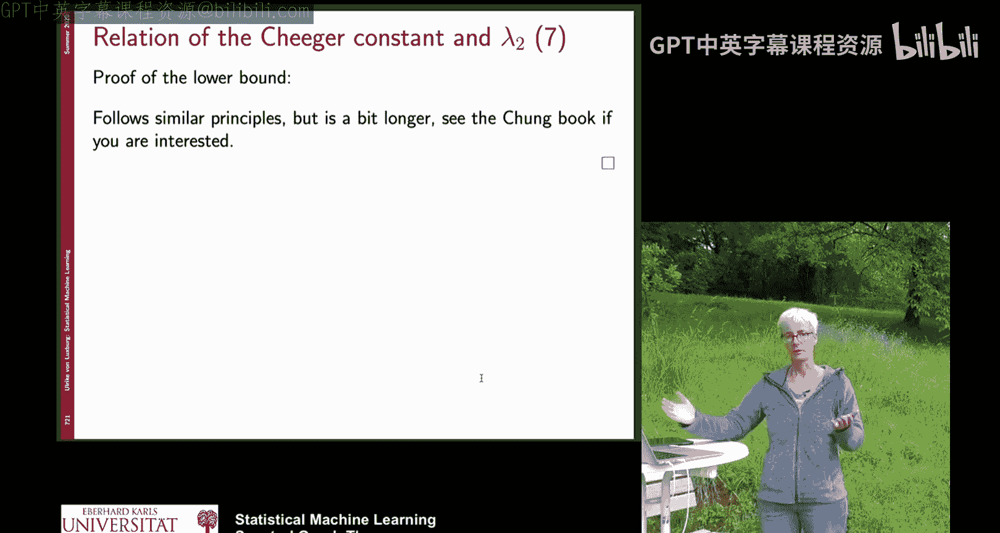

# 图宾根大学《概率和统计机器学习｜Tubingen Probabilistic and Statistical Machine Learning 2020》中英 p38 -38-Part 35 - Spectral graph theory.zh_en -BV1gso5YGE4s_p38-

Good morning。In the past couple of lectures， we considered clustering problems and we discussed the very traditional methods Kmins or single linkage algorithms。

😊，But now we slowly want to move to a new topic in clustering name spectral clustering this is one of the most successful modern clustering algorithms and I want to present it in the next lecture。

😊，What we are going to do in this lecture is we are going to lay the foundations to be able to understand what spectral clustering does。

😊，The foundations for spectral lasting come from a field that is called spectral graph theory。😊。

Spectralgraph theory， in principle has the idea that to describe geometric properties of a graph。😊。

We might make use of linear algebra tools when we look at the adjacency matrix of a graph or related matrices like the graphlaplian。

 this has already been started a long time ago， I guess in the 1970s or so and where people looked at properties of the adjacency matrix and you always try to make statements like here's a certain geometric property of your graph and you can see this in terms of linear algebra in certain properties at the adjacency matrix。

This was reasonably successful up to a certain point， however。

 in the field of clustering it turned out that we need to look at a different matrix that is called the graph Laplian。

 it is a very end of the adjacency matrix， but a bit different。😊。

And it turns out that this is exactly the right matrix to look at when we want to understand how the cluster properties or connectivity properties of a graph are related to certain eig vectors of this graph lapplian matrix。

😊，And in this lecture I want to introduce you to this field of spectrograph theory。

 of course there's lots more to say I mean there are whole lectures。

 the whole tutorials whole books on spectrograph theory if you're interested to learn more I encourage you to read it up today we just take a little glimpse on the field on spectrograph theory。

😊，We start spectrograph theory by looking at anized graph Lapls。

First of all let us define what these things are so we in the current lecture we are considering an undirected graph with nonnegative edge weights both of these properties are going to be important and I'm going to discuss later on y but for now the graph is undirected it has edge weights all the edge weights are denoted by WIJ W for weight。

And these weights are not negative。Now we introduce a couple of matrices。

Capital W is simply the weight matrix， or if you want the adjacency matrix of the graph。

 that's standard。😊，Then we define what is called the degree matrix。

The degree matrix is the matrix that has the degrees on its diagonal。

 so here let's simply start with an example， so here we have a graph at the bottom of the slide it consists of four vertices。

😊，With certain edge weights which are written on the edges you can see the adjacency matrix or the weight matrix of this graph here written on the slide。

 it has entry0 if there is no edge in particular typically we don't assume that the graph itself edges from a verex to itself so typically we would have zero on the diagonal。

😊，Then we have some edges here in the graph as you can see and the degree matrix is now the diagonal matrix that has the degrees of the vertices on the diagonal and everywhere else at zero。

😊，If you cant remember what the degree of a graph is。

 it is simply the sum of the weights of all the edges that are adjacent to a certain vertex。

 so for example the degree of vertex v1 is 4 because their edges 1 plus 1 plus 2 is 4。😊。

So these matrices are pretty standard and now we define what is known as the unnmalized graph Laplian。

 it is always denoted by L。This is simply the difference degree matrix minus weight matrix。

And here you can see the result for this particular example so on the diagonal you have now what is the entry of the degree matrix and on the off diagonal terms we have all the weights with a negative sign。

😊，Okay， for now， this is just a definition and it might。

And for now it's really hard to see why we want to look at this matrix also to be able to remember it later。

 I'm going to denote it on the iPad。😊。

So we have W is the weight matrix。Is the degree matrix D1。Din。

So it's a diagonal matrix the degrees are denoted by D1 to the n， if we have n vertices in our graph。

 I write it down it's the degree matrix。And then we have the matrix L。Which is the minus w。

 which is the unized。Lalaian。Un normalizedmalized because later on we are going to see that there also exists a normalized version。

Now， a lot of properties related to the graphph Lapl are all based in the following what I call key property。

😊，Consider the proposition on this slide， the GP an undirected graph， then for all vectors F。😊。

We have that F transpose LF。Is given by this formula here， the sum over I and J from1 to n。WJ。

 F minus Fj。So for now， this is simply a property of linear algebra。 there is no， I mean。

 as for now we don't have any geometric meaning in the graph， I'm going to give it later。

But this is a simple property of the graphlapline matrix L。

So the proof is on this slide， so what we want to do is we want to prove that this red guy here on the left hand equals this red guy on the right inside。

 this is the key property that we want to prove。😊，And now here's the proof， it is， in fact。

 really simple。😊，The first line we just plug in the definition， the Lalaian is d minus w。

 so we plug in the definition and we split the sum into the two terms。😊。

Now in the next line what we do is we simply plug in the definition of D。

 so here the d is a diagonal matrix， so the quadratic form of a vector f with a diagonal matrix is simply sum of I D squared because all the of diagonal terms disappear。

😊，And then here this is just the quadtic form of F trans post WF。Okay。

And now it comes just one step where we need to invest a bit of work and maybe it's the easiest thing if I do it on the iPad。

So what we want to do is we have some of I D Ifi squared minus。Some of Ij。If IFj， WI J。

Now what we want to observe is。I want to do what in German is called quadradihigson and I don't really know what the English term is we want to introduce some supplement terms to complement this to a binomial formula essentially so observe here we have Fi squared。

😊，And here we have IFG。Once。What I want to achieve in the end is I want to have something like F squared minus 2。

F IFj plus Fj squared。Okay。Now what I'm going to do first is Im going to maybe in green is maybe a bad color in pink。

😊，What I'm going to do is I put a one half here。And I put a factor2 here and a factor2 here。

Nothing has really changed。Now what I'm going to do is maybe let's move to black finally。

So I have now two terms， one is the one I simply leave it as it is the Ifi squared。

 and then I write exactly the same term just with an index J。😊，Z。DJFj squared。

So this doesn't change anything whether I use index I or J as an index in my sum and that didn't really change。

But now I have because of the factor2， I have the expression once with I and one with J。

And now observe that I can substitute certain terms here， so D I in this expression here。

Is the sum of WIJ？So how can I write this now？嗯。So maybe what we have so far is one half。😊。

We have some over。I， D， I， F， I squared。-2， sum I J。F I F J， W， I J。Plus， sum of J， D，J， F J squared。

So far， so good。And now we finally explore what is D is the sum over J WIJ。😊，And similarly， here。

DI is of DJ， some of IWIJ。And Ill observe if you do these substitutions。

 then we have what is written here on the slide。😊，Here's the first term。

 the second term and the third term。And now you can observe that you can take out this。

 you can sort of put this all under the same sum sign because we always have a sum over INJ。

We also always have this constant WIJ and then we have FiI。First of all。

 we have two F like we have F I squared minus2 F I， FJ plus FJ squared。

 which we can then replace by F I minus F J squared。Okay。So this is not really a complicated proof。

 it's a very simple proof， but again this is a really important property I want to show it to you once more if we have the quadratic form of the graph lapplium。

😊，This can be written in this kind of quadratic formula。Okay。Now， why is this important？

And maybe the first thing to observe here is why is this matrix called a graph lapplian。

 it can be explained with this particular property。So what we have seen is。This is the key property。

And now， I。I mean， this is really a fuzzy interpretation。

 you can make this more precise by stating everything precisely and there are papers about this。

 but I want to show you the intuition So what I want to do is I want to say WIJ is something like a similarity。

That's always what we have in our graph。 the edges are weighted by similarity and the similarity intuitively is always something like one over a distance。

😊，So similarity is large if distances are small。And typically like for example。

 we have also seen this in the kernel kind of framework。

 we have the similarity which is the kernel value and then there is also distance and so typically the way these things are related is or that's what I want to use here at least is that the similarity is one over the distance squared。

😊，This is just an intuition and on how we can could interpret a similarity。

But now observe what happens if you now take the sorry we are still here and now we replace the WIj by what I call like one over the Ijs distance Ij squared。

😊，It's this expression here。And now we have something like if you take a derivative。

If you consider like maybe again， I need to go to the iPad。

So if you take at derivative of a function， what do you do。

 you look at the function value at some point x function value at some point y。

And then you look at x minus y， the distance。And then you look at this particular expression and you let y converge to x。

 and then you check where does it converge to。So this is essentially。😊，In our context。

 we have not x and Y。 we have called it I and J， so we have FI。Minus f3。

And that is essentially the distance of IN。Okay and now we have this kind of expression。

 but on the formula on the slide we have it with a square and then we sum over that hoing。

And this is now if you know what the graphraphlaplian operator is in analysis。

 this looks very much like a graphlaplian operator。

 So what we have here is this is the derivative of F which is often written as an NAF。😊，squared。

 this is the squared here。And the sum is now in analysis， it's not a sum。

 it would because were all in a continuous space， it would be an integral over x。

And this is the definition of the Laplace operator or the quadratic form induced by the Laplace operator in analysis on R。

So for those who know that who have seen the Laplace operator before。

 this graph Laplaceian is essentially a discrete version of the Laplace operator on a continuous space。

😊，And this， as I said， this can be made precise， in fact。😊。

Some colleagues of mine Matta Sein and myself during our PhD times we have proved a number of results where you can prove that the graph lapplium converges to the underlying Laplace operator on。

Wellre on a manifold in this particular case， so you can make all of these things precise。😊。

But this is where the intuition come from。I want to show you one more intuition。

 what is the geometric meaning of that thing？To see this， let's again， let's maybe plot a graph。

Maybe like this。What we are going to do in the remainder of this lecture and also in the next few lectures when we talk about spectral clustering and spectraltrograph theory we have this vector F which so far was just a vector in R N we are going to interpret this vector as a function on our graph so assume we have a vector F。

😊，Which is F1， F2。2 FN。 So all our objects live in RN。If n is the number of vertices in our graph。

And now， so our vertices have numbers， oh sorry。😊，Black， so this is vertex 1， vertex 2， vertex 3。

 vertex 4， vertex 5， and so on。And now。So they are just numbers in some arbitrary order。

And now we consider f1 as a function value of a particular function that is defined on the graph so this is f1 shows you what is the function value at vertex 1。

 F2 is the function value at 2， F3， F4， F5 and so on so this vector。😊。

Gives us the value of a function that lives on the graph。And just for concreteness。

 consider this is example so you have a neural network sorry， you have。😊。

A social network the vertices correspond to persons like each person is connected to friends。

And you want to say how much money does a certain person want to spend to buy a new laptop。

 so this function value F might be the amount of money a certain person is going to spend。

Or you could also and this is what we are going to do。

 you could consider this function value as some kind of group indicatorship so you could say you have your social networks and you want to identify a group say all students in tububing in so you have a plus one if you're a student in tububing in and you have a minus one if you're not a student in tubing in。

So in this case， you again have a function on the vertices。

 which in this case is some kind of indicator function of group membership。

So what you always should have in mind now is that whenever I talk about a vector。

 it is a function on the vertices。😊，Now what does this expression Let me go back to the key property because this is so important。

 what does this expression that we have on the right hand side。

 what does it sort of encode or when is it going to be small。So because later on。

 we are going to see that all of clustering is about making this expression small。😊。

So when is this expression small？So it could so we have a sum of terms and all these terms are non negative。

 so WI because we have no negative edge weights is a number that is not negative and here we have a square which is also a non negative number。

So the whole sum is going to be small if each individual part is small。And how could a car be small。

 it could either be small if WIJ is small。😊，What would this mean in our graph WI in the extreme case is small if there is no edge then we have WIJ is 0 or if we have a weighted graph。

 WIJ is small if there is just a small edge weight。😊。

So this could be an edge between a vertex and a very far apart other vertex and where there's a very low similarity。

 maybe a bit larger than0， but not very high。Or this expression could be small if F minus fj are small。

And if I'm in FJ somehow I I said this is it measures the the difference between， between。

Between the functionaries of a point。 and now if we look at this graph。 So when would be a function。

 a function on this graph， when would it be small， let me try。

 try to make one more one more figure again， a fresh graph。Yes saw this itch。Does not make sense。

Make this。Now assume for simplicity， I use function values plus 1 or -1 just to illustrate what is going on。

 so I could have minus-1 plus1 minus-1 plus 1 minus-1 plus1。For example。

This would be a function that has a pretty large value of these guys because I have many vertices that are close to each other and so they have WIJ is1。

😊，But they have different function values so here， for example。😊，This particular edge。

Has a large weight because there is an edge， but the function values are pretty different。

 So if I just have plus -1 values， here we have I have a large difference。

 So this will count a large amount into the sum。And whereas。呃Sa。

If I have a minus1 here and I now consider this particular edge is there。

 but the two function values are the same so they don't count into the sum。So what we can see。

Is in the end， how could I like if I would like to find an assignment in this particular graph that has a small function value。

😊，Then I better make sure that if there are two points that are connected by an edge。

 that they have the same function value。So for example。

 if I would use the assignment now let's try to get rid of all the old assignments。

So if I would use a function that is defined like this。

 so I have plus  one plus  one plus  one plus one plus one here。-1， minus-1， minus-1 here。

This would have a pretty small value because all these edges。

 which intuitively so here we have two clusters which are indicated by this cluster indicator vector F。

😊，So all these guys within the cluster have the same function value。

 so in the sum in the key proposition they count for0 because f I minus fj is 0。😊。

And in the sum the only factor or the only part that would remain is exactly the sum for this particular edge where we have different function values。

 but this is just one edge。So essentially， I mean， the intuition I want to convey here and this is what we are going to make more precise later in the next lecture。

 I guess is that this expression here。😊，In the key proposition。

 it measures somehow the variation of the function along the graph。

If the function wiggles a lot within the same cluster or tightly connected group。

 this expression is high。😊，If the function stays pretty much constant on one cluster in the graph。

And maybe it might have a different value and a different cluster。

 but there are not too many edges between then this expression is going to be small。

And this is the intuition in the end why spectral clustering is going to work and why spectral graph theory is so helpful for that。

Okay， this was a long explanation for the key property。

 but I think this intuition is really important。So we have proved the key property。

 we have also seen why the thing is called the graphlaplian。嗯嗯。

Now we want to turn to the important spectral properties or key properties that the graph Laplian matrix has。

So again， assume we have an undirected graph with non negative edge weights and consider the anized graph lapplsian。

 it has the following couple of properties。The first one is that alisosymmetric and positive semi definite。

The second one is that the smallest eigenvalue of L is 0 and the corresponding eiging vector is the constant one vector。

And the last one is that we can now order all the eigens eigingvalue， the smallest one is0。

 and they have linearly increasing order。Okay。Let's simply go through it。

 So the first one aliometric， that's obvious。Because we start with an undirected graph。

 so the adjacency matrix is symmetric， the degree matrix is symmetric。

 so then the difference between degree and adjacency matrix is symmetric again。😊，That's obvious。

From the fact that we start with an undirected graph。

 this is also the reason why we need to have an undirected graph， Because otherwise。

 if this matrix wouldn't be symmetric， we would have。Troub which we're going to see in a minute。

The matrix is also positive， definite， semi definite。

And this is now a simple consequence of the key property。 If we go back to the key property。

 it's this one。A matrix is positive semidefinite if for all vectors F。

 the quarotic form F transpose LF is greater or equal to 0。😊，Now we can exploit the key property。

 we know that f transpose F can be expressed in this term in this lecture。

 I have already mentioned that this expression that is always greater or equal to 0 because w is greater or equal to 0。

😊，Because we have no negative edge weights， and if I minus fj squared is a squared term。

 so that's also not negative。So that's also obvious。

And here the important ingredient is that these edge weights are not negative again if you wouldn't have that。

 then this would be one of the points where spectrum fing or spectrumgraphery would break。

and now we are in a nice situation we know elisymmetric。

 first of all so we know that we can decompose it into a basis of eigen eigenvectors with real valued eigenvalues。

 we know its positive semi definite so all the eigenvalues have to be greater or equal to 0。😊。

So the smallest eigenvalue if possible is0 or it could be larger， we don't know it yet。😊。

And now the statement， the next statement is the smallest a value of L is exactly 0。😊。

And I can also give you the corresponding eigenvector， which is the constant one vector。

And now this again， is really easy to prove you just plug in。😊。

This constant eigenvector in the eigenvalue equation， so you need to prove l times v is 0。😊。

You just plug it in and it is an immediate thing， I think I have it on the next slide。😊，嗯。

it's here this expression and this is really obvious because if you just write down so if you multiply1 to the graph lapplian you split it into the two terms corresponding to D and W and then you just explore it you just write it down because。

😊，W times 1 takes the row sums of the matrix w and the row sums are the degrees and this is exactly what you get here。

 so just write it down on a piece of paper it's one line and you see immediately that this is0。

So that's also a very simple property and simple to proof property。

So the consequence I mean this isn't even anything that deserves the name of a proposition。

 so we now know the matrix is symmetric positive semideinite， it has real valued eigenvalues。

 they need to be greater or equal to 0 and we know there exists one that is0 so the smallest one if I denote the eigen if I order the eigenvalues in increasing order Lada 1 is the smallest one which is 0。

😊，And then we know everybody else has to be larger， or later equal than zero。Okay。

 so none of these properties is anything complicated or difficult and they all essentially follow from this key proposition。

😊，And we have seen the proof already。Now comes the more interesting propositions。

 how the spectrum and the eigenvalues and eigenvectors of the graph lapplian are related to the connected components or the cluster structure of the graph。

😊，And this is now something that's really important。Again。

 we consider sorry an undirected graph is no negative edge weights， as always。

And now there are two statements in this proposition。

The first one says that geometric multiplicity of the eingvalue 0。😊。

Is equal to the number K of connected components of the graph。Let me draw a picture。

So here we have a graph。😊，This is a graph and it has four connected components。

 so if you don't know what a connected component is it's the maximal connected sets so intuitively in a figure like you have four pieces here which fall apart these are the four connected components。

A connected component might consist of one vertex， or typically it consists of more than one vertex。

And the statement is no。😊，It's geometric， so we look at the graph lapplsian。😊。

And we compute its ag values。Now the statement says the number of eigenvalue 0 how often do we get this eigvalue 0 so what is the dimension of this eigen space corresponding to eigenvalue 0 that this number is equal to the connected components so here we have four connected components so if I write down the eigenvalues of the graphlaplsian the four modest eigenvalues are all zero。

😊，And the next angle values are all larger strictly larger than0。This is the statement here。

 the number， the multiplicity of the eigenvalue 0， like the dimension of the eigen space。😊。

Is equal to the number of connected components of the graph。

That's already nice because it would tell you if you can compute the eigenvalue of your graph lapplian。

😊，And at least if you don't run into numerical problems and you find out how many zero eigvalues you have。

 you already know what are the number of connected components of your graph。😊。

It might be maybe a complicated way of determining the number of connected components and it's not the most efficient way。

 but it would work。And now comes the second statement。

 which is even more important for what follows in the next lecture。

We can't even say how the eiging space looks that spans the eiging space of eigingvalue 0。

 I can give you a basis of this eiging space。And the basis。

 I think it's easier to write it here on the iPad， the basis is a characteristic vector of each of the component。

😊，So I have one eigenfunction in the spaces which has entries 1， and then we have 0，0，0，0，0，0。

So essentially so these are the vectors these are points123。

 so these are just if I look at I need to have a sort of numbering of my vertices to tell you which entry of the vector corresponds to which vertex so these are the first three vertices so this eigen vector is one on the cluster or on this connecteded component and0 everywhere else。

Then disconnect connected component。If this is vertex 4， would have 0， 0，0，1。00，0。

 So this is sort of corresponding to the second connected component of our graph。

 which just consists of one vertex。Then here we have vers Cs5 and 6 and the corresponding eigenvector would p 000。

0， and then。11， these are the ones entries 5 and 6 in our vector。And then we would have 0，0，0。

And the last a connected component would have the following eigen vector。

 it would have lots of zeros。And then it has three ones。So the basis of this eiging space。

Consistists of four vectors。You can already see that these vectors are linearly independent。

 so they span a four dimensional space。And all of them are eigenves of eigingvalue 0 and so the statement I mean。

 as I written it here， that's maybe read it， the eiging space of eigenvalue 0 is spent。

By the characteristic functions of those components and the characteristic function are exactly what I just defined here。

 it is a vector that is0 for vertices on the sorry one for vertices on the component in0 every。😊。

Okay and this is cool because at least in principle， it gives us way。😊。

To discover the connected components we could， I mean， at least if everything would work out。

 we could say， here's our graph。Computer graph Labrasian。

Comput the eyeing vectors of the graph Laplian。The number of eg vectors which have eingvalue 0。

Are going to tell you how many connected components you have。

And then for each component there will be one characteristic vector that is member of this eigen space and if at least if your numerical solver would give you this particular basis。

 then you would perfectly recover the cluster structure。😊。

I'm a bit careful here as you might notice in stating this about the numerical solver because the eing space is a four dimensional space and of course you can give many bases to this space。

 it is not really clear depending on your numerical solver which kind of preference your solver has to what kind of basis it is going to find often it's not going to find this basis but at least I mean for now we are still in in the。

😊，The principled approach where we simply want to see what would be possible in principle。So。

 this is good。嗯。But now， maybe let's， first of all， try to prove this proposition。 We haven't。

 I mean， I've talked about the result， but I haven't really proved it yet。 And again， here。

 the proof is not very complicated。We start with the case k equals 1， sorry go back。

Heres our proposition， it says the number of eigenvalues correspond to the number of connected components and then the eigenvectors have this particular form。

 it is a statement that holds for allK I want to prove it by induction。And essentially。

 I start with suit case K equal was1。K equal to1 means we just have one connected component。

 so the graph is connected。Okay。So we want to prove the case k equals 1。

 we can now assume that the graph is connected because that's the case we are currently looking at。😊。

Now let F be an eigenve with eigenvalue 0。😊，What do we need to show？嗯。First of all。

 we want to show that F is the constant vector。 Why do we want to show that， Let's go back。

the second statement says the eigenvalue0 is spent by the characteristic functions of these components now we just have one component so it should be spent by the constant one vector at least if this notation is correct so there should be one eigenve。

ThatSo taken together， there should be exactly one eing vector that has e value 0。

 and it should be the constant one vector。So we have to show that if f is an eigen vector of eigingvalue 0。

 then it already must be the constant  one vector。😊。

And the reasoning for this is again pretty simple， so we know that f is an eiging vector of eiging value 0。

 so LF is 0。😊，Now we exploit the key property we know。So we already know let me show it here。

 LF is 0， So then also f transpose LF is 0， so we can write 0 equals F transpose LF。

By assumption that F is an eigenvector of eigenvalue 0。And now we again exploit a key property。

As we've seen it on the previous slide。And now we have， if we read it from left to right。

 we have zero equals this thing on the right hand side。😊。

But now how can this expression on the right hand side be0？As we have argued before。

 all of sum parts of the sum are not negative， so this can only be0 if for each pair of IJ either it is the case the WIJ is0。

Or if WHA is not0 because there is an edge。Then F I and Fj have to be the same。

So whenever there is an edge。Between two vertices in our graph。

This expression has to be0 if this whole equation needs to be true。

 so the two function values need to be the same。Meaning whenever there is， in fact。

 even a connected path between vertices in the graph。😊，All elements on this path。

 all vertices on this path need to have the same function value because as soon as there would be one pair of vertices which are connected but don't have the same function values。

 this expression would be strictly larger than0。😊，So this is written here on the slide。

 so for all pairs of INj。😊，Either we have WHA 0。 So there is no edge。Or FIN is equal to Fj。

And in particular， if you now have exactly one connected component。

 this means that the function needs to be constant on this whole connected component。

That proves the proposition for the case k equals 1。😊。

Because we now know we have exactly one eigenve。😊，Let's go back。

We have proved that if f is an eiging vector it has already to be the constant vector。

 so there can't be any second or third eiging vector like so the eigen space can only be spent by the constant vector there's not another dimension。

 so we know that the number of eigenvalues of eiging vector of value 0 is exactly1 Naly the number of connected components and because the vector is the constant vector we also have the second part correct that the characteristic vector of this connected component is what spans the eigen space。

So case K equals 1 was easy。Now we go to the case case larger and strictly larger than one。

And now what we have is we have a graph that consists of K disconnected components。

And now you can observe that both the adjacency matrix or the weight matrix if you want and thegraph lapplian are blocked diagonal。

 that means if we have k。Blocks in our matrix， maybe let's write it on the iPad。

So say I have k equald3 clusters， maybe Ill write it in black， that's easier to see。

 so we have k equal 3 clusters。😊，So then the adjacency matrix has essentially a。😊，Has three blocks。

They might have different sizes depending on the size of the clusters so within the blocks there might be entries。

 there are some edges， some one， some zeros，1 zeros。

 so these are thes like the the edges within each of the connected components。

 So in each of these blocks we have。0 in once。Or if we have a weighted graph。

 we have non negative numbers in there， but outside of all these blocks we have zero because we have connected components。

 it means that there is not a single edge going say between block 1 and block2。

 so this means outside of these blocks， everything has to be 0。Now。

 if the adjacency matrix has this block form， the same is true for the for the。Graph Laplian。

Because the graph Laasian now has like the degree， the diagonal matrix is simply a diagonal matrix as we had it before。

 it doesn't change its structure， but now if you take the difference between a diagonal matrix and this block structured matrix。

 we end again with a block structured matrix with the same size of the blocks as we had them before。

😊，And observe now that each of these blocks is its own little graphlaplian。

 and that's something you need to digest once So here。😊，This block。

Its exactly the same as a graph Laplian。 if we would just compute it on the graph consisting of the first connected component。

Here we have L2 that corresponds to the second and L3 that corresponds to the third component。

Because there are no sort of cross interaction in the diagonal matrix it is so now we have two ways of computing this graph Laplian if you want。

 we can compute it on the whole graph as I've done it here on this on the iPad。

 we can write down the adjacency matrix， the degree matrix and take d minus a。

Or I could do it on each block individually， and I could write something like。

A1 is the adjacency matrix that just corresponds to the first block。A have D1。

 which is tested agonal matrix corresponding to this first block。

 so these are maybe just 10 vertices or so out of 50。And then I can compute a1， which is D1 minus a1。

And this is exactly the same thing that we have here。On the block of the of the pig graphavlaplian。

This is not difficult， but you need to verify once that it's true。Now， once we have that。

 the remaining of the remainder of the proof is really simple because now let's look at how does it look like。

 we now know。😊，So now we want to use induction so by induction we or in fact you don't even need induction here if you want。

 we already know that for the case K equals 1 there is exactly one eing vector so maybe if I write again and one this is just the matrix of the small block。

The first one， we have the first eigen vector of this matrix is the constant one vector。

And the same is true for the for L2 and L3。So each of them has exactly one eiging value0 with a constant one vector。

But now we have to stack this in the big matrix， so now we have this big matrix where we have all these blocks。

😊，And now how do the eigenvectors of this matrix look like they are essentially so they are the same eigenvectors as before but just paddted with zeros so the first eigenvector of this matrix here is the constant one vector on the first block and then zeros everywhere so it would have sort of three components the first one is constant1 on the first block of the graph on the first connected component0 everywhere else。

Then the second one。And we know we have exactly one such vector。

 then we have one vector that comes from the second block， which is 0，0，1，1，1，0，0，0。

And we have exactly one other such vector coming from the third block。

And this is exactly the proposition that we wanted to prove， we know。

 because each of these blocks has exactly one eigingvalue 0。😊。

In summary we have as many eigenvalue 0 as we have blocks in this matrix。

 namely the number of connected components， and each of these blocks gives us a constant one vector which if we look at it in the big matrix is the characteristic vector of this particular component。

😊，And this proves the statement for the case K larger than1。Okay。

 it's written here once more on the slide。But I just did it on the iPad。Okay。

 so we proved this proposition， so now we know that the number of blocks。😊。

Is indicated by the number of eigenvalues 0， and we get the characteristic vectors at least as one possible basis of this eigenspacee。

Now there's one thing where most people stumble across at some point and maybe some of you have already done it and I want to formulate it as a question here。

So there seems to be a contradiction because in one proposition I set。

The constant one vector is always an eigen vector of any graph。So also。

 if I have a graph that has five disconnected components。😊。

And the statement test the constant one vector。Has， is always has aigagonvalue 0。

 so it must be in the aigosspace。Now the other statement said we have these characteristic vectors as Iing vectors where we have these pieces like constant one on one black block and so and all the other blocks。

😊，The sum seems to be a bit contradictory at least on the first glance and I would like you to figure out why what is the point so if we go back I show it on the proposition so here I say say if we have five blocks we have five eigenvectors0 spent by these characteristic vectors。

😊，And in the previous proposition， I said。There's always the a vector constant one on the whole graph。

And I want you to figure out why this is not a contradiction， why this makes sense。

Please take a break if you can down see it right now and try to figure it out。

Okay so far we looked at unized graph lappls and have seen how they are related to the spectrum of a graph now what is going to be important in the next lecture is that there also exists normalized versions of this graph lapplaces and they are called normalized lapblastins。

😊，嗯。And essentially， there's a bit of， it's a bit annoying。

 There are two different ways of normalizing the graph lapplian。 And in fact。

 there's not a really unique。Notation in the literature。

 which really makes it annoying because whenever you open a paper on Spectrograph theory。

 you first have to figure out whether the letter L stands for an unmalized graph lablaian for a normalized one and then for which normalized one。

 So this is like whenever I open a paper， this is the first thing I write on the margin of the paper。

 What is this letter L that they use， What does it mean。

So to distinguish the different matrices here I used a notation that some people also use but some other people use different things。

 I used the two notations L Sim and LRV RW for the two normalizations of the graphph Larain so L in my notation is always unmalized and then whenever it has a subscript it is a normalizedized version。

😊，So the first normalization of this graph lapplian is what is called the symmetric normalized lapplian。

You take the original lapplian and you multiply it with d to the minus12 from left and right。

And here I mean maybe there is something you need to explain what is d to the you can't really take a square root of a matrix typically this doesn't really exist so D to the minus12。

😊，Is essentially。So the matrix D is a diagonal matrix consisting of TN。

And then we want to take that to the minus1 half again it's an naque notation this doesn't really exist。

 but what I mean here is simply the entry bias we take d1 to the minus 12， d2 to the minus12。

The N to the minus-1 half。So it's an entry based operation on the diagonal。

And this is the symmetric normalized graph laplastian。😊。

And then there exists what is called the random walk graphpha lapplian D to the minus 1 L。😊。

And if you have seen random walks before。😊，Then this matrix is very closely related to the transition matrix of a random walk on the graph。

 I'm going to mention it later on。In fact， both of these matrices。

 I mean you need to take the definitions for now there is no reason why you could see why these two definitions make sense。

 but at least there's one reassuring thing is that these two different definitions of a normalized lapplian have very similar properties in terms of their spectral properties。

😊，The first one is that we have again， something like the key property now for symmetric now we express it in the symmetric version。

So F transposed L Zoom F can also be written in such a way as we have seen it before。

 just that we have now this。Square root of the eye in the denominator。

And the proof is similar to the anorized case。 You can do it yourself if you want an exercise。

 I'm not gonna give it on the slides。嗯嗯。Now here are again the statements about the spectrum。

 also these properties are very similar to the ones of the anized lapplium。😊，So first first of all。

 we have a relationship between the spectrum of the two normalized versions。

 So if lambda is an eigenvalue of the random walk normalized lapplian。

And the corresponding eigen vectorctor is called U。

Then the same eigingvalue is also an eigingvalue of the symmetric normalization。

 so the eigingvalue are exactly the same。And you can transform the eigenves within into each other。

Eigenvector w of this random work matrix is the same as the D to the1 half of eingvalue U so there is a formula that brings like if you compute the eigenvectors and eigenvalue on one matrix you can always convert them to the other matrix this is formula。

The other property that sometimes is helpful is if land has an eigenvalue of the random work in thelaian。

Then they solve a generalized eigenvalue problem of this form and this is sometimes used to derive theoretical properties。

 I'm not going to dive into any deeper， just take it as a fact。

And now come the properties about how does the eves really look like？😊，So。

 if you look at the random walk lapplian， it always has the constant eyeing vector the eyeing value as the eing vector correspond to eing value 0。

 this is exactly as we have it for the anized lapplian。😊，This holds for the random workla last unit。

For the symmetric matrix， it does not hold because we can because we need to make this transformation。

😊，We always， I mean， we have the same eigingvalue0。

 but the eiging vector is now not a constant vector。

 but it's d to the12 times the constant vector because of this transformation that we have here。

And in particular， both of these matrices are again positive semi definite by the key proposition that' is easy to see and have again。

 I mean the smallest egvalue0 and then there might be some larger eenvalues。😊。

And the proof is really straightforward， it is more or less given in the same way as the previous one you can read it。

 but essentially it's obvious it is straightforward as we have seen it before。😊，Now again。

 the second important fact is not how does the spectrum look like。

 but how is it related to the cluster structure and again we have a very similar proposition to what we have seen before。

😊，The following。Again， the Gb and undirected graph is non negative edge weights。

 then the multiplicity of the eigenvalue 0 in both normalized matrices equals the number of connected components。

😊，And for the random work matrix， we have again this kind of indicator vector property。

 the indicator vectors are constant like the eigenvectors corresponding to zero are these indicator vectors of the clusters。

For the symmetric matrix， you again have to transform them by this D to the12。

And the proof is exactly the same as we have seen it before for the unormalized case。

 you just need to adapt it and that's obvious。😊，So for now we have seen two variants of this graph lapplian。

 the unized one and the normalizedized one， I have explained at least for the unormalized one this intuition that this key proposition at least measures a bit how this function wiggles along the graph。

😊，And we have seen this relationship between。Between the connected components of a graph。

And the eigenvalue of a graph lapplian。This is what we are going to exploit later on for spectral clustering。

 I want to show you one more important topic in spectral graph theory which is also related to spectral clustering。

 which is called the chiger constant。😊，So let's start as follows again we have an undirected graph with no negative edge weights usually and now consider a subset s of vertices and its complement S bar。

😊，So this is just any subset。Now we introduce two notations。We define what is the volume of a subset。

Of vertices and the volume is essentially。The degree like with some like I mean。

 the definition is the volume of the set S is we take for all vertices in S and simply sum of the degrees。

😊，Intuitively this means summing up like the degree is already the sum of all the edge weights。

 so intuitively what we do here is sum we sum the weights of all the edges that have at least part one vertex in S。

😊，This is a means for assigning a size to a subset of s。

 you could either count the vertices which we currently don't do or you could count the edges or sum up the weights of the edges。

 which is essentially what we do。So this is the volume of a set。We also define what is the cut value。

 or maybe I make a drawing once more。😊，So a cut， those of you who have seen algorithms know what a graph cut is。

 this is what we are going to define here， a graph cut is essentially something where you cut a graph into say two pieces here。

😊，And the cut is simply the weight of the edges that you have cut so we cut through this edge and we cut through this edge and the cut value is the weight of the edge weights that go from one side to the other side so here。

😊，If we fix a set S， and then we have its complement。

 we look at all edges that start in S and end up in S bar in the complement and we sum up the weights。

So the tigar constant of a set is defined as a ratio between the cut value。

En the minimum of the volumes on both sides。And I'm going to give you some intuition on what this means on the next slide。

 so later on we will be interested in partitions that result in a small chi cut。

 so a small chier cut would happen if the cut is small like we only cut through very few edges。

And if this expression because its in the denominator is large。

 which means that both the volumes on the two sides need to be reasonably large。Anyway。

 so for a specific cut S， this is the tiga constant associated to this cut。

 and then we define the tiga constant of a whole graph。😊。

As the minimum chi constant that we can achieve by looking at all possible partitions of this graph into two sets。

 so we look at all subsets s。And we compute all the chiah constants。

 and then we take the subset that gives us the smallest chi constant。And again。

 let's look at the intuition this is probably going to be a subset such that there are few edges out like between the set and its complement and it's going to be a partition where both S and S bar have a reasonably large size volume。

Ajustive a couple of examples here on the slides so consider I mean just to build up intuition like whenever you see such a definition its always good to I mean draw a couple of examples and try to find out what does this expression really means。

 This is what we now do so we consider a cl。😊，At league is a fully connected graph in like in this case。

 even including cell loops with in vertices。😊，And so what we can see is what I want to convince you at least intuitively of is that this has a tiger constant of the order  one。

 so we have in vertices， but the tiger constant is of order  one。

And how can we convince ourselves that this is true， It's not a formal proof。

 but it's sort of a proof by example， so we consider a couple of cuts to build up intuition so the first cut is we just cut this cl into two pieces。

 say we have an even number of vertices we put n half vertices on one side and half vertices on the other side and it's a fully connected graph。

So we know the cut that goes between the two sides has like we have n time n half points in the first side and half points on the second side。

 all of them are connected by an edge so if you sum over that the cut value is n square over4。😊。

And then the volume of the set S， which is the same as the volume of s bar because its symmetric。

 we have n vertices， so we have n half vertices and each of them has degree 1。

 so the volume is of the order n square over 2。And now if we look at the chiger constant。

 we need to divide the cut by these volumes， so we end up with something that is of the order one。

Now this is just the tiger constant of one particular cut。

The tiger constant of a graph is the minimum of all possible cuts。

 So maybe let's look at one more example。Let's look at a cut where we just split off one vertex from the rest of the graph。

Now you can again do the mask， you can compute what is the cut value， what is the volume。

 you end up again with an expression that is of the order one you can now do this for all the other cuts if you like。

😊，And in the end， you can convince yourself that the chi constant for a clique is really of the order one。

So here's a completely different graph， consider two cls。😊。

So each here we have one click on this side and one click on the other side。

And these two clickiques are connected by a single edge。

Now the statement I want to make is that in this case。

 the chi constant of the graph is of the order of 1 over n squared。And again。

 I do something like a proof by example， so I'm going to tell you already that this is the best cut that we could do。

😊，Because it has a small cut value and both sides， which Britain the denominator are reasonably large。

Now if you look at this cut， the cut value is one because there's just one entry cut。

 the volume on both sides is in square over four。😊。

Because we have n square S sorry n n half vertices here and they are all connected with each other。

 so essentially the sum of the degrees is of this order and now if you take the ratio between the two as it's in the definition of the ti constant you end up with 1 over n squared。

😊，And now you can convince yourself that this is the best cut that you could do in the graph。

 whatever other cut you are going to look at will have a higher chier constant and then you can prove that this is really going to be the chi constant of the graph。

😊，Yeah and so what is the intuition now I mean of course two examples are maybe not enough to build up intuition but you can come up with more examples if you like so small ti cuts are achieved when you split the graph into reasonably big two chunks such that each of these chunks is highly connected with each other and there are only few edges between the two chunks。

😊，Now why do I talk about this whole chiga inequality business。

 I do it because it's tightly related to spectral casting that we are going to see in the next lecture。

😊，And maybe as a first intuition， why this is the case。

 I want to relate it to spectraltrograph theory。 So because so far， I mean。

 the chiga constant did not。I mean， theres no lapplaces or whatever involved so far it is a geometric definition which in fact comes from from analysis so in analysis you often consider。

Iso parametric problems， which is you want to essentially you。

You want to find a cut say through a manifold such that you have two big volumes on both sides and the cut value which is sort of the volume。

 the lower dimension volume of the thing where your cut should be as small as possible this is called an isopparametric problem and essentially what we do here is the discrete version of this。

😊，系。And now I want to prove that this chiga constant has very tight relationships to properties of the graphlaplium。

 and here is one such proposition。Again， we have a connected undirected undirected undirected unweighted。

 And in this case， also a connected graph。 So we simply start with a connected graph because otherwise the chi cut like。

Maybe as an exercise， briefly consider， what is the chi cut value if I have a graph that is not connected that has several connected components。

Take maybe a minute to think about it。So I hope you've seen it like of course。

 if the graph is unconnected， it has several disconnected components then the tiga constant is always0 because we always find a partitioning two different connected components from each other where the cut value is0 and then no matter what the volumes are because in the numerator we have0 the tiga constant is going to be 0。

😊，So whenever we want to make an interesting statement here， we should probably look。😊。

At graphs that are connected。 Okay， so now we are in a connected and undirected， unweighted graph。

 as always。We denote by Lada2 the second smallest egging value of the symmetric graph lapplian。

Remember， the smallest eigvalue is always the zero eigenvalue。

And now we are looking at the second smallest one， Lada 2。The graph is connected。

 This means that Lada 2 is strictly larger than 0， it can't be 0。The proposition says now。

The chiular constant of the graph。Is essentially bounded from above and below by a term involving the second eigenvalue。

 so essentially we here we have the second eigenvalue over 2 which is a lower bound for the tigon constant and here we have an expression M2 over a scd of 2 times lambda 2。

Which gives an upper bond。So it means that we can sort of。

We have some intuition for the chiger constant， which somehow says if the chiger constant is small。

 if the graph has a nice cluster structure， there are big parts that are highly connected within each other but only scarcely connected between them。

Then we know that the chi constant is small and now somehow this is also related to the second eigenvalue。

 so its also the other way around。 so if if the chiger constant is small it means the second eigenvalue is small。

 so it means if the graph has a nice cluster structure the second eigenvalue tends to be small。

And we have the other。Inequality as well， which says if the graph has a small second eggvalue。

 then also the ti constant is small。 So they are sort of because this bound goes in both directions。

It essentially means that the chia constant and lambda2， at least on a high level behave similarly。

 they are small for the same kind of graphs， name before graphs that have a nice cluster structure。

And this is already， I think， I mean， the proofs are not extremely difficult， but it is some kind of。

 it is really a non- obviousous relationship that shows you how how strong this resemblance is between tools that you can have inspect graph theory by proving things that lie by looking at the eigenvalues and eigenvectors of the graph and about say the cluster structures and geometric properties of the graph。

😊，So the proof of this proposition， I don't want to give the full proof。

If you can read it up if you want， it's in the Spectrographary book of Fchang。Chapter 2。

I just want to give you one glimpse on how it works and we prove apart state like just one of the inequalities So what we' are going to prove now is assume that lambda2 is the second smallest eigen vector of your symmetric laplaian in Ht the ti constant and we prove that two times Ht is greater equal than lambda 2 this is one side of the inequality。

And the proof， I am not going to go through all details。

 you can read it on the slide or if you want also in Fng's book。😊。

What we are going to do first is we invoke the Ra principle。

 So we want to make a statement about the second smallest egg value。

 so how can we characterize this e value。We know by Ra's principle that this eigenvalue is the solution of this optimization problem where we look at the quadratic form of the symmetric lapplian。

😊，And we take the info。Not over all vectors， but this would be the first a vector。

 but overall all vectors that are orthogonal to the first vector。

So if you haven't seen this Ra principle before I strongly encourage you to look at the slides in the appendix and the linearar algebra appendix。

 there are some slides describing the Ra principle and this is exactly this like if you have the like if you want to find the smallest eigenvalue。

😊，Of a matrix， you simply minimize the quadratic form。If you want to find。

 say the second smallest eigingvalue， you minimize a quadratic form。

 but under the constraint that the vector you're looking at is orthogonal to the first eiging vector and so。

So this is a standard characterization。And now you can make a couple of transforms we already know how the first eggen vector looks like。

 namely it has this form D to the1 half constant1 vector now we make a convenient substitution here I sorry I can't really show it good on this1written node so we make the substitution。

And so we end up with this particular equation here so lambta 2。

 the anglevalue we are interested in is given as the infium over all vectors of a particular form over this expression here。

😊，Which is essentially W Imin。Now I see that I have a bit of an inconvenient notation so w are really the entries of this vector here and in my previous slide I always use w as the edge weights this is inconvenient so here Im sorry so here these ws are really the entries of this particular vector that we used in the substitution I need to change that。

😊，Okay， so now， but anyways we have this characterization Lambda 2 is characterized as an infimum of a certain vectors w of this expression here。

😊，AndNow we want to find an upper bound and how can we find an upper bound whenever we pluguck a vector w in here that satisfies this constraint that is orthogonal to d d times 1。

😊，We get an upper bound on Lada 2 right because Lada2 is the infium over those guyses。

 each particular vector gives us an instance of this thing and then the true lambda 2 is the infium。

 but whenever we plug in one particular w we just get an upper bound on lambda。

And now the whole trick is to find a good w that gives us an interesting pound。😊，Okay。

 and this is not what we are going to do。So to construct an upper bound。

 we now consider a particular vector W star。And as you might guess I mean in the end we want to go towards the chiger cut at some point。

 so what we're going to do is this construction of the vector W star。

 this particular vector that is going to give us a good upper a bound is going to be related to this chiger constant so what we now do is we look at this set S。

Wwhich is really the mini like the set that minimizes the chiger constant like the best partition in terms of the chiger constant so this here is just the chiga constant and we minimize it over all particular partitions so this I mean this here is the chiga constant of the graph here and we say aara is the partition that realizes the chiger constant of the graph。

And now we define a vector U， which is essentially something like a characteristic vector。😊，嗯。

Indicated by the said E star。So we use as a vector that has entries U1 to UN。

 each entry corresponds to one vertex。And we say if the vertex I belongs to Era。

We use this value in our vector in one over the volume of SR。And if I belongs to the complement。

 we use the volume of the complement here。So essentially I mean these values are just chosen such that in the end the thing is going to work out like the math is going to give you exactly what you like so its not obvious at this point that this is what you need to choose you can see it later on if you do the math that this is what is going to solve it。

😊，I think the important conceptual point here is this is something like a characteristic vector。

 which is one particular value on S star。😊，And one other particular value on Spar。

And now we need to we can note that the vector satisfies the constraint that we have， that's good。😊。

And then we can compute exactly this expression here by plugging in the vector。

 and then what we get is really the chi constant。😊，Here， two times the chi constant。

 you can go through the math yourself， there's nothing complicated here if you want to look at it and dispro the result。

The lower bound has a very similar form。It follows similar principles。

 It's just a bit longer and more involved。 So if you want， you can look at the the book of Fchang。

 It is in the second chapter。 I don't want to reproduce it on the slides。

 There's not much we can learn from it， but it follows a similar principle。

