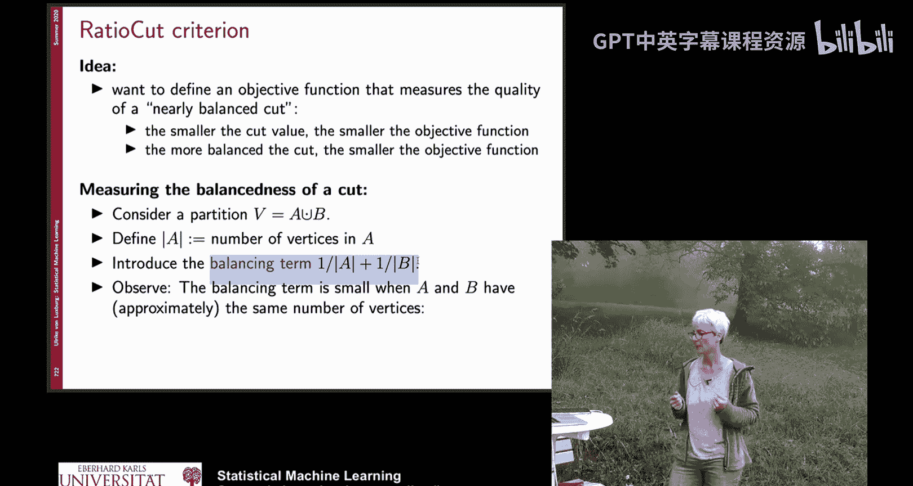
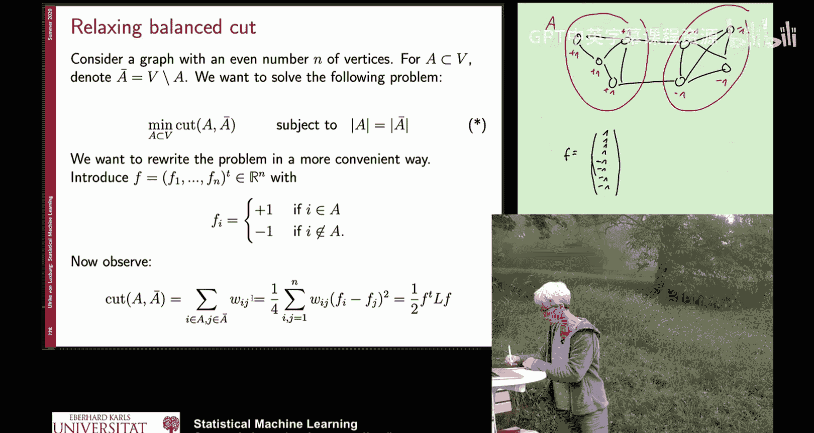
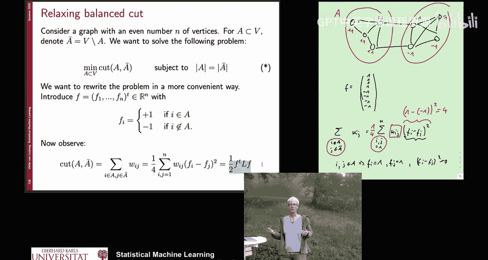
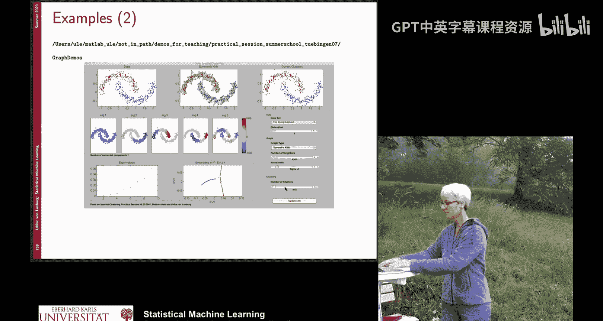
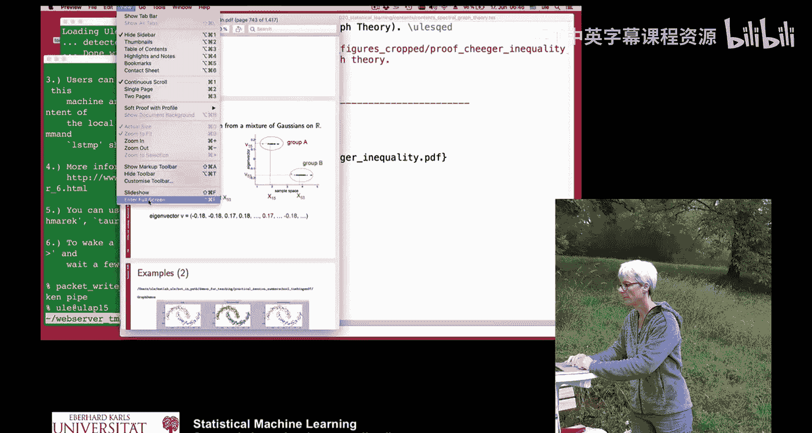
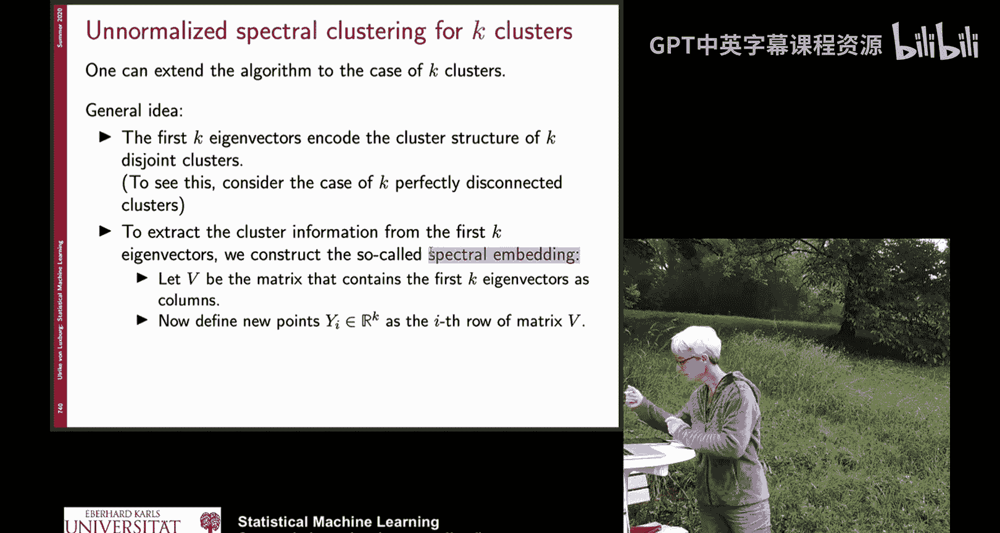
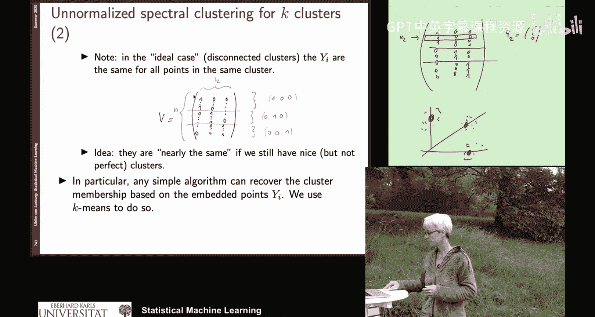
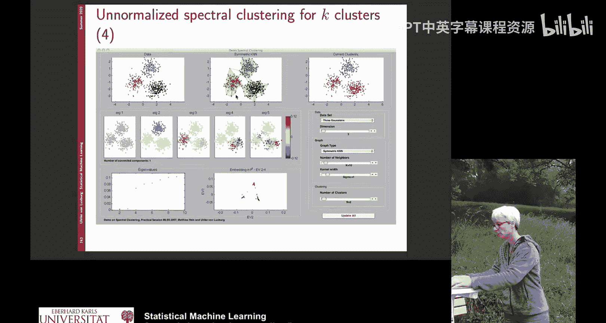
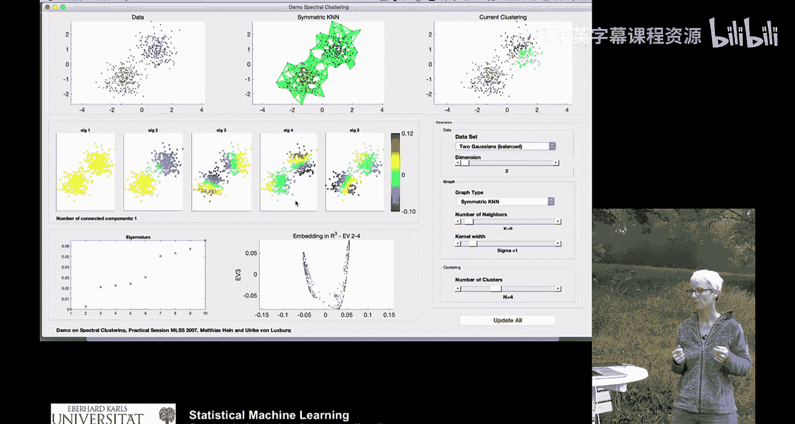
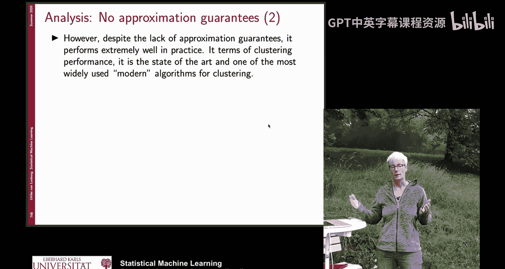

# 图宾根大学《概率和统计机器学习｜Tubingen Probabilistic and Statistical Machine Learning 2020》中英 p39 -39-Part 36 - Spectral clustering, unnormalized case.zh_en -BV1gso5YGE4s_p39-

Good morning。On this very foggy morning in the middle of June， after it's been raining for two weeks。

 Im now ready to record our next lecture， namely the lecture on spectral clustering。😊。

Spectral clustering is one of the modern clustering algorithms that can be used to cluster graphs and find cls in graphs or strongly connected subsets in graphs。

 so let us explain how this works。The intuition is the following。

 We assume that our data is given in form of a graph。And this can be for many reasons。

 it could be either that your data already has a natural form of a graph。

 say you want to cluster people in a social network。😊，For example。

 then the social network is already a graph。Or you have an interaction graph between proteins and you want to find similar proteins。

 groups of similar proteins。The other possibility might be that you simply have similarity based data so you have points in some abstract space in the similarity function。

😊，And then what you do is you first build a can nearest neighbor graph or an epsilon graph。

 and then use spectral clustering to find the groups in this particular graph。

So here is the image on this slide， what we are supposed to do or what we would like to do intuitively if you were given a graph。

 we would say a cluster。😊，Is a group of strongly connected vertices that is not strongly connected to other vertices in this particular figure you see we have two groups which one could consider as a cluster and there are many edges within the group。

 but only very few edges between the groups。And this is sort of the intuition of what you want to do in graph clustering and the question is now how can we achieve something like that？

Just as examples， I've already mentioned a couple of them finding communities in a social network。😊。

Finding groups of join the acting proteins in a protein interaction network。

 find groups of similar movies， for example， or subgroups of diseases if you have some kind of medical data。

😊，Now as a computer scientist， the first idea that comes to your mind if I tell you fine two groups that are not strong that have very few edges between each other sort of most people think about a min cut problem and this is sort of the first idea that most people have you say well in this particular graph how could I find the clustering。

 the cluster structure here I could run a min cut algorithm？😊，And then hopefully。

 the mint cut is going to。Find the cut that is shown here on the slide。

For those who have not seen min cut， it is an algorithm or it's a problem in a graph， given a graph。

 find a cut through the graph like indicated by such a line here。

 such that you cut as few edges as possible。😊，The nice thing about Min cut is that it has efficient solutions。

 polynomial solutions in particular。😊，And it's sort of an algorithm that people like to use a lot in like if you try to design algorithms。

😊，So the first idea would be， well， we just use any of our Min card algorithms。

 and then we find what we want to do。However， there's a particular problem that we're going to run into。

And it is indicated by this particular figure here。

Typically real data doesn't look as nice as we have it here on these slides。

 there are lots of outliers， lots of isolated vertices or vertices that are barely connected to the rest of the graph。

😊，If you now in this particular example on the slide。Try to find a min cut algorithm in the graph。

 It is not going to find this red cut that maybe is the one that we would like to find。

 but it rather is going to find a green cut。Simply separating one vertex from the rest of the graph。

But this is somehow not what we would like to achieve in clustering because we would say a cluster needs to be a reasonably large group。

 our goal is not to find some isolated vertex that is sort of far away from the rest but say we want to find two subgroups of diseases。

😊，And these subgroups are supposed to have reasonable size。And in practice。

 if you try that with a Minka algorithm， you will always end up with solutions like the green one。

 so in practice this is not going to work， it is not going to solve your problem。

This now doesn't mean that this whole graph clustering idea is bad。

 it just means we need to look for another algorithm。

So let's come back and think again about what we would like to achieve。

 we would like to achieve to find a cut that is small that cuts only very few edges。

 but such that on both sides of the cut the groups are reasonably large。

And probably we also need to incorporate the second constraint into our clustering algorithm because otherwise we end up with something like Min cut。

Now the problem is you now if you think back to your algorithms lectures。

 finding balanced cuts in a graph， balanced min cuts is an NP hard problem。

 so a balanced min cut is a problem where you say I want to find two groups in a graph。

Say of same size。Balanced， so they have the same size。 the two groups are balanced in the sense。

And the cat should be as small as possible。 This is an NPR problem。

AndNow this is the annoying thing of clustering whenever you come up with a clustering objective that you like。

 typically the problem is MP heart。😊，Now the question is from the algorithmic point of view is there anything we can do to solve this problem。

 I mean we can't use wind cardt because it's not going to give us the solution that we like。😊。

We can't use balanced cut at least not in the vanilla version because it is not we won't be able to solve it so maybe there is something in between that we can do that still solves our problem like from the point of view of the modeling part that we find clusters that we would like to find。

But that we are also， in fact， able to compute in the end。Okay， and now comes the idea。

 so first of all we formalize our objective crit。In form of an objective function。

 which still will lead to an NPR optimization program。

But then we are going to look for a relaxation and in the end。

 this relaxation turns out to work well。😊，Give us a nice solution and be efficient enough to be solved in practice。

So let's look at this slide。😊，So what we want to do is we want， I mean first of all。

 we don't want to find a criterion that really looks for a perfectly balanced cut but for a nearly balanced cut so we would be happy if say we want to find two subgroups of a disease and one subgroup is two thirdhirds of the data and one other subgroup is one thirdhird of the data that would be still fine so we don't want to be too strict on what balance means it just means you want a reasonably large sizes。

And in the last lecture we have already seen the chiah cut。

 which somehow tries to incorporate this notion of finding or like to encode the quality of a balanced cut。

 which is sort of a soft balancing crion。😊，Now in the spectral clustering literature。

 typically there are two ways to measure how balanced the cut is。

 you can either try to balance the vertices of the clusters or you can try to balance the edge weights of the cluster。

And we now start first of all， with the ratio cut criterion， which is going to balance the vertices。

So now consider the following situation， we have our set of vertices in the graph。😊。

And we assume we have a disjoint partition into two clusters。

 so for now we just talk about two clusters later and I'm going to tell you how this works for more than two。

 but let's to derive the algorithmistic for two clusters。

So we have a partition into two thesejo subsets， A and B。

And now we define by the notation absolute value of a。

 we say this is the number of vertices in group A。😊。

And now we consider this following balancing term。😊，One of a number of 30 season in A。Plus。

1 over a number of vertices in P。

And now you need to observe something， maybe I go to the iPad。

So assume we have a partition a which has， say half of the vertices in a。

And half of the vertices in B so all in all we have in vertices half of them are in A are half of them are in B lets simply write down what this criterion is so then we have one over a。

Plus one over B。Which is n over2 plus n over。I sorryrry。It is 2 over n。

 so we have it in the denominator plus 2 over n。Which is 4 over n， so in computer science lingo。

 this is of the order。1 over in。Okay， I mean， for now， let's just take it as effect。

 We don't really know yet whether this is good or bad。 This is just the number we get。

 This would be the number we get for a perfectly balanced cut。😊。

Now maybe let' us look at a different example where we have nearly all vertices in the first group a has n minus1 vertices。

😊，In B。Has just one remaining vertex。 So now let's look again at this criterion。

 one over a plus1 over B。We now have one over n -1。Plus， one over one。And this is of the order。

 theta of one。Which is much， much larger。So we already see on this particular example that if we look at the balancing。

😊，Then the balanced the perfectly balanced clustering has a smaller criteria than the completely unbalanced cluster and now if you want you can of course prove this formally that the more balanced the partian is。

 the smaller is this criterion one over a plus 1 over B。😊。

So this means that this criterion at least measures what we want in a somehow useful way。

 the better the thing is balanced， the smaller it this criterion。😊。

Here it's also on this on this slide。And formally， if you want to prove that you can consider like the easiest way would be to consider it as a continuous function where a is sort of the fraction of points that live in set A。

 say。And then sort of try to find out where the minimum of this function is。

I think you know how to do that， and then you would find that the minimum of this function is at the perfectly balanced partition。

Now we have two objectives that we want to solve。We have the cluster like our our graph clustering says。

 first of all， we want to have a small cut。And secondly， we want to have a balanced cut。

So we want to have this balancing criteria。So now we take the typically cut cr that's the same that you would also see in an algorithms lecture so we measure the cut by the weight of all the edges that we need to cut through。

😊，So if we have an unweighted graph， our edge weights are just either 0 or1， so this WIj here。😊。

In the formula are the edge weights。In an unweighted graph we just have one for an edge 04 if there is no edge so this criterion here the sum of I in A A and B。

 so we look at the two sides of the edge one living in A one living in B and we simply count the weights。

And sum them up。 And this is the， the cutth criteria。 And as it's also used in algorithms。

And now we need to combine this cut and this balancing criterion to one jointing。😊，That in the end。

 we might want to minimize， for example。And there again there are many。

 many ways in which we can combine such two like if you have two objectives you can take the sum of the two objectives you can take a ratio of the objectives you can take whatever you like and you can like square the other one and take the square root of the second one and then take a sum and then take a power of 17 so there is no unique way of doing that。

😊，The way people have agreed on in this particular literature is ratio cut。

 which is simply the product。Of the balance of the cut criterion。

 which says we want to have few edges between the clusters。And the balancing criterion。

 which says the two sides need to be balanced。 So here we simply take the product of the two。

For mathematicalematicconience。And this is what we now define the ratio cut criterion。

So observe that by this kind of combinationation we achieve what we want。

 at least this ratio cut criterion gets smaller the smaller the cut is and the better the balancing of the two clusters。

 So if we minimize this criterion we hopefully would be able to minimize both of these things。😊。

Both of these tools different criteria at the same time。Now， as you might still be able to guess。

 this problem is still NP hard because we didn't really change much。

 I mean we invented a formal notation for the cut and for the balancing but so far I mean it's a soft balancing criterion which in the end might maybe lead to the fact that this thing is not NP hard anymore because we are not going for a perfectly balanced cut but still if you look into it it's NP heart and that's pretty easy to see。

So by now we didn't achieve anything， we just have a nice formalism for defining what balanced a softly balanced cut is。

 but we still don't know how to solve it。And this is now where spectral clustering comes into the picture。

And we start with what is called anized spectral clustering。

So the problem we now want to solve is given an undirected graph G with non negative edge weights。

We want to find the partition of the graph into two sets that gives us the minimal ratio cut。

Consider again what are the assumptions we make here， we have non negative edge weights。

 this is really going to be important as soon as we would have negative edge weights this whole intuition doesn't work anymore and the algorithm might break down。

Typically in machine learning， we always have or in most cases we have non negative edge weights because intuitively what we consider is that the weights on the edges are similarity functions and typically you define a similarity function such that it's not negative。

 So this is not for most applications it's not really a big restriction。

The other thing that is really important is that the graph is undirected。😊，嗯。

And the reason is that otherwise spectralgraph theory breaks down。

 we have seen in the last lecture that we have all these niceM formulas for the spectrum of the graph and how the graph is related the connected components of a graph is related to eing vectors or eingvalue of the graph lapplian。

 Of course this whole theory only works， at least in the way I've presented it in the last lecture。

If the graph is undirected because otherwise the adjacency matrix and the graph thatlastian are not symmetric anymore。

 and then we don't know or typically you cannot decompose itig into a basis of eigenfunctions or eigenlectctors and then everything breaks down。

And as a side remark， there' is a lot of work where people try to find solutions for more general clustering problems like spectral clustering algorithms。

 modifications of the algorithm that works for directed graphs or for graphs as negative edge weights。

😊，But even though there have been many， many attempts。

 there's nothing really fundamentally as nice as the spectral gasing solution in this undirected case with non negative edge rates。

😊，Okay， now let's look how this works。And I want to show you how we need to relax the balanced cut criterion。

 the ratio cut criterion and end up with the spectral clustering algorithm and again we do this in a step by step procedure on the case where we just want to find two clusters。

So。For a simpler notation， let's assume that we have a graph with an even number of vertices。😊。

This is not a big restriction。 It just makes my formulas easier when I say n over2。

 Then I know it's still an integer。I now introduce a notation。

 so a is always a subgroup of points in R vertices a bar is supposed to be the complement group。😊。

So what we want to find is now。😊，I write it down in this way。We want to minimize。

 We want to find a partition A and a bar such that the cut is minimized。

Subject to the constraint that the clustering is perfectly balanced。Of course。

 this is not the general case， but we will start with the simpler case because it's easier than to write down what the derivation of the algorithm is。

So in this case。We start with the the。Objective that we really want to find a perfectly balanced cluster。

And now we are going to rewrite this problem in a way that is convenient to for the relaxation we want to do later on。

So now what we do is I mean you might guess we need to go into the direction of spectral graph theory because the thing is called spectral clustering and I already sort of said that we use the spectral graph theory to derive this clustering so probably we need to find some notation that has to do with lectures and matrices so this is not what we do。

😊，We introduce a vector F。Which simply encodes our clustering and maybe for now I start again making a figure because it might help。

😊，So assume we have a graph here。😊，Like this。And we would like to find a clustering。

 So what we now do is so a clustering would say for each vertex are you in group1 or are you in group2 So what we now do is we say so for example。

😊，If this is our group A， we would assign a function plus 1 plus 1 plus 1 plus 1 to every point or every vertex that lives in a。

And to this other group， we would assign minus ones。So in the end， we would end up with a vector F。嗯。

Wwhichch is if we have the vertices sorted in the order that first of all we have the vertices of a and then the one of a complement the vector that would look like this。

 we have four vertices in a which are plus 1。😊，And then we have four vertices in a complement。

 which are minus1。Okay， and this is now how we want to encode。The， the clasing of a graph。

It's a side remark note that to be able to do this。

 we need to assign some unique ordering to our vertices in the graph because we need to know to which vertex each of the entries belong。

But this is not a problem。 we just have to do it。Okay， now with this encoding。

 so we with encoding that the cluster vector is denoted by F。😊。

There is now an interesting observation， so now we check what is the cut between a and a bar。

So let's do it， so we simply write down the definition we have seen that before。

 it is simply the sum of the weights that go across the between the two clusters。

And now we had this magic formula that you might remember from the last lecture， no sorry。

We are not yet with the magic formula， it comes in the next step。

 so now what we see is this is sort of the main trick。And maybe I do it under there。On the iPad。

 So we have some I in。

A， J and A bar。W AG。Now what I want to claim is。First of all， I want to consider the sum。If I W I J。

 if I minus F J squared。And I didn't even write， so the indices now on this side go from one to n。

So what is going on here。Consider two cases assume we have an so a safe A is fixed for now。

 I mean here we are not yet in the case where we want to search for a we just want to compute given a。

 we want to compute the cut between a and A bar。So consider two cases in the first case。

 say the point I and the point J are in the same cluster， so if I and J are in a。

Then what do we have， we have by definition F I is 1。

And we have also Fj is one because theyre in the same group。So then this term f i minus fj。

Square is's 0。By definition of the vector F。And so in this case。

 in the sum here that we are currently looking at the term f minus fj is 0。

 so this whole term disappears。😊，This is good because observed that in the formula we currently have now I'm running out of colors so here we sum overall indices whereas on the first on the left hand side we just summed over indices that are different clusters what we can see now is that it doesn't hurt to some overval points which are the same cluster because all their contributions are going to be0 in the end。

😊，Because if I'm minus xj is0。Now， the other cases assume we have two points which are in different cluster。

 so I is in say A and J is in a bar。Then this term f I minus fj is going to be 1 minus minus1。

 so now the two guys have opposite signs because one lives in a and one lives in a bar。

And if you take a square of this， the simply gives4。And now this is why on the formula on this slide。

 we have this one over four in front of our sum。So then the two terms cancel and what all that is left for this particular entry is again。

 WIJ， which we still have here。And this is the reason why this first equality on the slide holds I go back to the slide now。

 so we have cut。😊，So， so mean by definition we have that the cut is the sum here and now by the argument I just showed you on the iPad。

😊，The sum can be rewritten in this particular way。And this comes by the definition of the select。

Now so far it doesn't really， I mean， why would you do that it's just a more complicated way of writing the same criterion？

But now comes the trick and this formula should look familiar to you。

 It is sort of this key proposition that we had the in the previous lecture about the graph labla。

 So this by this key property。Is F transpose L F， where L is now the graph Lalasian that is associated to this particular graph。

F is the vector of plus minus1 as we have defined it before and we have this constant 1 half here because in the magic formula there is also a constant2 somewhere so instead of1 over 4 we now get1 over2。

Okay， so what we see now is。The cut cr is very closely connected to the graph laplaian in the sense if you now look from left to right that the cut between two sets can be computed in terms of the graph lapplian and the cut indicator vector F。

😊。

And now we can start trying to try to start rewriting our problem So the original problem sorry I go back is here we want to minimize the cut subject to the constraint that the two sides have the same number of vertices。

Now， instead of minimizing the cut， we can say we want to minimize f transpose LF。

 we can drop the constant 1 half because it doesn't change anything。😊。

So this is just by the reformulation of the cut in terms of the graphlapassian。

AndNow the second constraint on the previous slide was that a needs to be the same as a bar。

 so the absolute value of a， the number of vertices in a needs to be the same as the number of vertices in a bar。

And now we can express this as well in terms of the vector F because F。

 the values in f are either plus 1 or minus1。And if the two groups are exactly the same。

 have the same size， then the entries of f sum up to 0。

 then we have exactly the same number of plus 1 and minus1 entries。So。

 we can say find minimize this quadratic function of the graph lapbraion over all vectors f subject to this balancing constraint。

And I mean， the important thing is now we still have this discreteness constraint because this whole argument only works。

😊，If F is this cluster indicator， vector with entries is plus 1 and -1。Okay， so so far。

 nothing really changed in terms of computational complexity or so this is still exactly the same problem just written in a different rotation。

If also， if you look at this problem， it looks difficult here you see it from the fact that it has a discrete constraint and this is it's not always so。

 but in this case， again， it's NP heart。 and we know that because we already knew that ratio of minimizing ratio cut or a balanced cut is NP hard。

So now comes the important trick from spectral plaing， we now are going to relax the condition。

And relaxing and optimization essentially means trying to increase the set of feasible points。😊。

Such that in the end， the set of feasible points is in the ideal case convex or at least has some structure such that we can maybe solve the problem without having running into too many problems。

😊，And so what we now do is this difficult constraint in the previous problem。😊。

Or maybe let's go back once more。 Sorry。 So what is difficult。

 These two things are not really difficult。 This looks like a typical quadratic optimization problem。

 You have to minimize a quadratic form and you have a linear constraint。

 So this is a very nice problem that we wouldn't。Assume that we would get any problems with that。

 So the only problem is this discreteetness constraint。

And so this is not what we do instead of having this condition that the Fs need to be plus or minus1。

😊，We now simply say， if I can be any real number。And we just to avoid that there is an ambiguity in our solutions。

 we simply normalize the vector f to have norm 1 so that because otherwise if you go back to this problem。

 if you don't have any constraint on the norm and we want to minimize this guy putting f to the constant zero vector would of course like it would satisfy this constraint and would also lead to the smallest solution possible here。

 but this is not what we want to find。And so this is why we need to still fix the norm。

And observe here， the norm is of course， also fixed。To a constant。

 it's not one here because the vector is an normalizedized。

 but it doesn't matter it would be a fixed like whenever we look at this problem the norm is fixed。

 so we do it here as well， we fix the norm for convenience to one。So。

 our problem now looks as follows， so this is now the relaxed version minimize f transposef subject to the sum of f being 0。

And now with these new constraints， the relaxed ones。

 F can be any vector in like if I can be any value in r and we has fixed the norm of this vector to1。

Okay， so this looks already a bit more promising。Hone could now try and go and implement this directly。

But there are still more observations that are going to make our life easier。

So the first observation is。😊，That the sum of the condition that the sum of the F is 0。

Is equivalent to saying that the vector F is orthogonal to the constant  one vector。

And just consider this for a moment， what does it mean to be orthogonal。

 it means that if you take the scalar product between f and the constant 1 vector， you end up with0。

And this is exactly the case because this scalar product between f and the constant1 vector is exactly the sum of the Fis。

 Just write it down on a piece of paper if you don't see it immediately。So exploiting this condition。

 we can now say the problem is still a bit different instead of having the sum of Fi being equal to 0。

 we now say f is supposed to be orthogonal to 1。And now comes the final observation and this is now really somehow cool that all this fits so neatly together。

😊，One， the constant one vector， if you remember， is the smallest eing vector of the graph lapplian。

 We have seen that in the previous vector， no matter what your graph is。

 there always exists an eiging vector。 The constant one vector is always an eing vector of your matrix of your graphflplian。

 and its corresponding eigingvalue is 0。And now we can exploit the raille principle that tells us that the solution to this problem is now the second smallest eigen vector。

😊，Of the graphla classian。 So if you would maybe go back once more。

 if you would simply say we need to minimize this expression without this constraint on the orthogonality。

The solution would be the smallest eig vector。Now， we have that constraint here that。

We need to be orthogonal to the first to the very smallest di vector。

 So the solution is then going to be the second smallest di vector。

And if you haven't seen the earlier principle， I think most of you would have seen it in the mass for L lecture。

 if you haven't seen it it's somewhere in the back in the appendix where we have all these lights on linear algebra。

 you can look it up， it's a principle that says if you want to minimize the certain like essentially it says that if you want to minimize this quadratic form then the solution it' the smallest eing vector。

 if you have additionally constraints。😊，That bring that sort of our orthogonal to the first e vectors。

 Then we need to take the next e vectors that are not orthogonal。Okay。

 so then what we now know is we don't even so we have not maybe let's start once more。

 we started with the problem of minimizing this balanced cut criterion。

 we re wrote the problem in several steps and then we relaxed it。

 We said we don't care about the discreteness constraint。

We ignore it and now but now we have a solution。For which we can already say how to compute it。

 we don't need to do some gradient decent or whatever kind of optimization method。

We simply can say the solution is going to be the second smallest aing vector of L so we can invoke our favoritenumeric algebra linear algebra package and find the second smallest aiging vector of this matrix。

And that's going to be our solution。Of the relaxed problem。YouNow。

 there is one final step you need to do。 So now our solution， of course， would be a real vector。

 And it's not。 But what we wanted to find is a vector that is either plus 1 or -1 in the entries。

 because we want to know what is the assignment of the points to the clusters。

 So we need to have this final step of projecting the。

The solution that we found back onto the space of our feasible solutions that we originally had。

 and we do that in the easiest way possible， we simply say， well。

 we just look at the sign of the entry in this vector F。If the sign is positive， we say you're in a。

 if the sign is negative， we say you're in a complement。And that's it。

 That's the the whole algorithm。So this is the summary。

And I called it by this slightly inconvenient name。

 heart balanced cut relaxation because we started with the heart balanced cut criterion and we relaxed it。

😊，So the algorithm is really， really simple， the input is the weight matrix or the adjacency matrix of the graph。

😊，We computed the corresponding degree matrix， we compute the corresponding graphph lapplian。

We compute the second smallest eigenvector of this graph Lalaian。

And then we look at the sign of this vector and just say everybody who has a positive sign is in group A。

 everybody who has a negative sign in this vector is in group B period。So that's really。

 really a simple algorithm。Now let's make a couple of remarks。So。As I said。

 the original problem is NP hard。We now solve a relaxed problem。

And this can be efficient in polynomial time。However。

 this relaxation doest need to at least we don't have any guarantees that what we find by this relaxed problem is really going to be the solution that we have been looking for in the first place and this is often the case in relaxations not always there are some elegant cases where even though you relax you can prove that you still find going to find the same solutions here this is not the case you can also construct examples and we' are going to see some in the later summer in the lecture。

Where the solution of the relaxed problem is very far away from the solution that you want to find。

However， in practice， it simply turns out that spectral clustering does find very good solutions。

 so we don't have any guarantee。But here this is sort of the engineering part of machine learning maybe I mean we need to find a relaxation otherwise we can't solve a problem。

 we can we can probablyably not give any guarantees on this relaxation which is always disappointing from a theoretical point of view。

 but practice still tells you that it's going to work。No。

We started with the problem of finding this hard constrained balance cut we wanted to find。

 like in the previous derivation， we said we want to minimize the cut subject to a and A bar having exactly the same number of vertics。

 This is， of course， at least following the introduction to this lecture。

 not really what we would like to do。 We have this ratio cut critherion。

 which is a bit more soft in the balancing constraint。

So now what we can do is we can now try to derive the or solve the relaxation for the problem of miniizing or for the problem of minimizing ratio cut。

And the trick list goes exactly the same way as the derivation we did now。

 just some of the formulas are a bit more inconvenient。😊。

But the line of argument is exactly the same， so let's look at it。😊，So now what we do is again。

We define a vector F that is a cluster indicator vector。

 it just has a definition that is slightly more cumbersome。😊，So now in the previous derivation。

 we just said f is either plus 1 or minus1。😊，Dending on whether a point is an a or an a bar and now we do again。

 I mean we do an indicator directly in the sense that there is one particular value that we assign for points in a and one particular point that value that we assign for points in a bar。

 but simply this value is a bit more complex it is not one or minus1。

It is simply the ratio between a bar and a， the number of vertic in a bar and a to the power of12。

And here you can't see why one chooses this value。 The point is this is sort of the the the the other way around。

 So typically you derive the proof you see what this value needs to be。

 and then you plug and then you know this is the value we need to plug in。

 So the formulas all work out in the end。And now we can do exactly the same kind of thing that we did previously。

 we can now observe that this ratio cut criterion。😊。

If you start rewriting is it is exactly the same as F transpose LF with this particular choice of F。

And here， of course， the choice of every really plays a big role because then these many of these terms cancel。

 and you end up with exactly what you would like to do。 This is not complicated。

 You might simply want to do it as an exercise at home。

So take the ratio cut criterion and try to rewrite it in the same way as we did it for the normal cut criterion with in this previous derivativerivation and proof that in the end you get f transpose LF。

😊，So once you've done that， what you achieved is you can say the problem of minimizing the ratio cut is equivalent to the following problem。

Minimize F transpose LF。Subject  two。That F has the form that is given above this complicated vector with a bar over a like the one we had had on the previous slide。

Okay， that again is， so here again， I mean， the blue thing is again a discreteness constraint。

 It's just not it two discrete values， plus 1 or -1， but it's two fixed values。 This， again。

 makes our problem in Pihar。you might wonder now where the where this balancing criterion went。

 Because in the previous arivation， we had explicitly， we had this balancing criterion here。😊，now。

Observe that whenever you have a vector F， which is of the form that we have had on the previous slide。

 then all its entries are going to sum up to 0。This is easy to see if you go back to this vector。

 I mean， you have how like if you sum up all these values over over the whole graph。😊。

You have a bar times this expression。Plus。Sorry， you have a times the first expression because this is the number like the number of vertices in a times this expression plus the number of vertices in a bar times this expression and everything cancels and you simply end up with zero that' is easy to see。

So any vector F that has this particular form is going to satisfy this constraint that you need to be orthogonal to the constant one vector。

So what we can do now is we can say we can have this additional constraint F is orthogonal to the constant one vector it is in the original form it is satisfied anyway。

 we now include it here because this is an important ingredient that we need after the relaxation。

Now we do the same as before instead of having the looking at the discrete problem。

 we just say we look at any particular value I mean it can any real value of FiI be relaxed。😊。

And again， fix the norm。And then by the same argument as before。

 we can invoke the Rale principle and see that the solution is going to be the second smallest eigen vector of the graphlaplaceier。

😊，And then again， as before， if you now do this assignment we we solve the the problem of finding the second small a vector of the matrix and then we。

😊，We assign the points to the two clusters， according to the signine of this vector。

So impurro code this algorithm is exactly the one that we have seen before previously I called it hard unbalanced cut relaxation or something like that。

 but in fact it is anized spectral casting， so this algorithm that is on this slide now called anized spectral casting is exactly the algorithm that we had already in our previous variation just that we now showed it is also a relaxation for the problem of minimizing the ratio cut criteria。

😊，So this is now the vanilla version of anomized spectrallast。Now。

 maybe I would like to give you some intuition on what it really does and why does it work。

 and I think if you want to really understand spectral clustering。

 it's important to build up this intuition。Let's look at a particular example。

So here I have a very simple example。 we have one dimensional points。😊。

They come from a mixture of two Colosians。Getting a bit colded。Sorry。So our data list are。

 so we just have one measurement for a point， say the height of a person。😊。

It's a mixture of calciumusians， say females and males， in this case。

 the distributions don't even overlap a lot。😊，So here's the histogram of our data。

And now what I want to show you is how the eigenve of the the second eig vector of the graphla plus looks like and this is on the right hand side so what I now do is and this is sort of important to understand so here I say I have data point each data point lives here on the x axis so here for example this red guy is data 。

15 say。😊，So what I now plot on this plot on the right hand。😊。

For each data point I plot a y value which is the corresponding entry of the lapplianve of the eigenvector。

 so for example here in sorry the eigenvector in on here you see what is the eigen the second smallest eigvector of the graph Laplian。

😊，You see it has entries which are typically around minus018。And plus 018。17 and so on。

 And for example， here this is at the position 15 in this vector because it is the entry of the eigenvector corresponding to data 015 or vertex 15。

And this is now the way I plot it is here I plot on the x value。

 I plot the value of the data  point 15， x15 and on the y value。

 I plot the corresponding entry of of the vector of the eing vector。

 So essentially I consider the eing vector as a function of the input point， and this is what I plot。

And so now what we can see here in this plot， which is really nice。😊。

The eigenvector is more or less constant plus some value， namely plus 700。17。

For everybody who lives in this group， A， which is sort of the first cluster of our data。

And here for everybody else in the other group， it is sort of minus 0。18。

So you see by looking at the eyeing vector， you already see you can like if you put the threshold as  zero。

 this is what spectral clustering does， we look just at the sign of the corresponding points。

 we would perfectly recover the clustering。😊，And this is sort of the first intuition。

 why spectral clustering rocks。I also want to show you a little MeLb demo which we have written a couple of years ago。

 unfortunately it doesn't run on many Mela environments anymore。

 but it still runs on mine so I'm going to show it to you。😊。

So here's our demo。And maybe。We start with a simple case， a mixture of two Gaussians。

So what you can see here on the top panel is always the data。

 in this case it's a two dimensional data， red Gaussian， blue Gaussian， a mixture of two Gausians。

 they have the same number of points， the same variance， a very simple data。Now。

 what do I need to do if I want to apply spectral clustering to this data set？

At least the vanilla version that we've been discussing so far。

I need to build a graph out of this data。And how do I do that。

 The typically ways to build a symmetric canuous na graph， this is sort of the standard procedure。

Here you can see how the symmetric k nearest Ne graph looks like and as the parameters of the graph here it seems like it's hard to see the number K was 10 the way when I invoked this。

 so this is the 10 nearest Ne graph。Now， what you can see here in the middle panel is a color code of the eingves。

So what you can see here is so for each data point again I consider the eing vector as a function of this data point and I color code it so here this first eing vector is a constant vector this is the constant one vector that we always have when we have a graph lapplian we look at the eiging vectors。

 the smallest one the smallest eingvalue is always zero and has a constant eing vector。😊。

This is what we see here that points all have the same color。Now。

 the one that we are currently interested in is the second eyeing vector。😊。

Because we say that for normalized spectral clustering， for unorized Sur。

 this is what we are currently looking at， we simply take this the second eiging vector of the graph laplaian and look at its sign and this is the assignment we later do。

😊，And so here you can， for example， see so here you have the color code， blue is negative。

 red is positive and green， green， yellow is is zero。😊。

So here we see that most like essentially the points which are in this bottom cluster are all negative。

 the points that are in this top cluster are all positive。😊，Now。

 what would happen if you works works spectral clustering on this data set is we would put a threat like in the vanilla version。

 at least you would put a threshold at 0 and say everybody who's。

Whose value is below 0 is one cluster and everybody who is above0 is the other cluster and this is the result that you can see here。

 so the current clustering is really is the one that you would currently look at if you just look at the second eing vector of the graph lapla。

😊，Now， we can do that， of course， for other data sets， I mean， there's lots of room to wiggle。

 So here you see for unbalanced Ga since it works， this is maybe not。So， interesting。

Maybe let's look at three Gaussians， so now we have a data set， this is always the original data。

 we have a data set consisting of three Gaussians。In the current version。

 we just told the algorithm to find two clusters。This is also here on the on the demo I could later on increase it。

 but for now let's we stick to two。 and then of course， it needs to sort of join two of the clusters。

And this is the outcome that is going to be again here we can see the the second eyeing vector we see it is pretty negative on this one cluster and then sort of a bit positive on these other two clusters。

😊，Remember that these entries here have 2 sum to 0。嗯。So this is why。

 because we have twice a number of points in these two clusters， their values is a bit smaller than。

On like smaller but positive here and here it's a bit larger but negative。

And this is now the cluster you get。You can also play with other data sets。

 here the to moons data set， which is always a data set that is。

We have seen it before for classification that is sort of one of the standard data sets where you would say。

 for example， Kmin is never going to work on this data because if we would invoke two clusters here。

😊，In K meanss you would need to find these convex two sets and this is never going to be able to recover to moons。

 And here we see for spectral clustering in this case it worked。

 So here's the canous Ne graph and we for a convenient parameter of K9 in this case。

I don't know how many of these are probably 200 data points， I would guess。So we have k equals 9。

 we already see， I mean， there are some edges between the cluster， but not very many。😊。

And now Spec clustering is supposed to find a balanced mint cut。

 and indeed it finds exactly what is supposed to be here。And if we look at the secondig eigenve here。

 we see again it is positive on one of the moons and it is negative on the other moon。😊。

And if you would simply look at this particular eing vector。

 you could already say what the clustering is that spectral clustering would assign to these data points。

Okay， I mean， that's for now we are coming back to this demo laterron。

 but now let's go back to the slides。

Because what I now want to talk about is how do we find more than two clusters。 So so far。

 we only looked at the case of two clusters and also the derivation we did was for the case of two clusters。

 Now let's look at K clusters。So now what we are going to do is instead of looking just at the second eiging vector。

 we are going to look at the first K eiging vectors。

And I'm going to show it to you in a demo in a minute。

 so what we now do is instead of just looking at the second eiging vector we take we compute all the first k eiging vectors。

And then we do what is called the spectral embedding。

 And maybe I just use the iPad once more to explain it。

So assume we have our graph Lalaian error。😊，It is just some matrix。

Now we compute the eigenvectors V1。Is some vector V2 is some vector。sorryrry。And then up to Vk。

 which is the case eiging vector， the case like the eiging vector like we look at the eig vectorctors corresponding to the case smallest eigingvalue。

😊，And now we stack those into a matrix that we could call decay， for example。

So we put the eigenves as columns here。So what is the dimension of this matrix。

 we have n data points， so we have N rows。And we have K columns， one for each of the itemigen。Extras。

And now what we do is。😊，If you just consider the case of k equals 2。

 we just looked at one particular column here namely the second one。

 the first one is always constant one， in fact we could ignore it for convenience you often take it with us but it doesn't really make a difference。

So for the case of k equals 2， we just what we did is。😊。

K equals 2 we just had this matrix v which consisted essentially of the constant1 vector which we ignored and then we had this this important eing vector here this one v10 V2 sorry the second eing vector and what we did now to cluster our data points is we looked at the second eiging vector at the entries and said is this entry positive or negative。

Now we are in this case where we have a full matrix。😊，Of K columns。 Now。

 what are we going to do to decide now for each data point， Where does it belong to We know for each。

 So say we look at this particular data point I。We look at the raw eye in this matrix。😊。

And now in this row we have k entries and now we say this is now the representation that to use 4。 I。

😊，So， this is now if you want， it is a vector that lives in RK because we have k numbers in row I and we now simply say this is now the new representation of the data point I that we want to have。

So if you want， you could say what we do is we map the vertex VI。😊，To this vector。

 how could I call this， do I have a notation wire？So this is the vector Y I is the one。

 so we map it to the vector Y I。That lives in acade。And we lived in。

The vertices so we know what what is implicitly does is we have an embedding of all the vertices of our data point into the space are k where K is the number of clusters that we want to find。

😊，And again， this embedding simply takes the K so if I want to see what is the embedding of point I we take the I throw in this matrix of iig vectors and this is going to be our representation。

And this embedding is called a spectral embedding。嗯。And now why does it make sense？Maybe consider。

 again the case where we are in this， this ideal situation of completely disconnected clusters。

 That is what we discussed in the last lecture。 We looked at the， at the。

At the situation where we have a perfectly like a graph consisting of a number of connected disconnected components。

😊，And then we already knew how how the e we know about the eig vector structure because we know that if we have if sorry I go back to the iPad that's easier say my graph consists of three。

😊，Disconed components。Then I know that there exists a basis of eiging vectors。

Such that V1 looks like this，1，1，1 and then zeros。And V2 looks like this， it is 0，0。

0 and then 11 and then 000。And we three。Is zero is on the first couple of as and then once。

This is what we have already proved。 So in this case our vector or our matrix V is going to look as it is printed on this slide。

 so we have one column consisting of the characteristic vector of the first cluster。

 a second column consisting of the characteristic vector of the second cluster and of the third cluster up to k clusters。

😊，And now observe。That this representation of the data points is exactly the same for all points that differ the same cluster。

 So if we have， if I now stack these vectors。In the in， in this matrix。

 I just do the plot here once more。Oops。This is how。How this matrix Vk looks like。And now again。

 what do we do for like the representation， for example， of 0。2？

This is the road that corresponds to vector 2。representationation is the point Y 2， which is just。1。

0，0。And this representation is the same for all points in the same cluster。

 so all points which are in the same cluster as V2 have exactly the same representation。😊。

So what would happen here if we are this ideal situation？😊，And we take this particular。

Basis of eigenfunctions， at least。Then the points that live in the same cluster are going to be mapped exactly to the same positions in this space。

 so in this particular case we would map into a three dimensional space。😊。

And the points of cluster 1 would be mapped here， the points of cluster 2 would be mapped here and the points of cluster 3 would be mapped here。

All on top of each other。 So we would have three different points in our in our embedding space。

1 for each cluster。And each of these points would consist of， essentially， as many。

As many vertices as our points in the cluster。And now this is， of course。

 the ideal situation now in truth if in a situation where we have real data。

 of course it would never look like this， but the intuition is now we still do the same procedure。

 we do this embedding and maybe it doesn't look as perfect as before maybe it looks a bit more。

 more fusuzzy。 maybe we have the data points as somehow sort of。😊，Moved around in some way。

 but still。The idea is， or the hope is that the data points corresponding to one cluster would sit at the same space。

Or same sort of。Corner of our space like and would be nicely separated。

 So now the idea is like in this particular embedding that you can see here the on the iPad。😊。

If you would simply run Kmes on this algorithm， on this data set。

 it is definitely going to find the correct clustering。

And this is now what a spectral clustering algorithm does。Sorry。

 so the algorithm is we do this embedding based on the graphalplian eigenvectors。😊。

And then use Kmins to find the final solution of our data。

Again， let's go to the demo。To see this once more。

AndNow again， maybe we go to the case of three Gaussians。

Because now we want to look at what happens for more than two clusters。

 so here again were in this situation we have three Gaussians。😊。

We built the symmetricane nearest Ne graph and now we look at the eingves and now because we want to find three clusters。

 we would look at three eing vectors。The first three。

The first one we would always ignore typically all the solvers that you would find also here the metal solver finds a constant one vector as the first a vector。

Now lets look at the second one， so here what we can see is the second a vector in this particular instance would have these two blue clusters sort of one group。

😊，And this red cluster here is sort of the second group。Similarly。

 the third a vector would maybe say。This one blue cluster is one group。

 and here these other two clusters are the other group。Now taken together。

 this is going to give us the information that we need to separate all three clusters from each other。

So if you would ask the algorithm to just find two clusters as we did here。

 we are going to find the blue one here and the red ones here。😊。

Let's now ask the algorithm to find three clusters。 How can I increase that？

And let's try to update it。So for three clusters， this is going to be the。😊。

Hang vectors that the clustering that we find it's sort of the correct kind of clustering。

And what you can also see here is the embedding of the first couple of eigenves。

 this is the spectral embedding。In fact， it is based on the first four eigenvectors because I didn't plot the first one here and what you can see is like all points that correspond to the blue I mean this is colored according to the true color of your data。

 so all points who were in the blue cluster end up here。

 all points who were in the red cluster end up here and all points in the black cluster end up here。

😊，And you can already see that the。That if you now apply Kmins to this particular representation。

 then at least we would be able to separate the data very clearly from each other and indeed this is what we see here。

 this is the classroom well find。😊，Now of course， for the fun of it we can also start considering what would happen I mean typically you don't know the number of clusters so what are you going to do you maybe play with your number of clusters。

We can try to see what would happen if we would ask the algorithm to find four clusters。So。

 for three cluster we already looked at the eyeing vectors now let's look at the eyeing vector this corresponds to the fourth eing vector。

😊，And here the interesting thing is now what we can see here is。

It sort of gets it tries to split this cluster here because all of a sudden here， I mean。

 in the previous plots， each of the two clusters was sort of had the constant color on it。

Now we have all of a sudden。Here we have strongly positive points and strongly negative points。

 So the eigenvector distinguishes these two parts of the cluster。 So if you would。IAs you。

 I going to find four clusters and now if you don't find a different solution for numerical reasons no。

Then we would see that the algorithm would split these two clusters here。Now， if you want。

 you can continue this way， you can sort of see how spectral clustering is going to split up more and more the clusters。

😊，I also want to show it to you， for example， in a different example。

 and here we have the two moons data set。And now I asked the， I willing to find four clusters。 So。

 again， what is going to happen， The constant eiging vector is pretty meaningless。

Next we have this eing vector here， the second one。

 which is sort of constant on one cluster or constant or maybe a bit positive here it sort of。

Pretty negative。So if you just would ask for two clusters， in fact， in this case。

 Im not even sure whether it would find the correct clustering it might be that it would cut here。

Or it would cut here， I don't know， because if you look at like here。

 you have two yellow and green points which have sort of the same color。

 they would end up in the same cluster。Now， what would happen now。

 if if you look at at the other a vectors， now we see that here along this。

Along this moon here it's pretty negative here it's pretty positive。

 the same here so it starts to split the individual moons and the higher you go so here you have eiging vector 5 for example it starts I mean this is sort of a U shaped function like this along the moon its negative here positive here negative here here you have U shaped function the other way around and the further you go the more finer grain the structures are going to be。

😊，In fact， maybe something that might help also to get get a bit of intuition on what's going on here。

 These eigingves of the graph Lalaians。 They are something like。On a very high level intuitive level。

 like a furier decomposition on your graph。 So essentially what they do is and maybe that's easier to see if I go back to the Gaussians。

😊，So essentially， it's， its sort of it tries to put sine waves on your cluster。

 That's my intuition on on the data。 So this first eiging vector is essentially a sine wave that just goes like this。

 So we have it。 It's positive on one cluster and negative on the other cluster。

 So it's something like one signine。Now here it already starts to split the first cluster。

 so on the first cluster it now does something like this。😊。

And then here it does's something like a more complex sign on the second class and then the further you go。

 the more sort of weak get your functions。😊，嗯。And I mean。

 maybe the germ robot is also shingong and Uber Svingong。 So you you see， first of all。

 the the the the white signs， and then you get smaller and smaller sine functions。嗯。

And this is sort of what is going on here even and now the fact is that what happens through this graph structure is that these sine waves are sort of aligned to the graph and they are sort of attached to individual clusters。

😊，But this is， of course， a very fuzzsy intuition， but this is the intuition I have about。

 about what's going on here。

Okay， let's go back。So here we have the anomized spectral clustering algorithm。

 I think I've already mentioned it， we go to the graph Lalastene。

 we compute this n times k matrix V consisting of the eigenvectors。😊。

We defined that new data points these embedding points as these rows in this matrix。

 and then we apply the K means classroom algorithm to these embedded points。Okay。

 here is one more comment I wanted to make。In the beginning I said K means is really a weird algorithm or like a simplistic algorithm that tends not to work on many real world data sets and so on。

 And now in the NPU K means yes， that's true。 but the key component of spectral clustering is really this。

😊，If you want preprocessing of computing the spectral embedding and there's all this theory of spectral graph theory aligned to or is the reason why we do that embedding and there are lots of results for which you can prove that in many cases it does something reasonable this kind of spectral embedding。

And then we use Kmins on the spectral embedding because there we hope that the data points are so nicely separated that even a simplistic algorithm such as Kmins would solve the problem。

😊，Of course， if you like， you could also start saying， okay。

 why don't I recursively apply spectral clustering now on the embedded points and so on if you want。

 but it typically doesn't really change a lot。Let's maybe briefly look at the running time。😊。

What is the running time of this algorithm， So of course。

 the bottlene see eigenvector and we have a matrix like our graph lappline is n times n。

 So typically the first eigenvector can be computed in order of N cube。

But now the point is which is polynormmal fine， but。Still。

 if you have a graph of a couple of million vertices and cube might be too much。 Now。

 the trick is really that typically if you have such large graphs。

 they're really sparse and sparse means that you only have very few edges that have non-zero weights。

 So in a social network， maybe I'm friends with， I don't know，100 persons also。

 but not with all the 5 billion people we have on the world。

So in this sense I have a very very sparse graph， the degree of each verex is really really small compared to the overall number of points we have in the graph and then we can invoke algorithms that are particularly designed towards sparse algorithms and you get much。

 much more efficient。😊，The standard algorithm that you might use is the power method。

That you can also if you don't know that you can look it up in the math， Appendix how this works。

 this is sort of the simplest method to compute eiging vectors and this is easily like easily works with sparse graphs and exploits the sparsity of the structure because essentially it's just matrix vector multiplications。

Which exploit the sparsity。The other thing is the running time or the conversionvergence time of these algorithms typically depends on the spectral gap。

 which is the difference between like if you want to find the second eiging vector it is or for the first eiging vector it is always a difference between the eig vector you want to find in the next one it essentially says how easily identifiable is sort of the eiging vector that you want to find in the extreme case if the gap is zero。

 you can have an eiging space spent per more。Then one vector， then it gets difficult。

 but typically in real data， it's never zero。And then again。

 the speed of convergence depends on that gap。But in practice， it is typically reasonably small。

Sorry， the algorithm is reasonably fast。 The spectral gap can be large or small， but。Yeah。嗯。

Here I now have a slide which again， wants to make this point that the solution that we find by spectral clustering is not always the optimal solution。

 Remember， we invoke this relaxation when we derived spectral clustering。

 and now I want to show you that this can go wrong。😊。

And typically the way you show these things is you construct an example of where it goes wrong and the example is as follows。

 we look at this graph which is typically called in the paper they always call it the cockroach graph cockroach is Kakalaa so here you have the buck and here you have the antenna of the buck。

😊，So essentially if this graph looks like this， under it's an undirected and unweighted graph edges are just plus1 or not exist。

😊，And now what people proved in this paper is。You can， of course。

 what is the best cut that you might want to find the best ratio cut is the red one。

 because what happens is we simply have to cut two edges here and then we have the same number of vertices on the left side on the right side so this is perfectly balanced。

However， what you can prove is that spectral clustering。

 the anized spectral clustering is going to construct this screen cut here。Which is， of course。

 suboptimal because it it's also perfectly balanced。

 but it cuts through many more edges than it's supposed to。So for this particular example。😊。

You can prove that spectral clustering goes wrong。And in fact， the prove is not simple。

 The point is you need to prove how the eigenvectors of all these graphs look like and this is typically something that's really really complicated if you I mean if someone gives me a graph and asks me how do the eigenvectors of the graph like look like I mean it's very。

 very hard to prove something about that。In this case。

 they could prove it because it' is a very heavily symmetric example。😊，嗯。

But it's fine because essentially， the example shows that the。

 that the relaxation can go arbitrarily bad。But as I said。

 even if there are these examples where it doesn't really work well。😊，Typically， in practice。

 it is a really good clustering algorithm。 We are going to see that there are more variants in the next lecture。

 in particular， normalized spectral clustering and also regularized spectral clustering。

 which is even better。😊，But for now， the main message is that spectral clustering does work well。

 even though we can construct examples where it goes from。

