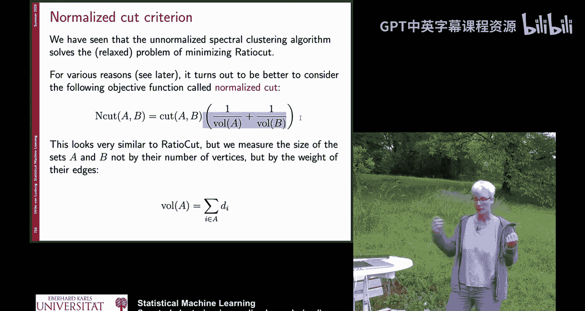
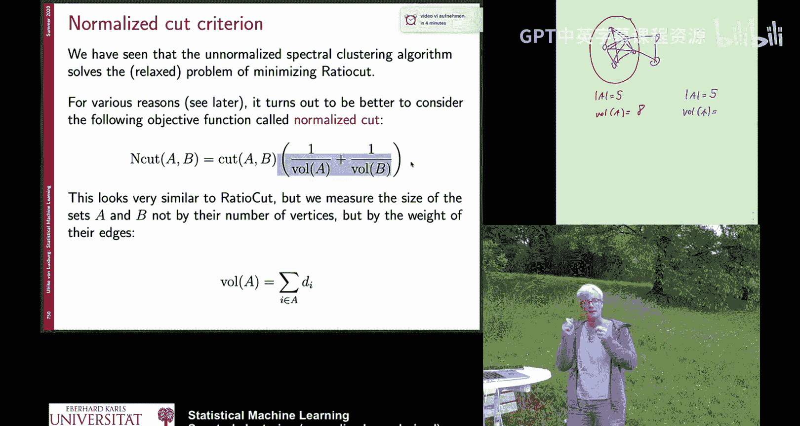
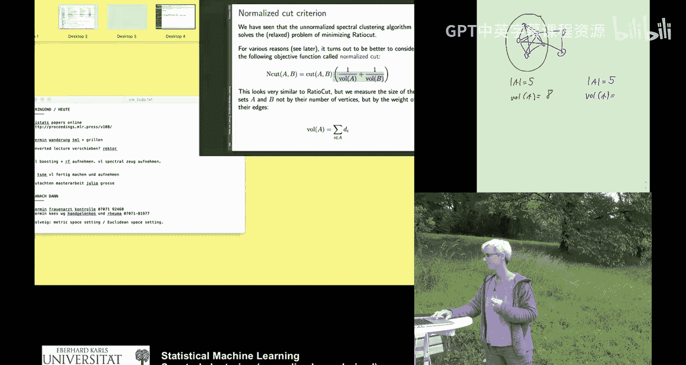
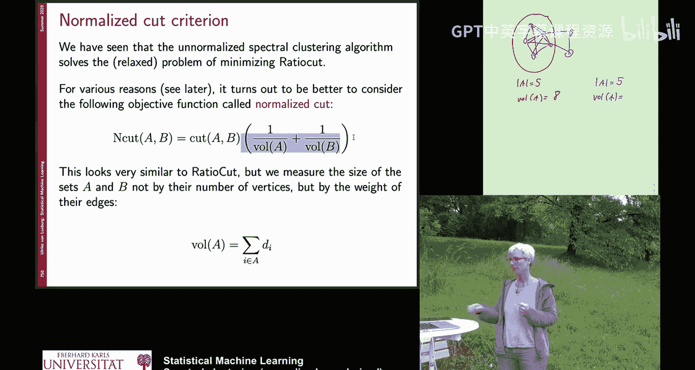
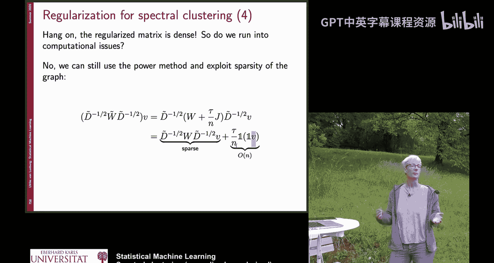

# 图宾根大学《概率和统计机器学习｜Tubingen Probabilistic and Statistical Machine Learning 2020》中英 p40 -40-Part 37 - Spectral clustering_ normalized, regularized.zh_en -BV1gso5YGE4s_p40-

In the previous lecture we considered the unorormalized version of spectral clustering。

 which is sort of the vanilla version， we said just to recap that what we want to do is we want to solve a balanced graph clustering problem。

We achieved this by defining a criterion that we call ratio cut that on the one side tries to find a cluster that has a small cut so few edges are going to go between the two clusters and on the other side is reasonably balanced in the sense that the two sides of the clusters have about the same size at least if it is possible。

Where we define the size in terms of the number of vertices。

Now we are going to look at the normal and this led to the unized spectral clustering version because the wordunnormalized comes from the fact that we use also the unmalized graphlaplian。

😊，Now there is another variant of spectral clustering which is called normalized spectral clustering because in the end it' is going to use the normalized version of the graphphflplian and in fact this is the version that you should always use in practice for theoretical reasons there are many advantages of the normalized versions over the unized version。

😊，So let's look at how this really works。In the previous lecture we have seen that derived ratio that we use the ratio cut criterion for the anized spectral clustering and now we define a slightly different criterion。

To discuss the balancing of the clusters。And the criterion works as follows。

 it is called end cut for normalized cut。We again say we want to minimize or want to find clusters that have a small cut between them so A and B and so if we have clusters A and B。

 the cut again measures the number of edges or weight of the edges that go between the clusters。

 this is something that is supposed to be small。But now we have a different way of the balancing criteria。

😊，And let me go to the iPad。 If you remember in the previous version， we had ratio cut。

Which is cut。Of A B times， and then we had one over norm of a。Plus， one over norm of B。Oh。

 who's sitting here？And here， A and P， they absolute value of A and absolute value of P。

Was the number of vertices in A& P。Now， if you look at the slide， we have the normalized cut。

Which is， again， the cut of A and B。But now， one over the volume of a。Plus one over the volume of P。

So， you see its the same principle， we measure the size of a cluster A or B by some expression。😊。

And the volume of the size of a class or the volume of a set。

Is essentially the weight of the edges that are in the set。 So if you remember。

 absolute value of a is simply。The number of vertices。Y ai。And the volume of a。

Is now defined as for all vertices IN A， the degree of the vertices。Or if you want。

 you can also write it。I in A， J in B。AndWI J。So w。

 so you start with I in in the set A and J can be anywhere。 It can be inside a or outside A。

 and you measure all the weights of all edges that go that start from。Points that are in the cluster。

 So if we have a figure。If these are the vertices， maybe let's draw a graph that's better。Like this。

And see。Our set a。Is this set here？Then what is the volume of a， I try to mark in what color。Pink。

 if that is possible， so I need to check all vertices in A。

 it is this guy and this guy we have two vertices。😊，And the absolute value of a would be simply2。

And now essentially what the normalized， the volume is going to look at is all these edges。

 which have at least one of their endpoints in a and it's going to sum over them。

This is simply a different way of of measuring the size of a cluster。 instead of taking the vertices。

 we essentially take the edges。But it has the advantage that it might， it might make a difference。

 Maybe let me draw one more picture if。My graph looks like this。嗯。

And say my group A I'm interested in is this one。So here the absolute value of a would be 5。😊。

And in the way I've drawn it now， if it's an unweighted graph。The volume of a。Would be 1，2，3，4，5，6，7。

8。 if I didn't mis cancel， there are 8 edges that have at least of one of the endpoints in a。

But now observe what happens if the， if in clustering。

 we say we want to have a group that is really tightly connected。 And this is。

And this is what we consider a cluster。 So now， if I add some edges here。嗯。In in the set。

 the absolute value of a doesn't change。 so in this new drawing。

 we still have absolute value of a is 5 because we have five edges， but the volume of a。

It's much large。 I don't want to count the edge， say say it's2 or something like that。

So the tighter these things are connected， the more weight does this cluster get and this is sort of a different way and maybe it's more appropriate to measuring what we are really interested in because it's about the connectivity and not about the number of arttices。

😊。

And now again， as in ratio cut， what we do is we combine the two criterion。

 we want to have a small cut value and we want to have two balanced clusters and we combine the two by a product。

 we simply say we minimize the cut times 1 over the volume of a plus 1 over the volume of B。😊。

And this is now called the normalizedist category。

Now， what you can do is you can make a derivation that is very。

 very similar to what we've seen in the anized case to derive what is now the normalized case like relaxing the normalized M case。

😊，It is。Very similar to what we have seen before。 Just some of the details are different。 And if。

 if you're really interested in it， you can check out my tutorial on spectral clustering。 there。

 I have the full derivation， and it's not much more complicated than the one we've seen here。

 It's just the formulas are longer。 And this is why I don't have them on this slide once more。

What is going to happen is if you write down the problem normal of minimizing normalized cut and to consider the relaxation。

 we again end up with an eigingve， but in this case we end up with the eing vector of the random worklaplium。

 So this is a normalized version of the graph lapplian。

 remember if you have the unmalized graph laplastine， there are two ways to normalize it。😊。

Either use the symmetric way or use the random walk normalization。 In both cases。

 the eing values are the same。 It's just the eing vectors are shifted by a multiplicative product。

So what we need to do is then in the end， we need to find the smallest K eigenves of the random worklet lastian。

And these are the ones in exactly the same way as in the anorized case that are going to give us the spectral embedding so we compute these eiging vectors put them into the columns of matrix v。

 the spectral embedding for point i is then the row of the i row of this matrix and then we are going to use ks in the embedding space to find the final clusters。

Now， one disadvantage of this random mark matrix， of course。

Is that it's not a symmetric matrix and for theoretic reasons， of course。

 we know that they have the same eigenvalue of the symmetric as the symmetric normalization。

 which I always call L zm on this slide。😊，And so we know there exists a basis of eing vectors。

 however the numericalmer solver might not know it and if a numericalmer solver sees a matrix that is not symmetric。

 it can't assume anything about the fact whether they are real valued eigingvalue or not so this is inconvenient because then what might happen is that your solveva doesn't really find the eigingvalue it uses a different algorithm than in the symmetric case it might end up with small complex for numeric reasons I mean maybe there are sometimes some small complex eigingvalue or complex。

😊，Parts in your eigenvalues。 And this is something you don't want。

And we want to exploit the fact that you know that you can solve it from a symmetric matrix。

 so typically what we do is for computational reasons we compute the eigenvectors and eigenvalues of the symmetric graph laplaian。

But then before we do the Kmins algorithm， we have to。

Converted to the random these e vectors by the formula we've seen in the previous lectures to the ones of the random worklaplian。

So in the end， what we get is an algorithm that looks very similar to the unormalized spectral clustering algorithm。

 but now with a different matrix， and this is now what is called normalizedized spectral clustering。

😊，So again， the input is the weight or adjacency matrix of the graph。

This is the degree matrix we now compute the symmetric normalization of the graphlaplsian。

We compute if we want to find two clusters， the second smallest eigenvector of this matrix。

Then we do this transformation that brings the eing vectors of the symmetric matrix to the ones of the random work matrix。

And then in the vanilla version， again， we do the partition by simply looking at the sign of this transform vector。

Note that there is one detail here that is different than in many papers that you would read and also in many implementations that you would see in practice。

 most people in practice simply they don't do this transformation。

 they simply stick with the eing vectors of the symmetric graphph lapplian but in my point of view this is not really what you're supposed to do there are some reasons why this is not the best choice because simply it is not the correct matrix like if you write down how this matrix looks like in the perfect case then you see that you have these constants。

 these normalization constants here which shouldn't be there because you don't get the indicator vectors with ones and zeros。

But with some other constants， and this is undesirable。 So I， when I implement it。

 I always do this transformation。Now， there has been a long debate about which spectral clustering algorithm is better。

 normalized unized one。 So in the literature， it started with the unized one already in the 1970s。

In 80s， maybe it was not really popular then， but this is how the algorithm started。

 and only recently， well recently is maybe not the correct word around the 200s 2001 to3。

 people started to use spectral clustering extensively。

 There were lots of key publications in this area， and then people advocated the normalized versions。

嗯。For a certain， because people simply observe that it works better。

 but there are also many fundamental reasons why the normalized version is better。One of them is。

 in fact what I did in my PhD a long time ago。You can prove if you look at spectrum lasting from a learning theory perspective。

 you can prove。That the unormalized spectral clustering often converges as you increase the number of data points to trivial solutions that are not the ones that you want to find。

 And this is simply an artifact of the way the matrix is built。

And you can prove that in the normalized spectral clustering version， is this is not the case。

It doesn't mean that normalized spectral clustering always finds a good solution or converts to the one that is really desired。

😊，But it does mean that an unized spectral clustering。

It might be the case that itt definitely does not converge to the one that you like。

So its some kind of it's from a learning serial perspective for clustering。

 it's often difficult to make really very good guarantees。

 often what you get are sort of these kind of necessary conditions and in my opinion。

 a necessary condition is，😊，It should at least have the potential to convert to the correct solution。

 and unized vector clustering in many cases does not have this potential。

 It will always convert to something wrong。And this problem does not occur with normalized spectral clustering。

 This is why you should use it。Okay。Now I want to turn to the last chapter on spectral clustering。

 namely regularized spectral clustering。And there is the literature here， and this is pretty recent。

 as you can see， some of the papers are from 2012， 2013。

 but then there is also a key paper from 2018。And the story is now the following。

Inspector clustering， it happens often that or it can still happen that we have graphs which have very unbalanced degreeistributions。

For example， if you look at a social network。😊，Then what happens is that there are some vertices which have a really high degree like。

 I don't know Bill Clinton or somebody like this， he would probably have millions of followers on Twitter if if you consider I don't know whether he Twitters。

 but anyway， so prominent persons have a lot of followers so the degree of their Twitter network。

 for example， is really， really high whereas normal persons maybe I don't know have fewer followers and so the degree is low。

There are many people who have a law degree， but there are few people who have a high degree。

And now what happens is if the cluster， if the structure of your graph has so unbalanced distributions of the degrees。

 this sort of brings a bit of unbalanced also to the spectral clustering rational。😊，嗯。

And what happens in those cases is that spectral rusting still often tries to or when observes in practice。

 first of all， that it finds outliers rather than finding balance splits。

And now there is one very simple cure and there are many different ways by this by which this cure has been derived and these are all the like these three papers essentially all come to the same conclusion but from different points of view。

😊，Namely， you need to introduce a regularization term to the graph Laplian matrix。So。

 typically what you now do is this regularization work as follows instead of looking at the normal adjacency matrix of your graph W。

 you now look at a regularized version of this matrix。😊。

Which is this which is calledW Tilda on my slide， which is essentially W。

Just that you add a little offset term tau over in to all entries of your matrix。

So J here is the matrix that is once in every position， so not just on the diagonal， but everywhere。

😊，Tau is a small parameter。 this is sort of what you could consider the regularization constant。

 which we often call Lata and supervised learning。 this is not tau。😊，And。

This is the matrix you now use。 So instead of the normal adjacency matrix。

 you use this sort of regularized matrix。And then you simply compute the graph Lalaian based on this new matrix W tilde。

 so what you get is you get a new degree matrix。😊，Which is essentially just again。

 the the original degree matrix plus sum offset。And then you can compute the unized。

 an normalizedized graph lapplian in the standard wave D minus w tilde。

And now there are many things that you can prove about this matrix and the proofs are beyond the scope of this lecture。

 but please check out the papers if you're really interested in。嗯。

What you can prove is that this regularization really improves a lot on the stability of your algorithm。

So what we can see here in this plot， this is a figure that I took from the paper of 2018 from Klour。

😊，嗯。Here we have the second eigenve。嗯。Which。s so so on the top， we have the regularized matrix。

On the bottom， we have the the eigenvectors of the unregularized matrix。

What you see here is in the unregized matrix。The eigenvector essentially so what you see here it's a plot like the one we had seen previously like each of these bars indicates that the data point has a certain particular entry in this eigenvector and here what you can see。

😊，That in this particular graph。These vanilla egg vectors。

 like the ones which of the non normalized graph lablaium concentrate on very few isolated points。

So if you would apply a clustering or like if you would apply the clustering rationale now to this kind of eigenvector。

 essentially director says， well， these three guys and maybe these three guys as well。

 they belong to one cluster。😊，These other three or four guys here belong to the other cluster and for these other 8。

000 points essentially we don't know where they belong they are close to zero so the spectral clustering doesn't really have any opinion on them。

😊，So this means that there is a small part of the graph。

That is considered in this particular eyeing victorous。As a cluster。

 here is another part that is considered as another cluster。

 but both of these parts just consist of four vertices or so， and the rest is simply nothing。😊。

And now assume if you have a couple of such a vectors， in the end。

 even if you do your spectral embedding with k equals5 or 10， you will just identify some very。

 very tiny groups in your graph because everything else is sort of close to 0。😊。

And now the question is， what does this regularization bring， and here is the same。😊。

Ien backed and now plotted for the regularized spectral lapplian。

And what you see here first of all is， I mean， there are many more non0 eigingvalue or like， no。

 the entries of the eiging vector are much more often non zero， essentially always。😊。

And we also can see heres a large part， a large group of the cluster consisting of about 1。

000 points or 500 points， I can't really see the scale here。😊，Which essentially is one big cluster。

 which has a positive eyeing vector。And here we have a large group which has a significantly negative eing vector。

 so this particular eing vector we are currently looking at would identify two groups。

 namely this group here consisting of maybe 1000 vertices and this group consisting of about 100 vertices which belong to one particular cluster。

😊，So we see the tendency of identifying outlier points is much， much lower。AndNow of course。

 first of all this is not obvious at all that this happens and maybe the question is also what is the reason for that and here is sort of the very。

 very high level line of argument。😊，So what you can prove is that many of these typically random graphs have what is called K dangling sets。

😊，So this is the case in social networks for example。

 you have a huge graph and then there is this guy which is called a k dangling set so here it's a5 dling set so you have five vertices which are just connected by one single edge to the rest of the graph so essentially it's in some kind of outlier component these a few vertices so it's not like there are five million vertices in here it's just five and they are just connected by one edge to the rest of the graph。

😊，Now， if you would apply something like the standard spectral clustering algorithm。

 there is a tendency in particular if the vertices of these graphs are unbalanced。😊。

To obtain these kind of cuts。嗯。And you can also see this by the chiga inequality， depending on K。

 if you have a K dangling set， and they might really induce a reasonable chiga value in particular if the rest of the graph is connected。

 So this is what the standard spectrum clustering algorithm would find。And now， you can prove。

That if you introduce this regularization to your graphlalay matrix。

 these are the sort of eigen vectorctors they disappear。

 They are not like the first couple of eigenvectors do not correspond to these kind of cave angling sets。

And this means that spectral cluster， and then it finds reasonable cuts。This is， of course。

 not obvious。 And also， the proof is really difficult。 But if you're interested， look at the paper。

 I think it's a really， really cool design。There is one aspect that for practice is really important。

Namely what we did so far， maybe I go back to this slide， so what did we do here？😊。

We have our original adjacency matrix， and now we add a matrix that is constant tau over n。😊。

Everywhere。Which means that this new matrix w tilde is not sparse anymore。

 so even if we start with a sparse graph W， say a social network where most of the edges are zero and nonexistent。

😊，After we did this regularization， the graph is not sparse because， I mean。

 that's the whole point there is entries everywhere， which are none zero。😊。

And why this might not be problematic for， for， from conceptual reasons。

 but for computational reasons， this might be really problematic because just assume you have a social network of Facebook and want to compute the second aing vector on your graph is not sparse。

 It's not going to work。 You're not， or at least you would need to spend a lot of effort。

 to try to compute an aing vector of a dense graph of a couple of million billion vertices。

And the cool thing is now that there is still a workaround that helps us to still solve the problem efficiently。

😊，And this works as follows。 So if you consider this is。

Now the normalized version of this of this adjacency matrix like we have the tilus and we normalizedize by the so W Tilde is this regularized matrix dtil is。

😊，like the corresponding degree matrix and this is the normalized graph lapbraian corresponding to this matrix。

 if you consider this product with a vector v like this normalized matrix times a vector v。

We cannot plug in the formula。For this tude matrices。

And what we observe is then it is a sum of two terms。

Where the first term is a product again of a sparse matrix。

 So here we have the original matrix W multiied with a diagonal matrix， which doesn't really have。

 So this is again， this is still a sparse matrix。 So for this part here。

We can use arse exploit sparsity and we are fine。And now we have this offset here。

And the trick is now that this offset has a special structure and we can treat it independently。

m sorryrry I didn't put any further details on the slide so the trick is now we can invoke an algorithm to find the eiging vectorctors of those matrices in an efficient way because this so if you use the power method for spectra for computing the eigen vector。

 the power method repeatedly needs to compute the current like we have the current vector which is our candidate for the eigen vectorctor and we need to multiply it with the matrix were interested in and we do this again and again。

😊，And now here this matrix multiplication is simple it's sparse。

 it is efficient and then we have this offset that we simply need to keep track of but this is something we can sort of compute analytically because V is our vector that we know that we have and then everything else we don't need to consider the full matrix here so this can be implemented efficiently and again if you want to look at the details please look at the papers。

😊。

So let us maybe to finalize this chapter on spectral clustering and look at the history of spectral clustering。

😊，I've already mentioned this。 It has essentially been discovered in the 1970s。

 but pretty much wasnt noticed at this particular time。

 There was a paper where someone published something like that。

 but nobody really took it up and it essentially it remained a hidden album sort of。

And then there were three papers all in 2000 and 2001 and 2。

 which sort of independently advocated for different versions of spectral clustering。

 theres a shemaic paper which did this for image segmentation。

and they used the normalized graphphlaplian and then there is the marinala paper which looked at the random walk lapian and did sort of show that there's this random walk explanation for spectrallasting and then again here's the standard paper by I Jordan and R who also used the normalized graphlaplian and these papers essentially all appeared around the same time and then spectrallasting really became very popular because it has this property that you can find clusters of an arbitrary shape which is not the case for something by King means。

by now I think it's really like if you if you are supposed to know a couple of clustering algorithms。

 of course， the traditional ones came in some single linkage。

 but the next one that you should definitely know is spectral clustering it is really the modern algorithm for clustering。

 it doesn't always give you perfect results but in practice it works very good and it is still an active fe of research as you can see。

 for example， from regular spectral clustering this paper from 2018 is just two years old so this is really people even though most of the basic things for clustering。

😊，Inpector clustering have been known。 There is still lots of work on it。

 also from a computational site。 There's a whole field of research where people always consider。

The computational are statistically tradeoffs for finding clusters。

 so you try to come up with graph models where you essentially you make a ground truth model that is really hard for clustering and then you check how how hard can you make a problem and still discover。

😊，Its the correct clustering。In different regimes， either using an NP hard algorithm。

 using a simple algorithm or using a very， very simple heuristic and so spectralcasting is always one of the candidates that is considered in this intermediate regime。

 so it really plays an important role。😊，Also in theory， but also in practice。 So my advice is。

 whenever you have a clustering problem， do play。With spectral clustering。

The important thing to get right here is the similarity function， for example。

 if you use the parameter k like if you use a k nearest neighbor graph you need to fix the parameter k if you get it wrong。

 spectral clustering is not going to work， if you get it right there's at least a slight chance that it works。

😊，If you have the choice， always use normalized spectral casting。

I just gave you one reason in the lecture， but there are many more reasons simply do it。

And also always consider using the regularized version of spectrum questions。

