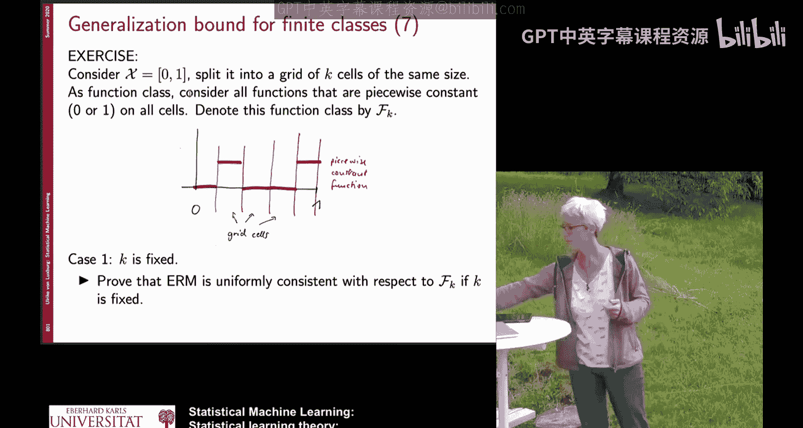
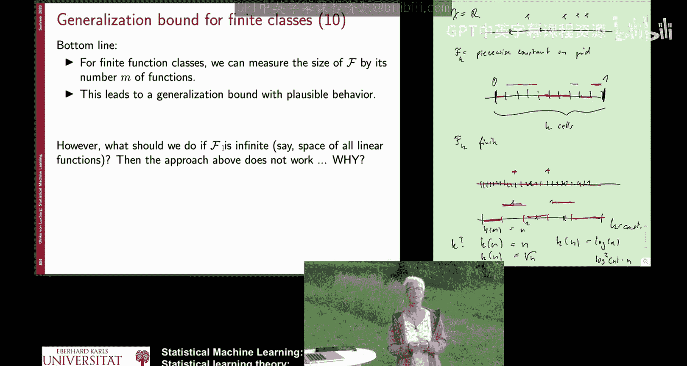

# 图宾根大学《概率和统计机器学习｜Tubingen Probabilistic and Statistical Machine Learning 2020》中英 p42 -42-Part 39 - Statistical learning theory_ finite function classes.zh_en -BV1gso5YGE4s_p42-

In the last part of the lecture， we have seen that if we want to have a learning algorithm。

 a classification algorithm that is consistent。😊，Then we need to prove the uniform law of large numbers。

 which says that for all functions in the given function class。

 the deviation between the true risk and the empirical risk。

 as measured on a particularly given sample goes to0 as n goes to infinity。

The expression we had on the last slide looked quite complicated and now the question is how could we prove something like a uniform law of large numbers？

😊，In this lecture now we are going to start to consider the case of finite function classes。

 so a class where we only have a finite choice of functions finite many elements。😊。

And then we will see how to prove the uniform law of large numbers for such a case and later on we will then generalize this by using more tools and more capacity measures in particular to infinite function classes。

 but to get the idea let us start with finite function classes。😊，Here is again。

 the intuition on this slide， you can see the expression that we're interested in。

 We want to bound the probability。😊，That the risk of a function deviates from the empirical risk of a function by more than epsilon。

 and we want to bound this in terms of the supreum overall functions in the class。

The idea why we needed to do that was because we said we can't apply the uniform law of nutch number to a function that depends on our data because then the standard law of larget numbers wouldn't hold anymore because the function also depends on the data and now the idea was to circumvent this problem by simply looking at the Supreme now how can we bound this kind of expression。

Here's the first general trick or the first simple step that we are going to use in this case of finite function classes。

Recall that we had looked at this concentration inequalities， in particular， the hefting Bo。😊。

That says for any fixed function， F0 that does not depend on the data points。

 it is like we first fix a function， then we draw data points and then we want to compare the true risk de deviation of the true risk from the empirical risk。

And we could bound this， say by this shiftfting inequality which said the probability that the deviation is larger than epsilon is smaller than 2 times e to the minus2 and epsilon squared。

😊，And as we had discussed already there， this is a nice bound because it decays fast with an exponential speed in this case。

 in terms of n。😊，嗯。And now the problem was that was also what we had discussed that we simply we cannot simply take this bound and apply it to the function F n that would have been chosen based on the finite sample that we have seen after we've seen the sample。

😊，So now we are in this case of a function class， we have finite many functions and we simply denote the number of functions by M。

😊，So our function class consists of F1 to FM。And now let's simply do the math。

 so this is really a simple and straightforward thing。

This is the expression we want to bound on the left hand， the red one。😊。

Now the first thing we do is we just replace a bit of notation instead of writing the supre over the function class。

 we know our function class only consists， its hard to mark these things。

 consists of M elements so we can just say okay we name these elements in the first place and call them f1 to fM and our bound now goes over the index I from one to M。

😊，Again， the risk of now if I minus risk the empirical risk minus the true risk。

And the probability that this is such an epsilon。Now the next thing we are going to do is if we have a supre here。

 we want to express it in terms of a logic operator。😊，And the logic operator。

 we have to use CSC or expression。😊，So we have M terms in our supreme or like M elements over which we take the supreme。

AndNow just try to understand what we need to do if you say the supre of M things is larger than something。

 it means at least one of these things needs to be larger than something。

 there can be some that are smaller and some， but at least one of them needs to be larger。

 and how can you express the at least in a logical operation you would use the ore conjunction。

And you would say it either needs to be the case that first for the first function。

 the deviation is small。Or it be the case that for the second function。

 the deviation is small and so on。So in the end， we have now M terms。

 as many as we have functions in our class， which are with or conjunction in a probability expression。

Now， I hope that you all remember if we have the probability of a finite number of events that are。

We have an aura between them。And we can use the union bound， so in the easiest case。

 we just have two L22 statements and probability of A or B。

Is always smaller or equal than the probability of A plus the probability of B。

Typically this bound is pretty bad， I mean it always holds。

 but it can be really loose in the sense that what we have on the right hand side is much larger than what we have on the left hand side。

😊，Because if the events intersect A and B， then this intersection is essentially counted twice。

I guess you know all this， if not， you might want to look it up again。

So now what we do is we apply this union union bound， and we have now M or conjunctions。

 So instead of just probability of a plus the probability of B， we now get M terms in our sum。

 So with sum over these M terms， the probability that the I function deviates。

In terms of the empirical risk from the tourist by modern epsilon。

And now the trick is now we can apply the hefting inequality to each single of these elements。😊。

Because now each in like each term in the sum here。Has the following philosophy。

 you first pick some function F I you fix it。And then you draw an empirical sample。

 you compare to the risk to the true sample， and you look at the deviation。And here this function。

 if I does not depend on the data at all， it's just， I mean we just go of all fixed M fixed function。

 there is no dependency。😊，On the data。So now for all of these functions。

 we can apply the union bound， sorry， the uniform log。😊，They havefting inequality？

For each of these terms， we get the result2 e to the minus to an epsilon squared。

And we have now this factor M here。 sorry， I only wanted to mark the M。

 which comes from the sum because we have M sub termss。 the factor2 comes from the hefting bond。

Okay and this already looks quite nice at least it tells us how we can bound if you now read only from left the red left expression in red and the right expression in red。

 we get a statement that says if you want to bound the supre over a finite function class，😊。

We essentially can proceed S if there would be only one function and the price that we have to pay is that we get this factor M in front of the E。

And this M， to be honest is not so bad because here we have something that decays exponentially so like a linear fact factor and the number of functions seems tolerable at this place at least。

😊，So here is sort of the first result that we can approve。Let us read it。

 assume F is a finite function class and contains M functions。

 that was the assumption we made finite function class。😊，Choose any epsilon。

Epsilon is any deviation number between 0 and 1。Then with probability。

 at least1 minus2 m equal to the minus2 n electron squared。😊。

We have that for all functions in our class。The deviation is bounded by epsilon。

And now note that I did two things here I turned the probability around I didn't express the probability that the deviation is larger than epsilon。

 but the probability that the deviation is smaller than epsilon。

 this is the thing that you're typically interested in you want to say with high probability there is not a high deviation so essentially I inverted to inequality and then here I needed to invert the probability。

But still， this is a somewhat inconvenient statement or way to state it。

 And this now is maybe something that you not might not appreciate so much， if you haven't。

Try to derive proof of your own theorems， but often there are many。

 many ways in which you can a theorem and some ways are easier to read or to understand in other ways and all of them might be correct。

😊，But some。Ways are a bit cumbersome and this is one of these cases because typically what you would like to have is if you remember in statistics。

 what do you have you want to have a statement like with 95% probability。

 my estimate is sort of correct。This is at least the feeling what you would like to prove。

 So you would like to know you would like to give to fix this probability here and say。

With 95% probability， my deviation is not larger than。

 and then the bound is supposed to tell you how large the deviation is going to be。

And here is the other way around because we fixed how large can the deviation be？😊。

And then we computed what is the probability we want to assign here？

And in many applications you would like to see it the other way around。

 there might also be application where you would like to see it in this way。

 but I also want you to show the other way。😊，This is now what I do on the next slide。

So what do we want to do Im sorry I go back instead of this term here， I want including the one。

I want to have a statement like with 95% probability。

So essentially what I need to do is I need to equate this guy with 95% probability and then I need to solve this expression for Epsilon and plug the epsilon here and then I get the same like I get conceptually the same result but state it in a different way。

😊，So this is what we now do we want to say there is a deviation probability to data say 5%。

 this is the probability by which we allow the results to be wrong。😊，And then we say， okay。

 this deviation probability weequ with 2 m Epsilon Ae to the minus2 n。Excellent squared。

And then we simply solve this for epsil and I guess everybody can do that this is not difficult so and what you get is。

😊，You get this square root here， which consists of two like in the en numerator， you have two terms。

And this is the typically way it looks like you have the capacity like the size of your function class in some way。

😊，You have a confidence term。You divide by 2 n， and then you have a square root around it。

And let us look how the final bound then looks like。😊。

It's now the same kind of statement just written up the other way。Again。

 we have a final function class and functions and now instead of picking epsilon。

 we know pick a delta， which is this deviation probability。😊。

And then the theorem says then with probability at least one minus delta。

For all functions in the class， we know。😊，Thats the empirical risk， sorry。

 the true risk is bounded by the empirical risk。😊，Plus， a deviation term under the square root。

And this deviation term looks now as I said before。

 we have the lock of the number of functions over to n。

 this somehow tells us the relation between the size of the function class and the sample size。😊。

And here we have this so called confidence term， which is log1 over Dlta over 2 n。

And this is not a statement of a uniform law of large numbers because this statement holds uniformly for all functions in our class and so in particular it also holds for the function that might have been picked by the algorithm that we have used to pick a function from our data。

😊，Based on our data。Now， there are like if you see such a serum。😊，Typically you don't understand。

 I mean， it's impossible to understand it right away what it means if you haven't seen something like that before and what is sort of what is the meta meaning of such a theorem。

 So how can you now interpret， does it make sense， I is it a good result。

 Is it a bad result for now it's just a mathematical statement and typically a lot of work goes into trying to really understand what it means this the best we can achieve。

 Is it a really bad result， I it a result we would like to have and so on。嗯。

Now let's try to do this here， as I said。And the。And。In the theem。

 we have the bound of the so we bound true risk by the empirical risk class this deviation term and this deviation term consists of two parts。

 a capacity to determine a confidence term。😊，It somehow makes sense。

 maybe do the first basic kind of checks。The sample size increases and gets larger what happens to the bound。

 the square root term is going to go smaller。So the tourist will approximate empirical risk in a better way。

 This makes sense。 If the sample size increases， we hopefully get fewer deviation because we know more about our data。

 This makes sense。The other thing in terms of the function class。

 what happens if the function class increases， we get more and more functions。😊，Intuitively。

 if we get more functions， we have a much higher likelihood that we are going to overfit at least eventually to our data。

😊，And in particular， if there are many， many more functions， then say we have data points also then。

😊，And this is captured in this term here， then I can't really market the lock 2 M over 2 n。😊。

Some hotel tells us how many functions can we afford before everything starts to explode？

Because what we would like to have， if we want to have uniform consistency。

 the square root term needs to be small and ultimately also go to 0。

 So essentially what we need to have here is lock。 if you can if we ignore all the constants。

 we need something like lock M over n。😊，Needs to go to 20。

And so this tells you what is sort of the tradeoff between number of data points and number of functions because typically you would choose M like in a real world setting。

 even if you have a finite function class， you would like to have the number of functions increase with increasing sample size because maybe in the beginning of just 15 data points then you maybe say my data in my space consists like a four or five functions but if I have5 million data points maybe I should have more than four or five functions I should maybe have a couple of thousand functions and so on。

And here， this bound tells you what is the trait of namely the number of function。😊。

Is only allowed to grow loggarith Mcly in the number or needs to grow smaller than loggarith Mcly in the number of sample points。

 So lock M over 2 n needs to go to 0。And we are going to see an example in a minute where I again。

 want to explain what this means。The other term here。

 the confidence log1 over delta here we have the same story。

 what you would like to have is if you get more confident about your data so if you want to have the bound maybe not only to hold with 95% probability but with 99% probability。

😊，This means Dlta gets smaller， eventually Dlta goes to zero and then again this this term here gets larger and larger。

😊，And because log of one of datata is still going to explode。😊。

This also makes sense because if you want to have a statement where you're really sure。

 then your statement needs to be loser。😊，It's something like if I look in a lecture hall which is crowded by a number of students and and someone asks me well how many students are in your lecture then I could say something like well I'm pretty sure that they're about I don't know。

 not more than 100 students but then somebody says okay your life really depends on the fact that you don't overshoot so if you really。

 really， really want to be sure what is the maximum number of students that you might have in your class then I might maybe even though I think hundred is a good estimate I might say oh there are not more than00 students in my class because then I can be sure I didn't really make a mistake。

😊，So the confidence needs to increase like sorry， if the confidence needs to get better。

 So I want to be more confident， then the confidence regions need to be larger because I need to account for the unlikely event。

 that something went wrong。 and the more confident I want to be。

 the more unlikely event I need to take into account。

 So the sort of the size of the confidence interval。 if you want increases again。 So here。

 if Delta goes to 0， this term is going to get very large。

 And the statement how close the empirical risk and the tourist are。 again， is a bit looser then。

Of course you can now， as you can always like if you want you can say this deelta term is supposed to go to zero as n goes to infinity with a certain speed and here again this sort of scale shows you what a tradeoff would be how much more confident you can be if decem size increases。

😊，Because of course， if you see more sample points eventually， you also get more confident again。

Okay， let's see what did I else note on this slide。

 so if the function class gets larger than the bond gets worse， we had that。😊。

If M is small enough compared to N， then we get a tight bound， This is also what we discussed。

 The term is log M over N。The whole bound only holds with probability 1 minus delta when we increase delta。

Sorry， decreased delta， then one minus delta is going to be increased。

 so we have a higher confidence the bun gets worst。Okay， here the last thing maybe if M is fixed。

 anti confidence delta is fixed and n goes to infinity。

 then the empirical risk converges to the true risk because this whole square root is going to go to zero。

😊，And the speed of this convergence is of the order 1 over squarero rootd of n because then everything in de numerator of this curved is a constant and we still have the denominator so it is square rootd of n。

And here again， if you want to grow your function space within。

Then you need to make sure that lock M over n goes to0。If you want to get consistency。

I now want to show you a little example where we can already prove a theorem that is really interesting and it's also on your exercise sheet so you need to sort this assignment in the following week。

😊。

But let's simply go through the gist of the assignment。

 So now assume we are in a very simple setting we have a grid。😊，Of data points， No sorry。

 we have data points。 first of all that live in R。 So our data space x is R， the real line。

So all our points sits somewhere here。And we are in binary classification and say we have labels like you on the slide。

 I call them zero and one， so we might have some training data。😊，It looks like this。

So we have points on x， we have labels plus a01，0 and1。And now we want to learn a function。

And how is our function class， our function class？😊，Conists of piece wise。

 constant functions on a grid。 So I maybe just call it down piece wise。Constant。On a grid。

So if I have my data space， I have a certain grid。😊，You like a uniformly space grid。With K cells。

 so all in all here。I have K K Sals inmigrant。And all my data lives between0 and  one。

So the width of each of these grid cells is1 or okay。And my functions now look as follows。

 but they need to be piecewise constant on these grid cells so I can do something like zero here。

 one here， one here， one here，0 here，0 here，0 here。😊，1 here，0 here，1 here。 right。

 So this is how functions in this class look like they are always constant on each grid cell。

 and they can。Change between the two layerss as much as they want。

 but on our grid side they need to be constant。This is sort of one of the typical examples that you often study。

Because it's a simple case and now we can see what our bound does so maybe the first thing to notice。

 so I call this function class FK。😊，So FK。Its the function class that consists。

 I should have had a here that consists of these piece whereas constant functions on K grid cells observe that it is finite。

 right？😊，And if you want， I think you can do that yourself。

 you can compute how many functions does this class have。😊。

And now you can apply the generalization bound that we had on the previous slide to this particular function class。

😊，And now the interesting question you might want to ask is what is a good number of k such that in the end I might get uniform consistency？

😊，So now we have this parameter K and we want to use the generalization bound to find out what parameter K we can choose to get this consistency。

😊，Now observe if I have say 10 data points and k is 500。

 then I can overfit completely because then I could do these funny things like put like for example put the function close to zero everywhere else but have it just the same value as the training data。

😊，in a very small region around your training data。

 so you could do something like if this is your training data。And your grid says are very。

 very small。So k is huge， then you can choose a function that essentially is here1 and 1 and everywhere else it is 0。

And this function would not be consistent。And maybe think about why and try to prove that。

But on the other hand， what is the other extreme case we could have。The same。Kind of training data。

 But now maybe our grid consists just of， I don't know，5 cells。Maybe I filter them in red。

Now I have five cells and then if I want to fit this to the training data I would maybe do something like this this well and here I would know for this cell I have one point which is plus1 and one which is0。

 I simply need to decide maybe。I decide by majority vote， but there is no winner here。

 so I just choose one of them plus one。😊，And this and here outside of the observed data。

 I can also do whatever I want。And there is at least a slight chance that this thing eventually is going to be consistent if my if my grid cells are large enough so typically were going to see what typically happens and now the exercise is going to be used this statement that we had on the previous slide this generalization bound to prove for which values of k if k is now a function of n。

😊，Is it going to be consistent so you could think of should k grow linearly as n。

 so the thing we're after is something like we want to figure out k as a function of n so if you want you can say k of n we could choose something like n with as many grid cells as we have data points。

And maybe for now you can try to think about before you install this exercise what do you think so if you for example have as many grid cells as we have data points do you think this is going to be to lead to consistency？

😊，Then you can think about something like ha could be square root of n。

Because maybe you come to the conclusion that n is a bit too large。

 maybe you can use square root of n， then you can also do something like k is what other function lock of n。

😊，Or you could also have K is， I don't know， lock log square of n times n something whatever， I mean。

 there can be any function。And I think there are now two steps in this exercise。

 the first one is maybe to get an intuition for how large this function。😊，Should we。

Something I forgot is K could， of course， be much larger than and it could be n squared in cube or E to the n or whatever。

 So maybe， first of all， come up with an intuition for what you think。

This function might look like and then try to use the Ethereem to prove what comes out of it。

And I'm not going to reveal the result now because it's going to be an exercise。

So this is the first one proof that empirical risk minimization is uniformly consistent of sorry with respect to if K if k is fixed sorry this is maybe the first I didn't put this here so we can put it again K is constant。

And if K is constant。Then the first exercise is going to be to prove that you have uniformi consistency。

This is going to be easy。And then， the next thing。I didn't really even put the exercise here on this slide if k is growing。

 so the next thing that's going to be on your assignment is proof if K grows。

How fast can it grow such that do you get still consistency。

And then the next question is do we have now also base consistency so the uniform consistency so far only tells us that the estimation error goes to0 do we also get a statement about the approximation error and then the question is proof or give a counter example。

Okay， here we have the case too。😊，K grows within n。

 so it's a function of n how fast can K of n grow such that we still get consistency？And then again。

 about what about approximation error and base consistency？Okay， so。

This is sort of the major tool the bound that we have proved for finite function classes and the inside is maybe the term by which we measure the size of the function classes。

 the number of functions， this sounds really trivial if you're in a finite example， of course。

 how would you measure the size of a class you would simply count how many functions do you have in this class。

 this is obvious here， it's not so obvious what we need to do if our function class gets larger like if it gets infinitely many functions。

😊，嗯。Maybe the interesting insight is that the way by which we measure the size of the function class is lock of the number of functions。

 at least if we want to compare it to the number of data points。

What we have seen is it leads to a generalization bound that at least has a plausible behavior so far we haven't proved that this is the best kind of generalization bound we have。

😊，Because it's just like so far we just have an upper bound and you could like maybe let's go back to the statement here。

😊，We now say we have an upper bound so the tourist is smaller than the empirical risk plus and deviation term so far we don't really know whether this deviation term is really the best one you could prove。

😊，So often if you start proving theorems， I mean you come up with a first proof and theorem is very。

 very loose。 it is correct， but what you have here is a number that is much too large and there might be ways to prove tighter bounds。

 This is nothing we can say from this particular slide here so we don't know how tight the bond is。😊。

At this point in time， but we have a first bond。And now， of course， the big question is。

 what are we going to do if our function is infinite， This is going to be the next chapter。

If the function is infinite we cannot simply count a number of functions because it' is going to be infinity and we also can't use this bound as we have it here because it would have infinity times e to the minus2 and epsilon squared this is not going to be helpful so we need to do something else and in the next lecture we are going to see that there exists a number of combinatorial tools which。

😊，Also count a number of functions， but in a different way。😊。

And then with these kind of communator tools， we can prove bound。

 which look similarly to the one we have seen here。

 this is going to be the topic of the next lecture。

