# 图宾根大学《概率和统计机器学习｜Tubingen Probabilistic and Statistical Machine Learning 2020》中英 p43 -43-Part 40 - Statistical learning theory_ shattering coefficient.zh_en -BV1gso5YGE4s_p43-

Good morning。In the last lecture， we started to look at Staistic learninging theory。😊。

Which is all about trying to prove under which circumstances。

Machine learning algorithms for classification are going to work we looked at a simplified setup where we say we look only at binary classification and we do empirical risk minimization and we want to relate the empirical risk of the function that we see that we can observe from our data to the true underlying risk of the function。

😊，And then we want to bound the deviation so to give us some kind of confidence statement how good our current classifier might be。

😊，Maybe let me briefly recap how this works so it's easier to get back into where we are。

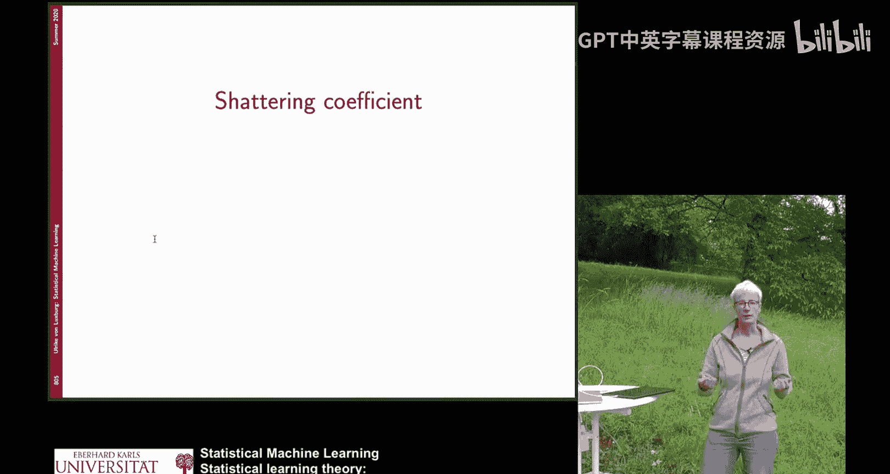

So what were interested in we have an algorithm that sees N data points and is going to select a function。

 This function is going to be called fn。😊，Now we are of course interested in the true risk of this function。

 so we are interested in risk of Fn where R is really the true underlying risk。

 not the empirical risk。And what do we want to compare to。

 We would like to compare to the best that we could achieve in the current set of function that were searching for a good candidate so we have。

This function F index curly F， which is the best function in this function space F that we could possibly pick。

In terms of the risk。And now we want to compare the risk of the function that our algorithm picked of n to the risk of the function。

 the best function in the class。And what we would like to know is whether this risk。

 the deviation in this risk is larger than epsilon or not。😊，Andm。Now。

 this is a bit of an inconvenient quantity。And we did some not so complicated steps to transform it into a different quantity。

 We said the probability that this guy like this expression deviates by more than epsilon can be bounded by a different probability Naly what we are now looking at is we look at the risk。

Of a function。Minus the empirical risk of a function。And for now。

 this can be any function in our space， but we take the supre over all functions in this space。

So we say for all functions that are out there。😊，We look at what is the difference in the empirical and in the true risk of this function and what is the worst case？

And then were interested in the probability that this expression is larger than epsilon。😊。

And hopefully this probability is small， or at least if you want to have a consistency statement converges to 0 as n goes to infinity。

😊，And this is the property of uniform conversions because we have a deviation statement that holds uniformly of our whole function class。

😊，And in the last lecture we have seen if we have a finite function class that only consists of M functions。

😊，Then we can bound this expression by something of that looks like M times。

E to the minus2 n epsilon squared。There might be a factor two missing here。

 I'm not sure that's not important。But the key quantity is this expression can be bounded by something that has this term M。

😊，Where M matters the size of the function class。Now again。

 if you remember back to the beginning of the very beginning of this lecture。

 we said that if the function space is too large， then probably learning is not going to work。😊。

Here we now see， of course， if you have a finite function space， it's maybe not too large。😊。

But now the question is， what do we do if you have infinite function spaces。

And this is now where the shattering coefficient comes in because last lecture we have already observed that the proof that we used for this kind of expression wouldn't work if our function space all of a sudden has infinitely many functions。

😊，So now we need a different concept and the first concept I want to talk about is the shattering coefficient。

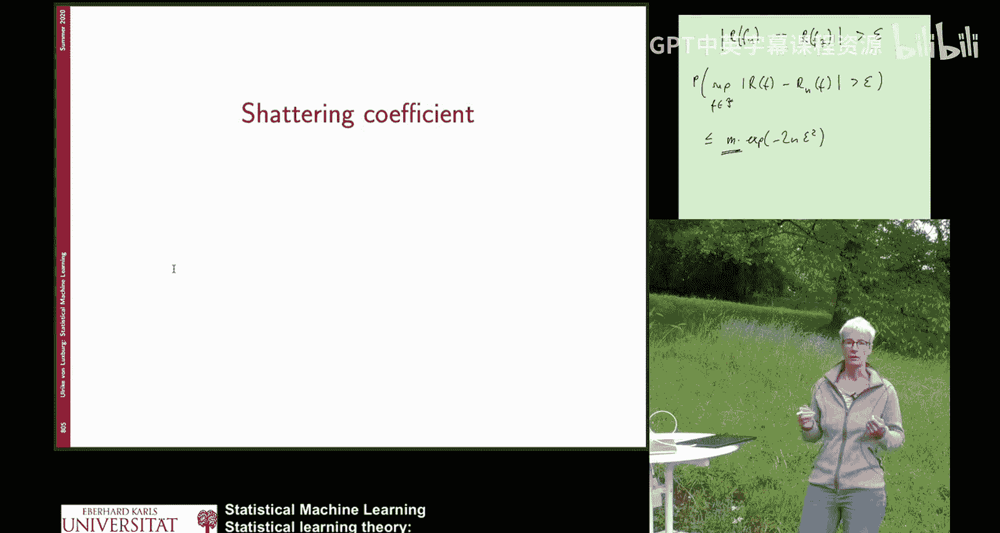

The shattering coefficient is a combinatorial measure that tries to measure the capacity of how large a certain function spaces。

😊，Let's maybe go through the slide。So assume we are given a sample of npoint， x1 to xn。

 any points in our space。And we have this function class F。Now。

 the first thing we do is we define what is called the function space f index x1xn。😊。

Which is essentially simply the restriction of all the functions to this finite set， so I have many。

 many functions in my space。😊，Infinitely many， just is the case we have in mind。😊。

But now we have a finite sample and all these functions we are in binary classification can take the value minus1 or plus 1 or0 and 1。

 depending on how you want to encode it。😊，AndNow we are we are given a finite sample。

 So all we are interested for in right now is what can the functions achieve on this finite sample。😊。

Now in this finite sample and we know this is the function space F cur F index x1 x。

 and we simply look at the restriction of all the functions。

 So this bar here means the restriction operator of a function。

Now already if you think about it we have now n data points and each function can take the value plus 1 or minus1。

 we are already in a finite function space if we restrict our space only on end data points because we have just two to the power of n many possibilities to have a binary classification of these end data points。

😊，Now the shadowttering coefficient matters the number of functions。

 the number of ways in which we can label all these data points。😊。

The shadowttering coefficient here is denoted always by this curly n of F and n so it' is a coefficient that depends on the function space and on the number of sample points you are currently looking at。

It is simply the maximum number of ways in which we can label。😊。

The data points that we are currently given。And we simply check how many different ways do we have to label these end data points and this is the shadowing coefficient。

😊，It's a very simple and also straightforward definition。

Let us look at a particular example to see how this shadowttering coefficient works。

 The example is also on the slide， but maybe it's easier if I present it slowly on the iPad。😊。

The data space we are currently having in this example is simply the real line。😊，So， we have。

There will be a line。Which is our data space。Now， what is our function space？

Our function space is going to consist of step functions which have this particular form。so。Maybe。So。

 this way。So they are 0 up to some point a。And then there are one。

 so it's typical step functions and we always have one 0 at the beginning and one later。

 so the step is only always increasing。 We don't have a step the other way around。

So our functions space consists of all those step functions for all values a that we could possibly choose。

And now we want to look at the shadowing coefficient of the set of functions for a particular n because the shadowing coefficient depends on the function space and on the number of data points so say we want to look at the case and sorry I need to。

😊，Change the pen。So， we now want to look at the case n equal 3 and what we are interested in is what is the center coefficient of the function class with three points。

😊，So what do we now need to do？😊，We need to look at the definition of the shadowttering coefficient and maybe we go once back to this slide。

 so we need to look at all possible choices of three data points。😊。

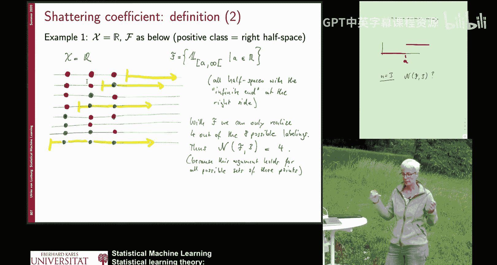

And need to see how many different ways can we label these three data points？

And now maybe to get some intuition， we start with some three data points。

 which are three distinct data points in our space。

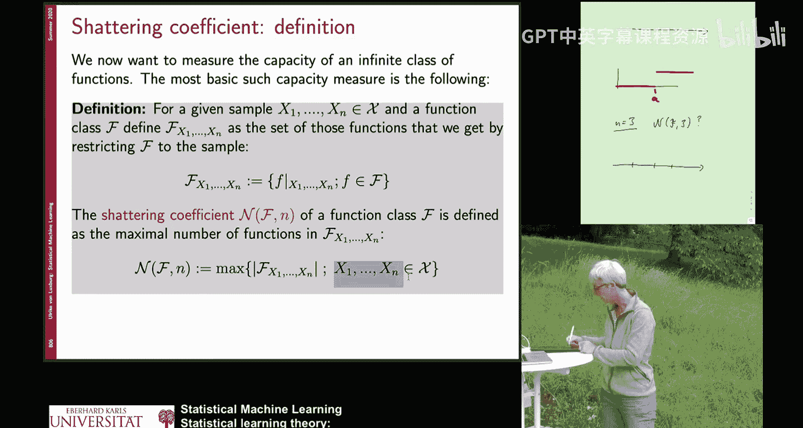

嗯m。And now we need to look at how can we label these data points with our function class。Now。

 maybe let's look at a particular example if we would have this particular it' hard to see。

 I can have a step function that has its parameter。😊，A somewhere here。

 a would be here everything before a would be 0， maybe I try to draw it this way。

And everything here would be one。So， in this case， we would achieve the labeling that all three points would have to label one。

😊，This is also if you now go to the slide， this is sorry， this is the bottom。Partor you。

where the threshold A is at the left of all the data points everybody on this slide here has a blue color。

😊，And now we can sort of slowly move the threshold more to the right and this is now what you can see here on this slide so depending on where the threshold is you can achieve different labelings。

 for example， you can also achieve the labeling in the first row on the slide。😊。

Which is everybody is zero。Because the threshold only happens later and then everything after these three points would be one。

 but we don't mind。😊，Then here this we have having 2。0 and the next 0。

1 we can also achieve by putting this threshold here。

But now in the third line in this plot on this slide is something that we cannot achieve by this function class if you would like to have a labeling where the first point is 0。

 the second point is 1 and the third point is0 again we cannot realize this labeling with the function class because we only have one step in our function。

😊，And so now we go through all cases， there are three points， two labels。

 so we have two to the power of 3， which is eight different ways to label these data points in principle。

😊，And now we simply count how many of these labelings can we realize with the function class we're looking at。

😊，And if you go through this figure here， I listed all these eight different labelings and you can see there are four labelings that can be achieved。

😊，In the function class we currently are， so we know the shadowing coefficient of this particular function class is four。

😊，Sorry， the shadowttering confusion of this function class four three data points is four。

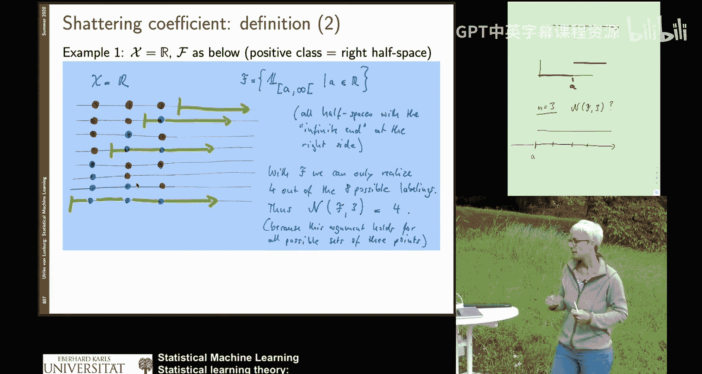

I have a second example。😊，嗯。It's a two dimensional example。

 I mean these are all toy examples just to build some intuition。

 So now assume our data spaces are too。😊，This one here and the function class is works as follows we simply can its again some kind of step function in a two dimensional in a two dimensional setting we have a line。

 everything below this line is0， everything above the line is1 and again we just have one direction so zero is always at the bottom and one is always at the top。

😊，And now again， you can try to look at what is the shattering coefficient。😊。

For a particular number of data points。And here we are interested in the shattering coefficient for five data points。

 see。😊，And now how do you approach that if you want to know what is a shattering coefficient of a certain function class with a certain number of points。

 you simply start playing with points。So here we put five points。😊。

And then you think about the function class and consider how many different ways do you have to label these points？

😊，And you can do that and you will realize that for this particular set of points which I call data1 on the slide。

 there are five different ways to label this data set and in particular these ways is either you put the line at the bottom that everything below would be zero but theres no data point every data point above so all data points would get label 1 and then you slowly move the line up。

😊，And so some of these data points will get the label 0 and the one apart will still get the label1。

And if you do this and you can convince yourself that there are five different ways to label this particular data set。

😊，But now the ting coefficient is the worst case， it's the maximum number of points。

 the maximum ways in which you can label five points。So。

 what you can conclude from this one single example of data points is that the sheltertering coefficiention must be at least five。

😊，It could still be larger because it could be that I find a different set of points where I can realize more labelings because again we are sort of interested in the worst case and worst like be in this case means we can achieve many labelings。

😊，So what you can now do is you can look at a different data set。😊。

So here we have this data set2 where you all of a sudden can achieve six different ways to label these points and the difference is here I mean it's a bit hard to see maybe on the sketch so here we have two data sorry here we have two data points which have exactly the same height so we somehow can separate them with these lines here we now have six data points which are nicely separated so we can put lines between all of them so we can achieve six different ways to label this data point this particular set of points。

😊，So we can conclude that the shadowing coefficient is at least six。😊。

And now you can look at other data sets， you can look at a set which is just a row of five points。

 there are just two different ways of labeling this and so on。😊，And now what you can。

Now you have now abound on your shadowing coefficient because you know the shadowing coefficient is at least six currently you don't yet know that it that in principle it could be that it is a bit larger because you might still discover another set of points。

😊，For which you might be able to realize even more labelings。

But in this particular case it is not the case you can try to convince yourself and this is not something you need to prove that no matter which set of points you are going to pick。

 you will never ever be able to realize more than six different labelings and once youve proved that then you know the feing coefficient of this particular function class on five data points is 6。

😊，I have a third example， it goes along similar lines， so again we have the data space is R2。😊。

Now a function classes looks a bit different now we don't have lines that move up and down but we have circles and we can put the circles wherever we want and we can change the radius as much as we want so the function class consists of all circles that you can put on R2。

😊，And the way a function labels the data points is that everything that's in the interior circle or say。

 on on the sphere corresponding to the circle or like on the。OnThe shell， I I miss the English word。

Sre on the outside of the circle， everything here is red。

 one class and everything that' is outside of the circle is blue。😊。

And now you can try to compute again what might be the shattering coefficient of this particular function class for a small n。

 And I'm not going to give you the example here。 you can or the answer here。

 you can simply play with it yourself。😊。

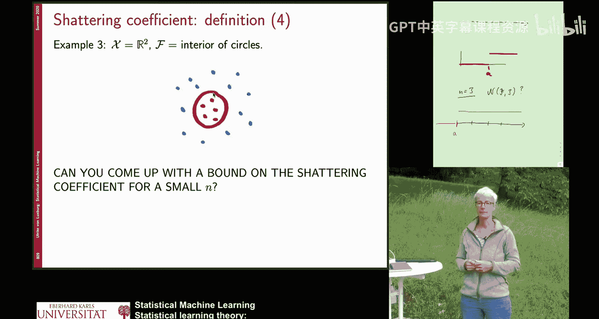

Now， the reason why we are looking at this is because we want to prove a generalization bound for function classes that have a certain property of their shadowing coefficient。

And before we prove it， I simply want to show you what the result is going to be。

 and then I'm going to guide you through the steps。😊。

So the result is going to be a generalization bound in terms of the shadowttering coefficient。😊。

So let F be an arbitrary function class on some arbitrary space。Pick some value of epsilon。Then。

 the probability。🤢，That。Over all functions in the class。

 the empirical risk deviates from the true risk by more than epsilon。

Is bounded by this expression here。Which is essentially two times the shadowttering coefficient。

Times e to the minus n epsilon squared over 4。And now looking at this maybe try to compare in your mind this kind of statement with a bound we had for a finite function class for a finite function class。

 the left hand side was exactly the same on the right hand side。

 Instead of the sttering coefficient here， we simply had the number of functions。😊。

And here we had an expression， I think the constants were a bit different。

 we probably had e to the minus2 and epsilon squared and now we have instead of a two we have a1 over 4。

 but this doesn't make any conceptual difference。😊，So again， the statement is if you look at this。

 if n goes to infinity。😊，This term here at the end would go to zero very fast。But of course。

 now the question is what happens with the shattering coefficient because this is a quantity that also depends on n and depending on how this quantity grows with n。

The complete right hand is going to go to0， or maybe not。

And the other statement I have on this slide here is again if you turn around the probabilities and this is the more convenient way or the more traditional way the more。

 I don't know， it's the better way to write this generalization bound because you see more what is going on。

😊，And we've discussed in the last lecture already how this works。

 so this is equivalent to the following statement。😊，You pick some confidence term de。

And then with probability at least one minus delta， all functions in your class。😊。

Satisfy the following statement， namely that the tourist of the function is bounded by the empirical risk of the function。

Plus， this big square rootton。Which again here we have lock of the shadowtering coefficient。

 previously we had lock of the number of data points sorry lock of the number of functions in our space。

😊，Here we have the same confidence term as we had previously。

It might be that in the previous bound I have written plus lock of lock of1 over Dlta。

 which is the same as minus lock delta。And then we have n or 2 n or something like that in the denominator。

So qualitatively this bound looks very much like the bound for finite function classes。

 just that the number of functions is now replaced by the shadowing coefficientsion。😊。

And again conceptually this somehow makes sense because the shatering coefficient simply counts like on a fixed number n of data points how many different functions do I have this is a finite number and this is in particular this number the sha given by the shattering coefficient。

😊。

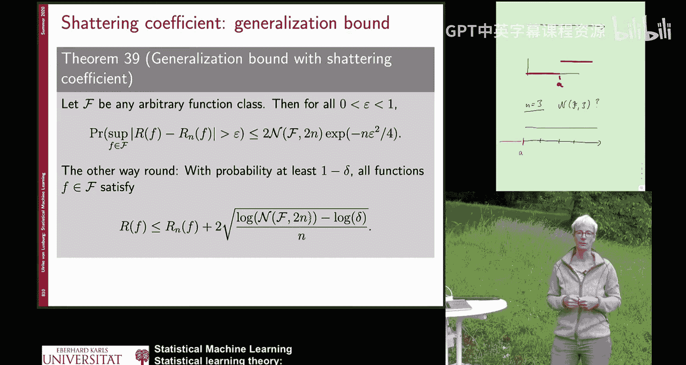

Okay， now I want to show you how to prove that statement。

 at least roughly I' am not going to spell out all the details but give you the strategy of the proof。

😊，So now the first thing that we are going to use is what is called the symsymmetrication trick or symmetrication lemma。

😊，And this is a step that occurs very， very often if you want to prove something。

 if you want to prove generalization bound in this kind of combinatory framework。😊。

Because maybe consider what we have here。What we want to prove is abound on the true risk。😊。

Of a function minus the empirical risk。Now this second term here， the empirical risk。

 this is something that we can measure on the finite set of points and then if the shadowing coefficient is small so if we have only few functions in our class。

 we sort of would know how to treat this kind of guy。😊，But the problem is， of course。

 on the whole space we have more than these shattering coefficient many number of functions。

 we have infinitely many functions typically。😊，So this argument of saying well we just need to look at this finite subspace restricted to our sample points。

 at this point here it doesn't really work because we have this term which we would not be able to treat in this way。

😊，So what we would like to have is now we would find a way that replaces this risk。

 this true risk here， which is over infinitely many points which we wouldn't know how to treat。😊。

Or infinitefinly many functions in particular。😊，Bu an expression as we see it here that contains just empirical risks。

😊，And now how does this work？😊，The trick is this is of course a theoretical construction is we now introduce what is called a ghost sample。

😊，So we have these end sample points which are given in our training set。And now， I mean。

 we're trying to prove a theoretical statement now assume。😊。

We would have another sample coming from the same underlying distribution。

 and someone gives us this sample。 It just， it is provided to us Additionallyly to the training points。

 And this is called the ghost sample。 These two samples are considered to be independent。

So we once get the training sample and then we get the ghost sample。😊。

And it's called the ghost sample because in practice we will never actually need to have it it is just a tool that we need to prove the kind of serum。

😊，And now to the notation， so here with our M， we now denote the risk。

 the empirical risk with respect to the training points。😊，And by R and prime。

 we denote the risk that corresponds that can be measured on this ghost sample。

 so if you compute the training error on this ghost sample instead of the tool training set。

And now the statement of the summetization lemma is essentially you can bound the risk of like this expression that we're interested in。

😊，The difference between the tour risk and the empirical risk。😊，By twice。This expression here。

Where we look at the empirical risk on the ghost sample and the empirical risk on the true sample。

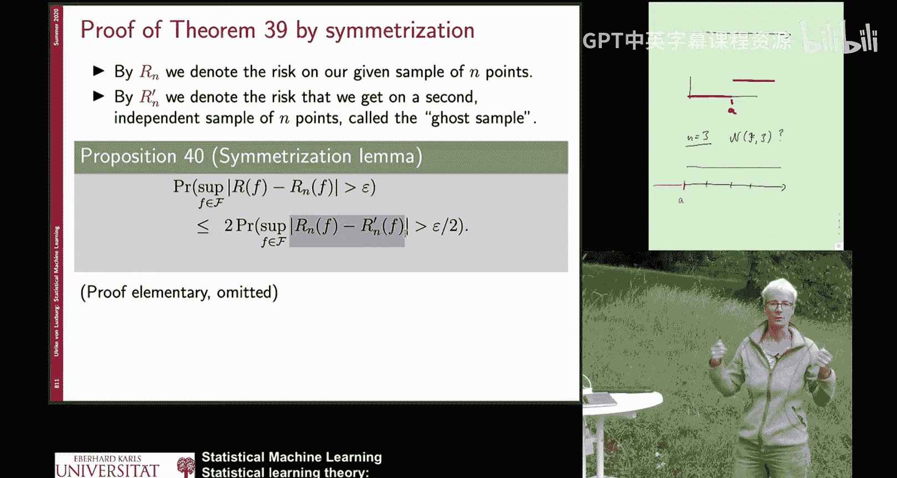

I'm not going to prove thesymmetricization lemma， the proof is pretty elementary。

 but maybe give you simply some intuition。 So if you know that or what we're interested in is that R of f minus。

😊，R N of F is small， so the distance between the two。

Risk of a function and the empirical risk measured on sample one。

Now assume if we have this ghost sample here， we have the risk on a second sample。

 so somehow if for all functions we know that this expression is small，😊。

Then we somehow also know that this expression would be small if you take the distance between those we just replace the sample。

 if you say with high probability these two terms。😊。

do not deviate by much from each other then this is true both for the sample and for the ghost sample and then also like the difference between the sample like the empirical terms between sample and ghost sample should be small and the other way around。

😊，So this is some kind of triangle inequality argument in the proof it's a bit more complicated because you have the supre and the probability to take care of。

😊，But essentially there's nothing really complicated here。But observe what we have achieved now。

 now we have this expression that does not depend on the two risk anymore， it just depends。😊。

On the risk on， on our true sample and like apart on the on the trading sample and on the ghost sample。

 So all of a sudden， we now have a。 and if we now look at the functions that that we need to look like that can be realized。

 we now have two finite sets， each consisting of endpoint。So。

 we might in the worst case look at two endpoints like the sample here and the sample there。

 restrict a function class and then need to see how many functions we have。😊。

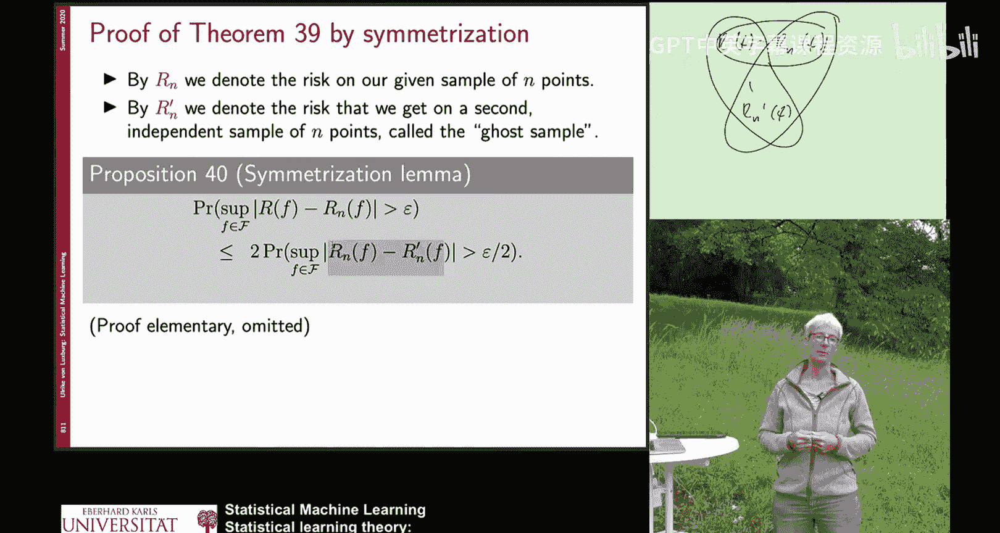

And this is sort of summarized on this slide here so what's the point of cemeterricization？😊，Well。

So as I described already。😊，So essentially here in the first paragraph I describe again why we need to go over to this ghost sample and here the red sentence is the key which I also explained already that now again if we have a supreme over the function class it only runs over finitely many points。

 namely the points which are the functions that take the values on the sampling on the ghost sample。

 so in the end we're interested in the shattering coefficient。😊。

M of F just with a 2 n instead of the original n， because we have the sample and the ghost sample。

And this is now then we can sort of this now we can sort of go back to the same situation as we had before and try to prove the serum。

😊，As we did for finite function classes。The discussion of this generalization bound is essentially the one we already did。

 The bound is sort of analogous to the one with finite function classes。

I've already explained also that the shatering coefficient measures how powerful a certain function class is so how many different labelings can it realize maybe to give you a bit more intuition in the end it's all about does a function class overfit or not and because we are using empirical risk minimization if we have a very powerful function class that can perfectly reproduce a training labels for all different data points then this is very likely to overfi。

😊，And this is essentially what is being measured in the centering coefficient if the centering coefficient would be 2 to the power of n。

😊，So exponential in the number， like。This is if you think about how large could the shadowing confusion become。

 we have n data points to labeled so it could be up to 2 to the power of n。😊。

And then this means the function class could overfit terribly because no matter what labels I put on my training set I could realize it was my function class and then we would probably guess。

😊，That maybe we don't have generalization， that maybe our generalization bond doesn't。

 or at least we would need to would like to see in the generalization bond that the thing doesn't converge and maybe let's go back to the bond here。

😊，Now， if our headttering coefficient here is exponential。

So we have2 to the power of n or in this case we have 2 to the power of 2 n which in fact doesn't make a big difference and then we have the lock。

 So here we have a term that still depends on n and be divide it by a term on n。

 So this is not going to go to 0。 This is a constant fraction depending on n。

 but it's not going to go to 0。😊，So this shows that if the lock shadowdowing coefficient is exponential。

 then we at least with this kind of statement we would never ever be able to guarantee consistency and because we have this equivalent between uniform convergence and consistency。

 this would tell us at least that the consistency as we have stated it previously would not hold。😊。

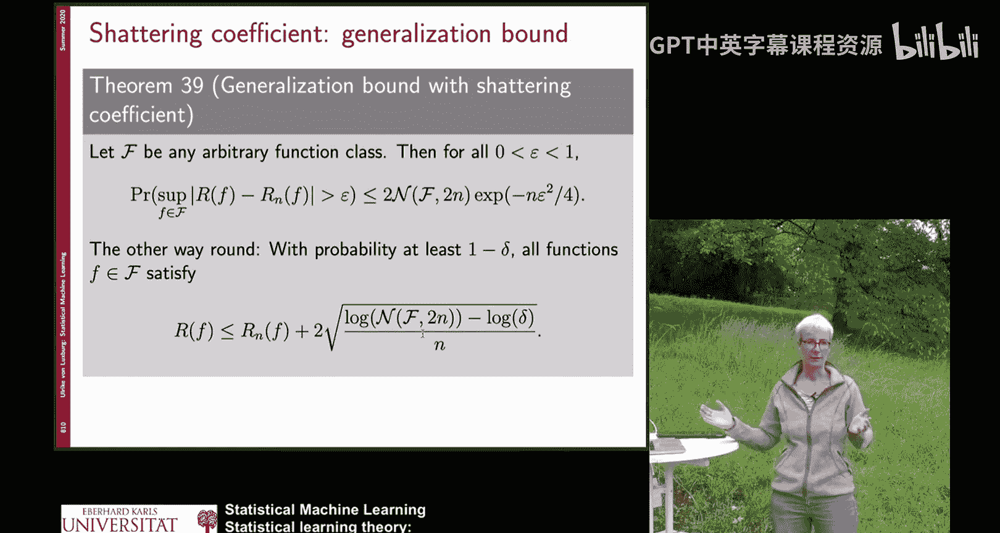

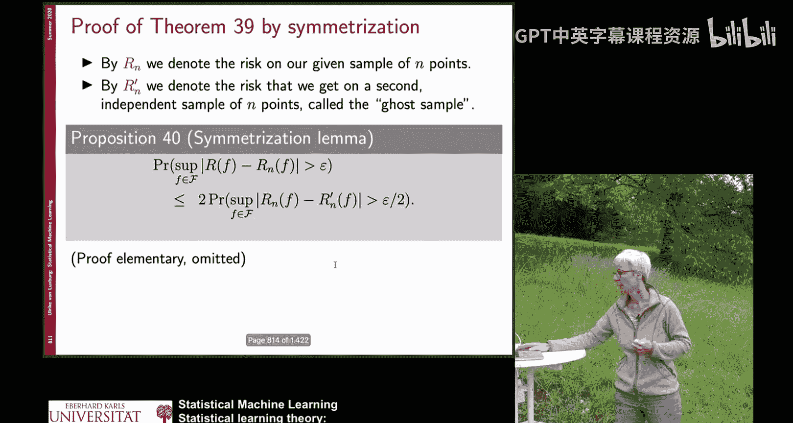

Okay， and this is now described here on this next slide。

 so if we want to get consistency of a classifier。😊。

Then what we need to have is exactly the term that we just looked at this in this serumem that this lock shadowttering coefficient over n needs to go to 0。

😊，And once we have that， then we have what we would call a small function space。

And then the generalization bond would tell us that I go back once more。😊。

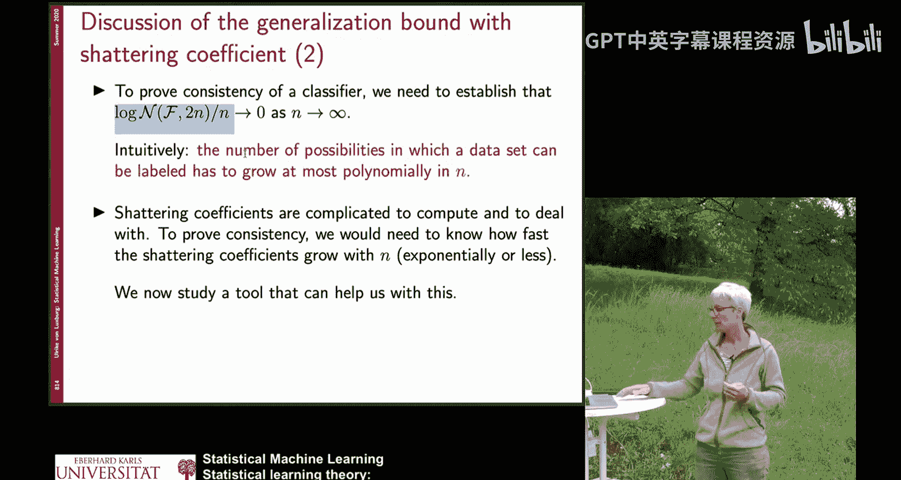

Sorry here， so then I mean we can ignore this confidence term we can sort of if we want we could slowly let delta go to0 if we wanted2 with n but the key term here is the lo shadowtering coefficient over n and if this expression goes to 0 then the whole thing is going to go to 0。

😊。

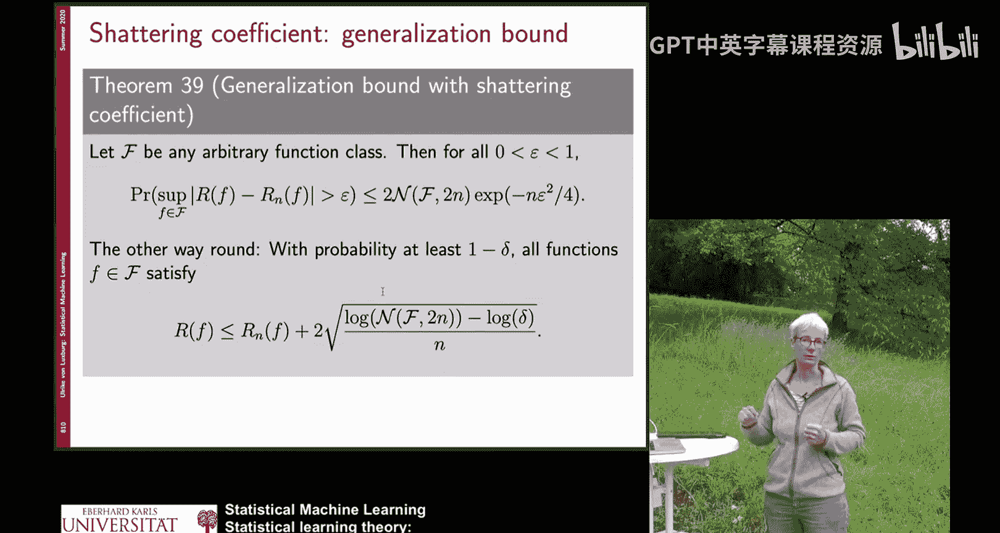

So here we have now a condition that tells us if this condition is true， then this function class。😊。

Is a function class that leads to consistency？The key message here is that if you want to have this expression going to zero then as I already hinted before the sheltering coefficientsion must not grow exponentially。

 so the only thing that you can afford is if the sheltering coefficientsion grows polynomly with your number of sample points。

😊，Okay。So this is already， I mean， even though the proof is surprisingly simple。

 this is a pretty powerful tool because it allows us at least to make statements about infinite function classes and when do we have consistency for these function classes？

😊，The big downside of this whole approach is that the shadowttering coefficient is really a thing that is hard to compute so if you have not like such a nice function class consisting of step functions or so but something more complicated it is really complicated to compute the shadowttering coefficient because you always need to make a statement over all possible positions of data points how many labelings can this function class realize。

😊，And this is not so easy。And so I want to show you a different tool in the next lecture which is called the Vapic Tranks dimension。

 which is a different combinatorial tool to evaluate the capacity of a function class and that at least for some realistic function classes is easier to compute。

😊。

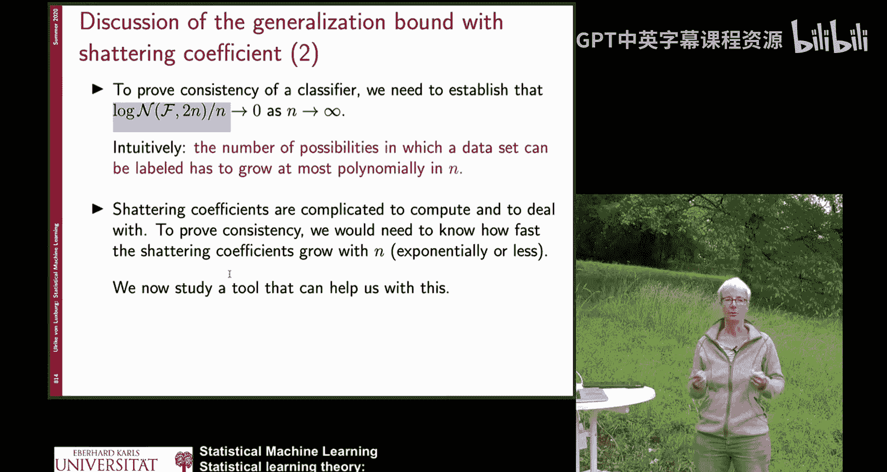