# 图宾根大学《概率和统计机器学习｜Tubingen Probabilistic and Statistical Machine Learning 2020》中英 p44 -44-Part 41 - Statistical learning theory_ VC dimension.zh_en -BV1gso5YGE4s_p44-

We had just looked at the Che in coefficienticient as a first tool to treat the case of infinite function classes and to still improve generalization bonds。

😊，As I said at the end of that lecture， centering coefficients are really hard to compute and in particular for real world function classes。

 this is typically quite difficult。😊，Now we are going to look at a different tool which is called the VC dimension for Wpnick Chaonans。

 VC， Vaapic Chaononices were the two people who invented that。😊。

And now it's another combinatorial tool， let's look at it。😊。

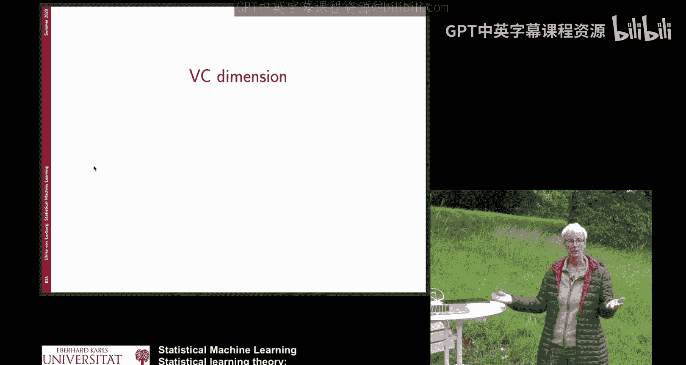

We start right away with the definition。So we are given a data space X and a function class F。

And we now say a function class shatters a set of points。

If this function class can realize all possible labelings on this data set on this set of points。

 So there are two end points， we have two to the power of n many different binary labelings。

 and we say。A function class shatters this particular data set。

If it can achieve all the labelings which means that if we look at how many functions are in the function space restricted to these data points。

😊，Then there are all possible functions namely2 to the powerof n。Okay。

 so this means for this particular set of points， we can realize all labelings of this data set no matter where we put plus ones and minus ones。

 we can realize the labeling。😊，Now now we define what is the V dimension of a function class and this is now as opposed to the shadowing coefficient not a quantity that also depends on n。

 it is a quantity that just depends on the function class。

So the Vc dimension of a function class is defined as the largest number of data points。😊。

Such that there exists a sample of the size M。That can still be scheduleded by the function class。So。

 the formula definition is。嗯。However should I start reading so the VC dimension？😊。

Is the maximum integer or n。 So it's an integer。 it's a number attached to this function class such that there exists a set。

Of in data points in our data space。Such that this set can be centered by the function class in the sense that the function class can realize all possible labelings。

And if this maximum does not exist， then we simply say the VC dimension is infinite。

Now maybe let's digest this and compare it mentally a bit to the shattering coefficient because I mean they are in some sense similar but in some sense also different so the first important thing is that the shattering coefficient depends on one particular sample size and here we get rid of this dependency on the sample size by saying。

😊，We look at different sample sizes。And as soon as we end up at a sample size where we find one particular data set that cannot be shattered anymore。

 then this is where we stop and this is where we know that then we have found the V dimension。😊。

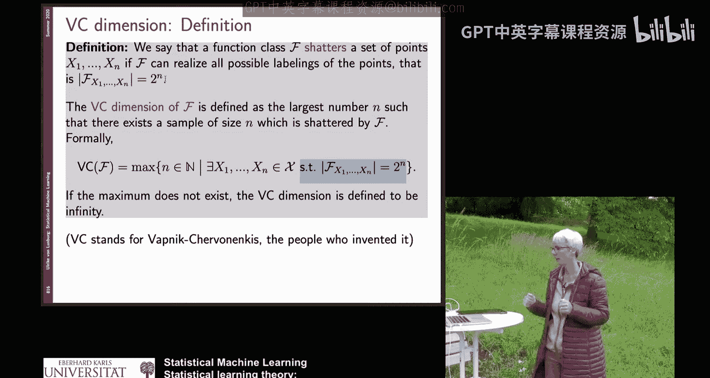

Let's maybe try to look at some examples。

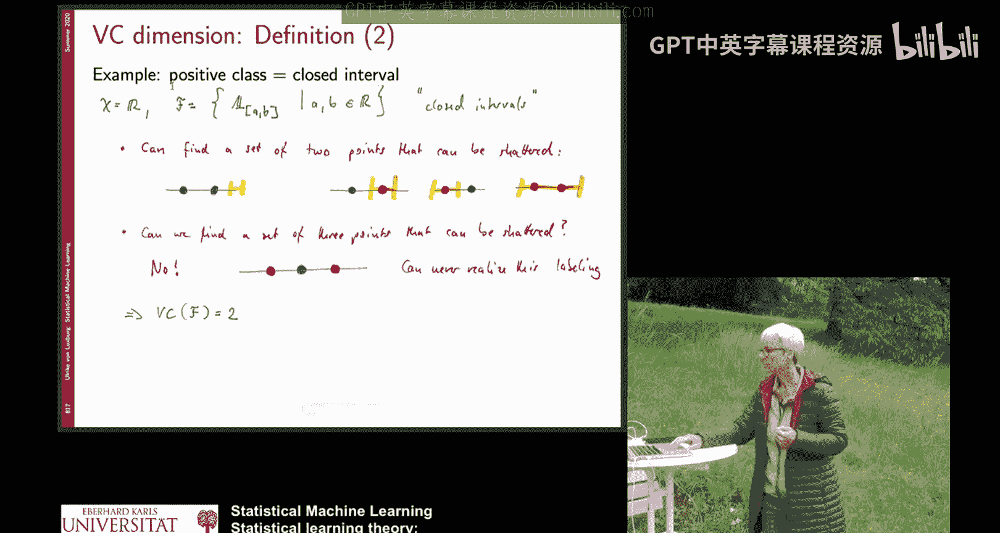

And maybe I also do it in parallel on the iPad because it's easier to see so our data space in this particular example is again the space X is the real line。

😊，And our functions consist of closed intervals， so they have the form。AB。

Where a is a number so A and B are simply real numbers。These are closed intervals。

Oh sorry its not the of course it's not the interval。

 but the characteristic function of those intervals， let me just plot one。😊，Here we have the line。

 here we have A， here we have B。嗯。And our farms look like this。Okay， one on the interval0 outside。

Another question is， what is the VC dimension？And to find out what the receipt dimension of a set of points is。

 you simply start again a bit similar as we did in the sheltering coefficient we start with small sets of points and then try to see whether you can or small sizes of sets of points and you start to see whether you can find a data set that can be sheltered。

😊，So we start maybe n equals to 1 it maybe too simplistic。

 we start with a data set consisting of two points， so lets say we start with n equals 2。

We have a real line， we have two points sorry， this point here。And this point here。

And now the question is can we shatter it that means can we realize all possible labelings on this particular set of points？

😊，And here the answer is of course yes， we can put the interval if for example。

 if we want to have that the first point has labeled plus  one and the second one should get label 0。

 then we simply choose the function。😊，That looks one of the so。A function that looks like this。

Then the first point has labeled plus one， the second point has labeled 0。

We can do it the other way around， we can have the second point being one， the first point not one。

 we can have both being one or both being 0， so there are four different labelings we can realize all of them。

😊，Which means that the V dimension has to be at least two。

Because and this is now something one really has to be careful about。

 we don't need to prove that all like in principle that all sets of two points can be shattered。

 it just says as soon as we found one data set that can be shattered。

 we know the VC dimension needs to be larger than this one。😊。

So we dont so we just need to for each number and we just need to find one data set that is shattered and then it's fine。

So now let's look at the case n equals sorry。In the case， n equals 3。Look again at the real line。

 we have three points。And now again let's try to find out whether we can realize all possible labelings and now my answer is no on this data set we cannot realize all possible labelings。

 there is one labeling that we definitely cannot achieve namely the one where this guy has plus one and these two guys sorry where this guy has zero。

😊，Yeah， I erase it again to make it more visible。So this guy has zero no。This guy has zero。

 this is plus  one， this is plus one。So we have essentially a step function with the step going down in the middle。

And this is a step function that is not in our function class。

 so this labeling we cannot realize with our particular function class。😊，嗯。

And now we can stop and now we can say so the V dimension has to be two。

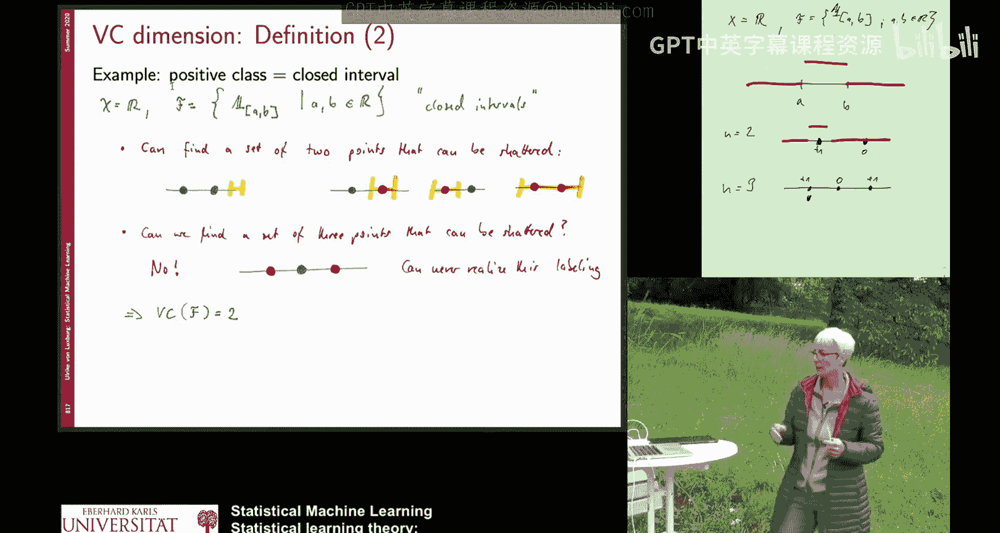

Let us maybe go back once more to the definition to verify that we really did it correctly and also myself。

 I always need to think about this very carefully and sometimes I also get it wrong。😊，So。

We look for the maximum n。Such that there exists， a data set。Ha， that can be shattered。

And now we need to look at n equals 3 and the question is does there exist a data set that can be shattered that has three points？

😊，And what this example shows that we have here on the iPad is that matter how I mean this is sort of independent of the positions of the point。

 so no matter how you are going to put three points on this real line you will always not be able to shatter it。

😊，So for all data sets of n equals 3 size， we cannot chatter these data sets。

And now we know that the V dimension is2。

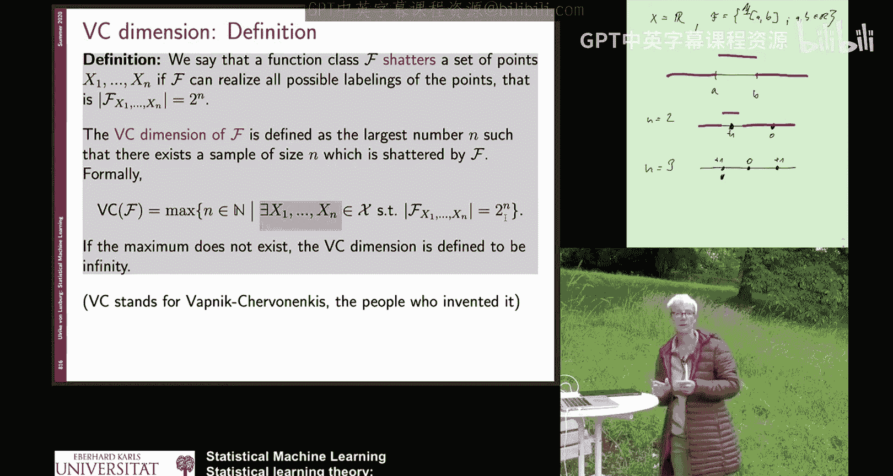

You check for n equals 2 does there exists， the data set that can be shaed， Yes， fine。

 you can continue。😊，You check for n equals 3。😊，Is there a data set that can be shattered if yes。

 you can continue if no， if you don't find one， you need to prove that for all data sets。

 they cannot be shattered and then you found the V dimension。

I have a couple of more examples on the slides， it's all these simple toy examples which don't really help you in practice but help you maybe to get a bit of intuition。

😊，So now let's again show this on the iPad。Our space x is r2 now。And the function class consists。

 so we have data points in on the。Plane in our function class consists of excess parallel rectangles。

And now the question is， and say inside the rectangle， it's plus  one， outside， it's minus-1。

And now is the question， does there exist point configuration， say of ns 4 that can be shattered？😊。

And for n equals 4， you can find a point configuration that can be measured and if you look at this particular point configuration here。

😊，Now assume say just one of these two points so if you want to have this point plus one easy so the same for all other points if you want to have two points like this。

Being class 1 and the other one being negative easy。And also。

 if you would have liked the two opposite points， for example。

 these two points being plus1 and everybody else minus1 also works。

So you can convince yourself that if you construct a data set like this。😊。

This data set can be centered， so we know the VC dimension has to be greater or equal to 4 because we found that data set that can be centered。

And observe here I have this remark even on this slide we cannot shatter all data sets of four points so here's an example of a data set of four point set cannot be shattered if you have one point in the interior and you want to have everybody outside being plus one but the point in the interior being zero then this doesn't work with this particular function class。

😊，Now the next so we know we found a data set for four points that can be shattered now we look for five points。

😊，And now you can try to convince yourself that no data set of five points can be shattered。😊。

And I don't want to sort of spell out the proof， but the general idea is consider a set of five points。

😊，Then and you now try to find what are the extreme points。

 so I try to maybe show it on the iPad say we have five points。

And now you look at what are the extreme points if you approach them from left and right and from top and bottom。

😊，So sort of if I have a hyperplane coming parallel to the axis and that comes from the left。

 when does it touch the first point so in this particular case which I have on the iPad。😊。

So this is the extreme point， this guy on the left side， we have one extreme point on the right side。

 then we have one extreme point from the bottom。😊，And one extreme point from the top。

And then you can now prove if you have five data points， there has to exist one data point。

That is not an extreme point in both access parallel directions。

So you have it sort of sitting inside。 It might also still sit on the line。

 but somehow then it's not on the on the extreme on the other extreme。And。

And then you can prove that such a data set you can never settle。And then， you're done。

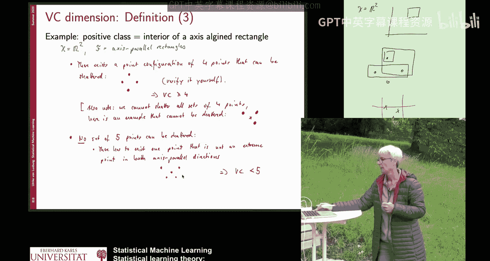

Here's yet another example just to keep on presenting examples but I'm not going to go through it very intensely so again were R two our farmstone class is now more complexx it's not just like excess parallel squares but it's polygons with D corners。

 convex polygons with D corners。😊，Something like this and you can prove that the V dimension of this function class is 2D plus1。

😊，So and the lower bound is， in fact， that surprisingly elegant and easy。

 So whenever you put so for the lower bound， you need to find a data set of。

For like for some and you want to find a data set that can be shattered。

And now we because we want to prove that the VC dimension is 2 d plus  one。😊。

We need to look at 2 d plus1 points and see whether we can shater this dataset set。😊。

whether we can find a data set that we can and to construct such a data， what do we do。

 we put the points on a circle， D plus one points on a circle。😊。

We give them arbitrary colors because we need to make sure like if you can color them blue and red in all possible ways that is possible then we share the data set so you just pick a coloring and then essentially you want to say so for example everybody who is red should be plus1 and everybody who is blue should be0。

😊，So if you have less than D points， red D points， then you can construct a polygon using like you are allowed to construct polygons with D corners。

So then you can construct such a polygon and everybody in this polygon or on the corner of such a polygon is going to be red and everybody else is outside and is blue is zero。

And the other way around if your data is more than d red points you can use a different construction you slightly put the corner of the polygon outside such that it still does not touch these blue points and you can convince yourself that by this again you can sha data like you can classify the data in the way that color is given here and so in this way you can realize all possible colors on D+1 data points。

😊，So this is the lower bound。 So it tells us that the VC dimension is 2 d plus 1。

 at least 2 d plus one。Now we want to know that its not 2 d plus 2。

And this is a bit of a more technical argument and I don't want to give it here on the slide if you want you can read it up it's written in a couple of the textbooks more in the combinatorial we see dimension kind of textbooks。

😊，One last example。Our spaces are。Our function class is all sine waves with different frequencies。

 so this t parameter which tells you essentially how dense these sine waves are。😊。

If you look at this function class， then the V dimension is infinite。😊。

Because no matter if for each end。😊，You can put your points in such a way and use a sine wave of such high frequency that you can realize all possible labelings on this particular data and then you have shareded it and you can do this for all numbers of data points。

 So here the VC dimension would be infinite。Okay， and now come some examples where we don't have the proofs on the slide as well。

😊，Which I in fact show that DVC dimension is something that can at least make helpful statements for some function classes that occur in practice。

😊，Namely， if we look at linear functions， so if you are in the space RD you have50 dimensional utility space and your function class is linear hyperplanes。

😊，Then you can prove that the VC dimension of your function class is d plus one。

 so youre in a D dimensional space， the VC dimension is d plus one。

And the proof is surprisingly not extremely complicated if you know what the steps are。

 we might put it on the exercise sheet。😊，The other thing that's important also for support vector machines has to do with margins。

 with hypoplans with a certain margin。😊，So this is now really has been proved in particular for support vectoror machines。

😊，So our data space is again RD。😊，We have a certain parameter row which is going to be the margin and we say f row。

 the function space f row are all linear functions that have margin is at least row。

And then you can prove at least， I mean， you need to make one more assumption namely that the data points it within a sphere of a certain radius。

😊，Because this sort of。You need this assumption because the margin row is an absolute value and like if you blow up your data but you don't blow up the margin then somehow the statement wouldn't really make sense so you need to relate the size of the margin somehow to the width of your dataset and so if you say my dataset lives inside of a ball of radius R。

😊，Then you can prove that the V dimension of this function class is either the minimum of T。😊。

Or this term askcar of a row square， which essentially tells you the larger row is the small VC dimension because observed like if this margin is really small then you fall back in the standard case of arbitrary linear hyperplanes and your VC dimension would be d plus one。

😊，But if your Martin is really large， then this term here， where we this askcar of a rose square。😊。

This term eventually is going to be smaller than D。😊，So yeah。

 we see I mentioned decreases even beyond the one that you know from linear functions。

So if you're able to classify all your data points with a high margin， then this is a good sign。😊。

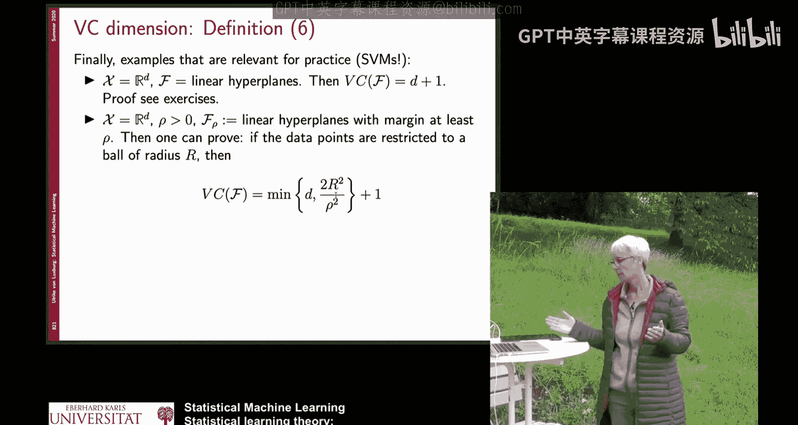

Okay。Now， the reason is why do we really look at this V dimension？😊。

It sounds like a combinatorial tool but at least it's not immediately obvious that by looking at the VC dimension we would be able to prove a generalization bound because it does not really count the number of functions it just gives sort of this combbininator threshold where you say way well below the VC dimension I can always sha above the VC dimension I cannot shatter anymore。

😊，Intuitively， I mean， somehow it makes sense that if were after a statement for end to infinity。😊。

We are interested in this tail regime where we are at large sample sizes。

 so even though we can chatter all our data points， all our like all the small data sets。

 maybe eventually we are in this part where we cannot chatter the data sets anymore。😊。

And now the question is really how much smaller do the function classes get。

 So in principle you could think about saying， well， maybe I can't realize all functions。

 but all but one function。😊，So then I would still have an exponential number of functions and then again the generalization bound probably wouldn't work because if we single again about this log shattering diamond we would have the log shattering coefficient being polynomial or the shattering coefficient being polynomial but nobody tells us that it is polynomial。

 we just state is it two to the power of n or is it something less and there something less could be just one less and bound still wouldn't give us any good result here。

😊，So the question is really， what do we know about the number of functions in a function space that has a small VC dimension if this sample size is large？

😊，And now here's this very， very surprising cool， great statement， this Sa Shiila lemma。

 which in fact has been proved in。😊，Many different communities。 It's a combinatorial lemma。

 It has been they exist， many， many proofs out there。 and these proofs are really nice and elegant。

 We might want to do one of them in the exercises as well。 But maybe for now， let's first of all。

 look at the statement。😊，Assume we have a function class with a finiteVC dimension D。😊。

Then the number of functions。So the shattertering coefficient。

 So the number of functions that we have when we look at n particular data points is bounded by this expression here。

😊，Now， this is still a bit of an inconvenient expression。

 and it's not immediately clear whether this is good or bad。

 but you can bound this expression further and see that this expression is bounded by。😊，So。

 the shattering coefficient is bounded by e and over D to the power of D where e is the eer number n is the sample size you are looking at and D is your VC dimension。

And in particular， like this is of the order n to the power of D， so it's polynomial in D。😊。

And it's not exponential anymore。

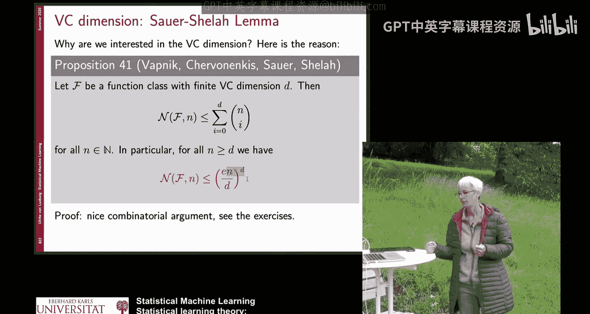

And this is really， really cool and also very surprising。 And I have a figure on the next。😊。

Slide to illustrate it。 So again， and let's look at this figure at the bottom of the slide。

 So this arrow depicts the number of sample points and going to infinity。

And then we look at this place where we have n equals t。Now。And we assume that our space。

 our function space， as we see dimension D。So now what happens below if we have fewer data points than D。

😊，So we're in the regime with data points， maybe five data points and5 is smaller than the。Then。

 in principle， the shatering coefficient for this number n can be exponential because we don't make any statement here。

😊，And the Saur Shiila lema also doesn't make any statement。

 but what the Saur Shiililla lemma says is once we go beyond this steam。😊。

The function space only grows polynomly into the power of D。And this I find， I mean， this is really。

 really surprising， so you have this transition point and nobody really tells you that that there is a transition from exponential mean exponentially many number of functions to polynomial。

 but this is not what this our sheel lemma gives us。😊，And then in this regime。

 we can invoke our standard generalization bound is with a polynomial number of functions and then we would get consistency。

😊。

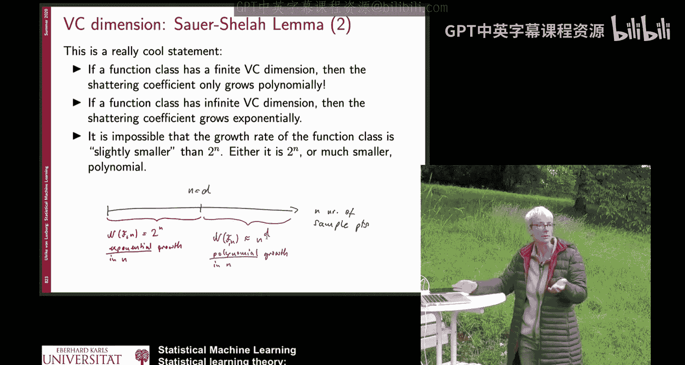

Okay and now this is what we now see as a result here。

 you can now plug this our silalemma into the theorem we had before so the theorem before is the one where we here have the shattering coefficient and now we know that the shattering coefficient is at most this the2 to the D over D。

😊，We plug it in here and then this is a result， so the result reads as follows let FP your function class with we see dimension D。

😊，Then with probability， at least one minus delta， all functions satisfy that the true risk of the function deviate from the empirical risk by utmost this expression。

 And this expression is now。 So here we replace the the shattering。😊。

Coicient by the by the VC dimension。 So here we have now this expression in D。So I， I mean。

 I put the D so because we have a， we have E。

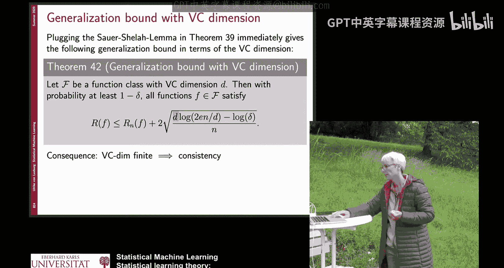

So， if you go back to this our sheila lemma， this is the expression here now you have the lock of this expression。

 so we have d times lock of this expression。😊。

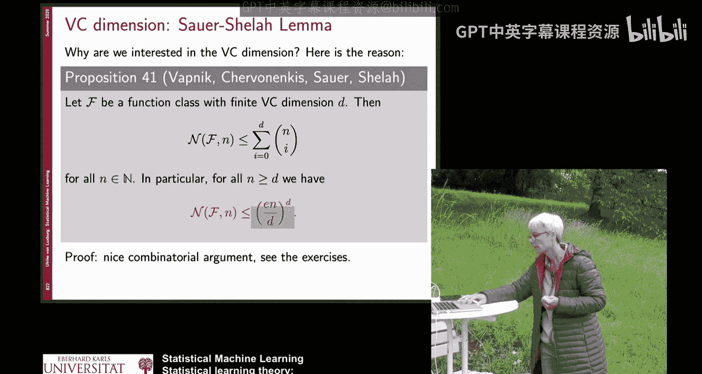

And this is what we have here three times lock of this expression。And that's good。And in particular。

 it implies that if D。😊，Is a finite quantity so observed D is not a quantity that would grow with n we have function class and if the function class has a finite V dimension D then d is a constant in this bound。

😊，So we can ignore all the constants in the limit for enter infinity， then we have here log N。😊。

Over in。And this is going to go to zero， and then we get consistency。Cool， isn't it？

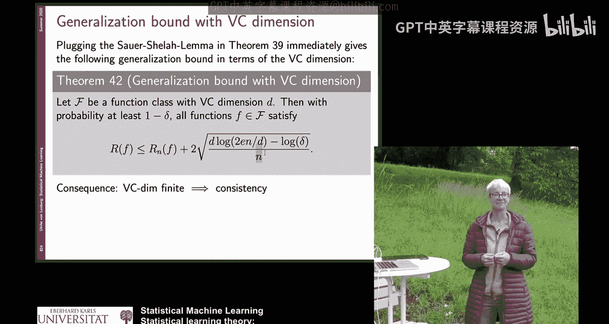

So more generally， you can also prove that the theorem holds also the other way around。😊。

So you really have that the empirical risk minimization is consistent with respect to F if and only if the VC dimension is finite。

 because observed the way we stated the statement earlier is if we just said like this generalization bond just says if the VC dimension is finite then we get consistency。

 but it also here the host the other way around。😊。

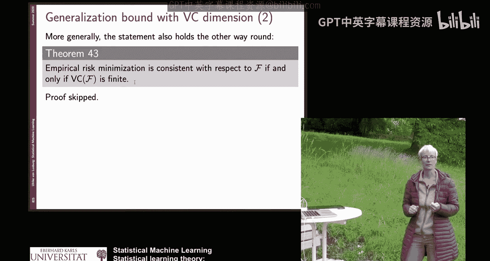

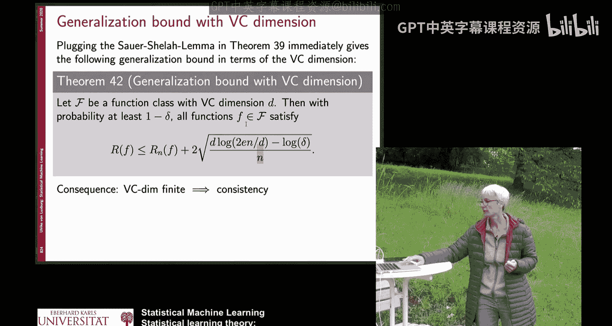

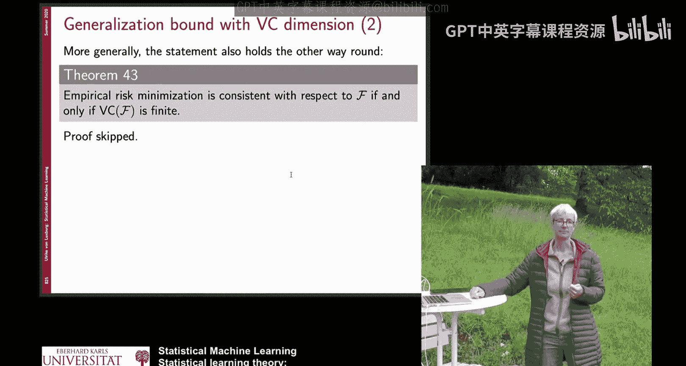

There is one more thing that I also want to show you and to point you out because often it is sort of what people always try to figure out is how many samples would I need before I sort of get to a regime where I have enough data points to have some reasonably small confidence intervals about my result。

😊，As I already said， this is something that typically in machine learning is not possible。

 we can't get as strong confidence intervals as in statistics for example， for T test or。

 but you still at least you can get a feeling for the order of magnitude or sort of how fast that' the number of sample points needs to grow such that you end up in a regime where you can be reasonably confident of what your result。

😊，And this is what we now see on this slide。😊，So if we have such a g bound。

 you can always ask how many sampless do we need to have？😊，To achieve error at most epsilon。Okay。

And now what we do is， I mean the  error in this generalization bound here is this expression here。😊。

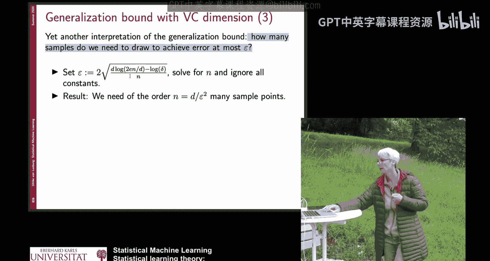

And now if you want to say， well， this expression here。

 this fert expression should be at most epsilon， then we can solve for n and see how many ends do we need。

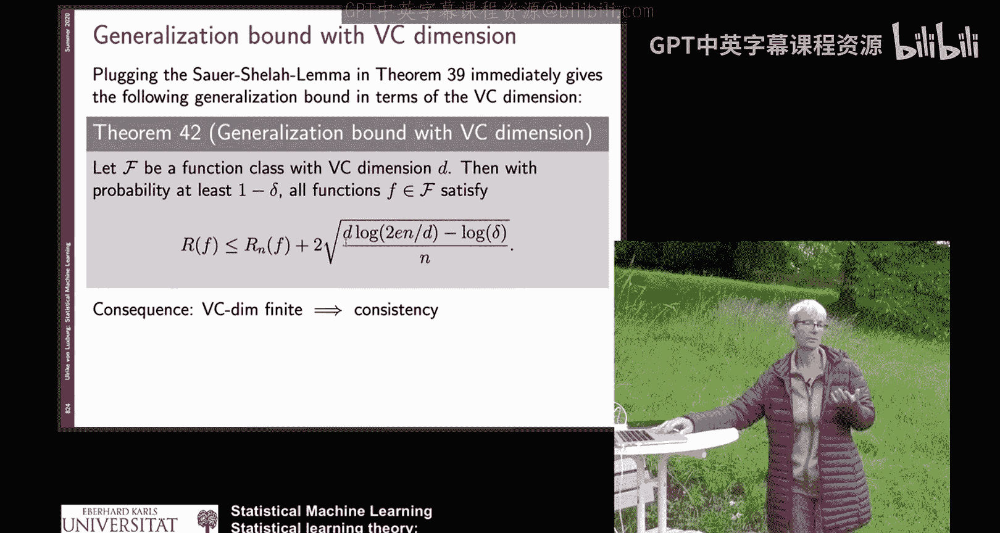

So we do this we set the expression here epsilon we equal it to the squareification term。

 you solve it for n and you simply ignore all the constants if we just after a feeling it gut feeling like trying to give us some intuition and then what you get is you need of the order of t over epsilon square many sample points。

😊，Which says the number of sample points grows linearly with the VC dimensions so if you have the choice between a couple of function classes then and the VC dimension is a bit different then the number of samples also needs to be a bit different but not so much different just linearly indeed。

😊，And of course you have this epsilon term that somehow needs to be in the denominator also because the more you confidence you want to have the more sample points you would probably need。

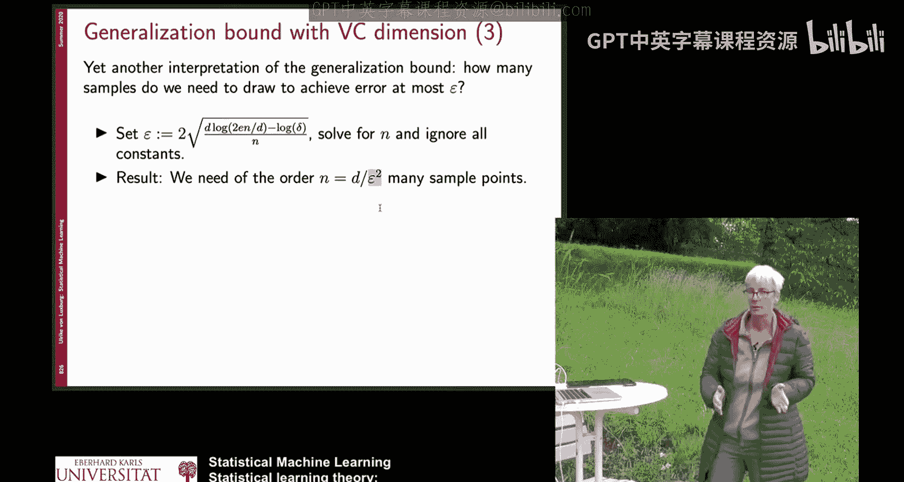