# 图宾根大学《概率和统计机器学习｜Tubingen Probabilistic and Statistical Machine Learning 2020》中英 p49 -49-Part 46 - ML and Society_ (Un)fairness in ML.zh_en -BV1gso5YGE4s_p49-

In the last lecture， I have discussed the general debate about machine learning in society and what are the important issues and the important keywords that would come up with in this debate。

😊。

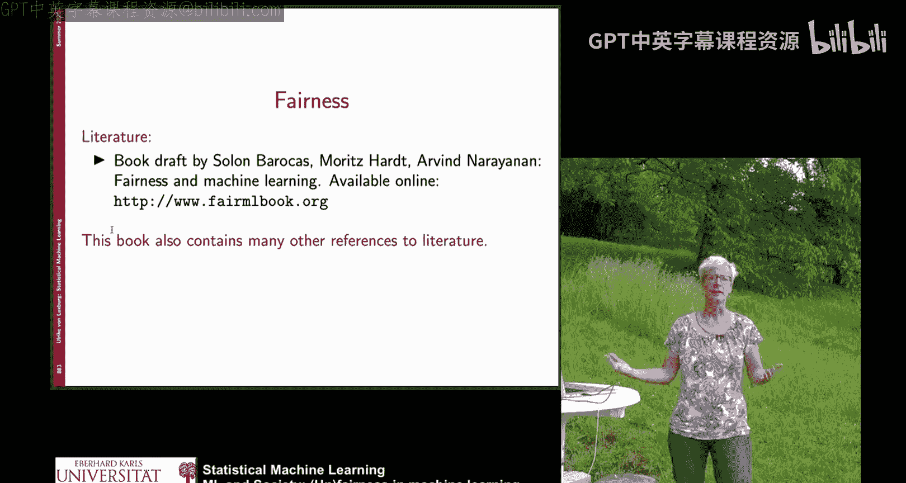

One of the keys I mentioned very briefly only in the last lecture is the keyboard of fairness and now we want to focus on fairness of machine learning algorithm for the next couple of slides。

😊，A source or reference， you can look at the book draft by Solen Barrokas Murit and Avin Naranaan。

 fairness and machinechine learning， which is online。

 it's still a draft but many of the chapters already and in the slides I will always refer to it as the fairML book。

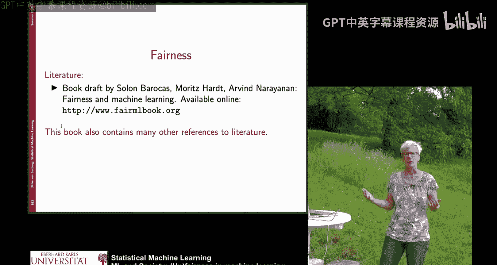

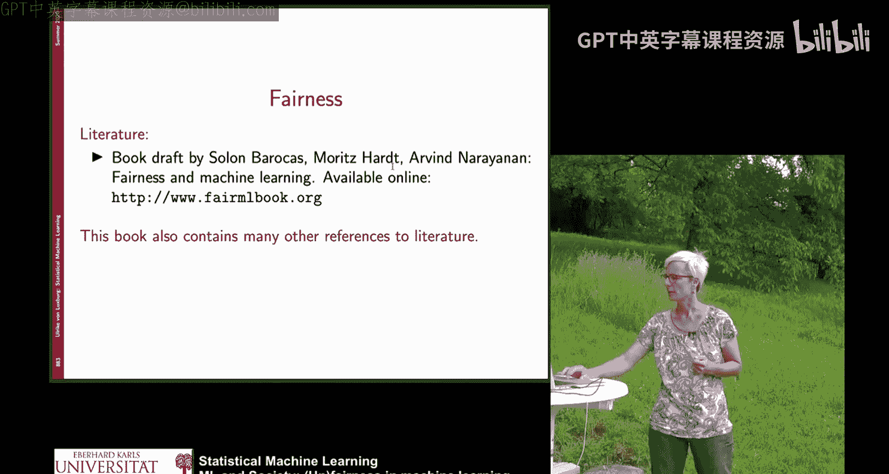

I will also have many other references on individual slides on individual problems。

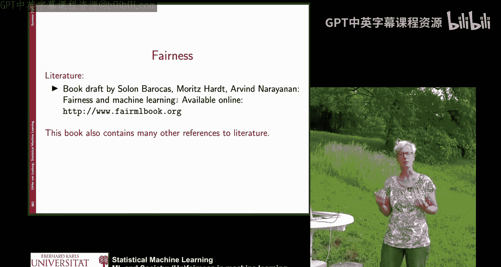

Let us maybe start again to say why can machine learning be unfair？

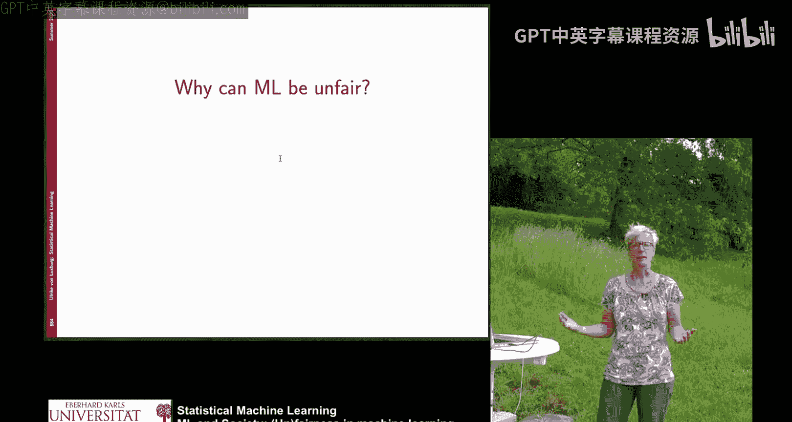

Let's simply start with a case of credit scoring。Machine learning systems are supposed to predict whether a certain person is going to get a credit if he or she applies for a credit at a bank。

😊，And now assume we do something very similar， we just build a linear model so we describe the person based on features so that the income。

 the age of the person， the education of the person， the address of the person。

 how many children does the person have so on， so each person you describe by a set of features and say you simply use a linear model because it's easier to understand so we use a linear model under we train we have training data of the past we train a linear model to predict whether a certain person is going to pay back the credit or not。

Now what turns out is that the zip code of the address of this person is in fact pretty highly correlated with the fact whether the person is going to pay back the credit or not。

 so it is a strong predictor for the yes or no decision。😊。

So what this means is that just because you live in an area of low income indicated by your zip code。

 you have a harder time getting the credit。😊，And even stronger put。

 it means that you probably need to compensate for your bad zip code， for example。

 by having an even higher income as somebody would have if you or she would live in a wealthy neighborhood。

😊，So here you can see that already there is some unfairness in the system because simply because youre in a neighborhood that has low income on average。

 you are sort of going to be disadvantaged and of course this might happen for example。

 to black people in a city where there are lots of quarters where like low income people which happen often to be black people live in one neighborhood and white people live in a wealthy other neighborhood and then all of a sudden you have a racial discrimination against black people simply because they have this wrong zip code。

😊，There are many other problems also in the example of credit scoring and we' are going to come back to that later。

The example of credit scoring was an example where sort of we would think that it shouldn't be the case that simply being of a black skin should have any influence on the decision of whether you get a credit here's another example which goes the other direction it's an example of affirmative actions。

😊，So there was a lawsuit at Harvard in 2014 and 15 where students complained that the admission rules are highly unfair。

 and I just quote，ra plays a significant role in admission decisions。

 consider the example of an Asian American applicant who is male。

 not disadvantaged and has other characteristics that result in a 25% chance of admission。😊。

Simply changing the race of the applicant to white and leaving all his other characteristics the same。

😊，Would increase his chance of admission to 36%？Changing his race to Hispanic would increase the chance of admission to 77%。

 changing his race to African American would increase his chance of admission to 95%。😊。

So what they say is， again， a person is described by a feature vector。😊。

And if you play with this feature vector and you keep everything constant and you just play with the race of the person。

 this is just one feature out of I don't know，100 features maybe。

Then this is going to change the admission chances of this particular person。

 and they consider this to be unfair。If you look at this more formally。

 essentially the argument is the probability of being accepted under the condition that you have certain features。

😊，And the race is Asian American。Its smaller than the one if your race is white， which is again。

 smaller than if your race is Hispanic and smaller if your race is African American。

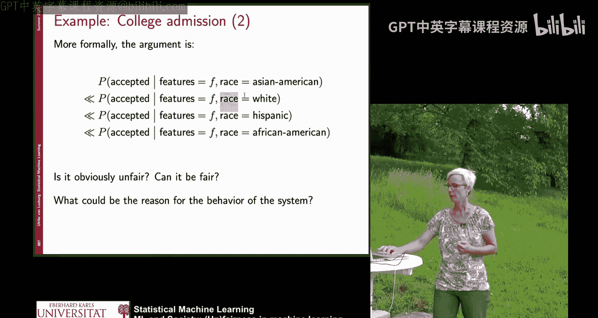

And now the people who complained here and took it and it ended in a law in a court proceedings。

They found this very unfair， but from another point of view， we can call it fair。嗯。

And now this is really a debate。 It's a debate about affirmative action。

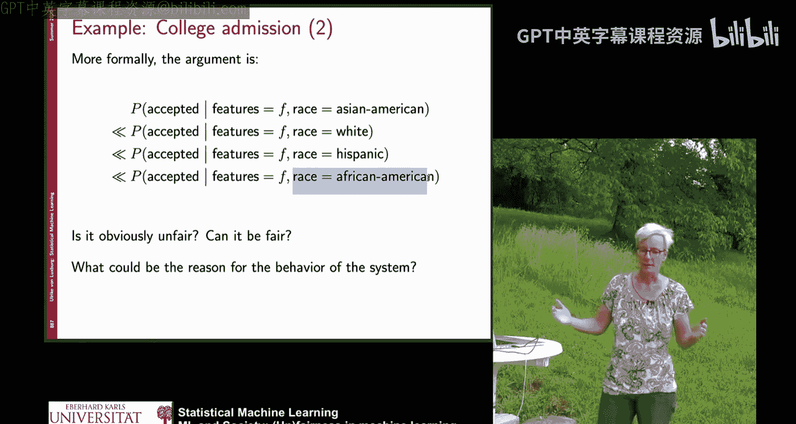

This is a similar debate as we often have it if you want to like for example， in gender imbalance。

 if the question is always do you want to force companies to have sort of more women in their highest ranking managers or so it's sort of the same kind of thing do you want to force certain。

😊。

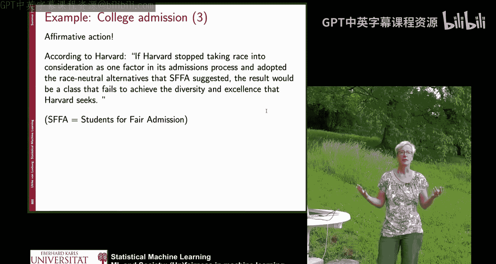

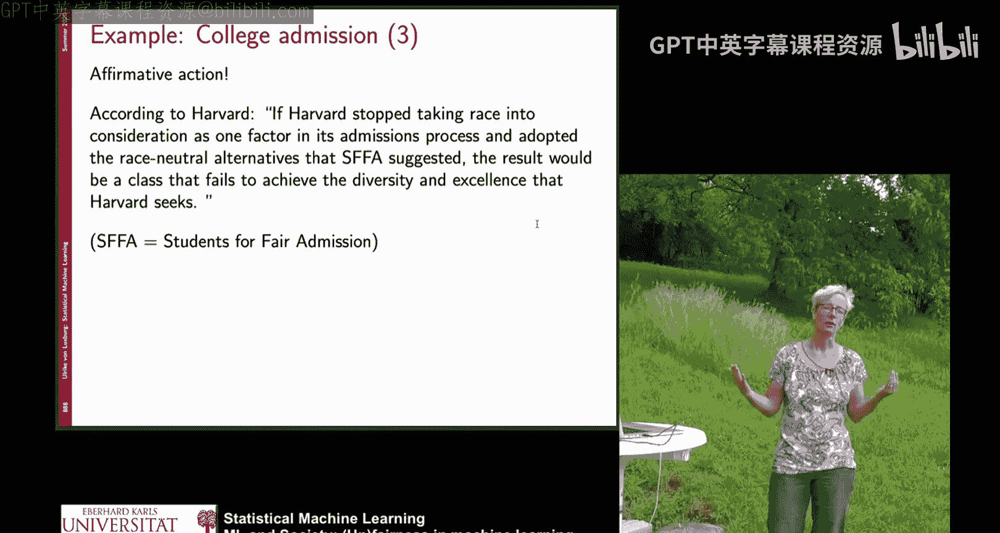

Universities or companies also to promote minorities。According to Howard。

 the answer that Harvard gave to this kind of statement was if Howard stopped taking race into consideration as one factor in its admission process and adopted the race neutral alternatives that SFFA suggested。

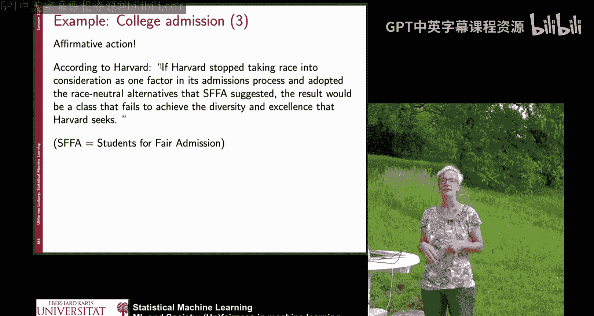

The result would be a class that fails to achieve the diversity and excellence that Howard seeks。😊。

So here they said explicitly。😊，We do want to take the race into account as opposed to the example of credit scoring where we would think it would be maybe unfair to have the race because it might disadvantage to black people here。

 we would say Harvard wants to take the race explicitly into account because if they want to have some affirmative actions for example with respect to black population。

 then ignore they can't ignore the race of a person。😊。

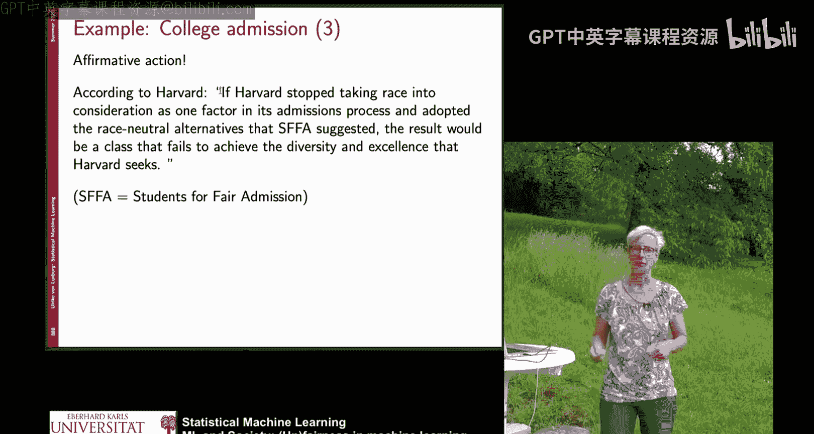

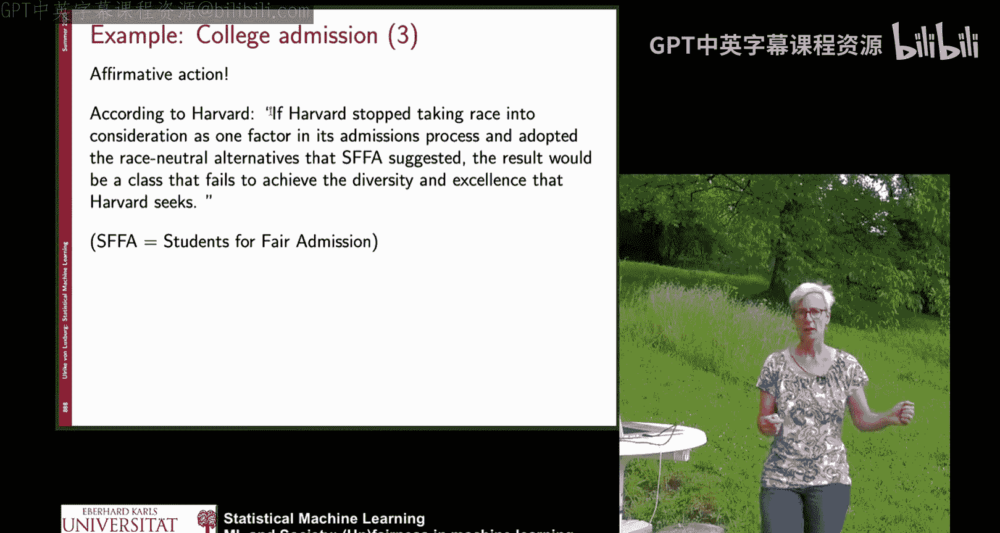

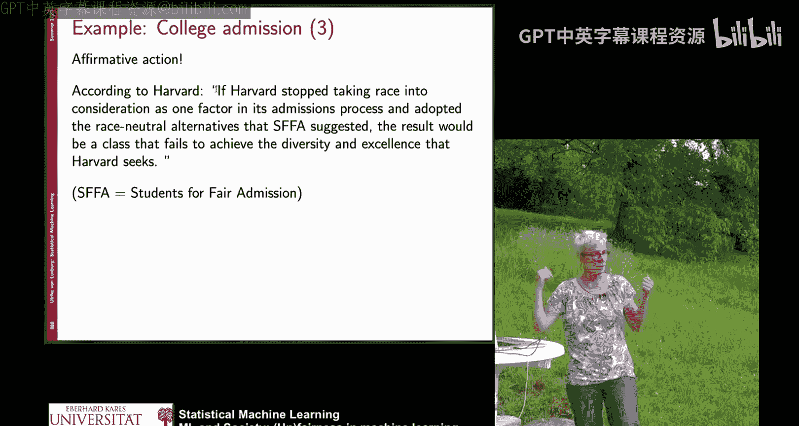

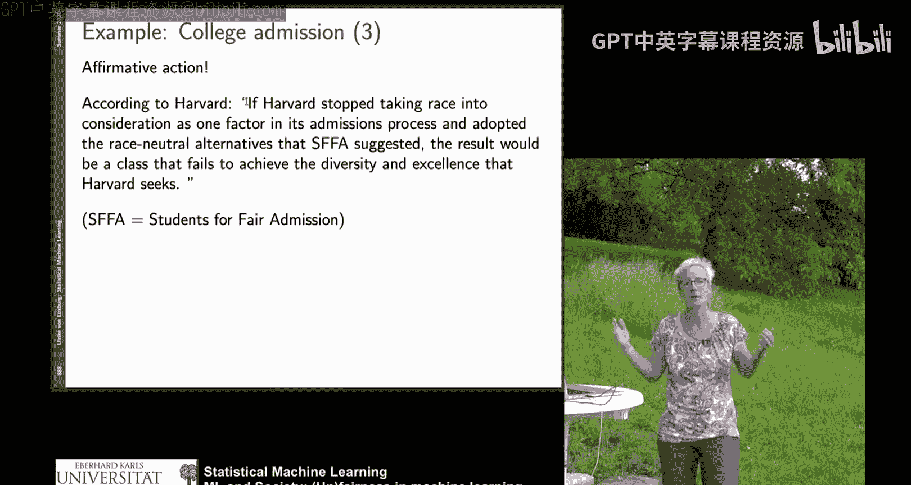

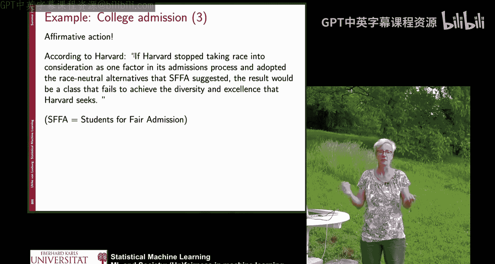

Okay， and maybe simply to tell you what the outcome was in October 2019。

 the judges concluded that what Harvard did is lawful。😊，And I， have a couple of quotes。

And maybe as a note of course， and all these quotes come from web pages which are by the different parties。

 so each of these quotes might be highly biased， but anyways I wanted to map this debate here。😊。

So they say consistent with what is required by the Supreme Court president Harvard has demonstrated that it uses race as a factor that can be a plus or a tip in making admission decisions。

 Harvard has demonstrated that there are no workable and available raise neutral alternatives。😊。

That would allow it to achieve an adequately diverse student body while still perpetuating its standards for academic and other forms of excellence。

Based on the court's preferred model， there is not a statistically significant difference between the chances of admission for similarly situated Asian American and white applicants。

Okay， so essentially the conclusion was that in this case， the affirmative actions was lawful。

And this， I think， just shows the general debate。In machine learning。

 there might be many implicit bias。 There might be implicit biases。

 as we had seen it in the example of。Of the credit scores。

 or there might be explicit biases which are intended by the people who design the system but of course in all these cases you need to think about whether this is really what you want to do。

😊，Now here are again， more examples where unfairness can arise in machine learning。Here。

 the example is Amazon deliveries。So Amazon used the data driven system to determine the neighborhoods in which they wanted to offer free same day delivery。

😊，And a study in 2016 found stark disparities in the demographic makeup of these neighborhoods。

In many US cities， white residents were more than twice as likely as black residents to live in one of these qualifying neighborhoods。

😊，So this is again， maybe sort of a bit like the zip code example in the credit scores， Amazon。😊。

Ha some way I don't know how it worked to determine whether theres in a certain neighborhood they want to offer this three day delivery and as it happened。

 it turned out that this is the case for all the white areas and not so much for the black areas。

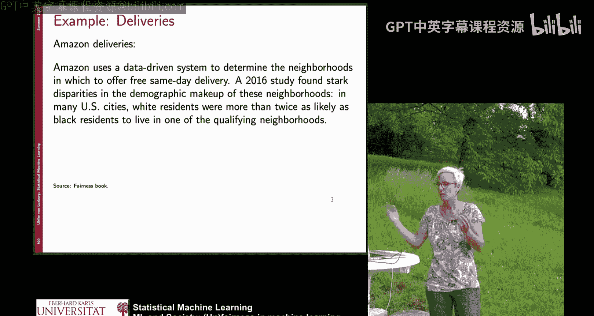

Which， of course， is a disaster and maybe not what Amazon intended。

It simply came out of the algorithm， but then maybe they should have thought about it prior to deploying it。

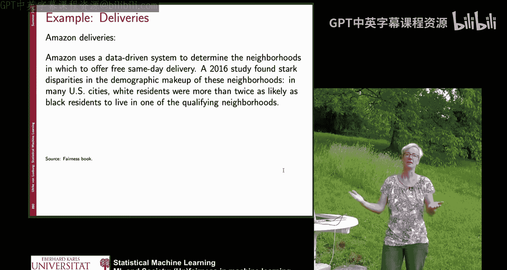

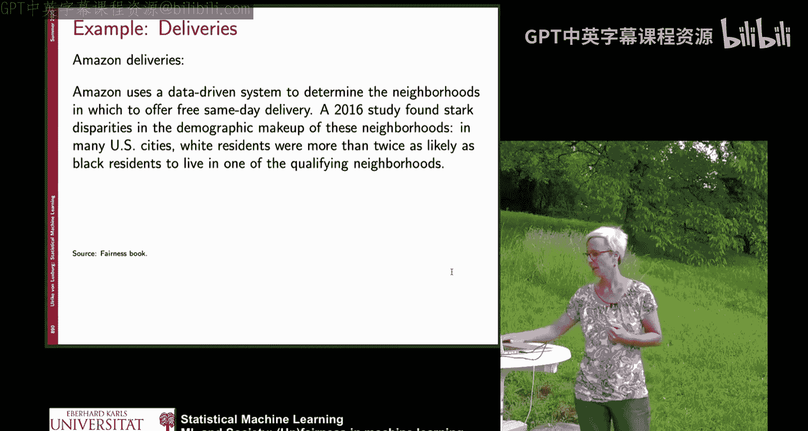

Street pump， it's a similar kind of device。 So here the idea is in the city of Boston。😊。

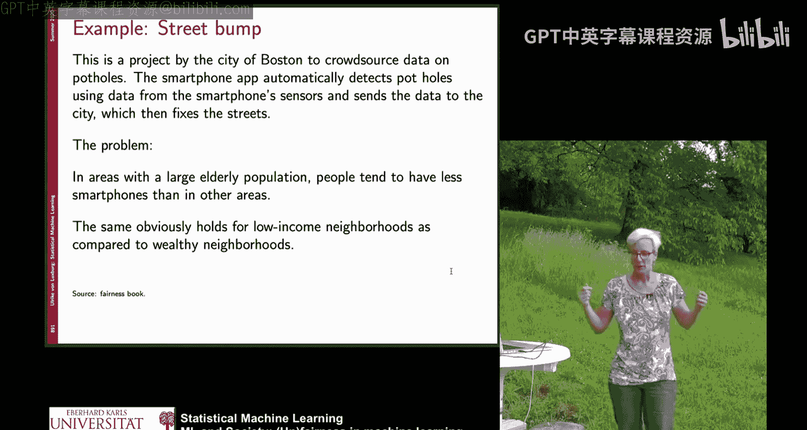

They wanted to have a project that crowdsourced data on potholes like you have a smartphone app。

And if you drive on the street and there is a pothole it shakes。

 the smartphone app registers that there is this sort of shake and sends the data to the city and then the city can fix these streets。

😊。

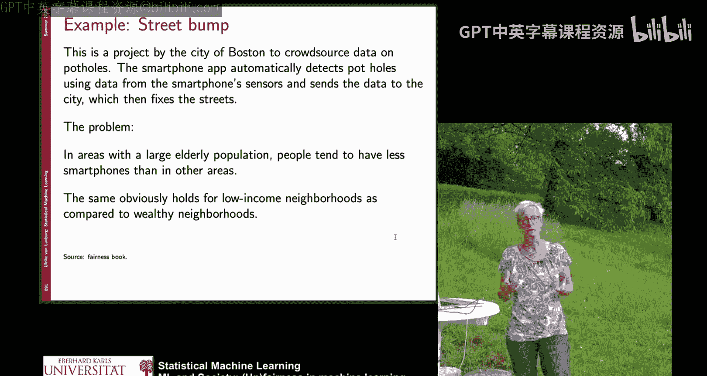

This is sort of a very innocent and sort of a great idea。

 you just think nobody is going to tell us about the potholes， nobody is going to call us and say。

 look here's a pothole in the street。😊。

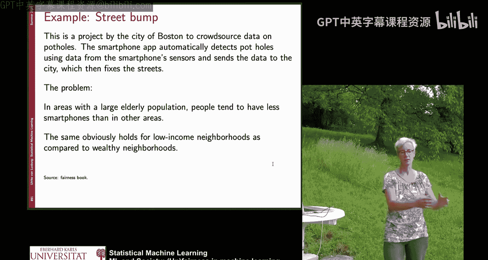

People just drive around。😊，And automatically the phones， whenever there is a pothole。

 they register it and then we can repair all of them。 It sounds really。

 it sounds like on first glance， it sounds great。 It sounds really innocent。

 I'm sure people had the best intention who made this app。 but now what happens again。

 there are certain areas where you have lots of people driving around in cars with expensive phones on their seat。

😊。

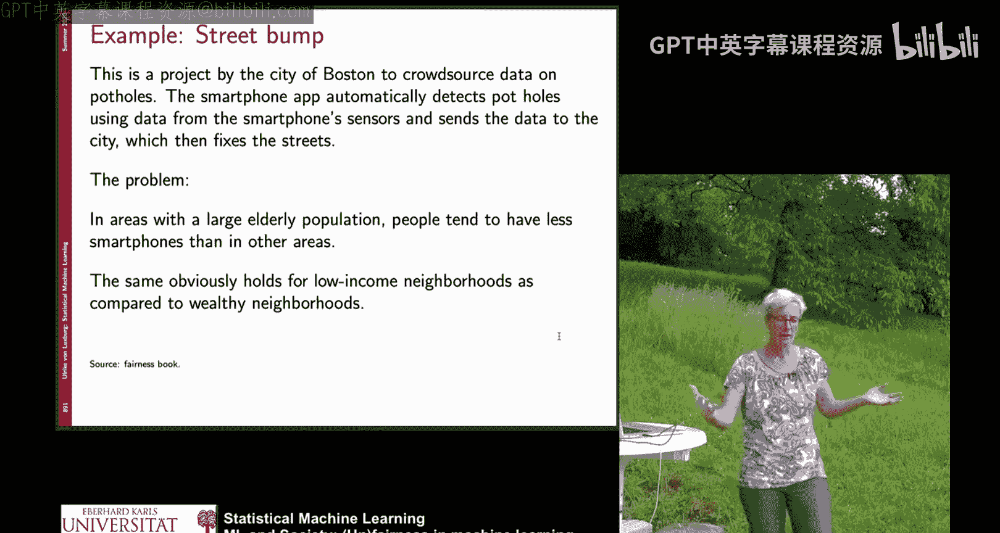

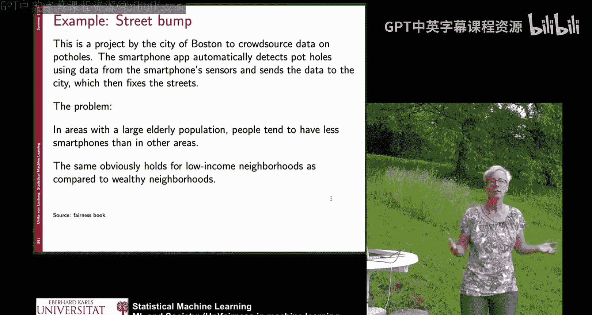

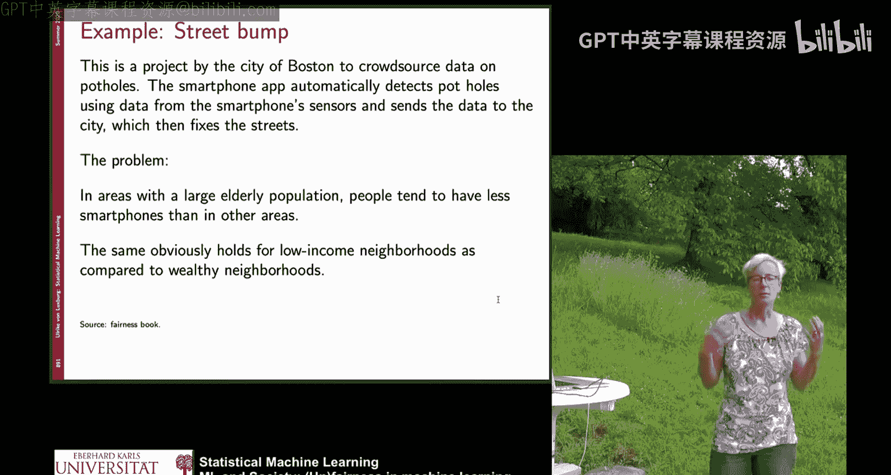

And there are other areas where maybe there are not so many cars or not so many expensive phones。

 And then， of course。In these areas where there are lots of like lots of cars and lots of phones more street bumps are being reported and more of these streets bumps are being repaired。

 So again， here it might happen that you're in an area with a large elderly population， for example。

 people don't have so many smartphones so they have more potholes in the street。😊。

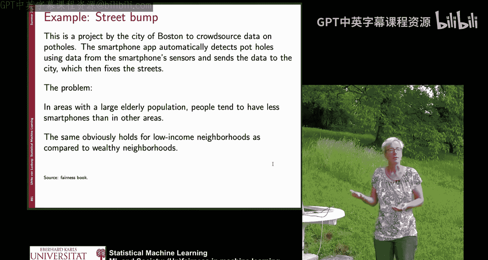

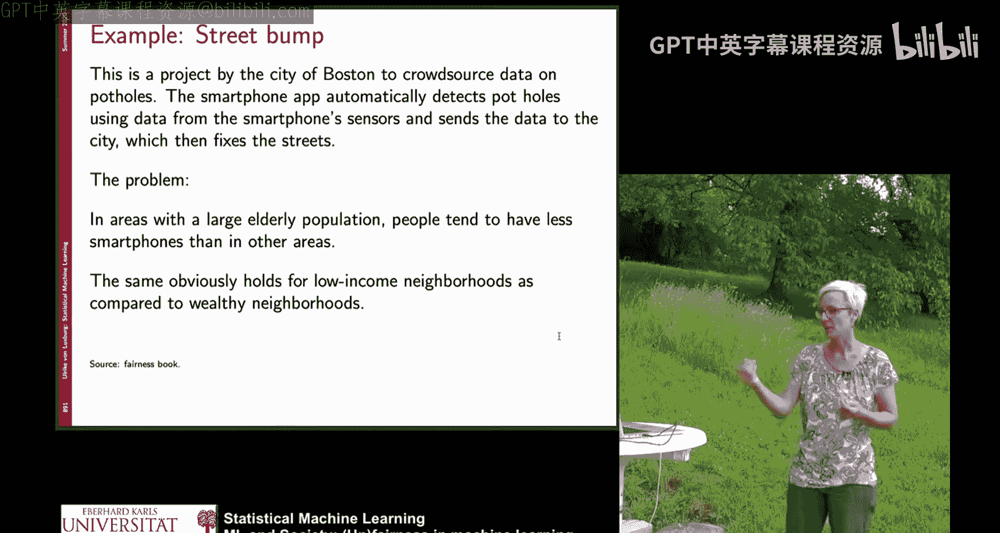

The same obviously holds for low income areas again。

 there are more potholes in the street because maybe people can't even afford to have a car。

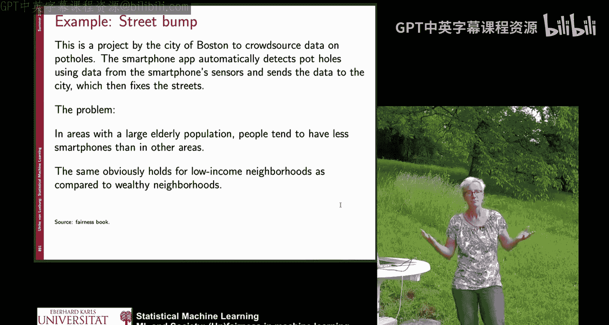

Recruitment tools。So this is again a quote， and as you see。

 I always put the reference at the bottom of the page。😊，Amazon。

Where mainhold 74% of the company's mandatory positions recently discontinued the use of a recruiting algorithm after discovering gender bias。

 The data that engineers used to create the algorithm were derived from the resumes submitted to Amazon over a10 year period。

 which were predominantly from male whites。The algorithm was taught to recognize word patterns in the resumes and these data were benchmarks against the company's predominantly male engineering department。

 as a result， the AI software penalized any resume that contained the wordwo in the text and downgraded the resumes of women who attended women's colleges。

😊，So again， I mean it's a sort of reasonably well I don't know how innocent but it's a sort of natural ideas。

 if you think language tools work great and you can sort of mind text to outsource some of your recruiting work。

😊，The idea is you scan your resumes and now you need to predict whether this particular person。😊。

For example， would have been employed in the past。 So what do you do。

 You have your past record of employment data， you have the resumes of people and you can see whether a certain person has been employed or not。

At that time， the decision was made by some person in your department。

 in a human resources department， for example。And now you want to learn for a new incoming CV。😊。

Whether this person is supposed to be employed or invited for a job interview or also。And of course。

 in the past， there might be many prejudices that exist in the past data and in particular in the past。

 most of the employees were male and this is in your data。

 then the system that you train on this past data will have the same kind of prejudice。

 And so as it happened here， the system downgraded the resumes of women。 so you sort of。😊。

The prejudices you had in the past are going to be continued in the future。😊，Another one。

This was last year in 2019 I read this in a German newspaper。

 the  employment agency in Austria was planning to use an automatic tool to classify unemployed persons and the tool was supposed to define three classes。

According to whether the two things， the chances of this person are high。

 medium or low to find a new job， so you have three groups。

 a low middle high chances of finding a new job and again this is based on all your on personal data like your employment history。

 your education， your agents on。嗯。And then the idea is， once you have this kind of categorization。

 you could every new unemployed person， you would go through ord， maybe not every。

 but some people would go through the screening system。

 and then you can sort of decide to put more money either in the group of high chances of getting a new job because you think that's more promising or you might also say I want to put more money into the low group because they need it more。

 I mean， then you need to take a political decision。 But first of all， you have this classification。

And now the problem is it'sly as similar as in this Amazon recruitment tool。

 of course all the past prejudices that you have in your employment history will be continued。

 for example， in this particular case it has been proven that female and elderly people had a worse evaluation by the algorithm and I'm sure the same happens for foreign people because in the past foreign people maybe we're not as high qualified didn't have such a good education as the white Austrian people and then of course automatically the bias that happened in the past will be in the tool and then for like a new person coming in who is foreign and。

😊，Already， simply by the fact that the person has a foreign。it comes from a foreign country。

 It will be classified。 He or she will be classified as having lower chances of finding a new job。

More examples。 I'm sorry to give you so many examples。

 but I really find this important to see for you to see that there are these kind of biases happen everywhere。

 Here's another one。😊，Wed embeddings。So I don't know whether youve heard of word embeddings before。

 this is a very popular tool in linguistics and like text analysis。😊。

So there's a very popular algorithm， which is called word to V。😊。

So the input consists essentially of word occurrences in large text copper， so you take many。

 many texts。😊，And you want to what you want to do is you want to emdding to generate an embedding of words into a Euclidean vector space。

 and typically like this vector space is a reasonably high dimension 300。

 maybe but not like 50 million so its sort of。😊，I mean， given that there are so many words out there。

300 is maybe something reasonable。 And what you want to do is that words that have a similar meaning are mapped close by。

And then what people discovered that is something that everybody found really cool is what is called word ad Mes。

 So what you can do now is you check， for example， what is the embedding of the word France。😊。

And what is the embedding of the word Paris， So maybe France is here and Paris is here。

And now you look at what is the embedding of England。

 maybe England sits here and then you discover that sort of at the same so if France and Paris are here and London and England is here then London is here so sort of this vector that goes from the country to the capital city。

 it's sort of the same so here you go from France to Paris and if you start from London and go the same vector then you end up sorry if you start in England and you go the same vector then you end up in London。

😊，And this was sort of a funnyqui or funny thing people discovered and there was lots of debates about this and people played with it。

😊，嗯。And then you can now start playing bird games So what people did is first of all。

 they tried to generate a sentence out of these things they saidLdon is to England。

As Paris is to France。 So you sort of try to build this word pass。London is the capital of England。

 Paris is the capital of France， and then you say London is to England。S Paris is to France。

And now you can start playing。You fix a word。X。And then it's all about biases so we want to find gender stereotypes。

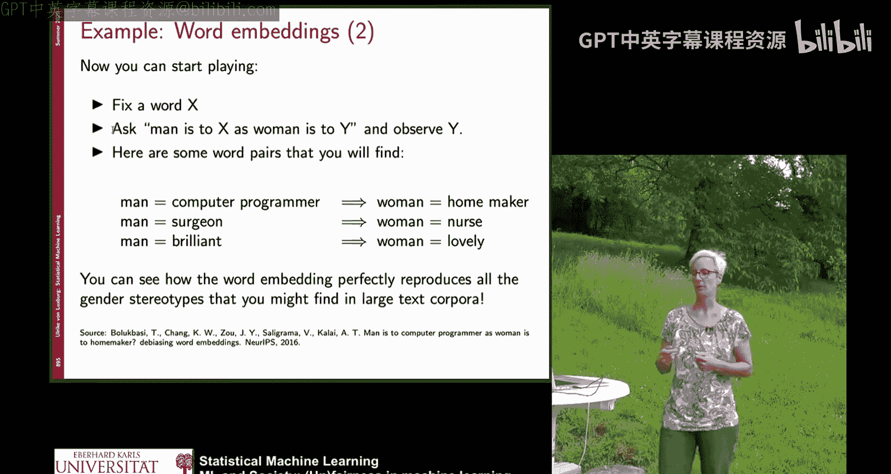

So we always now ask the question。A man is to x and exes somebody to fix。As a woman is to why。

 And then you observe what y is。 So let me just make it with an example。

 So you fix the word computer programmer， and then you say。A man is to computer programmer。

 as a woman is too。And then you simply compute this output so you take the man。

 you compute the distance of man to the vector from man to computer programmer， you go to woman。

 you add this vector， and then you check this word why。

 where you're going to end up and what you're going to find is a man is to computer programmer as a woman is to homemaker。

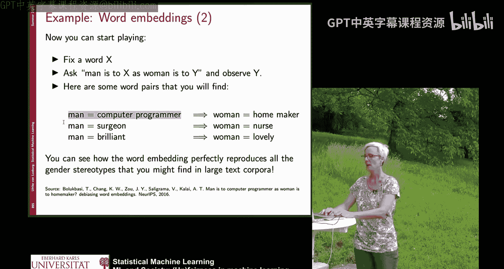

You can already see the Ch stereotype there。 man is the school guy。

 he's a computer programmer and the woman should she's a homemaker， she cooks。

And then you can you can keep on playing this game， and it's really striking。

 So the man is the surgeonant。 The woman is too nurse。 sorry， you're just a nurse。

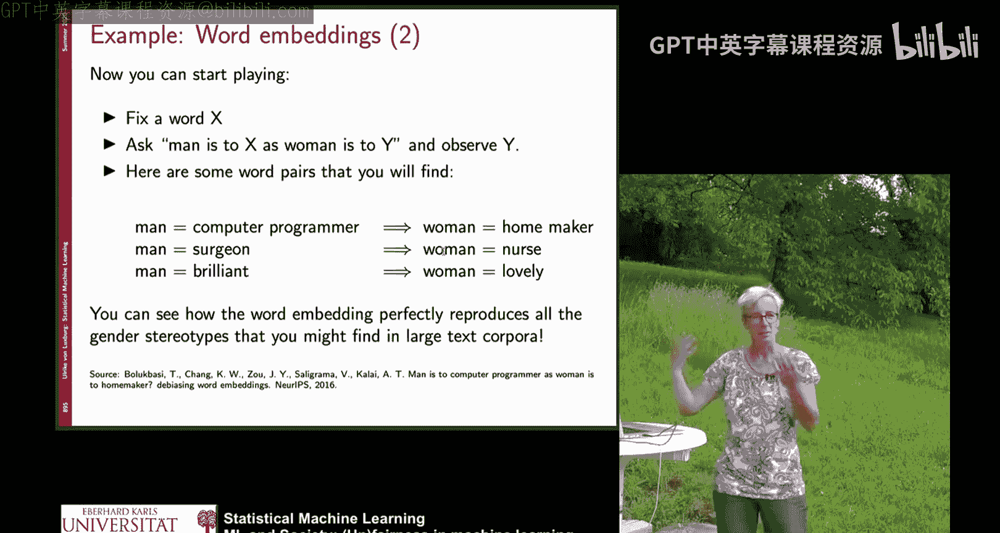

The man is brilliant。 The woman is lovely。s and there are all these。 and you can play with this。

 And what you can see here is they are all these gender stereotypes。 And， of course。

 these stereotypes exist in the past text data。 they don't come from from nowhere。 It's sort of。😊。

You take many texts and I don't know which text they forgot which text they took here。

 it was a large text copobra and it simply had all these prejudices in there or maybe it was just also maybe you shouldn't call it prejudices。

 it's maybe how it has been in the past but maybe we now consider this inappropriate。

 we would say why should a woman not be a computer programmer in particular as a computer scientist you might think this so you do not want to have these prejudices or these historical events that happened in the past。

 you don't want them in your predictive system that does something to a future。😊。

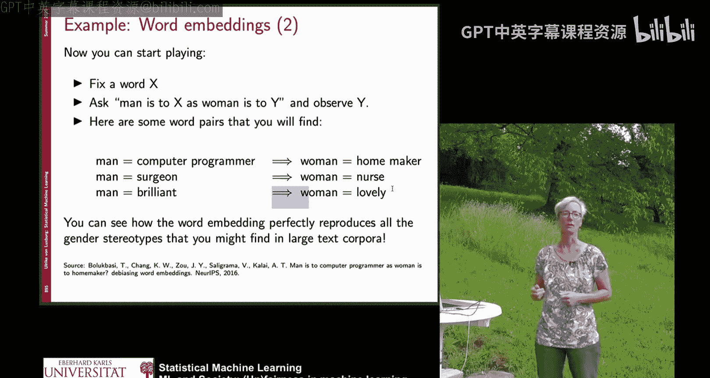

But you can see that if you don't try to counteract things。

 it is sort of this is always in your data。😊，There's no way that past text data doesnt it sort of tells you the sort of situation of society at that time。

 and it's impossible to get it out there。😊，But now you need to think about if you use such a word embedding。

 for example， to do some like and apply it now to some other analysis。

 you will have these prejudices in there and you need to be aware of that。😊。

The last example I want to discuss a bit more lengthy is the compass example。

 I've mentioned it already in the beginning of the lecture。😊。

So the Compas system is used in the US nationwide。To decide whether defendants awaiting trial are too dangerous to be released on bail。

😊，And maybe for the German participants in this lecture to be released on bail。

 it means Fgi Laenwen of Kon。So you have someone who is awaiting a court trial。

 you're currently in jail and now the decision is maybe the court trial is only going to take place in six months because people need to collect evidence or I don't know for many reasons there might be still a delay and the question is do you need to wait in jail until the decision on your case is being taken or are you going to be released on bail？

Okay， and what the compast tool does。It assign a score from 1 to 10。

And this score indicates how likely it is or how likely compost thinks that this person is going to reoffend。

 so to reoffend means the person is going to be released on bail， once a person is out of the jail。

 he does another crime。😊，And this score is based on lots of factors， including age， age。

 sex and criminal history， but not race， at least race is not an explicit feature in this tool。😊。

And now the just the interpretation， the higher the score。

 the more likely is it that this person is going to be risky and or considered risky and then the person is going to stay in jail whereas if this score is low。

 one it is sort of a risk score how risky is the person low means good because the person is less risky to commit a new crime。

😊，AndNow there was a very， very strong debate， I think in 2015 or so about this particular compos example。

 and I have some references at the bottom of this slide。😊，And I want to show you two points of view。

 the blue one， which says that this compass core is not biased。

 and then we're going to see a red one， which says that this compasst core is biased。

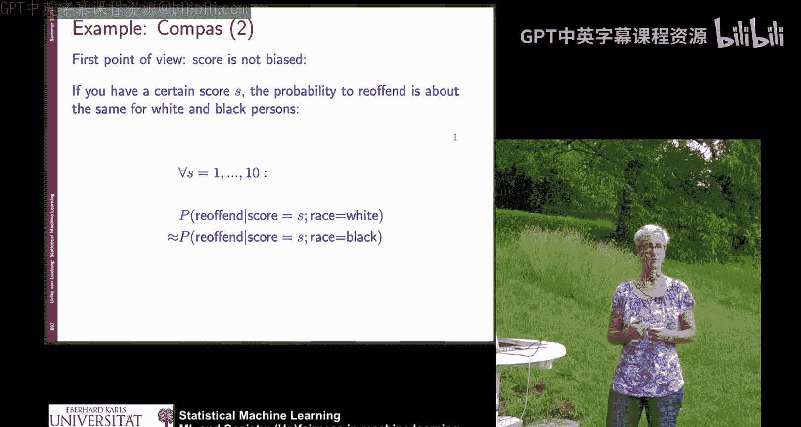

Okay。Let us start with the first point of view。Obviously by the people who design that score。

 they say and the question is always， is it court against for is it biased against race。

 like is it unfair to black people？😊。

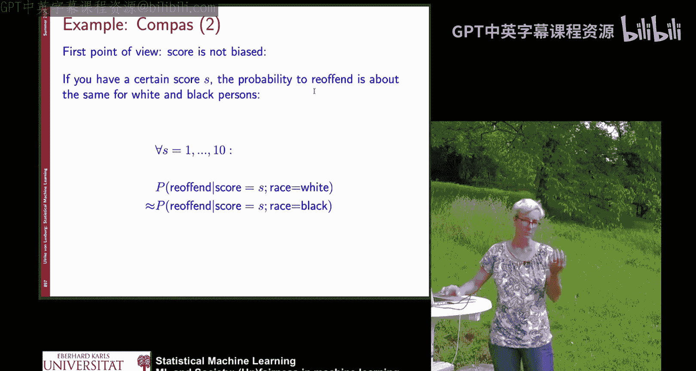

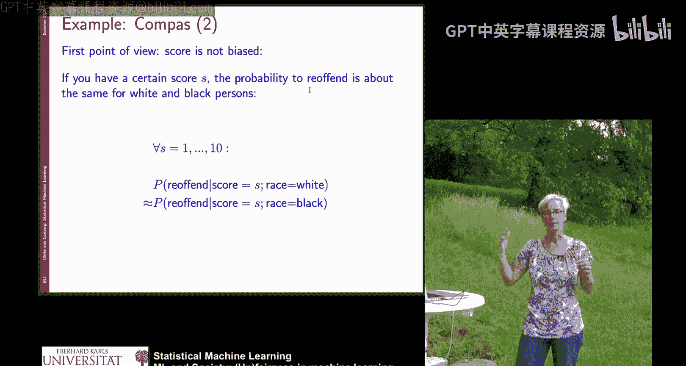

And the point of view of the people who designed the system is no， it's not biased。

 and now here's the argument。

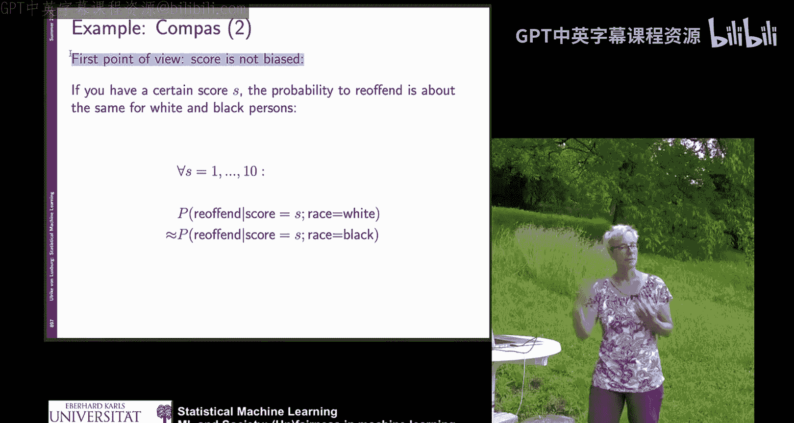

No， they say if you have a certain score S。

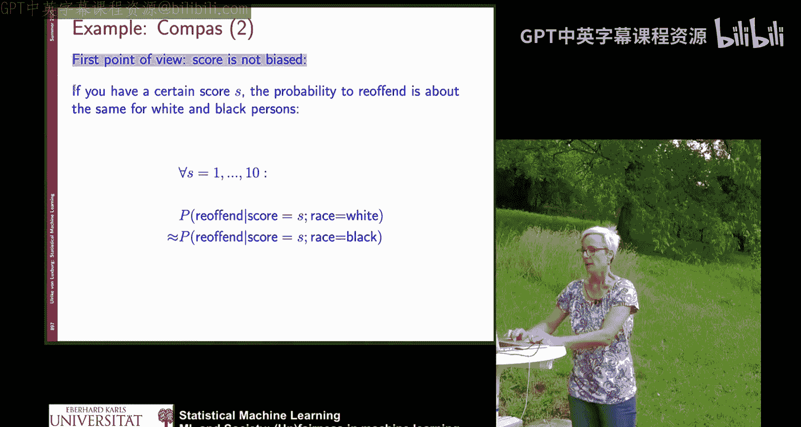

Like the system assigns to U as core S between1 and 10。

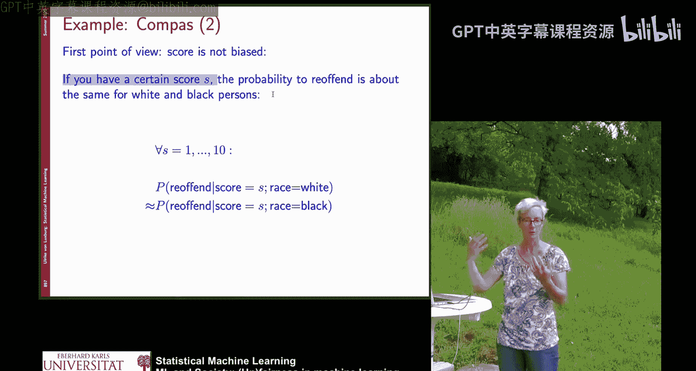

The probability to reoffend is about the same for white black persons， white and black persons。

 so for all scores S that could potentially be assigned to you。

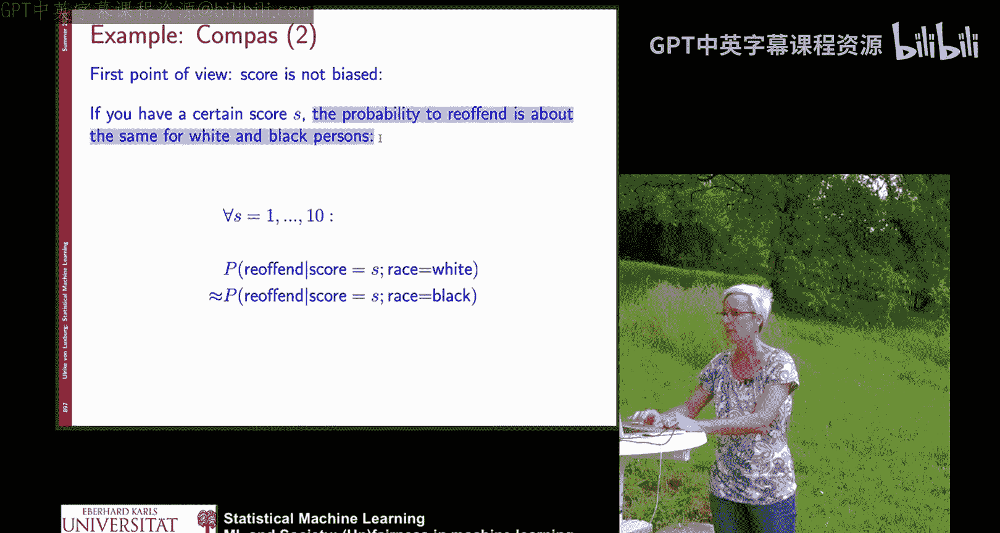

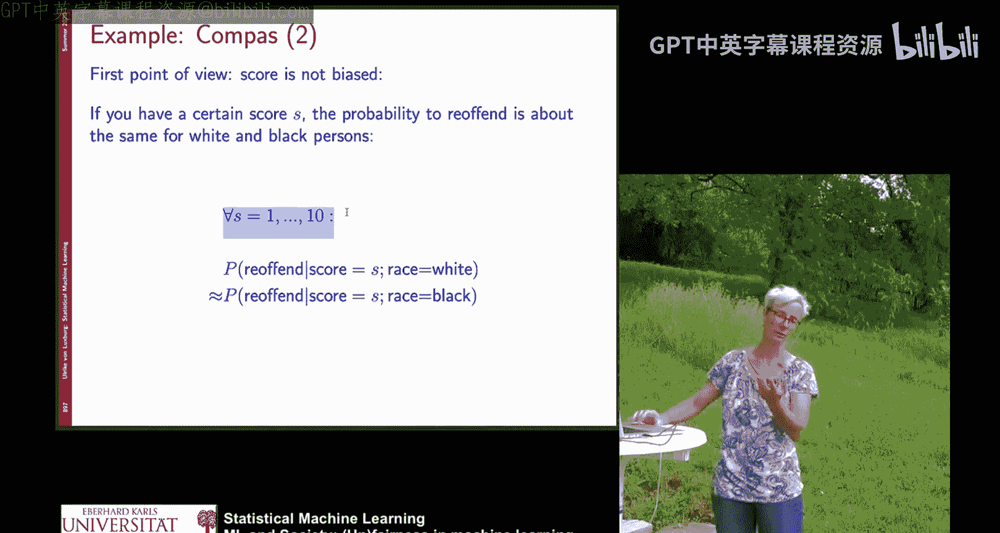

The probability to reoffend。😊，If you have that particular score it about the same no matter whether your race is white or your race is black。

😊。

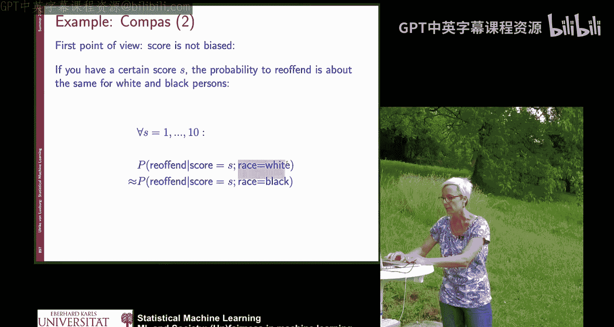

So we look at again， we look at for each a value of the score we check。😊。

What is like given someone has a score of8， what is the probability to reoffend？

And this probability is the same for white and for black people。

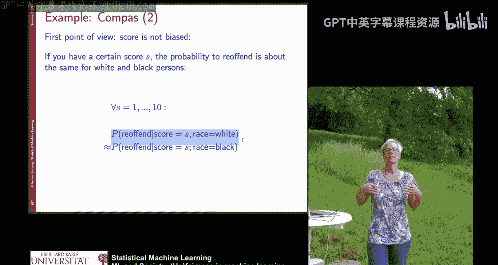

So they said it's not biased against white and black and this sounds sort of if you read it。

 it sounds quite plausible you would say at least in your first reading you would say。

 that sounds like it's not biased。😊。

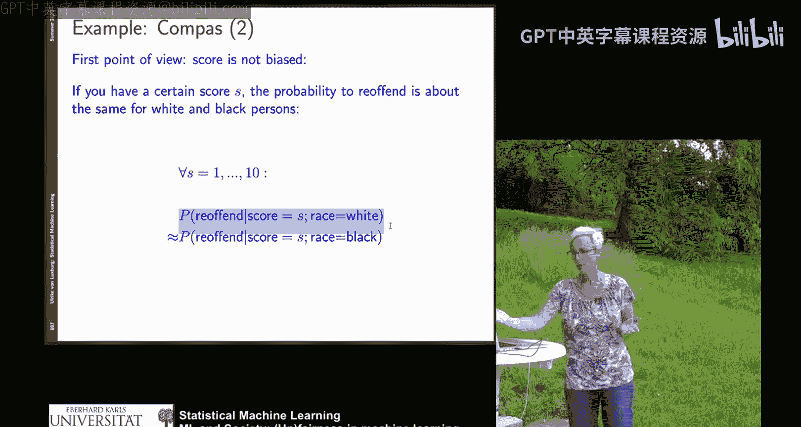

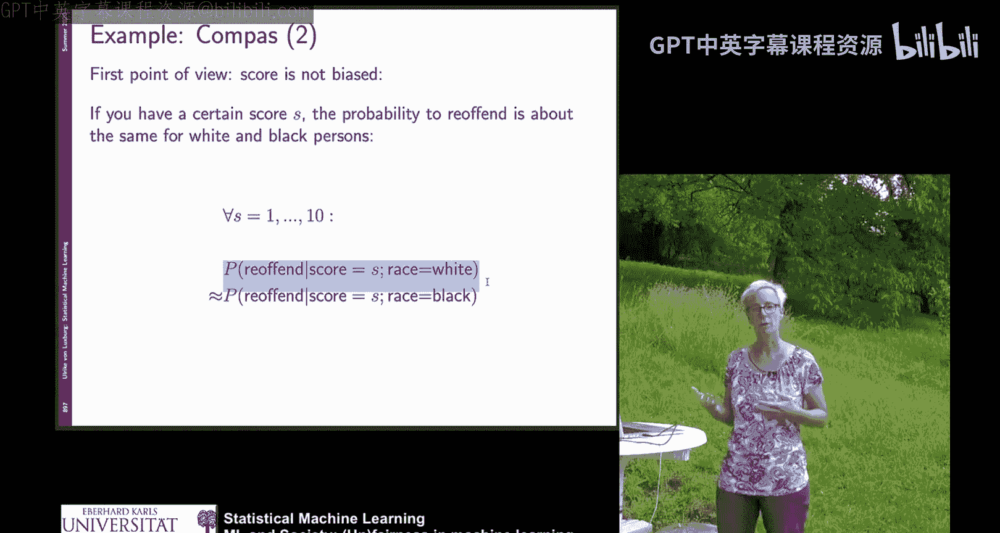

Just to show it as a plot。😊，Here is on the x axis you have the risk score。

 which is this number between 1 and 10。On the Y axis， you have the chance of recidivism。

So to commit another crime。And here you have two curves， the black and the white curve。

 one in blue one in red and you can see that these curves are pretty much on top of each other so and you see also some kind of confidence limits no I don't know how they computed that but sort of this plot says if you look at it where the red and the blue line are sort of the same so this curve is not biased against race。

😊。

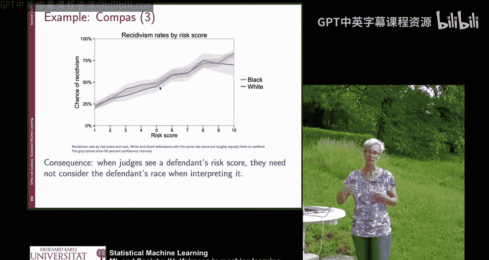

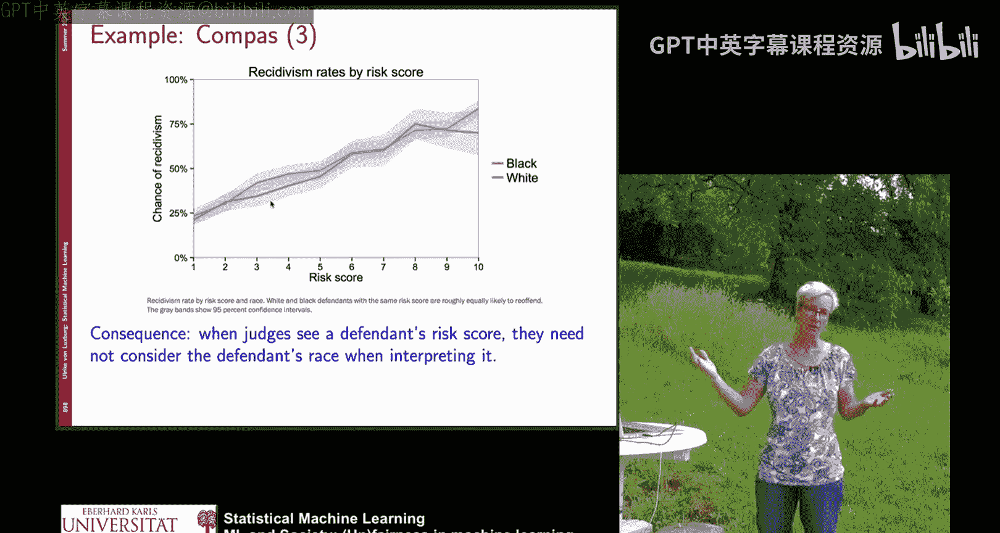

And the argument they made is like when a judge sees a defendant's risk score。

 the judge does not need to consider the race because the risk score is sort of independent of this race and the judge can simply concentrate on this score and maybe some other sort of information but not on the race to make the final decision whether this person should be released or not。

😊。

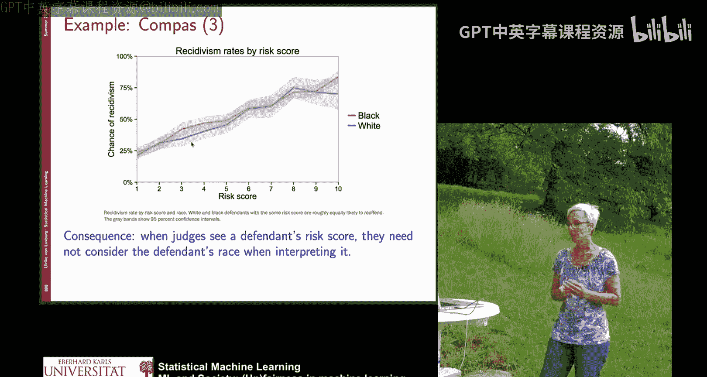

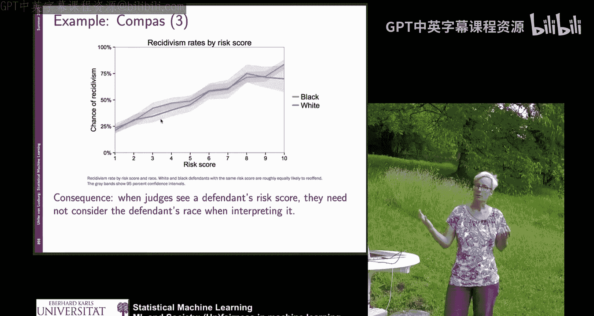

Okay， that's one point of view。And you read this and you think makes sense。

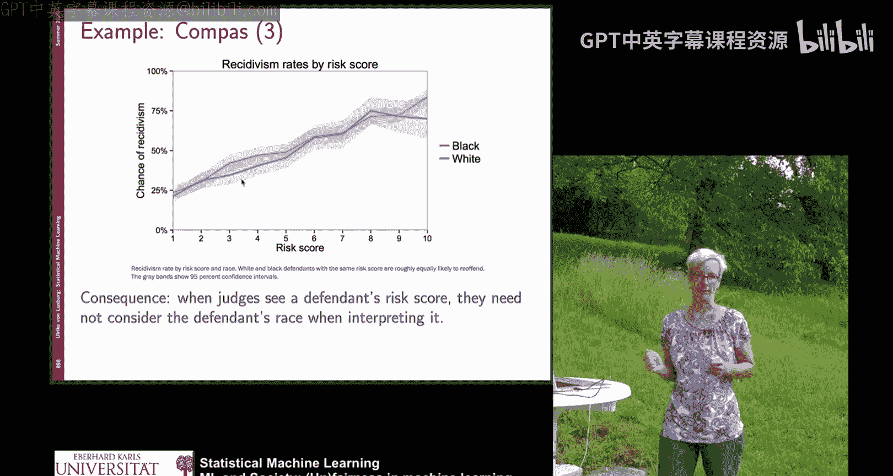

Okay。Now here's the other point of view。And that was the point of view that was made by the people who criticized the system。

 they say。😊，These course are highly biased。Now， here's the argument。

Among those defendants who ultimately did not reoffend。

Blacks were more than twice as likely than whites to be classified as medium or high risk 42% versus 22%。

So in a formula， it says the probability that you have a high risk score。😊，If。

 in fact you are not going to reoffend， but your race is black， its much。

 much higher than the probability to have a high risk score if your race is white。😊，So now observe。

 they look at a different different probability， they now look at the probability of obtaining a high risk score。

😊，Given。That the person does not reoffend。And then they compare again。

 black versus white and they find that this probability for the black people is much higher so it tends to be the case that the black people achieve a higher get assigned a much higher score。

 so they are considered to be more risky， so the likelihood that they need to stay in jail is much higher。

😊，Okay， and if you read this， you say， wow， that's really unfair。

And I think that's sort of another point is we have these two。😊，Different points of view， the blue 1。

 which says it's fair。 And you think what that sounds right。 And you have the red one。

 which is unfair。 And you would also say why that's right。 And now， how can we bring this together。

 I mean， they simply。Well， it's not simple。 They take two different notions of how to measure the fairness and depending on how you measure the fairness。

😊，You come to different conclusions。And heres a very nice plot and the references are given bottom at the end of these slide somewhere。

 which brings these things together。😊。

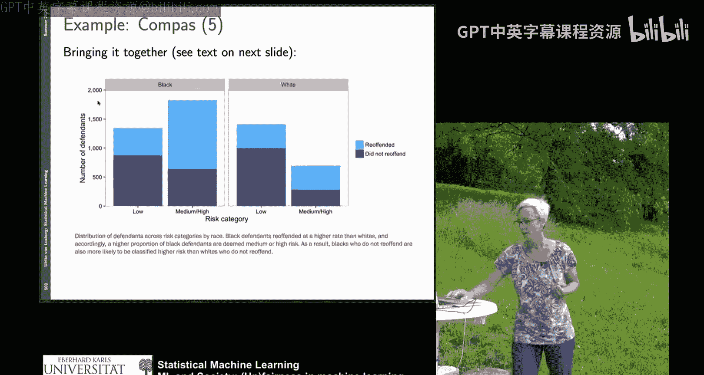

So this is how the data looks like。 and I first explained this plot neutral and then I show how it comes to the two different points of view。

 So what you see in this plot here is you have on the left side the two bars belong to the black population and on the right side the bars belong to the white population。

😊，On the X axis you always have this score， so here low means the person has been assigned a low score so the person is going to be considered not risky and likely be released。

😊。

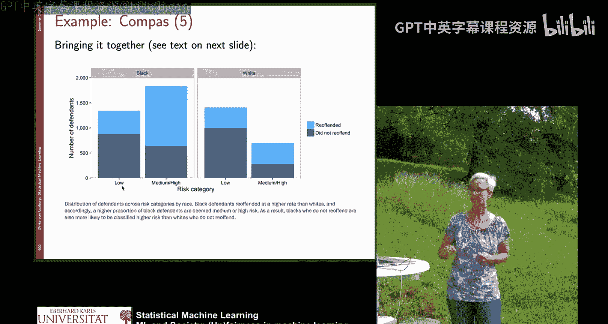

And then here's the second part that simply summarizes medium and high risk of these persons。

 so these are the kind of persons you would probably not release。😊。

And then on the on the Y axis， it's simply a histogram。

 You simply count' how many people fall into each of these categories。 So here， for example。

 we see that among the black population。And。The ones who are classified to have a low risk score。

 and we have about， I don't know，800 people in this particular data set。

 and then we have maybe I don't know，300，400 people who have this light blue score。

 which is reoffended。 So okay， sorry， I forgot to explain it。 So the black。

A black color here means。The person did reoffend。 and here the blue color means the person did not reoffend。

Sorry， it's the other way around。 light blue means the one on top means the person reoffed and the one on bottom means the person did not reoffend。

So essentially all the data is summarized in this particular plot。😊。

And this is simply the data， and now we need to see how we can derive these two point of views。

And here is now the blue point of view， which says the data is not or the score is not biased。

 the algorithm is fair。So what is now says is within each risk category。😊。

The proportion of defendants who reoffend。Is approximately the same， regardless of race。

So in the figure， this means I try to depict it now always in the bottom of the figure and I sort of have been drawing on top of the figure to try to explain this。

😊，So we take the low bar of both populations， so we take the low bar of black people。😊。

And the low bar of white people。And now what we see is if we look at the ratio between the top of the bar and the bottom of the bar。

 like here light gray and dark gray and here light gray and dark gray。😊。

The fraction of people who reoffend is sort of the same in both of these bars。

 So if you look at the proportions like sort of， I don't know。

 maybe it's one third or one quarter of the people here are in the light blue region and the rest is in the dark dark blue region and here it's sort of the same。

 I mean， these fractions are roughly the same。Okay and this is this first point of view。

 it says look at the ratio this on this bar and on this bar between the top and the bottom it's sort of the same and the same holds if you look at the right bar sort of again here and here the fractions are sort of the same。

😊，And this is why the blue fraction of people says this is a fair score。哎。

Now let's look at this red point of view where people say this is a very unfair score。

 now we look at something else。The argument is no。Black defendants who don't reoffend。

Are predicted to be riskier than white defendants who don't reoffend。 And in the figure。

 now you look at the people who reoffend these are always or like in the figure I marked the ones who do not reoffend。

 these are always the dark parts of the bars at the ones at the bottom。

And now you check what is the fraction of people who do not reoffend and here for the black population we have 58% have been attributed to low and 4 people or 42% have been attributed to medium high risk。

😊，Whereas in the white population 78 of those people who do not reoffend have been categorized into the low bar and only 22 have been categorized in the high bar and now if you look at the ratio between these two categories in left。

 like in white and in black population you see that many more like in the white population most of the people who do not reoffend also end up in the low risk category and this bar here the black one。

😊，hich is sort of the positive the wrong decision so these are people who did not reoffend but end up in the high risk category and this is much smaller for the white population than for the black population so essentially like in the black population it looks like a big chunk of the people who should have ended up here in this low risk part of the barough ended up in this high risk part of the bar。

😊，And this is the point of view。Why this algorithm is unfair。And now the question is， again。

 how can this happen， What is the reason that depending on the different point of use。

 you come to these different kind of conclusions。 Again。

 you need to look in the data to understand that。 So in the raw data。Black defendants。

 we offend at a higher rate than whites。And this is now these fractions that we have have on top here。

A classifier that is perfect in terms of accuracy accuracy will thus be more likely to classify black defendants as medium or higher risk than white defendants。

😊，Because if you look at this， like the black defendants typically weoffended at a higher rate。

 58% and the white population reoffends at a lower rate， 33%。

 so if you would use an algorithmic tool， then typically it would put black defendants in a higher risk category。

😊，And now the big， big question is and this was a long debate and I think there is no final conclusion to this debate。

 who is right， is this fair， is this corner fair or is it unfair？😊。

And it really depends on your point of view。 Both points of view have a formal argument in favor。

AndNow for me， I don't want to even give a final answer to the question。

 which of the situations do I find fair or unfair， like am I more a blue person or a red person。

 I think what is important in this particular case is。

That whether we find that the result of an algorithm is fair or unfair。

 really depends on the way we measure the fairness。

And it also depends on the way we measure the success of the algorithm。😊。

And in particular， for this data， it's impossible to construct。😊。

Like any non-travial classifier that is fair with respect to both of these notions and we are going to see that the problem is that there are many different definitions of what could be fair and typically they are mutually exclusive so if you have nontrivial data。

 you can be fair with respect to one measurement， but then you are not fair with respect to another measurement。

😊。

And from my point of view。There is no technical solution to this dilemma。

Sort of the society has， first of all， to decide whatever the society is in this case。😊。

But the decision， which of this notion of fairness we would like to obey to is a decision that would need to be taken outside of machine learning。

 like either by the society or I don't know who is going to decide it。

And then once this decision has been taken。We as machine learners can say， okay。

 if you are after this particular notion of fairness， we can try to correct for this。

Or we can also try to correct for this other notion of fairness。

 but you need to tell us which notion of fairness you want to achieve。

Which is of course a very strong statement because also in society I think it's completely notob which of these notions you would like to have。

 I mean both points of use at least have some points in common or against them。

And I don't want to sort of comment on what I think would be the solution here。

 I really find it's important to simply note that these notions of fairness are not compatible with each other。

And it's not the technical of people who decide it。

 but somebody else needs to take this decision on which notion of fairness you want to obey here。

And here you can see at the bottom of the slide there are lots of literature hints on this topic。

 I mean if you just type compass into Google you will find many。

 many more hits you can simply try to form your own opinion。😊。

Just as a last side remark here， and there are more obvious things which are which are not even I haven't even touched yet。

 for example。😊。

The problematic thing is when you look at this data here， this one。😊。

When do you know that a person has reoffended， of course you can only know this for a person who has been released from jail。

 so this is again a biased score because for a person like because you look at historic data now someone gets released and then you look at did this person be offend or not for someone who did not get released you couldn't even recalled whether this person would have reoffended。

So this is definitely against a highly biased way of measuring whether someone is going to offend or not。

 because the only people you see are the ones who have been released。

嗯。Okay， so this sort of concludes my my section of examples in unfairness。

 and I want to sort of discuss the first takeaway。So the first and most important takeaway is that implicitly all kinds of biases are into machine learning systems。

 and whenever you do an automatic classification systems。

 there are millions of sources from which unbiased can end up in your data and we're going to discuss it more systematically on the next couple of slides。

The next thing in most of these systems， the people who designed that system did not intend to be unfair。

I mean， the people who do， I don't know， credit scoring or the people who do compass。

You maybe can say that they did not or at least be hope。

 but I think or like say the job agency in Austria。

 I'm sure they did not intentionally try to be unfair to a certain part of the population。

So it's not like they they， they built the system in such a way。 This is just the way it comes out。

 If you not easily apply machine learning。

Unfair systems will come out。 And they like， if youre not don't take particular care。

 this will always happen。

There are some systems that was the Harvard admission case where some people actively tried to intentionally have a bias in the system。

 for example， in Harvard inative action， in this affirmative action case。😊。

There is no unique definition of fairness。And in the next part of the lecture。

 we are going to see some formal definitions。😊，There exist many definitions， at least 10。

 I would say。😊，And they are typically exclusive， so if you're fair with respect to one definition。

 you're unfair with respect to the other definition。😊。

AndNow which definition of fairness is appropriate really depends on the application you are currently looking at is not there might be some applications where one notion of fairness is appropriate。

 but there might be others where a completely different notion of fairness is appropriate。😊，So。

When you have an application， you always need to consider for your particular application。

 which notion of unfairness is the one you like to have。

And in particular also it's not you who decides that it should be the society or the ones who use that system。

 the ones who are concerned who have to live with the consequences of your system。

 they would need to be the ones。😊，To decide which notion of fairness you should try to achieve in your particular system。

嗯。The next point， when we want to have a fair system。

 it often at the same time means that we need to give up on the precision of the system or on some other systems。

 some other performance measure of the systems。So for example， if you want to be unfair。

 it might be that you can design your algorithm to achieve a higher notion or like a better notion of fairness than it currently has。

 but maybe then your classification accuracy accuracy goes down。😊，So。

Training systems into a particular direction of fairness always means you increase some aspect here。

 but you might decrease performance at a different， at a different place， for example， at a accuracy。

And again， this is now a point of debate， how much increase of fairness justifies how much decrease in accuracy accuracy。

 for example。😊，Again， this is a decision you can maybe point out that this exists， but in the end。

 the person who uses that system or the society or whoever is concerned needs to decide that。😊。

And again having I mean this is obvious but I want to repeat this this fairness criterion is a request that comes from society so you can't say well I don't care about society。

 I don't care about fairness I want to have the system that has the highest accuracy because you're not the one who is going to decide it at least if your system is being used in a context of society。

😊，There are sort of requests that come to you from the users and you will need to to make sure at least as good as possible that you can satisfy this particular request。

嗯。It is hard to come up with an application for machine learning where you cannot spot any discriminatory behavior。

And this is really something I want to stress and if you want to have more examples。

 maybe look at the book， the fairness book， the draft I mentioned in the beginning。😊。

No matter which application you come up with， if you stare at it for a long enough time。

 you would see discriminatory behavior。 This always happens， and in the next lecture。

 we are going to discuss what are the sources of all these unfairness that comes into。

So this really is an issue， and it's always an issue。 It is always。

 So whenever you design a system that is being used in a context of society。

 you need to think about this fairness aspect。

And the annoying thing from a technical point of view。

There is not going to be a simple solution， and you're not going to be the one who finds the simple solution without discussing with the society which kind of solution everybody would prefer。

There are certain things we can do， and we are going to see that in the next lecture。😊。

But society and you have to， to discuss jointly， which is the solution that everybody prefers。

