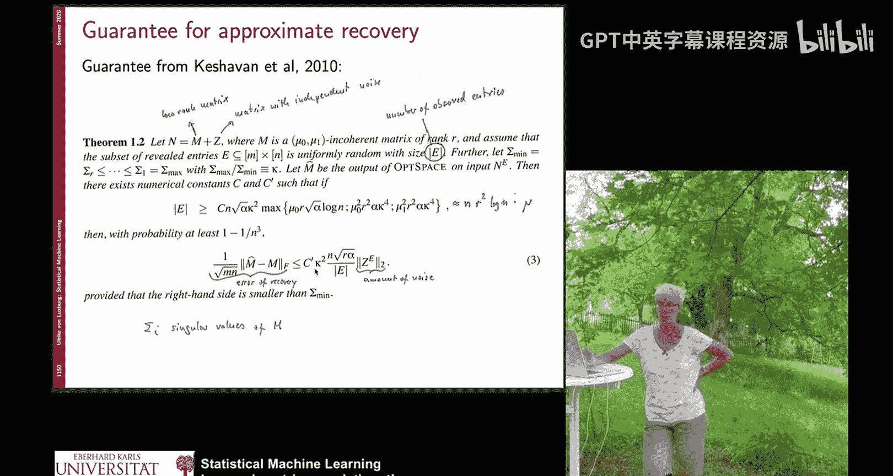
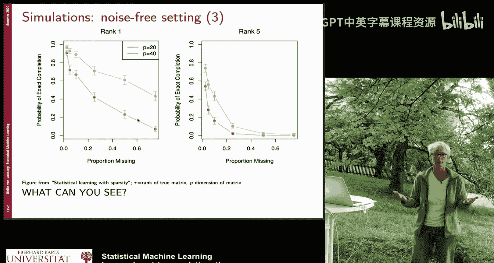
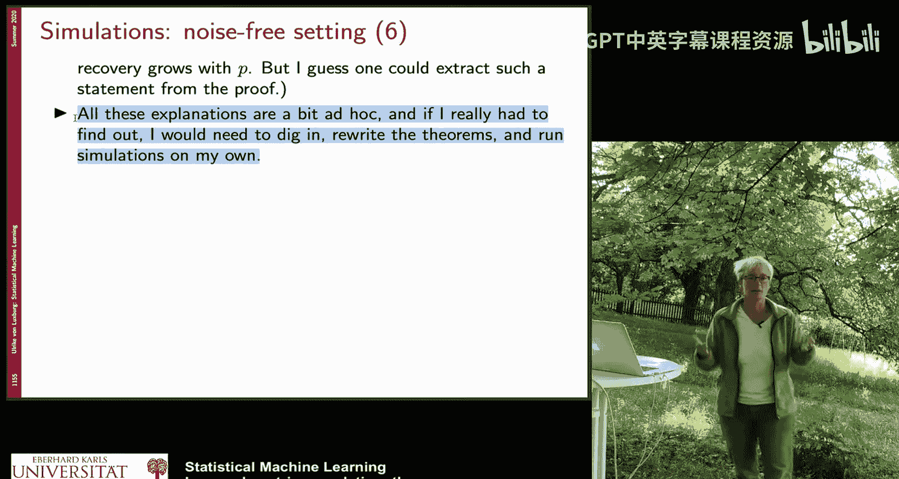
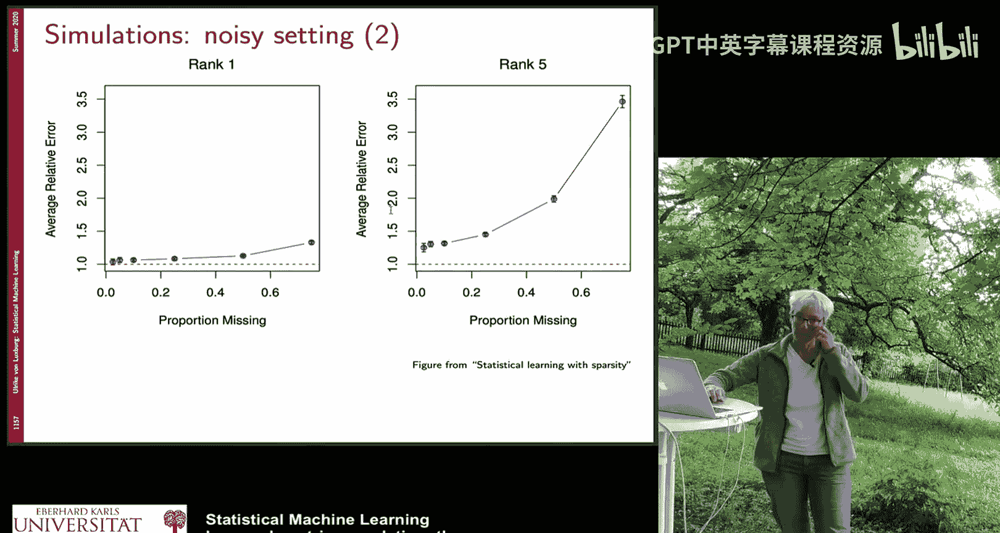

# 图宾根大学《概率和统计机器学习｜Tubingen Probabilistic and Statistical Machine Learning 2020》中英 p55 -55-Part 52 - Low rank matrix completion_ theory.zh_en -BV1gso5YGE4s_p55-

So now we have this algorithm， we have seen how it behaves in practice。

 at least on this particular data set， it seems to do something that' is reasonable。😊。

Now what can we say about theoretical results？Now， let's again try to first build up a bit of intuition。

 So consider an arbitrary matrix Z。And let's for simplicity assume that this matrix is even squared。

 so we have the same number of movies and people that watch it， so it's a P times P matrix。

AndNow assume that we observe n entries of this matrix and these entries are drawn uniformly at random。

 so we have P times P matrix we pick n entries randomly。

And the question that we want to look at is now how many entries do we probably need to look at before we can successfully reconstruct this matrix。

 at least approximately or what would be a first guess for the number of entries。

So now there are a couple of things that obviously should not occur。

 So one problem is the problem of empty columns。So if there is a row or a column in this matrix for which we don't see any entries then there is nothing we can predict so there is a user but the user didn't tell you anything about what he likes then there is nothing you can recommend or if there is a new movie and nobody has seen it。

Then at least in this collaborative approach， there's no way you can make you can tell which users are going to like this movie。

Okay， so， so one necessary condition that we would have is if you do this random sampling of entries in a matrix。

We would need to make sure that there is at least one entry in each row and at least one entry in each column。

Okay and now this is our combinators question that I want to ask for you。

 so assume so now essentially what we have is we have n elements。

 so here it' is written on the slide， we sample n elements。 Each elements belongs to P columns。

How large does n need to be， such that with reasonably high probability。

 we have at least one element in each column。Maybe you can try to solve it as an exercise。嗯。

Maybe you also know it because this is a very famous problem。

 it's called the coupon Collector problem。You need to have at least P lock P many samples It's called coupon collector。

 So if you remember a schoolki， you often had these kind of sticker albums where you have I don't know it's soccer soccer championship and you have like these sticker albums where you can buy stickers each pack of stickers contains I don't know 10 particular stickers and your album has100 empty places for the stickers So how many of these little sticker packages do you need to buy before you have the album complete This is sort of this kind of problem。

Okay， so I mean， the first thing I want you to notice。😊。

We need to sample at least p times P entries of this matrix。 Otherwise it's pretty much hopeless。

 at least hopeless that we can say something about each column。

 So P log P P is the dimension of our matrix。 P log P is the first answer。Now。

 the second thing we want to or we think that our matrix might be a lower rank matrix。

 so say the rank is R。So if we have a rank r matrix which has is a p times p matrix。

 then we can describe this matrix by r vectors essentially so a rank R means we have say are singular vectors for example。

 so we have r vectors each of them has p entries， so all of all we have r times p parameters in these vectors。

So somehow we need to， and this is now really wild guessing， but still it helps to gain intuition。

 So we probably like we want to estimate something like r times p number of parameters。And typically。

 I mean， you cannot hope that we can get away with having fewer than these parameters because then maybe your matrix might even have a lower rank。

 So so in typically little choices， these RP entries could not be compressed any further。

 so you couldn't just replace them by something that is even smaller。

So I now wrote it is plausible and the question is what is plausible but now we want to have RP parameters of this matrix and one thing that you might find plausible is at least that we probably also need to observe about R I mean at least r times p entries of a matrix otherwise it's not going to work。

😊，Okay， I mean， this is sort of a very rough rule of thumb or hand waving， as I've written here。

But often this kind of rules of thumb， if you have a good feeling。

 then it helps you to get some intuition about the problem。Okay， so now we have two conditions。

 P P lock P entries from the coupon connector program to make sure we hit each column。

And r times P entries， if you want to approximate this with a R statement。Now， here's the next thing。

 and this is now a very technical thing that is a bit more complicated。

And the condition is called coherency。So assume our matrix that we want to complete looks like this。

 This is the matrix。 It's completely full of zeros， and there's just one entry。

 one in the top corner。😊，And I assume we randomly dis sample some entries of this matrix and we try to recover it exactly。

😊，So this is not about exact recovery in the first place。This looks like a very complicated problem。

 I mean， from from a structural point of view， the matrix has rank1。 So it's really low rank。

 so you might be happy and say this should be an easy problem。

 but still the problem is not easy because the entries in this matrix essentially I don't have the same importance。

 This is one entry that you need to that you need to find。If you miss it。

 you're likely to miss most of the important thing of this matrix or the important structure。

And so if we or if we sample less than of the oral PC scale entries。

 then likelihood is like it's high that we fail to miss to find this entry and the result is going to be wrong。

And now there's this condition that is called coherency that tries to catch this particular kind of problem and the problem is that some entries are more important than others。

 and if you have this condition， then of course， if you just uniformly sample at random and you miss the important ones you have a problem。

And now if you try to formulaize this problem from a mathematical point of view。

 the problem is that the eiging vectors of this matrix are too much aligned with the standard basis of RPp。

😊，Which means here， I mean they are perfectly aligned because it's just one times the standard basis。

 the first eigenve and the unit first unit vector。And so it's perfectly aligned。

 So we just need to have like a one here。 And then this describes the whole vector。

 But what would be much better if if， if say the coordinate system would be much more rotated and I would need to have a bit of an aspect of each of the standard phase vectors。

And this is now what we try to cover in the condition that is called coherency。

So what we now want to do is we want to measure。😊，Up to which extent the eiging vectors of the matrix that we are currently looking at are aligned with the standard basis。

😊，And now this leads to coherence until here' that definition。

So assume u is a subspace of your original ofRD in the test dimension R。

And sayP is the protection on this particular subspace。Now we say the coherence of the subspace U。

Withorth respect to the standard basis。Y。Is defined as follows。

 so the Korean Sea is going to be denoted by muu。And here some kind of normalization factor。

 but the important point is we look at the projection so we project each each of the standard basis vectors on this particular space。

😊，And then we evaluate what is the norm of this particular projection。Right。

 and this here in the front， this is just a scaling constant。

But essentially so what we want to do is we want to project the standard basis on this space and then if it's okay。

 and then we call this we do that for all the d basis vectors and then we take the maximum and this is what we call coherency。

And maybe to get a feeling for this， let's look at a couple of examples first。

So here's the matrix we started with。 This matrix has a one here and 0 everywhere else。😊。

The first a value is1， everybody else is 0。Now if I so the first a vector of this matrix is this is the unit vector。

 so if I project。嗯。TheThe standard unit vector on this first eigenvector， I get exactly the same。

 I get a one out of there because these eigenvectors coincide。

 So B1 the first eigenvector or singular vector of this matrix。 In this case。

 it's an eigvector is exactly the same as the first vector in the standard basis so we get the maximum thing that we could get out namely one here。

For all the other eigenvectors。This doesn't really matter anymore because this is going to be the maximum value。

Recall we have a project operator here。 so this norm can only be it It can't get larger than one1 is the maximum norm that you can attain for a project of a unit vectorctor。

 at least。Let's look at the same matrix just with flip signs because like the problem if you have once everywhere and just a0 at a different place。

 it's sort of the same problem we just flipped sort of the entries。😊，And again。

 if you missed the zero here， then we are not going to predict correctly at this particular entry。

So again， now you can look at the eiging vectors and eigenvalue here and you can try to compute them in this particular case with a number of vectors with and right I have a matrix of five entries here。

 this is how the first eiging vector looks like， this is how the second eiging vector looks like。

And now this unit eigen this unit basis vector is an element of the span of the first two eigenvectors。

And now you can see that if you project the unit the standard vector e1 on this space spent by the first two es for eigenvalues。

 for example， egves， sorry， then again you get a1 here。So again， this is a high value。

 looking meaning that the problem is difficult。Now let's look at this other matrix that consists completely of onces。

 what do we get here？😊，The first eigenvector is the constant one vector。Everybody else is zero。

 if you do the projection， you can just compute it like if you project the standard unit vector on this thing。

 what you get is just one over squared of n。 So this has a low coherence value。 and in fact。

 this is the smallest value that you could attain possibly。I mean， these are just examples。

 but they show， I mean， the coherency is sort of a number that changes between 1 over squared of n and 1。

😊，And the ones stand for difficult cases。 So if the Korean is high， it's difficult。

 if the Korean is low， we might expect it to be simpler。Okay。And here again。

 this is sort of I've written it on the slide as well， so the coherency， the smaller， the coherency。

 the easier。😊，The maximum value conceal is sort of the value of1。

 the minimum value is if you achieve this value and then it's1 of squared of n。嗯。Okay。

And sort of here， the general intuition is that coherency is low if all entries have about the same order of magnitude。

 because then sampling， some of them doesn't really。

They all have sort of the same kind of importance。Oh， here's one more example。

 a random rank K matrix。😊，Here I made a simulation just again to get some feelings So for what would be the Korean of a random matrix。

 Now start with a rank K。 So how do you generate a random rank K matrix in the first place。

A p times p matrix that has rank K so that' is not completely obvious but if you think about it for a couple of minutes there are many solutions but this is one。

 you generate a random matrix of size n times r。😊，And yeah， then you simply take the product。

M times entrance post， then you have an n times n matrix， but it has still rank R。

So the first our eigingvalue are being larger than0， everybody else is 0。😊。

And now I can sort of in my simulation， I can vary if R is low。😊。

I can now check what happens for the different ranks with the coherency and here we see the plot that I obtained so here you have coherence just without the nominizing factor so the sing between one of curve of n and 1。

And here's the rank of the matrix， and what you see is if your matrix is low rank。😊。

Then this random matrix， the way I generated these matrices is more or less random so here you might want to hope that there is not one particular entry that is more important than other entries because all entries have been generated independently by the same kind of process so somehow the entries should have the same kind of importance and this is also what you can see here up to a certain extent so if the rank is low at least then the coherency is low as well and the coency increases if the rank of the matrix increases as well。

 this was 100 times00 matrix so in the end of course it a coherency is one。

And now the cool thing is you can now prove guarantees for exact recovery of matrix completion in terms of this kind of coherency and also for approximately recovery。

😊，And the guarantees are always of the followinging flavor and we are going to see some on the next slide。

 so P is now the size of the matrix and R the rank。😊。

So the statements typically have a flavor like with high probability。😊。

Exact recovery of a matrix is possible。If the observed entries satisfy at least a guarantee like this。

 So the number of entries that you observe capital N。Has to satisfy a certain guarantee。

 so it needs to be larger than a constant times R times p times log P。And now and okay。

 this constant depends on the coherency。😊，So if the coherency is low， then this constant is also low。

And then this parameter n here， the number of entries that you need to sample。

 you can sort of forget about the constant and the number is something like r times P at times log P。

And this is sort of cool because it says like if the coherency is low。

 this sort of should be the regime where we can achieve something。😊。

And now think about the root of thumb we had， we had one root of thumb that says we need to sample at least r times P many entries。

This was from the rank constraint。And we had this other rule of thumb that tests。

 we probably need to sample at least P times log P entries to make sure we have an entry in each column and in each row。

And now the bound says， if you're in this nice regime， where coherrency is low。

 then forget about this constant and we get exactly sort of the best thing that we could get from these two kind of things。

 That R times p times lot P。 That's really so elegant， isn't it。😊。

And now the other thing is if the coherence is high。😊，Then what you can prove is， I mean。

 you can see this from the slide here， but then c times r is sort of on the same scale as P。😊。

So you have C times r here is being replaced by a P so you need to sample about in the worst case p square of p entries which is in more entries than you have so if you randomly sample from the matrix by this sampling scheme you make sure that you have essentially seen each to all entry at least once。

And this makes complete sense， at least in hindsight now you have this coherency which is a parameter that tells you how difficult your problem is。

 if it' is easy you are in this nice regime where you also I mean just consider this sort of seems reasonable if your rank is reasonably low。

😊，Then you sort of maybe forget about the lock， but essentially you need to sample linearly many entries in the number of rows of your matrix and also linearly in the rank。

If the coherrency is high then there is nothing you can do essentially you need to sample each individual entry of your matrix before you will be able to solve the problem。

 so then matrix completion essentially doesn't work because you need to see everything that you otherwise might be able to predict。

Now， the proofs are not so obvious， and this is steep theoretical results behind there。

 but if you want， you can try to look at the papers。And here I now have this question。

 is it a good or a bad result but I also started to discussing it and I guess you already found that I find this is a good result and really I like it a lot。

😊，I also want to show you a bit how these theorems look like if you look at them in the original papers I mean just also to give you a bit of a feeling so heres the theorem that comes from Cans 2009 it is really about the exact recovery and it sort of has this coherency notion so let us maybe try to decrypt the serumem so we say MS an n times n matrix n1 times N2 matrix of a certain rank R and in your head maybe think to make it simpler and 1 and2 is the same it's just a number n。

😊，We have a singular value decomposition， sorry？😊，And now we assume blah。

 blah and1 is smaller than N2 that' iss not important now when we do an SVD the sigma matrixes r times R because it the rank R matrix and U is and so here he just fixes essentially this is the dimensions of the matrices and now he makes two assumptions assume that first a0。

The row and column spaces have coherencies bounded above by some constant mu0。

 so this is the coherency condition you say。We said low is good。

 and they say the currency must be at most mu0。 And this is a constant that is going to。

 to characterize our problem。 the smaller the constant is， the better the bounds hopefully should be。

The second assumption A1。The matrix has a maximum entry bounded by some particular term in absolute value。

 This， again， is another way to measure。That there is not one entry that is much。

 much larger than all the others。 It also gives you a bit of the scale of the results。Observe also。

 yeah。 So here you have another constant， which is essentially new one。

 So now we have two constants that tell us to quantify how difficult the problem is me0。

 The coherency。The bound on coherency in mu 1。 So the the rest is just scaling。

 but mu 1 is sort of the interesting constant here which talks about the maximum entry of the matrix。

And now suppose M entries of the matrix， so M is now the number of entries that are being assembledd。

😊，Like lowercase， M are being sampled with locations uniformly at random。

 and now there is a statement if M is larger than a certain thing。

Then and we are going to decrypt it in a minute， but lets first read it so if m is sorry if m is smaller is larger than a certain number。

 so we sample at least so in so many entries。😊，Then if you look at this problem。😊。

That we want to solve， namely the exact matrix completion。And we solve it。

 then the solution is unique and equal to M， so we have the exact recovery of the original matrix with probability。

 at least bh with a high probability。😊，So under all these assumptions， if we sample enough entries。

 then with high probability， we have exactly recovered our matrix。😊，Okay。So from the outline。

 this sounds like the statement we we might want to have。 and now you need， but too decrypted。

 this takes a bit of time。 So now we need to look at these entries。

 So here it says we need to sample so in so many entries。

And so here we see essentially so here we have the rank times the dimension of the matrix。

 so this is essentially what was P in our previous slide and here we have something that locked P again and there are a couple of constants in here and in particular these two constants me1 and me2 that characterize how difficult the problem is they enter the bound in terms of a constant。

Okay。And then we have also the other thing， the probability。

 this this whole statement holds with hopefully high probability。

 and now you can check with which rate the probability decreases。

This is something that is a bit more complicated， but you can now try to see whether the probability that。

It typically should go should decrease as your problem gets simpler。O。And oh sorry。

 And what I forgot， forgot to mention here is that the star is the trace norm of the problem of the matrix。

 Okay， so this is really， we want to。Find the matrix at the smallest trace now。Okay。

Here I have another statement of a similar theorem that's not taken from a different paper。

So this is now for approximate matrix recovery。 So previously。

 we had that we want to exactly recover the matrix。 And now we want to。

Approximately we cover the matrix。 and heres yet another theem。 So now observe。

 So we have now and of course， thenotation is always a bit different and different from my slides because it's taken from different papers。

So assume assume we have a low rank matrix M that has some noise on it on top of it， which is here。😊。

And the whole matrix is called n。And now we have a matrix， again。

 we can measure the incoherency of this matrix， it has rank R。😊。

We observe a certain number of set of entries。And these entries are sampleed uniformly at random。

Again， we make。 so now we make an assumption on the on the。

Minimum and maximum singular values of this matrix。 And in particular。

 we look at the ratio of these minimum and maximum values and call it K。

And now we say hat is the output of the optimal algorithm。

 I think this probably this is the soft imp algorithm I'm not really sure。That。

So so assume that M hat is not the estimated matrix。

Then there exists constants such that if the number of entries that we sample is larger than something。

 so same kind of structure， then with probability at least something that is really high。嗯。

The error of recovery in terms of the Frus norm M had minus M forus norm。Is bounded。

By a certain term， that decreases if the number of separate entries gets larger。

 it sort of scales with the amount of noise that we have it scales with n and Ka。

 so there are certain parameters that sort of quantify how difficult the problem is。

But so you can now give results on the approximate recovery and the number of entries that we need to have is sort of on the same order of magnitude as before if you try to decrypt this complicated statement here essentially you have like n times R times log n times mu。

So the statement is very， very simple to this similar to the statement we had previously。

 it has the same flavor of result， but now for approximate matrix recovery。😊，Good morning。

While recording the lectures last time I got interrupted by my daughter。

And now it's a new day and I'm going to resume from where we stopped。So in the last lecture。

 we came until the point where I explained the theorem about the approximate recovery。😊。

And now we want to look at simulations to see whether the theorems that hold that have been proved to hold in theory also manifest themselves in practice。

😊，This is always important， even if you work on theory， because。

You can often prove theoretical guarantees and they are of course correct。

 but often these guarantees are also statements that make strong assumptions or that make statements about very large sample size or so and it is important to see whether these statements sort of can be recovered in simulations as well and typically this is the case but its a very important step even if you're working on theory。

😊，So let's now check whether。If we try to make simulations about matrix completion。

 the algorithms behave the way we think they should behave。😊。

So the first thing we need to consider is how can we generate a random low rank matrix because we now want to generate some toy data so we want to have a ground truth matrix that has low rank yet a symmetric and we want to it doesn't even need to be symmetric sorry but it needs to be some random low rank matrix and as I've said already before you can' simply sample entries randomly。

Independently from each other because this is not going to result into a matrix that has low rank。

 so what we are looking for is a model by which we can generate a matrix that is as random as possible but has a fixed prescribed rank and of course also a fixed size。

You might want to lean back and think for a minute on how you could generate such a random matrix。

Okay， maybe you you have seen how it works， so here's one approach that you can try。😊。

So what we do is in the end we want to have a matrix that has size p times p。😊。

And the rank of the matrix is supposed to be R here R。Now。

 what we' are going to do is we generate two matrices U and V。And these matrices are rectangular。

 they are not square matrices， so they have the dimension r times p sorry p times R。

And for these matrices， we sample random independent entries。 You could sample them just binary。

0 or1 values， but what we are doing here in this simulation is we sample each entry independently from all the other entries by a simple normal distribution。

And you will see later we are going to look at some figures。

 so the values one chooses here the authors choose here from which I took the figures is P 20 so that's the size of the matrix of 40。

 the rank is something like one or 5。😊，Simply to get you a feeling so typically you start with reasonably small problems。

 even though in practice and you want to apply to much larger things。

 but to understand what's going on， you want to run the simulation on your laptop。

 you want to press a button and you want to see the result immediately so maybe start with a small scale problem。

Okay。So we generate these matrixes U and V， and then we define a new matrix that is called Z。😊。

Which is a product of u times v transpose。Now， observe the dimension of this new matrix is p times p。

And this matrix also has rank R。If you don't know why this is true that the matrix has rank R。

 I encourage you to think about it and come to a solution because that's important。Now。

 what we have done so far is we defined our ground truth model from which we want to simulate the data。

And now we need to generate toy data from this metals from this model。 So what we now do is。

We have this groundous matrix， which is sort of say the matrix of the observed ratings of customers。

 for example， and now we sample n entries from this matrix independently at random positions。

Because this is also the assumption that we always make in this theorem that entries have been sampled randomly uniformly from the matrix。

Now we have our data， so we have the incomplete matrix。

 and now we want to complete it and want to look at how do the algorithms perform。 So what do we do。

We now apply our algorithm， for example， soft impute to complete。 So taking the incomplete matrices。

 we complete them and estimate a new matrix C hat。And then we want to compare the matrix E hat to the true original ground truth matrix E。

In some norm， you can now look at different kinds of norms。And hopefully。

 you would like to achieve that the matrix you head is close to Z。😊。

And then what we are going to do is we are going because this is of course there is lots of randomness in this process here and the sample size is not yet so large。

😊，To so what we do now is we are going to repeat this experiment very often and then like for each particular fixed parameter setting we repeat the experiment very often and then report the fraction of how many of these result these experiments were successful in the sense that we correctly recovered the matrix so in this first experiment we are after exact recovery and we are also in a noisefr setting so we really want to check can we exactly recover。

😊，The ground truth matrix。And here is a simulation of the results of the simulation。

 which I took from the book Statistic learninging with Sprsity。😊，Let's know， first of all。

 try to digest the plot。So what we have here on the left hand side so we have two panels on the left hand side we have the situation where the original rank of the matrix is1 and at the right hand side we have the assumption that the matrix has rank 5。

On the x axis you always see the proportion of missing entries so if say 0。2 of the entries0。

2 means that 20% of the entries are missing so here we still have observed many of the entries of the matrix at 0。

6 we have already seen less than like only 40% or 60。Percent of the entries are missing。

 so the problem should get more difficult when we go from left to right。

 because we observe less in less entries。On the Y axis， we have the probability of exact completion。

Which means in the best case， it would be one。 So we repeat our experiments here 100 times。

 and the probability of exact completion says how often will we successful。If the probability is one。

 it means we have been successful all the time， if the probability gets lower。

 we are less and less successful because we can only exactly complete the matrix in say here。

 for example， if it's 。2 and 20% of the cases。😊，So at the Y x is high is good。Okay。

 so now we know what is on the axis and then we have two。

 two plots one for the so P is the original size， the dimension of the matrix it's 20 either a 20 by 20 matrix or that's the orange curve or a 40 by 40 matrix。

 that's the blue curve。And now， typically what you should do if you run a simulation like this is you need to convince you like first of all。

 probably you should build an expectation on how the curves should look like。😊。

And then you compare your expectation with what you see。

 And often these things don't match or there are things you can't explain。

 and then you need to to consider what's going on。So let's look at this figure。

 So the first thing is that the curves， like I'm now in the left panel。

 the curves decrease if you go from left to right。And that makes perfect sense because the less entries we observe。

 the less likely it is that we correctly recover there。😊，As the matrix。

So this is what we would expect。We can maybe also compare the figure on the left to the figure of the right。

 so in the left we have the true matrix has rank one at the right， the true matrix has rank 5。😊。

And now when we compare these figures， we can see that the problem gets more difficult if the true rank is 5 because these curves decrease much much faster on the right hand side than they do on the left hand side。

 so this is good。😊，Or this is what we would expect because the higher the rank of the original matrix。

 the more difficult the problem is。😊，Okay， so far so good。Now。

 there's a sad aspect that I find not so obvious。Namly， we have two curves here。

 We have the green and and the orange ca。 The orange curve consists is the case that the original matrix is 20 by 20。

 and the blue curve is that the matrix is 40 by 40。And honestly。

 if I would have predicted what would happen。I would have said completing a 20 by 20 matrix is easier than completing a 40 by 40 matrix。

 so I would expect that the curve that corresponds to the 20 by 20 matrix。

 the orange one is above the blue one because I would think if it is easier then the likelihood of success is higher。

😊，So this would have been my expectation。If we now look at the two plots。

 we see that it's the other way around。And this is now a place that really deserves explanation and in particular。

 if this is a situation。😊，Like if you implemented an algorithm yourself and you want to understand what's going on。

 then this is really something to look into。

And I have so so the summary like on this slide here， I summarize what I've said so far。

 so the first to easy point， like a problem gets harder when we have less entries。

 the problem gets more difficult if the matrix has a higher rank that's all clear and heres now the observation that is a bit confusing for a fixed R。

😊，The likelihood of exact recovery increases with the dimension P。

 So the problem gets simpler if the original matrix is larger。Okay。

 now to really understand what's going on， one would need to dig into here。 and admittedly。

 I didn't spend two days trying to find out what is going on here。😊。

I trust that the authors have done the simulations correctly。 I mean。

 the first thing you always check is whether you maybe mix up the the legend and your figure and maybe you simply put the wrong labels at the two curves。

 But I would guess that the authors did a good job here and put the correct labels。

And now you need to start to look into what might be the reason that you observed this unexpected behavior。

 and I put two possible explanations on the slide。At the same time。

 admitting that I didn't really try to figure out whether these explanations are true or whether there is yet another reason。

 because this is sort of， I also want to show you how to approach such a problem。

 This would be what you would also need to do if this would be your experiment。

So let's start with possible explanation one。So my first explanation says to recover a rank R matrix of size p。

 you intuitively need to recover r times p parameters。😊。

Now the matrix has about p square many entries。And these P square。

 many entries are the source of information that you have。

So the ratio between what you want and what you see is like this is what we are looking for and this is sort of the。

And p square is the number of of， of possible sources of information that we have， which is R over P。

So for a fixed R， this gets， of course better when P increases。😊，This might be one explanation。

 So because the matrix has so much many more entries， somehow the problem gets easier。

 like more entries compared to the number of parameters that we want to recover。

The second explanation is。If we look at this recovery athereum that we have seen on the previous slide。

What we can see is the following。 So everything else being fixed。

 the necessary number of samples that we need increases with P log P This we have already discussed。

 but we also look need to look at the probability of exact recovery because this one increases as 1-1 over P cube。

And now what you can do is you can compare the probability of recover the entries from MP measurement。

And this probability would be higher if P is larger。

And so there is now a trade off between the error that you're going to make and the probability of recovery。

 and it might also be that if you rewrite the theorem，😊。

then you can see that this behavior in terms of P is going to happen， so you could for example。

 try to rewrite the theorem in such a way that the probability of recovery is always the same。

So you fix the probability of recovery， say， 95%。And then you check how many samples do you need。

 and then you look at how does it change independently dependency of the original dimension of the matrix。

And perhaps if you do that， then you would see that this behavior that we can see in the plot also is implicit in your serum。

😊，But as I said， all these explanations are a bit athawk。

 I didn't really spend all the time to dig out why the two curves behave this way。

This would take me probably a day to figure maybe maybe it's just a matter of an hour。

 but maybe it's also a day or two。 And I didn't want to spend a day。

 but this is sort of the way I would start approaching this problem。

 And maybe I think as a lesson to you， it's maybe sometimes better to not show you what are the results that I get after sitting at staring at something for for one week。

 but to show you how I would approach such a problem。 And this would be the approach I would take。

 And then if none of the two explanations make sense。I would either try to find a third explanation。

😊，Or maybe I would start to reimplement my simulation and would check maybe after all。

 maybe after all there a pack。 And in this way， please。

 play so long until you really understand what's going on here。

Okay。This was the noise3 case。😊，Now， let's look at a noisy setting。So in the noisy setting。

 what we do is we generate the matrix as we had it before。😊。

But now we add a Gaussian noise to each of the entries。 So on each of the entries。

 So you say you have your ground was matrix。 but on each of the entries。

 we now put noise with standard deviation。5。😊，So we now， instead of the matrix Z。

 we now observe a matrix that are simply called Z noiseisy。😊，And now we try to reconstruct a matrix。

😊，While observing partially the entries of syn noiseizing。

And what we are going to do is we are going to plot。😊，And what are we going to plot some。

 some kind of error curve， of course， and what we what the authors of the book where I took the figure from is plotted the average relative error。

 which is the average forbeism error so。😊，The difference between the true matrix and the estimated one。

Of course， the true matrix without the noise， no with the noise， sorry。

So you take the matrix you noisy。😊，And then in the denominator。

 you normalize by the standard deviation of the noise。This is some kind of relative error。And again。

 if you see such simulations or in a paper， they say I'm going to plot the relative error in this way。

 I mean， this is maybe not really a standard form of an error that you would see in millions of textbooks。

 So maybe the first thing you should consider is， well， what is the best thing that we could expect。

To come out here。And I'm going to tell you that the best ever relative error would be about one。😊，嗯。

But maybe you need to try to understand why it's really the case that the best ever to relative error for this kind of experiment is1。

 I think it's， it takes maybe5 minutes。 It's not immediately obvious。And here are other results。

 so it's the same kind of setting as we had on the previous simulations here we have on the left side we have the rank one case on the right side we have the rank 5 case。

😊，On the X axis， we have proportion missing， so the problem gets more difficult。

 the more we go to the right hand。And the average relative error is sort of so so now observe this is no error。

 It is not rate of success。 So here lower is better。 and the dashed line is at one。

 this is sort of the best you could hope for。 And the more you deviate from one。

 the worse the result gets。Observve that here， I mean， it's important like in in the previous plot。

 it was good if， if the curve was high now it's good if the curve is low。 This is， in fact。

 not a very good style， typically within the same chapter of the book or the same。I don't know paper。

 you should either stick to error or to rate of success or accuracy because otherwise it's always confusing anyways。

 I mean we can cope with。😊，AndNow let's look at it。

 so I mean the first thing we see is indeed the error increases if the proportion missing increases。

 which makes sense， this is what you would expect。😊。

What we also see is if you compare the left figure and the right figure is that the error increases when the rank is higher。

 so in the rank one case the error is say for 60% missing， it's maybe 1。25 or so。😊，嗯。

And here in the right hand side， the arrow would already be something like 2。5。

So the problem gets considerablyably more difficult if the rank of the original matrix is higher。

Also observe maybe to get a feeling for what this average error is。

That an average error of two is something that's already pretty large。

 and an average relative error of  three is probably something that is。That is too large to。

 to be of practically relevance。Simply if you think， for example。

 you have Amazon ratings there between one and five。

 you put a certain standard so okay you can't look at the absolute numbers because it's relative error。

 but essentially it means the error here the error is twice as large as the noise， for example。

 in in your figure。

嗯。Okay。Now， with this， I want to conclude this chapter on low rank matrix completion and the neighbors start to do their lawn。

 which is also annoying。Let me try to finish that I want to look at the literature first。😊，Of course。

 this， this field is is still reasonably young。 I mean， looking at the history。

 So there's this first PhDsis by Faal， who took the nuclear norm as a surrogate for the rank for the rank。

 And this was sort of。😊，An important step。And then there are a couple of seminal papers as he won by Art Ree in 2005。

 which gives the first kind of generalization bonds。😊，And then then Kanddes and Bch。

 who came up with all this mathematical formalization of when is a problem easy to solve and difficult to solve and the Netflix challenge just for the historical perspective was between 2006 and 2009。

😊，And the book by Haty， Tptturani and Weinward is 2015， I believe， and we are now 2020。

 so this is still reasonably reasonably you， even though of course many of the things are already。

 I mean well understood。😊。