# 图宾根大学《概率和统计机器学习｜Tubingen Probabilistic and Statistical Machine Learning 2020》中英 p56 -56-Part 53 - Compressed sensing.zh_en -BV1gso5YGE4s_p56-

Today， we want to discuss about compressed sensing。

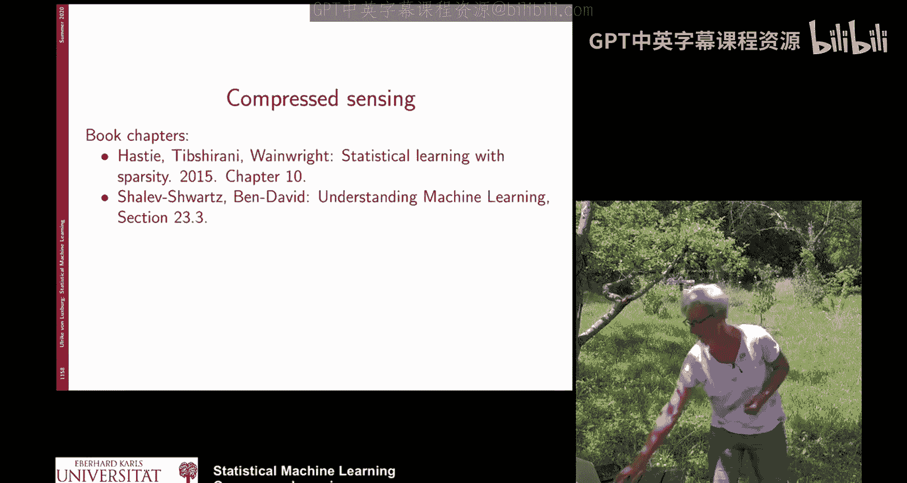

What is compress sensing about。Now， consider， for example， the camera in your phone。

The typical way such a camera works is you have many。

 many different light sensors and each light sensor at each sort of position of your image records the intensity of a certain color in your image。

😊，And the camera stores the image first of all in a raw format。

 which for each pixel value tells you all the different amounts of light you have in each of these pixels。

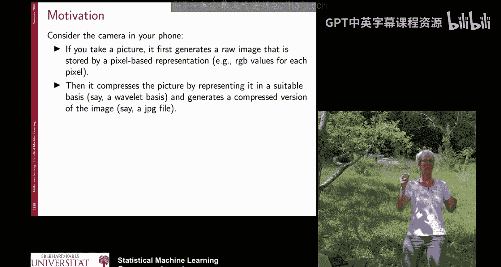

And then typically what you do as a second step is you compress these images。

 say you convert a JPEEC， you make a JPEEC file or so。Where you start from a file that might be。

 say 10 mebyte。 and in the end you have 500 kilobyte。 and still by looking at this image。

 you don't see any big difference between the two images。

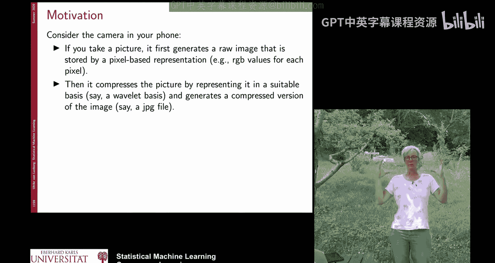

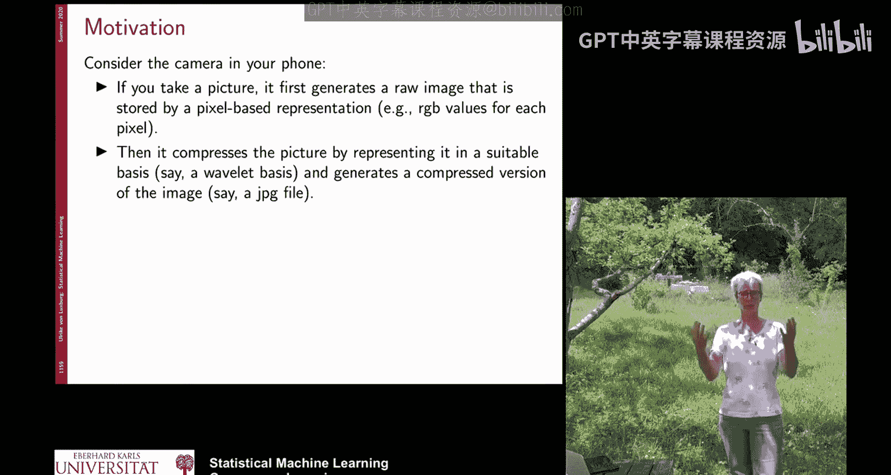

Here we we have just an example， I guess all of you are aware of it。

 but still on the left hand side we see an image。😊，Then what we do is a wavelet compression。

 which is is a particular way of compressing the image。 and I don't want to discuss the details。

 And on the right hand side， you see the same image now in a compressed format and by looking at it。

 you don't see any at least visually you don't see a big difference between what is on the left and the right hand。

 yet the size of these images on like the storage you need to store all these images is very different。

Now， the idea would be that sometimes you have a recording device where you don't have so much memory in the first place。

 so assume maybe in the old days of the phones when we didn't have like 120 gigabytes of storage。

 but you had very small storage on your phone and you still want to record an image。

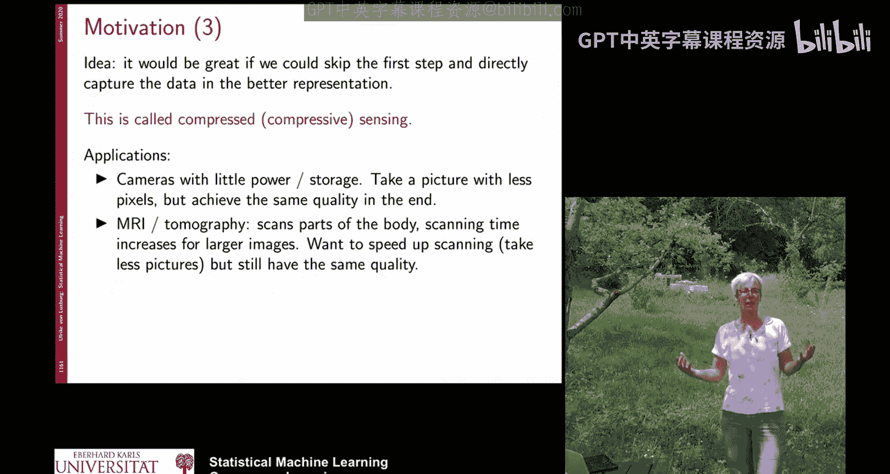

So when you record the image， it's huge。 but after compressing it more。

 So what would be really great to achieve is that we could sort of omit this step of first taking this huge image and then compressing it。

😊，By directly， when we record the image generating this compressed version of the image。

The field that makes this possible is called compressed sensing。

 so sensing means we send something so we either get an image or it might be it might be some kind of audio signal or their different kind of application So you want to send a signal。

 but you want to do it in such a way that directly you achieve at the compressed version rather than taking this detail。

And there are lots of applications for this， like the one I already said you could have a camera which has very little power of a little storage。

 so you still want to store an image， you can't afford to store an image with 10 megapixels。

 but still you won't have a good image in the end。😊，Another application is from the medical domain。

Taking MRI automography images。 So the way this works is like you put people in a scanner and then the MRI is going to scan a particular part of your body。

😊，But the scanning takes a long time because you need to have many different slices on scans for the different like adapt values。

 and so it can easily take like 150 or 20 minutes to scan a particular person。

And again and then again you achieve you end up with a very。

 very huge file of data and it would be really cool if you could speed up that process and say I don't need to sense certain aspects of this image and maybe it's even faster than if I need to scan like without like sort of in a damp for in a dumb fashion scan everything that's out there。

 rather try to to achieve a clever scanning that it ends up with a compressed in image right away。😊。

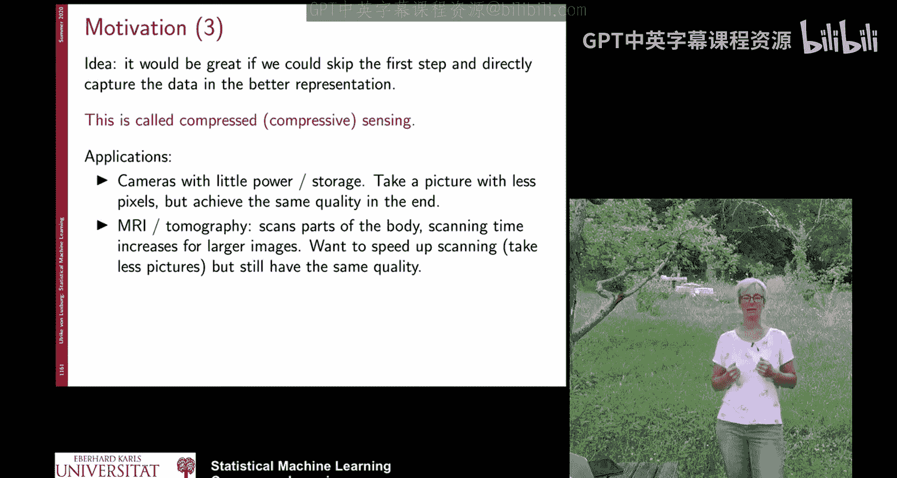

Now， the setup setup now works as follows。 So typically。

 we assume we want to observe a vector in R D。And and typically。

 this vector is also not a sparse vector， like an image。 if we have an image encoded pixel based。

 so there is nothing sparse about the image。 It's going to tell us a light intensity for each particular pixel。

However， the underlying assumption is that there might be a different basis in which we can represent our image in a spa。

😊，This could， for example， be a wavelet basis。 So if we would encode the。

 the image in a wavelet basis， maybe we only need， I don't know，200 coefficients。

 wavelet coefficients and can encode an image which otherwise would have 10 Mg pixels in a， in a。

Of course， it's a lossy compression， but maybe it， it's visually not visible that there's anything else。

 that there's anything that's lost。嗯。And the trick is now， if you would， of course。

 know the spaces in which the data is sparse， we would know the transformation。 and then we could。

 of course， technically con do this conversation from the non sparse signal to the sparse signal。嗯。

But typically， it's not really， it's not really clear how to do that。 And in particular。

 we want to avoid this step of taking this de。The trick is now what we want to do is we want to invent a basis such that all images that are spars。

Can be compressed in a， in a useful way。

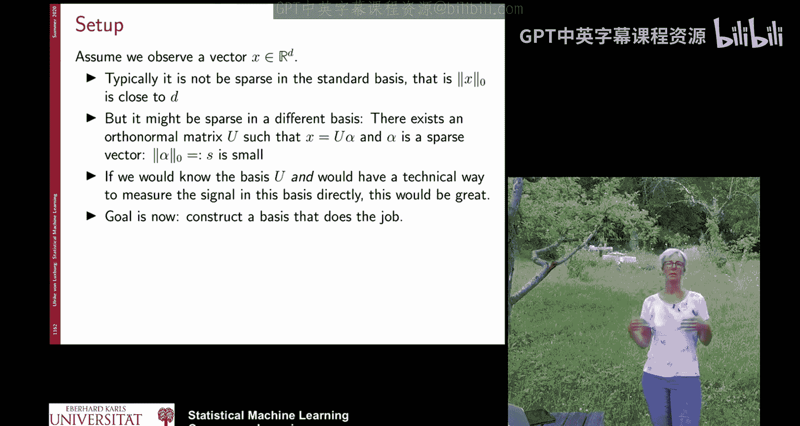

So were going to look at the following rotation in the following。

 So I try to keep it constant across all the slide now。

 So D is always going to be the dimension of the original space。

S is going to be the sparsity of the signal。 So how many in this space in this interesting basis you。

 how many of the entries would be non0 if you represent the image in the spaces。

And K is going to be the sparsity that we will actually hope to achieve。

 which hopefully is low as well。😊，This is sort of what we want to。

 to get at at when we do this kind of compression conversion。And so obviously， by。

 simply by these definitions， we always had have that S is smaller or equal to K is smaller or equal to D。

 That's obvious from simply from the definitions。

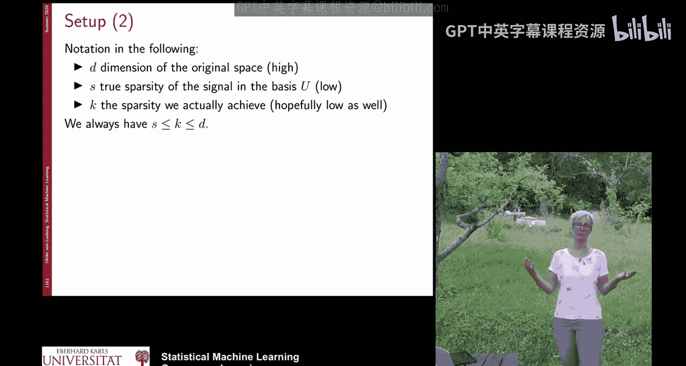

And before diving into the theory how this works， I want to illustrate how this can actually work in Praxis with a really cool example。

 namely the single Pixie camera。😊，So digest it against a standard camera。

 we typically record millions of points and pixels。

And then apply a compression algorithm like a JPEC。

 And now what we're going to do is we' are going to construct a camera that can just record one particular pixel at a time。

So at each time point we have this one sensor that can record the amount of light。

 and yet we want to sense a whole picture， a whole scenery with this kind of camera and we want to do it not in such a way that we sort of post the camera to all the different pieces in the scenery and record millions of pixels in this stupid way but we want to have a more efficient way。

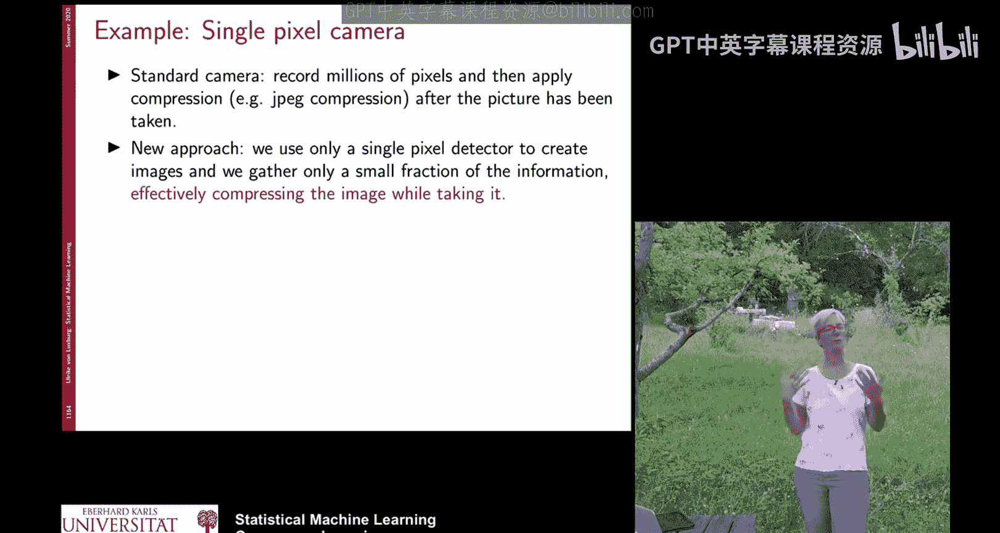

And here is the figure how this works。So what you need to imagine is。It's a bit hard to see。

 So here we have the。So what we have here is on the top of this image， you have the photo diode。

 this is your one pixel that you can record。Here on the left hand side of the illustration。

 you see a scene。 This is the scene that we want to record that we want to take the photo of。

Now what is going to happen， the important part is this array that we have here。😊。

This array is a minuscule piece of equipment that consists of lots of tiny mirrors and these mirrors。

😊，Can be switched on or off in such a way that the mirrors reflect the part of the scene that would correspond to this particular part in the mirror。

To the photo theode or they don't。 So essentially here， for example， in the image。

 if there is a black。😊，If there is a black square， it means the mirror is on。

 so it would take whatever comes from the scene and would reflect it to the photodiode。

And for the white pieces， it would not reflect anything to the photoode。

Now what you can see here is we now have a sort of random assembly of mirror positions where some of these mirror positions are switched on and some of them are switched off。

😊，And so what we get and the photo or what does it record now。

 it records essentially the sum of all these signals that come from this black kind of mirrors so essentially I mean you can consider it as you have the scene you randomly switch on and off some pixels and you sum the intensity of the pixels that you have switched on。

😊，And this is what you record。Okay， so this is one。 so you first of all you do this once。

 you have one， one layout of your of your of your mirrors for this fixed layout。

 you take an image of your scenery and you achieve with a value with one number corresponding to this describing this image。

 which is the sum of these random randomly chosen pixels。AndNow， the trick is， of course。

 we do this again。 So now we take a different different combinations of of black and white here。

 So we now choose a different random position of these mirrors which are switched on and switched off。

😊，And again， at the photo record， this sum of the intensities that we get for this particular layout of the mirrors。

And now we keep on doing this a number of time。And the question is now， now say we do this for。

 say 100 times， so we have 100 images， each image corresponds of one number。😊，AndNow。

 the question is， can we based on these 100 number numbers that we have recorded。

 Can we reconstruct the original limit。And the answer is going to be yes。

 and I'm going to show an example in a minute just to give you some numbers。

 So here the the resolution of this image is 64 by 64。😊，And which would consist in 4000 pixels。

 if you like。And the way this is is being compressed in this particular example that we're going to see on the next slides and we choose k equals 1600。

 so we choose 1600 measurements。 so we repeat this measurement process 1600 times with random layouts of these mirrors and then we are going to reconstruct the image and so what you can see is simply like here you have a factor of a bit more than two from this 1600。

Metterments that we actually take to the raw image format。 So what by this。

 like for this particular toy example， we would have saved about half of the storage that we would need。

 This is not really impressive for this toy example。

 but still I find it very impressive because here's how it looks like。

So on the left hand side， you have the original。The original image of a soccer ball in the 64 by 64 pixel space。

 it's a grey scale image。😊，And on the right hand side。

 you can now see the reconstructed image that has been reconstructed from these 1。

600 measurements that have been taken by this single pixel camera。And I find this really。

 really cool because this opens the door to many applications and it sort of it's also intriguing that this really works。

 I find this very beautiful and also astonishing the fact that it works。😊。

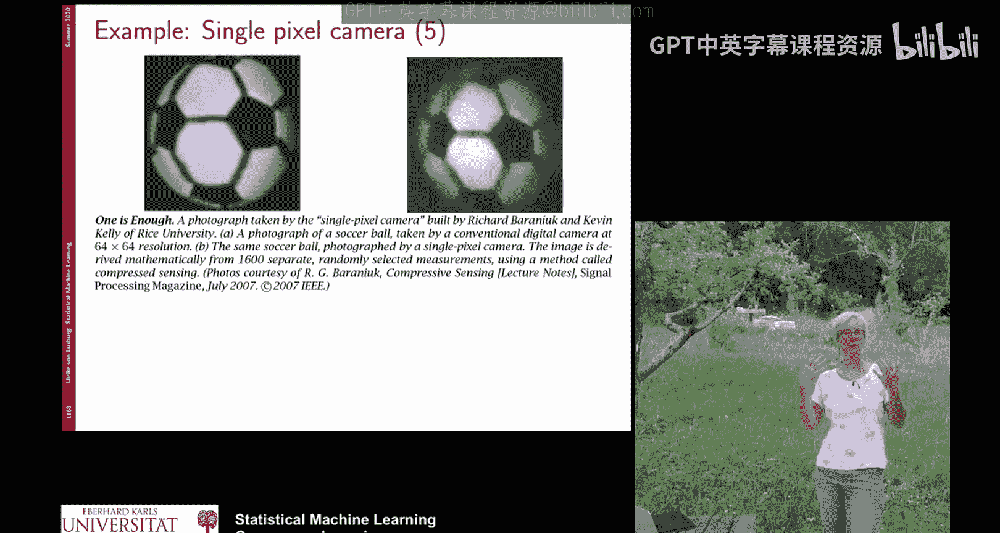

Let us maybe go back to the text description on how this works。 So have in mind is schematic。

 so this is not what you should have in mind and I'm going to describe it yet once more。😊。

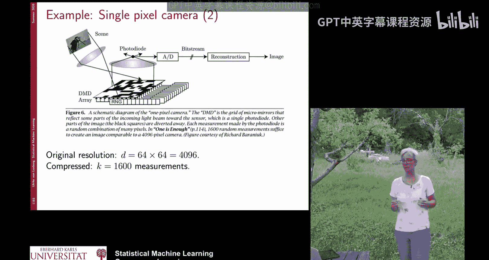

Im in in form of a text。So the way it works is you have this array of bacteria size mirrors or tiny mirrors。

😊，To acquire a random sample of the incoming light and so this is sort of what comes in。

 you have the images the mirror that has switched on。😊。

And it's going to project it on the single photo you。Now。

 each of these mirrors can be tilted in one of two ways。

 either to reflect the light towards this photoode or away from it。

So the red tendency is the photo theode receives a linear combination of the images of all the mirrors that are switched on。

So it's just one number。So the light that the sensor receives is a weighted average of many。

 many pixels， namely all of them that have been switched on。😊，Now， one configuration。

 WI of the mirrors gives rise to one linear measurements of our signal linear because it's a linear combination of the pixels。

And now we repeat this procedure k times， so we achieve k different measurements w1 to WK。And then。

The next step is we want to be able to reconstruct the original image。

And now the theoretical result that we are going to develop through the course of this lecture。😊。

That by taking of the order S lock D over S many snapshots。When each for each snapshot。

 we take a different random selection of mirrors， which has switched on it off。

The single pick picture singing。Pixel your camera is able to acquire a recognizable picture with a resolution comparable to D pixels。

😊。

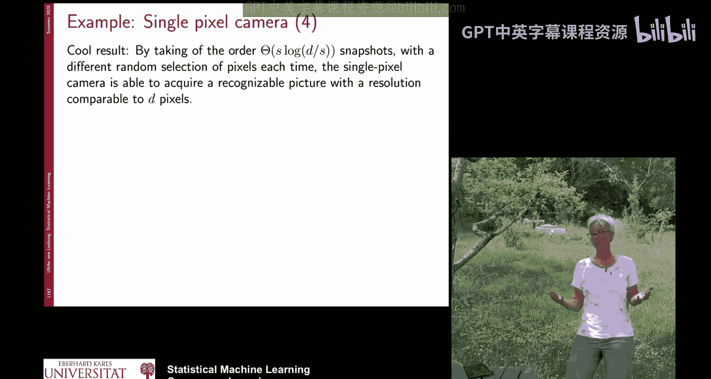

And here the interesting thing is， of course， S is D log S。

So S is the sparsity that we need to assume that we potentially can achieve。

And lock D over S is sort of maybe just to get a feeling。 lock D over S is maybe not so large。

 Simply forget about the lock。 And so essentially， it's nearly linear。

 It's it's a tiny bit larger than S。 And S is the absolute best sparssity that you could achieve that is sort of the assumption that we need to to to plug into our algorithm。

 So the assumption is going to be。 We can represent it in a basis which has sparsity S。

 So the representation has sparsityity S。 You now we can recover it。

By taking only a bit more than as many snapshots。And this is really cool。

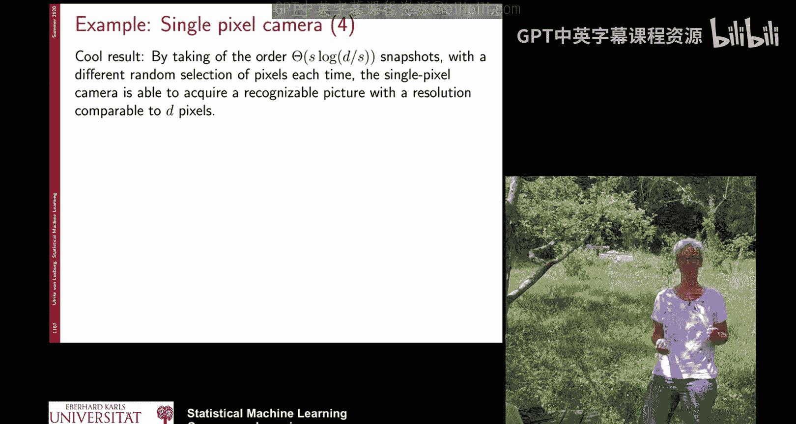

In fact， there is also a nice blog that I discovered which is already more than 10 years old by Ternce Tao。

 who described that And he also was very enthusiastic。

 I think he shares the feelings I also have have whenever I read about this。😊。

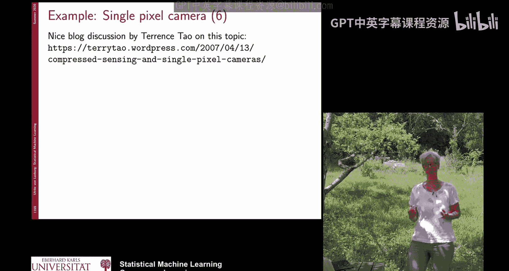

Now let's look a bit at this from a bit more from a more like conceptual point of view。

 so what we' are now going to do is we design K different linear measurements which are called w1 to WK。

😊，And this in this example we had， this is being done by a specific hardware。

 but this is the sensing approach。So we and and the important point is we construct these measurements before we see the signal。

 so we maybe once we draw the random layout of all of all these mirrors。

 but it's not like we first see the image in some high resolution and then look at the and then sort of megacomput that tells us what is the best way to place these mirrors we place the mirrors once。

And then we see the signal。 So this is important。 we want that this layout of the mirrors we choose K different layouts。

 but then it it's supposed to work for all incoming signals as long as certain assumptions are being satisfied。

😊，So we first designed the linear measurements， then nature picks an unknown signal X in a high dimension space in RD with a large D。

And now we directly receive the measurement results which are on this slide called x1 tde to x2 tde and so on。

😊，Which is just a linear combination of the original signal with this sensing device。

And this results in K measures， K measurements in a K dimensional vector space。

And then we are supposed to reconstruct the original image X。

From this measurement that we have taken X to the。And as I said on the end of the slide。

 so the goal is to design a single set of measurement vectors that works well for all signals so that we can reconstruct the signals very well。

 no matter what the incoming signal is going to be。😊。

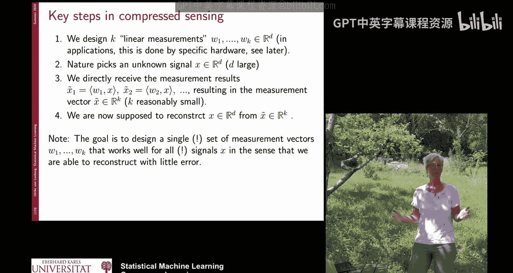

Here's yet another way to describe it。So this is now more in matrix formulation。 So again。

 we have the signal X。😊，We can't measure x directly， but we can measure a compressed version of this。

 and this is now encoded into a matrix w。 so now essentially we stack all these vectors w1 to Wk。

 we put them into a matrix which is called capital W。

And so what we what we obtain is a measurement exer， which is w times x。Now。

 living in a low dimension space， are K。And K would be much much smaller than D。

And this matrix w is chosen before we see the data， so we choose the matrix W once。

 and then we keep on using it for recording data， and then we want to reconstruct the high dimensional signal from this low dimensional representation。

And now here's a question to you。😊，Now we have this equation here， x to is Wx。

We want to reconstruct X。 So what would be the natural approach by which you would think this would work。

And maybe sort of think about it for a couple of minutes。 How would you solve that。

 And then maybe what might be problematic about it。

 Please sort of switch off the video for a minute and think about it。

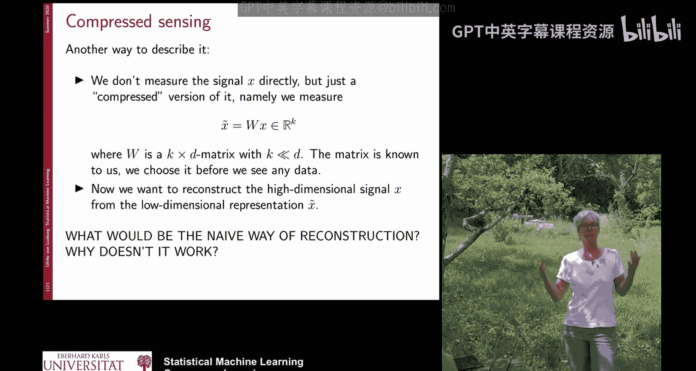

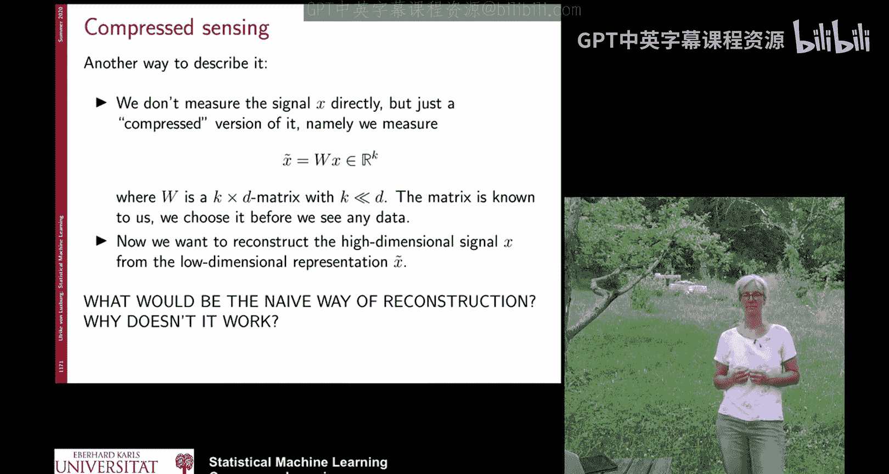

Okay， maybe you have found the solution。 So the naive way of solving this problem would be to say。

 well， we have a linear system of equations and we have the the linear system externalter is w X。

 we simply solve it。 We know externalterly。 we know w， so we solve it for x。However。

 the problem that we are going to run into is that this linear system is completely underde。

 So we have K inequalities。😊，These are the sensing， the measurements that we took。

 but we have D unknowns， all the original variables that we have。 So K is much， much smaller than D。

And then there are many， many， many solutions， infinly， many solutions to the system。

 And we don't really know which one to prefer。Okay， and like unless we make any assumptions。

 there is no way we can get out of this strip。 We have a linear system of equations。

 It's underdetermined。 There are infinitely many solutions。

 And if we don't have any induct bias and we don't know which of these solutions to pick。

 and it's not going to work。

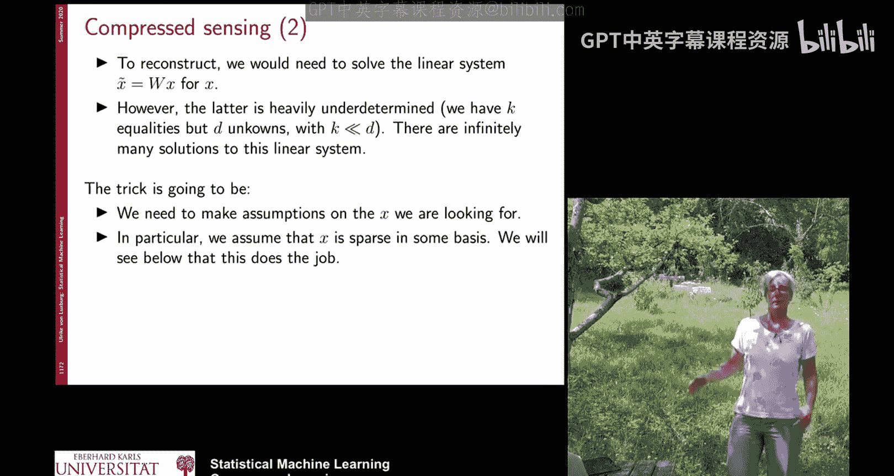

And now the interesting and cool insight is sort of what might be the inductive bias that we can choose such that this thing is going to work。

😊，And the interactive bias that we are going to make is that the signal that we are looking for is sparse。

And we have seen many different kinds of putting inductive biases also on matrix problems where we might say a matrix is low rank and so on for a vector。

 the one way one natural way of making an inductive bias is to say that the vector is sparse most of the entries of this vector should be 0。

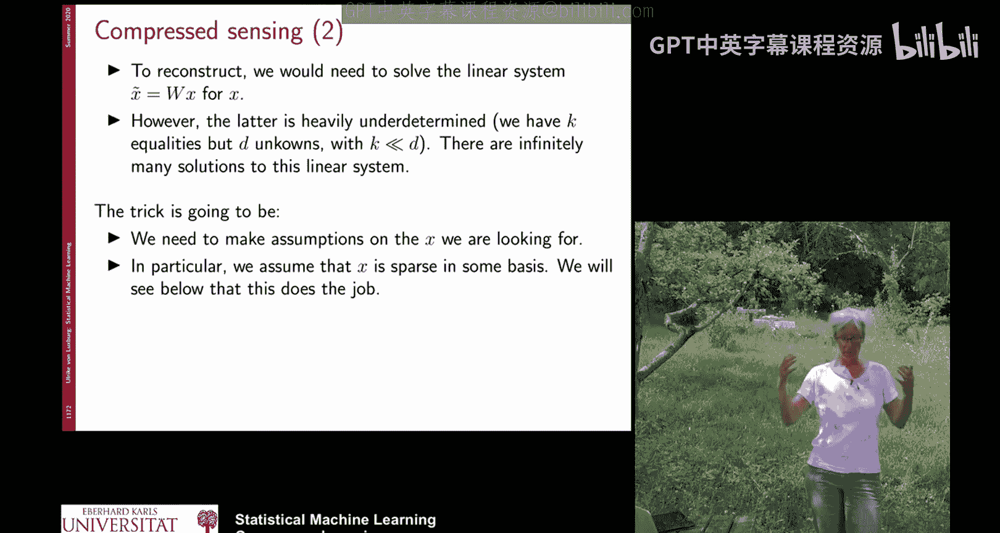

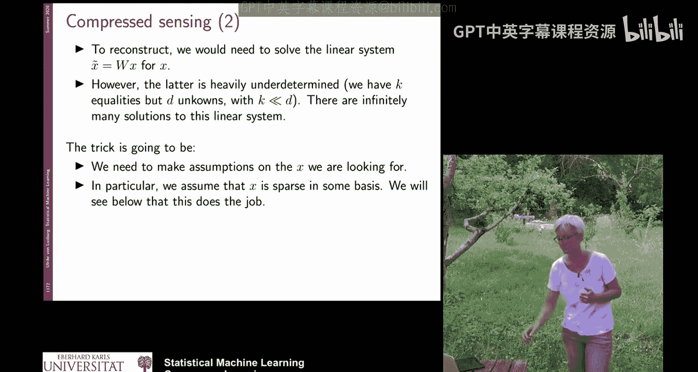

Okay， and here is now the first theorem that we want to look at and that we are going to derive throughout this lecture。

So fix a signal length T。 So this is the high dimensional the dimensionality of the high high space and as sparsity level S。

 this is the one that we want to achieve。Let W be a K times D matrix where K is chosen as we have seen before。

 namely of the or S lo D of S。😊，Where each of its entries of this matrix W is chosen independently from a standard normal distribution。

 So what we are going to do is we construct this matrix W in each entry for each entry。

 we draw a random normal distributed random random number。Independent。

And then with high probability over the choice of this matrix W。

 what is going to happen is the following。Every S sparse signal。

Can be efficiently recovered from the sensing， from from this linear ecosystem of equation。

Which is external is Wx。And how can we recover it， we can recover it by solving an optimization problem。

 namely the optimization problem minimize the one norm of x subject to the constraint that the linear inequality the linear system is satisfied。

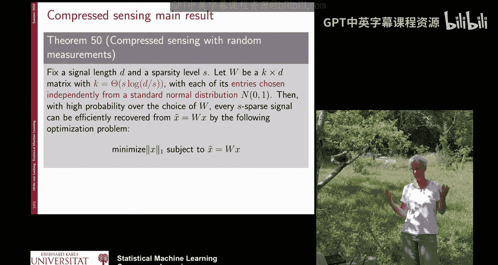

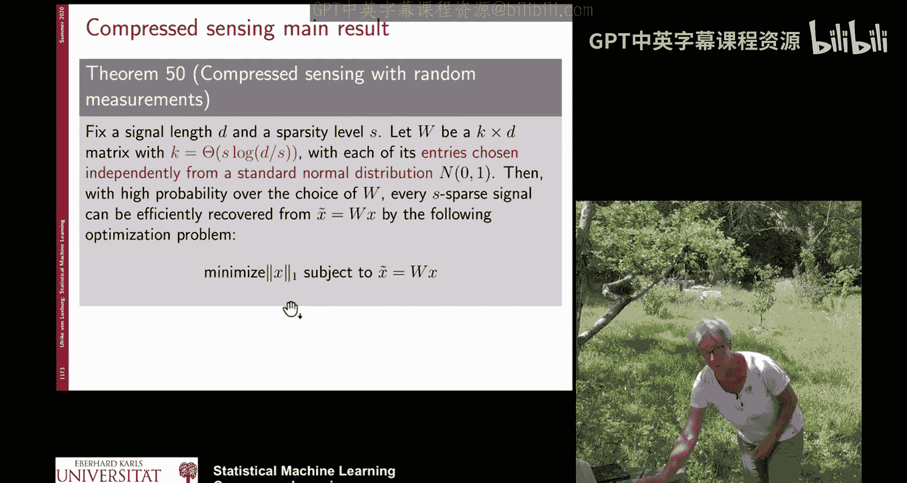

Okay， so the theorem makes three very interesting statements。😊。

The first statement is the sensing matrix W， we can choose it as a random matrix where the entries are chosen independently from a normal distribution。

This is very nice， and it sort of should remind you of something that we've seen in one of the previous lectures。

 namely the Johnson Den Tosum， so in some sense。😊，Like。This matrix， what it does is it。

 it generates K random projections。And we have seen in Johnson Lyn Law that random projections have certain nice mathematical equalities。

 and here is no a different way in which these random projections are nice。Okay。

 so the first important statement is， how do we choose the sensing matrix。

 It is just a matrix of independent entries。The second important thing is。What is the sparsity level。

 how many measurements do we need， how large does so how many columns in this matrix do we need and the statement says we need to have about s lo d over as many many sensings。

And this is also nice because it says it just it' it's nearly linear in the parrsity of the signal。

 So somehow if you want to recover a vector that has S entries， which are nonzero。

 it's hardly imaginable that you could recover such a vector without making S individual measurements。

 because how should you like if if I want to write down a vector， which is 10 nonzero entries。

 and I can just record called five numbers， then there's no way in which I can sort of。😊。

get this unless I make some assumptions now on the structure of these numbers。

 but typically we don't。So it makes sense that we need to sense at least as many many numbers。

AndNow it's a slightly bit larger than namely by the factor locked the Os。

 but this factor is not really large。 and in practice， I think it doesn't really play a big role。

So that's the second thing。 how many like what is how many， how many sings do we need to make。

And the third statement is now how once we made like we have done the compress sensing and we recorded the signal。

 how can we reconstruct the original signal and it says here the algorithm is you simply minimize the one norm of the vector subject to the fact that this linear system needs to be satisfied。

So the serumorem essentially covers everything that we would like to need。

And now I would like to go through deriving what is the background of this whole theorem。

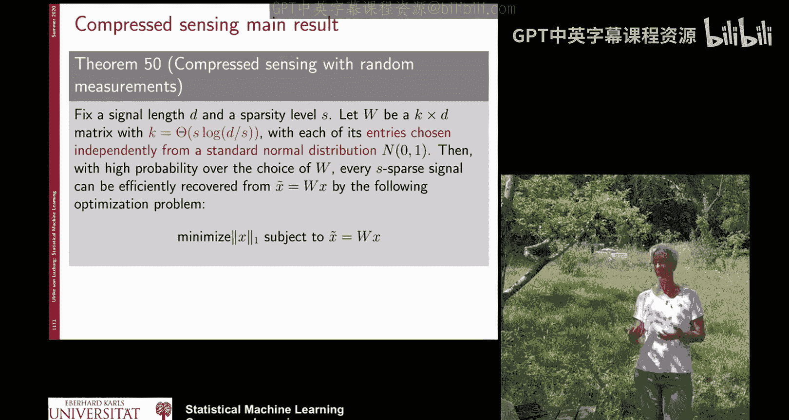

Oh， before we do that， here's the question， whether you think that S D log D over S is good。

 I've already given you the answer。 I think it's really good。 I've just explained that。😊。

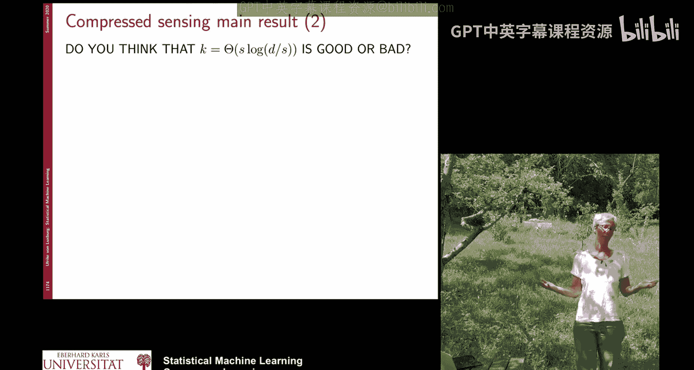

So the answer is here。There's also a handwa intuition why。

It's S lo D over S Y this is really the correct number that you might want to end up with。嗯。Okay。

 so the first thing is， I mean， we are looking for a vector of length D。

 and it has S non zero components。So we know the number of components。

 but we don't know where these non zero components are。

Now how many different subsets do we have where these components might sit at。

 So there are D it was as many subsets of size S where these positions could be among all the de positions of the vector。

 that's clear。And in principle， to recover the perfect solution for this problem。

 what we would need to do is， I mean， the naive way would be to try out all these des as many subsets and then try to reconstruct by having these subsets non-ze and everything else being zero。

This would， of course， be the na E approach。There is a more efficient algorithm that you can do and you can you can prove that this algorithm then leads lock D choose as many attempts。

 This is a bit。 I don't want to go into the proof， but the argument is sort of similar to if you know that to the lower amount of compression based sorting where you say at each particular point in time I need I need to decide need to compare to numbers whether it's smaller or larger and then I want to find the ordering of these numbers and when you do that you essentially build up the recursion tree of the algorithm like of the different and possible solutions and you end up at the fact that you only need to ask for lock do you teach choose as many entries and that's sort of a similar argument Yeah I don't want to go through it in detail。

But the bottom line is。That S D log D log sorry， S。Here， I mean， we have lock T choose S。

 This is S lock T over S。 This really makes sense as a number。

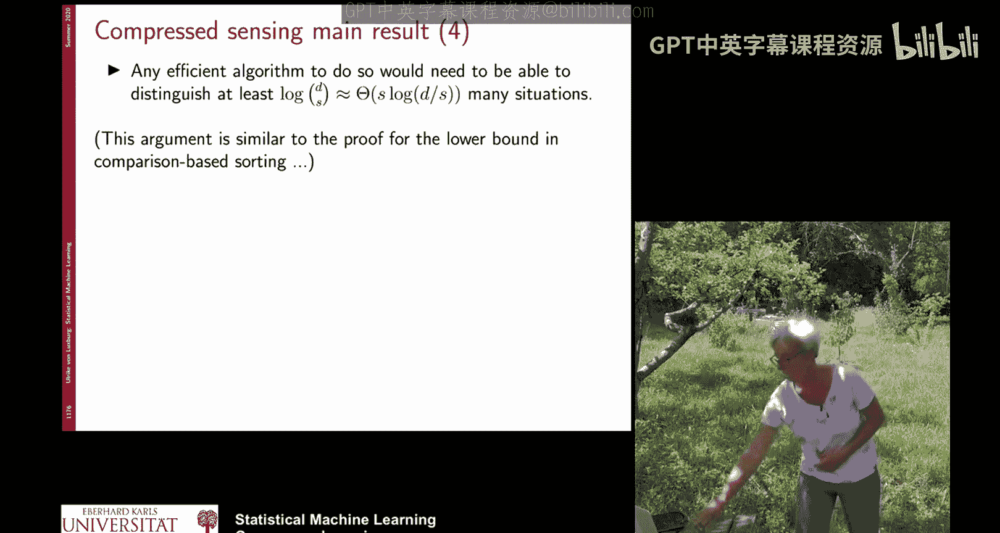

Now， let's look at what would be the key steps when we want to prove that theorem。

The first key step is。嗯。That if we choose this matrix such that it has a certain property。

 which is called R IP， the restricted isoometry property。

Then any case pass vector can be recovered from its compress compressed image。

At least by an inefficient algorithm named it by the one that minimizes aterity or not。Okay。

 so here the statement will be there is a certain property that a matrix needs to satisfy this matrix W。

 the sensing matrix， and once it does that， it can be by minimizing the zero norm of a vector。

 we can find a solution of the system that is nearly the exact solution to what we' are looking for。

And then the very surprising thing here is that we can equally well do it by not minimizing their zero norm。

 which is annoying， I mean， because as we it's discrete。😊。

But we can do it with the L1 norm instead instead and the L1 norm is really nice and this is sort of the same argument that we've seen many times in the past already。

 for example， in Lasso where we say instead of solving regression with a sparsity constraint in the zero norm we solve a sparsity constraint in the one norm and we've also seen it in matrix completion where we say said instead of the rank of a matrix。

 we look at the nuclear norm at the trace。😊，And this is and in。

 in this particular case of of matrix completion， we could also even prove that by going from the 0 and1 to the1 norm。

 we don't lose anything。 we can still find the optimal solution。Okay， so this is again， it's cool。

 and it's surprising that one can， in fact， prove that it's gonna work。And then the last thing is。😊。

Now， what we have is we say if we have such a nice matrix W with this sort of secret property restricted I summetric property。

 which I'm going to explain later。Then by minimizing the L one norm we can actually write down an algorithm that is going to work so the last hidden bit is how can we construct such a matrix W and the answer is going to be and we can use simply a random matrix with entries which are drawn from a normal distribution and this is going to do the job。

Okay， now let's go into each of these steps。The first step is we want to define these RIP matrices。

And here's not the definition。A matrix W is Epsilon2 SRI， sounds a bit complicated。

For all nonze vectors that have sparsity， at least s， we know。The。

 if you compare the norm of W X to the norm of x itself。And-1 is smaller or equal to epsilon。

So observe in the ideal case what you would like like in the ideal case W would be maybe something like an identity matrix where you don't do anything to your vector。

 then in the best case what you would achieve here is a ratio of 1。😊，Now。

 what do you want to say now， when we do the sensing， we can deviate from one a bit。

 but not by more than epsilon。😊，And this needs to hold for all vectors that have sparsity at most S。

 and this is important so this property obviously is not going to hold if we want to use it on any vectors。

 the question is can we make it can we sort of proof or find some matrices that satisfy this property if we sort of restrict ourselves to a subset a small subset of vectors named with the sparse vectors？

😊，So the intuition is， it is a bit。Like in in Johnson In class。

 when we apply this matrix to the vector， the norm of this vector is not really going to change a lot。

 And if you remember， this was similar to what we had in Johnson In class。

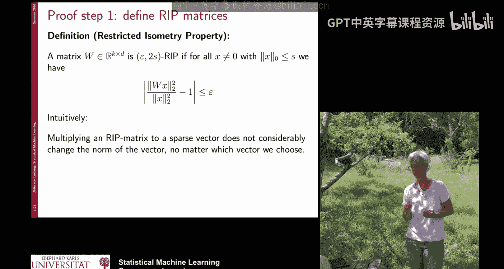

Okay， and now the first theorem that we can prove is。That once we have these RFP matrices。

Then we can achieve a lot less compression if we can optimize over the L0 norm。 This is， of course。

 a theoretical statement because in practice， this is not going to work。 But yet again。

 maybe we start with a theoretical result first。 and here it is。

So now assume we have this RIP matrix for some epsilon。

 so epsilon is sort of the amount by which so on the previous slide。

 sorry I forgot to say this so there are two parameters S is the parrsity and epsilon is the error that we allow。

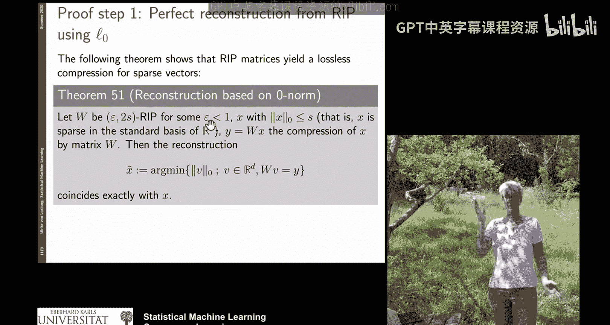

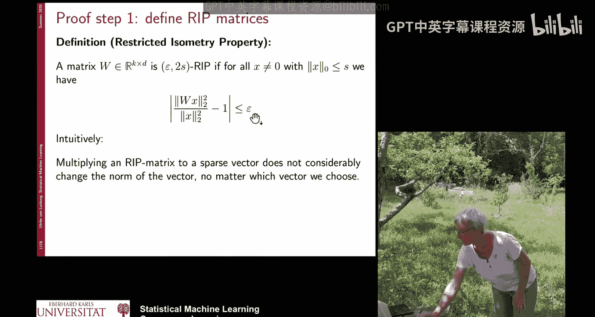

And now we say so we assume we have this property。And now we have a vector x that has sparsity atmost S。

And then now we compress this matrix， this vector x by taking w times x。

And now we end up with a vector Y。And now we want to reconstruct the vector x from y and how do we do that。

 we now say we solve the minimization problem， minimize the zero norm of a vector under the constraint that the vector satisfies the line equation inequalities。

And the segment is， the result from this algorithm coincides exactly with our original signal。

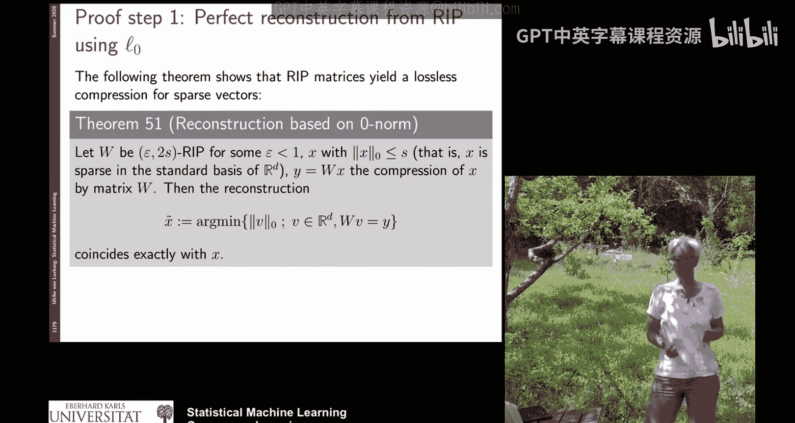

And we can prove that theorem it' surprisingly， it's not so difficult。

 There's proof by contradiction。So we assume now that is reconstruction that we have sorry。

 in the previous slide， it was called Y， but I meant X tilda。

So ex as always said the reconstructed one on the previous slide。

 I should have written ex instead of Epsilon， instead of Y I'm sorry。

So let us assume that the two guys don't coincide。Now， by definition of externality。

 we know external is the vector that minimizes the zero norm。😊，UnderUnder the linear system。

 so the constraint is like we look at all vectors that satisfy this linear system。

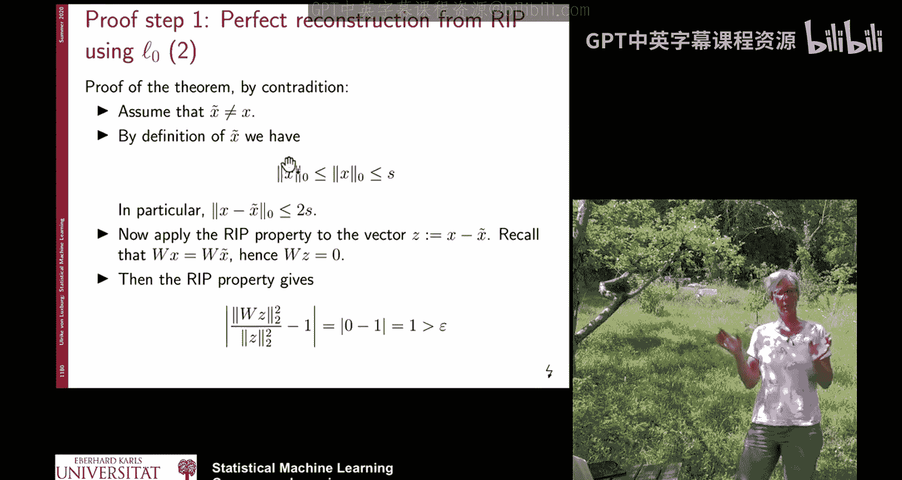

And of course， the original vector satisfies it。But also now。

 the vector that we find in this optimization problem solve finds it。

 And the vector we find in the optimization problem is the the one that has the minimum theonm。

 So by this construction， we know that the zerom of this vector can only be smaller or equal。😊。

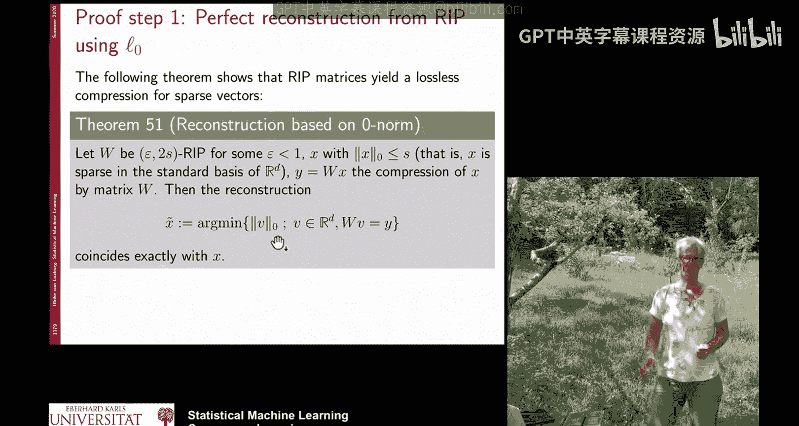

To the zero nu of the true vector。And we know that the serumroome of the true vector is bounded by S。

 This is one of the assumptions that we make in the serum。And so in particular。

 what you can now see is that the difference between the the number of nonze coefficients in x and x can at most be to s because like。

Extera has S at most as many components， which are on zero。

X also has at most S components which are on0。 So the difference between the two can at most have two s。

 Like in the worst case， these positions don't coincide at all。

 And then we have two S positions which are on 0。And now the trick is we now apply this RIP property to this difference vector to the vector x minus tilde。

 which is simplifyified notation we now call this vector z， so z is x minus x tilde。

And also observe that Wz is 0 because both vectors x and exilder satisfy the linear system。

 So for both of them Wx and W x till agree。So W Z needs to be 0。

And now what do we get by the ROP property， we now can plug it in。😊。

And here the first thing disappears it is zero， which is what I just explained。So we have 0 minus1。

This is one。And this is now larger than epsilon。 So if you chose epsilon smaller than one。And then。

 we have a contradiction。Because the RFP property said that whenever we use it on a vector that is2 S barsrs。

 then it needs to hold。

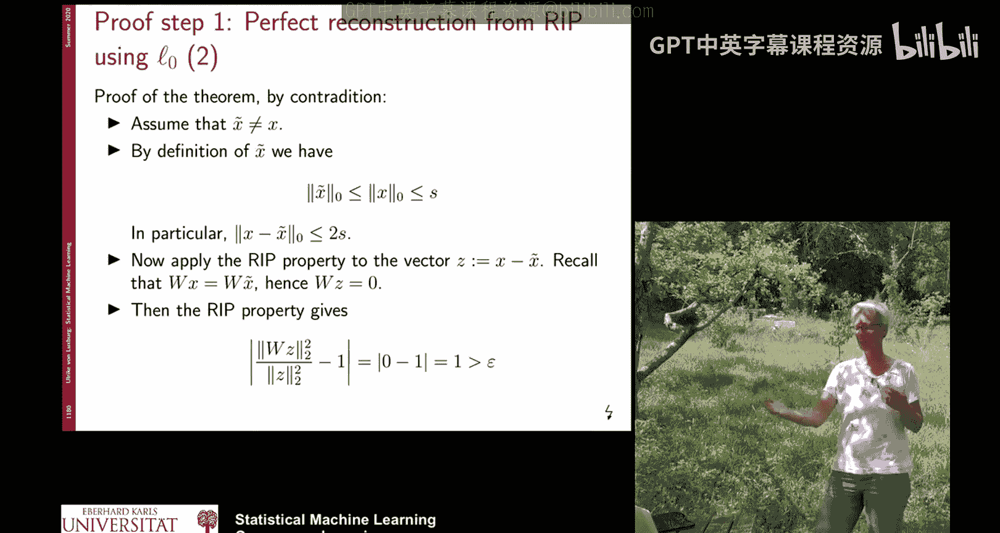

Okay。As I said， the serum already immediately gives a first algorithm to reconstruct the vector。

 but of course， it doesn't work in practice because it's a discrete optimization problem because we optimize over the serum。

And now the next step is going to be to replace the0 norm by the 1 norm。

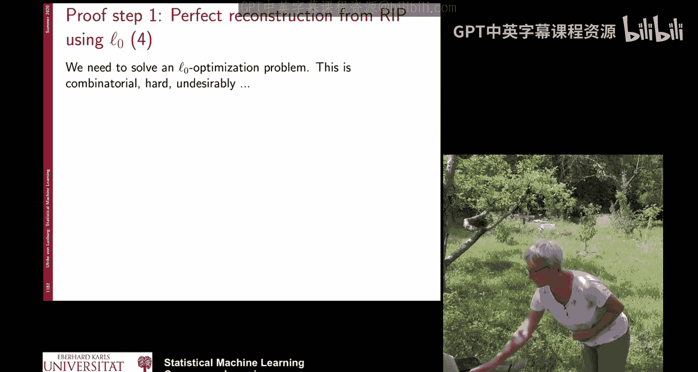

And the result， as I said， which I find very surprising and nice。

 is now that we can get the same kind of guarantees when we use the one norm instead of the Lze or norm。

And the serum now reach as follows。And theyre the same assumptions as in the previous theorem。

We cannot now state that it doesn't really make a difference。

 whether we minimize the zero norm here on the left side or the one norm on the right hand side。

 we will find the same solution of the optimization problem。And this is really cool。😊。

I don't want to go into the proof， but there's a very nice write up in the book by Sha Sha Schwartz and Shaib Bndavi。

 You can look at it if you're interested in the references here on the slide。😊。

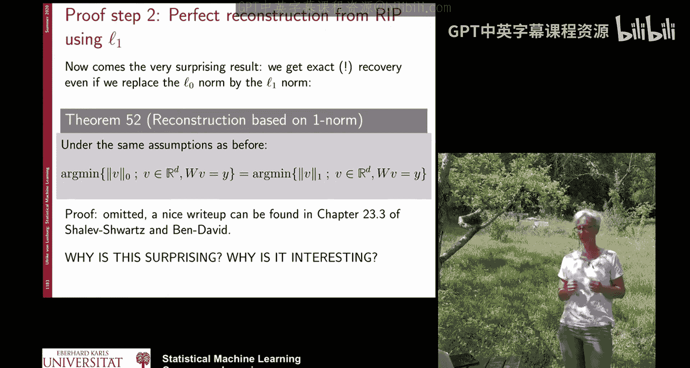

Okay。Now， this is really nice because what happens now is the theorem gives us a pretty efficient way to exactly reconstruct the original signal from this past one and the optimization problem that we need to solve is a linear program。

 So this is something we know that we can do it in a polynomial time。😊，And then this is really cool。

Now some remarks about extensions， I mean， of course this is sort of we just scratched the surface here。

 there are many， many， many different serumems and different regimes with different assumptions and so on。

So here there exists a stronger version of the the that does not assume that the original vector is S spa。

And then you can sort it's a bit like in PCA， you can just say we are going to recover the S。Best。

 the largest components of a vector and the other ones maybe don't play such a big role or they do。

 But sort of the the guarantee that we get is on the first S components of this vector。

 which is really interesting as well。And then there are also versions of the theorum where you don't know what the basis is in which the signal is for us。

 you have an unknown basis and you can prove similar kind of statements。

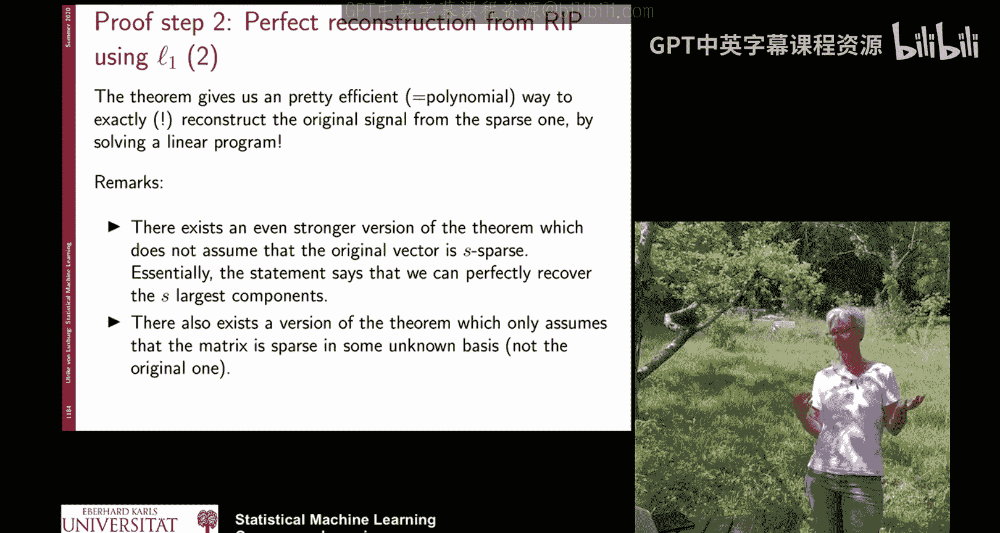

So this was the second step and now we need to look at how can we actually construct these RFIP matrices and here is now the answer that random matrices have this RFIP property and the statement now looks as follows that S be an integer。

And we have these parameters， epsilon in Dlta。And here is now okay。

 So we choose k like a constant times the number that we've seen so often namely S lo the over。

As we had previously noticed Delta Epsilon。Over epsilon squared。Okay。

 let's maybe simply take it for now and this statement is going to be now we choose w。

Its a matrix in R time R K to the D where K is not chosen as chosen as large as it is indicated in the line before。

 and each entry is drawn from from a normal distribution with mean 0 and variance  one of s。

Then with probability 1 minus delta over the choice of this render matrix。

 this matrix is Epsilon S RIP。Okay， and and you need to be aware。

 So the randomness is over the choice of the matrix， which you typically only do once。And so， so。

 so you choose the matrix。 But then with high probability， you have this property。

Maybe also observe so epsilon sort of it again looks a bit like in the Johnson Den gloss where you also have Epsilon square and the denominator and there again Epsilon was also the error that is allowed on the norms of the vectors and this is the same kind of statement here。

And more generally， now， if you want to go to a different basiss。

 if use as any D times d ortho the normal basis， which maybe performs a basis transformation。😊。

Then also， the matrix W times W times U is Epsilon S RIP。Again。

 I don't want to go into the details the proof is in the Sha Shah Le Schwartz and Sha B Davidavi book I just made a couple of remarks and one of them is as I've already mentioned。

 this is really close to the Johnson Ly class theorem which we've seen earlier in the lecture。😊。

And the second part of the theorem with this basis transformation matrix U takes care of the situation when the signal is in sparse and the original basis。

 but in some other basis that we could choose。

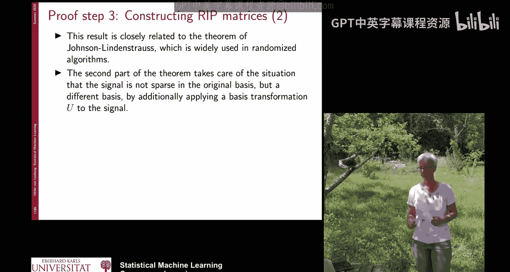

Now let us give us， I mean， this was sort of the theory behind that and even though I didn't really show you the proofs。

😊，It is somehow surprising that they are not extremely complicated。 I mean。

 I'm sure this was not easy to come up with。 It's like as many of very of many elegant mathematical series。

😊，It's a problem like if you don't know how to solve it， it looks really， really。

 really hard and might even look impossible， but once you see the solution。

 it is sort of simple and elegant and nice。😊，But still let's try to build up a bit more intuition。

 So here's a different way to tell the same story。Name decompressed sensing has advantages when signals are sparse in an nonbe basis。

Measurements are expensive like in an MRI scan in the medical domain。😊。

But computations at the receiver end are cheap because at the receiver end you need to reconstruct the signal。

 so it， of course doesn't help you if if you can take these measurements and on the same device where you're taking the measurements you also need to sort of do this inversion and this sort of reconstruction of the signal。

The scenario we are looking for is you have a cheap sensing device。

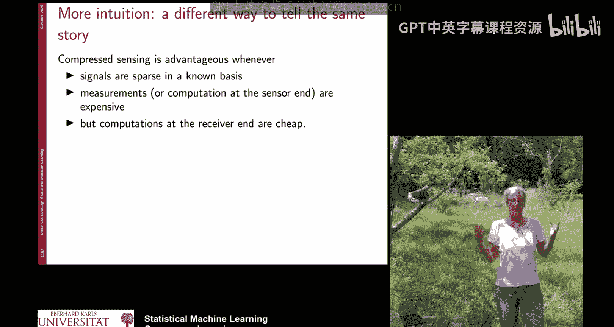

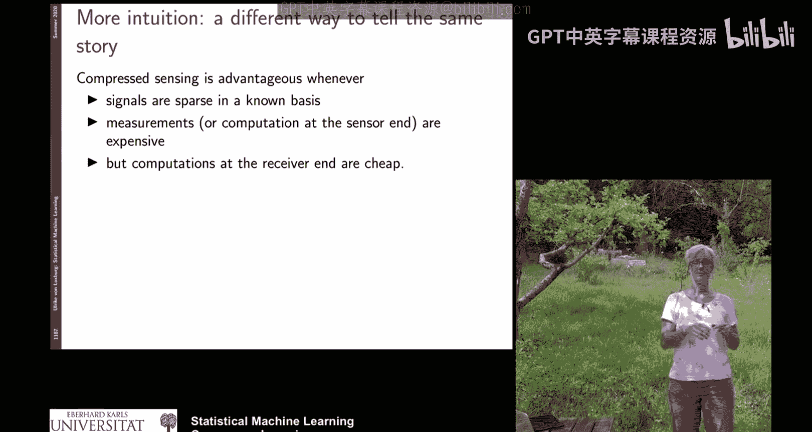

Say a very low cost phone。 you take this measurement to say， say， I don't know。

 you're a scientist and you throw sensors in the rainforest to take certain pictures。

 And later on you collect them again。 maybe that's a stupid example。 But then you collect them again。

 you can take these K measurements。 and now you can bring them together lap and you have all the time of the world to solve this optimization problem of minimizing their one norm。

And there's a linear constraints。So。But this is something we need。

 We need to make sure that at the receiver。 and where we finally do this evaluation。

 computations should be cheap， or we should have the power to do this to solve this optimization problem。

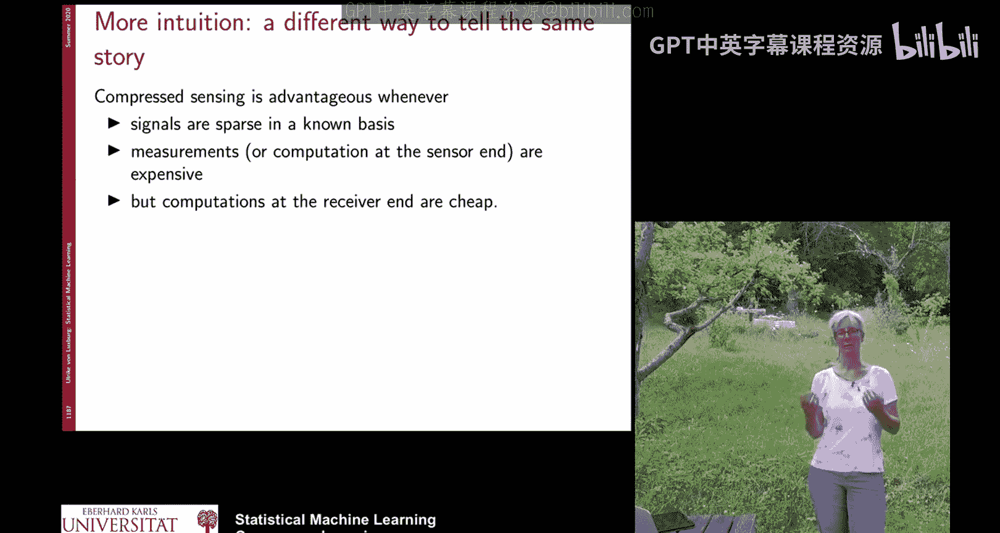

And the trick is now each of the measurements is a small number of random linear combinations of signals。

But because we know that the underlying signal can be compressed。This sort of under this assumptions。

 we still have enough， enough measurements to be able to reconstruct the signal。

This is sort of the main story。 And， and this reconstruction works by a nonlinear procedure。

 That's maybe also important because this linear procedure doesn't work。

 And this would simply be solving this this linear system， which is underdetermined。

 So we have this nonlinear thing， which is solving this optimization problem。

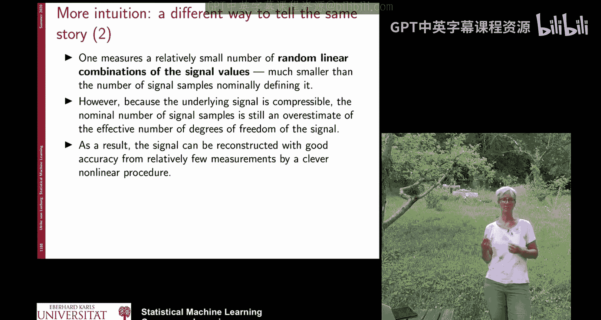

Now if you read the literature， often people give you sort of conditions under which compress sensing works。

 I am not sure how informative I find these conditions but yet I want to discuss them briefly so the first one is transform sparsity so the desired image should have a sparse representation in a known transform。

So it needs to be compressible。 So if you have a random image， it's not going to work。

 There needs to be some way to compress this image。

Then the incoherence of undersampmbling effects that may be something that we are going to see in the next example as well。

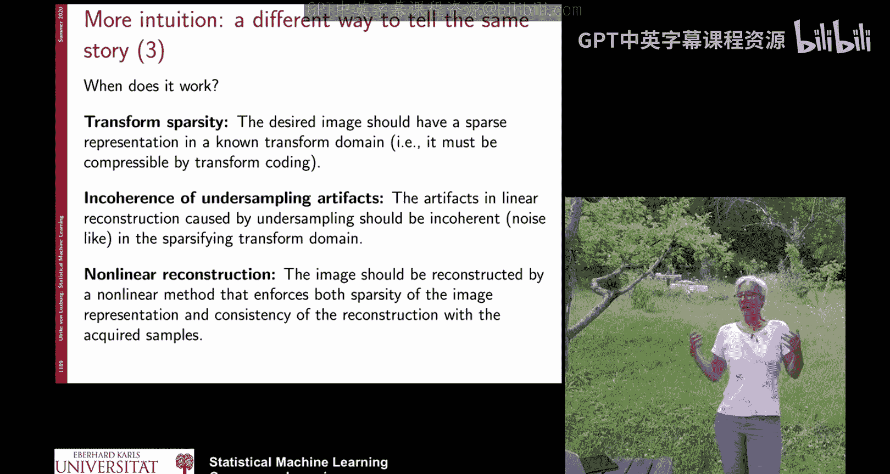

嗯。So what we need to achieve when we do this random selection of bits to take into account that this doesn't sort of this selection。

Should be incoherent in a way that there's no sort of regular that regularity that comes up and that that because that would destroy the performance of this algorithm。

 And maybe this can be better understood on in the next example where I look at at particular。嗯。

Compressed sensing examples。And then it's an ordinary construction。😊。

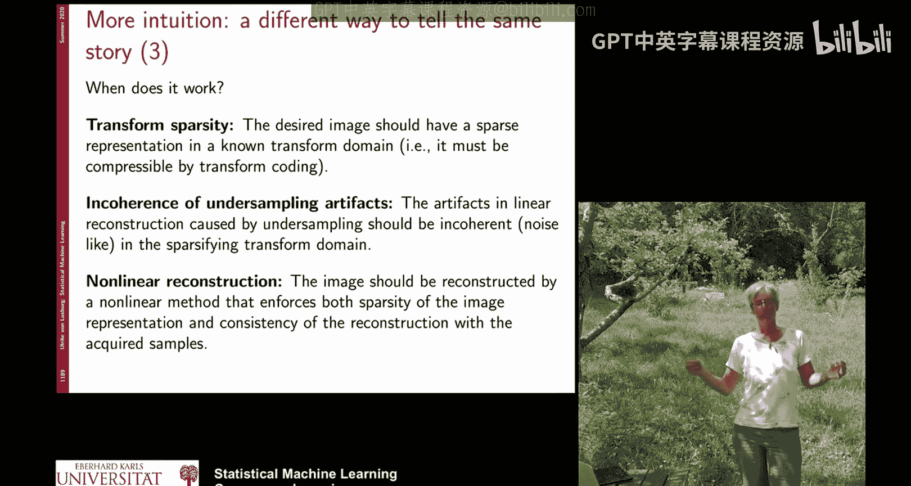

This is what I already said with the linear construction。 It wouldn't wouldn't work。 Now。

 I want to look at an example that comes from time series， and it's taken from a paper from 2008。

 which in fact， is with compressed sensing for MRI。 So for the medical domain。

 But it also discusses this example here。嗯。Assume we have a tie。 We have a signal。

 which typically is non sparse。 And maybe I show the next slide first。

 So the plots that you're going to see here is。

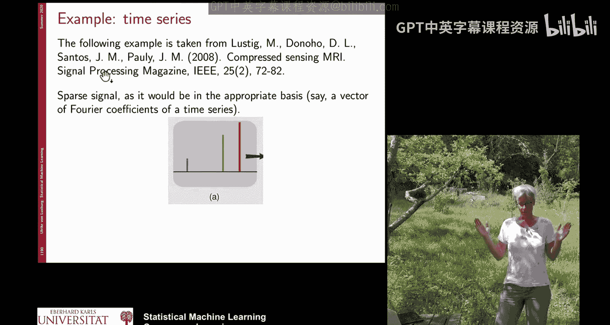

So here you need to imagine on the x axis we have different sort of components of our vector like basis vectors。

 for example， and on the y axis you always see the coefficient that the signal would have in this representation of the basis vectors。

 So here we see essentially for each of the coefficient we have a very high high peak。

 so all of these coefficients are somehow on 0。

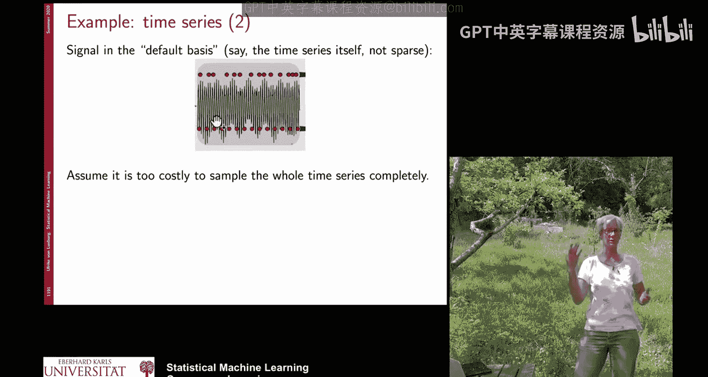

But the assumption is， we have a signal for which if we。Would record it in an appropriate basis。

 we only have three。We only need to have three non0 coefficients。 The ones that are here。

 So the blue， the green and the orange one， and all the other coefficients would be 0。

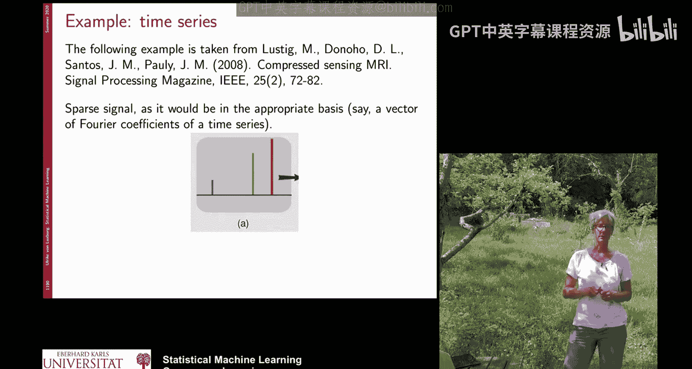

So。This is， if you represent a signal in the sparse space。 For example， in， in。

 in Fourier coefficient in a wavele basis， whatever。

It doesn't really matter what this example here is。 So assume it's， say it's a wavelet basis。

 And in this wavelelet。嗯诶。If you write the signal in this wavelelet basis。

 we just have3 non zero coefficients。

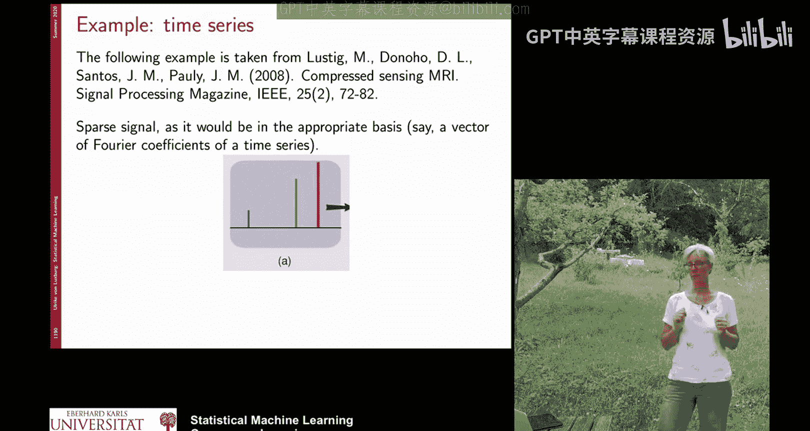

Whereas in the original basis， in the default basis， nothing is， is sort of sparse。

 all the coefficients among you。And now the question is how can we sort of sample or how could we measure the signal and now we assume that it's too costly to simply measure the signal for all different for all these different basis vectors。

 we want to have a more efficient procedure。😊。

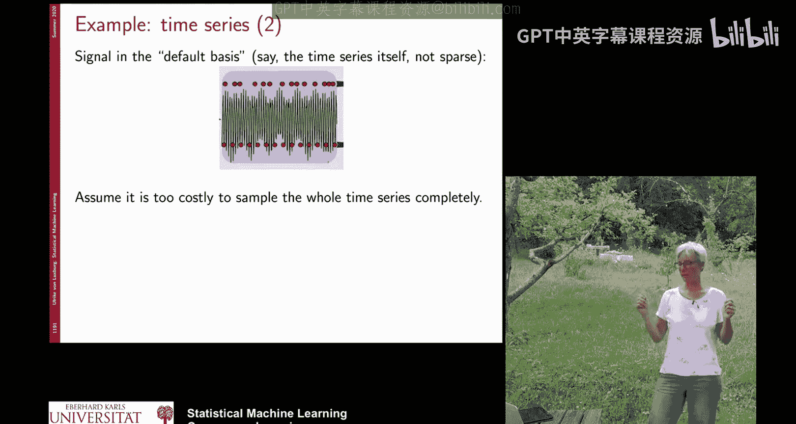

Now the first obvious idea that you could do is you would say you do equiz based under sampling so what do you do instead of measuring each of these coefficient in the previous representation。

 I just measure every1 coefficient or so so here for example and this is indicated by the red dots here now these red dots are one way of sampling the signal and we sample like each I don't know fifth kind of coefficient here。

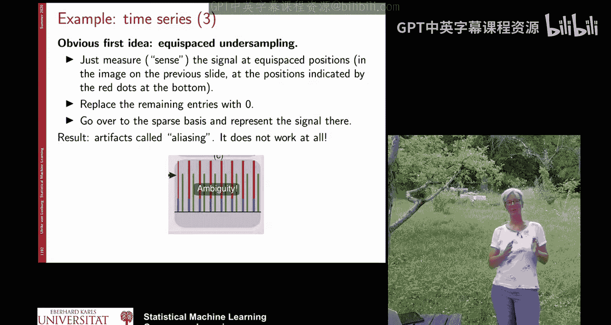

EE space across the signal。 So for each fifth coefficient， we measure， what is this coefficient。

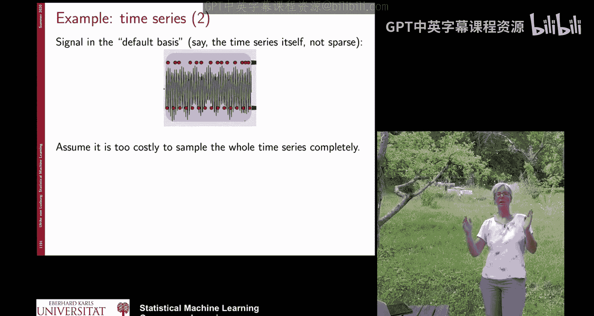

And the ones in between， we simply omit， and then we try to reconstruct the remaining signal。嗯。

And this is now the result that you can see here。If we if we now go to this virus。 So we do this。

 we I mean， we measure the signal just at these positions。

 the remaining signals entries we simply set to0。Which by the way。

 like in this one pixel camera would be like the signals we measure are the mirrors that are switched on like the black ones and the the other ones that we set to0 are the mirrors that are switched off。

 So this is completely consistent with the story we had before。

 So we simply measure some of these coefficients。😊。

And now we can go over to the sparse spaces and represent the signal there。

And then this is not going to work。 And you can read up in the paper white。

 So there's an artifact that's called aliasing。 and this is very well known in the signal signal detection community。

And this would be the result that you get in this other basis。

 so you see that instead of just having three bars， we have very many bars here。😊。

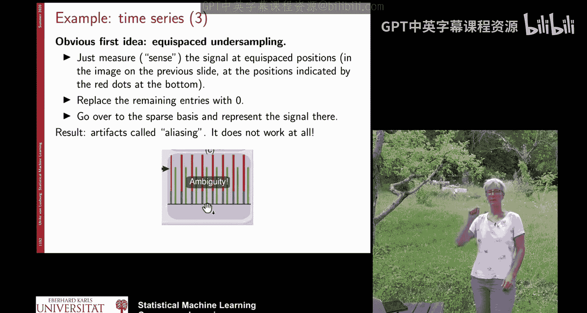

And now the idea of compress like the approach that comes out of the theory from compress sensing is now instead of using this equi spaced undersmbling。

😊，We now do random under assemblyly。So instead of sampling at equi space positions。

 we randomly pick some entries。

And let me go back to this image here so in this paper they did just a random sampling of these entries and they came up with these couple of red dots here which indicated positions that they are going to sample so they just it's the same number of red dots that as in the bottom。

😊，But now it's， it's at random positions。

Okay， and now you randomly do this。

And now you try to represent the image in the sparse spaces and the surprising thing is this already somehow works because now this is how the representation would look like we see the green and the orange bar very clearly sticking out。

😊。

Then we see lots of noise。And the blue bar， maybe if you want also sticks out a bit。

 it's a bit unclear whether this one really sticks out or not。

 but at least the other two bars are very clearly visible。😊。

And so what if we would now threshold the signal here would say， well。

 most of the components are zero， so we set every component to zero which is smaller than a certain threshold。

😊，Then we might be able to recover something that is close to the spae representation of the signal here。

 I mean if you would threshold， we might also get these two other orange signals。

 but it's already much better than what we've seen before。😊。

And here's again， a figure trying to summarize this whole effect。 if you want。

 you can look at it at home and also read what is the captain here is essentially what I've just said。

I have yet another image， another example， which is images。😊，Again。

 taken from some medical medical domain。

So what we are going to see on the next slide， sorry， maybe we we show it first。

 So this is the noisy， fully sampled image that we want to record。 Sa this is the scan of， of。

 I don't know。 somebody's brain。嗯。

Or another part of the body， in fact， I don't know。So what we so this is the original image。

 it's a bit noisy because from the scanning， we have some noise。😊。

And so what we are going to see is the image and the coefficients in some basis where the signal is reasonably sparse。

 so we see that there are some coefficients that are really high and many other coefficients are really low。

嗯。So if we would be in this sparse space， say the wavelet basis。

 then we can represent the image in a sparse way， but obviously the image has not been recorded in this wavelelet basis。

 like in the first place the image has been recorded as a fully grown image which like lots and lots of different pixels。

嗯。And now what the authors do is they compare different mechanisms for understandingling this image。

So the first attempt they did is you do a random under， I mean。

 random under samplingamping that's already good。But now the question is。

 how do you reconstruct And like in the first example， they reconstruct by minimizing the L2 norm。

If you remember in regression， I mean， rich regression is the one where you sort of try to punish by the altum。

 That's the same kind of thing here。 So you try to minimize the al norm。And then what you find is。

The following image。 And if you compare this image to the previous one， I go maybe be back once more。

You see that here you have lots of artifacts。 You have these kind of little。

Little arcs that go over the image here and also here。Which were not present in the original image。

Now， if you do the same based on L1 minimization， as suggested by comping。

 then you reconstruct this nearly perfect image here。So。

I find this really impressive。Maybe also， there might be some people in the audience who know a bit about information theory。

So there is a theorem that is sort of related to this and you need to be aware of what's going on here if you know at least if you know that theorem。

😊，Namely， there shanon sent to him。So Shannon is the guy who invented essentially information theory and lots of basic theorems in this field。

😊，And here's the theorem， so if you have a time varying signal。😊。

With no frequencies higher than DHtz， so this is sort of an assumption that we need to make。

This can be perfectly reconstructed by sampling the signal at regular intervals of1 over 2D seconds。

 so we have 2D samples at regular intervals and if we make the assumption that no frequencies in this signal have more than MHtz。

 then we can reconstruct the image。If our signal does have frequencies which are higher than that。

 then it cannot be reconstructed uniquely if Decemberem with this rate。

And then you observe exactly this kind of aliasing thing namely that there are two different signals that have the same samples。

 so you cannot distinguish between them。And now this somehow seems to be a bit contradictory to what we've said before。

AndBut yes， now they catch。 So in compress sensing， we make stronger assumptions than in serum。

So thechiev resolution is not controlled by the maximum number of frequencies that we have。

But by the sort of information content by the sparsity of the signal。

 So this is an assumption that was not present in the original theorem by Shannon。嗯。

And if we know that among these T frequencies that can occur。😊，Only s of them really do occur。

Then we can reconstruct the signal from an even smaller number of measurements。

 So maybe compare that here we say we have team。 So essentially we have T many bins。

And if we sample these many kind of interval then we can sort of reconstruct and the statement we get now is if you know that most of these bins are empty。

😊，We can sample more efficient， more efficiently than is given by the shennon serumum。

And this is really nice。 And if you know they the information through。

 maybe you might want to think about this a bit further to really understand where are the differences between the two。

So this is the end of this section I'm compress sensing through my bottom line is this is still a very active area of research。

😊，I think this field is really， really cool。 I mean， the results are surprising。

 the proofs are not extremely difficult。😊，And there are lots of applications that really make sense in practice like cameras。

 MRI scanning and so on， so this is really worthwhile looking at when you want to actually build actual applications and you have restrictions on the sensor side。

😊，Maybe regarding space capacity， but not on the receiver side。

 at least if you have computational power at the receiver side。

 then you're fine by using this technique。

