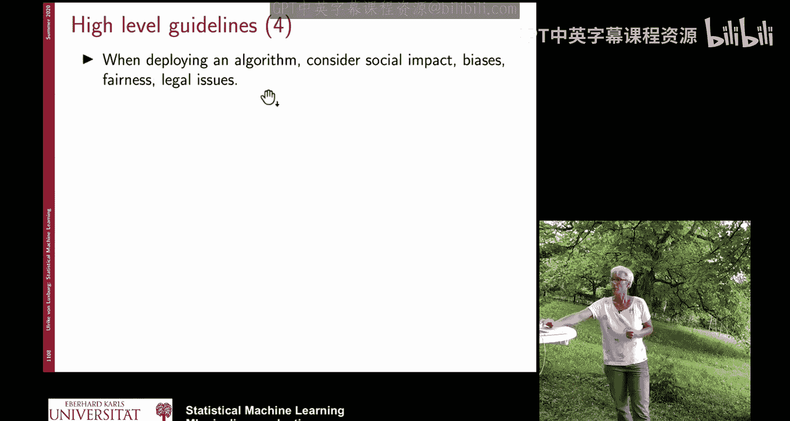

# 图宾根大学《概率和统计机器学习｜Tubingen Probabilistic and Statistical Machine Learning 2020》中英 p58 -58-Part 55 - ML pipeline_ evaluation.zh_en -BV1gso5YGE4s_p58-

Currently we are in the process of discussing the whole pipeline of machine learning。

 starting from recording the data， preprocessing it。

 selecting the learning algorithms similarity function and so on。

 and now we are at the stage where we want to talk about evaluation of the results of your classifier。

😊，What I want to show you in this lecture are sort of the traditional measures to account for the performance of a classifier in terms of classification accuracy。

😊，There are maybe some aspects missing in this lecture which are about all the other measures of performance like fairness。

 for example， which we have treated in some of the other lectures。

 so for now we want to focus on what we could slowlylobbly call the accuracy of a classifier。Now。

 there are many different ways by which you could measure the error or accuracy of a classifier。😊。

And there are some cases where many of these measures agree and there are also some cases where many of these measures disagree。

 let's maybe look into it。😊，So the most important thing to understand when you need to evaluate a classifier is what is the confusion table。

And I simply made this now for the case that we have a binary classification setting。😊。

Too positive in a negative class， both in reality and in the predicted values。😊。

And now there are different cases that it can occur in this table we see always the true label。

 which is， for example， a positive and negative and the predicted labor which is positive and negative。

😊，And now there are four entries in this table， true positive。

 often abbreviated by TP in the following。These are positive examples that have truly also been recognized by our algorithm to be positive。

😊，Fals negative examples。These are examples that have been predicted to be negative。

 but this is false。 So the truth is that these are positive examples。 It's this aspect here。

Then we have true negative examples at the far corner。

 which are negative points that have also been classified as negative。😊。

And then we have false positive， which are points that have been classified as being positive。

 but the reality would have been that they are negative。😊。

And then are the four different letters TP and FP for true and false positives and F n and T and for true and false negatives。

And then there are some more kind of abbreviations that might be used in the next slides， so P。

 capital P， or it could also be a lowercase P， I am not sure I am consistent on the slides is the number of positive examples in total of true positive examples in total。

😊，N is the number of negative examples in total。 And if you just consider it， like， for example。

 P is the same as T P plus F P。The true positive examples are that's already wrong。Sorry。

 there's a type on the slide and I haven't seen it so far。嗯。The number of positives is。

 as I indicated here the row sum here， and this is the sum of the true positives and the false negatives here because not false positives。

 is it written here， sorry， this is a mistake。 Please correct this in your version。And similarly。

 here I made it correctly the negatives。😊，FP， the false positives and the true negatives。

This is correctly here。Okay。And now you can define many， many different measurements of。

How good a classifier is based on all these numbers that we've seen so far。

So the error rate is typically like this is what we was the 01 loss in many of our previous lecture。

😊，is a fraction of points that have been classified wrongly。

 whether it's positive or negative points and in which way they have been classified wrongly。

 it's simply the points that are not have not been classified correctly。

 So this is the false negatives and the false positives。Over the number of positives and negatives。

 So this is the total number of data points。Then we have the accuracy。

 which is essentially the opposite in the best cases is 100% the error rate in the best case is 0%。

 so the accuracy is just 1 minus the error rate。😊，Then there are many more quantities that are important。

The true positive rate is often called sensitivity。😊，That's Tp over P。And here the question is。

 how many of the true positives did we find？For example。

 just given a current context testing aboutVID， the question is people who have had the COVID disease and we tested how many of them have been recognized to have had the COVID disease。

😊，Fest positive rate。Is FP over N， How many of the negative points have been wrongly classified positive。

And then the true negative rate the specificity is the true negative points over n。😊。

The false negative rate is f and over P。 So these are so all these are different notions。

 and to be honest， I often also cannot remember what is really sensitivity or specificity。😊，If。

 in doubt， simply look it up。You need to know at least if you read papers。

 you need to know the error rate and the accuracy。😊，And the R C curve， which is going to come later。

 Senitivity and specific CD are not used so often in our field， at least。

Then depending on how unbalanced the classes are， there are some other measures that are sometimes used。

 the positive predicted value is Tp over Tp plus FP。

 the negative predictive value is Tn over Tn plus。I didn't see this very often。

 I just wanted to have it on the slides for completeness。Now in information retrieval。

 there are two notions which are again important， and you should know them precision and recall。😊。

In information retrieval the difference to a standard classification is that were mainly interested in the positive class so information retrieval deals with the situation。

 you type a search query into Google， you look at the results and you want to know how many of these results are correct results and how many are wrong results。

 you don't really care about what happens to all these points that did not apply to the search query at all。

😊，Now， the recall is true positive over P。 So how many positive examples can we find？

With our algorithm， for example， so does our search query。

 the results of our search query match the true set of results that is out there。😊。

And then there's precision。T P over Tp plus Fp。How many of all these points that have been classified positively are indeed correct。

 So now we look at the results list of Google how many of these results are truly there and how many are maybe bronzzi and we are interested in the process that the true ones。

😊，Now there are two more me that are used very often ROC and AUC。

 and this takes a bit of more explanation。So in the background is that in many applications， again。

 for example， in information retrieved there are many more negative examples and positive examples。

 so this is a highly unbalanced problem I just want to see search the results that match my search query and this is not of course the majority of the web pages。

 but very few of them。😊，And then， of course。The classification accuracy is really a bad measure of performance。

 If most of these pages are not interesting at all， the measure of performance will always be 999，9。

9 9%， but were only interested in these like 50 pages that are sort of get like whenever we compute any score they get lost in。

😊，In the accuracy error rate。So we need to look into true positives and false positives。😊。

And now there is a clever way to try to be able to measure both of these criteria at the same time。

 and this is the ROC curve。And the history of this RC curve is in。

So it is called the receiver operator characteristic curve， that's what ROC stands for。😊。

And the background is now we are going to consider classifiers where the classification depends on a threshold。

 something like hyperplanes。😊，So we are going to look at the Hypenng of x。

 but we can shift it from left to right by some parameter theta， which is called the threshold。😊。

And then we plot the false positive rate versus the true positive rate for a varying decision threshold sigma and maybe let me first try to show the example。

😊，You might have seen such images before， this is the RC curve。😊，On the x axis。

 we have the false positive。A rate and on the Y axis， we have T。 So the true positive rate。

And this curve happens because we have this parameter theta。

 so for each value of the certain parameter theta。😊，We sort of we check what is the the different。

 like what is the confusion table and and compute these different these two numbers。

 and then this corresponds to one point on this curve。

 So each point on this curve corresponds to to one particular value of that threshold。

So let's go back。 So what we do is we have this decision threshold Cta。

 we vary from minus infinity to infinity。😊，We always evaluate the true positive and the false positive rate。

 and then we plot it and plot these points in a space and this leads to a curve this one here。😊。

And maybe very quickly you might want to figure out that it is indeed true that Tp over P is always between a number between 0 and 1 and Fp over n is1。

 so this curve always lists in the unit square。And now where does this curve come from？In fact。

 it comes from normal。And now the situation that has been considered in the past and like where this thing comes from is you have two signals。

 a negative signal and a positive signal。😊，And the signal by itself might be a binary signal。

 minus1 or plus1。But now the signal is being corrupted by noise and too big people would assume that this noise might be normally distributed like here。

So we have two classes， the class  minus-1 and the class plus1。

 and their distributions look like this。 So these are the class conditional distributions。

And now when we choose a classifier， we put a threshold somewhere， say at this red line here。

 this is our value of theta。 so theta goes from a minus infinity to infinity。😊。

And now depending on where theta is we have we have the different four cases which come from the confusion table。

 so here these orange ones are the ones that truly are negative and have also been classified as negative because they are on the left side of the decision threshold similarly here this a large blob of blue。

😊，Points is on the correct side of the decision threshold and has label plus one。However。

 there are also a few points which are misclassified。

 So if you look at the tail of this minus the class minus-1 distribution to green points here。

 there are some points which are on the wrong side of the threshold and these are false positives so they have been classified in the positive class whereas originally they come from the negative class。

😊，And similarly here， the false negatives sit on the left side of the red decision line and are the ones that should have gotten the label plus one。

 but they got the label minus1。😊，And now by varying this threshold。

Can generate a curve like the RRC curve that we have seen before。

And now what you can try to figure out yourself and convince yourself is in such a situation。

 I here have an example， I mean it's just a sketch of an ROC curve。😊。

And I indicated four classifiers， the red one， the green one， the blue one and the black one。😊。

And it corresponds roughly to the situation we have here， so the red one sits here。

 the green one here and so on。 so the threshold goes in this image from left to right。😊。

Whereas these points walk from along the line from right to left。

And I really urge you to look at this and really understand and try to make sure why the red point here is on the right of the green point where here it's the other around。

 simply try to do the like doing the math is said too much you don't have any numbers just get the infusion from the plots why this is true。

😊，So try to understand if the red line moves towards the green line。

 what happens to the false positives and to the true positives。Sorry， yeah。Now。

 the important thing that you might want to know for applications is that there are。😊，嗯。

Or maybe typically in the beginning， maybe also this has been more applied to a evaluate the quality of a data set。

 for example， a transmission or so a good data set would look like this。

 so you have two Gausss which are very well separated。😊，And then the ROC curve。

 if you take the thresholds from left to right， looks like this。

 it is very steep in the beginning and then very flat。😊，And the better。Separated the data is。

 the more this curve sort of matches goes towards the corner here。 So in the very extreme curve。

 the curve is nearly rectangular。But now the worse the data set gets。

 the more this R sequence curve moves towards the diagonal。

 so the diagonal corresponds to a class that is completely random。😊，So when it's above the diagonal。

 it means it already does something and the more above it is， the better it is。😊。

And now the RC curve can also be used to compare classifier and sort of the toy figure that people have in mind when they use this tool is this one here。

So a classifier that corresponds to random guessing like is the red line here that gives you the diagon on the ROC curve。

😊，Then if you have one class the green one and there is another one， the brown one。

 where the curve is always on top of the green one。

 you can say this brown one other than the green one。😊，Okay。So this sounds nice in theory。

In practice， it's not as nice because typically the plot might look like this one here。

 So here is a plot that I've taken from a paper。Where I guess the green one is sort of a random classifier and then you have people try to compare different classifiers。

 and you see it's all of a mess。 So the red classifier is very good in this area of the space。

 but it's much better than random guessing， in fact， even in this part of the space。

 the blue one tends to be better than the green one maybe so it's better than random guessing。

 but whether the blue one or the black one is better it's really unclear。

 and also whether blue or black are better than red， it's sort of a bit unclear as well。😊。

So here it is really difficult， and this is typically what happens in practice to say from this image what is better。

Now， what people sometimes do。If they think all the situation is so complicated。

 just summarize it with a number， people sometimes use what is called the AUC。

 the area under the ROC curve。😊，And they essentially， I mean。

 they simply say let's forget about the shape of this curve we just measure what is the area under this curve and the better the area。

 the better we consider a classifier。😊，嗯。To be honest， I find this really。I mean。

 I don't find it to say the least because it's not such a simple picture like if you if you see this like this。

 you simply cannot summarize them in one number what you might be able to say is in this regime，😊。

If this is a routine that' is important for application， then the red guy is better。

If this regime here is important for application， then maybe not use a red guy but use a black guy and here in the middle maybe it's not so important which one to use at all and classification accuracy is not going to be extremely high anyways。

😊，But summarizing it within one number to simply get rid of the problem of trying to interpret this plot to me is not a convincing approach。

😊，Still， you see it a lot in papers。So in particular， if we look at multi class performance。

 we can of course， define all these schools， of course but they get less and less meaningful because there are so many classes like an error。

 like if you have 100 classes。😊，then sort of the， the random guessing error rate would be one over 100。

 So， so numbers get very small， sorry。嗯。In like the。

 the random classifier would get one out of 100 guesses， correct。

And so so all these numbers get really， really small and then it's sort of it's really complicated to evaluate what what the classification result really is。

😊，And to be honest， I don't really have now I guess it really depends on your application if you have very many classes you need to do something else anyways。

 but if you have a few classes， maybe just look at the confusionfu matrix and try to discuss which cases work well and which ones don't。

😊，Now， what see very often in publication a table like this。

See here I mean just to explain what's in this table。

 this is a publication I took from a table that that book took from some publication here you see lots of data sets。

 In fact， these are all very well known easy。 most of them are easy dataset sets that you can just download online I dataset is from Fser It's from 19 I don't know 48 is it or 33 I can't remember 28 maybe even so it's a very old dataset a very simple one。

😊，And then these are data sets that you like if you have worked in machine learning， most of them。

 you know because they have been around for a long time。😊。

So these are standard data that someone downloads from the internet and then you have lots of different classifiers so here for example you have the Canersna you have C。

45 which is a decision tree， you have some support vector machine and then you have some maybe A andN is probably an artificial neural and then you have some other algorithms。

 maybe the ones that have been invented by the authors。

 I don't know this guy here cheat or more or whatever。😊，And then people put this table。

And then for each classifier they took the error rate， the average classification error rate。

 they put the mean and the standard deviation after repeating this process for 10 times or so。😊。

And now sometimes they put the lines in bold which sort of for one data set what is the best result so here apparently morphF has the best result for 4。

6 error rate so in this they put in bold。😊，And now， as a reader。

 you can set the table for the next 20 hours and its very really hard。It largege tables。

 whenever you need to evaluate it， by all means， use plots because plots are something that humans can access in a very natural way。

These kind of tables are completely meaningless and it's also very hard to interpret。 I mean。

 there are many other problems with this table， but already being a table is a problem。

So by all means， avoid tables。Always， like， only use a table if you don't see any other way。

 even after thinking for it for two days。I mean， if you write a paper。

 you spend a lot of time trying to present your results。

 if you thought about it for a long time and you really can't come up with anything better than use a table。

 but I would be surprised if there's any true reason why I would use a table for presenting such results。

No。The problem with all these comparisons is that typically what people like to achieve is they want to say that that fire is better than the other one。

However， practice is quickly not the case。 So you， I mean， the first thing is， in general， the。

a classifier， always better than another classifier。So， it would。The application。

And then like what you see in these papers， it really depends on the choices of data。And in fact， in。

 in papers， you can also expect that a lot of cheating is happening in the background you run your result on 50 different data sets and you just present 18 on which your algorithms worked and maybe two just to be a bit honest on which itt didn't work so well。

 And then you say my classifier screen。And the question is， really。

 when would you say that a classifier is really better than another1， I mean。

 there might be some rare cases， but typically。At least at this stage of research in machine learning。

I am always surprised if you see a paper claiming it has a much better algorithm than somebody else。

So what you can do if you want to be a bit more systematic about this。

 you can use statistically tests， even though this is also not very common in machine learning。

 So what you can do is。Like use a statistically test where the null hypothesis。

Is that both classifiers have the same performance？So the mean accuracy， for example， is the same。

 that's the null hypothesis。😊，Then as a test statistic， you use the difference in error rate。

 for example， our accuracy。😊，And then you run a test and want to test whether this difference is significantly different from0 or not。

And you can either do it in form of a T test where you say the assumptions is that I mean the first assumption is that these values are independent across data sets。

 which you always need for the tests， but which is a very strong assumption。And in particular。

 if you try to tune your tests towards a particular application。

And then you can assume that these errors are normallyly distributed and use a T test。To be honest。

 also this I don't find extremely convincing because again everything depends on the choice of the data sets on effect whether these things are independent and finally typically errors are not normally distributed so applying a T test if these assumptions are all not correct sort of gives you a number but you can't really trust this number in any way。

You can also use a permutation test， which at least doesn't make any assumption on the underlying distribution like of the errors。

So the bottom line is what you do is you again， you you look at the statistics of the difference between two the the error raids between two classifiers。

But you now have some kind of randomdom permutation scheme between the different lines in your data matrix。

Or in your error matrix。If you want to know how a ferutation test works。

 then please read it up in the literature。So you can also do that。😊，Again。

 I am not sure how important it really is to do these kind of tests。

 but some people feel better with it。You need to be aware that no matter which test you use。

 there are always assumptions that go into the test and that by choosing。Data sets。

 you can often choose also differences like achieve different resultss in the test statistics。Okay。

 here I think this is sort of a summary of what I've just said。Here are some。

 so to conclude this lecture I also want to make a couple of remarks on this evaluation of like like in papers you often see these kind of numbers that try to compare the performance of classifiers and you always try to boil the message of a main paper down to a few numbers。

😊，Maybe this by itself is a bit problematic， not only in our scientific field。

 but in other fields as well。And here's a quote that I want to simply read。

So we are interested in the real performance for practical applications therefore。

one should keep in mind that such a collection does not represent any reality。嗯。

I was trying partially。Which they are perfectly suited。And this， for me。

 is really a very important quote， because it means。If I want to write a paper。

 heres this classified that always works great， somehow we can't make such a statement。

 that's the no free lunch theorem， it's not true。😊。

So we need to say for which class of problems maybe the classifier is well suited。

AndNow then we come closer to this story。 It might be so that the class classifiers are perfectly。

 I don't know work very well if you have data sets， low dimensional data sets， view points， whatever。

 So you have certain characteristics， then maybe your your classifier works well it does not work very well in some other domain where where there are different classifiers that work well。

😊，嗯。And later on， I say a bit more， but I think what is really。

 really important is to sort of try to characterize when your classifierworks were。And in particular。

 if you in the ideal case， I mean now I know this is a bit problematic if you're working on machine learning methods。

 you don't have a particular application domain。😊，But then maybe you can't also make so strong statements in practice。

 if you have a particular application domain in your mind。

 you need to test on examples from this application domain of course。Heres yet another one。

In comparing classifiers， one should realize that some classifiers are valuable because they are heavily parameterized and thereby offer a trained analyst a large flexibility in integrating his problem knowledge in the classification procedure。

😊，Other classifiers on the contrary are very valuable because they are entirely automatic。😊。

And do not demand any user parameter adjustment。As a consequence， they can be used by anybody。

 It is therefore difficult to compare these types of classifiers in a fair and objective way。

And this is again， I find a very， very important message， so using the Canous neighbor classifiers。

 that's something that everybody can do。😊，Training a complicated even neural net from scratch。

 if you haven't done that before is not so easy。 And there are millions of heuristics that you would need to know before you can train it successfully。

 And so also like。😊，Depending on where this algorithm is supposed to be applied。

 whether it's being applied by someone who is a trained specialist here or by someone who is in a completely different discipline from a company。

 a computer scientist who doesn't know anything about machine learning。

 but he can at least train this canous Ne classifier。😊。

So it is sort of it is hard to say this classifier is always better than the other one。

 it always depends on the circumstances in which a classifier are being used。😊。

So my bottom line is when you want to compare classyifiers。

 try to compare them for a particular task。Try to make sure for which what is the kind of problem you're looking at。

Then within this task， test on a variety of data sets under many different conditions on many dataset sets。

 low dimension， high dimension， small set of small small number of points， large number of points。

 low no high noise high， low noise， high noise。Use simulated data where you know what it the ground truth and you can control different parameters about the difficulty of the problem and use it on real data which you cant control。

😊，Be fair。 Try to implement the classifiers the best way you can。

Its available use implementations by the people who invented the algorithms。

 because this is something you might know yourself。

 Like if you invent your own algorithm and you want to sell it in a paper。

 you're going to spend weeks in trying to tune your algorithm to make it really run very well in many applications。

 And now if for this competitive competitor algorithm。

 you just spend one day and you use the default parameter selection， of course。

 it's going to perform worse。So make sure that when you compare classifiers to it in a fair way。

Personally， if I read a paper that says my classifier is better than yours。I tend not to believe it。

 And I start looking really critically at the way they describe the experiments。

 And very often you find something。 I mean， either they are not described at all then I don't or not in enough detail。

 than I don't believe it。 Anyways， or you see sort of their flaws in the experimental setup and so on。

嗯。So what I think is a much better approach than trying to find classifiers that are better than anybody else's classifiers to assess the weekss and strengths of your classifier because this is also really what science is about。

 its not about making bold claims。😊，But it's about really zooming into defined details of a certain method and trying to make statements in a paper that say。

There is a certain situation where my classifier is good。

 but then there is this other situation where my classifier is not as good and in this situation I would prefer to use this other classifier。

😊，Because it's not only important to know when your classifier works。

 but it's also important to know when it does not work。

And this is particularly relevant for practical applications。Okay。

 here's the point about when I read that a classifier is better than another that I'm suspicious。

 I already made this point。😊，And this is sort of the end of this electron evaluation。

 there are lots of references on evaluating classifiers and here just have a couple of them which really research in comparing classifiers。

😊，Typically， they come from a more statistically kind of background， but anyways。

 you can look at the references I like them。Here are some more references that you can also look at。

As a concluding remark， I might want to say close with the remark I also made at the beginning。

This particular lecture just focused on introducing all these different parameter like different evaluation metrics like sensitivity and ROC curve and whatnot。

In practice， there might be many other criteria beyond the accuracy。

Of a classifier that might be important， it might be computational speed cost of evaluating a test point。

 cost of storing the model， for example， like in networks when you need to store when the model is really picked that you need to store。

But there are also other measures like how fair is your classifier？😊。

And like what is the social implication when I use these kind of results？😊。

And all of these together only give you a good evaluation of your classifying performance。😊。

And it is important that you look at all of them and not just focus， for example。

 on this one number on the accuracy and you forget anything around it。

I want to conclude by looking at some or summarizing some of the guidelines that you might want to follow when you attack particular machine learning problems。

I mean， the obvious thing， but still I want to repeat is machine is not about applying one algorithm to one dataset。

 it requires a lot of tuning parameters playing with different algorithms with different representation and trial and error。

You might be lucky and have a simple problem， and then many algorithms might work。

 maybe even can your neighbour but does a useful job。 and then you' are fine。😊。

There might be more difficult problems， or there are many more difficult problems out there where you can be successful if you spend a lot of efforts。

😊，And of course， there are also problems where essentially you can't do anything。

 at least with the current knowledge of machine learning。

 we cannot solve these problems successfully。😊，And this。

 in practice happens quite a lot because if you start working on a problem。

 you don't know in the beginning on whether maybe your data doesn't contain any interesting information。

 maybe it's simply too difficult。 maybe you would need to have much， much more data than you have。

 And if you have a million of data points， you could solve it， but you only have 50 data points。

So there are many， many reasons for， for which machine learning method might fail。 and it's often。

It is， of course， disappointing if that happens and it's sometimes also unclear why this happens。

 Sometimes you can make up a reason， for example， in particular。

 if you don't have enough data in a high dimension space， for example。

But there might be other cases where you simply don't know why it doesn't work。

 it simply doesn't work。And you need to decide after half a year of work。

 whether you want to sort of stop working on this problem completely or whether you want to give it these two more weeks in which you might get this great idea that finally helps you to solve the problem。

😊，As I've said， I think this is a repetition of what we've seen typically you need to think about how do you gather your data。

 how do you pre it processes， how do you set up the learning problem。

 how do you evaluate your results。😊，And also about you need to think about post processing。

 interpreting your results and also thinking about what are the implications when you deploy your results in particular in the social context。

There are some very high level guidelines。 I'm not sure whether these are the most important guidelines。

 but these are some that come to my mind when I think about it。 The first one is。

When you try to solve a machine learning problem， try to quickly come up with a first baseline。

Try Ka' neighbor。But you need to of course preprocess your data to be able to apply Canius neighbor but don't spend like a large amount of time in making the most complicated of all machine learning models。

 first of all try something simple and then try to figure out whether it's worth the effort of getting better or not。

😊，Something that often decides on success or failure of machine learning is whether you can incorporate prior knowledge about your data into the process of learning and this is not obvious at all how to do that in the approaches that we have discussed it can be done via the similarity function or the loss function and so on in other approaches in probabilistic approaches it goes by looking at the probabilistic models that you use and so on。

Try to understand the various biases that are being introduced， the sampling bias from。

 from your data collection， the inductive bias that comes from your learning algorithm。

 Are all these biases appropriate。 Is there anything you can do or have to do about it。

 because otherwise your problem is not solvable。Evaluate your results thoroughly and critically。

 And but with critically， I really mean critically。 when you invent your algorithm， I mean。

 the temptation is always to say， well， my algorithm is great and then sort of ignore all the evidence that your algorithm might not be so great。

 after all。 And just if the evidence is so pressing that you sort of can't get away。

 then you sort of give in and say， well， maybe it's not so great。 So try to be critically。

 This is really what science is about。 It's not about inventing。😊，Now。

 the German word is loftless So I don't know。 I I guess you can't say that in English。

 like inventing great things which in have， which in fact， are not there。

 science is a critical field。Play， play， play。 That's obvious。

But machine learning doesn't work without playing and also maybe having fun playing with data and algorithms and implementing and looking at plots。

Then there is a guideline that has been posted by Laria Miabnik， it's a very general guideline。

 but still I find it helpful from time to time which is when solving a problem of interest。

 try not to solve a more general problem as an intermediate step so if you want to solve a classification problem don't estimate the density first in a high dimension space and then try to classify。

😊，Try to do this directly， because each intermediate step and in particular。

 if it's a difficult intermediate step， introduces some errors。

 and you should try to avoid these errors。 Of course， now。

 this processing pipeline has many different steps。And there's no way around it。

 But I think the point here is。Try not to solve a very， very general problem in the middle。

 try to do the steps。As small as possible。And in a way that what you're solving in the middle is not more complicated than what you need to solve in the end。

And finally， when deploying an algorithm， consider the social impact， consider biases， fairness。

 also consider legal issues。

