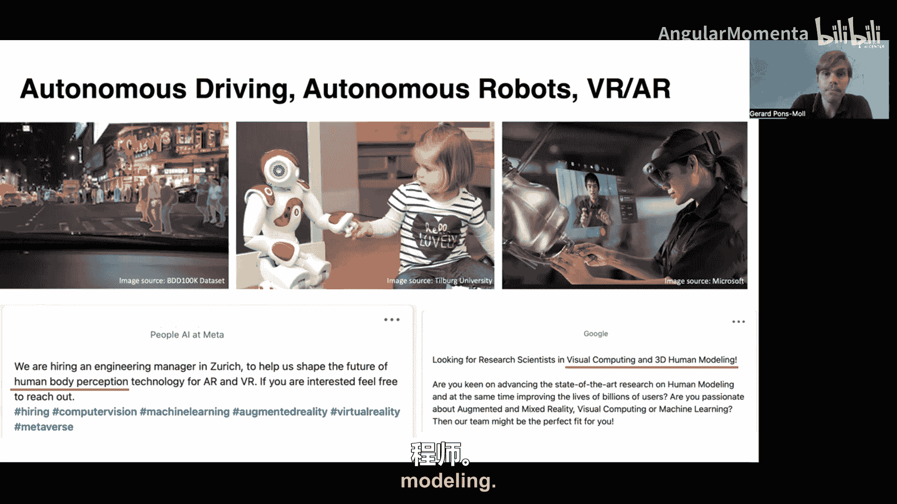
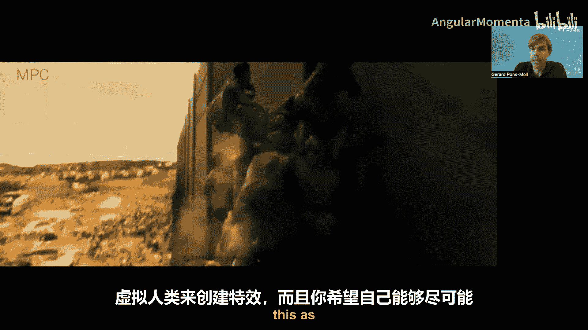
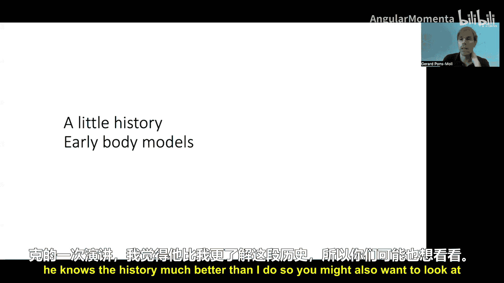
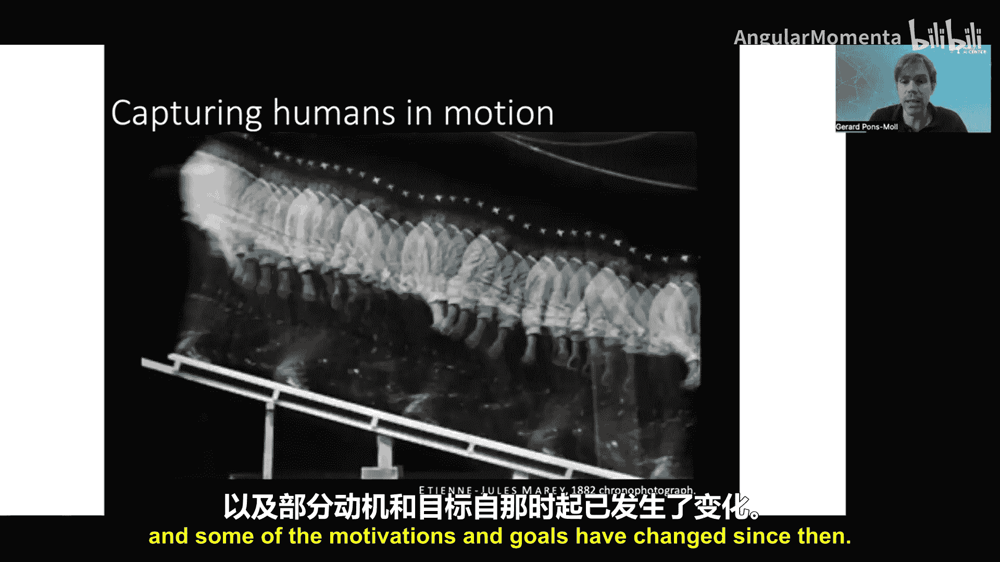
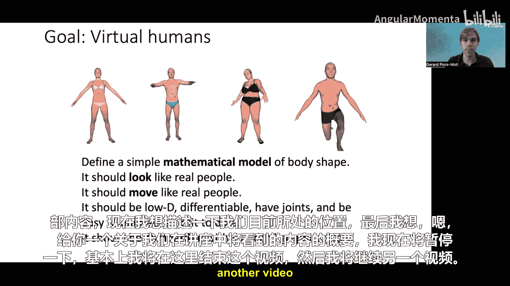

# 001：人体模型导论与历史 🧍‍♂️📜

在本节课中，我们将学习构建人体模型的关键要素，以及如何将模型与数据拟合。我们将特别回顾早期工作的历史，这些工作引领我们走到了今天这一步。

## 概述

人类自文明伊始，其生活就围绕着与他人的互动和感知展开。人体和人际互动在历史上被无数次描绘。人类通过触摸、操控来改变世界，通过互动建立关系、寻找爱情、缔结友谊、舞蹈和影响他人。为了让计算机成为人类的全面伙伴，它们需要能够“看见”我们，即理解我们的互动、意图、手势、肢体语言以及我们与世界的互动。如果计算机能够“看见”我们，它们就能通过观察来了解我们。

由于人类是许多应用和社交互动的核心，因此有大量应用需要虚拟人类也就不足为奇了。例如，自动驾驶需要理解人类行为以避免事故；人机交互需要理解我们的意图和情感；虚拟/增强现实需要能够无缝、沉浸式地跨全球沟通，这都需要在所谓的“元宇宙”中再现难以区分的虚拟人类。

当然，大型科技公司对投资虚拟人类非常感兴趣，这反映在该领域的大量招聘上。虚拟人类同样也是任何需要3D内容创作的应用所必需的，例如3D电影常利用虚拟人类来制作特效，并且我们希望这个过程尽可能快速高效。

然而，目前许多令人印象深刻的虚拟化身演示都是针对特定个体的，需要长时间制作和昂贵的设备，难以规模化。因此，研究的目标是**民主化人体模型的创建**，使其尽可能易于访问和快速。为此，我们需要超越个性化模型，构建能够**泛化到人群**的统计模型。

## 虚拟人类的构成要素

当谈到虚拟人类时，我们通常考虑**外观**或**行为**，并倾向于将这两者分开思考。

*   **外观**：指我们看起来的样子，即如何构建表面和外观，使其看起来像真人。这些虚拟模型应该像真人一样移动和看起来真实，并且易于控制、动画制作和拟合数据。
*   **行为**：指人类如何与3D世界互动。这需要将人置于3D环境的背景中进行感知，而不仅仅是孤立地看待。如果我们能够感知人类在3D世界中的行为，就可以构建能够在3D世界中自主互动的虚拟人类模型，并合成适应不同环境的、看起来真实的人类动作。

建模外观和建模行为这两个目标是相互关联的。一个是计算机视觉目标（训练计算机“看见”），另一个是计算机图形学任务（训练化身模仿我们）。这两个领域之间的界限并不十分清晰，因为很多时候解决一个问题需要同时解决另一个问题。

## 从图像中感知人类的挑战

为什么从图像中感知人类对计算机来说很困难？挑战在于：
*   **深度丢失**：从2D投影中估计3D深度非常困难。
*   **姿态复杂**：人类姿态存在于一个高维度的复杂空间中。
*   **遮挡**：人与人之间或人体自身的部位相互遮挡。
*   **其他因素**：低对比度、噪声、不同背景、不同体型（儿童、瘦弱、肥胖等）、各种光照条件以及穿着衣物等。

因此，从视觉数据中建模人类是一个极具挑战性的问题，也是计算机视觉领域的核心问题之一。

## 人体模型的历史回顾

回顾历史，看看早期的模型以及最初构建的人体模型是什么样子，是非常有趣的。这有助于我们了解思想是如何发展的，以及哪些想法在当时取得了突破。

### 早期影响与关键点追踪

该领域的一个关键影响是Johansson的工作。他在论文中指出，用描述主要关节运动的少量亮点来表示活体的运动，10到12个这样的元素就足以唤起人类行走、奔跑、舞蹈等活动的强烈印象。确实，这些关键点能唤起人类的印象，但显然缺失了很多信息。在某种程度上，这些缺失的东西正是我们在本课程中感兴趣建模的内容。然而，关键点追踪一直是计算机视觉中的主导范式，是进行更复杂工作的基础。

但问题是，**关键点就足够了吗？**
*   首先，关节在图像中并不可见，它们不是直接可观测的。
*   其次，如果我们想模拟与他人的互动，需要考虑接触，而接触世界的是皮肤表面，而不是关节。
*   最后，我们对其他人的印象不仅基于姿态，还基于面部表情、体型甚至衣着。

### 从数据推断人体模型的三个组成部分

从数据推断人体模型可以归结为三个组成部分，多年来这些部分变化不大：
1.  **运动参数化（运动学）**：定义人体模型如何移动，即用运动模型参数化一些基元或表面。
2.  **形状定义（身份）**：定义人的身份。模型从使用简单的圆柱体发展到使用基于神经网络的复杂表面表示。
3.  **推断（拟合）**：如何将模型拟合到观测数据。推断技术发生了显著变化，早期工作基于生成式优化或粒子滤波器，现在则主要基于神经网络或其与优化的结合。

推断的目标是找到模型参数 **x**（控制姿态、形状和身份）的最大后验概率，给定一些观测数据（如图像 **I**）。这通常通过最大化似然乘以先验来实现。早期技术主要基于优化（如梯度下降、二阶方法或基于粒子的优化）。

大多数算法的步骤相似：从图像中提取特征（如轮廓、边缘），尝试用模型复现这些特征（称为**分析综合法**），然后通过优化参数来对齐模型与图像特征。

### 人体模型发展历程

让我们看看人体模型的发展简史：

*   **约45年前**：Hinton的论文使用基于矩形的木偶，并尝试将其拟合到关键点。论文指出，孤立地拟合每个矩形会产生歧义，但以整体方式联合考虑所有矩形可以获得更好的解释。
*   **早期模型**：Nevatia、Binford、Marr和Nishihara等人提出了基于圆柱体的基元集合，并建立了如何使这些圆柱体适应不同形状的理论，然后将其拟合到距离扫描仪数据。
*   **1983年**：Hogg的开创性工作首次将3D人体模型拟合到图像。模型基于将模型线与图像中检测到的边缘进行匹配，这是一个生成式方法。
*   **随后十年**：该领域进展缓慢。
*   **1994-2004年**：研究重新兴起，人们能够复现Hogg的结果。出现了使用更精细基元（如超二次曲面）的工作，例如Cerveri等人的工作。Plankers和Fua使用隐式球体来近似人体形状。
*   **1999年**：Blanz和Vetter的**人脸可变形模型**取得了突破。他们通过扫描大量人脸，构建了人脸几何、反照率和光照的统计模型，既能合成新面孔，也能通过拟合模型参数从图像重建人脸。这项工作质量极高，至今仍可与当前先进技术媲美。
*   **身体扫描与统计模型**：将人脸模型方法扩展到身体面临更大挑战，因为身体更复杂、可变性更大。首个身体扫描仪由Cyberware建造。1999年左右，美国军方进行了一项调查，扫描了2000名男性和2000名女性，创建了CAESAR数据集，这对构建身体模型至关重要（尽管其人口代表性有限）。
*   **开创性身体模型工作**：Allen等人的工作展示了可以通过将模板配准到每个扫描数据来构建统计模型。他们首次建立了身体形状的统计模型，这一思想至今仍很流行，也是SMPL模型的核心。
*   **2005年**：SCAPE模型取得突破。它建模了形状统计，并使用单个主体建模了身体如何根据姿势变形（如弯曲肘部时肘部的变形）。这是第一个在形状身份和动画质量上都相当真实的模型。
*   **其他模型**：还有如Allen的模型（包含许多SMPL的组件）、Hasler等人的模型（基于骨骼集合）和T-pose模型（基于姿态和形状的张量分解）等。
*   **2010年左右**：当时没有广泛可用的人体模型。为了追踪，研究者需要扫描特定主体，手动插入骨架，这是一个非常繁琐的过程。也存在一些无骨架或混合骨架的自由变形模型，它们更灵活但也更脆弱。

## 总结

本节课我们一起回顾了构建虚拟人类模型的核心要素及其重要性，并深入探讨了人体模型的发展历史。我们从早期基于关键点和简单几何基元的模型，看到了向数据驱动的统计模型（如人脸和身体的**可变形模型**）的重大转变。历史表明，一个成功的模型需要很好地平衡**运动参数化**、**形状定义**和**高效的数据拟合能力**。当前的研究正致力于构建能够**泛化**、**高真实感**且易于从消费级设备数据中重建的模型。在接下来的课程中，我们将更深入地探讨这些模型的技术细节。