# 002：人体模型介绍与课程概述

在本节课中，我们将学习虚拟人体模型的基本概念、构建方法以及本课程将要涵盖的核心主题。我们将从人体模型的历史与现状入手，逐步深入到其数学原理、数据采集与处理，并预览后续课程内容。

## 人体模型简介

上一节我们简要回顾了人体模型的发展历史。本节中，我们来看看当前最先进的人体模型是什么样子。

早期的人体模型要么未公开，要么不易使用，这阻碍了其在学术界和工业界的广泛应用。一个理想的虚拟人体模型应满足以下要求：
*   它是一个简单的身体形状**数学模型**。
*   它看起来和动起来都应像真人。
*   它应该是**低维度**且**可微分**的，以便拟合到观测数据。
*   它应包含**关节**，以支持动作解释。
*   它应易于动画制作和数据拟合。
*   它应与标准图形工具（如 Maya）兼容。

## 数据采集与3D扫描

若想模拟软组织或衣物的非刚性变形，静态扫描仪是不够的。下图展示的是蒂宾根大学感知系统系微动作实验室建造的动态扫描仪，它能够以高时空分辨率捕捉运动中的人体三维形状。

该扫描仪从多个视角、以高帧率捕捉人体，并基于这些多视角图像重建出3D形状。构建人体模型的基本思路与Alan和Angelngeo在Scape项目中的工作类似：收集数千个不同体型和姿态的人体扫描数据，并将其合成为一个数学函数。

## 模型构建原理

我们希望学习一个数学函数 **`M`**，它接收一组参数（如姿态、形状、软组织、外观），并输出可以渲染为逼真人体的模型顶点。

本质上，我们将整个人体表示为一个3D网格，该网格被分割成多个部分，每个部分在一个运动学树中旋转。这建立在经典的骨骼动画理念之上。一个典型的网格可能包含约7000个顶点，相当于21000个数字。但大多数顶点组合并不对应真实的人体，只是随机数据。因此，我们的任务是学习一个数学函数，它能接收一组低维参数，并生成对应真实人体的顶点组合。

## 模型的分解与参数化

构建虚拟人体模型时，将其分解为姿态变形和形状变形是有用的。这样我们可以分别合成不同的姿态和形状，然后将这些因子组合起来，生成任意姿态下的任意人体。

模型参数化的是相对于模板网格的偏差。我们可能还对其他因子感兴趣，例如呼吸或软组织动力学，这就需要参数化那些能解释此类变化的位移。

## 数据配准：关键挑战

构建这些模型遇到的第一个问题是，3D扫描数据是未配准的，它们是没有语义信息的点云。这意味着我们不知道哪些点对应脸部，哪些点对应躯干。没有语义信息，就很难进行统计分析。

通常的做法是，将一个公共模板配准到所有扫描数据上，然后基于此构建统计模型。**配准**指的是优化模板参数，使其与扫描的3D点云对齐。为每个扫描都执行此操作，就能将所有扫描数据带入良好的对应关系中。

良好的配准对于构建优质人体模型至关重要，但这一步非常困难。原因包括：
*   **歧义性**：高分辨率扫描与低分辨率模板匹配时，单个模板点可能对应多个扫描点。
*   **缺乏特征**：人体许多部位缺乏鲜明特征，容易混淆不同点。
*   **复杂姿态与自接触**：某些姿态需要良好的初始化才能收敛，自接触现象使配准更加困难。

本课程中，你将通过一个专门练习学习如何自己完成配准。

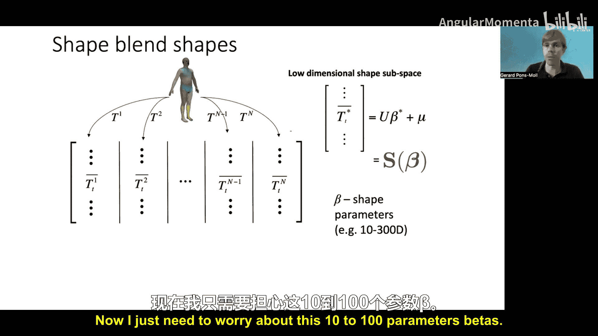

## 从配准数据到统计模型

配准完成后，将所有形状归一化到一个标准姿态中至关重要。这样我们可以在不考虑姿态影响的情况下研究身体形状的统计特性。然后，每个形状可以被视为一个向量，从而使用线性代数技术计算统计量。

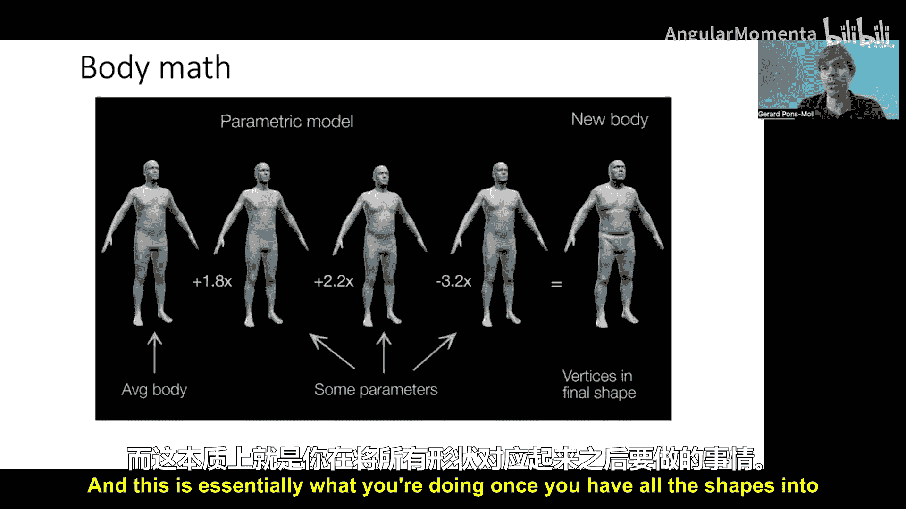

例如，下图展示了来自CAESAR数据集的2000名男性和2000名女性的平均形状。

建模身体形状统计量时，我们可以使用线性高斯模型或PCA模型。**形状基向量**是相对于模板的位移集合。将所有形状（处于相同姿态）放入一个矩阵，然后对该矩阵执行主成分分析，我们就能用少数几个主成分解释大部分形状方差。

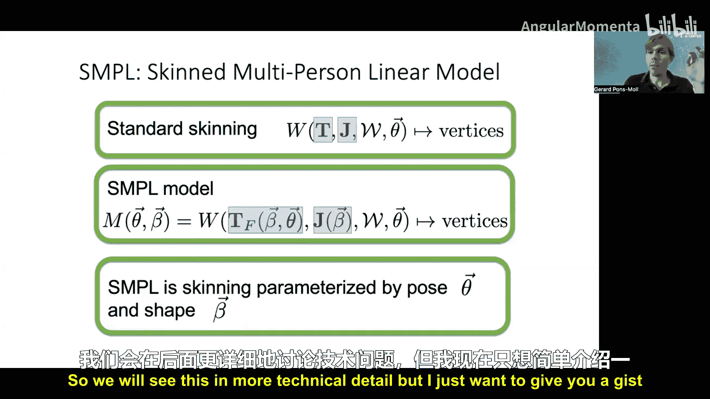

**公式**：`形状 = 平均形状 + 形状基向量矩阵 * 形状系数β`
通常，仅需10个左右的β系数就能解释人群中90%以上的形状差异，这大大降低了参数维度。

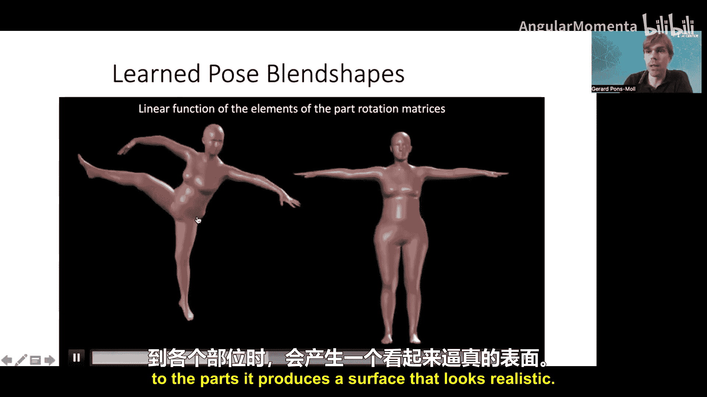

## SMPL模型：业界标准

目前学术界和工业界广泛使用的标准模型是**SMPL模型**。它主要基于计算机图形学中沿用多年的标准蒙皮技术。

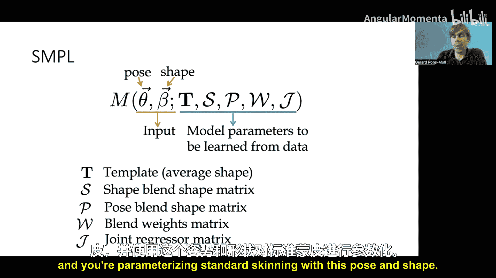

SMPL模型参数化了标准蒙皮中的某些组件（如模板、关节位置）与低维姿态、形状参数之间的关系。其核心思想是学习一个函数，接收低维的姿态参数θ和形状参数β，输出顶点位置。

以下是SMPL模型的关键组成部分：
1.  **模板网格**：在标准姿态下的平均人体网格。
2.  **形状混合形状**：改变人物身份的位移，由形状参数β控制。
3.  **姿态混合形状**：解释肌肉膨胀等姿态相关变形的位移，由姿态参数θ控制。
4.  **混合权重**：定义身体各部分如何刚性移动的权重，从数据中学习得到。
5.  **关节回归器**：一个将网格顶点映射到关节位置的矩阵。

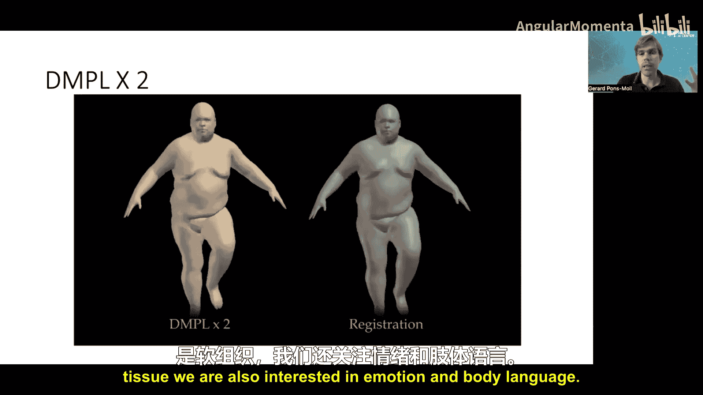

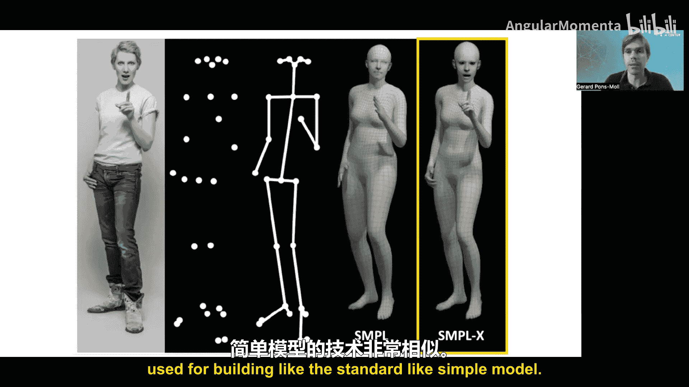

通过从配准的扫描数据中学习这些参数，以最小化表面到表面的误差，我们就能得到SMPL模型。

## 超越基础形状：表情、手部与软组织

对于许多应用，我们不仅关心形状和姿态，还关心表情、身体语言等。SMPL模型对此是不够的。

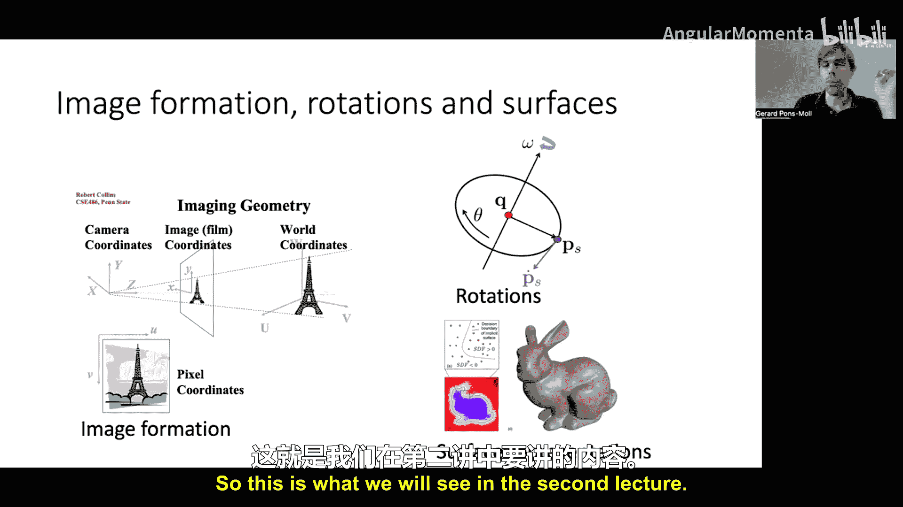

因此，出现了如**SMPL-X**这样的模型，它包含了手部和面部。构建面部和手部模型的技术与构建身体模型的技术非常相似。面部模型将形状、姿态和表情因子分离开来。手部模型（如MANO）也遵循类似SMPL的统计建模原理。

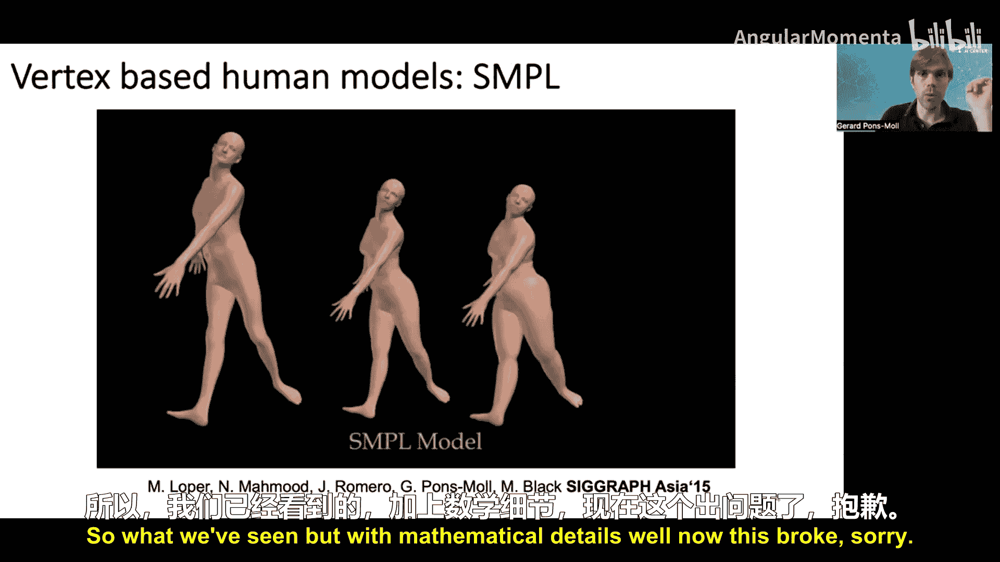

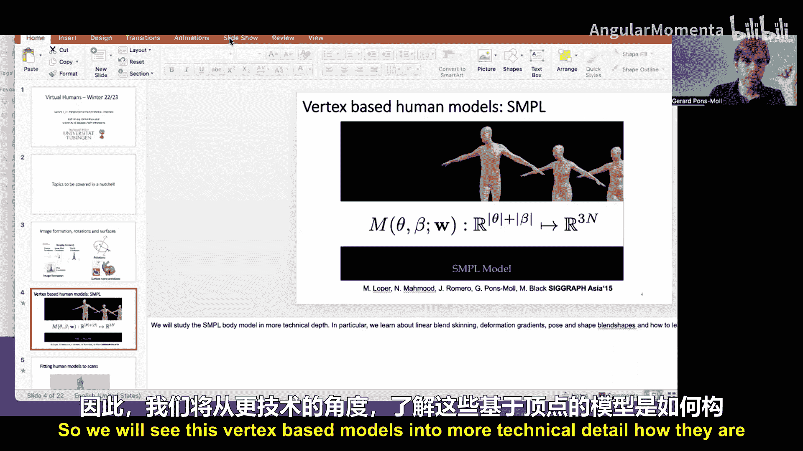

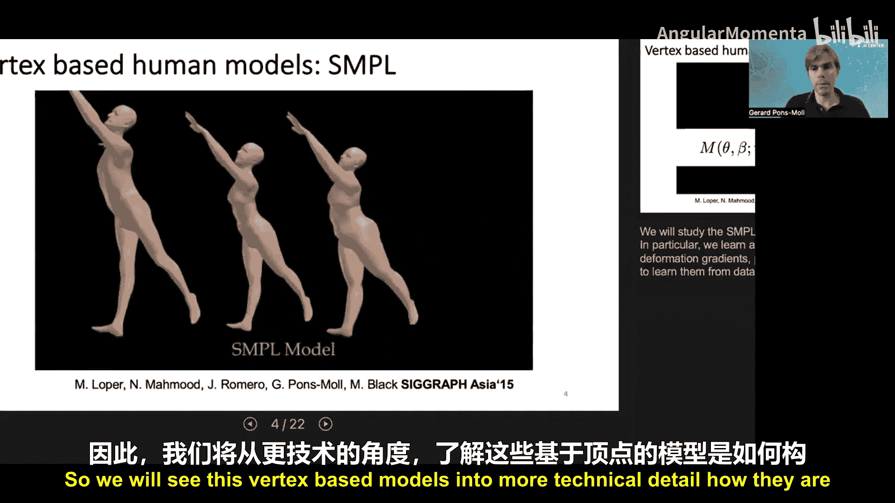

此外，若要建模软组织，需要在模型中添加控制软组织的组件。这需要从动态扫描数据中学习。

## 课程内容概述

到目前为止，你应该对构建人体模型所需的工作有了大致了解。接下来，我们预览本课程将涵盖的主题。

### 第二讲：图像形成与表示
我们将学习如何从图像和视频等视觉观测中恢复人体模型。为此，首先需要理解图像是如何形成的。内容将涉及图像形成原理、不同的旋转参数化方法以及表面表示方式。

### 第三讲：人体模型构建细节
我们将更技术性地深入探讨如何构建像SMPL这样的基于顶点的人体模型，包括其数学形式以及如何从数据中学习它们。

### 数据拟合与模型配准
我们将学习如何将人体模型拟合到扫描数据，即之前讨论的关键的配准过程。你将在练习中亲自实践。

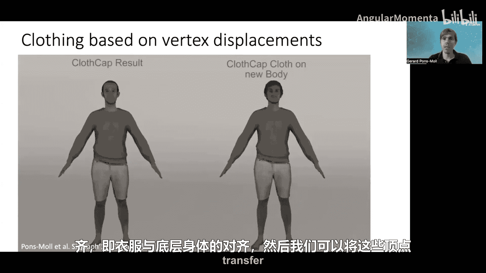

### 从图像中推断人体模型
这是单图像三维重建的任务。我们将看到基于优化的方法、基于神经网络回归的方法，以及结合两者优势的混合方法。

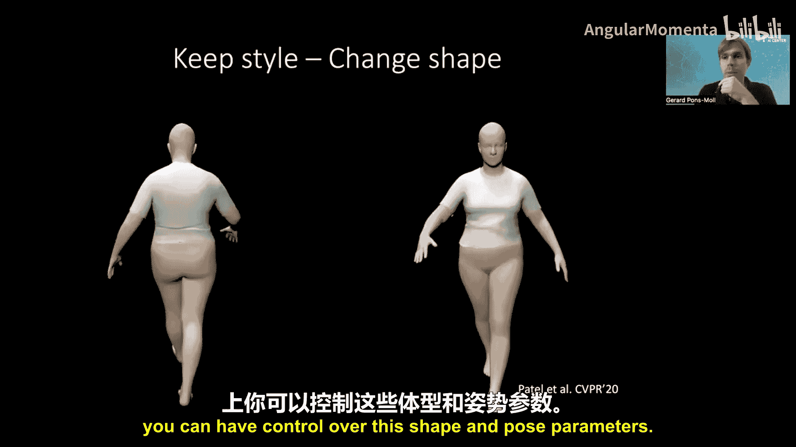

### 基于可穿戴传感器的运动捕捉
在没有外部相机的情况下（如户外运动、跨房间追踪、VR应用），可以使用附着在身体上的惯性测量单元。我们将学习如何仅基于少数IMU数据恢复全身运动。

### 衣物建模
为了产生真实感，需要考虑衣物建模。
*   **基于顶点位移的方法**：如ClothCap，将衣物作为单独的网格层进行跟踪和转移。
*   **隐式表面与神经表示**：为了处理更复杂的衣物和拓扑变化，近期工作转向使用神经网络参数化的隐式表面（如SDF），或神经辐射场。
*   **NeRF**：一种将场景的3D几何和外观存储在神经网络中的方法，通过查询空间点的密度和颜色进行渲染。

### 行为与交互
我们将研究如何追踪与物体和3D场景交互的人体，构建能够理解场景可供性、合成与场景交互的人类运动模型，最终向构建能够感知并自主与3D场景交互的虚拟人类迈进。

## 总结

本节课中，我们一起学习了虚拟人体模型的基本概念。我们了解了理想模型的特征、通过动态扫描采集数据的过程、模型构建中关键的配准步骤，以及如何使用统计方法（如PCA）从数据中学习形状和姿态变化。我们还介绍了业界标准的SMPL模型及其核心组件，并预览了本课程将深入探讨的多个前沿主题，包括从图像中恢复模型、衣物建模、神经表示以及人体与场景的交互。在接下来的课程中，我们将对这些主题进行详细的技术性探讨。

