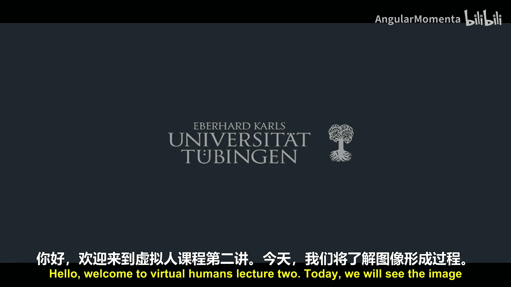
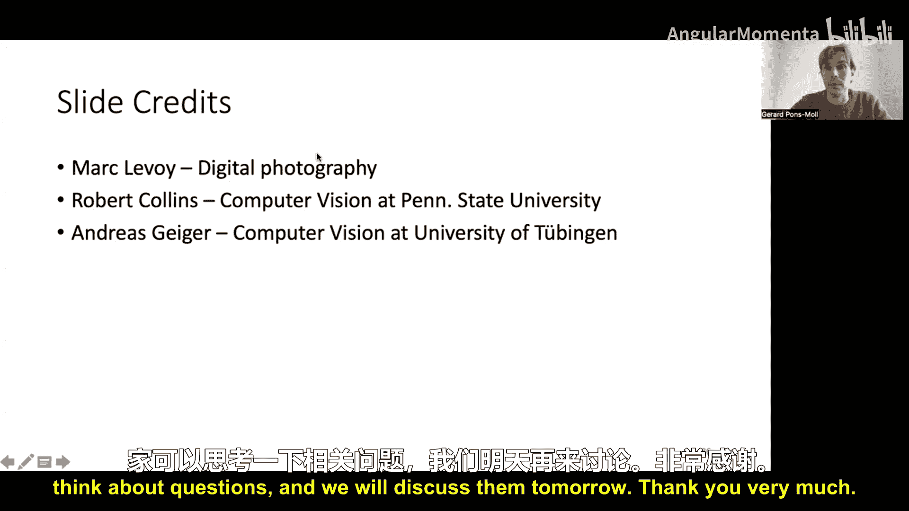

# 003：图像形成过程

在本节课中，我们将学习图像是如何形成的。虽然这是一门虚拟人类课程，但我们常常需要从图像中提取三维人体模型。为了做到这一点，我们首先需要理解图像是如何形成的，真实人物在图像中如何呈现，以及会发生哪些投影效应。我们将从线性透视的直观介绍开始，然后将其形式化，并学习如何用一个投影矩阵来表达整个图像形成过程的几何部分。

## 线性透视与自然透视

上一节我们介绍了课程目标，本节中我们来看看图像形成的基础——透视原理。

自然透视是指世界中的特征在观察者眼中所张成的视觉角度。其直观事实是：距离更远的物体看起来具有更小的视觉角。这意味着，当物体靠近观察者时，观察者看到的物体张角会增大。

然而，仅凭自然透视不足以绘制出正确的图像。为了将三维场景正确投影到二维图像上，需要考虑线性透视。

线性透视由菲利波·布鲁内莱斯基于1413年发现。它指出，透视图像是由物体发出的光线与一个画面平面（或画布）相交形成的。与自然透视类似，物体离观察者越近，在图像中显得越大。但这种比例关系与自然透视不同。

我们可以用相似三角形来数学描述线性透视。假设物体高度为 **H**，观察者到图像平面的距离为 **f**（即焦距），物体到观察者的深度为 **Z**。根据相似三角形关系，可以得到图像中的高度 **y** 为：

**y = H * f / Z**

从这个公式可以得出几点重要结论：
*   投影不是关于物体坐标的线性映射，因为存在除以 **Z** 的运算。
*   物体越远（**Z** 越大），在图像中显得越小。
*   焦距 **f** 越大，物体在图像中显得越大。

## 消失点与透视效应

由于线性透视不是线性映射，三维世界中的平行线在图像中可能不再平行。随着物体远离相机，它们会显得越来越小，导致平行线汇聚于所谓的“消失点”。

以下是关于消失点的几个关键事实：
*   一幅透视图中可以有无限多个消失点，每一组不平行于视线的平行线都会汇聚到一个消失点。
*   平行于画面平面的直线不会汇聚，在图像中保持平行。

一个有趣的问题是：当观察一个非常长的建筑物正面（视线垂直于该平面）时，其远端在透视图中是否应该比中心部分画得更小？答案是否定的。因为在这种情况下，建筑物各部分的深度 **Z** 没有变化。根据线性透视公式 **y = H * f / Z**，当 **Z** 恒定时，图像高度 **y** 也恒定。因此，在正确的线性透视图中，建筑物的远端不会变小。如果看起来变小，那是由于观察图画时的自然透视（视觉角变化）造成的，而非图画本身的透视错误。

另一个常见现象是：为什么有时看一幅透视画会觉得扭曲？通常是因为观看距离不对。要正确观看一幅透视画，你需要站在与作画时相机位置相对应的距离上，以尊重其原始的透视关系。

## 相机模型：从针孔到透镜

理解了透视原理后，我们来看看实现它的物理设备——相机。

最简单的相机模型是针孔相机。光线通过一个小孔，在另一侧的传感器上形成倒立的图像。针孔相机能产生正确的线性透视，并且所有景物都在焦点上。但其主要问题是进光量太少，导致图像非常暗。

为了解决进光量问题，可以增大孔径。但这会导致图像模糊，因为传感器上的每个点会接收到来自物体上多个点的光线，形成一个光锥。

透镜解决了这个问题。透镜可以将从物体同一点发出的光线聚焦到传感器的一个点上，同时允许大量光线进入。因此，现代相机使用透镜代替针孔。透镜有两个基本原理：
1.  平行于光轴的光线穿过透镜后，会汇聚在焦点上，该点到透镜的距离称为焦距 **f**。
2.  穿过透镜中心的光线不会发生偏折。

基于这两个原理，我们可以推导出透镜公式，它描述了物体距离 **S₀**、像距 **Sᵢ** 和焦距 **f** 之间的关系：

**1/S₀ + 1/Sᵢ = 1/f**

这个公式告诉我们，为了对特定距离的物体清晰对焦，需要如何调整传感器与透镜之间的距离。与针孔相机不同，透镜只能使一个平面上的物体完美对焦，这个距离称为对焦距离。

## 焦距与视野

在计算机视觉的针孔相机模型中，我们使用的焦距 **f** 是指投影中心到图像平面的距离。而在物理透镜模型中，焦距 **f** 是透镜本身的属性，不依赖于传感器位置。在实践中，计算机视觉通常使用简化的针孔模型。

焦距 **f** 和传感器尺寸共同决定了相机的视野。视野 **FOV** 可以通过以下公式计算：

**FOV = 2 * arctan( (传感器尺寸/2) / f )**

由此可见：
*   焦距 **f** 越小，视野 **FOV** 越宽（广角镜头）。
*   焦距 **f** 越大，视野 **FOV** 越窄（长焦镜头）。
*   传感器尺寸越小，视野 **FOV** 也越小。

焦距的不同会带来显著的透视效果差异。例如，用广角镜头（短焦距）拍摄人像时，需要靠近被摄体以使其在画面中大小合适，但这会夸大近大远小的透视效果，导致鼻子显得很大。而用长焦镜头（长焦距）拍摄时，摄影师会远离被摄体，这减少了不同深度部位（如鼻子和耳朵）之间的透视差异，使人脸看起来更平坦。

在电影摄影中，有一种叫“Dolly Zoom”或“Vertigo Effect”的技巧，就是在移动摄影机的同时改变焦距，使画面中某个主体的大小保持不变，而背景的透视关系发生剧烈变化，产生眩晕感。

## 图像形成的数学形式化

现在我们已经对图像形成有了直观理解，接下来让我们用数学来形式化这个过程。我们的目标是用一个单一的投影矩阵来表达整个图像形成过程。

图像形成涉及一系列坐标变换：
1.  从世界坐标到相机坐标。
2.  从相机坐标到图像坐标（通过透视投影）。
3.  从图像坐标到像素坐标。

### 1. 世界坐标到相机坐标

世界坐标是描述三维场景的全局坐标系。相机坐标是以相机光学中心为原点、光轴为Z轴的坐标系。两者之间的变换是一个刚体变换，包括旋转 **R** 和平移 **t**。一个世界点 **P_w** 转换到相机点 **P_c** 的公式为：

**P_c = R * P_w + t**

这个变换可以用一个4x4的齐次坐标矩阵来表示。

### 2. 透视投影：相机坐标到图像坐标

这是核心的投影步骤。根据之前推导的相似三角形原理，相机坐标系中的点 **(X, Y, Z)** 投影到图像平面上的点 **(x, y)** 的公式为：

**x = f * X / Z**
**y = f * Y / Z**

这里 **f** 是焦距。注意，这个变换不是线性的，因为涉及除以 **Z**。为了用矩阵表示，我们引入齐次坐标。齐次坐标下，一个二维点 **(x, y)** 可以表示为三维向量 **(x', y', w)**，其中 **x = x'/w**, **y = y'/w**。利用这一点，透视投影可以写成一个线性矩阵乘法：

**[x', y', w]ᵀ = [[f, 0, 0, 0],
                 [0, f, 0, 0],
                 [0, 0, 1, 0]] * [X, Y, Z, 1]ᵀ**

然后，通过除以 **w**（即 **Z**）得到最终的图像坐标：**x = x'/w = fX/Z**, **y = y'/w = fY/Z**。

### 3. 图像坐标到像素坐标

图像坐标是连续的，单位为毫米（或其它物理单位）。我们需要将其转换为离散的像素坐标。这涉及一个仿射变换，包括：
*   **缩放**：考虑像素的物理尺寸 **(s_x, s_y)**（毫米/像素）。
*   **平移**：图像平面原点（主点）通常不在像素阵列的角落，需要偏移 **(o_x, o_y)**。
*   **轴翻转**：有时像素坐标系的Y轴方向与图像坐标系相反。

因此，像素坐标 **(u, v)** 的计算公式为：

**u = (x / s_x) + o_x**
**v = (y / s_y) + o_y**

这也可以用一个矩阵来表示。

### 合成投影矩阵

将上述所有变换矩阵相乘，我们可以得到一个3x4的投影矩阵 **P**：

**P = K * [R | t]**

其中：
*   **[R | t]** 是3x4的外参矩阵，负责世界坐标到相机坐标的刚体变换。
*   **K** 是3x3的内参矩阵，它包含了焦距 **f**、主点偏移 **(o_x, o_y)** 和像素缩放因子 **(s_x, s_y)** 等信息。其常见形式为：

**K = [[f/s_x, 0, o_x],
      [0, f/s_y, o_y],
      [0,   0,   1]]**

最终，一个齐次世界点 **[X_w, Y_w, Z_w, 1]ᵀ** 通过以下步骤投影到齐次像素坐标 **[u, v, 1]ᵀ**：

**[u', v', w']ᵀ = P * [X_w, Y_w, Z_w, 1]ᵀ**
**u = u' / w'**
**v = v' / w'**

这个投影矩阵 **P** 是计算机视觉和计算机图形学中的核心工具，用于从三维世界渲染二维图像，或反之，为从图像推断三维结构提供几何约束。

## 正交投影：一种简化模型

当物体距离相机非常远，或者使用长焦镜头时，透视效应变得非常微弱。在这种情况下，可以忽略除以 **Z** 的步骤，使用一种更简单的模型——正交投影。

正交投影直接丢弃深度 **Z** 坐标，并将 **X** 和 **Y** 坐标按一个固定比例 **s** 缩放：

**u = s * X**
**v = s * Y**

用矩阵表示为：

**[u, v, 1]ᵀ = [[s, 0, 0, 0],
               [0, s, 0, 0],
               [0, 0, 0, 1]] * [X, Y, Z, 1]ᵀ**

正交投影计算简单，适用于远景或对精度要求不高的场合。但在近景下，它会错误地表示物体的相对大小，因为忽略了“近大远小”的规律。

## 总结

本节课中，我们一起学习了图像形成的完整过程。

我们从**自然透视**和**线性透视**的直观概念开始，理解了物体在图像中大小与距离的关系由公式 **y = H * f / Z** 描述。我们探讨了**消失点**的现象，并分析了不同观看距离对透视画感知的影响。

接着，我们研究了相机如何实现透视，从**针孔相机模型**到现代**透镜相机模型**，解释了透镜如何通过聚焦光线来解决进光量问题，并介绍了透镜公式 **1/S₀ + 1/Sᵢ = 1/f**。我们还明确了**焦距 f** 与**视野 FOV** 的关系，以及不同焦距带来的透视效果差异，这对理解人像摄影和三维重建至关重要。

最后，我们将整个过程数学形式化。通过引入**齐次坐标**，我们将非线性的透视投影表示为线性矩阵运算。我们定义了**内参矩阵 K** 和**外参矩阵 [R | t]**，并将它们组合成单一的**投影矩阵 P**，实现了从三维世界坐标到二维像素坐标的完整映射。作为补充，我们也介绍了在特定条件下可用的简化模型——**正交投影**。

理解图像形成是计算机视觉（从图像恢复三维信息）和计算机图形学（将三维场景渲染为图像）的基石。掌握这些原理，是后续学习虚拟人类建模、姿态估计、三维重建等课题的关键第一步。