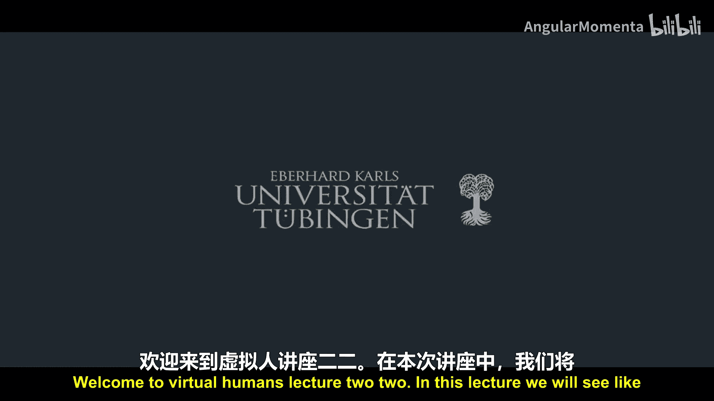
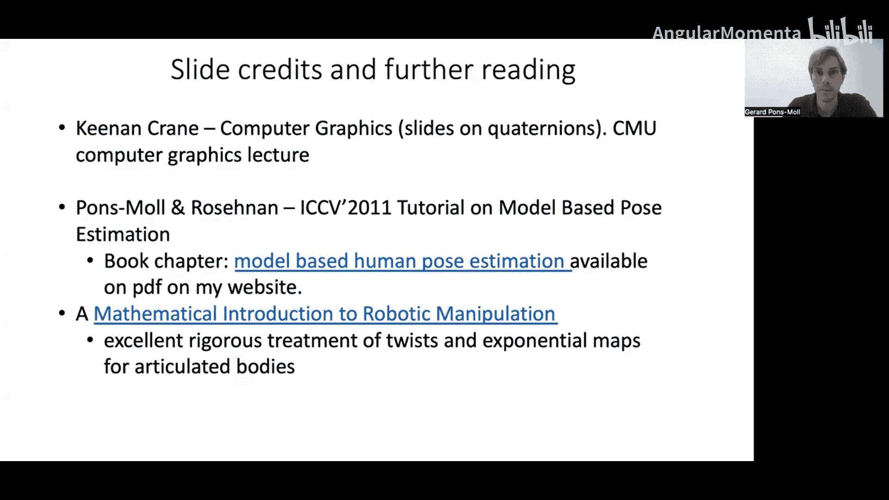

# 004：旋转与运动链



在本节课中，我们将学习如何参数化旋转和运动链，这是参数化人体运动的核心组成部分。我们将探讨旋转矩阵、欧拉角、四元数、轴角以及指数映射等不同参数化方法，并了解它们的优缺点。最后，我们将学习如何使用运动链来建模人体骨架的关节结构。

## 旋转参数化概述

在上一节中，我们提到建模人体运动需要关注如何参数化其运动。本节中，我们将深入探讨如何表示和处理旋转，这是描述人体姿态变化的基础。

旋转是一种线性变换，它保持角度和距离不变，且不产生镜像效果。在二维空间中，旋转是可交换的，但在三维空间中，旋转的顺序至关重要，因为它们不可交换。

## 旋转矩阵

旋转矩阵是表示旋转最直接的方式。它是一个3x3的矩阵，其列向量是目标坐标系基向量在参考坐标系中的表示。

**公式**：给定一个在身体坐标系 `B` 中的点 `P_B`，其在空间坐标系 `S` 中的坐标 `P_S` 可通过旋转矩阵 `R_SB` 计算：
```
P_S = R_SB * P_B
```
其中，`R_SB` 的列是 `B` 坐标系的基轴在 `S` 坐标系中的表示。

旋转矩阵需要9个数字，但受正交性（`R^T * R = I`）和行列式为1（`det(R) = 1`）的约束，其内在维度仅为3。这些约束在数值优化中可能带来挑战，但旋转矩阵因其由正弦和余弦函数构成，在机器学习任务中有时表现良好。

## 欧拉角

为了用更少的参数（三个）表示旋转，欧拉角是一种流行的方法。它将旋转分解为绕三个坐标轴（如X、Y、Z轴）的连续平面旋转。

**公式**：一个欧拉角旋转（以Z-Y-X顺序为例）可以表示为：
```
R(α, β, γ) = R_x(γ) * R_y(β) * R_z(α)
```
其中，`R_x`、`R_y`、`R_z` 分别是绕X、Y、Z轴的旋转矩阵。

欧拉角直观且易于计算导数，但它存在一个严重问题：万向节锁。当两个旋转轴对齐时，会失去一个自由度，导致参数化不唯一，这在优化和学习中是不希望的。

## 四元数

四元数是复数在三维空间中的推广，用于表示旋转而无万向节锁问题。一个四元数 `q` 包含一个实部 `q_w` 和三个虚部 `q_x`、`q_y`、`q_z`，可以紧凑地表示为 `q = q_w + v`，其中 `v` 是向量部分。

**公式**：单位四元数可以表示为轴角形式：
```
q = [cos(θ/2), sin(θ/2) * u]
```
其中，`u` 是单位旋转轴，`θ` 是旋转角度。

旋转一个向量 `a` 使用四元数乘法：
```
a' = q * a * q_conjugate
```
四元数乘法不满足交换律，这与三维旋转的特性一致。四元数非常适合旋转插值（如球面线性插值SLERP），但在优化时需要强制其范数为1的约束。

## 轴角与指数映射

轴角表示用三个数字（一个单位轴向量 `u` 和一个角度 `θ`）直接描述旋转，没有奇异性。指数映射提供了从轴角参数到旋转矩阵的封闭形式转换。

**公式**：给定轴角参数（缩放后的旋转轴 `ω = θ * u`），其对应的旋转矩阵 `R` 可以通过指数映射得到：
```
R = exp(θ * [ω]_×) = I + sin(θ) * [ω]_× + (1 - cos(θ)) * [ω]_×^2
```
其中，`[ω]_×` 是向量 `ω` 的反对称矩阵。

这种表示非常直观，导数易于计算，并且是SMPL等人体模型使用的参数化方法。

## 运动链

运动链用于建模如人体骨架的关节结构。它通过将多个刚体变换（旋转和平移）串联起来，描述末端效应器（如手部）相对于基础坐标系的位置。

**公式**：对于一个具有 `n` 个关节的链，末端效应器的变换 `G_SB(θ)` 是各个关节变换的乘积：
```
G_SB(θ) = exp(θ_1 * ξ_1) * exp(θ_2 * ξ_2) * ... * exp(θ_n * ξ_n) * G_SB(0)
```
其中，`θ_i` 是关节角度，`ξ_i` 是描述关节运动的“扭转”坐标（包含旋转轴和可能的平移）。

在解决逆运动学（如让人手到达特定位置）时，我们需要计算雅可比矩阵，该矩阵将参数空间的小变化 `Δθ` 映射到末端效应器空间的变化 `Δx`。雅可比矩阵的列由各个关节的扭转贡献构成，这使得基于梯度的优化成为可能。

## 总结

本节课中，我们一起学习了多种旋转参数化方法：
*   **旋转矩阵**：最直接的表示，但参数冗余且有约束。
*   **欧拉角**：直观且参数少，但存在万向节锁问题。
*   **四元数**：无奇异性，适合插值和累积运动，但需要单位范数约束。
*   **轴角与指数映射**：直观、无奇异性、导数易算，是现代人体模型（如SMPL）的基础。




我们还学习了如何使用**运动链**和**乘积指数公式**来参数化 articulated 骨架，以及如何利用**雅可比矩阵**进行优化以解决如逆运动学等问题。理解这些概念对于参数化和分析人体运动至关重要。