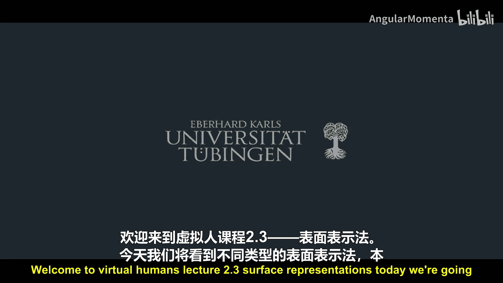
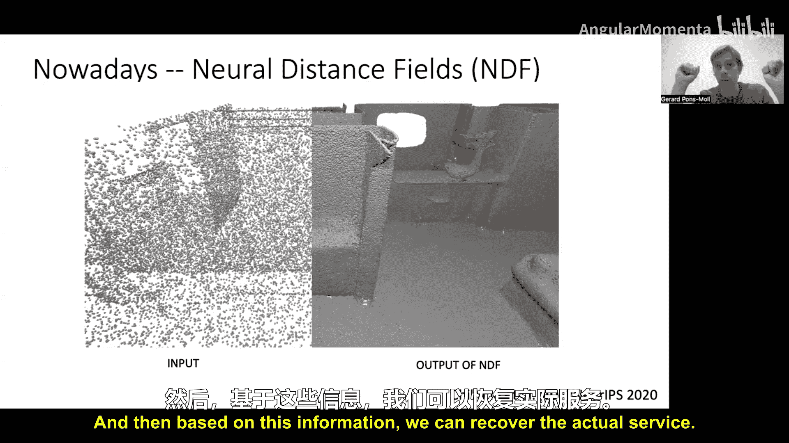
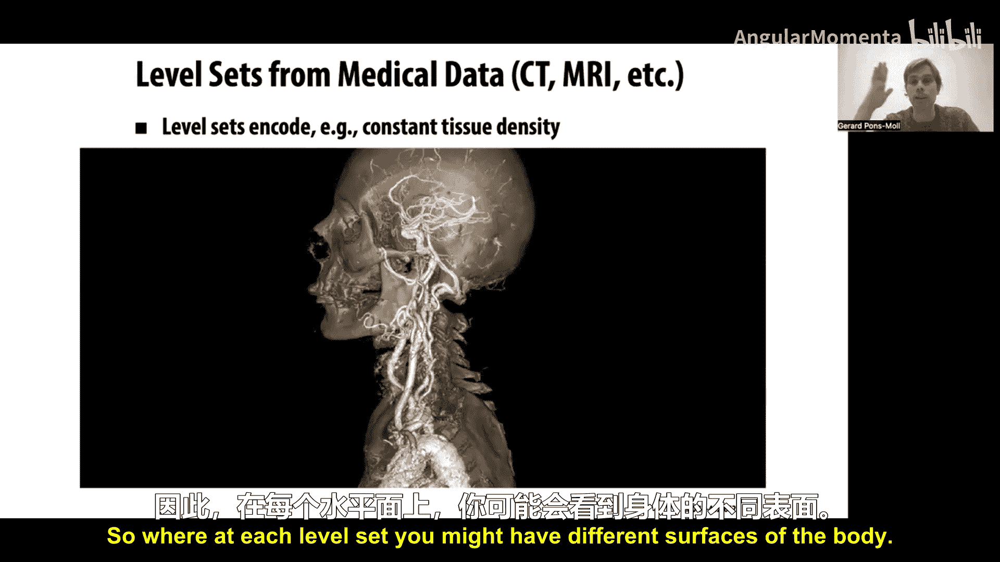
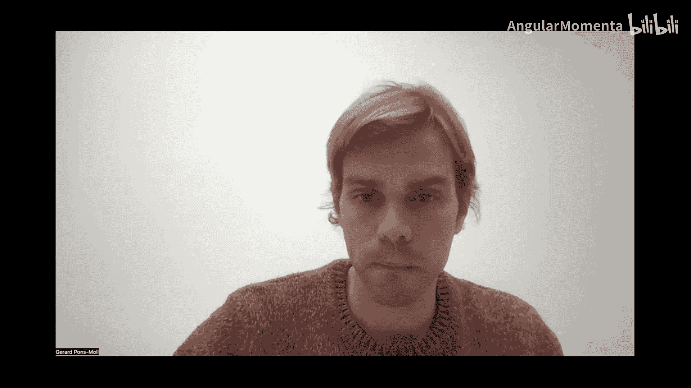

# 005：表面表征

在本节课中，我们将学习不同类型的表面表征方法。我们的目标是理解每种表征方式的优缺点。

## 概述

在之前的课程中我们简要提到，为了建模虚拟人类，你需要考虑如何参数化运动。这涉及到运动学、旋转和变换。本节课的主题将是几何学，即如何建模人的形状。我们将看到这是一个非常有趣且复杂的主题。当然，如果你想生成看起来逼真的人类，还需要考虑材质、光照、纹理等。然而，本讲座的重点将放在如何建模实际的形状，即人类和物体的一般几何结构上。

那么，我们如何描述几何形状呢？

## 几何表征的多种方式

以下是一些描述几何形状的可能方式。

*   你可以使用语言描述，例如“这是一个单位圆”。
*   你可以使用数学方程。例如，你可以说，这些是满足 `x = cos(θ)` 和 `y = sin(θ)` 的 (x, y) 点。
*   你可以使用隐式方程来表示这条曲线，例如 `x² + y² = 1`。
*   你可以说，这是一条曲率为1的曲线，即一个圆。
*   你可以说，这是一条沿任何轴都对称的曲线。
*   你可以使用无限多条边来近似这个圆，就像一个多边形。
*   你可以使用更复杂的表示，例如，说它是某个微分方程的解。

因此，表示几何形状的方法有很多种。而表征方式的选择，实际上取决于你想要建模的对象。

## 几何建模的挑战与选择

让我们看一些几何形状的例子。例如，人类的面部非常重要，因为它表达情感，是交流的基本组成部分。身体也是如此。准确捕捉每一个细节至关重要，否则，在远程呈现或元宇宙等场景中，交流就会变得不自然。

观察面部，它有皱纹、嘴巴、牙齿和头发。看起来，即使是面部的不同部分，也可能需要不同的表征方式。也许网格对于建模面部是足够的，但对于头发，你可能需要另一种表征，比如某种体积表征或发丝模型。对于服装，也许你可以用网格，但如果你想处理拓扑变化和复杂的服装，可能需要使用隐式表示。我们将在本课程中看到所有这些内容。

如果你在建模服装和动力学，你必须考虑一种允许你改变形状并使形状对外力做出反应的表示。也许网格对此有好处，因为你有由边连接的顶点，这类似于实际表面的构成方式。对于像流体那样会分裂和合并的形状，网格可能不是一个好的表示。对于在不同尺度上都非常复杂的形状，例如一个完整的城市，你需要考虑可扩展性，单个网格可能不是一个好主意。或者，你可能需要建模复杂的头发，体积表示可能比仅用表面表示更合适。

鉴于所有这些选项，自然会思考编码几何形状的最佳方式是什么？这确实取决于你想要建模的对象。这是图形学和虚拟人类领域的一个反复出现的主题，没有一种最佳选择。因为几何处理本身就很困难。

## 显式与隐式表征

本质上，数字编码几何形状的方法有很多。我们主要有两种类型的表征：显式和隐式。

*   **显式表征**：例如点云、多边形网格、细分曲面、NURBS曲线等。显式意味着我们可以非常直接地访问表面上的点。
*   **隐式表征**：表面由一个方程或函数隐式定义，该方程或函数规定了点需要满足的约束。这里我们也有很多选择，例如需要存储的水平集、代数曲面、Blobs等。

每种选择都最适合于特定的任务。

## 隐式表征详解

在几何的隐式表示中，点不是直接已知的，但它们满足某种关系。例如，一个隐式曲面由方程 `x² + y² + z² = 1` 定义，这就是单位球体。但我们不一定需要数学方程，我们可以有一个存储在计算机中的函数，对于每个 (x, y, z)，它给出一个数字来定义该点是在表面内部还是外部。例如，你可以有一个函数，如果点在外面（如图中的蓝点）则取值为0，如果在里面则取值为1。现在，表面将是所有满足 `F(P)` 处于内部和外部决策边界上的点。

正如我所说，隐式表示有很多种，比如代数曲面、构造实体几何、水平集、Blobs、分形等。我们将看到其中的一些表示。

### 隐式表面的优缺点

首先，让我们通过一个小游戏来理解隐式表面的优点和缺点。

假设我正在考虑一个隐式表面，例如 `F(x, y, z) = 0`，就像我之前展示的那个。我要求你：给我一个表面上的点。你可以使用 `F` 来评估。游戏是你可以以任何你想要的方式使用 `F`，任务是找到表面上的点。你该怎么做？这并不简单，因为你可以查询一个点，函数会告诉你它是在内部还是外部。但你必须查询很多点，直到找到一个实际上在边界上的点。所以，我们将展示有方法可以有效地找到边界，但它永远不会像显式方法那样高效。

让我们看看你可能感兴趣的另一个方面，例如，知道一个点是在表面内部还是外部。这在考虑相交问题时很重要，例如，你想知道一个虚拟人类是否与3D世界相交。并且你想避免穿透，例如服装和身体的穿透，能够有效地知道一个点是在表面内部还是外部很重要。

例如，如果我问你，点 (0.75, 0.5, 0.25) 是在单位球体内部还是外部？这很容易检查。我可以直接代入方程 `x² + y² + z² = 1`，然后我看到 `x² + y² + z²` 是 9/16 + 4/16 + 1/16 = 14/16 = 7/8，小于1，这意味着该点在单位球体内部。所以这非常快速和容易做到。

因此，隐式表面使得像内外测试这样的任务变得非常容易。这对于相交和穿透检测等非常有用。

## 显式表征详解

几何的显式表示是那些点被直接给出的表示。你有一些参数，它们参数化了表面，然后你基本上可以访问这些点。例如，球体上的点可以用以下显式参数化定义：`(cos(u) * sin(v), sin(u) * sin(v), cos(v))`，其中 `u` 和 `v` 在区间 `[0, 2π)` 和 `[0, π]` 内的任何值都会给我一个表面上的3D点。

通常，显式表示是从 `R²` 到 `R³` 的映射，因为表面的内在维度是二维的。对于一个嵌入在3D中的二维表面，你可能没有整个表面的表达式，但可能有表面局部区域的表达式。我们将看到，通过拥有许多局部面片来编码表面是一种方法。

同样，在图形学中有许多显式表示，如三角形网格、细分曲面、NURBS、点云。你将看到其中的许多，并会使用其中的一些。

### 显式表面的优缺点

现在，让我们用显式表面玩另一个游戏。

我给你一个显式表面，你必须找到上面的点。表面是 `F(u, v) = (1, 2, 3) + u * b`。你如何找到表面上的点？你只需选择任何 `(u, v)` 值，就完成了。显式表示会直接给你表面上的点。任何 `(u, v)` 值对都会给我平面上的一个3D点。所以，显式表面使得像在表面上采样点这样的任务变得非常容易。

现在，我有一个新的表面 `F(u, v)`，我想检查一个点是否在里面。例如，这是我的表面，它在这里有这个表达式，基本上是这里的这个哑铃形状，我想检查这个点实际上是在内部还是外部。嗯，这不像以前那么容易了，因为这里的这个函数只告诉我如何在表面上采样点，但它没有告诉我一个点是在内部还是外部。所以这是你无法用显式表面轻易做到的事情。

## 总结与比较

总之，一些表示方法比其他方法更适合，这取决于任务和你想做什么。

回到隐式表面。也许在计算机图形学中最基本和历史悠久的隐式表面用法是代数曲面。这基本上是用数学方程组合形状。所以，表面是 `X, Y, Z` 多项式的零集。本质上，例如，对于球体你有这个隐式方程 `x² + y² + z² = 1`，但如果你想要更复杂的形状，比如一个心形，你有像 `(x² + (9y²)/4 + z² - 1)³ = x²z³ ...` 这样的方程。你看，这不容易定义，而这只是一个简单的心形。如果你想用数学方程建模像牛或汽车这样的东西，那将非常困难。

然而，你可以通过组合更简单的形状来构造复杂的形状，这是计算机图形学中经常使用的主题。使用隐式，你可以非常容易地进行操作和组合形状，例如并集、交集和差集。它允许你非常容易地完成所有这些操作，而用显式表示则不然。如果你有两个网格，你必须找到并集形状，这并不简单。

所以，你可以基本上链接不同的操作，如并集、交集和差集等，以产生更复杂的形状。你还可以扩展这个想法，不是用布尔运算组合形状，而是以平滑的方式混合它们。为此，你可以使用例如距离函数，它给你空间中每一点到表面上最近点的距离。然后，你可以混合任意两个距离函数。

本质上，实现两个距离函数的布尔并集，你只需取两个距离函数的最小值，这将创建并集。所以，使用隐式表示组合形状是相当简单的。

使用这些基本形状，你可以组合它们来生成非常复杂的场景。虽然这在艺术上非常有趣且美丽，但很难做到，因为很难用数学方程表示世界上的每一个几何形状，即使我们组合它们，即使我们生成由更简单对象组成的场景。

解决这个问题的一种方法是使用水平集。我们已经看到隐式表面有一些很好的特性，如合并和分裂，但当然很难用封闭形式描述复杂的形状。水平集是一种替代方案，因为你可以存储一个近似函数的数值网格。本质上，你会有一个3D立方体，并为每个点（每个体素，即空间中的一个点）存储该点是在内部还是外部，或者存储到表面的距离。

这基本上是将整个函数存储在内存中，所以更灵活。你不需要数学方程，因为它都存储在那里。然而，它提供了对形状的更多控制，但你需要存储空间，并且需要大量的体素才能有足够详细的形状，这可能是个问题。这在今天可能是个问题，我们将看到这一点。

一个常见的趋势是用神经网络替换这些水平集。本质上，你不是将形状存储在这些网格中，而是使用一个神经网络，你可以查询空间中的每个3D点，它会给你到表面的距离。你可以在一个神经网络中存储许多对象，根据你对网络的调节，你会得到一个或另一个对象。例如，这是我们几年前发表的一篇论文的例子，它本质上使用一个隐式表示表面的神经网络，可以从稀疏点云恢复场景的密集点云。这里你可以看到，这是一个单一的神经网络，经过训练以完成场景。所以，这里的网络接收空间中的一个点，并输出到表面的距离。然后基于这个信息，我们可以恢复实际的表面。

我们将在后面的课程中解释为什么这是一个好主意，以及为什么这种表示对深度学习如此有益。

隐式表面在医学成像中非常广泛地使用，因为你有不同的层，这非常适合用这些体积的水平集编码。在每个“切片”上，你可能有不同的身体表面。

当然，水平集的缺点是现在你有 `O(N³)` 的复杂度，因为你有三个维度，所以如果你想要越来越高的分辨率，这会以立方级增长，对于存储来说不是好消息，对于处理（如果你在做学习）也是如此。你可以通过仅存储表面周围的窄带来降低成本，但这仍然是使用这些水平集的主要限制之一。

选择表示时需要考虑的另一件事是计算法线和最近点有多容易。这对于渲染通常非常重要，例如，我们需要知道法线，或者为了将一个点云注册到另一个点云，我们需要能够轻松地找到空间中点到表面的最近点。

如果你使用隐式表示并使用距离场，到表面的距离很容易，因为它由距离场本身给出。所以距离场 `F(P)` 给出了从 `P` 到 `Q` 的距离，其中 `Q` 是表面上最近的点。`F(P)` 已经给了我们距离，这是个好消息。现在，我们如何得到表面的法线呢？

表面上给定点 `P` 的法线等于这个函数 `F(P)` 的梯度。为什么是这样呢？`F(P)` 给出了到表面的距离。梯度会告诉我们距离增加最快的方向。我们知道，如果我们沿着表面移动，距离应该如何变化？它不应该改变，距离应该等于零。所以沿着表面，水平集没有变化，没有梯度。因此，垂直于这个表面的方向应该是梯度，即变化最大的方向。法线不能与这个梯度不同，因为否则意味着它在切平面上有分量，这对于法线来说是不可能的。所以这就是为什么 `F(P)` 的梯度等于该点的法线。这也容易计算。

对于最近点，如果你有一个距离场，事实证明有一个非常简单的公式，我们在一些研究中使用了它，它基本上是如何将一个点投影到表面，并找到给定点的最近表面点。如果我有一个点，梯度告诉我方向，因为我应该移动多少个距离单位才能落在表面上？嗯，想象查询点 `P` 在这里，我离表面有多远？我离表面有 `F(P)` 个距离单位远，所以我需要做的就是取梯度，它告诉我方向，然后乘以 `F(P)`，即到表面的距离。我没有提到的一点很重要，在距离场中，梯度将具有单位范数。因为距离在最大变化方向上，一次只会改变一个单位。

隐式表面的优点是，如果你使用这些代数表示和Blobs，描述可以非常紧凑。很容易确定一个点是否在形状内部，你只需查询函数，它会告诉你。其他查询可能很容易，例如到表面的距离。对于简单形状，有精确的描述，没有采样误差，并且易于处理拓扑变化。

问题是，在形状中找到点很昂贵，很难知道哪些点在形状上，这不太容易做到。而且，除非你存储这些水平集或用神经网络编码形状，否则建模非常复杂的形状并不容易。

## 显式表征详解

那么显式表示呢？也许最简单的是点。你可以将表面表示为一个点列表 `(x, y, z)`。这尤其重要，因为这是任何3D扫描设备或任何计算机视觉重建算法的输出。点通常带有法线，可以轻松表示任何类型的几何形状，它们可以处理拓扑变化，因为我们实际上忽略了连接性，这有点像作弊。如果你有一个密集的点云，那么很容易渲染它。然而，在实践中，你通常有一个稀疏的点云，不容易渲染，你必须做点什么，比如在那里放置一个圆盘或球体，做一些近似，更难知道遮挡，更难推理遮挡。

这使得点云有时不太适合计算机视觉任务。而且，很难在采样不足的区域进行插值，也很难进行处理，因为你不知道什么连接着什么。例如，如果你必须考虑动力学，你不知道连接性，你不知道什么连接着什么，如果你在做服装动力学而不知道连接性，这很难做到。

一个更强大但处理起来更棘手的表示是多边形网格。你存储顶点和多边形，基本上你存储点以及告诉你这些点应该如何连接的多边形。这可能是三角形或四边形，如果你一次连接三个或四个顶点。

所以更容易进行处理和模拟，你可以进行自适应采样，所以你可以对形状的某些部分使用大量的面（我指的是三角形，有时我也会用“面”来表示三角形），对其他部分使用较少的三角形，等等。然而，数据结构可能变得更复杂，而且一般来说，处理拓扑变化确实是个问题。想象一下，我正在处理之前我们有的这个形状，这个形状分裂了。如果我使用隐式表示，没问题，因为我只是改变了 `F(P)`。我可以想象这可能由一个神经网络参数化，或者我把它存储在内存中的网格里，我可以只改变 `F(P)`，这将处理拓扑变化。如果我现在用网格表示表面，从这里到这里是一个真正的痛苦，因为我必须知道分裂后的新顶点，例如，一个细胞分裂成两个，我必须知道哪些顶点现在彼此连接，跟踪这些变化非常复杂。更重要的是，这个过程是不可微分的。如果你使用隐式函数，你可以有这个分裂，一切仍然是可微的，因为我们只关心 `F(P)` 和 `F(P)` 的导数。

所以你已经可以看到隐式函数可能比显式函数更适合的地方。

要建模网格，你基本上将顶点存储为坐标三元组，然后你有三角形或面，指示如何连接这些顶点。所以它们有索引，指示哪个顶点连接到哪个其他顶点。或者对于体积，你可能有四面体，基本上由连接顶点的不同三角形定义。

那么三角形内部的点呢，你怎么知道？例如，你可以使用重心插值，这很容易做到。你有三个点，例如 `P_i`, `P_j`, `P_k`，如果你想知道中间的点，它们将是这些顶点上点的凸组合。所以你可能会得到三角形中间的一个点 `P` 为 `φ_i * P_i + φ_j * P_j + φ_k * P_k`。

计算法线有多容易？一个选项是你可以计算每个面的法线，这很容易做到，因为你可以考虑从 `P_2` 到 `P_1` 和从 `P_3` 到 `P_1` 的向量，你可以取叉积，这将给你平面的法线。你可以有一个每个三角形的法线。这可能看起来不太平滑，所以光照可能看起来有点三角化。

获得更平滑法线的另一个选项是插值面法线。例如，通过查看相邻三角形在顶点处插值，然后你可以使用重心插值在三角形内部插值法线。所以对于三角形内部的一个点，它的法线由 `φ_1, φ_2, φ_3` 这些凸系数参数化，然后它基本上是顶点 `P_1, P_2, P_3` 处法线的凸组合。所以，在网格中计算法线不是大问题，很容易做到。对于点云则不那么容易，对于点云你必须做点什么，通常必须进行某种局部PCA来近似法线，因为你不知道连接性。

那么距离呢？如果我们有一个参数化表面，例如这些数学表达式，对于每个 `(u, v)` 对，给我 `(x, y, z)` 点，即从 `R²` 到 `R³` 的映射，那么我可以通过取切平面上两个向量的叉积来得到法线，即沿 `u` 的导数和沿 `v` 的导数，我可以取这两个切平面向量的叉积，就得到了法线。如何计算距离？嗯，我必须找到一个给定点的表面上的点，使得连接该点和表面上点的线段垂直于切平面，或者平行于法线。所以我需要找到点 `F(u, v)`，使得 `(Q - F(u, v))` 与法线的叉积等于0。

对于网格，你没有这种从 `(u, v)` 到 `R³` 的数学方程映射。在那里，你通常必须找到最近的三角形，然后找到三角形中满足这个方程的最近点。为此，你需要使用一些加速，比如一些数据结构来加速搜索，以找到给定点的最近三角形。这是你必须经常做的事情，例如，当你进行配准时。

## 从线性到多项式：贝塞尔曲线

我们说过，对于中间的点，我们可以使用重心插值，这基本上是一种线性插值方法，其中 `F` 基本上是极值点处函数值的凸组合。当然，问题是，为什么我们要把自己限制在线性基函数上？这个凸组合，你可以把它看作是两个函数的线性组合。那么，我们能否用其他基得到更有趣的几何形状呢？答案是肯定的，例如，我们可以使用多项式。线性插值是一阶多项式。但我们可以使用更高阶的多项式来获得更大的灵活性。

首先想到的基基本上是 `1, x, x², x³` 用于多项式。但人们通常使用伯恩斯坦基，它遵循这个方程：`B(k, n, x) = C(n, k) * x^k * (1-x)^(n-k)`，其中 `k` 索引基，`n` 是多项式的次数，`x` 是0到1之间的值。为什么你想使用这样的多项式？原因是它更灵活，允许你更容易地调整高度。例如，注意只有一个基在一个端点取值为1，只有另一个基在另一个端点取值为1。所以如果我想匹配一个给定的端点，我只需要处理这些基。如果我想匹配另一个端点，我只需要处理那个基。对于通常的多项式基，情况并非如此。本质上，中间的点也是，每个基在0到1的区间内主导一个区域。

本质上，贝塞尔曲线是用伯恩斯坦基表示的曲线。为了参数化曲线，你有用 `s` 参数化的曲线，基本上是这些基函数的线性组合，由控制点调制。所以控制点调制不同的基。对于 `n=1`，我们得到一个线段。对于 `n=3`，我们得到这个三次贝塞尔曲线。例如，如果我们有这些控制点 `P0, P1, P2, P3`，我们得到的曲线将是一条平滑曲线，它插值端点 `P0` 和 `P3`，并平滑地接近其他控制点。另一个重要的特性是，曲线将在末端段相切，并且始终在凸包内。例如，这对于我们想要进行光栅化时很有用。

但是，如果我们想建模一条更复杂的曲线，比如由这些控制点给出的曲线，会发生什么？你将没有足够的自由度。如果你开始增加自由度，它不会很好地插值，很难控制，如果有太多控制点，效果就不好。那么，如果我们有很多控制点，如何解决这个问题呢？你可以做的是，基本上将许多贝塞尔曲线拼接在一起，并在连接处施加一些约束。

本质上，你将要求贝塞尔曲线在点处匹配，并且它们的切线也匹配。这个非常简单的技术被广泛使用。实际上，任何程序如PowerPoint、Illustrator、Keynote，你在屏幕上看到的每种字体都是由贝塞尔曲线组成的。所以每次你看文本时，你都在看这些贝塞尔曲线多项式。也用于文件格式等。

在数学上，你所做的是拼接所有这些贝塞尔曲线，然后基本上在一个单一的贝塞尔曲线中，区间从0到1。实际上，为了让它从0到1，我们必须做 `(u - U_i) / (U_{i+1} - U_i)`。所以你只需要看到，当你取值 `U_i` 时，我们在0，当 `u` 取值 `U_{i+1}` 时，这取值为1，所以这个小贝塞尔曲线从0到1。

为了获得无缝曲线，我们需要点和切线对齐。例如，这不是我们想要的，因为这些点没有连接。这里它们连接了，但切线不匹配，所以这是切线，你看它们不匹配。我们想要的是在点和一阶导数上都匹配的曲线。为了让它更平滑，你还可以施加二阶导数也匹配，以获得更平滑的曲线。

所以，第一个自然问题是，我们如何实现这一点？每条曲线都是三次的，所以你有以下多项式。当然，它是三次的，自然问题是，我们有多少自由度，我们有多少约束？让我们考虑一条给定的曲线。我们有这四个控制点。所以，从向量角度思考，我们有四个向量自由度。但是我们需要点和切线匹配。所以我们有两个向量约束。所以我们没问题，因为我们有足够的自由度。如果我们只关注一个连接处，对于每条曲线，我们有四个自由度，我们有两个约束。所以我们没问题。

现在，如果我想创建一个闭合循环，它还能工作吗？是的，因为对于每条曲线，我有四个自由度，我有四个约束，每端两个。所以自由度的数量仍然匹配约束的数量。这也许是使用这些三次贝塞尔曲线的一个原因。

那么对于二次或线性贝塞尔曲线，它能工作吗？不能，因为自由度不够。

## 从曲线到曲面：贝塞尔曲面片

但这些是曲线，问题是如何为曲面做这个？你可以利用曲线，通过做曲线之间的张量积来获得曲面片。这只是一个花哨的名字，但你基本上做的是通过将 `F(u)` 乘以 `F(v)` 来获得中间的点，这就是你获得这个 `F(u, v)` 函数的方式。所以现在，我们有贝塞尔曲面片，而不是贝塞尔曲线。

所以基看起来像这样，同样，你将有控制点来调制这些基中的每一个。有了控制点，你将得到不同的曲面片。所以你有这个基多项式的线性组合，权重由控制点给出。

你可以玩同样的游戏，你可以要求曲面片在连接时匹配，并且要求它们的切线匹配。这样，我们可以获得平滑的曲面。现在我们可以问和以前一样的问题：我们总能得到连续性和切线连续性（C1连续性）吗？你必须思考，这不容易回答，你必须考虑每个面片的自由度以及我有多少约束。

事实证明，如果我有一个简单的连接性，比如这里的这个东西，其中每个顶点基本上被四个面片共享，那么一切都会解决，你有足够的自由度来满足约束等等。然而，这种连接性只适用于这种连接性，但不适用于其他更复杂的连接性。事实证明，许多曲面不能用这种简单的连接性表示。实际上，任何看起来不像甜甜圈的曲面都不能用这种连接性表示，在曲面的某个点，你需要其他连接性。

贝塞尔曲线的另一个问题是，它们甚至不能表示圆锥曲线。但有一个解决方案。同样，解决方案是使用齐次坐标。这是一个有趣的想法，所以你将在连续的齐次坐标中建模曲线，然后你将进行投影到平面上以获得圆锥曲线。所以这有点像你在那里用额外的一个维度建模曲线，然后你把它投影回来。我们在图像形成中已经看到过这个想法，四元数也像是增加一个维度以便能够做新事情，所以这里再次出现。这样做的结果称为有理贝塞尔曲线。

这推动了NURBS（非均匀有理B样条）的使用。名字从何而来？首先，节点在任意位置，这就是为什么它被称为非均匀。它基于有理贝塞尔曲线，这就是为什么它被称为有理，因为你有一个商，你除以齐次坐标，正如我们在图像形成课程中看到的。你有一个分段多项式曲线，这就带来了B样条的名字。

NURBS的一个有趣特性是，齐次坐标控制顶点的强度。例如，这里我们展示了对于这些控制点，不同的齐次坐标使曲线更接近控制点，或者对于较低的权重，它更忽略控制点。如果你想要表面的一部分平滑而另一部分有尖锐的曲线，这可能很有趣。

我们如何从曲线到曲面？你猜对了，我们再次使用张量积，我们再次有相同的故事，我们可以有面片，我们可以连接它们以产生曲面，这很好，因为它们易于评估，可以产生精确的圆锥曲线，具有高度的连续性，并且仍然广泛用于医学应用和图形学。然而，它们仍然很难拼接在一起，很难编辑。

## 细分曲面

一个更简单或更容易控制的、自由度更少的显式表示是细分曲面。本质上，有一个有趣的特性，如果你从一些控制点开始（称为控制曲线），并反复分割边，并对现有顶点进行精心设计的平均（平均规则），你会得到一条比前一条曲线更平滑的曲线。如果你迭代这个过程，再次分割边，然后进行某种平均，有许多平均方案会产生不同的极限曲面或极限曲线。有趣的是，在极限处，你会得到一条具有可证明平滑度的漂亮的极限平滑曲线。这通常与我们之前见过的一些众所周知的样条曲线完全相同。

当然，这里你可能会问自己，细分是显式还是隐式表示？你怎么想？它没有提供立即获取表面上点的方法，你需要做一些操作。然而，你没有表示点上某些约束的函数，因此它并不是真正的隐式表面，而是一种显式表示。

细分曲面已在计算机视觉中使用，例如表示海豚的形状。这是一篇非常酷的论文，基本上直接从图像重建并建立了海豚形状的统计模型。这对于当今人体建模的许多工作非常有启发性。

当然，如何将这种细分曲线方案推广到细分曲面？你基本上有相同的过程，但你从一个控制笼开始，而不是控制曲线，然后用一些局部平均细分每个元素，有许多可能的规则，比如两个著名的是用于四边形结构的Catmull-Clark和用于三角形网格的Loop细分。然后你得到平滑的细分曲面。

细分曲面的常见问题或常见问题是，在它们是否插值控制点还是近似控制点之间存在权衡。然后你必须考虑顶点处的连续性等等。然而，它们非常容易使用，因为你完全用控制点控制形状，所以比样条和其他多项式更容易，因为你需要处理的参数更少，所以更容易控制。在某些情况下实现起来可能有点棘手，你必须设计这些平均方案等等，并计算导数。例如，点到表面的距离可能有点复杂，但可以做到。实际上它在实践中被广泛使用，获得了学院奖，并且仍然非常常用于制作动画电影。

## 课程总结

好的，这就是我想描述的关于表面表示的全部内容。当我们看到更先进的技术时，我们会看到更多，但这些是基础。

这些幻灯片几乎完全基于Keenan Crane的计算机图形学讲座。你可以查看那个讲座，它涵盖了我们无法涵盖的更多计算机图形学主题，我们将更专注于虚拟人类。

也许总结一下，没有最好的表面表示方法。隐式表面对于拓扑变化非常好，对于内外测试非常好。显式表面更直接地给我们点，有时变形表面更容易。这些基于多项式的显式表示被使用，在图形学、计算机视觉和机器学习中非常流行。在机器学习中它们不那么流行，因为本质上，多项式的这些基函数给了我们一些平滑特性，这些特性存在于我们感兴趣的这些形状中，但那些也可以通过神经网络学习，如果你可以直接从训练数据中学习这些特性，那么通常就不那么必要了。

本节课中，我们一起学习了表面表征的两种主要类型：显式和隐式。我们探讨了各自的优缺点、适用场景以及一些具体实现如点云、网格、贝塞尔曲线/曲面、NURBS和细分曲面。理解这些基础对于后续学习虚拟人类的几何建模至关重要。