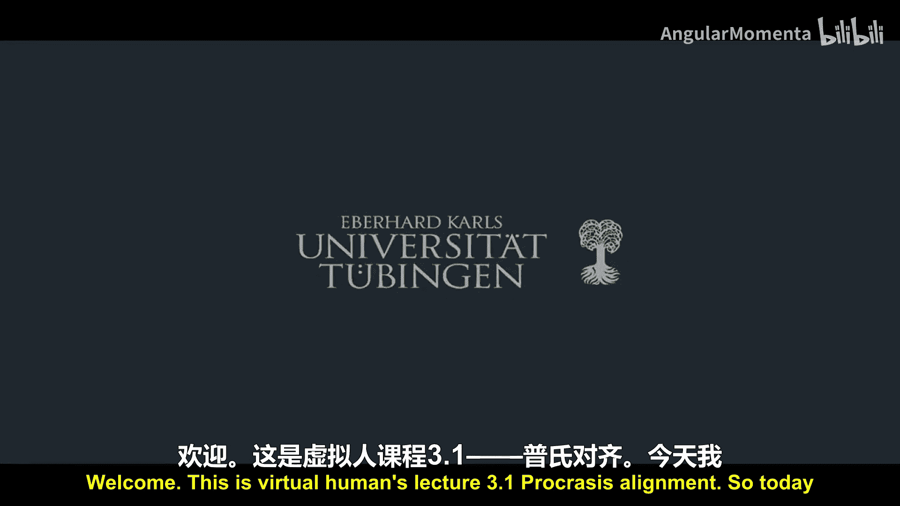

# 006：普洛克路斯忒斯对齐 🧍‍♂️➡️🧍‍♂️



在本节课中，我们将学习最基础的形状对齐方法，称为普洛克路斯忒斯对齐。这是一种刚性对齐技术，用于寻找最优的缩放、旋转和平移参数，将一个源形状与一个目标形状对齐。

## 概述

之前我们提到，我们希望构建一个能够控制人体姿态和形状的模型。为此，我们需要收集大量不同形状和姿态的人体扫描数据。然而，这些扫描数据通常只是无序的点云。为了进行后续的统计形状分析，我们必须首先将这些数据“对齐”，即建立点与点之间的一一对应关系。本节课将介绍实现这种对齐的最基本形式——刚性对齐。

## 形状表示：网格

在深入对齐算法之前，我们先回顾一下三维形状的表示方法。在接下来的课程中，我们将主要使用**网格**来表示表面。

一个网格由两部分组成：
*   **顶点**：一个 `n x 3` 的矩阵 `V`，其中每一行代表一个顶点的 `(x, y, z)` 坐标。
*   **面**：一个 `m x 3` 的矩阵 `F`，其中每一行包含三个顶点的索引，表示一个三角形面片。

因此，网格是表面的分段线性近似，可以看作是从二维空间到三维空间的映射。

```python
# 示例：一个简单的三角形网格
V = np.array([[0, 0, 0],  # 顶点0
              [1, 0, 0],  # 顶点1
              [0, 1, 0]]) # 顶点2
F = np.array([[0, 1, 2]]) # 一个由顶点0,1,2构成的面
```

## 刚性变换

刚性对齐的目标是找到一个**刚性变换**，将源形状 `V` 最优地对齐到目标形状 `V‘`。一个刚性变换由三个参数定义：
1.  **缩放**：一个标量 `s`。
2.  **旋转**：一个属于特殊正交群 `SO(3)` 的旋转矩阵 `R`。
3.  **平移**：一个平移向量 `t`。

对一个顶点 `v` 应用刚性变换的公式为：
`v‘ = s * R * v + t`

在矩阵形式下，我们可以将变换后的所有顶点表示为：
`V‘ = s * V * R^T + t`
（这里 `t` 被广播加到每一行）。

几何上，旋转是让点绕原点转动，缩放是让点沿其与原点的连线方向移动，平移则是直接给点的坐标加上一个偏移量。

## 普洛克路斯忒斯问题

现在，我们正式定义要解决的问题：**普洛克路斯忒斯对齐**。

给定源形状点集 `X`（`n x 3` 矩阵）和目标形状点集 `Y`（`n x 3` 矩阵），我们希望找到缩放 `s`、旋转 `R` 和平移 `t`，以最小化以下目标函数：

`E(s, R, t) = Σ_i || (s * R * x_i + t) - y_i ||^2`

其中 `R ∈ SO(3)`，即 `R` 是一个行列式为1的正交矩阵。

这个名字来源于希腊神话中的强盗普洛克路斯忒斯，他有一张铁床，会让过路的旅客躺上去，身高不足者会被拉长，身高超过者则会被砍掉腿脚，以“完美”适应床的长度。我们的算法只进行“拉伸”（缩放、旋转、平移），而不会“砍脚”。

## 奇异值分解回顾

在介绍解法之前，我们需要回顾一个核心数学工具：**奇异值分解**。

SVD定理指出，任何矩阵 `A` 都可以分解为三个矩阵的乘积：
`A = U * Σ * V^T`
其中：
*   `U` 和 `V` 是正交矩阵。
*   `Σ` 是一个对角矩阵，其对角线上的元素称为奇异值。

几何上，这意味着任何线性变换都可以分解为“旋转-拉伸-再旋转”的组合。SVD将是普洛克路斯忒斯对齐算法的核心。

## 普洛克路斯忒斯算法

普洛克路斯忒斯对齐问题有一个**闭式解**，无需使用梯度下降等迭代方法。以下是算法的步骤：

1.  **计算中心**：分别计算源形状 `X` 和目标形状 `Y` 的质心（所有点的平均值）。
    `x̄ = mean(X)`, `ȳ = mean(Y)`
    然后得到中心化后的点集：
    `X_c = X - x̄`, `Y_c = Y - ȳ`

2.  **计算缩放因子 `s`**：
    `s = trace( X_c^T * Y_c ) / ||X_c||_F^2`
    其中 `||.||_F` 表示弗罗贝尼乌斯范数。这个比值给出了两个形状在尺寸上的比例关系。

3.  **计算旋转矩阵 `R`**：
    *   计算协方差矩阵 `H = X_c^T * Y_c`。
    *   对 `H` 进行奇异值分解：`H = U * Σ * V^T`。
    *   最优旋转矩阵为：`R = V * U^T`。
    （注意：需要检查 `det(R) = 1`，如果为 -1，则需要对结果进行修正以确保是纯旋转）。

4.  **计算平移向量 `t`**：
    `t = ȳ - s * R * x̄`
    这确保了变换后源形状的质心与目标形状的质心重合。

### 算法推导思路

上一节我们给出了算法的步骤，本节我们简要看看其背后的推导思路，以加深理解。推导主要分为三步：

**1. 求解最优平移 `t`**
将目标函数对 `t` 求导并令其为零，可以发现最优平移仅依赖于两个形状的质心，其表达式正是 `t = ȳ - s * R * x̄`。这意味着，在已知缩放和旋转的情况下，只需对齐质心即可得到最优平移。

**2. 求解最优旋转 `R`**
在去除平移的影响（即使用中心化后的点 `X_c`, `Y_c`）后，最小化问题可以转化为最大化 `trace( R * H )`，其中 `H = X_c^T * Y_c`。
对 `H` 进行SVD分解后，利用正交矩阵的性质，可以证明当 `R = V * U^T` 时，该迹达到最大。

**3. 求解最优缩放 `s`**
在已知最优旋转 `R` 后，将目标函数对 `s` 求导并令其为零，即可得到 `s = trace( X_c^T * Y_c ) / ||X_c||_F^2` 的表达式。

## 总结

本节课我们一起学习了**普洛克路斯忒斯对齐**，这是三维形状刚性对齐的基础方法。我们首先回顾了用网格表示形状的方式，然后定义了由缩放、旋转和平移构成的刚性变换。接着，我们引出了需要解决的优化问题，并介绍了核心数学工具SVD。最后，我们详细讲解了普洛克路斯忒斯算法的闭式解步骤及其背后的推导思路。该算法通过计算形状的质心、协方差矩阵及其SVD分解，高效地找到了对齐两个形状的最优刚性变换参数。


在下一讲中，我们将探讨更有趣的**非刚性形状对齐**方法，它能够处理更复杂的形状变形。