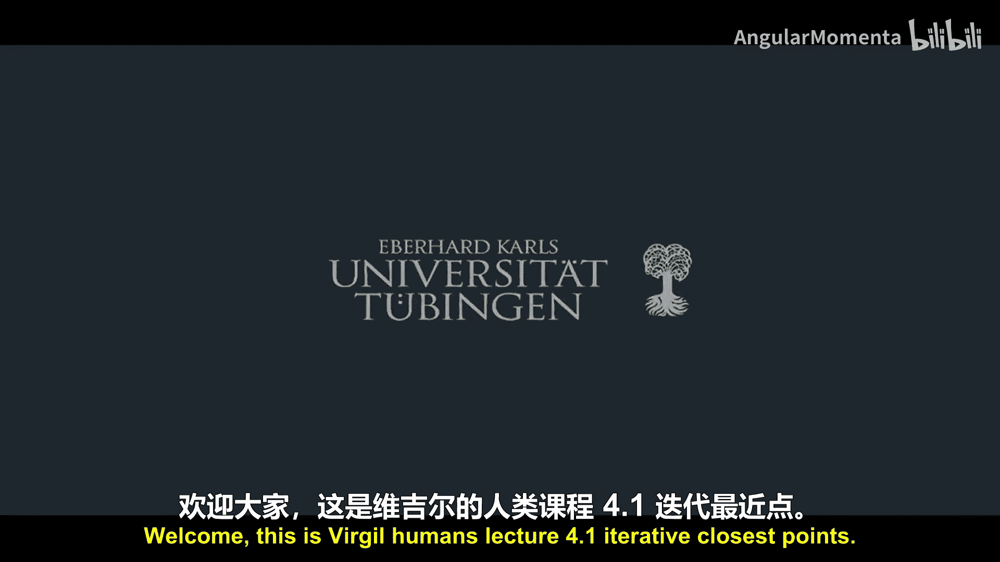

# 007：迭代最近点（ICP）算法 🎯

在本节课中，我们将学习一种比刚体变换更有趣的形状对齐方法。具体来说，我们将探讨如何非刚性地对齐形状，这与上一讲中假设已知对应关系的情况不同。我们将使用一种更通用的变换类型，并学习著名的迭代最近点算法。

## 从已知对应关系到未知对应关系

上一节我们介绍了Procrustes算法，它能在已知对应关系的情况下，为形状提供最优的刚体对齐。但问题是，我们通常并不知道两个形状之间的对应关系。即使知道对应关系，我们又该如何非刚性地对齐形状呢？

为了解决这些问题，我们将学习一种在计算机视觉和图形学中广泛使用的算法——迭代最近点算法。它是构建统计形状模型（如人体模型）并进行良好配准的核心工具。

## 寻找对应关系的挑战

我们如何找到两个形状之间的对应关系呢？一个想法是提取某种描述局部形状的特征描述符，然后在目标形状中尝试匹配。但这种方法会遇到问题：可能存在多个匹配，或者在某些缺乏显著特征的区域，对齐会变得非常困难且模糊不清。

显然，我们需要一种更全面的方法，并考虑某种初始化。接下来，我们将看到如何做到这一点。

## 迭代最近点算法原理

我们有以下目标函数：
`E(F, C) = Σ_i min_{x_i} || F(x_i) - y_i ||^2`
其中，`F` 是将源形状点 `x` 映射到新位置 `F(x)` 的变换函数，`y_i` 是目标形状上的点。`x_i` 表示对于目标点 `y_i` 在源形状上的最近点。

真正的优化问题同时涉及变换 `F` 和对应关系集合 `C`。这是一个“先有鸡还是先有蛋”的问题：找到正确的 `x` 依赖于当前的变换 `F`，而找到最优的 `F` 又依赖于当前的对应关系 `x`。

迭代最近点算法通过交替优化的方式解决这个问题：
1.  固定当前变换 `F^j`，为每个目标点 `y_i` 在源形状上寻找最近点，更新对应关系 `x_i^{j+1}`。
2.  固定当前对应关系 `x_i^{j+1}`，优化变换 `F` 以最小化距离 `Σ_i || F(x_i^{j+1}) - y_i ||^2`。
3.  重复迭代步骤1和2，直到收敛。

## 算法流程与细节

以下是迭代最近点算法的具体步骤：

1.  **初始化**：通常将形状中心对齐是一个好的起点。
2.  **对应关系步骤**：给定当前变换估计 `F^j`，计算每个目标点 `y_i` 在变换后源形状上的最近点，得到对应关系 `x_i^{j+1}`。
3.  **变换步骤**：使用更新后的对应关系 `{x_i^{j+1}, y_i}`，求解最优变换 `F^{j+1}`。对于刚体变换，可以使用Procrustes分析。
4.  **迭代与终止**：重复步骤2和3，直到误差低于阈值或变换更新非常小。

需要注意的是，迭代最近点算法是一个局部方法，如果初始化不好，可能会收敛到不理想的局部极小值。

## 提升算法性能的技巧

为了提高算法的效率和鲁棒性，可以考虑以下方法：

*   **加速最近点搜索**：使用KD-tree等数据结构，将复杂度从 `O(n^2)` 降低到 `O(n log n)`。
*   **采样**：不使用所有点进行匹配，而是使用一部分点来计算变换。
*   **方向性**：始终从目标形状向源形状寻找对应关系，以避免退化解。
*   **处理异常值**：使用鲁棒损失函数（如Huber损失）来降低错误对应关系的影响。
*   **利用法线**：在寻找对应关系时结合法线信息，可以提高匹配质量。
*   **点对面距离**：最小化目标点到源形状表面的距离，而不是到特定顶点的距离，可以使优化过程更平滑。

## 扩展到非刚性变换：基于梯度的ICP

Procrustes分析给出了最优刚体变换，但如果变形模型是非刚性的呢？我们可以将迭代最近点算法推广到非刚性变形。

此时，变换 `F` 是一个非线性函数（例如，参数化的人体姿态模型）。在“变换步骤”中，没有闭式解。我们可以通过计算能量函数 `E` 关于变换参数 `θ` 的梯度（或雅可比矩阵）来线性化问题，然后使用梯度下降等优化方法进行求解。

更新公式可以表示为：
`θ^{j+1} = θ^j - α ∇_θ E`
其中 `α` 是学习率。对于最小二乘问题，也可以使用高斯-牛顿法或列文伯格-马夸尔特法等更高效的方法。

算法流程变为：寻找对应关系 -> 固定对应关系，执行几步梯度下降来更新变换参数 -> 重新寻找对应关系 -> 迭代。

## 实践中的注意事项

在实现基于梯度的迭代最近点算法时，有几个关键点：

*   **参数化**：变换 `F` 由参数 `θ` 定义（如人体模型的姿态和形状参数）。梯度是针对这些参数计算的。
*   **自动微分**：现代深度学习框架（如PyTorch、TensorFlow）的自动微分功能可以方便地计算复杂模型的梯度，无需手动推导。
*   **优化器选择**：梯度下降是最基本的方法，但对于非线性最小二乘问题，使用高斯-牛顿或列文伯格-马夸尔特法等二阶近似方法通常更有效。
*   **收敛性**：由于能量函数对于一般变形模型是非凸的，优化可能陷入局部极小值。良好的初始化和正则化项对于获得可靠的对齐结果至关重要。

## 算法对比：点对点 vs 点对面

在演示中，使用点对点距离的迭代最近点算法在优化时，对应关系在参数更新步骤中被“锁定”，导致每次更新对应关系时可能产生较大的跳跃。而使用点对面距离时，在参数更新过程中，对应点可以沿着三角面片滑动，从而使整个优化过程收敛得更平滑。为了获得高质量的配准结果，需要关注这些细节。

## 总结与下节预告

本节课我们一起学习了迭代最近点算法的核心思想。我们了解到：

*   Procrustes分析适用于**已知对应关系**的**刚体对齐**问题。
*   当对应关系**未知**，且需要考虑**更广泛的变换类型**（如非刚性变形）时，需要使用迭代最近点算法或其变种。
*   迭代最近点算法通过**交替优化**对应关系和变换参数来求解。
*   算法可以扩展到非刚性情况，使用**基于梯度的优化方法**。
*   算法的性能可以通过**加速搜索、鲁棒损失、点对面距离**等技巧来提升。
*   由于问题的非凸性，**好的初始化和正则化**对获得正确解非常重要。

在下一讲中，我们将开始学习人体模型的基础，了解其背后的数学模型以及如何从训练数据中学习它。