# 008：基于顶点的模型与SMPL 🧍‍♂️➡️🧍‍♀️

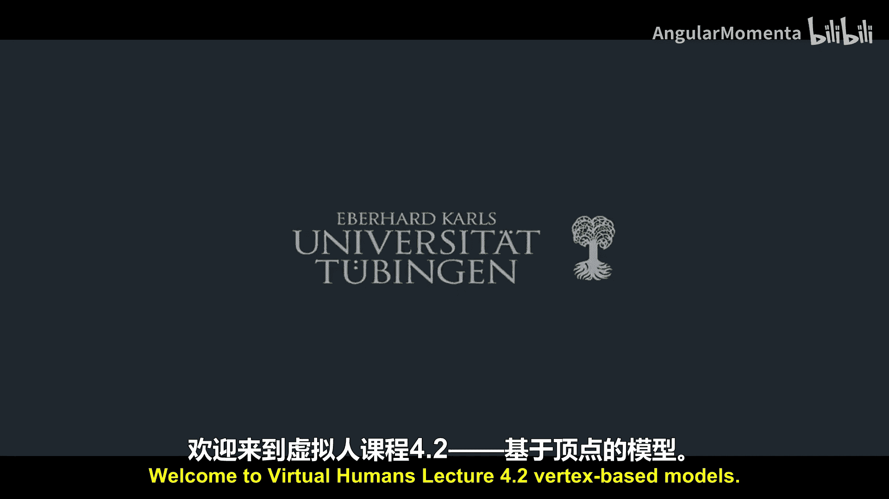

在本节课中，我们将学习如何构建一个身体模型，并特别聚焦于一个流行且简单的模型——SMPL。我们的目标不仅是理解SMPL的工作原理，更重要的是理解构建一个好的身体模型需要哪些关键要素。

首先，让我们回顾一下什么是身体模型。身体模型是一个函数，它接收一些输入参数并输出一个三维人体网格。在本例中，我们选择的输入参数是人的**姿态**和**体型**。我们希望这个函数能让我们以一种看起来真实的方式，独立地控制人体的姿态和体型变化。你可以固定姿态改变体型，也可以固定体型改变姿态。

这里，我们用带箭头的 **θ** 表示姿态参数向量，用带箭头的 **β** 表示体型参数向量。许多论文沿用这种表示法，因为SMPL模型最初使用了这种符号。

既然我们相信姿态和体型是控制人体形状空间的一组好参数，那么问题来了：我们应该学习什么样的函数？我们的模型形式是什么？是姿态和体型到顶点坐标的线性函数，还是多项式函数？给定一个函数形式（比如多项式），我们如何利用三维扫描的训练数据来拟合其中的超参数（比如权重 **W**）？

实际上，无论是线性还是多项式映射，效果都不会很好。原因在于，由关节引起的形变部分具有很强的非线性，而这部分用**旋转**来建模效果最好，这正是我们在第二、三讲中学到的内容。

---

## 骨架与运动学链 ⛓️

上一节我们提到了用旋转来建模姿态，本节我们来看看如何组织这些旋转。

一种直接的想法是将身体分成多个部分，每个部分用一个旋转和平移矩阵参数化。姿态就是所有部分旋转和平移的集合。但这样做有问题：这些参数彼此独立，没有约束。在优化时，各部分可能会“飞”得到处都是。

一个非常有效的约束方法是使用**运动学链**。运动学链本质上是用**骨架**来参数化人体运动，其中每个身体部分相对于其父部分旋转。要获得某个部分（例如小臂）的最终变换，你需要从该部分开始，沿着骨架链向上累积所有父部分的变换，直到根关节。

在SMPL等模型中，通常使用**指数映射**（轴角表示）来参数化旋转。一个旋转可以用一个轴角向量 **ω** 表示，其模长代表旋转角度，单位向量代表旋转轴。通过**罗德里格斯公式**，可以将其转换为一个3x3的旋转矩阵 **R**：

**R = I + (sinθ) * K + (1-cosθ) * K²**

其中，**K** 是由轴角向量 **ω** 生成的反对称矩阵。

在骨架中，旋转是围绕关节进行的。因此，要绕某个关节旋转一个点，需要应用一个包含旋转和平移的变换矩阵 **G**。其旋转部分就是上面的 **R**，平移部分则是将点移动到关节位置所需的向量。这个变换是局部的，它将点从子部分的坐标系转换到父部分的坐标系。

通过运动学链，我们可以累积这些局部变换，最终将身体坐标系下的点 **p_b** 转换到世界坐标系 **p_s**。

---

## 线性混合蒙皮及其问题 🎭

上一节我们介绍了如何用运动学链变换刚性的身体部分，但直接应用会导致部件连接处出现不自然的“硬”边界和折痕。

动画领域多年来使用**线性混合蒙皮**来缓解这个问题。其核心思想是：不再将每个顶点硬性地分配给一个身体部分，而是**软性地**分配给多个部分。每个顶点受多个关节变换的影响，影响程度由一组**混合权重**决定，所有权重之和为1。

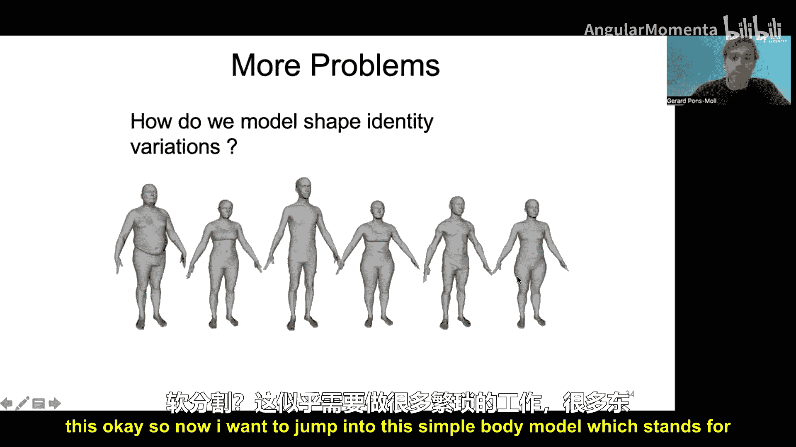

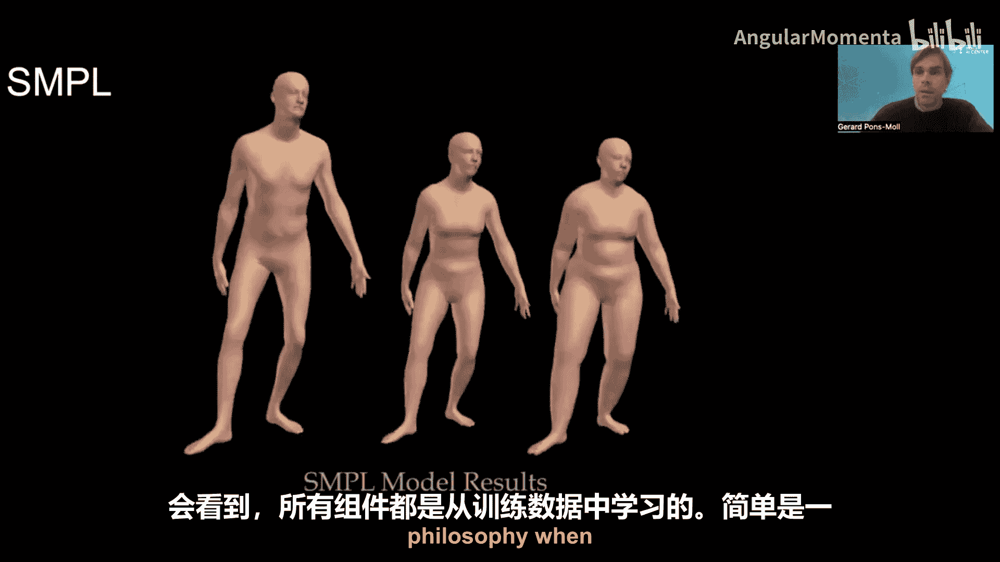

一个顶点 **v_i** 的最终位置通过线性混合其关联关节的变换矩阵得到：

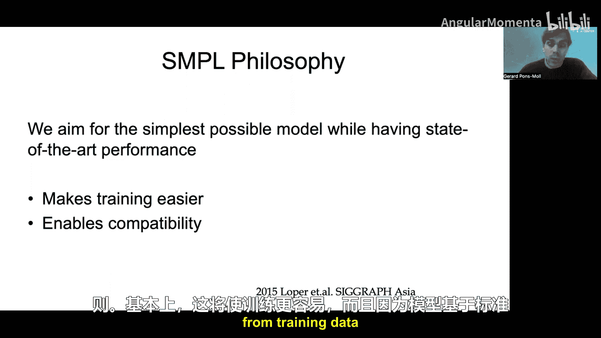

**v_i‘ = Σ (w_{k,i} * G_k(θ)) * v_i**

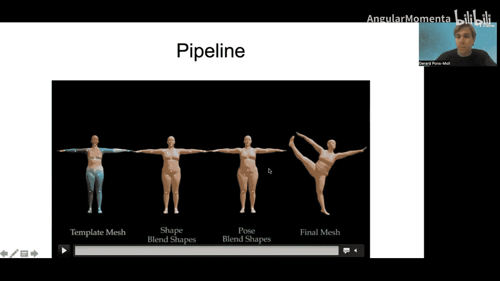

其中，**w_{k,i}** 是第k个关节对顶点i的混合权重，**G_k(θ)** 是该关节的变换矩阵。

这解决了连接处的平滑问题，但引入了新问题：我们是在线性组合变换矩阵，而旋转矩阵本身存在于一个非线性流形上。线性组合的结果可能不再是有效的旋转矩阵，从而导致视觉上的“糖果纸”扭曲等伪影。

此外，混合权重和关节位置通常需要动画师手动精心调整，这是一个繁琐且难以扩展到多种体型和姿态的过程。

---

## SMPL模型：从数据中学习一切 🧠

上一节我们看到了传统蒙皮方法的局限，本节我们来看看SMPL模型如何通过数据驱动的方式解决这些问题。

SMPL（Skinned Multi-Person Linear Model）的核心哲学是：在保持行业兼容性（基于标准蒙皮）的前提下，追求最简单的模型，并**从训练数据中学习所有参数**。

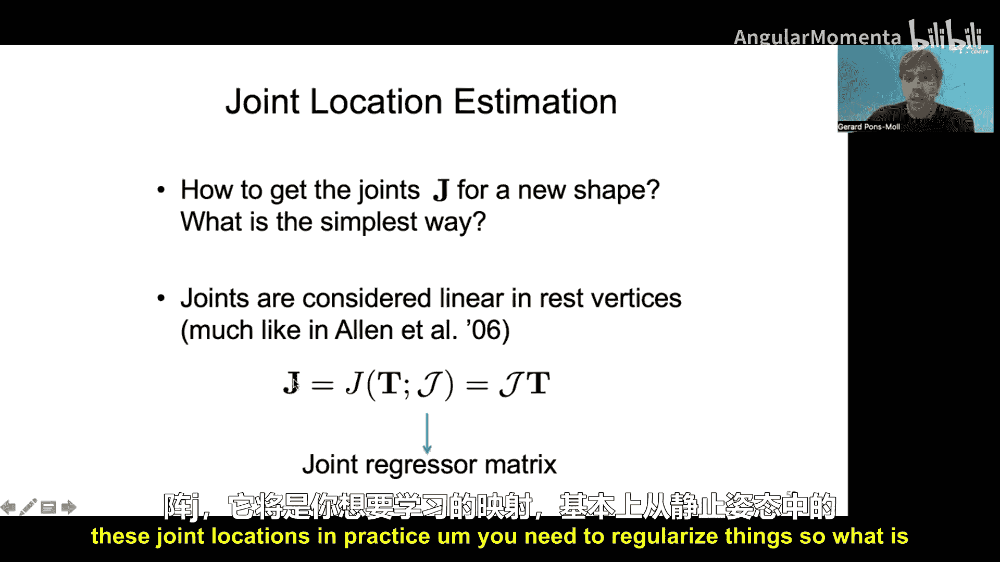

SMPL是一个函数 **M(β, θ)**，输入体型 **β** 和姿态 **θ**，输出一个三角网格。其流程在标准蒙皮基础上增加了两个关键部分：
1.  **体型混合形状**：建模不同人的身份（体型）差异。
2.  **姿态混合形状**：建模在特定姿态下，为弥补线性蒙皮缺陷和表现肌肉收缩等效果所需的顶点位移。

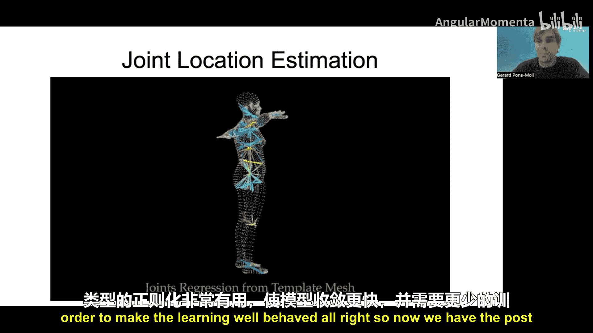

并且，**关节位置 J 也被定义为体型 β 的函数**，通过一个从静息姿态顶点回归关节位置的**稀疏矩阵**（关节回归器）来实现。

---

### 姿态混合形状的设计关键 🔑

姿态混合形状 **B_P(θ)** 被设计为姿态参数 **θ** 的函数。一个朴素的想法是让 **B_P(θ)** 线性依赖于轴角向量 **θ** 本身，但这在实践中效果很差，因为轴角表示存在对称性和无界性问题。

SMPL采用了一个更聪明的设计：让 **B_P(θ)** 线性依赖于**每个关节旋转矩阵的元素**。具体来说，对于每个关节的旋转矩阵 **R_k**，我们减去单位矩阵 **I**（以确保在零姿态时混合形状贡献为零），然后将所有关节的 **（R_k - I）** 矩阵向量化并拼接成一个大向量 **r(θ)**。姿态混合形状则是这个向量与一个姿态混合形状基矩阵 **P** 的线性组合：

**B_P(θ) = P * r(θ)**

这样，**B_P(θ)** 就是旋转矩阵元素的线性函数，学习起来更加稳定和有效。

---

### 模型的训练与参数学习 📊

SMPL需要学习大量的模型参数（超参数），包括：
*   平均模板网格 **T̄**
*   体型混合形状基矩阵 **S**（通过PCA获得）
*   姿态混合形状基矩阵 **P**
*   混合权重矩阵 **W**
*   关节回归器矩阵 **J**

训练需要两类数据：
1.  **多姿态数据**：用于学习 **P**、**W**、**J**。需要同一人在不同姿态下的三维扫描。
2.  **多体型数据**：用于学习 **T̄** 和 **S**。需要多人在**同一静息姿态**下的三维扫描。

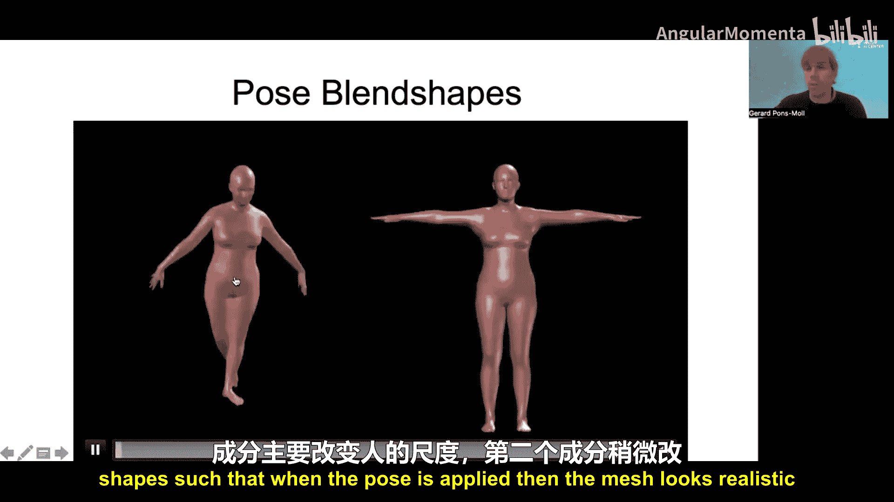

训练过程是一个复杂的优化问题，需要最小化模型预测与真实扫描数据之间的误差。由于参数众多且相互依赖，训练时需要谨慎地分阶段进行，并加入各种正则化约束（如对 **P** 使用L2正则，对 **W** 向手动初始权重正则，对 **J** 施加稀疏性和关节位于部分交界处的约束），以确保模型收敛良好并具有泛化能力。

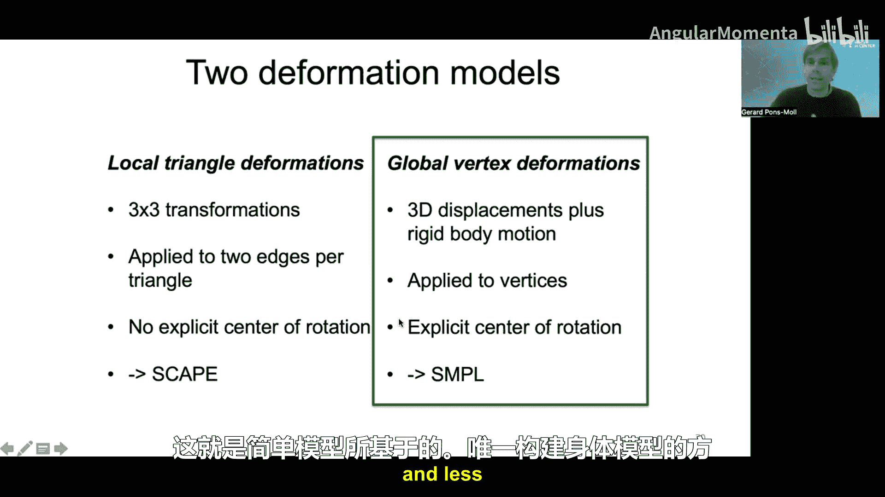

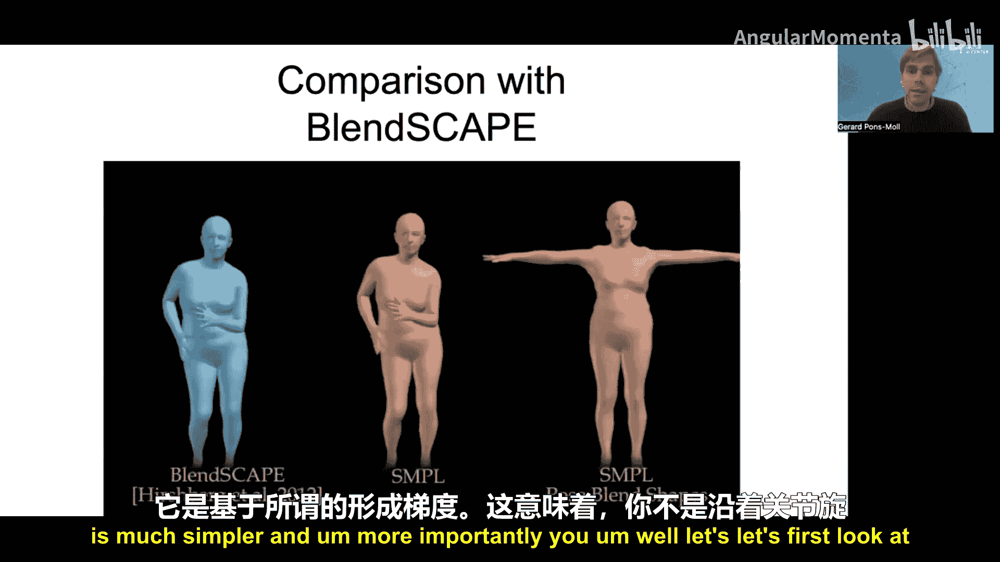

一旦模型训练完成，这些超参数就被固定下来。使用时，我们只需操纵 **β** 和 **θ** 这两个简单的参数，就能生成各种体型和姿态的真实人体网格。

---

## 总结与扩展 🎯

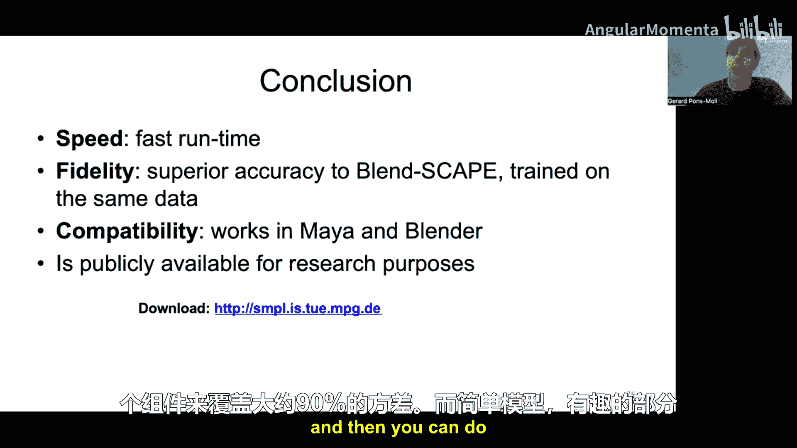

本节课我们一起学习了基于顶点的身体模型，特别是SMPL。
*   **核心思想**：将身体建模为姿态和体型的函数，结合**线性混合蒙皮**与**数据驱动的混合形状**。
*   **关键改进**：SMPL从数据中自动学习蒙皮所需的所有参数（模板、混合权重、关节位置、姿态/体型混合形状），避免了繁琐的手工调整。
*   **设计要点**：将姿态混合形状设计为**旋转矩阵元素**的线性函数，是模型成功的关键之一。
*   **优势**：SMPL模型简单、高效、与现有动画工具兼容，并且用较少的体型参数（PCA主成分）就能捕捉大范围的形状变化，比之前的基于变形梯度的方法（如SCAPE）更紧凑。

SMPL模型可以被扩展，例如加入**软组织动力学**层（如Dyna模型），来模拟肌肉抖动等更细微的效果。这只需在顶点位移公式中增加一项与动力学参数相关的混合形状即可。

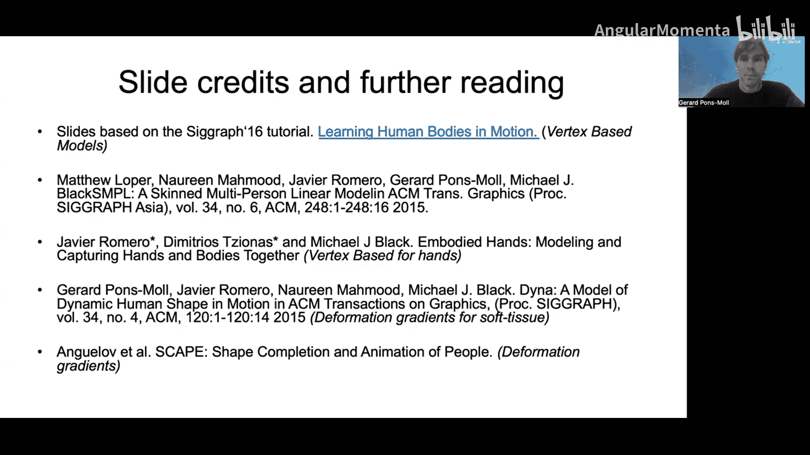

希望本讲能帮助你理解SMPL的内部机制，并体会到在构建身体模型时，**恰当的数学模型**与**充分利用数据**同样重要。