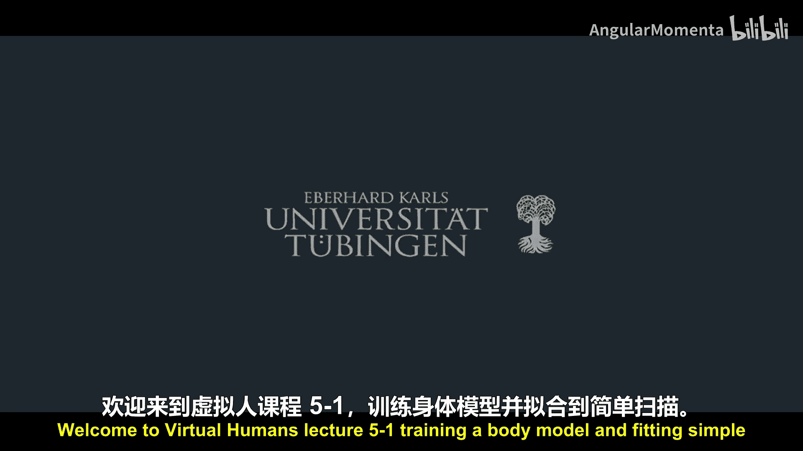

# 009：模型训练及将SMPL适配到扫描数据

在本节课中，我们将学习如何训练人体模型，以及如何将模型（如SMPL）适配到扫描数据上。我们将首先了解另一种基于三角形变形而非顶点位移的模型，然后深入探讨如何从数据中训练模型，并解决模型训练与数据配准之间“先有鸡还是先有蛋”的循环依赖问题。

## 基于三角形变形的模型

上一节我们介绍了基于顶点位移的模型，它们通过在基础网格上应用一系列学习到的位移来模拟姿态和形状变化。本节中我们来看看另一种基于局部三角形变形的模型，例如SCAPE模型及其扩展BSCAPE。

这类模型的核心思想是：对网格的每个三角形或边，应用一个由姿态和形状参数化的3x3变换矩阵。定义一个三角形包含顶点 `t0`， `t1`， `t2`。模型首先将三角形平移到原点，然后考虑其两条边向量，例如 `e0 = t2 - t0` 和 `e1 = t1 - t0`。接着，对每个三角形应用一个特定的3x3变换矩阵 `X` 来变换这些边。

如果对每个三角形独立应用变换，得到的网格将不再连续，因为共享顶点可能被拉向不同位置。为了获得一个连贯的网格，需要求解一个最小二乘问题，找到一组新的顶点 `V`，使得由这些新顶点构成的边尽可能接近经过变换矩阵处理后的目标边。这可以通过求解以下问题实现：
`min_V ||AV - XE||^2`
其中矩阵 `A` 用于从顶点计算边（例如，包含1和-1的稀疏矩阵），`E` 是原始边向量，`X` 是对应的变换矩阵。

与SMPL模型类似，这类模型也将变形分解为姿态和形状两部分：
*   姿态相关变形：由一个关于姿态参数 `θ` 的函数 `Q(θ)`（3x3矩阵）编码。
*   形状相关变形：由一个关于形状参数 `β` 的函数 `S(β)`（3x3矩阵）编码。
*   关节运动：由一个关于 `θ` 的混合矩阵 `B(θ)` 建模，用于混合全局变换矩阵。

一个关键区别是，这类模型没有显式的骨骼关节概念，所有变换都在全局坐标中进行，通过后续的缝合步骤保证网格连贯性。

以下是SMPL（顶点加法模型）与SCAPE（三角形乘法模型）的主要对比：
*   **SMPL**：在基础网格上**累加**顶点位移；使用线性混合蒙皮进行关节运动；需要定义骨骼。
*   **SCAPE**：对三角形边应用**相乘**的变换矩阵；通过混合全局变换矩阵进行关节运动；**没有显式骨骼**。

需要指出的是，SMPL模型被广泛采用的原因之一是其效率。SMPL直接在顶点位移空间进行PCA，而SCAPE在3x3变换矩阵空间进行PCA。后者是一个更高维、更抽象的空间，导致模型容量浪费在最终网格中不可直接观测的变化上。因此，SMPL通常能用更少的形状参数解释更多的观测顶点方差。

## 从数据训练人体模型

现在我们来探讨核心问题：如何从数据中训练人体模型（无论是SMPL、SCAPE还是其他模型）？我们拥有不同姿态、不同形状人体的扫描数据，但扫描数据本身存在缺失、自遮挡、拓扑不一致等问题，直接学习非常困难。

因此，我们首先做一个强假设：假设我们已经拥有了**配准数据**。即，对于每个扫描，我们已经通过某种方法将一个模板网格变形，使其与扫描对齐，并且所有配准结果具有相同的顶点数和连接关系。

在拥有配准数据 `{V_j}` 的前提下，训练模型 `M` 就变得相对直接。我们需要找到模型的最佳超参数 `Φ`（例如，SMPL中的混合权重、关节回归器、形状基向量、姿态混合形状等），使得模型在最佳姿态 `θ_j` 和形状 `β_j` 下生成的网格，与每个配准结果 `V_j` 尽可能接近。这可以通过最小化以下目标函数实现：
`min_Φ Σ_j min_{θ_j, β_j} ||M(θ_j, β_j; Φ) - V_j||^2`
注意，我们需要同时优化模型超参数 `Φ` 以及每个配准对应的姿态形状参数 `{θ_j, β_j}`，这是一个复杂的优化问题。

然而，我们做了一个非常强的假设——我们已经拥有了配准数据。实际上，我们并没有。这就引出了下一个关键问题：如何从扫描数据得到配准结果？

## 从扫描到配准的适配问题

配准的目标是：将一个模板网格（如SMPL的默认模板）变形，使其紧密匹配扫描数据，同时保持网格的连贯性和顶点对应关系。这本质上是一个非刚性ICP（迭代最近点）问题。

回顾ICP流程：初始化估计，然后迭代进行 1) 为源点（模板）在目标（扫描）上寻找对应点，2) 求解最优变换以使源点对齐到对应点。在非刚性配准中，变换 `F` 不再是刚体变换，而是顶点的变形模型。

那么，变形模型 `F` 应该是什么？有以下几种选择：
1.  **直接优化所有顶点自由度**：让每个顶点自由移动以匹配扫描。但这会导致优化不稳定，网格容易扭曲变形，即使加入平滑约束也很难得到合理的身体形状。
2.  **仅使用SMPL模型参数**：只优化姿态 `θ` 和形状 `β` 参数。问题在于，现有模型无法捕捉扫描中的细节（如面部特征、发型等）。如果仅限于模型空间，我们将无法从新扫描中学到任何新信息，这对于训练新模型没有意义。
3.  **混合方法**：同时优化SMPL参数 (`θ`, `β`) 和一个**残差顶点位移场** `V`。目标函数鼓励配准结果 `V` 既接近扫描，又接近当前SMPL模型 `M(θ, β)` 的输出。优化过程中，SMPL参数捕捉主体姿态和形状，而顶点位移 `V` 可以捕捉模型无法表达的细节。先验项的权重控制着对模型空间的忠实度。

## 适配目标函数详解

将一个模型适配到单个扫描的完整目标函数通常包含以下部分：
`E(θ, β, V) = λ_data * E_scan + λ_coupling * E_coupling + λ_pose * E_pose + λ_shape * E_shape`

以下是每个项的作用：
*   **扫描到网格距离项 `E_scan`**：最小化扫描点到配准网格表面的距离。为提高鲁棒性（应对离群点和初始位置不佳），常使用鲁棒代价函数，如Geman-McClure函数 `ρ(x)`：`ρ(x) = (x^2) / (σ^2 + x^2)`。当距离 `x` 较小时，惩罚近似二次；当距离很大时，惩罚趋近于常数1，避免离群点主导优化。注意，这里计算的是**点到表面的距离**，而非点对点距离，这允许在优化过程中隐式地更新对应关系。
*   **耦合项 `E_coupling`**：约束配准顶点 `V` 不要偏离模型 `M(θ, β)` 太远。有两种常见形式：
    *   顶点距离：`||V - M(θ, β)||^2`，关注顶点的绝对位置。
    *   边距离：`||A*V - A*M(θ, β)||^2`，其中矩阵 `A` 用于计算边向量。这更关注局部表面几何（边的方向和长度），对整体位置变化更不敏感。
*   **姿态先验项 `E_pose`**：防止出现不自然的人体姿态。通常假设姿态参数 `θ` 服从高斯分布，使用马氏距离：`(θ - μ_θ)^T Σ_θ^{-1} (θ - μ_θ)`。协方差矩阵 `Σ_θ` 的逆对不同的姿态变化方向进行了加权。
*   **形状先验项 `E_shape`**：防止形状参数 `β` 偏离合理的人体形状范围。同样可采用高斯先验：`(β - μ_β)^T Σ_β^{-1} (β - μ_β)`。

权重的设置 `(λ_data, λ_coupling, λ_pose, λ_shape)` 至关重要。一种常见的策略是进行**多阶段优化**：
1.  **初始阶段**：设置很大的 `λ_coupling`、`λ_pose` 和 `λ_shape`，`λ_data` 较小。这相当于做一个强约束的SMPL模型拟合，确保结果是一个合理的人体。
2.  **中间阶段**：逐步降低姿态和形状先验的权重 (`λ_pose`, `λ_shape`)，适当降低耦合权重 `λ_coupling`，同时增加数据项权重 `λ_data`。允许配准结果在模型约束下逐渐贴近扫描细节。
3.  **最终阶段**：进一步降低或移除先验权重，主要依靠数据项和较小的耦合项进行微调，以捕捉扫描中的高频细节。

通过这种渐进式策略，最终得到的配准结果 `V` 既能保持合理的人体结构，又能超越当前模型 `M` 的表达能力，从而为模型训练提供新的信息。

## 解决“鸡与蛋”问题：协同配准

我们面临一个循环依赖：训练模型需要配准数据，而获得好的配准又需要一个好的模型。这个“鸡与蛋”问题可以通过**协同配准**技术解决，其核心思想是**交替优化**。

我们不再分别处理单个扫描的配准和整个模型的训练，而是定义一个覆盖整个扫描数据集的总目标函数：
`min_{Φ, {θ_j, β_j, V_j}} Σ_j E(θ_j, β_j, V_j; Φ)`
其中 `Φ` 是模型超参数，`{θ_j, β_j, V_j}` 是每个扫描对应的姿态、形状和配准顶点。这个目标函数同时包含了所有扫描的配准损失以及对模型参数的依赖。

直接优化所有参数非常困难。我们可以采用块坐标下降法（或类似期望最大化的思想）进行交替优化：
1.  **固定配准**：保持所有 `{V_j}` 固定，优化模型超参数 `Φ` 以及每个扫描对应的 `{θ_j, β_j}`。这一步相当于用当前配准数据来训练或更新模型。
2.  **固定模型**：保持模型超参数 `Φ` 固定，分别优化每个扫描的配准 `{θ_j, β_j, V_j}`。这一步相当于使用当前模型作为先验，为每个扫描计算新的、更精确的配准。
3.  **迭代**：重复步骤1和2。随着迭代进行，模型因更优的配准而变得更好，而更好的模型又能产生更准确的配准，形成良性循环。

## 总结

本节课中我们一起学习了：
*   除了基于顶点位移的模型（如SMPL），还存在基于**三角形变形**的模型（如SCAPE）。它们通过对网格边应用变换矩阵来工作，并通过求解最小二乘问题保证网格连贯性，且通常不依赖显式骨骼。
*   **训练人体模型**需要找到模型超参数，并针对每个训练样本优化其姿态和形状参数，以最小化模型输出与配准数据之间的差距。
*   获得**配准数据**本身需要一个人体模型作为先验来约束变形过程，而训练一个好的模型又需要高质量的配准数据，这构成了一个“鸡与蛋”的循环依赖问题。
*   通过定义包含数据项、耦合项、姿态和形状先验的**混合目标函数**，并采用**多阶段优化**策略调整权重，可以将一个模型适配到扫描数据，得到既贴合扫描细节又保持合理人体结构的配准结果。
*   这个循环依赖问题可以通过**协同配准**方法解决，即**交替优化**模型参数和所有扫描的配准结果，使两者在迭代中共同改进。

这些内容基于2016年《Learning Human Shapes in Motion》教程，幻灯片特别感谢Javier Romero。

