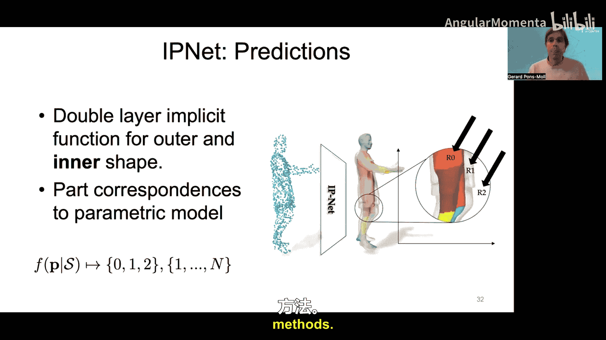

# 010：基于学习的配准 - 第一部分

在本节课中，我们将继续探讨与之前完全相同的问题：给定一个点云，我们希望拟合一个参数化人体模型（SMPL），并使其变形，以解释给定的扫描数据。这被称为3D对齐或3D配准。

我们已经了解了如何通过经典方法，如迭代最近点算法和优化来实现这一目标。本节课中，我们将探讨如何利用学习技术，使这个拟合过程更加鲁棒和可靠。

## 扩展SMPL模型：SMPL+D

为了本次课程，让我介绍一个概念：**SMPL+D**。它扩展了SMPL模型，以模拟服装和头发的细节。

回顾一下，SMPL模型通过一组**形状参数**来建模身份，并通过一组**姿态参数**来建模姿态相关的形变。最后，我们应用运动学链和旋转来驱动身体。

SMPL模型的问题在于它无法模拟服装。那么，我们如何以一种简单的方式扩展SMPL来模拟服装呢？

最简单的方法是添加一组**位移场 D**，用于模拟个人细节和服装。本质上，你可以从一个标准姿态下的未着装身体，通过添加位移D，得到一个包含服装、头发和面部细节的标准姿态身体。

需要注意的是，这里的D**没有**被任何潜在参数（如编码服装的参数）参数化。它是一个完整的位移矩阵，因此具有很高的自由度。本质上，它需要接近数据，因为这是一个高度欠约束的问题，它本身并不是一个完整的服装模型。我们将在未来的课程中看到如何更好地处理这个问题。目前，这只是通过增加参数来增强模型的表达能力。

顺便提一下，在SMPL基础网格上添加位移场的想法，与让配准的顶点在接近模型的同时尽可能接近数据点的想法几乎是等价的。因为这允许顶点偏离模型，其效果与在SMPL模型上叠加位移场D基本相同。因此，这两种表述在很大程度上是等价的。

## 配准的应用场景

我们之前已经了解到，寻找配准是训练人体模型的关键步骤。然而，除了训练人体模型之外，还有其他应用也需要将SMPL拟合到扫描数据上，特别是计算从扫描到模型的配准。

以下是几个例子：
*   **寻找扫描间的对应关系**：如果你想在两个扫描之间找到对应关系，以识别不同身体部位的对应部分，你可以将同一个SMPL模板分别拟合到每个扫描上。这样，你就隐式地在两个扫描之间创建了一个对应映射，因为你总是可以从一个扫描映射到SMPL模板，再从SMPL模板映射到另一个扫描，从而在两个扫描之间形成一个对应循环。
*   **从深度流中跟踪身体**：你可能有一个来自Kinect等设备的深度数据流，并希望从中跟踪身体的形状和运动。这基本上是一个逐帧的配准问题。
*   **用骨架驱动扫描动画**：如果你想获取一个扫描数据并用骨架为其制作动画，你需要先将SMPL模型拟合到这个点云上。

所有这些应用都需要将SMPL拟合到扫描数据，因此这是一个重要的问题。在本节课中，我们将看到如何有效地做到这一点，以及如何从训练数据中学习这个配准过程的某些部分。

## 经典方法的局限：ICP与局部最小值

我们已经看到，使用ICP算法将SMPL（或本节课中的SMPL+D）拟合到扫描数据，需要求解一个包含多个项的目标函数。其中最重要的是**扫描到网格距离项**，它计算扫描中每个点到配准网格上最近点的距离。这本质上需要寻找最近点对。

为了最小化这个目标函数，你需要在**寻找对应关系**和**寻找最优变换**之间进行某种ICP式的交替迭代。我们在两节课前已经看到，这被称为ICP算法。

现在，如果我告诉你ICP算法**容易陷入局部最小值**，你应该不会感到惊讶。基本上，ICP计算最近点，但这些对应关系可能是错误的。

例如，在下图中，运行ICP将SMPL网格拟合到这个点云的结果显示，点云中的腿是交叉的，而配准结果中的腿却没有交叉。又或者，手部并没有真正匹配点云中的手部。原因是点云中的手部点很可能被错误地匹配到了网格的臀部点上，从而导致错误的对应关系，使得模型的某些部分解释了数据的错误部分。

因此，我们现在知道，使用最近点作为对应关系容易陷入局部最小值。接下来，我们将看看如何利用学习技术来改进这个配准过程。

## 基于学习的配准方法概览

我们将简要介绍两种类型的模型：
1.  **非参数化模型**：不使用SMPL等参数化模型。
2.  **参数化模型**：使用像SMPL这样的参数化模型，但利用训练数据和深度学习来学习从点云到SMPL模板的对应关系。

还有第三种方法，我称之为**混合方法**，这是一项非常新的工作，我们称之为“学习顶点下降”。我们将在未来的课程中看到它，但不在本节课讨论。

### 非参数化模型方法

那么，你能做的最简单的事情是什么？你想找到对应关系，或者想将一个模板拟合到输入形状上。

你可以做的是将点云编码成一个**特征向量**（记作 `ε(S)`）。然后，给定一个模板和这个特征向量，你可以训练一个解码器来**直接预测顶点位置**，使其匹配输入形状。这是一个非常直接的方法，网络需要直接预测顶点位置。

你可以认为网络本质上扮演了顶点形变模型 `F` 的角色，这个我们之前讨论过的、使顶点更接近数据的形变函数，现在由一个神经网络来编码。

这种方法产生的结果比ICP对人类数据更好，因为它是从数据中学习的。然而，它仍然会陷入局部最小值，并且需要至少100个不同的全局旋转初始化，才能使这个学习模型收敛。此外，这个模型无法从数据中获取细节，并且生成的模板是**不可控的**，因为它不是SMPL模型，你无法对它进行姿态和形状调整。虽然可以相对容易地从中计算出一个SMPL模型，但它不是直接可控的。

这种方法收敛性不佳的原因之一是，这里的网络使用的是输入形状的**全局特征**，并一次性预测所有顶点。这是一个非常困难的学习问题。网络很难知道如何一次性预测所有顶点，因为它缺乏更局部的推理。为了获得良好的泛化能力，你需要大量包含不同姿态和形状的训练数据。当我们看到隐式表面重建方法与显式方法的区别时，我们会更好地理解这些概念。

### 结合隐式重建与参数化模型：IP-Net

因此，我们在这里提出的问题是：**我们能否学会将SMPL模型拟合到数据上？并且，如果数据中存在高频细节，我们能否保留它们？** 因为如果我们能做到这一点，我们就可以使扫描数据变得可控且非常逼真。

在我们大约一两年前提出的一项名为 **IP-Net** 的工作中，其目标是明确的：我们输入一个点云，并希望能够通过姿态和形状参数来控制这个点云。为此，我们当然需要将一个参数化模型（如SMPL）配准到这个点云上。

当时，基于深度学习的隐式表面重建方法刚刚兴起，并且人们认识到它们在保留细节方面比显式方法要好得多。我们稍后会更好地理解这一点，但现在的直觉是：这些隐式重建方法基本上基于非常局部的证据来预测表面在空间中的内外情况。这允许你使用数据进行训练，并且网络只需要观察局部模式来做出决策，从而能够更好地捕捉精细细节，因为你不需要那么多的数据，本质上你是在做非常局部的决策。

因此，我们称之为 **IP-Net** 的模型的高级思想是**结合隐式重建**（擅长捕捉细节）**和SMPL模型拟合**（提供可控性）。

你可能会问，为什么这是个好主意？正如我所说，基于学习的隐式重建方法更擅长捕捉细节，并且可以处理任意姿态。而参数化模型在捕捉细节方面并不擅长，因为一旦你超出参数空间，就无法表示这些细节。同时，泛化到复杂姿态也很困难，因为需要一个好的初始化。

本质上，隐式重建方法的主要问题是它们生成的是**静态网格**。你对静态网格做不了太多事情，因为你无法改变其姿态和形状。而参数化模型可以被重塑和重新摆姿势。因此，很自然地会想，我们能否在这里结合两者的优点。这就是IP-Net的基本思想：我们能否得到一个隐式重建结果，然后通过将模型拟合到它上面， somehow 将其转化为一个显式的、可控的模型？

当然，这里的挑战在于，在当时，从点云预测隐式表面的问题已经相对被理解，例如我们组和其他组的方法，如IF-Nets或NDFs（神经距离场）。它们可以将完整或不完整、稀疏或密集的点云转化为连续的隐式表面。

但问题在于，你如何然后将一个SMPL模型拟合到它上面？这看起来像是你把点云变成了一个表面，然后游戏规则是什么？我仍然需要解决配准问题。

主要问题在于，ICP会由于错误的对应关系以及SMPL模型无法表示服装和头发等原因而陷入困境。因此，目标函数无法很好地被最小化，因为模型无法解释数据。

在IP-Net中，有两个关键思想：
1.  **将SMPL预测为一个隐式表面，以使拟合变得容易**。这有点像是反其道而行之：你从一个着装的网格，得到一个我们称之为**内表面**的未着装网格，使得这个表面看起来比以前更接近SMPL模型。本质上，现在拟合过程会更容易，因为隐式表面没有服装、没有头发，没有这些困难。
2.  **预测对应关系，而不是使用最近点**。

### IP-Net的实现方式

我们如何做到这一点？我们训练一个处理点云的网络（一种流行的方法是基于称为PointNet的架构）。在高层次上，它的处理方式类似于卷积神经网络处理像素：处理点云，从中提取特征，然后从这些特征解码出预测。

在这里，我们训练一个**隐式表面网络**来预测三个“层”或区域：
*   第一个区域是**身体内部**，即未着装的身体。
*   第二个区域是**身体和服装之间**的空间。
*   第三个区域是**服装外部**的空间。

网络可以被训练来预测空间中的每个点属于哪个区域。此外，你还可以预测这个点属于N个身体部件中的哪一个。你可以对空间中的所有点进行这些预测。

这就是现在被称为**神经场网络**的方法。它们之所以被称为这样，是因为它们对空间中的每个点都做出预测。我们将看到，这个简单的想法实际上被证明是非常强大的。我们将在未来关于神经场和隐式表面重建方法的课程中详细探讨这一点。

## 总结

在本节课中，我们一起学习了基于学习的3D人体配准方法的第一部分。我们首先回顾了通过添加位移场D来扩展SMPL模型以模拟服装细节的概念（SMPL+D）。接着，我们探讨了配准技术在不同应用场景中的重要性。

然后，我们分析了经典ICP方法容易因错误最近点对应而陷入局部最小值的局限性。为了克服这个问题，我们介绍了两种基于学习的配准思路：一种是直接预测顶点位置的非参数化模型，另一种是结合了隐式表面重建优势的参数化模型方法IP-Net。

IP-Net的核心思想是通过神经网络预测一个与SMPL更相似的“内表面”以及点与身体部件的对应关系，从而绕过ICP对最近点的依赖，并使后续的SMPL拟合变得更加容易和鲁棒。这为从扫描数据中获得既细节丰富又可控制的人体模型提供了一条有希望的途径。在接下来的课程中，我们将继续深入探讨其他先进的配准方法。