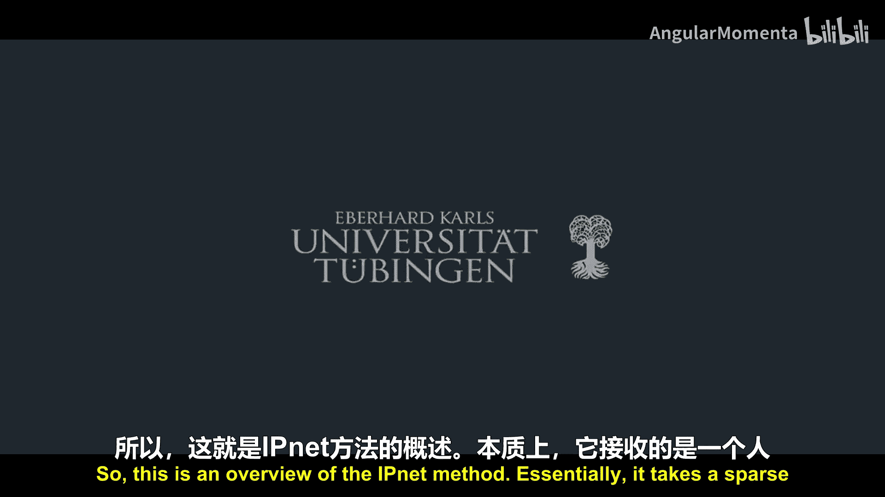
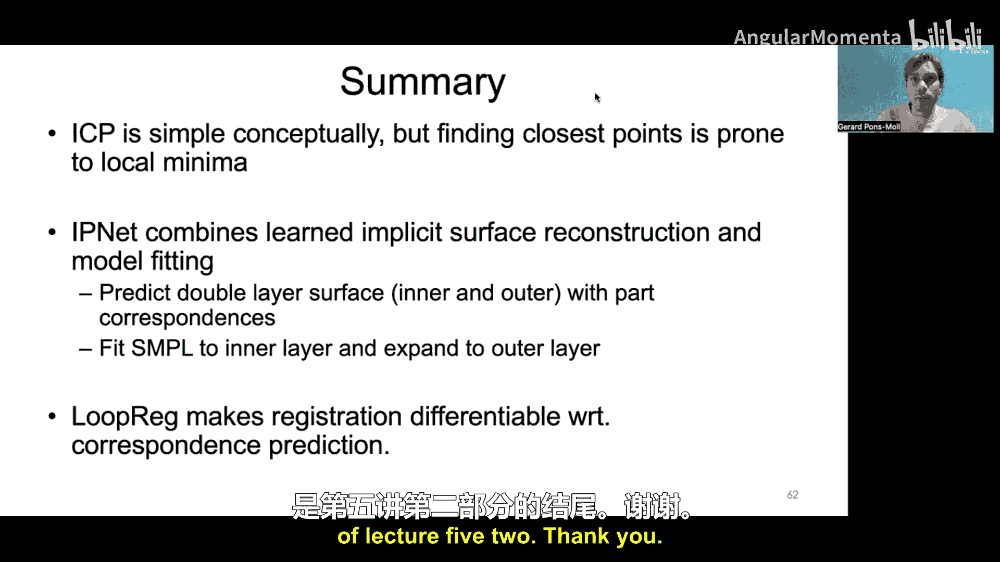

# 011：基于学习的配准 - 第2部分 🧠


在本节课中，我们将深入学习两种结合了神经网络与经典模型拟合的先进三维人体配准方法。我们将探讨如何利用隐式表面重建来简化配准过程，并介绍一种能够联合优化对应关系和模型参数的端到端自监督方法。

---

## IPNe方法概述 🧩

上一节我们介绍了基于学习的配准的基本概念，本节中我们来看看一个具体的实现：IPNe方法。

IPNe方法接收一个可能穿着衣物、带有头发和面部细节的人体稀疏点云作为输入。它预测两个由隐式函数表示的表面：一个是**内层身体表面**，这个表面不包含衣物，应该类似于简单模型的表面；另一个是**完整表面**，包含衣物和头发等细节。此外，该方法还会预测每个点的身体部位标签，以使后续的拟合过程更容易。



这两个预测背后的核心思想是：由于内层表面更接近简单模型，因此将简单模型拟合到这个表面会更容易。一旦简单模型大致对齐到内层表面，就可以轻松地将其变形以解释外层表面的细节，从而获得一个代表完整人体的注册结果。这样，我们就可以改变模型的形状和姿态，这是本工作的主要目标之一。

---

## 优化与预测细节 🔍

接下来，我们更详细地了解优化和预测是如何工作的。

在测试时，我们利用神经网络的预测来使配准过程表现更好。本质上，我们有一个依赖于姿态、形状和一些表示衣物等的自由形变位移向量的能量或损失函数。

我们需要最小化以下目标：

1.  **数据项**：将简单模型与IPNe预测的身体表面进行匹配。
2.  **部位项**：将简单网格的各个部位与IPNe预测的部位标签进行匹配。
3.  **拉普拉斯正则化项**：确保重建的表面局部平滑。

以下是数据项的公式描述。它是一个双向匹配目标，包含经典的基于ICP的目标（最小化目标表面顶点与拟合模型之间的距离），以及一个从模型反向匹配到IPNe预测的目标。

```math
E_{data} = \sum_{v \in M} \min_{u \in S_{inner}} ||v - u||^2 + \sum_{u \in S_{inner}} \min_{v \in M} ||u - v||^2
```
其中 `M` 是简单模型，`S_inner` 是IPNe预测的内层表面。

与原始点云相比，这个拟合过程更容易，因为预测的表面是密集的，并且不包含衣物等细节。

---

## 部位目标的作用 🏷️

拥有部位标签非常有用，因为它可以让ICP过程更容易。你可以逐个部位进行匹配。

以下是部位匹配目标的公式。它对简单模型的各个部位求和，然后对于每个部位，只考虑该部位对应的预测身体顶点与模型之间的匹配。

```math
E_{part} = \sum_{p \in Parts} \sum_{u \in S_{part}^p} \min_{v \in M^p} ||u - v||^2
```
其中 `δ` 函数指示我们正在匹配模型的哪个部位。例如，在匹配上臂时，只考虑IPNe预测的上臂点与身体模型上臂部分之间的匹配。

---

## 处理不完整数据的能力 💪

这种方法的一个关键优势是能够处理不完整的点云数据。

例如，你可以获得一个部分点云（如人的背部不可见）。如果尝试直接将简单模型拟合到这个不完整的点云上，效果可能很差。但是，如果首先使用神经重建方法恢复出完整表面，然后预测内层和外层表面，就可以先拟合内层部分，再扩展到外层部分，从而获得良好的注册结果。这在经典方法中直接拟合输入点云是难以实现的。

这种方法允许你拟合简单模型并使其变形，从而改变注册结果的姿态和形状。它也可以应用于人体以外的形状，例如手部。

---

## 学习的优势与挑战 ⚖️

那么，学习相比传统ICP带来了什么？

以下是学习的优势：
*   学习的对应关系比最近点更可靠。
*   可以补全和去噪输入形状。
*   可以移除使拟合变难的细节（如衣物和头发）。
*   对于部分点云，ICP拟合非常困难，而学习方法可以处理。

但学习方法也存在挑战：
*   为了获得展示的中间表面结果，需要运行Marching Cubes算法将隐式表示转换为显式表示。这个过程计算成本高且不可微分。
*   对应关系相对于拟合过程是不可微分的。在拟合过程中，我们需要用ICP算法不断更新对应关系，这涉及到交替的步骤。

---

## LUDRE方法：一种更优雅的解决方案 🌀

一个自然的问题是：能否使对应关系可微分，从而避免不断更新对应关系？能否移除昂贵的Marching Cubes计算作为中间步骤？

我们在NeurIPS上发表的一篇名为《LUDRE: Self-supervised Learning of Implicit Surface Correspondences, Pose and Shape for 3D Human Mesh Registration》的论文中解决了其中一些挑战。

目标与之前完全相同：从点云获得注册。但我们认识到经典拟合的问题是，你需要最小化一个同时依赖于对应关系本身和模型参数 `x` 的目标。实际上，你是在优化扫描与模型之间的这些对应关系。

经典ICP的本质就是迭代以下两步：
1.  寻找对应关系（关键点、最近点或使用预训练网络）。
2.  优化模型参数以最小化目标。

这个过程容易陷入局部极小值，且不是端到端可微分的。虽然神经重建可以使过程更可靠，但问题在于能否进一步推进，得到一个更集成的公式。

---

## LUDRE的核心思想：自监督循环 🔄

在LUDRE工作中，我们提出了一种无需监督或自监督地联合优化模型和对应关系的方法。

我们考虑一个网络 `F_φ`，它将每个扫描点映射到模型表面上对应的点。为了表示身体表面上的对应关系，我们考虑一个规范姿态下的人体网格。我们希望有一个映射，它能接收每个扫描点，并预测在这个规范形状上的对应表面点 `m`。

核心思想是：如果我们有这样的映射，我们可以使用简单模型，结合模型参数 `x`（编码形状和姿态），将这个点 `m` 变形到扫描空间，以解释原始的扫描点。这就形成了一个循环：从扫描点 `s` 到规范点 `m`，再通过简单模型变形回扫描空间。

循环是有趣的，因为它可以用于自监督。一个基本的约束是：如果你组合这些映射（从 `s` 到 `m`，再从 `m` 通过简单模型回到 `s`），这个循环应该闭合。

---

## 实现挑战与解决方案 🛠️

实现这个想法面临几个挑战：

1.  **联合训练**：能否在没有监督的情况下联合训练网络和优化模型参数？
2.  **表面约束**：如何确保网络预测的对应点确实位于模型表面上？让网络预测恰好位于流形上的三维点是很困难的。
3.  **集成优化**：如何在联合训练过程中实际集成对应关系预测与模型拟合？

以下是我们的解决方案：

*   **扩散简单模型**：为了解决网络预测点可能不在表面的问题，我们将简单模型定义的表面变形函数**扩散**到整个周围三维空间。这可以通过距离变换来实现，使得对于空间中的任何点，都按照离它最近的表面点的变形方式来变形。这样我们就得到了一个从三维空间点到变形后空间点的映射 `G`。
*   **施加流形约束**：我们同时施加一个拉格朗日约束，强制网络预测的点尽可能靠近表面流形。这可以通过惩罚预测点到表面的距离来实现。

最终，我们得到了一个清晰优雅的目标函数，我们可以计算它相对于网络参数 `φ` 和每个训练扫描的模型参数 `x` 的梯度。因此，我们可以优化一个预测对应关系的网络，以及每个训练注册的特定姿态和形状参数。

有趣的是，最小化这个能量不需要配对标签数据，我们可以仅通过“闭合循环”来训练它。

---

## 实践效果与数据利用 📈

在实践中，事情并非如理论般完美。我们需要使用少量监督数据来引导（bootstrap）这个过程，然后利用这个自监督目标，在训练过程中添加更多扫描数据，使对应关系预测器越来越准确。

实验结果表明，在固定监督数据量（例如1000个扫描）的基础上，不断增加无监督数据的比例（从0%到100%），配准误差显著下降。这意味着，尽管没有使用任何额外的标签，仅通过添加原始扫描数据，就能使整个拟合过程越来越准确。

与之前最先进的方法（如完全监督的3DCODED）相比，LUDRE方法产生了相当准确的结果。这得益于自监督循环，以及神经对应关系预测器与经典模型拟合的结合。

---

## 总结 🎯

本节课中我们一起学习了两种先进的基于学习的配准方法。

*   **ICP** 概念简单且有用，但寻找最近点常常导致局部极小值。
*   **IPNe** 方法通过预测内、外双层表面和部位标签，结合隐式表面重建与模型拟合。先将简单模型拟合到内层，再扩展到外层，以获得良好的结果。
*   **LUDRE** 方法提出了一个更优雅的公式，能够对对应关系和模型参数进行联合微分优化。我们看到了添加越来越多无监督数据如何带来益处和更高的准确性。

这些将学习与模型拟合相结合的方法非常强大，并且仍在被用于解决不同的问题，例如建模交互。

感谢观看，这是第5.2.2讲的结束。


