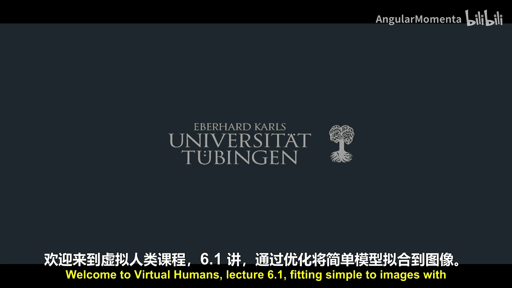

# 012：通过优化将SMPL适配到图像

## 概述
在本节课中，我们将学习如何从单张图像中估计人体的三维姿态和形状。这是一个极具挑战性的问题，因为图像是三维世界的二维投影，我们丢失了深度信息。我们将重点介绍一种**生成式方法**，即通过优化一个参数化人体模型（如SMPL）的参数，使其在图像平面上产生的投影与图像证据（如检测到的二维关节点）相匹配。

## 为什么从单张图像估计三维姿态和形状很困难？
上一节我们介绍了如何将模型适配到点云数据。本节中我们来看看从单张图像进行估计的挑战。

从单张图像估计三维人体姿态和形状是一个极其困难的问题，原因如下：
1.  **高自由度**：人体姿态空间非常复杂，参数维度高，但有效的姿态只是这些参数组合的一个子集。
2.  **巨大的外观变化**：图像中的人体可能具有不同的肤色、穿着、背景、光照、姿态和交互方式。
3.  **深度信息丢失**：图像是三维世界的线性透视投影，我们丢失了深度信息，导致至少三分之一的自由度无法直接观测。

一个经典的视频可以很好地说明深度模糊性问题：许多不同的三维姿态可以投影到几乎完全相同的二维图像上。这使得问题变得非常棘手。

## 解决方案：利用先验知识与人体模型
面对如此困难的问题，我们需要利用先验知识，因为图像证据本身不足以唯一确定姿态和形状。我们知道人体有固定的骨骼结构，只有某些姿态是合理的，运动主要是关节式的，人体形状大致对称且存在于一个子空间中。

为了利用这些信息，我们需要一个**人体模型**。如今，**SMPL模型**已成为从图像估计人体姿态和形状的事实标准模型，它统一了表示方式，无需为每个对象单独建模。

## 问题形式化
我们的输入是一张RGB图像，目标是估计模型参数。如果使用SMPL模型，这意味着需要估计**姿态参数（θ）**、**形状参数（β）**，以及可选的**相机参数**（即相机相对于人体的位姿）。

从概率角度看，这可以表述为一个最大后验估计问题：在给定图像证据 `Y` 的情况下，找到最可能的模型参数 `X`（包含θ, β等）。这等于最大化**似然**（模型解释图像的程度）与**先验**（关于合理姿态和形状的知识）的乘积。

## 生成式方法 vs. 判别式方法
历史上，解决此问题主要有两种途径：
1.  **判别式模型**：直接学习一个从图像像素到三维人体表面或模型参数的映射。我们将在下一讲中看到这类方法。
2.  **生成式模型**：拥有一个人体模型，并通过优化模型参数来解释图像证据。**本节课我们将聚焦于这种生成式方法**。

如今，在生成式方法中，基于优化的方法占主导地位，因为对于高维空间，基于采样的方法效率不高。

## 基于优化的生成式方法框架
基于优化的方法通常遵循一个通用框架，包含三个步骤：

以下是该框架的三个核心步骤：
1.  **从图像中提取特征**：例如，轮廓、距离变换、边缘或二维关节点。
2.  **用模型预测这些特征**：将当前模型参数下的三维模型投影到图像平面，渲染出对应的特征（如投影的二维关节点或轮廓）。
3.  **优化模型参数以对齐特征**：通过迭代优化，最小化模型预测特征与图像观测特征之间的误差。

一个好的优化特征需要能够从模型高效预测、易于计算，并且最好是**可微分的**。例如，**二维关节点**就是一个极佳的特征，因为它易于从模型投影得到，且天然可微。

## 特征匹配与优化目标
为了对齐特征，我们需要知道图像特征与模型预测特征之间的对应关系，这类似于三维形状配准中的ICP问题。

一个关键问题是：我们应该将模型匹配到图像，还是将图像匹配到模型？考虑图像中只包含部分人体的情况，如果最小化模型到图像的距离（即让模型点去寻找图像上的对应点），对于图像上不存在的部分，模型点可能会匹配到错误的背景上。因此，通常结合使用两种方式或采用更鲁棒的策略。

优化目标通常被构建为一个**非线性最小二乘**问题。总误差 `E` 是一个依赖于模型参数 `X` 的标量，我们希望最小化它。

总误差可以表示为各个特征误差的平方和：
`E(X) = Σ_i || r_i(X) ||^2`
其中，`r_i(X)` 是第 `i` 个特征的残差向量，例如预测的二维关节点与检测到的二维关节点之间的差值。

从概率角度，如果我们假设观测误差是独立且高斯分布的，那么最小化这个最小二乘误差就等价于求解最大似然估计。

## 优化算法：高斯-牛顿与列文伯格-马夸尔特
我们如何优化这个非线性最小二乘问题呢？核心技巧是线性化**残差向量** `e(X)`，而不是直接线性化标量误差 `E(X)`。

对残差向量在当前参数 `X_t` 处进行一阶泰勒展开：
`e(X_t + ΔX) ≈ e(X_t) + J(X_t) ΔX`
其中，`J` 是残差向量 `e` 关于参数 `X` 的**雅可比矩阵**（一阶导数矩阵）。

将展开式代入误差平方和，并忽略高阶项，通过求解使误差增量最小的 `ΔX`，我们可以得到参数更新步长。这导出了两种重要的更新规则：

以下是两种核心更新方法：
*   **高斯-牛顿步**：`ΔX = - (J^T J)^{-1} J^T e`
    *   其中 `J^T e` 恰好是标量误差 `E` 的梯度。
    *   `J^T J` 是标量误差 `E` 的**海森矩阵**（二阶导数矩阵）的近似。
*   **列文伯格-马夸尔特方法**：`ΔX = - (J^T J + μ I)^{-1} J^T e`
    *   这里引入了阻尼因子 `μ` 和单位矩阵 `I`。
    *   当 `μ` 很大时，更新近似于梯度下降，稳定但收敛慢。
    *   当 `μ` 很小时，更新近似于高斯-牛顿步，在最小值附近收敛快。
    *   L-M 方法动态调整 `μ`，在优化过程中结合了两种方法的优点。

迭代更新参数：`X_{t+1} = X_t + ΔX`，直至收敛。

## 现代方法：SMPLify 及其演进
早期方法（如2001年的经典工作）虽然开创性地使用了生成式优化框架，但受限于特征质量和模型表达能力，只能在受控环境下工作。

近年的两大突破彻底改变了这一领域：
1.  **可靠的二维姿态检测器**：基于卷积神经网络，能够从图像中高精度检测人体关节点。
2.  **灵活易用的三维人体模型**：如SMPL，无需针对每个对象进行繁琐的扫描和骨骼绑定。

**SMPLify** 方法巧妙结合了这两大突破。其核心思想是：
*   **自底向上**：使用现成的二维姿态检测器（如OpenPose）从图像中提取二维关节点 `J_2D`。
*   **自顶向下**：将SMPL模型的三维关节点 `J_3D` 通过相机模型投影到二维平面，得到预测的二维点 `Π(J_3D)`。
*   **优化目标**：最小化检测点与投影点之间的误差，同时加入姿态和形状先验项，以及防止肢体穿透的惩罚项。

其优化目标函数可概括为：
`E(θ, β) = E_J(θ, β) + λ_θ E_θ(θ) + λ_β E_β(β) + λ_C E_C(θ, β)`
其中 `E_J` 是二维关节数据项，`E_θ` 和 `E_β` 是姿态与形状先验，`E_C` 是防穿透约束。

## 扩展与挑战：SMPLify-X
SMPLify 主要关注身体。为了捕捉手部、面部表情等细节，**SMPLify-X** 被提出，它：
*   将SMPL模型升级为包含手、脸细节的**SMPL-X**模型。
*   使用**变分自编码器** 来学习更紧凑、合理的姿态先验，替代了混合高斯模型。
*   通过分类器预测性别，并选择对应的性别特定模型进行拟合，因为男女形体统计差异显著。

尽管优化方法取得了巨大成功，但仍存在局限性：
*   **依赖检测器**：如果二维姿态检测失败，优化结果也会失败。
*   **局部极小值**：优化过程可能陷入局部最优解，需要良好的初始化。
*   **深度模糊性**：对于某些姿态（如正面/背面翻转、腿部前后混淆），仅凭二维证据难以确定唯一的三维解。
*   **匹配模糊性**：如何将图像观测与模型预测正确关联，本身就是一个模糊问题。

## 总结
本节课我们一起学习了如何通过优化方法，将参数化人体模型（如SMPL）适配到单张图像，从而估计三维人体姿态和形状。我们了解了该问题的挑战性、生成式方法的概率框架、基于非线性最小二乘的优化流程（特别是高斯-牛顿和L-M方法），以及现代方法如何利用强大的二维检测器和SMPL模型取得突破。我们还看到了当前优化方法在细节捕捉（SMPLify-X）和仍面临的挑战（如局部极小值、深度模糊性）。在下一讲中，我们将探讨如何利用学习方法来尝试解决或缓解这些基于优化的方法所面临的问题。