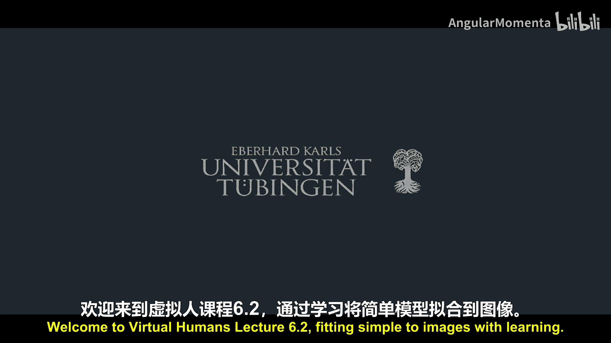
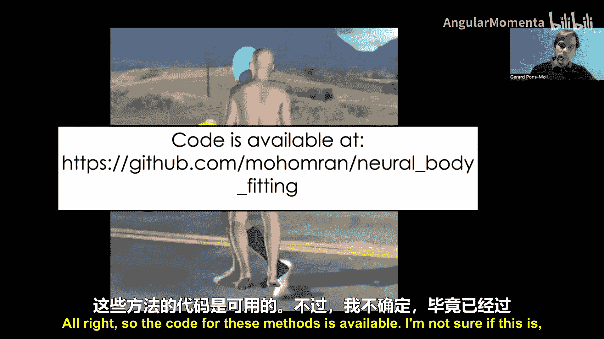
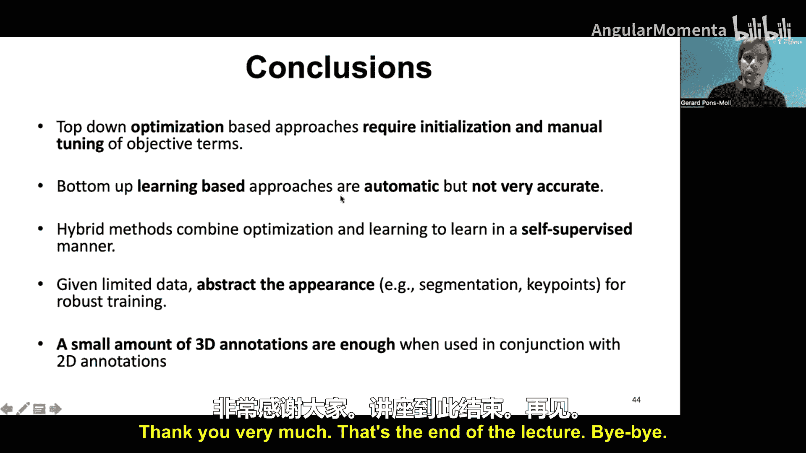

# 013：通过学习将SMPL适配至图像 🧑💻

在本节课中，我们将学习如何利用深度学习技术，从单张人物图像中估计SMPL人体模型的参数。我们将探讨如何克服3D标注数据稀缺的挑战，并介绍几种结合优化与学习的自监督方法。

---

在上一讲中，我们介绍了通过优化方法将SMPL模型适配到图像的技术。该方法需要预先提取图像特征（如关键点、轮廓或边缘），并且优化过程可能较慢，容易陷入局部最优解。

本节中，我们将探讨是否可以通过深度学习，直接从图像像素学习一个映射函数来预测SMPL参数。核心挑战在于缺乏成对的图像与3D姿态数据。现有的3D数据集通常是在实验室环境下采集的，与网络上的自然图像差异很大。此外，由于深度歧义问题，从单张图像恢复3D姿态和形状本身就是一个难题。

因此，研究社区提出了一个关键问题：**能否利用大量未配对的2D和3D数据来学习一个先验知识？** 接下来，我们将介绍两篇同时期提出、思路相似的重要论文，它们阐述了自监督学习人体姿态和形状的核心概念。

---

## 方法一：端到端的人体形状与姿态恢复 (HMR) 🤖

第一篇论文名为《End-to-end Recovery of Human Shape and Pose》（简称HMR）。作者直接提出了核心问题：**如何在没有成对3D监督数据的情况下，训练一个深度神经网络来直接回归SMPL参数？**

其基本架构包含一个编码器（回归器），用于从输入图像预测姿态、形状和相机参数。由于没有直接的3D监督数据，训练这个映射关系是困难的。

以下是利用现有数据的关键思路：
*   我们拥有大量带有2D关键点标注的图像（例如通过OpenPose算法获得）。
*   我们可以训练网络从像素预测SMPL参数，然后将SMPL模型投影回图像，并最小化预测的2D关节点与图像中检测到的2D关节点的**重投影误差**。

然而，如果仅用这个2D重投影损失进行训练，网络可能会生成一些虽然能投影到正确2D点、但看起来不像真实人类的“怪物”模型。这是因为网络没有被训练去生成合理的人体形态。

为了解决这个问题，我们需要引入先验知识，确保预测的姿态和形状符合真实人体的分布。在注册课程中，我们已经见过如何构建姿态和形状先验（例如高斯混合模型或变分自编码器）。在这篇论文中，作者选择了**生成对抗网络（GAN）** 的思路。

其核心思想是：编码器作为生成器，产生姿态和形状参数；同时引入一个判别器，用于判断输入的姿态和形状是来自真实数据分布还是生成器。通过生成器和判别器之间的对抗训练，最终生成器能够产生符合真实人体分布的姿态和形状。在测试时，只需保留生成器（编码器）即可。

这种“在解释图像的同时保持分布内”的方法，在当时对野外图像的处理上取得了显著成果。

但这种方法使用包含所有像素的完整图像作为输入，而图像在颜色、纹理、光照和外观上存在巨大差异，因此需要大量数据才能泛化良好。

---

## 方法二：神经人体拟合 (Neural Body Fitting) 🔄

接下来介绍的第二篇论文是《Neural Body Fitting: Unifying Deep Learning and Model Based Human Pose and Shape Estimation》。它与HMR有很多相似之处，但也引入了一些关键的新概念。

这篇论文从另一个角度出发，对比了基于模型的方法和基于学习的方法：
*   **基于模型的优化方法**：通过最小化目标函数（如SMPL预测关键点与图像检测关键点之间的误差）来适配模型。但这种方法可能较慢，且严重依赖于初始化。
*   **基于学习的方法**：如果有训练数据，可以训练一个回归器。但获取野外自然图像及其对应的3D姿态和形状标注极其困难。此外，大多数深度学习模型只做预测，**不会将输出与输入图像进行一致性验证**，这可能导致预测与图像对齐不佳。

论文提出的混合架构与HMR类似，也使用SMPL模型作为中间3D表示，并将其投影到2D图像空间计算损失。其优势在于可以灵活地放置损失函数：
*   如果有一点3D数据，可以在姿态和形状参数上施加损失。
*   如果只有2D关键点标注，则在投影后的2D关键点上施加损失。

这篇论文进一步探索了两个重要维度：

**1. 输入表征：简化图像信息**
一个直观的想法是：将图像简化为语义分割图（如人体部位分割），再从分割图回归参数，这样是否更有用？因为这移除了许多与姿态形状无关的外观信息，可能有助于网络泛化。

以下是该论文对不同输入表征效果的评估结果（误差单位为毫米，越低越好）：
*   **原始RGB图像**：98.5
*   **轮廓图**：95.5
*   **3部位分割图**：86.5
*   **6部位分割图**：66.2
*   **12部位分割图**：27.8
*   **2D关键点**：54.7

实验表明，使用部位分割作为中间表征能显著降低误差。轮廓图移除了太多信息，效果不佳；而适度的部位分割（如12部位）在保留必要信息的同时，有效提升了泛化能力和准确性。**因此，当数据有限时，抽象掉不相关的信息是一个好策略。**

**2. 需要多少3D监督数据？**
另一个关键问题是：我们需要多少3D标注数据？能否主要依靠2D数据？

以下是不同损失函数组合下的误差对比：
*   **仅使用2D损失（无先验/GAN）**：误差很高（198.2），结果不具意义。
*   **增加3D关节空间欧氏距离损失**：3D误差大幅下降至83.7，但关节旋转误差仍高。
*   **在姿态形状潜空间直接施加损失**：3D关节误差与上一种相当，但关节旋转误差显著降低。
*   **组合所有损失**：得到最佳结果。

更重要的实验是分析所需3D数据的比例。在一个可控数据集上的实验表明：**仅需约2%的训练数据具有3D标注，其余98%仅需2D关键点标注，就能使网络性能保持在一个较好的水平。** 这意味着，少量的3D数据足以让网络学习到关于姿态和形状的先验，从而正则化整个学习过程，其余知识可以从大量2D数据中习得。

---

## 方法演进与总结 📝

在这些方法之后，出现了进一步的改进思路。例如，有方法指出回归得到的形状常常与图像拟合不佳，因此提出了一种更直接的结合方式：**先用深度网络做初步预测，然后以此作为初始化进行优化（优化效果更好），再用优化得到的结果作为监督信号来训练深度网络**，如此迭代。这本质上是将学习与优化在循环中更紧密地结合。

现在，让我们从数学概念上理解基于模型的优化与回归之间的联系。本质上，自监督方法是在训练一个神经网络，将图像映射到3D人体模型的潜参数（姿态、形状，甚至衣物和纹理）。我们可以将其视为一个可微渲染流水线：预测几何与纹理 -> 渲染 -> 与图像比较。

传统的优化方法是针对单张图像，优化潜参数以最小化渲染损失：
`argmin_{θ, β} L(R(SMPL(θ, β)), I)`
其中 `R` 是渲染函数，`I` 是图像。

而学习的方法则是优化网络参数 `Φ`，使得对于训练集中的所有图像，网络预测的潜参数经过渲染后都能与图像匹配：
`argmin_{Φ} Σ_i L(R(SMPL(f_Φ(I_i))), I_i)`
这里，`f_Φ` 就是我们的神经网络。这种公式化的好处是，**理论上可以利用海量的互联网图像和视频数据，来训练更好的回归器，甚至改进3D模型本身**。尽管实践中存在诸多挑战（如信噪比低），但这为未来研究提供了有趣的方向。

---

本节课中我们一起学习了如何通过自监督学习从单张图像估计SMPL模型。我们总结如下：
*   **自上而下的优化方法** 精度高且具有反馈循环（输出会与图像反复验证），但需要良好的初始化和手动调整目标函数。
*   **自下而上的学习方法** 是自动的，利用了数据中的先验，但通常精度稍低，且预测结果可能与图像对齐不佳。
*   **混合方法** 结合了优化与学习，能够在仅有少量3D标注、大量2D标注的情况下进行自监督学习，是当前的主流方向。
*   **当数据有限时**，对输入图像进行抽象（如使用语义分割），移除与任务无关的外观细节，能有效提升模型的泛化能力和准确性。
*   **仅需少量3D标注**（约2%），结合大量2D关键点标注，就足以训练出有效的模型。

感谢学习，本讲到此结束。👋