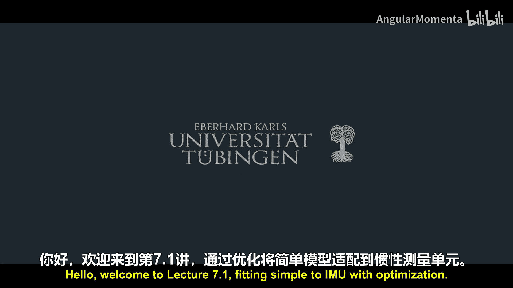
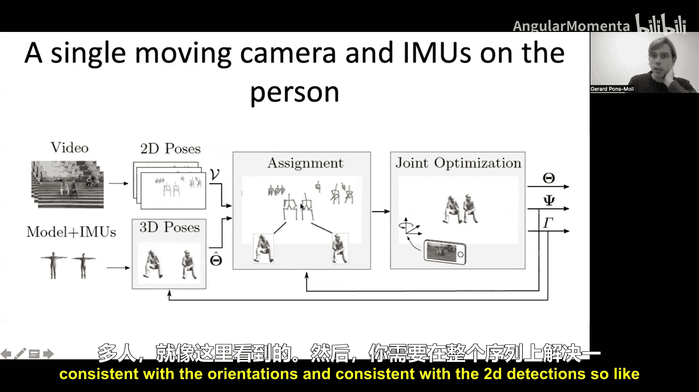
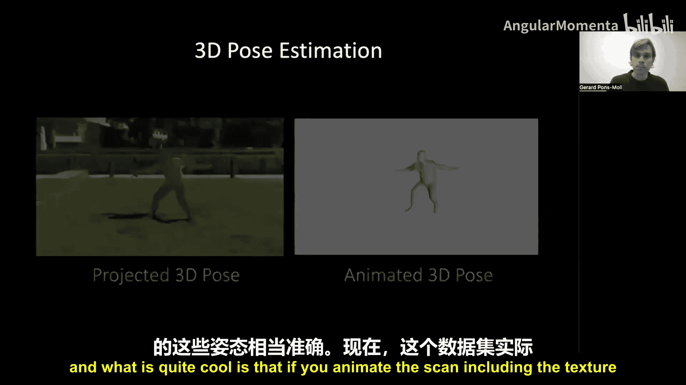
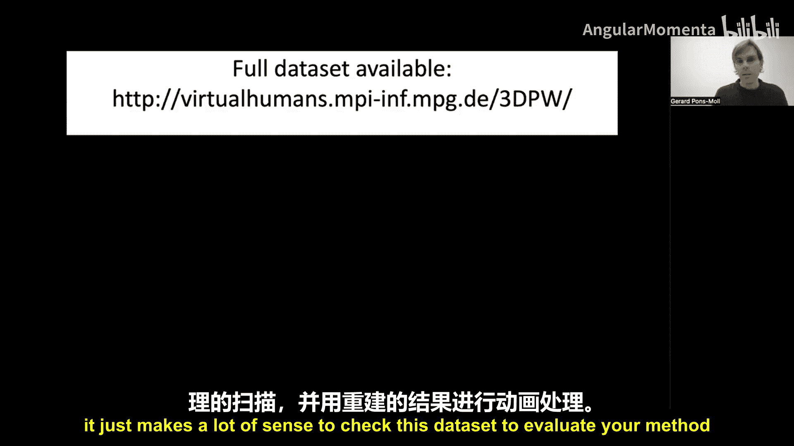

# 014：通过优化将SMPL模型适配到IMU数据

在本节课中，我们将学习如何通过优化方法，将SMPL人体模型适配到稀疏的惯性测量单元数据上。我们将基于一篇名为《Sparse Inertial Poser: Automatic 3D Human Pose Estimation from Sparse IMUs》的论文展开，该论文发表于SIGGRAPH 2017并获得了最佳科学论文奖。

## 概述与动机

我们的目标是基于可穿戴传感器来估计人体的姿态。这些传感器是能够放置在人体上的小型设备，用于重建运动。我们希望达到的精度类似于视频中展示的效果，其中图像仅作为参考，而结果完全由传感器数据生成。

上一节我们介绍了从图像中估计人体姿态和形状的方法。然而，基于视觉的方法需要外部摄像头，这限制了其记录范围，并且难以记录某些活动。因此，基于惯性测量单元的方法提供了一种替代方案。

## 什么是惯性传感器？

一个惯性测量单元是一个包含磁力计、陀螺仪和加速度计的小盒子。它能提供该盒子局部坐标系相对于某个全局坐标系的**方向**（通常用四元数表示），以及在该盒子坐标系中测量的**加速度**。

全局坐标系通常这样定义：X轴指向磁力计检测到的磁北方向，Y轴指向加速度计在静态时测得的重力负方向，Z轴由叉积得出。

## 结合视觉与IMU

人们已经尝试将IMU与视觉系统结合。例如，在博士论文的早期工作中，我们使用多个摄像头和五个IMU，通过优化框架整合信息来估计人体姿态和形状。关键思想是结合基于视觉的关节定位（更准确）和基于IMU的关节方向跟踪（更可靠）。

## 稀疏IMU姿态估计方法

本节中，我们来看看论文《Sparse Inertial Poser》所采用的不同方法。它采用了“分析-综合”的方法，使用放置在身体末端和背部的六个IMU。

为了将身体运动与IMU观测联系起来，我们需要一个被追踪者的**铰接式人体模型**（这里使用SMPL），并且需要知道IMU在身体上的**位置**。

我们采用一个包含三个目标项的优化方法：
1.  **方向一致性**：比较模型预测的骨骼方向与IMU测量的方向。
2.  **加速度一致性**：比较模型预测的加速度与IMU测量的加速度。
3.  **姿态先验**：基于训练数据，衡量当前姿态的可能性（使用马氏距离）。

此外，还使用关节限制来防止不自然的弯曲。

## 方向距离度量

在比较方向之前，我们需要了解如何在旋转空间（SO(3)）中测量距离。以下是几种常见的度量方式：

*   **角距离**：最自然的度量。对于两个旋转矩阵 **R** 和 **S**，角距离 *θ* 是相对旋转 **SR^T** 的轴角表示中的角度。公式为：
    `θ = arccos( (tr(SR^T) - 1) / 2 )`
    或者等价于 `θ = ||log(SR^T)||`，其中 `log` 是矩阵对数映射。

*   **弦距离**：定义为两个旋转矩阵之差的Frobenius范数。公式为：
    `d_chord(R, S) = ||R - S||_F`
    它与角距离的关系为：`d_chord^2 = 8 sin^2(θ/2)`。

*   **四元数距离**：对于单位四元数 **q_s** 和 **q_r**，需要考虑四元数 **q** 和 **-q** 表示相同旋转的歧义性。距离定义为：
    `d_quat = min( ||q_s - q_r||, ||q_s + q_r|| )`
    它与角距离的关系为：`d_quat = 2 sin(θ/4)`。

*   **轴角空间L2距离**：直接计算两个旋转对应轴角向量的欧几里得距离。但这种方法在角度接近π时可能不连续，因为相反的轴可能产生相近的旋转，但向量距离很大。

选择不同的度量会影响优化行为。在论文中，我们选择了**角距离**。

## 仅使用方向的局限性

如果只优化方向一致性，由于传感器稀疏，会存在歧义。许多不同的姿态可以产生相同的肢体末端方向，导致结果不自然。加速度数据可以帮助解决这种歧义。

## 利用加速度数据

加速度数据本身非常嘈杂，直接双重积分得到位置会导致误差爆炸。论文的关键突破是**在多个帧的批次上进行优化**。这样可以利用身体模型来正则化加速度的数值积分，从而稳定地利用加速度信息，并消除方向上的歧义。

优化问题变为在所有T帧上最小化目标函数，包括方向项、加速度项和先验项的总和。

## 优化求解

我们通过线性化残差向量并使用高斯-牛顿或Levenberg-Marquardt等算法来求解这个大规模优化问题。雅可比矩阵具有特殊的稀疏结构：
*   方向项只依赖于当前帧，导致块对角结构。
*   加速度项链接了相邻帧（t-1, t, t+1）的姿态参数，形成带状结构。

利用这种稀疏性，可以高效地求解线性系统。

## 结果与评估

通过批优化和强身体模型先验，该方法首次实现了仅用六个IMU就能高精度重建人体运动。评估显示，结合方向与加速度的完整方法（SI）在角度误差和关节位置误差上均显著优于仅使用方向的方法。

**局限性**包括：无法跟踪手部和脚部的精细运动；全局平移存在漂移；需要人体模型；并且是离线方法（需要所有数据）。

## 拓展应用：3DPW数据集

该方法还可用于创建野外环境下的3D人体姿态数据集。通过结合稀疏IMU和手持手机摄像头，我们可以获得具有准确3D参考姿态的野外图像-姿态对。这解决了之前缺乏野外精确3D姿态数据的问题。由此产生的**3DPW数据集**包含视频、2D/3D姿态标注、相机姿态和3D人体扫描，被广泛用于评估野外人体姿态估计方法。

## 总结

本节课我们一起学习了如何通过优化将SMPL模型适配到稀疏IMU数据。核心在于：
1.  使用包含方向、加速度和先验的优化目标。
2.  理解并选择合适的旋转距离度量。
3.  在**多帧批次上进行优化**，以利用加速度数据并解决方向歧义。
4.  利用身体模型和先验知识约束这个欠定问题。
这项研究首次证明了仅用六个IMU即可在野外高精度重建人体运动，并为创建宝贵的野外3D姿态数据集（3DPW）提供了基础。

