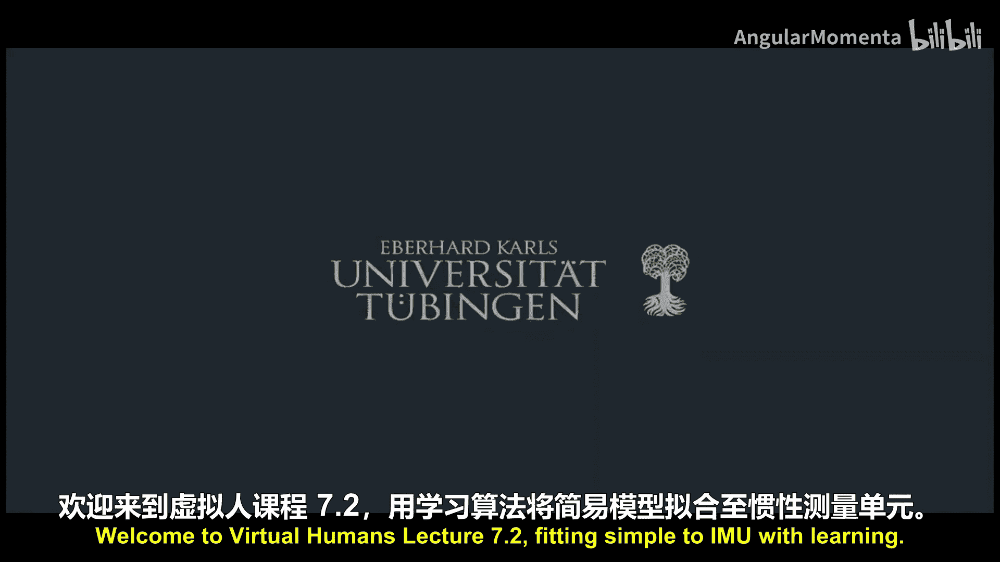
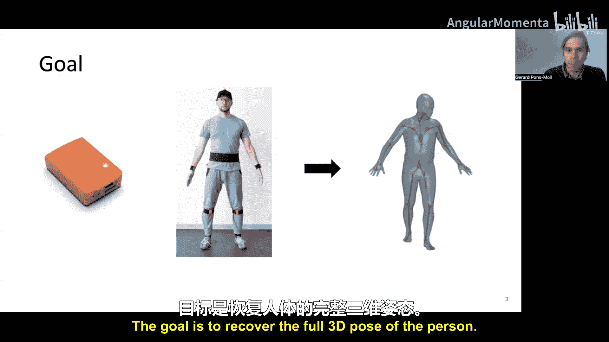
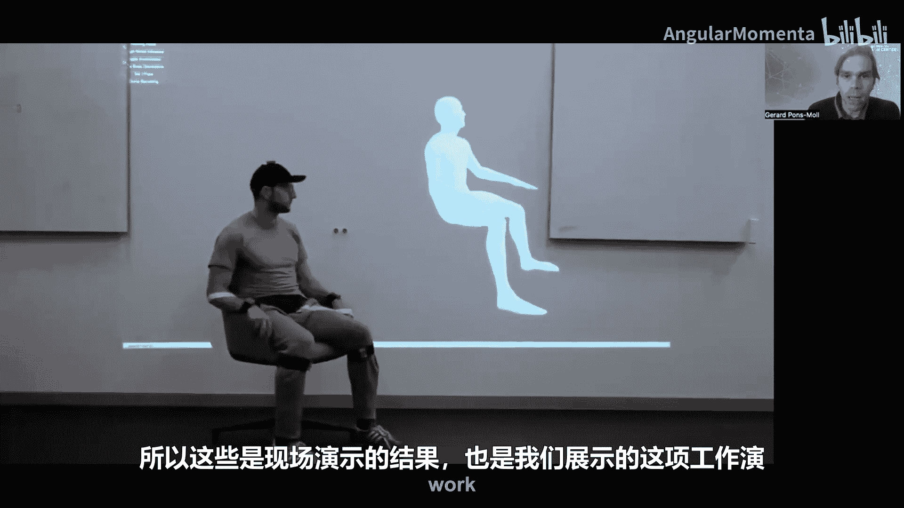
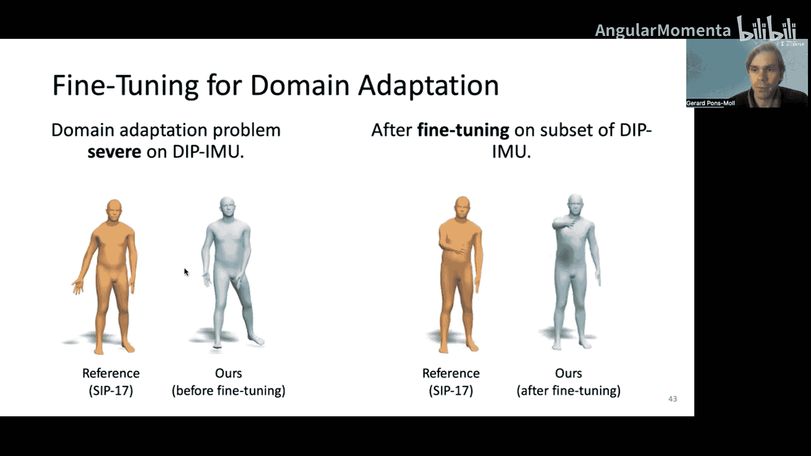
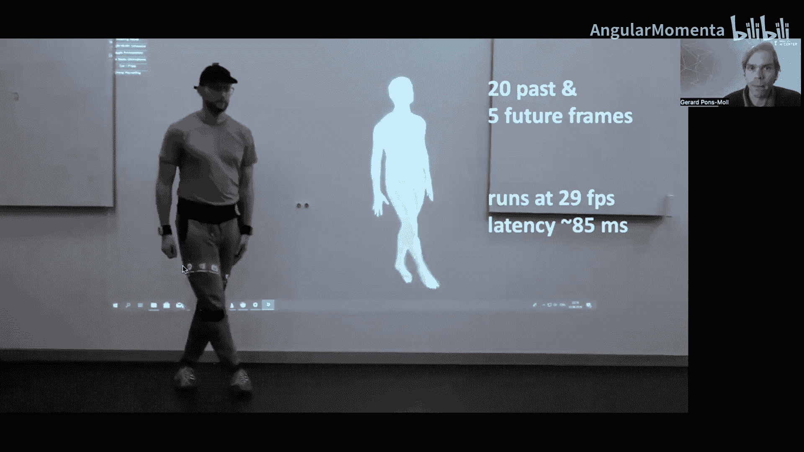
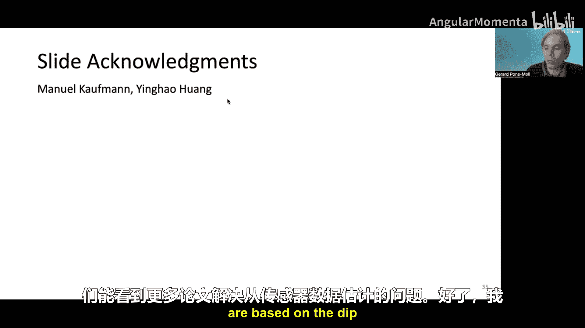
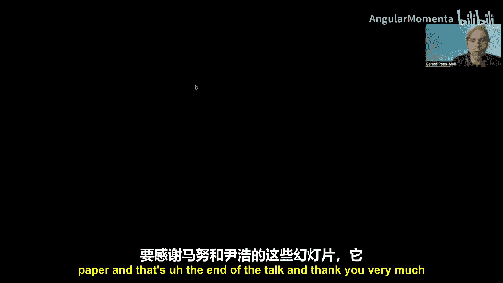
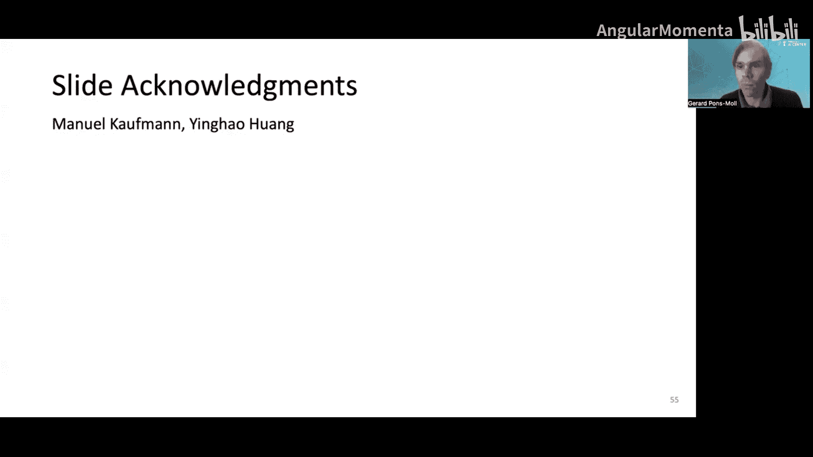

# 015：基于学习的SMPL模型与IMU数据适配 🧍‍♂️➡️📊

在本节课中，我们将学习如何利用基于学习的方法，将SMPL人体模型与来自惯性测量单元（IMU）的数据进行适配。与上一节介绍的基于优化的方法不同，这种方法可以实现实时的人体姿态重建。

## 概述与背景

在上一节（第71讲）中，我们探讨了如何使用优化方法将SMPL模型适配到IMU数据。本节我们将转向一种基于学习的方法，它能够实现实时处理。本节内容基于2018年发表在Siggraph上的论文《Deep Inertial Poser》（DIP），但我们将聚焦于其核心概念，这些概念也适用于更近期的研究。

首先，我们简要回顾一下IMU。IMU是一种可以测量其自身相对于全局坐标系**方向**的设备，同时也能测量其相对于该静态全局坐标系的**加速度**。

在本工作中，我们使用了六个IMU传感器，分别放置在身体的末端：小腿、手腕、头部和背部。我们的目标是，仅根据这些传感器提供的方向和加速度数据（不包含位置信息），恢复人体的完整三维姿态。

上图展示了该方法得到的结果演示。可以看到，尽管只有六个传感器，不足以完全约束全身姿态，但我们仍然能从这些稀疏的传感器数据中恢复出合理的人体姿态。

## 为什么使用IMU进行动作捕捉？

你可能会问，为什么需要使用IMU进行动作捕捉？以下是几种主流捕捉方式的对比：

*   **基于反光标记的光学系统**：用于电影制作，精度高，但需要大量摄像机、设备昂贵、设置时间长，且只能在有限的录制空间内使用。
*   **无标记视频捕捉系统**：只需单目或双目摄像头，更为便捷。但要求摄像头与人物始终保持无遮挡的视线，这在人物与物体交互（如桌子）或在复杂场景（如大型建筑、户外）中难以实现。
*   **多传感器系统（如Xsens）**：使用约17个传感器，提供了足够的约束来跟踪运动，但侵入性更强，需要更多传感器，设置时间也较长。
*   **混合方法（传感器+摄像头）**：结合了视频的位置约束和IMU的方向/加速度约束，是两全其美的方法。
*   **稀疏IMU优化方法（如Sparse Inertial Poser）**：无需摄像头，非常方便。但它是基于多帧联合优化的离线方法，无法实现实时结果，而实时性对于虚拟现实等需要即时反馈的应用至关重要。

因此，我们的需求是：**使用少量IMU传感器（减少侵入性）、设置简单、无需摄像头，并能实时重建完整姿态。**

## 核心挑战与解决方案

与上一节类似，核心挑战在于：**方向信息本身通常不足以唯一确定姿态。** 例如，在下肢方向几乎不变的情况下，姿态也可能发生显著变化。这意味着许多不同的姿态都可能满足相同的方向约束。

因此，我们需要**学习**哪些是满足给定方向约束的合理姿态。过去（以及上一节）的方法是利用**时序信息**进行优化，并整合**加速度**数据来获得更多关于身体如何运动的线索。基于SMPL这种生成式模型，我们可以从模型本身合成预测的观测值（加速度和方向），并与真实IMU测量值进行比较优化。

然而，这种优化方法（Sparse Inertial Poser）计算耗时，需要数分钟，属于离线优化，不适合实时应用。

我们的目标是实现实时性能。我们不想使用优化，而是希望用一个基于学习的系统——特别是**神经网络**——来替代它。

## 基于学习系统的三大要素

任何基于学习的系统通常都面临三个关键挑战，它们极大地影响着算法性能：

1.  **数据**：如何获取足够多且高质量的训练数据？
2.  **架构**：如何设计网络架构以有效利用姿态数据的时序相关性？
3.  **损失函数**：使用什么样的损失函数才能反映我们期望的输出？

接下来，我们将逐一探讨这三个要素。

### 数据获取与处理

数据通常是这类学习系统中最重要的部分。

**如何获取数据？** 目前并没有大量与运动数据配对的IMU数据库，因为这种数据捕获本身就很困难。幸运的是，得益于像SMPL这样的统一模型格式，我们可以利用已有的运动捕捉数据集（如AMASS数据集），这些数据集将多种运动数据统一到了SMPL格式中。我们可以直接使用这些SMPL格式的数据，然后通过**前向运动学**来合成IMU的观测数据（加速度和方向）。只要我们知道了传感器在身体上的附着位置，就可以轻松地从SMPL模型合成这些数据。

**数据处理至关重要**。我们必须仔细处理数据表达方式，这直接关系到模型能否学到有效信息。首先要理解的是涉及到的**坐标系**：

*   **SMPL身体坐标系**：模型的顶点坐标系。通常Y轴与重力方向对齐。
*   **IMU惯性坐标系**：由传感器定义。Z轴通常与重力方向相反（指向地心），X轴由检测到的地磁北极方向确定，Y轴由右手定则推导得出。

传感器测量的是小盒子（IMU）相对于这个惯性坐标系的**方向**。然而，在使用SMPL模型进行跟踪时，我们更感兴趣的是**骨骼相对于身体坐标系的方向**。因此，我们需要进行一系列坐标变换。

以下是关键的坐标变换步骤：
1.  **将IMU读数转换到身体坐标系**：这需要应用传感器到惯性系的旋转 `R_IS`，以及惯性系到身体跟踪系的旋转 `R_TI`。
2.  **计算传感器到骨骼的恒定偏移**：由于IMU盒子贴在骨骼上时可能存在朝向偏差，我们需要计算一个固定的旋转偏移 `R_BS`。这通常在初始帧（第0帧）通过已知的对齐关系计算得出。
3.  **得到骨骼方向**：对于每一帧的传感器测量 `R_TS`，应用恒定偏移 `R_BS`，即可得到骨骼相对于跟踪系的方向 `R_TB`。

**一个重要问题**：如果我们直接用上述计算出的骨骼方向数据来训练网络预测姿态，会有什么问题？考虑一个面向北方做的动作与面向南方做的相同动作——骨骼方向会完全不同，但动作本质是一样的。我们不希望网络学习这种与全局朝向相关的、不必要的变异。

**解决方案：根节点归一化**。我们需要对每一帧的数据，应用根节点（如骨盆）旋转的逆变换。这样，所有骨骼的方向都表达为相对于根节点坐标系的方向。无论人面向何方，相同的动作都会产生相同的数据，这极大地增加了数据的有效性和网络的泛化能力。

### 网络架构设计

现在我们来看网络架构。由于我们处理的是时序数据，因此模型的选择非常重要。

以下是尝试过的几种架构：
*   **前馈神经网络**：使用过去和未来帧的一个窗口作为输入。它能解决任务，但未显式建模时序信息，结果存在抖动。
*   **WaveNet**：一种常用于语音建模的卷积架构。它只隐式地建模时序依赖，在本任务中产生了明显的、令人不悦的抖动，特别是在手部和脚部。
*   **双向循环神经网络**：DIP论文中最终采用的架构。具体来说，是使用了LSTM单元的**堆叠双向循环神经网络**。网络中包含前向传播（蓝色单元）和后向传播（绿色单元）的细胞，信息在时间上向前和向后传递。这种架构能够有效地捕捉前后文信息，对于时序预测任务非常强大。

### 损失函数设计

最后，我们讨论损失函数。

最简单的选择是在预测姿态上使用**L2损失**，这已经能产生合理的结果。但由于IMU数据存在不确定性（多个姿态可能对应相同的传感器读数），我们需要让网络能够表达这种不确定性。

一种简单的方法是让网络输出一个**高斯分布**，即同时预测姿态的均值 `μ` 和对角协方差矩阵（方差向量 `σ²`）。然后，我们通过最大化对数似然来训练网络：
`L = -log P(Y|μ, σ²)`，其中 `Y` 是真实姿态。

网络会学习预测 `μ` 和 `σ²`。当网络对预测很有信心时，它会减小方差 `σ²`；当不确定时，则会增大方差，使概率分布更平坦，以覆盖更多可能的姿态。

**另一个技巧：输入重建损失**。在训练中，有时网络会倾向于忽略部分输入信息（例如，可能更关注方向而忽略加速度）。为了确保网络充分利用所有输入信息，我们可以要求网络在输出姿态的同时，也**重建出输入信号**（如各关节的加速度）。这迫使信息必须流经网络各层。同样，对于重建任务也可以使用高斯似然损失。

## 实时性与评估

该网络非常灵活。在测试时，你可以选择使用的未来帧数：
*   **纯因果模型**：只使用当前及过去帧的数据预测当前帧，零延迟，完全实时。
*   **带未来信息的模型**：允许少量延迟，使用未来几帧的信息来预测当前帧，效果更好。
*   **完全离线处理**：使用所有未来帧信息，效果最佳，但延迟最大。

因此，我们可以在延迟和精度之间进行权衡。DIP方法的结果比基于优化的Sparse Inertial Poser快几个数量级，同时保持了可比的精度。

在标准数据集（如Total Capture）上的定量评估显示，DIP在关节角度误差和位置误差等指标上与优化方法（SIP）表现相近或略优。重要的是，评估集中在**没有放置传感器的肢体部位**，这使得评估更具挑战性，也更能体现方法的泛化能力。

## 域适应与最新进展

一个未提及但非常重要的问题是**域适应**。我们使用合成数据训练，却在真实IMU数据上测试，这之间存在域差距。解决方案通常是：先在大规模合成数据上预训练一个大模型，然后在少量真实数据上进行**微调**，以捕获真实IMU测量的统计特性。微调前后，结果质量有显著提升。

上图展示了实时演示的效果。

最后，简要介绍几篇改进DIP的后续工作，它们提出了有趣的想法：
1.  **TransPose**：采用从末端关节到根关节的**分层预测**方式，并利用**脚部与地面接触**信息来正则化估计，特别是对于全局位置的估计。
2.  **Transformer Inertial Poser**：使用**Transformer架构**替代RNN。更有趣的是，它根据预测的姿态，同时预测一个可能的地面**高度场**，这对于施加脚部接触、摩擦等物理约束非常有用。
3.  **Physics Inertial Poser**：结合了运动学预测器和**物理模块**。物理模块通过优化扭矩和外力来产生满足测量值的运动，但优化过程较为复杂。

## 总结

本节课我们一起学习了如何利用基于学习的方法实现从稀疏IMU到SMPL人体姿态的实时重建。我们总结了以下关键点：

*   **实时稀疏IMU捕捉是可行的**。
*   **在大规模合成数据上训练**非常有用，且日益重要，因为它易于控制并能生成海量数据。
*   **域适应**仍然是一个重要挑战。
*   网络**架构**（如双向RNN/Transformer）和**损失函数**（如高斯似然损失、输入重建损失）的设计对性能至关重要。
*   **数据预处理**（如坐标变换、根节点归一化）是成功训练的基础。

本工作的代码和数据均已开源，供进一步研究和应用。

感谢观看。

